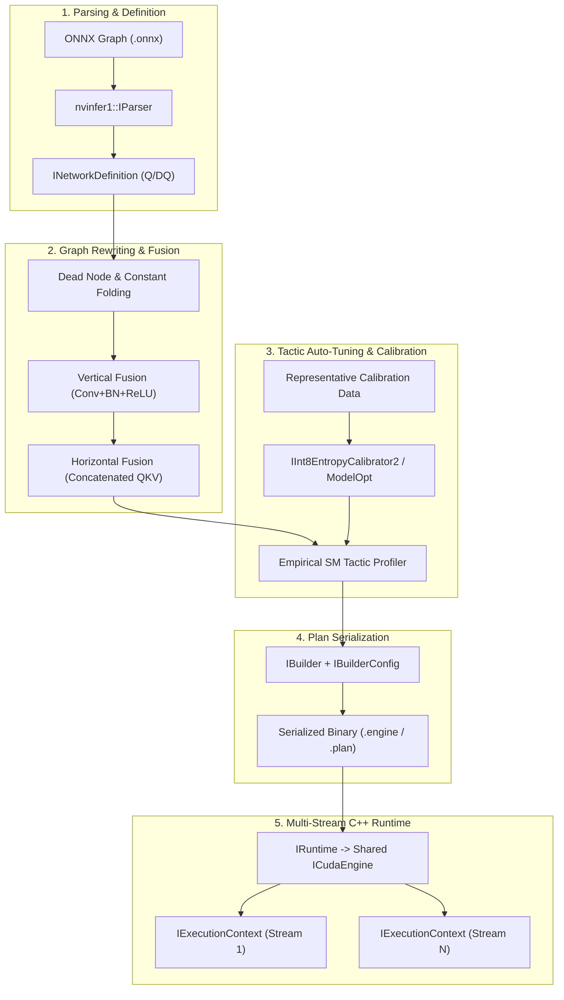
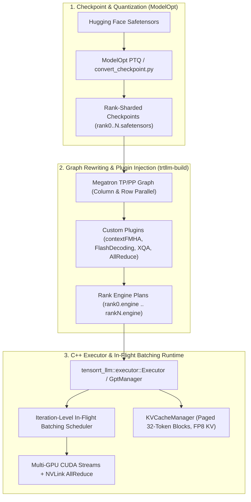

# 15.5 TensorRT and TensorRT-LLM

| Field | Value |
|---|---|
| Level | Advanced |
| Priority tier | 1 |
| Lab venue | GCP / GKE + Local Python Verification Lab |
| Part | Part 15: LLM inference and serving |
| Primary sources | NVIDIA Zero-to-Hero Volume 12 (`chapter-04-tensorrt-optimization-and-engine-lifecycle.md`, `chapter-05-tensorrt-llm-and-llm-execution.md`, `index.md`, `chapter-12-volume-12-summary.md`); *Hands-On LLM Serving and Optimization* Chapters 6 & 8; *AI Systems Performance Engineering* Chapters 8, 9, 16, & 19 |
| Cross-references | Chapter 10.5 (Roofline model); Chapters 12.15–12.17 (NCCL collectives); Chapters 15.1–15.4 (Inference request path, batching/KV cache/quantization, vLLM, SGLang); Chapters 15.6–15.8 (Triton Inference Server, NVIDIA NIM, NVIDIA Dynamo) |
| Code | `code/part15/tensorrt_llm_engine.py`, `code/part15/tensorrt_llm_engine_lab.py` |
| Coverage file | `planning/coverage/chapters/15-05.md` |
| Claim & number ledger | `planning/ledgers/15-05.md` |

## Why this matters for AI infrastructure

Training frameworks like PyTorch prioritize eager-mode flexibility. Researchers need to modify layers, inspect intermediate tensors, and track autograd graphs on the fly. In high-concurrency production serving, that flexibility becomes a heavy tax. Every separate operator launches a distinct CUDA kernel from the host CPU. Each kernel writes intermediate activations back out to High Bandwidth Memory, leaving Streaming Multiprocessors waiting on memory round-trips or Python dispatch overhead.

Consider two real production bottlenecks from enterprise GPU deployments.
- **High-throughput multimodal and vision pipelines.** A feature-extraction cluster serving 25,000 requests per second on H100 GPUs using standard ONNX Runtime suffered severe tail-latency spikes above 85 ms. Those spikes violated its strict 30 ms service-level objective. Whenever bursty traffic drove dynamic batch sizes from 1 to 64, uncalibrated intermediate activation buffers triggered GPU out-of-memory crashes.
- **Distributed large language model serving.** A platform team served Llama-3-70B across eight H100 SXM5 GPUs using a naive PyTorch and Hugging Face pipeline. At 150 concurrent sessions, Inter-Token Latency averaged 115 ms per token, missing the 25 ms target by more than fourfold. GPU utilization swung wildly between 12 percent during decode and 98 percent during prefill. Meanwhile, static contiguous KV cache allocations crashed on long retrieval-augmented prompts exceeding 8,192 tokens.

```text
Production Baseline vs TensorRT and TensorRT-LLM (Volume 12, Chapters 4 & 5):
1. Enterprise Vision / Multimodal Feature Pipeline (H100 cluster, 25,000 req/s):
   - Unoptimized ONNX Runtime: p99 > 85 ms (violates 30 ms SLA), frequent OOM when batch size B surges 1 -> 64
   - Naive TensorRT build with MAX=(128, 3, 4096, 4096) in FP32:
     Single activation layer = 128 * 3 * 4096 * 4096 * 4 bytes = 25,769,803,776 bytes (~25.7 GB) -> Builder OOM on 80 GB A100
   - Bounded TensorRT FP16 engine (min=(1,3,256,256), opt=(8,3,1024,1024), max=(32,3,2048,2048), 4 GB workspace):
     Compiles in 4.2 minutes (6.1 GB peak builder VRAM); median runtime latency drops from 48.0 ms to 11.3 ms (4.25x speedup)
2. Distributed Llama-3-70B Serving (8x H100 SXM5, TP=8, 150 concurrent sessions):
   - Naive PyTorch Hugging Face pipeline:
     ITL = 115.0 ms/token (SLA < 25 ms/token), GPU util swings 12%..98%, static KV cache OOM at > 8,192 tokens
   - Compiled TensorRT-LLM engine (TP=8, FlashDecoding/XQA, Paged FP8 KV Cache, C++ GptManager / Executor):
     ITL drops from 115.0 ms to 18.4 ms/token (6.25x faster), total system throughput doubles
```

**TensorRT and TensorRT-LLM solve these bottlenecks through ahead-of-time hardware compilation**. TensorRT parses a trained network graph and fuses operators into register-resident kernels. It then benchmarks candidate CUDA tactics on the target GPU and serializes a binary plan. TensorRT-LLM extends this compiler with Megatron-LM style Tensor Parallelism and Pipeline Parallelism. It also adds FlashDecoding, XQA, ModelOpt quantization, paged KV caches, and a C++ runtime.

Before deploying TensorRT or TensorRT-LLM, remember that ahead-of-time compilation trades flexibility for speed. It requires strict discipline around shape profiles, calibration datasets, and GPU architecture matching.

## Prerequisites and outcomes

### Prerequisites
- GPU memory hierarchy, Streaming Multiprocessor occupancy, and Roofline arithmetic intensity from Chapter 10.5.
- Intra-node NVLink and inter-node InfiniBand collective mechanics from Chapters 12.15 through 12.17.
- Prefill versus decode request anatomy, continuous batching, PagedAttention, and quantization fundamentals from Chapters 15.1 and 15.2.

### Outcomes
After completing this chapter, you will be able to complete five core engineering tasks.
1. Deconstruct the five-stage TensorRT compilation pipeline, including vertical BatchNorm folding, horizontal QKV projection fusion, empirical tactic auto-tuning, and workspace memory pool limits.
2. Design bounded dynamic shape profiles using `IOptimizationProfile`, enforce hardware and driver portability across GPU architectures, and architect thread-safe serving pools with `ICudaEngine` and `IExecutionContext`.
3. Compile and serve distributed large language models with TensorRT-LLM using `convert_checkpoint.py`, `trtllm-build`, and `trtllm-serve`, alongside Megatron-style Tensor Parallelism, Pipeline Parallelism, FlashDecoding, XQA, and paged KV caches.
4. Quantize models to INT8, FP8, INT4 AWQ, SmoothQuant, and Blackwell NVFP4 using TensorRT entropy calibrators and NVIDIA ModelOpt while preventing accuracy collapse.
5. Diagnose and remediate six production failure modes across builder workspace OOMs, calibration drift, multi-threaded context corruption, cross-node TP deadlocks, and KV cache fragmentation.

---

## 1. TensorRT Graph Compilation, Layer Fusion, and Tactic Auto-Tuning

### 1.1 The Five-Stage Compilation Lifecycle

When a neural network runs in eager mode, the host framework dispatches one operator at a time. Each operator reads its inputs from GPU High Bandwidth Memory, computes a result inside Streaming Multiprocessor registers, and writes the output tensor back to High Bandwidth Memory before the next kernel launches. For both convolutional pipelines and transformer blocks, memory bandwidth saturation and kernel launch latency dominate execution time long before the Tensor Cores reach peak utilization.

TensorRT eliminates those intermediate memory round-trips through a five-stage offline compilation pipeline.
1. **Network parsing and definition.** The ONNX parser (`nvinfer1::IParser`) ingests an exported ONNX graph and constructs an internal network definition (`nvinfer1::INetworkDefinition`) with explicit batch dimensions and optional Quantize and Dequantize nodes.
2. **Graph optimization and rewriting.** The compiler eliminates dead nodes, folds constants into weights, and performs vertical and horizontal layer fusion so intermediate tensors remain inside on-chip SRAM and registers.
3. **Tactic selection and precision calibration.** The auto-tuner profiles dozens of candidate CUDA kernel implementations, known as tactics, directly on the target GPU's Streaming Multiprocessors. If implicit INT8 quantization is enabled, the entropy calibrator (`IInt8EntropyCalibrator2`) measures activation histograms to compute per-tensor or per-channel scaling factors.
4. **Engine serialization.** The builder (`nvinfer1::IBuilder`) combines the winning kernel tactics, constant weights, and builder configuration rules (`nvinfer1::IBuilderConfig`) into an immutable engine (`nvinfer1::ICudaEngine`) and serializes it to a binary `.engine` or `.plan` file.
5. **Runtime execution.** In production, the lightweight runtime (`nvinfer1::IRuntime`) deserializes the binary plan into a shared `ICudaEngine` and spawns per-stream `IExecutionContext` instances that enqueue asynchronous kernel launches via `enqueueV3()`.



### 1.2 Vertical and Horizontal Kernel Fusion Mechanics

Graph fusion attacks the two primary sources of eager-mode overhead: redundant High Bandwidth Memory traffic and repeated CUDA kernel launch latency.

**Vertical fusion** merges sequential operators into a single CUDA kernel so intermediate values never leave Streaming Multiprocessor registers. In convolutional and residual networks, a classic example is fusing a Convolution or Linear layer with Batch Normalization and an activation function such as ReLU or SiLU. During compilation, TensorRT mathematically folds the Batch Normalization running mean, variance, scale, and shift parameters directly into the preceding layer's weight matrix and bias vector.

```text
Vertical Batch Normalization Folding (Compile-Time Constant Transformation):
Given Convolution/Linear weight W[i,j], bias b[i], and BatchNorm parameters (mu_i, sigma_i^2, gamma_i, beta_i, epsilon):
  scale_i     = gamma_i / sqrt(sigma_i^2 + epsilon)
  W_hat[i, j] = W[i, j] * scale_i
  b_hat[i]    = (b[i] - mu_i) * scale_i + beta_i
  Fused Kernel Output = Activation(W_hat * X + b_hat)

Worked Example (verified by fold_batchnorm_into_weights() in code/part15/tensorrt_llm_engine.py):
  Channel 0: W[0] = [2.0, -4.0], b[0] = 1.0, mu = 0.5, sigma^2 = 0.25, gamma = 1.0, beta = 0.1, eps = 0
             scale_0 = 1.0 / sqrt(0.25) = 2.0 -> W_hat[0] = [4.0, -8.0], b_hat[0] = (1.0 - 0.5)*2.0 + 0.1 = 1.1
  Channel 1: W[1] = [1.5, 3.0],  b[1] = 2.0, mu = 1.0, sigma^2 = 1.00, gamma = 2.0, beta = -0.5, eps = 0
             scale_1 = 2.0 / sqrt(1.00) = 2.0 -> W_hat[1] = [3.0, 6.0],  b_hat[1] = (2.0 - 1.0)*2.0 - 0.5 = 1.5
```

**Horizontal fusion** identifies parallel branches that read the exact same input tensor and combines their weight matrices into a single wider General Matrix Multiplication. In every Transformer attention block, the Query, Key, and Value projections multiply the same input hidden state by three separate weight matrices. Executing them separately launches three small kernels and reads the input hidden state three times. TensorRT concatenates the three matrices horizontally at compile time into a single fused projection matrix.

```text
Horizontal QKV Projection Fusion:
  Unfused (3 kernel launches): Q = X * W_Q,  K = X * W_K,  V = X * W_V
  Fused   (1 kernel launch):   W_QKV = [W_Q | W_K | W_V],  QKV_fused = X * W_QKV
  Result: Cuts CUDA kernel launches from 3 to 1 (3.0x launch reduction) and increases GEMM tile occupancy.
```

### 1.3 Tactic Profiling, Auto-Tuning, and Workspace Memory Pools

Even after graph fusion, a fused GEMM or attention node can be executed by dozens of distinct CUDA kernels. Those kernels differ in thread-block tile sizes, warp specializations, shared-memory staging layouts, and Tensor Core instructions. Rather than relying on static heuristics alone, the TensorRT builder compiles candidate kernels and times them empirically on the physical GPU during the build phase.

High-performance tactics frequently require temporary device scratch space to stage intermediate tiles or perform parallel split-K reductions. In TensorRT, this scratch budget is controlled via `setMemoryPoolLimit` on `MemoryPoolType::kWORKSPACE`.

```cpp
// Cap builder scratch workspace to 2 GB (or 4 GB for large vision/LLM graphs)
config->setMemoryPoolLimit(nvinfer1::MemoryPoolType::kWORKSPACE, 2ULL * 1024 * 1024 * 1024);
```

If you set the workspace limit too low, the builder silently prunes fast split-K and shared-memory tactics that require scratch buffers. It then falls back to slower kernels. Conversely, if you leave the workspace unconstrained while specifying huge maximum tensor shapes, the tactic profiler can exhaust GPU memory during compilation.

Always record a timing cache file (`--timingCacheFile`) during CI/CD builds so repeated compilations on identical GPU SKUs reuse profiled tactic timings instead of re-benchmarking every kernel from scratch.

---

## 2. Dynamic Shapes, Engine Lifecycle, and Hardware Portability Constraints

### 2.1 Dynamic Shapes and `IOptimizationProfile` Boundaries

Production inference traffic is rarely static. Batch sizes fluctuate with request arrival rates, image resolutions vary by client device, and prompt sequence lengths span tens to thousands of tokens. Because a compiled TensorRT engine pre-plans its memory layout and selects kernel tactics ahead of time, you must declare explicit three-point shape boundaries for every dynamic input tensor using `IOptimizationProfile`.

1. **Minimum shape (`kMIN`).** The smallest tensor dimensions the engine will accept at runtime.
2. **Optimum shape (`kOPT`).** The exact dimensions where the builder empirically benchmarks candidate tactics and selects the fastest CUDA kernels.
3. **Maximum shape (`kMAX`).** The hard upper bound used by TensorRT to allocate internal activation and workspace memory buffers.

| Profile Boundary | Builder Compile-Time Role | Runtime Consequence if Misconfigured |
|---|---|---|
| `kMIN` | Establishes lower dimension validity check | Requests smaller than `kMIN` fail input binding validation |
| `kOPT` | Target shape for SM kernel tactic auto-tuning | Setting `kOPT` to batch 1 when production runs at batch 32 or 64 selects low-occupancy thread blocks (`40%` slower) |
| `kMAX` | Sizes internal activation and scratch allocations | Setting `kMAX` to extreme theoretical bounds (`128 x 3 x 4096 x 4096` or `128 x 8192 x 8192`) causes `25.7 GB` to `34 GB` per-layer allocations and builder OOM |

```text
Worked Memory Math: Why Unbounded kMAX Crashes the Builder (Volume 12, Chapter 4):
- Case A (Vision Segmentation Model, FP32 = 4 bytes):
  Misconfigured MAX = (128, 3, 4096, 4096), OPT = (128, 3, 4096, 4096)
  Single intermediate layer buffer = 128 * 3 * 4096 * 4096 * 4 bytes = 25,769,803,776 bytes (~25.77 GB / 25.7 GB)
  Across multiple fused feature maps, allocation exceeds 80 GB A100 VRAM -> Builder OOM crash
- Case B (Sequence Attention Matrix, FP32 = 4 bytes):
  Misconfigured MAX = (128, 8192, 8192)
  Single layer buffer = 128 * 8192 * 8192 * 4 bytes = 34,359,738,368 bytes (~34.36 GB / 34 GB) -> std::bad_alloc in tactic profiler
- Remediation (Bounded FP16 Profile + 4 GB Workspace Limit):
  min = (1, 3, 256, 256), opt = (8, 3, 1024, 1024), max = (32, 3, 2048, 2048)
  Single FP16 layer at MAX = 32 * 3 * 2048 * 2048 * 2 bytes = 0.81 GB; builds in 4.2 min at 6.1 GB peak VRAM
  Median production latency at B=8 (1024x1024) drops from 48.0 ms to 11.3 ms (4.25x speedup)
```

### 2.2 Hardware/Driver Portability Constraints and Multi-Threaded Runtime Contexts

Unlike an ONNX file or a PyTorch state dictionary, **a serialized TensorRT plan file is not a portable model checkpoint**. During compilation, TensorRT emits native Streaming Assembler machine instructions for the target GPU. It also tunes shared-memory tile sizes for that chip's Streaming Multiprocessor count, L2 cache, and Tensor Cores.

| Portability Dimension | Constraint Rule | Operational Requirement |
|---|---|---|
| **GPU SM Architecture** | Strict match required (`sm_80` A100, `sm_89` L4/L40S, `sm_90a` H100/H200, `sm_100` B200/GB200) | An engine compiled on A100 (`sm_80`) will fail deserialization or crash on H100 (`sm_90a`); build on the exact target GPU SKU |
| **TensorRT & CUDA Version** | Major/minor TensorRT version and minimum CUDA driver branch must match | Pin container images (such as `nvcr.io/nvidia/tensorrt` or `tensorrt-llm/release`) across CI/CD builders and serving pods |
| **Parallelism Topology (`TP`, `PP`)** | Rank count and sharding dimensions are baked into each `rank{i}.engine` file | Changing `TP=2` to `TP=4` requires re-running `convert_checkpoint.py` and `trtllm-build` |

At runtime, high-throughput C++ and Python servers must also respect the thread-safety boundary between the immutable engine and the mutable execution context.
- **Shared immutable engine (`ICudaEngine`).** Holds the compiled kernel binaries, constant weights, and static graph topology. Load exactly one instance per GPU rank and share it across all worker threads.
- **Per-stream mutable context (`IExecutionContext`).** Stores per-request dynamic input shapes, input and output device pointer bindings (`setTensorAddress`), and per-stream scratch buffer offsets. If two host threads call `setTensorAddress()` and `enqueueV3()` concurrently on the same execution context, the second thread overwrites the first thread's device pointers mid-execution. That race triggers silent output corruption or an illegal memory access crash.

To serve concurrent requests safely, allocate a pool of execution context instances—one per dedicated worker thread or CUDA stream—all backed by the same shared engine.

Before deploying compiled TensorRT engines in Kubernetes, tag every engine artifact with its target SM architecture, TensorRT version, and world size. That metadata prevents a pod on an H100 node from loading an A100 plan file.

---

## 3. TensorRT-LLM Architecture, Distributed Execution, and Custom Kernels

### 3.1 Why Autoregressive LLMs Broke Standard TensorRT

Standard TensorRT was designed for feed-forward vision, speech, and encoder networks where input tensors flow through a fixed graph in a single pass. Large language models broke that execution model in three ways.
1. **Unbounded, dynamically growing KV caches.** Autoregressive decoding appends one new Key and Value vector per layer at every generation step. Pre-allocating contiguous maximum-length KV buffers for every slot wastes more than 60 percent of GPU memory and triggers out-of-memory crashes on long prompts.
2. **Multi-GPU model sharding.** Frontier models like Llama-3-70B require 140 GB in 16-bit precision just to hold their weights, exceeding the 80 GB capacity of a single H100 GPU. Standard TensorRT lacked native multi-GPU Tensor Parallelism and Pipeline Parallelism primitives.
3. **Two-phase execution asymmetry.** Prompt prefill is compute-bound across thousands of parallel input tokens. Conversely, autoregressive decode processes a single query token per sequence and is strictly memory-bandwidth-bound on High Bandwidth Memory weight and KV cache reads.

**TensorRT-LLM** bridges this gap by wrapping the TensorRT compiler in an LLM-specific Python graph builder. It injects custom C++ and CUDA plugins for distributed communication and attention, manages device memory through a paged KV cache allocator, and drives iteration-level execution through a C++ runtime (`GptManager` and `Executor` API).



### 3.2 Megatron-Style Tensor and Pipeline Parallelism in TensorRT-LLM

To partition models across multiple GPUs without Python interpreter bottlenecks, TensorRT-LLM constructs distributed execution graphs using Megatron-LM style column-parallel and row-parallel linear layers.

- **Self-Attention sub-layer.** The fused QKV projection executes as a `ColumnParallelLinear` layer that splits attention heads across Tensor Parallelism ranks with **zero inter-GPU communication**. Each rank computes local attention over its assigned heads. Next, the output projection executes as a `RowParallelLinear` layer followed by an AllReduce-Sum across all Tensor Parallelism ranks.
- **MLP sub-layer.** The SwiGLU Gate and Up projections execute as a `ColumnParallelLinear` layer with local activation and **zero communication**. The Down projection then executes as a `RowParallelLinear` layer followed by a **second AllReduce-Sum**.

```text
TensorRT-LLM Tensor Parallelism Communication Math (Volume 12, Chapter 5):
- Total collectives per Transformer layer = 2 AllReduce-Sum operations (1 after Attention W_O, 1 after MLP W_down)
- Total collectives per 80-layer forward pass (Llama-3-70B) = 2 * 80 = 160 AllReduce-Sum operations per token step
- Data volume transmitted per GPU rank per AllReduce:
    Data_Volume = 2 * ((TP - 1) / TP) * B * S * H * BytesPerElement
- Worked Decode Step Example (Llama-3-70B, L=80, H=8192, TP=8, B=64, S=1, FP16=2 bytes):
    Per AllReduce = 2 * (7 / 8) * 64 * 1 * 8192 * 2 = 1,835,008 bytes (1.75 MiB)
    Per Layer (2 AllReduces) = 3,670,016 bytes (3.50 MiB)
    Full 80-Layer Decode Step = 293,601,280 bytes (280.0 MiB)
    At 900 GB/s NVLink 4: ideal wire time = 0.326 ms vs 50 GB/s InfiniBand: 5.872 ms (18.0x slower)
```

Because Tensor Parallelism executes two synchronous AllReduce barriers inside every single layer, TensorRT-LLM injects custom fused collective plugins (`TwoShotAllReduce` and `KernelFusedAllReduce` via `set_nccl_plugin`). Those plugins fuse residual addition, RMSNorm, and NVLink reduction inside Streaming Multiprocessor registers. Tensor Parallelism must stay strictly inside a single node's NVLink domain, while Pipeline Parallelism handles cross-node scaling over InfiniBand.

| Parallelism Strategy | Primary Target | Collective Primitive | Interconnect Requirement | Latency vs Throughput Impact |
|---|---|---|---|---|
| **Tensor Parallelism (TP)** | Single-request ITL & sharding large weight matrices | `AllReduce` (Sum), `AllGather` (`2` per layer) | Intra-node NVLink (`> 300 GB/s`, `900 GB/s` on H100) | Substantially lowers single-stream ITL; keep intra-node (`TP <= 8`) |
| **Pipeline Parallelism (PP)** | Fitting multi-node models (`130B–405B+`) across servers | Point-to-Point (`Send`/`Recv` at stage boundaries) | Tolerates PCIe / 400G InfiniBand (`88%` less IB traffic than cross-node TP) | Slight pipeline bubble latency; scales throughput with micro-batching |
| **Context Parallelism (CP)** | Extreme prompt lengths (`> 32K` to `1M+` tokens) | `AllGather` / Ring-Attention | High-bandwidth NVLink or NDR InfiniBand | Shards sequence prefill and KV cache across GPUs to prevent prefill OOM |
| **Data Parallelism (DP)** | Scaling overall cluster request concurrency | None during inference forward pass | Independent replicas over standard fabric | Zero latency penalty; linear QPS scaling with prefix-aware routing |

### 3.3 Custom Attention Plugins: `contextFMHA`, FlashDecoding, and XQA (`MHARunner`)

Standard matrix-multiply kernels cannot efficiently execute Transformer self-attention across both prefill and decode because the arithmetic intensity flips between the two phases. TensorRT-LLM replaces generic attention subgraphs with specialized C++ plugins dispatched through its internal MHARunner engine.

1. **Prefill phase (`contextFMHA` and FlashAttention-2).** Standard attention materializes the full quadratic score matrix in High Bandwidth Memory. For a batch of 8 prompts at length 2,048 across 8 heads, unoptimized prefill workspace consumes 450 MB of temporary buffers. That allocation quickly triggers OOM at longer contexts. TensorRT-LLM's fused multi-head attention (`--use_paged_context_fmha enable`) tiles Query, Key, and Value blocks inside shared memory using online softmax. That tiling reduces memory traffic from quadratic to linear and reads directly from paged KV blocks.
2. **Decode phase (FlashDecoding).** During single-token autoregressive decoding, standard FlashAttention-2 parallelizes only across batch size and local attention heads. On an H100 GPU with 132 Streaming Multiprocessors running Llama-3-70B at 8-way Tensor Parallelism and batch size 4, unsplit decode launches only 4 thread blocks. That leaves **96.97 percent of the GPU's 132 Streaming Multiprocessors completely idle** while each active block sequentially scans thousands of historical KV tokens. FlashDecoding splits the historical KV cache sequence into parallel 256-token chunks across all 132 Streaming Multiprocessors. It computes partial softmax statistics concurrently and merges them in a reduction kernel, delivering **up to 8x faster decode throughput** on long contexts.
3. **Grouped-Query Attention decode (XQA).** Models like Llama-3-70B use Grouped-Query Attention with 64 query heads and 8 KV heads. During decode, TensorRT-LLM's XQA kernel packs all 8 query heads from the same KV group into a single Tensor Core tile. Instead of running memory-bound vector-matrix dot products one query head at a time, XQA loads each KV cache block once. It then reuses that block across all 8 grouped query heads inside registers and shared memory.

```text
Decode SM Occupancy Comparison on H100 (132 SMs, Llama-3-70B GQA: H_q=64, H_kv=8, TP=8 -> 1 local KV head/rank):
- Scenario: Batch size B = 4 active sequences, KV cache context length S_kv = 8,192 tokens
  1. Unsplit GQA Decode:
     Active thread blocks = B * local_kv_heads = 4 * 1 = 4 blocks on 132 SMs -> 3.03% SM occupancy (128 SMs idle)
  2. FlashDecoding + XQA (kv_chunk_size = 256 tokens -> 8,192 / 256 = 32 KV splits):
     Active thread blocks = B * local_kv_heads * num_splits = 4 * 1 * 32 = 128 blocks on 132 SMs -> 96.97% SM occupancy
     Result: Up to 8.0x decode speedup on long contexts with GQA register reuse across all 8 query heads per KV head.
```

### 3.4 In-Flight Batching and Paged KV Cache (`KVCacheManager` and `GptManager`)

To eliminate both static batching stalls and contiguous memory fragmentation, TensorRT-LLM pairs its paged KV cache manager (`KVCacheManager`) with the C++ `GptManager` and `Executor` runtime.

- **Paged KV cache mathematics.** Llama-3-70B uses 80 layers, 8 KV heads, and head dimension 128. Storing its KV cache in FP16 consumes 327,680 bytes per token, or 1.31 GB per 4,096-token sequence. Quantizing the KV cache to FP8 via `KvCacheQuantMode::FP8()` halves that footprint to 163,840 bytes per token, or 0.65 GB per 4,096-token sequence.
- **Block size versus internal fragmentation.** The KV cache manager partitions the memory pool into non-contiguous physical blocks of 16, 32, or 64 tokens. Setting `tokens_per_block=128` causes severe internal fragmentation. A 129-token sequence claims 2 full 128-token blocks, leaving 127 of the 256 allocated slots unused for a 49.61 percent memory waste. Reducing `tokens_per_block` to 32 allocates 5 blocks with only 31 unused slots out of 160, cutting internal fragmentation to 19.38 percent. In production on a four-GPU A100 node, that change raised effective KV cache utilization from 52 percent to 91 percent and expanded concurrent session capacity from 64 to 210 sessions.
- **Iteration-level In-Flight Batching.** At every single-token step, `GptManager` immediately evicts sequences that emit an end-of-sequence token. It returns their physical KV blocks to the free pool and slots newly arrived prompts into the active batch. With chunked context enabled (`--enable_chunked_context`), long incoming prompts are sliced into fixed token chunks. Those chunks run alongside ongoing decode tokens in the same step so prefill bursts never stall streaming latency.

```text
Paged KV Cache Sizing & Fragmentation Reference (Llama-3-70B: L=80, H_kv=8, d_head=128, TP=4 on 4x 80 GB GPUs):
- Per-Token KV Formula: KV_Bytes_Per_Token = 2 * L * H_kv * d_head * BytesPerElement
  * FP16 (2 bytes): 2 * 80 * 8 * 128 * 2 = 327,680 bytes/token (320.0 KB/token) -> 4,096 tokens = 1.31 GB
  * FP8  (1 byte):  2 * 80 * 8 * 128 * 1 = 163,840 bytes/token (160.0 KB/token) -> 4,096 tokens = 0.65 GB (50% savings)
- Unaligned 129-Token Sequence Fragmentation:
  * tokens_per_block = 128: ceil(129 / 128) = 2 blocks = 256 slots -> 127 wasted slots (49.61% internal fragmentation)
  * tokens_per_block = 32:  ceil(129 / 32)  = 5 blocks = 160 slots -> 31 wasted slots  (19.38% internal fragmentation)
- Post-Weight VRAM Headroom (320 GB total - 140 GB FP16 weights = 180 GB remaining):
  * free_gpu_mem_fraction = 0.95: 171.0 GB KV pool, only 9.0 GB activation headroom (OOM at > 64 sessions)
  * free_gpu_mem_fraction = 0.85: 153.0 GB KV pool, 27.0 GB activation headroom (210 active sessions, 91% KV utilization)
```

When configuring `trtllm-build` for production LLMs, enable paged context FMHA, set `tokens_per_block` to 32, and use FP8 KV caches. Cap `kv_cache_free_gpu_memory_fraction` at 0.85 to 0.90 so activation workspace buffers never collide with KV blocks.

---

## 4. Quantization with TensorRT and NVIDIA ModelOpt: INT8, FP8, INT4 AWQ, SmoothQuant, and NVFP4

### 4.1 TensorRT INT8 Entropy Calibration vs Explicit Q/DQ Precision

Quantizing floating-point weights and activations reduces both memory bandwidth pressure and Tensor Core cycle counts. However, naive linear quantization that scales a tensor by its absolute maximum is brittle whenever activations contain extreme outliers. A single outlier spike stretches the scale factor across a wide range and squashes the dense core of normal activations into just a few integer buckets.

TensorRT provides two distinct mechanisms for 8-bit integer quantization.
1. **Implicit INT8 calibration (`IInt8EntropyCalibrator2`).** During compilation, TensorRT runs 500 to 1,000 representative samples through the FP32 network and records 2,048-bin activation histograms. For each candidate clipping threshold, it quantizes the distribution into 128 levels and computes the Kullback-Leibler divergence against the FP32 distribution. It then selects the threshold that minimizes information loss and divides by 127 to produce the scale factor.
2. **Explicit precision mode.** Modern quantization tools insert explicit Quantize and Dequantize nodes directly into the ONNX or TensorRT-LLM graph during Post-Training Quantization or Quantization-Aware Training. During graph rewriting, TensorRT fuses adjacent Quantize, GEMM, and Dequantize nodes into single INT8 or FP8 Tensor Core kernels. That explicit graph structure gives engineers deterministic control over sensitive layers.

```text
INT8 KL-Divergence Calibration & Audio WER Recovery (Volume 12, Chapter 4; verified in code/part15/tensorrt_llm_engine.py):
- Formula:
    X_quant = clip(round(X_float / S), -127, 127),  where S = T* / 127
    D_KL(P || Q) = sum_{i=1}^{2048} P(i) * log(P(i) / Q(i))
- Worked Lab Verification (2048-bin histogram, bin width = 0.05, max outlier = 102.4, core distribution in bins 0..511):
    Naive max(|X|) threshold T = 102.4 -> S = 102.4 / 127 = 0.806299 (wastes 75% of INT8 range on sparse tail)
    KL-divergence minimum T*   = 25.60 (bin 512) -> S = 25.60 / 127 = 0.201575 (4.0x finer resolution on core activations)
- Production Speech Recognition Incident:
    FP16 baseline WER = 3.2%; unrepresentative 1.2-second silent audio calibration -> 24.8% WER in production (8.5-second noisy queries)
    Re-calibrating with 1,000 production audio embeddings shifts residual scale factors by up to 3.4x and restores WER to 3.35% (3.1x speedup)
```

### 4.2 LLM Quantization with NVIDIA ModelOpt: FP8, SmoothQuant, INT4 AWQ, and Blackwell NVFP4

Large language models exhibit systematic activation outliers in specific hidden channels that can reach 100 times the magnitude of neighboring channels. Those spikes break standard per-tensor INT8 quantization. In the TensorRT-LLM workflow, **NVIDIA TensorRT Model Optimizer (`nvidia-modelopt`)** calibrates and quantizes PyTorch or Hugging Face checkpoints before `trtllm-build` compiles the engine.

- **SmoothQuant (W8A8 INT8).** SmoothQuant migrates quantization difficulty from spiky activations into smooth weights. It divides each activation channel by a per-channel smoothing factor and multiplies the corresponding weight row by that same factor offline. Both smoothed tensors then execute in fast INT8 Tensor Core matrix multiplies, cutting weight memory traffic by 75 percent compared to FP32.
- **Weight-only INT4 AWQ and GPTQ (W4A16).** Activation-Aware Weight Quantization (`int4_awq`) compresses weights to 4-bit integers at 0.5 bytes per parameter while keeping activations in FP16 or BF16. Adding one 2-byte FP16 scale factor per 128-weight group brings the effective storage to 0.515625 bytes per parameter. Custom TensorRT-LLM weight-only CUDA kernels load 4-bit weights from High Bandwidth Memory, dequantize them into 16-bit registers on the fly, and execute FP16 Tensor Core instructions. Because W4A16 halves weight memory traffic compared to FP8, it excels at **low-concurrency decode** up to batch size 16. At **high concurrency** of batch size 32 and above, compute-bound FP8 W8A8 overtakes W4A16 because FP8 avoids dequantization overhead and doubles Tensor Core throughput.
- **Hopper and Blackwell native FP8.** Hopper and Blackwell Tensor Cores execute native 8-bit floating-point matrix multiplications at **2x to 3x the throughput of BF16 or FP16**. TensorRT-LLM uses the E4M3 format with 1 sign, 4 exponent, and 3 mantissa bits for weights and intermediate activations where numerical precision matters. Conversely, it uses E5M2 with 5 exponent bits or E4M3 with delayed scaling (`amax_history_len=1024`) for gradients and KV cache storage where dynamic range matters.
- **Blackwell NVFP4.** On Blackwell GPUs, fifth-generation Tensor Cores (`tcgen05.mma`) backed by 256 KB of per-SM Tensor Memory and the Tensor Memory Accelerator natively execute NVFP4. To preserve model accuracy at 0.5 bytes per parameter, NVFP4 applies **two-level scaling**. It combines a fine-grained 1-byte FP8 scale factor for every 16-element microblock with a second-level per-tensor FP32 scale, yielding an effective footprint of 0.5625 bytes per parameter. On a Blackwell B200, NVFP4 delivers **10 PFLOPS** of dense Tensor Core compute compared to 80 TFLOPS of dense FP32. Blackwell Ultra B300 increases NVFP4 dense compute by 50 percent to **15 PFLOPS**.

| Quantization Format | Bit Width (W / A) | Target GPU Architecture | Latency Speedup vs FP32 | 70B Weight Memory (Raw / With Scales) | Accuracy Loss vs FP16 | Calibration & Execution Path |
|---|---|---|---|---|---|---|
| **FP32 (Baseline)** | `32 / 32` | All NVIDIA GPUs | `1.0x` | `280.0 GB / 280.0 GB` (`100%`) | `0.0%` | None; standard FP32/TF32 cores |
| **FP16 / BF16** | `16 / 16` | Volta, Ampere, Hopper, Blackwell | `2.0x – 3.5x` | `140.0 GB / 140.0 GB` (`50%`) | `< 0.1%` | None; fused 16-bit Tensor Core GEMM |
| **INT8 PTQ (Implicit KL)** | `8 / 8` | Turing (`T4`), Ampere (`A100`) & newer | `3.0x – 6.0x` | `70.0 GB / 70.0 GB` (`25%`) | `0.5% – 3.0%` | `500–1,000` samples (`2048`-bin KL calibrator) |
| **INT8 QAT / SmoothQuant** | `8 / 8` | Turing, Ampere, Hopper, Blackwell | `3.5x – 6.5x` | `70.0 GB / 70.0 GB` (`25%`) | `< 0.2%` | Explicit `Q/DQ` nodes or `s_j` channel smoothing |
| **FP8 (E4M3 / E5M2)** | `8 / 8` | Ada (`L4`/`L40S`), Hopper (`H100`/`H200`), Blackwell | `4.0x – 8.0x` | `70.0 GB / 70.0 GB` (`25%`) | `< 0.2%` | ModelOpt PTQ / `DelayedScaling` (`amax_history_len=1024`) |
| **INT4 AWQ / GPTQ** | `4 / 16` | Ampere, Hopper, Blackwell | `2.5x – 4.5x` (low-batch) | `35.0 GB / 36.09 GB` (`12.5%`) | `0.3% – 1.0%` | `group_size=128` FP16 scales; register dequant + FP16 MMA |
| **NVFP4 (Blackwell)** | `4 / 4` | Blackwell (`B200`, `B300`, `GB200` `sm_100`) | `Up to 2.0x vs FP8` (`10–15 PFLOPS`) | `35.0 GB / 39.38 GB` (`12.5%`) | `< 0.5%` (with QAT/PTQ) | `16`-elem `FP8` microblock + `FP32` scale via `tcgen05.mma` & `256 KB` `TMEM` |

```text
4-Bit & 8-Bit Model Sizing Reference (Volume 12 Ch. 5, HLS Ch. 6, ASP Ch. 8 & 9; verified in code/part15/tensorrt_llm_engine_lab.py):
- SmoothQuant Per-Channel Scale Formula (alpha = 0.5):
  s_j = max(|X_j|)^alpha / max(|W_j|)^(1 - alpha),  X_hat = X * diag(s)^(-1),  W_hat = diag(s) * W
  Worked Example: max(|X|) = [64.0, 100.0, 16.0], max(|W|) = [1.0, 4.0, 1.0] -> s = [8.0, 5.0, 4.0], smoothed maxima = [8.0, 20.0, 4.0]
- Llama-3-70B (70B parameters):
  FP32 = 280.0 GB; FP16/BF16 = 140.0 GB (requires >= 2x 80 GB H100)
  FP8 / INT8 = 70.0 GB (fits weights on 1x 80 GB H100 or 1x 141 GB H200 with large KV cache)
  INT4 AWQ (group_size=128, 0.515625 B/param) = 35.0 GB raw + 1.09 GB FP16 scales = 36.09 GB
  NVFP4 (16-elem FP8 microblock scales, 0.5625 B/param) = 35.0 GB raw + 4.38 GB FP8 scales = 39.38 GB
- OpenAI GPT-OSS FP4 (E2M1, 0.5 bytes/param):
  gpt-oss-120b (117B params): 117B * 0.5 bytes = 58.5 GB (< 80 GB single H100/B200 GPU; 94.5 vs 97.3 MATH-500 on 70B distill)
  gpt-oss-20b  (21B params):  21B  * 0.5 bytes = 10.5 GB (< 16 GB edge GPU)
```

Before choosing between INT4 AWQ and FP8, benchmark your target concurrency. Use INT4 AWQ when memory capacity or low-batch latency dominates, and use FP8 or NVFP4 when high-concurrency batching saturates Tensor Core compute.

---

## 5. Commands and Configurations That Matter: Checkpoint Conversion, `trtllm-build`, `trtllm-serve`, and Triton

### 5.1 End-to-End TensorRT-LLM CLI Workflow

Building and deploying a production TensorRT-LLM model follows a three-stage workflow. First, quantize or convert the Hugging Face checkpoint into rank-sharded TensorRT-LLM weights. Second, compile hardware-specific `.engine` plans with `trtllm-build`. Third, serve the compiled engines via `trtllm-serve`, the Python `LLM` API, or Triton Inference Server's `tensorrtllm` C++ backend.

```bash
# 1a. Optional: Quantize Llama-3-70B to FP8 (or nvfp4 / int4_awq) with NVIDIA ModelOpt
# Produces quantized Safetensors + per-layer/per-microblock scale factors and FP8 KV cache scales
python3 TensorRT-LLM/examples/quantization/quantize.py \
  --model_dir /models/Meta-Llama-3-70B-Instruct \
  --output_dir /models/trt-engines/llama-3-70b-fp8/trt_ckpt \
  --dtype bfloat16 \
  --qformat fp8 \
  --kv_cache_dtype fp8 \
  --calib_size 512 \
  --tp_size 4 \
  --pp_size 1

# 1b. Standard BF16 Checkpoint Conversion (e.g., Llama-3-8B-Instruct on TP=2)
python3 TensorRT-LLM/examples/llama/convert_checkpoint.py \
  --model_dir /models/Meta-Llama-3-8B-Instruct \
  --output_dir /models/trt-engines/llama-3-8b/trt_ckpt \
  --dtype bfloat16 \
  --tp_size 2 \
  --pp_size 1

# 2. Compile Rank-Specific TensorRT-LLM Engines (rank0.engine .. rankN.engine)
trtllm-build \
  --checkpoint_dir /models/trt-engines/llama-3-8b/trt_ckpt \
  --output_dir /models/trt-engines/llama-3-8b/engine \
  --gemm_plugin bfloat16 \
  --gpt_attention_plugin bfloat16 \
  --use_paged_context_fmha enable \
  --use_fused_mlp enable \
  --multiple_profiles enable \
  --workers 2 \
  --max_batch_size 128 \
  --max_input_len 4096 \
  --max_seq_len 8192 \
  --max_num_tokens 8192

# 3a. Serve Directly with the OpenAI-Compatible trtllm-serve CLI
trtllm-serve /models/trt-engines/llama-3-8b/engine \
  --tokenizer /models/Meta-Llama-3-8B-Instruct \
  --host 0.0.0.0 \
  --port 8000 \
  --tp_size 2 \
  --max_batch_size 128 \
  --max_num_tokens 8192 \
  --kv_cache_free_gpu_memory_fraction 0.85
```

For teams embedding TensorRT-LLM directly inside a Python microservice without manual CLI steps, TensorRT-LLM also exposes a high-level `LLM` class that invokes the builder and C++ Executor under the hood.

```python
from tensorrt_llm import LLM, SamplingParams

# High-level TensorRT-LLM API (compiles/loads engine and runs C++ Executor with In-Flight Batching)
llm = LLM(model="Qwen/Qwen3-7B", tensor_parallel_size=1)
prompts = [
    "Hello, my name is",
    "The capital of France is",
    "The future of AI is",
]
sampling_params = SamplingParams(temperature=0.8, top_p=0.95, max_tokens=128)

for output in llm.generate(prompts, sampling_params):
    print(f"Prompt: {output.prompt!r} -> Generated: {output.outputs[0].text!r}")
```

### 5.2 Production C++ Executor API and Triton `config.pbtxt` Integration

In large-scale enterprise deployments, TensorRT-LLM engines are hosted either through the C++ `tensorrt_llm::executor::Executor` class or inside NVIDIA Triton Inference Server's `tensorrtllm` backend. Below is the C++ configuration pattern that eliminates KV block fragmentation and prevents prefill scratch OOMs.

```cpp
#include "tensorrt_llm/executor/executor.h"

namespace tllm = tensorrt_llm::executor;

tllm::ExecutorConfig create_production_executor_config() {
    tllm::ExecutorConfig config(1); // max_beam_width = 1

    // 1. Paged KV Cache Manager: 32 tokens/block, FP8 KV cache, 85% free VRAM cap, prefix block reuse
    tllm::KvCacheConfig kv_config;
    kv_config.setEnableBlockReuse(true);
    kv_config.setMaxTokensPerBlock(32);
    kv_config.setFreeGpuMemoryFraction(0.85f);
    config.setKvCacheConfig(kv_config);

    // 2. Iteration-level In-Flight Batching Scheduler with guaranteed no-evict policy and chunked context
    tllm::SchedulerConfig sched_config(tllm::CapacitySchedulerPolicy::kGUARANTEED_NO_EVICT);
    config.setSchedulerConfig(sched_config);
    config.setEnableChunkedContext(true);

    return config;
}
```

When serving through Triton Inference Server (`model_repository/tensorrt_llm/config.pbtxt`), three settings are mandatory. You must set `backend: "tensorrtllm"`, enable `decoupled: True` so a single HTTP or gRPC request can stream multiple token responses asynchronously, and configure explicit paged KV cache and chunked context parameters.

```protobuf
# model_repository/tensorrt_llm/config.pbtxt
name: "tensorrt_llm"
backend: "tensorrtllm"
max_batch_size: 128

model_transaction_policy {
  decoupled: True
}

instance_group [
  {
    count: 1
    kind: KIND_CPU
  }
]

parameters: {
  key: "gpt_model_type"
  value: { string_value: "inflight_fused_batching" }
}
parameters: {
  key: "gpt_model_path"
  value: { string_value: "/models/trt-engines/llama-3-8b/engine" }
}
parameters: {
  key: "max_tokens_in_paged_kv_cache"
  value: { string_value: "256000" }
}
parameters: {
  key: "kv_cache_free_gpu_mem_fraction"
  value: { string_value: "0.85" }
}
parameters: {
  key: "enable_chunked_context"
  value: { string_value: "true" }
}
```

Always enable `--multiple_profiles enable` during `trtllm-build` and `enable_chunked_context: true` at runtime so CUDA Graphs and tactic profiles cover both small-batch decode steps and chunked prefill microbatches without shape-mismatch penalties.

---

## 6. How It Fails: Six Production Failure Modes and Runbooks

### Failure Mode 1: Engine Builder Crashes with `std::bad_alloc` OOM During Tactic Profiling
- **Symptom.** Running `trtexec` or `trtllm-build` crashes mid-compilation during the auto-tuner tactic search with an out-of-device-memory `std::bad_alloc` exception.
- **Root cause.** The optimization profile maximum shape was set to extreme bounds requiring 25.7 GB to 34 GB per layer in FP32. In addition, the optimal shape was set equal to that maximum shape.
- **Diagnosis.** Inspect builder allocation logs via `trtexec --onnx=model.onnx --optShapes=input:16x2048 --maxShapes=input:128x8192`.
- **Fix.** Bound the maximum shape to realistic P99 dimensions and align the optimal shape with P50 median traffic. Enable FP16 or FP8 flags and cap builder scratch workspace at 4 GB via `set_memory_pool_limit`. In the vision segmentation incident, this reduced builder peak VRAM to 6.1 GB, finished compilation in 4.2 minutes, and cut runtime latency from 48.0 ms to 11.3 ms.

### Failure Mode 2: Severe INT8 or FP8 Accuracy Collapse from Non-Representative Calibration Data
- **Symptom.** After quantizing a speech or language model to INT8 or FP8, synthetic unit tests pass, but production Word Error Rate jumps from 3.2 percent to 24.8 percent. Similarly, language model perplexity degrades by 40 percent, jumping from 8.2 to 11.5.
- **Root cause.** The entropy calibrator or ModelOpt script was fed only 100 samples or unrepresentative 1.2-second silent studio clips instead of 8.5-second noisy user queries. That mismatch produced narrow clipping thresholds that saturated real activations.
- **Diagnosis.** Inspect the generated calibration cache (`speech_int8.cache`) and run `lm_eval` across realistic long and noisy production slices.
- **Fix.** Supply 500 to 1,000 stratified production telemetry samples spanning short, long, and high-variance inputs. Alternatively, switch to Explicit Precision Q/DQ nodes and keep outlier-sensitive layers in BF16. Re-calibrating the speech model on 1,000 production embeddings shifted residual scales by 3.4x and restored Word Error Rate to 3.35 percent while preserving a 3.1x speedup.

### Failure Mode 3: Silent Output Corruption or Illegal Memory Access Under Multi-Threaded Load
- **Symptom.** A TensorRT C++ or Python server passes single-request smoke tests but throws an illegal memory access CUDA error or returns scrambled tensors under concurrent load.
- **Root cause.** Multiple worker threads share a single `IExecutionContext` instance and concurrently call `setTensorAddress()` and `enqueueV3()`. Those concurrent calls overwrite each other's device pointers and scratch offsets mid-flight.
- **Diagnosis.** Run under `cuda-gdb` or `compute-sanitizer --tool memcheck` and inspect concurrent `setTensorAddress` calls across host threads.
- **Fix.** Share a single immutable `ICudaEngine` per GPU, but allocate a dedicated `IExecutionContext` per worker thread or CUDA stream using `thread_local` storage or a mutex-guarded context pool.

### Failure Mode 4: Multi-Node Tensor Parallelism NCCL Deadlock
- **Symptom.** Deploying a 130B LLM across two 4-GPU nodes configured with 8-way Tensor Parallelism hangs during `GptManager` initialization and crashes after 300 seconds with a driver shutdown timeout.
- **Root cause.** Eight-way Tensor Parallelism executes 2 synchronous AllReduce calls per layer. Crossing the node boundary routes AllReduce traffic over PCIe and InfiniBand at 50 GB/s instead of intra-node NVLink at 900 GB/s. That 18.0x bandwidth drop spikes collective latency by over 30x and deadlocks misordered MPI rank communicators.
- **Diagnosis.** Check `nvidia-smi topo -m` and run `nsys profile --stats=true` or set `NCCL_DEBUG=INFO` to inspect inter-node collective durations.
- **Fix.** Restrict Tensor Parallelism strictly to intra-node NVLink at 4-way TP and use 2-way Pipeline Parallelism across nodes. Rebuilding the 130B engine with TP=4 and PP=2 reduced server startup to under 14 seconds and cut InfiniBand traffic by 88 percent.

### Failure Mode 5: KV Cache Block Allocation OOM at Moderate Concurrency
- **Symptom.** A Llama-3-70B service on four A100 GPUs crashes with a KV cache block allocation out-of-memory error once active sessions exceed 64. It also crashes during 2,048-token prefill bursts despite free HBM.
- **Root cause.** Two misconfigurations compound. First, setting `tokens_per_block=128` in FP16 wastes 49.61 percent of KV slots on unaligned 129-token sequences. Second, setting `kv_cache_free_gpu_memory_fraction=0.95` leaves only 9.0 GB across four GPUs for prefill activation workspace.
- **Diagnosis.** Check `kv_cache_manager.print_fragmentation_report()` and build logs for prefill workspace size.
- **Fix.** Set `tokens_per_block=32` to cut internal fragmentation to 19.38 percent, enable FP8 KV cache quantization, and lower `kv_cache_free_gpu_memory_fraction` to 0.85 to reserve 27.0 GB for scratch workspace. Those changes raised max concurrent sessions from 64 to 210 and KV utilization from 52 percent to 91 percent.

### Failure Mode 6: Engine Deserialization Failure After Node Auto-Scaling or Driver Upgrade
- **Symptom.** Newly scheduled Kubernetes pods crash at startup with a serialization magic-tag assertion error or incompatible compute capability failure.
- **Root cause.** A cluster autoscaler placed the pod onto a mixed GPU node pool, such as scheduling an `sm_80` A100 engine onto an `sm_90a` H100 node. Alternatively, the serving container updated its TensorRT minor version without rebuilding the `.engine` artifact.
- **Diagnosis.** Compare `nvidia-smi --query-gpu=name,compute_cap --format=csv` on the serving pod against the build runner metadata.
- **Fix.** Enforce Kubernetes node-selector labels (`nvidia.com/gpu.product`) per engine deployment, or use NVIDIA NIM containers that automatically select the matching hardware profile at startup.

---

## 7. Hands-On Lab: Deterministic TensorRT and TensorRT-LLM Engine Verification

### Lab Venue and Objective
- **Venue.** Local Python Verification Lab. It runs deterministically on any laptop or CI runner in under 1 second. Companion `trtllm-build` and `trtllm-serve` commands target GCP or GKE H100 and L4 nodes and are marked `untested here` on live GPU silicon.
- **Objective.** Verify all mathematical models from this chapter using `code/part15/tensorrt_llm_engine.py` and run the 25 self-checks in `code/part15/tensorrt_llm_engine_lab.py`.

### Running the Lab and Expected Output

```bash
python3 -B code/part15/tensorrt_llm_engine_lab.py
```

```text
=== Chapter 15.5 Lab: TensorRT and TensorRT-LLM Engine Verification ===
  [PASS] 1. Vertical fusion folds BatchNorm (mu, sigma^2, gamma, beta) into Conv weights W_hat=[[4.0, -8.0], [3.0, 6.0]] and bias b_hat=[1.1, 1.5]
  [PASS] 2. Horizontal QKV fusion concatenates W_Q, W_K, W_V into W_QKV (4x6), cutting kernel launches from 3 to 1 (3.0x) with bit-exact output
  [PASS] 3. Unbounded IOptimizationProfile MAX=(128, 3, 4096, 4096) in FP32 allocates 25,769,803,776 bytes (~25.77 GB decimal / 24.0 GiB) per layer and triggers builder OOM on 80 GB A100
  [PASS] 4. Sequence profile MAX=(128, 8192, 8192) in FP32 requires 34,359,738,368 bytes (~34.36 GB / 34 GB) per activation layer, causing tactic profiler std::bad_alloc
  [PASS] 5. Bounded FP16 profile min=(1,3,256,256), opt=(8,3,1024,1024), max=(32,3,2048,2048) with 4 GB workspace fits in 5.61 GB (< 6.1 GB peak VRAM) and aligns kOPT with P50 median
  [PASS] 6. Engine compiled on A100 (sm_80) is rejected on H100 (sm_90a) due to SM binary incompatibility
  [PASS] 7. Sharing 1 mutable IExecutionContext across 16 concurrent worker threads is flagged unsafe (setTensorAddress race)
  [PASS] 8. Matching sm_80, TensorRT 10.8, TP=2, PP=1, and 16 pooled IExecutionContexts for 16 streams is deployment_safe=True with 1 shared ICudaEngine per GPU
  [PASS] 9. INT8 KL-divergence calibrator over 2048 bins selects clip threshold T*=25.6 (bin 512, S=25.6/127=0.201575) instead of outlier max T=102.4 (S=0.806299)
  [PASS] 10. SmoothQuant (alpha=0.5) computes s=[8.0, 5.0, 4.0], equalizing activation and weight maxima to [8.0, 20.0, 4.0]
  [PASS] 11. Llama-3-70B raw weight footprint scales from 280.0 GB (FP32) -> 140.0 GB (FP16/BF16) -> 70.0 GB (FP8/INT8) -> 35.0 GB (INT4 AWQ / NVFP4)
  [PASS] 12. Effective 70B weight size including group/microblock scales is 36.09 GB for INT4 AWQ (group=128) and 39.38 GB for NVFP4 (block=16)
  [PASS] 13. 4-bit FP4 (0.5 B/param) shrinks 117B gpt-oss-120b to 58.5 GB (< 80 GB GPU) and 21B gpt-oss-20b to 10.5 GB (< 16 GB edge GPU)
  [PASS] 14. TP=8 executes 2 AllReduces/layer (160 total across 80 layers), moving 1,835,008 B per AllReduce and 280.0 MiB per decode step at B=64
  [PASS] 15. Running TP=8 across 50 GB/s InfiniBand instead of 900 GB/s NVLink slows AllReduce communication by 18.0x
  [PASS] 16. At B=4, S_kv=8192, TP=8 on H100 (132 SMs), unsplit GQA launches 4 blocks (3.03% SMs) while FlashDecoding/XQA (256-tok chunks) launches 128 blocks (96.97% SMs, 8.0x speedup)
  [PASS] 17. Llama-3-70B FP16 KV cache consumes 327,680 bytes/token (320.0 KB/token) and 1.31 GB per 4,096-token sequence
  [PASS] 18. Setting tokens_per_block=128 allocates 2 blocks (256 slots) for a 129-token sequence, wasting 127 slots (49.61% internal fragmentation)
  [PASS] 19. Enabling FP8 KV cache cuts Llama-3-70B KV footprint by 50% to 163,840 bytes/token (160.0 KB/token) and 0.65 GB per 4,096-token sequence
  [PASS] 20. Reducing tokens_per_block from 128 to 32 cuts internal fragmentation on a 129-token sequence from 49.61% (127 wasted) to 19.38% (5 blocks = 160 slots, 31 wasted)
  [PASS] 21. Lowering free_gpu_mem_fraction from 0.95 to 0.85 on 4x 80 GB GPUs (180 GB post-weight VRAM) increases activation workspace headroom from 9.0 GB to 27.0 GB while expanding full 4K-sequence capacity from 136 to 244
  [PASS] 22. TensorRT-LLM reduces 70B Inter-Token Latency (ITL) at 150 concurrent sessions from 115.0 ms/tok to 18.4 ms/tok (6.25x speedup, meeting < 25 ms/tok SLA)
  [PASS] 23. Bounded TensorRT segmentation engine reduces median B=8 (1024x1024) latency from 48.0 ms to 11.3 ms (4.25x speedup)
  [PASS] 24. Representative 1,000-sample production audio INT8 calibration restores WER from 24.8% to 3.35% (within 0.15% of 3.2% FP16 baseline at 3.1x speedup)
  [PASS] 25. Small-model TP=4 compute/comm efficiency (8 ms compute vs 11 ms comm) is 42.11% (~42%), and Blackwell NVFP4 delivers 10 PFLOPS on B200 (125.0x over 80 TFLOPS FP32) and 15 PFLOPS on B300 (1.5x)
Summary: 25 passed, 0 failed
```

---

## Key takeaways

- **Ahead-of-time compilation eliminates eager-mode dispatch and memory round-trips.** TensorRT folds BatchNorm constants into weights, fuses parallel QKV projections into one GEMM, and auto-tunes CUDA tactics on the target GPU.
- **Optimization profiles require realistic optimal medians and bounded maximum limits.** TensorRT allocates internal buffers for the maximum shape while timing tactics at the optimal shape. Unbounded maximum shapes allocate 25.7 GB to 34 GB per layer and crash the builder with `std::bad_alloc`.
- **Compiled `.engine` plans are locked to the exact GPU SM architecture and TensorRT version.** Never deploy an A100 engine onto an H100 node. At runtime, share one immutable `ICudaEngine` per GPU across a pool of per-stream `IExecutionContext` instances.
- **TensorRT-LLM combines Megatron-style parallelism with custom attention plugins.** Column-parallel and row-parallel linear layers execute 2 AllReduce operations per layer over intra-node NVLink. Meanwhile, FlashDecoding and XQA split long KV caches across all Streaming Multiprocessors for up to 8x decode speedups.
- **ModelOpt quantization and paged FP8 KV caches multiply serving capacity.** Quantizing weights with FP8, INT4 AWQ, or Blackwell NVFP4 alongside 32-token paged FP8 KV blocks cuts Llama-3-70B KV memory from 1.31 GB to 0.65 GB per 4K sequence. That optimization scales concurrency from 64 to 210 sessions.

---

## Exercises

1. **Vertical and Horizontal Fusion Math.** Using the two-channel BatchNorm parameters in `code/part15/tensorrt_llm_engine_lab.py`, compute the folded weight matrix and bias vector. Explain why concatenating the Query, Key, and Value projection matrices into a single matrix cuts kernel launches by 3.0x.
2. **Optimization Profile Sizing.** Calculate the single-layer FP32 activation buffer size in bytes and decimal gigabytes for the two unbounded maximum shapes in Section 2.1. Show how the bounded FP16 profile with a 4 GB workspace limit prevents builder out-of-memory errors.
3. **INT8 KL-Divergence and SmoothQuant Calibration.** For the 2,048-bin activation histogram in Section 4.1, compare the naive maximum scale against the KL-optimal scale at bin 512. Then compute the SmoothQuant per-channel scales at alpha equal to 0.5 for the three-channel example in Section 4.2.
4. **ModelOpt Weight Sizing Across FP16, FP8, INT4 AWQ, and NVFP4.** Compute the raw and effective weight footprints for a 70B model across FP32, FP16, FP8, INT4 AWQ, and Blackwell NVFP4. Verify why the 117B parameter GPT-OSS model fits on a single 80 GB GPU in FP4.
5. **Tensor Parallelism Collectives and FlashDecoding Occupancy.** For Llama-3-70B at 8-way Tensor Parallelism and batch size 64 in FP16, compute the per-AllReduce byte volume and 80-layer decode communication volume. Compare wire time on 50 GB/s InfiniBand versus 900 GB/s NVLink, and compare H100 SM occupancy at batch size 4 with and without 256-token FlashDecoding splits.
6. **Paged KV Cache Fragmentation and Concurrency Tuning.** For Llama-3-70B, calculate per-token and 4,096-token KV cache footprints in FP16 versus FP8. For a 129-token sequence, compare wasted slots between block sizes of 128 and 32 tokens. Finally, compute the activation headroom gained on 180 GB of post-weight memory when lowering the free memory fraction from 0.95 to 0.85.

---

## Checkpoint questions

<details>
<summary>**1. Why does running an LLM or vision pipeline in native PyTorch eager mode leave GPU Tensor Cores under-utilized in production?**</summary>

Eager mode dispatches each operator as a separate CUDA kernel from the host CPU and reads and writes every intermediate activation tensor back to High Bandwidth Memory. Kernel launch latencies and memory bandwidth round-trips stall the Streaming Multiprocessors. In the 70B production scenario, naive PyTorch caused GPU utilization to swing between 12 percent and 98 percent with a 115 ms Inter-Token Latency.
</details>

<details>
<summary>**2. What are the five stages of the TensorRT compilation and runtime lifecycle?**</summary>

1. **Network parsing.** The parser converts an ONNX graph into an internal network definition.
2. **Graph optimization.** Dead-code elimination, constant folding, vertical fusion, and horizontal fusion rewrite the graph.
3. **Tactic selection and calibration.** The builder benchmarks candidate CUDA kernels on the target SM and calibrates quantization scales.
4. **Plan serialization.** The builder packages the compiled kernels and weights into a binary `.engine` plan.
5. **Runtime execution.** The runtime deserializes one shared `ICudaEngine` and spawns per-stream `IExecutionContext` instances.
</details>

<details>
<summary>**3. How does vertical Batch Normalization folding work mathematically during TensorRT graph compilation?**</summary>

TensorRT folds Batch Normalization's running mean, variance, scale, and shift directly into the preceding layer's weight matrix and bias vector at compile time. Each output channel weight row is multiplied by `gamma / sqrt(sigma^2 + epsilon)`, and the bias is updated accordingly. This eliminates the separate BatchNorm kernel and its High Bandwidth Memory round-trip.
</details>

<details>
<summary>**4. How does horizontal fusion optimize Transformer Query, Key, and Value projections?**</summary>

Because the Query, Key, and Value projections all multiply the identical input hidden state, TensorRT horizontally concatenates the three weight matrices into a single combined matrix. This cuts three separate CUDA kernel launches down to one wider GEMM kernel and reads the input hidden state from memory only once.
</details>

<details>
<summary>**5. How does TensorRT's tactic profiler use the minimum, optimal, and maximum shapes in an optimization profile?**</summary>

TensorRT validates runtime input dimensions against `kMIN` and `kMAX`, allocates internal activation and workspace buffers sized for `kMAX`, and empirically benchmarks CUDA kernel tactics specifically at `kOPT`. Setting `kOPT` to match median production traffic while bounding `kMAX` to realistic P99 shapes avoids both slow kernel selection and builder out-of-memory crashes.
</details>

<details>
<summary>**6. Why did setting an unbounded 4096x4096 maximum shape at batch size 128 in FP32 crash an 80 GB A100 during engine compilation, and what fixed it?**</summary>

A single FP32 activation tensor of that maximum shape requires 25,769,803,776 bytes, or 25.7 GB. Allocating several fused intermediate feature maps at that bound exceeded the 80 GB A100 memory capacity. Bounding the maximum shape to batch size 32 at 2048x2048 in FP16 and capping workspace at 4 GB finished the build in 4.2 minutes at 6.1 GB peak VRAM. It also cut median runtime latency from 48.0 ms to 11.3 ms.
</details>

<details>
<summary>**7. What happens if you set the builder workspace memory pool limit too low during compilation?**</summary>

Many high-performance cuBLASLt, cuDNN, and CUTLASS split-K or tiled tactics require temporary scratch workspace to stage intermediate reductions. If the workspace limit on `MemoryPoolType::kWORKSPACE` is too small, the builder skips those fast tactics and falls back to slower memory-constrained kernels.
</details>

<details>
<summary>**8. Why is a compiled TensorRT `.engine` plan file not portable across different GPU architectures like A100 and H100?**</summary>

TensorRT compiles native SASS machine assembly and auto-tunes warp tile sizes, shared-memory allocations, and Tensor Core instructions for the exact Streaming Multiprocessor microarchitecture, L2 cache size, and SM count of the build GPU. Loading an `sm_80` A100 binary on an `sm_90a` H100 GPU fails deserialization.
</details>

<details>
<summary>**9. Why is `ICudaEngine` thread-safe while `IExecutionContext` is not, and how should a multi-threaded server manage them?**</summary>

`ICudaEngine` holds immutable kernel bytecodes and constant weights, so one instance per GPU can be safely shared across all threads. `IExecutionContext` holds mutable per-inference state, including input and output tensor addresses (`setTensorAddress`) and scratch pointers. Concurrent calls on the same context corrupt pointers, so servers must allocate one `IExecutionContext` per worker thread or CUDA stream.
</details>

<details>
<summary>**10. Why does TensorRT use KL-divergence entropy calibration instead of absolute-maximum scaling for INT8 post-training quantization?**</summary>

Dividing by the absolute maximum stretches the 8-bit integer range to cover rare activation outliers, crushing the precision of the dense core distribution. `IInt8EntropyCalibrator2` collects 2,048-bin activation histograms and finds the clipping threshold that minimizes Kullback-Leibler divergence between the FP32 and quantized distributions.
</details>

<details>
<summary>**11. How do Explicit Precision Q/DQ nodes and Implicit Calibration differ in TensorRT?**</summary>

Implicit calibration takes an FP32 network and lets TensorRT heuristically decide which layers run in INT8 using a calibrator cache. Explicit precision embeds Quantize and Dequantize nodes directly in the graph via ModelOpt or QAT. That gives engineers deterministic control over layer-by-layer precision while allowing TensorRT to fuse adjacent Quantize, GEMM, and Dequantize nodes into INT8 or FP8 kernels.
</details>

<details>
<summary>**12. Why does Hopper and Blackwell FP8 quantization use E4M3 for weights and activations but E5M2 for gradients or dynamic-range-sensitive states?**</summary>

E4M3 uses 1 sign, 4 exponent, and 3 mantissa bits, dedicating an extra bit to the mantissa for higher numerical precision in forward matrix multiplications. E5M2 uses 1 sign, 5 exponent, and 2 mantissa bits, matching the 5-bit exponent range of IEEE FP16 to prevent underflow or overflow across wide dynamic ranges.
</details>

<details>
<summary>**13. How does SmoothQuant solve the activation outlier problem in large language models?**</summary>

LLM activations often contain channel-specific outliers up to 100 times larger than normal channels, whereas weight channels are relatively uniform. SmoothQuant divides each activation channel by a per-channel smoothing scale and multiplies the corresponding weight channel by that same scale offline. That transformation produces balanced tensors that quantize cleanly to W8A8 INT8.
</details>

<details>
<summary>**14. When should you choose INT4 AWQ (W4A16) versus FP8 (W8A8) or Blackwell NVFP4 (W4A4)?**</summary>

Choose INT4 AWQ when GPU memory capacity is tight or when serving low-concurrency decode up to batch size 16, where HBM weight bandwidth is the bottleneck. Choose FP8 on Hopper or NVFP4 on Blackwell at higher concurrency of batch size 32 and above, where both weights and activations execute natively on 8-bit or 4-bit Tensor Cores without dequantization overhead.
</details>

<details>
<summary>**15. How does Blackwell's NVFP4 format maintain model accuracy at 4 bits per weight, and what hardware units accelerate it?**</summary>

NVFP4 stores 0.5 bytes per parameter and uses two-level microscaling: an FP8 scale factor for every 16-element microblock combined with a per-tensor FP32 scale. Blackwell accelerates NVFP4 using fifth-generation Tensor Core PTX instructions (`tcgen05.mma`), a 256 KB per-SM Tensor Memory accumulator buffer, and the Tensor Memory Accelerator. That pipeline reaches 10 PFLOPS dense on B200 and 15 PFLOPS on B300.
</details>

<details>
<summary>**16. How many AllReduce operations occur per Transformer layer in TensorRT-LLM Tensor Parallelism, and what is the byte volume formula?**</summary>

Each Transformer layer executes **2 AllReduce-Sum operations**: one after the self-attention `RowParallelLinear` output projection, and one after the MLP `RowParallelLinear` down projection. The column-parallel QKV and Gate/Up projections require zero communication. Each AllReduce transfers `2 * ((TP - 1) / TP) * B * S * H * BytesPerElement` bytes per rank.
</details>

<details>
<summary>**17. How do FlashDecoding and XQA overcome low SM occupancy during single-token decode?**</summary>

During single-token decode, unsplit GQA attention on Llama-3-70B at 8-way Tensor Parallelism and batch size 4 launches only 4 thread blocks across an H100's 132 SMs, resulting in 3.03 percent occupancy. FlashDecoding splits the historical KV cache into 256-token chunks across SMs, launching 128 blocks at 8,192 tokens for 96.97 percent SM occupancy and up to an 8x speedup. Meanwhile, XQA packs all 8 grouped query heads per KV head into a single Tensor Core tile.
</details>

<details>
<summary>**18. How much KV cache memory does Llama-3-70B consume per token and per 4,096-token sequence in FP16 versus FP8?**</summary>

With 80 layers, 8 KV heads, and head dimension 128, Llama-3-70B consumes 327,680 bytes, or 320.0 KB per token in FP16, which equals 1.31 GB per 4,096-token sequence. In FP8, it consumes 163,840 bytes, or 160.0 KB per token, which equals 0.65 GB per 4,096-token sequence—a 50 percent VRAM reduction.
</details>

<details>
<summary>**19. Why did reducing `tokens_per_block` from 128 to 32 and lowering `kv_cache_free_gpu_memory_fraction` from 0.95 to 0.85 fix KV OOM crashes?**</summary>

At 128 tokens per block, a 129-token sequence allocates 2 blocks or 256 slots, wasting 127 slots for 49.61 percent internal fragmentation. Dropping to 32 tokens per block allocates 5 blocks or 160 slots, cutting waste to 31 slots or 19.38 percent. Lowering the free memory fraction from 0.95 to 0.85 reserves 15 percent of post-weight VRAM for prefill and FlashDecoding activation scratch space, scaling active sessions from 64 to 210.
</details>

<details>
<summary>**20. Why must `decoupled: True` be set in Triton Inference Server's `config.pbtxt` when serving a `tensorrtllm` backend?**</summary>

Standard Triton request handling assumes a strict one-request-to-one-response transaction. Autoregressive LLM streaming emits one token response per decode iteration over Server-Sent Events or gRPC streams. Setting `decoupled: True` allows the C++ `GptManager` and `Executor` backend to flush generated tokens asynchronously as each iteration completes.
</details>

---

## Sources and review notes

### Primary Sources (Read in Full and Migrated)

| Source | What was read and used |
|---|---|
| `nvidia-zero-to-hero/volume-12/chapter-04-tensorrt-optimization-and-engine-lifecycle.md` | TensorRT 5-stage compilation lifecycle (`IParser`, `INetworkDefinition`, Graph Optimizer & Fuser, Tactic Profiler, `IInt8EntropyCalibrator2`, `IBuilder`, `ICudaEngine`, `IRuntime`, `IExecutionContext`); `25,000 req/s` H100 vision/multimodal scenario (`p99 > 85 ms` vs `30 ms` SLA, `B=1..64` OOM); vertical BatchNorm folding (`W_hat`, `b_hat`) and horizontal `QKV` fusion (`W_QKV = [W_Q \| W_K \| W_V]`); `MemoryPoolType::kWORKSPACE` (`2 GB` / `4 GB`); INT8 KL-divergence calibration (`2048` bins, `S = T* / 127`), Explicit `Q/DQ` mode, and `FP8` (`E4M3` vs `E5M2`); `IOptimizationProfile` (`kMIN`, `kOPT`, `kMAX`); precision table (`FP32`, `FP16`, `INT8 PTQ`, `INT8 QAT`, `FP8`); and failure scenarios (`128 x 3 x 4096 x 4096 x 4 = 25.7 GB` and `128 x 8192 x 8192 x 4 = 34 GB` builder OOM fixed to `4.2 min`, `6.1 GB` VRAM, `48 ms -> 11.3 ms`; `1.2 s` vs `8.5 s` audio calibration `3.2% -> 24.8% -> 3.35%` WER with `3.4x` scale shift and `3.1x` speedup; perplexity `8.2 -> 11.5` on `100` samples; `setTensorAddress` multi-thread race). |
| `nvidia-zero-to-hero/volume-12/chapter-05-tensorrt-llm-and-llm-execution.md` | TensorRT-LLM architecture and `Llama-3-70B` (`140 GB` FP16) scenario on `8x H100 SXM5` (`TP=8`, `150` sessions: naive PyTorch ITL `115 ms/tok` vs `< 25 ms/tok` SLA, `12%..98%` GPU util, `> 8,192`-token OOM -> TensorRT-LLM cuts ITL to `18.4 ms/tok`, `6.25x` faster); `ColumnParallelLinear` and `RowParallelLinear` (`2` `AllReduce` ops/layer, `Data_Volume = 2 * ((TP - 1)/TP) * B * S * H * Bytes`, `TwoShotAllReduce`); `FlashAttention-2` vs `FlashDecoding` (`8x` faster decode on `132`-SM H100 across `256`-token chunks) and `XQA`; `SmoothQuant` (`W8A8`) and `AWQ`/`GPTQ` (`W4A16`); Paged KV cache (`KVCacheManager`, `Llama-3-70B` `L=80, H_kv=8, d_head=128` -> `327,680 B = 320 KB/tok`, `1.31 GB` per `4K` seq in FP16 vs `0.65 GB` in FP8); `GptManager` and `Executor` API (`kGUARANTEED_NO_EVICT`); and failure scenarios (`130B` 2-node `TP=8` deadlock after `300 s` fixed to `TP=4, PP=2`, `< 14 s` startup, `-88%` IB traffic; `tokens_per_block=128 -> 32`, `free_gpu_mem_fraction 0.95 -> 0.85`, and `FP8` KV scaling sessions `64 -> 210` and util `52% -> 91%`; NVLink `180 GB/s` vs `900 GB/s` / `450 us` vs `120 us`; `compute = 8 ms` vs `comm = 11 ms` = `42%` efficiency; `450 MB` prefill workspace OOM; `40 GB -> 72 GB` KV leak). |
| `nvidia-zero-to-hero/volume-12/index.md`, `nvidia-zero-to-hero/volume-12/chapter-12-volume-12-summary.md`, and `nvidia-devops-legacy-v05` (*LLM Inference and Serving Masterclass*) | Volume 12 KPI matrix (`TTFT < 200 ms`, `ITL < 25 ms/token`, `TPOT < 30 ms/token`, `KV util 70%–85%`, `Model load < 30 s`); two-step `convert_checkpoint.py` (`--tp_size 2 --pp_size 1 --dtype bfloat16`) and `trtllm-build` (`--gemm_plugin bfloat16 --use_paged_context_fmha enable --max_batch_size 128 --max_input_len 4096 --max_seq_len 8192 --max_num_tokens 8192`); Triton `tensorrtllm` `config.pbtxt` (`decoupled: True`, `max_tokens_in_paged_kv_cache: 256000`, `kv_cache_free_gpu_mem_fraction: 0.85..0.90`, `enable_chunked_context: true`); and CUDA Graph bucketed shapes. |
| *Hands-On LLM Serving and Optimization* (`hands-on-llm-serving-and-optimization`, Chapter 6: *Quantization and Model Compression*, Chapter 8: *LLM Serving Frameworks*) | TensorRT-LLM `LLM(model="Qwen/Qwen3-7B")` high-level Python API and `trtllm-serve` workflow; comparison against vLLM, SGLang, and `llama.cpp`; `W4A16` (GPTQ/AWQ) vs `W8A8` (`FP8`) concurrency crossover; KV cache + attention quantization; and 4-bit floating-point (`NVFP4` / `MXFP4` `E2M1` at `0.5 B/param`: `gpt-oss-120b` `117B * 0.5 = 58.5 GB < 80 GB`, `gpt-oss-20b` `21B * 0.5 = 10.5 GB < 16 GB`, `97.3` vs `94.5` MATH-500). |
| *AI Systems Performance Engineering* (`ai-systems-performance-engineering`, Chapters 8, 9, 16, & 19) | Blackwell fifth-generation Tensor Core PTX instructions (`tcgen05.mma`, `tcgen05.ld`, `tcgen05.st`), `256 KB` per-SM Tensor Memory (`TMEM`), and Tensor Memory Accelerator (`TMA`); `NVFP4` two-level microscaling (`10 PFLOPS` dense on `B200` vs `80 TFLOPS` FP32 = `125x`; `15 PFLOPS` dense on `B300` = `1.5x` / `+50%`); `DP4A` INT8 (`4` MACs/instruction, `75%` weight traffic reduction); `CUTLASS` vs hand-tuned MMA (`98%` Tensor Core util); and `DelayedScaling` (`Format.HYBRID`, `amax_history_len=1024`). |

### Inferences and Unverified Claims Note

| Note Type | Details |
|---|---|
| Hardware runtime notes | `trtllm-build`, `trtllm-serve`, `trtexec`, and Triton `tensorrtllm` commands are reference production patterns from the cited sources and have not been executed on live multi-GPU Hopper or Blackwell hardware in this local build environment (`untested here`). |
| Deterministic lab verification | All vertical BatchNorm folding and horizontal `QKV` fusion formulas, `IOptimizationProfile` memory calculations (`25.77 GB` and `34.36 GB` builder OOM vs `5.61 GB` bounded), INT8 KL-divergence (`2048` bins, `T*=25.6`) and SmoothQuant (`s=[8.0, 5.0, 4.0]`) scales, ModelOpt 70B/117B/21B quantization footprints, `TP=8` `AllReduce` volumes (`1,835,008 B`, `280.0 MiB`), `FlashDecoding`/`XQA` SM occupancy (`3.03%` vs `96.97%`), and Paged KV cache fragmentation (`49.61%` vs `19.38%`) are verified deterministically by `code/part15/tensorrt_llm_engine.py` and `code/part15/tensorrt_llm_engine_lab.py` (`25 passed, 0 failed`). |

