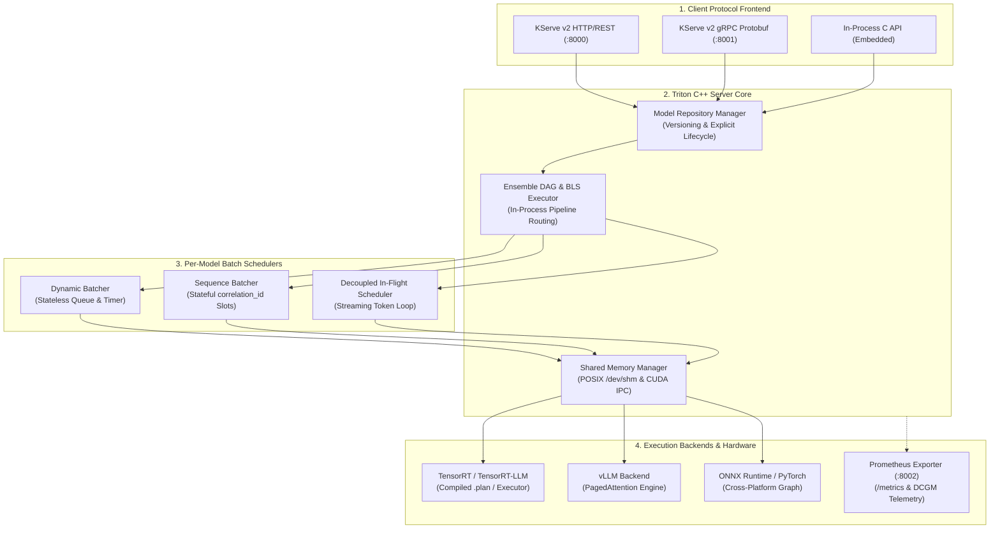
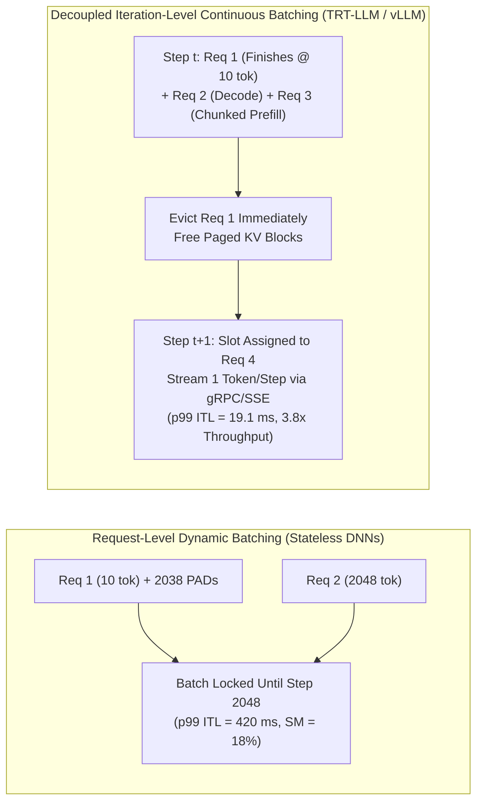

# 15.6 Triton Inference Server

| Field | Value |
|---|---|
| Level | Advanced |
| Priority tier | 1 |
| Lab venue | GCP / GKE + Local Python Verification Lab |
| Part | Part 15: LLM inference and serving |
| Cross-references | Chapter 15.1 (Anatomy of an inference request); Chapter 15.2 (Batching, KV cache, and quantization); Chapter 15.3 (vLLM in depth); Chapter 15.5 (TensorRT and TensorRT-LLM); Chapter 15.14 (Benchmarking with GenAI-Perf) |
| Code | `code/part15/triton_inference_server.py`, `code/part15/triton_inference_server_lab.py` |
| Coverage file | `planning/coverage/chapters/15-06.md` |
| Claim & number ledger | `planning/ledgers/15-06.md` |

## Why this matters for AI infrastructure

Early AI prototypes almost always start as a trained model wrapped inside a lightweight Python web server such as FastAPI or Flask. That pattern works on a laptop, yet it breaks down quickly in a production data center. Platform teams hit three structural walls when they scale custom Python wrappers across a GPU fleet.

- **Single-model lock-in:** Production pipelines rarely run a single neural network in isolation. A retrieval-augmented assistant may combine a vision preprocessor, an embedding encoder, a cross-encoder reranker, and an autoregressive language model. Maintaining separate custom web servers for TensorRT, ONNX Runtime, PyTorch, and vLLM multiplies container build pipelines and wastes idle GPU capacity.
- **Poor hardware utilization and interpreter locks:** Python's Global Interpreter Lock serializes CPU thread execution inside a single process. When dozens of concurrent requests hit a custom Python server, CPU threads stall on tokenization, JSON parsing, and uncoordinated CUDA stream launches. Meanwhile, the GPU Tensor Cores sit idle waiting for work.
- **Missing operational standards:** Site reliability engineers need deterministic model version control, zero-downtime hot reloads, decoupled Kubernetes liveness and readiness probes, and microsecond queue-versus-compute latency histograms out of the box.

NVIDIA Triton Inference Server solves these challenges with an open-source, high-performance C++ serving core. **Triton decouples client network protocols from backend execution runtimes.** One standardized server can host any model framework across GPUs and CPUs.

```text
Production Reference Numbers (Volume 12 Chapters 2, 3, 5, 7, and Labs 01-02):
- Triton network ports: Port 8000 (KServe v2 HTTP/REST), Port 8001 (KServe v2 gRPC), Port 8002 (Prometheus /metrics)
- DenseNet-121 ONNX dynamic batching benchmark at concurrency C = 64 (Lab 02):
  No batching (max_batch_size = 0): 520 RPS, p99 latency = 121.5 ms, realized batch = 1.0
  Conservative dynamic batching (max_batch_size = 16, delay = 5,000 us): 2,850 RPS (5.48x speedup), p99 = 8.9 ms, realized batch = 13.0
  Aggressive dynamic batching (max_batch_size = 64, delay = 50,000 us): 3,400 RPS (6.54x), p99 = 48.5 ms at C = 64, but 51.2 ms at C = 1
- Transformer encoder instance_group oversubscription on an 80 GB A100 GPU (Volume 12 Chapter 3):
  count = 8 (8 * 9.5 GB = 76 GB VRAM, 4 GB free): 84 ms CUDA stream mutex stall, latency = 110 ms (up from 25 ms), throughput = 180 RPS
  count = 2 (2 * 9.5 GB = 19 GB VRAM, 61 GB free) + dynamic batching: latency p99 = 18.4 ms, throughput = 792 RPS (+340% / 4.4x gain)
- Host-to-device PCIe Gen5 x16 (64 GB/s peak) transfer bandwidth (Volume 12 Chapter 2):
  Pageable malloc() host memory: 10-14 GB/s (double copy through OS page-locked staging buffer)
  Pinned host memory / POSIX Shared Memory (/dev/shm): 55-62 GB/s direct DMA (4.88x faster at nominal 58.5 vs 12.0 GB/s)
```

Before you deploy custom Python wrappers into production, standardize your model repository, batch schedulers, and shared-memory data paths on Triton Inference Server.

## Prerequisites and outcomes

### Prerequisites
- Review end-to-end inference request stages, TTFT, and ITL fundamentals from Chapters 15.1 and 15.2.
- Review PagedAttention and continuous batching from Chapter 15.3 and TensorRT-LLM engine compilation from Chapter 15.5.
- Understand basic Kubernetes pod probes, Docker container runtime flags, and Prometheus metric scraping.

### Outcomes
After completing this chapter, you will be able to:
1. Architect a versioned Triton model repository on local or cloud storage. You will also author `config.pbtxt` files that align maximum batch sizes with TensorRT optimization profiles.
2. Select and tune Triton's stateless Dynamic Batcher, stateful Sequence Batcher, and decoupled continuous batching backends for TensorRT-LLM and vLLM.
3. Size GPU instance group counts to balance concurrent CUDA stream execution against GPU HBM capacity and workspace requirements.
4. Compose multi-stage inference pipelines using declarative Ensembles and imperative Business Logic Scripting with zero-copy CUDA shared memory pointers.
5. Optimize client transport across HTTP/REST, gRPC, C API, POSIX System Shared Memory, and CUDA Shared Memory. You will also profile Pareto-optimal configurations with `perf_analyzer`, Model Analyzer, and Prometheus metrics.

---

## 1. Triton C++ Core Architecture, Model Repository Layout, and Configuration

### 1.1 Internal Server Architecture and Multi-Framework Execution

When a client sends an inference request to a naive Python web server, the same Python process parses the network socket, allocates host tensors, and calls the framework runtime. If multiple models share the node, each model runs in its own isolated container with duplicate runtime overhead. In *Hands-On LLM Serving and Optimization*, Chapter 3 contrasts this single-model service pattern with cost-efficient multi-model serving. In that multi-model architecture, a unified serving backend shares GPU memory and mitigates cold starts across many models.

Triton implements this multi-model backend in native C++. Requests enter through a protocol frontend supporting KServe v2 HTTP/REST on port 8000, KServe v2 gRPC on port 8001, or an in-process C API for embedded edge applications. The Model Repository Manager validates loaded artifacts and routes requests into per-model schedulers. Those schedulers assemble batches and dispatch pointers through a shared memory pool to backend plugins such as TensorRT, TensorRT-LLM, vLLM, ONNX Runtime, LibTorch, OpenVINO, or the Python Backend. Finally, a dedicated telemetry thread exports hardware and request counters on port 8002 at `/metrics`.



| Server Component | Architecture Role | Primary Responsibilities | Key Flag or Config | Primary Failure Mode |
|---|---|---|---|---|
| **KServe v2 Frontend** | Network ingress | Parses JSON or Protobuf and manages HTTP/gRPC streams | `--http-port=8000`, `--grpc-port=8001` | Socket exhaustion or `4 MB` gRPC payload limit |
| **Model Repository Mgr** | Lifecycle controller | Discovers, validates, loads, and unloads versioned models | `--model-control-mode=explicit` | Missing `config.pbtxt` or partial NFS file read |
| **Dynamic Scheduler** | Stateless batcher | Groups requests up to `max_batch_size` within queue delay | `max_queue_delay_microseconds` | Queue latency inflation under low load |
| **Sequence Scheduler** | Stateful router | Routes requests sharing `correlation_id` to the same slot | `sequence_batching` block | Slot exhaustion on missing `END` flag |
| **Backend C API** | Runtime bridge | Connects C++ core to TensorRT, ONNX Runtime, PyTorch, or vLLM | `platform` or `backend` field | TensorRT engine SM or version mismatch |
| **Ensemble & BLS Engine** | Pipeline composer | Chains multi-model DAGs with zero-copy memory pointers | `platform: "ensemble"` or Python BLS | Unreleased VRAM buffer or thread starvation |
| **Prometheus Exporter** | Telemetry service | Exports request histograms, queue counters, and GPU VRAM | `--metrics-port=8002` | Scrape timeout or missing metric labels |

### 1.2 Model Repository Layout and Version Policies

Without a strict directory contract, model upgrades turn into ad-hoc file swaps that break running containers. Triton enforces a standardized directory hierarchy called the **Model Repository**. This repository can reside on local NVMe storage, NFS, Amazon S3, Google Cloud Storage, or Azure Blob Storage.

Each top-level subdirectory represents one logical model name, such as `resnet50` or `dense_net`. Inside that model directory sits a `config.pbtxt` specification file alongside one or more numeric version subdirectories holding the serialized model artifact.

```text
/var/model_repository/
├── resnet50/
│   ├── config.pbtxt               <-- Model configuration protobuf specification
│   ├── 1/
│   │   └── model.plan             <-- Version 1 compiled TensorRT engine plan
│   └── 2/
│       └── model.plan             <-- Version 2 compiled TensorRT engine plan
├── dense_net/
│   ├── config.pbtxt
│   └── 1/
│       └── model.onnx             <-- Version 1 ONNX Runtime model file
└── rag_bls_pipeline/
    ├── config.pbtxt
    └── 1/
        └── model.py               <-- Version 1 Python Backend / BLS script
```

By default, Triton serves only the highest numeric directory. You can override this behavior in `config.pbtxt` using one of three version policies.
- **Latest policy:** Setting `latest: { count: 1 }` loads only the highest numeric version folder. Setting `count: 2` keeps the two newest versions loaded for canary comparisons.
- **All policy:** Setting `all: {}` loads every numeric version directory simultaneously so legacy clients can pin older endpoints.
- **Specific policy:** Setting `specific: { versions: [ 1, 2 ] }` loads only the exact version numbers listed in the array.

### 1.3 Anatomy of `config.pbtxt` and TensorRT Optimization Profile Alignment

Every model in Triton is governed by its `config.pbtxt` file. This protobuf text file declares the execution backend, the server-level maximum batch size, the input and output tensor signatures, the batch scheduler policy, and the instance group placement.

```protobuf
name: "resnet50"
platform: "tensorrt_plan"
max_batch_size: 64

input [
  {
    name: "input_bytes"
    data_type: TYPE_FP32
    dims: [ 3, 224, 224 ]
  }
]
output [
  {
    name: "probabilities"
    data_type: TYPE_FP32
    dims: [ 1000 ]
  }
]

dynamic_batching {
  preferred_batch_size: [ 16, 32, 64 ]
  max_queue_delay_microseconds: 5000
}

instance_group [
  {
    count: 2
    kind: KIND_GPU
    gpus: [ 0, 1 ]
  }
]
```

Understanding how `max_batch_size` interacts with tensor dimensions and compiled TensorRT engines prevents the most common startup and runtime errors in Triton.
- **Implicit batch dimension when batching is enabled:** When `max_batch_size` is set to a positive integer such as 64, Triton automatically prepends an implicit batch dimension to every tensor shape array. Declaring three-by-224-by-224 image dimensions tells Triton to accept any batch size from 1 up to 64.
- **Explicit full shape when batching is disabled:** When dynamic batching is disabled or managed internally by a decoupled LLM runtime, `max_batch_size` is set to 0. You must then write the full tensor shape explicitly in the dimensions array, including the leading batch dimension of 1.
- **TensorRT optimization profile ceiling:** A compiled TensorRT plan file contains a baked-in hardware optimization profile with minimum, optimal, and maximum batch bounds. Triton's `max_batch_size` must never exceed the TensorRT engine's maximum profile dimension.
- **Ingress rejection versus scheduler splitting:** Suppose a client sends a single request with a batch size of 128 when the maximum batch size is 64. Triton's frontend immediately rejects that request with HTTP 400 Bad Request before it reaches the GPU queue. Conversely, when many small requests arrive concurrently and dynamic batching is enabled, the scheduler packs them into sub-batches matching the preferred batch sizes.

```text
config.pbtxt Shape and TensorRT Optimization Profile Reference (Volume 12 Chapter 3 & Lab 02):
- Implicit batch mode (max_batch_size: 64):
  input dims: [ 3, 224, 224 ] -> runtime tensor shape [ B, 3, 224, 224 ] for 1 <= B <= 64
- Explicit unbatched mode (max_batch_size: 0 in dense_net_nobatch):
  input dims: [ 1, 3, 224, 224 ] -> output dims: [ 1, 1000, 1, 1 ]
- TensorRT .plan optimization profile bounds:
  batch_dim: min = 1, opt = 16, max = 64 (requires Triton max_batch_size <= 64)
- Oversized request batch (Request Batch = 128 when max_batch_size = 64):
  Rejected immediately at ingress with HTTP 400 Bad Request ("inference request batch size exceeds maximum allowed")
```

### 1.4 Model Control Modes: `none`, `poll`, and `explicit`

How Triton discovers repository changes determines whether model updates are safe under live production traffic. Triton offers three model control modes at startup.
- **Static mode (`none`):** Triton loads all models in the repository once at startup and ignores subsequent filesystem changes.
- **Polling mode (`poll`):** Triton periodically scans the repository directory on disk and automatically reloads modified models. Never use polling mode in production. Suppose a CI/CD job copies a 1.2 GB plan file over NFS while Triton polls every 5 seconds. Triton will read the partially written file, fail with a magic number mismatch error, and drop server readiness to HTTP 503.
- **Explicit mode (`explicit`):** Triton loads only the models requested via startup flags or explicit REST and gRPC model control calls. Combining atomic directory renames with explicit load calls guarantees zero-downtime model rollouts.

Always run production Triton deployments in `--model-control-mode=explicit` and validate `max_batch_size` against your compiled engine profile before exposing the service.

---

## 2. Batch Schedulers: Dynamic, Sequence, and Decoupled Continuous Batching

### 2.1 Stateless Dynamic Batching (`dynamic_batching`)

Executing one inference request at a time starves modern GPUs. Launching a CUDA kernel for a single image or a single embedding vector incurs fixed driver launch overhead while leaving most Streaming Multiprocessors and Tensor Cores underutilized. As *AI Systems Performance Engineering* highlights in Chapter 16, dynamic batching improves both throughput and tail latency under high arrival rates. Processing larger batches prevents the GPU from sitting idle between requests and drains the queue faster.

Triton's **Dynamic Batcher** is a stateless request-level scheduler for models where each request is independent, such as image classification, object detection, embedding models, and cross-encoder rerankers. When a request arrives, the scheduler places it in an internal queue until one of two conditions is met.
1. **Preferred batch size reached:** The queued requests reach one of the configured preferred batch sizes or the maximum batch size. Preferred batch sizes should be multiples of 8 or 16 to align with NVIDIA Tensor Core matrix tile dimensions.
2. **Queue delay timer expires:** The oldest request in the queue reaches `max_queue_delay_microseconds`, at which point the scheduler dispatches whatever partial batch has accumulated.

```text
Dynamic Batcher Queue Mechanics and Telemetry Formulas (Volume 12 Chapter 3 & Lab 02):
- Queue wait budget rule: Set max_queue_delay_microseconds to 10%-20% of total end-to-end SLA (e.g., 2-4 ms for a 20 ms SLA, or 5,000 us = 5 ms standard)
- Realized Average Batch Size:
  B_realized = delta(nv_inference_request_success) / delta(nv_inference_exec_count)
- Mean Queue Wait Time per Request:
  t_queue_avg = delta(nv_inference_queue_duration_us) / delta(nv_inference_request_success)
- Single-Request Latency Decomposition (dense_net_conservative at C = 1 in Lab 02):
  Client avg latency = 2,218 us (p99 = 3,100 us = 3.1 ms) at 450.0 infer/sec (4,500 requests in 10,000 ms)
  Server avg latency = 1,950 us = 150 us overhead + 200 us queue + 1,600 us compute input
```

In Volume 12 Lab 02, benchmarking DenseNet-121 on ONNX Runtime with `perf_analyzer` across client concurrencies from 1 to 64 demonstrates the trade-off between unbatched, conservative, aggressive, and misconfigured queue delays.

| Profile Name | `max_batch_size` | `preferred_batch_size` | `max_queue_delay_microseconds` | Peak Throughput (`C = 64`) | `p99` Latency (`C = 1`) | `p99` Latency (`C = 64`) | Realized Avg Batch Size |
|---|---|---|---|---|---|---|---|
| `dense_net_nobatch` | `0` (Disabled) | N/A | `0` | `520 RPS` | `2.1 ms` | `121.5 ms` | `1.0` |
| `dense_net_conservative` | `16` | `[4, 8, 16]` | `5,000` (`5 ms`) | `2,850 RPS` (`5.48x`) | `3.1 ms` | `8.9 ms` | `13.0` |
| `dense_net_aggressive` | `64` | `[16, 32, 64]` | `50,000` (`50 ms`) | `3,400 RPS` (`6.54x`) | `51.2 ms` | `48.5 ms` | `48.2` |
| `dense_net_misconfigured` | `64` | `[64]` | `500,000` (`500 ms`) | `4 RPS` (at `C = 2`) | `> 500 ms` | `> 500 ms` (at `C = 2`) | `2.0` (at `C = 2`) |

Notice why the conservative profile is the production sweet spot for latency-sensitive services. At concurrency 64, it multiplies throughput by 5.48x while slashing p99 latency from 121.5 ms down to 8.9 ms. By contrast, setting a 50 ms delay in the aggressive profile forces a single user at concurrency 1 to wait the full 50 ms timer before the batch dispatches. Worse still, setting a single preferred batch size of 64 with a 500 ms delay at concurrency 2 traps both requests for the full 500 ms timeout on every call. That misconfiguration collapses throughput to just 4 RPS.

### 2.2 Stateful Sequence Batching (`sequence_batching`)

Stateless dynamic batching routes each incoming request to whichever model instance happens to be free. That works for independent images, but it breaks stateful models such as streaming speech recognition, recurrent neural networks, and stateful conversational encoders. Those models maintain hidden state in GPU memory across sequential chunks.

Triton's **Sequence Batcher** solves this by binding every multi-step session to a unique integer `correlation_id`. When a client starts a streaming audio or text session, it attaches that correlation identifier and control flags to the request headers.
- **Sticky slot routing:** When a start flag arrives, the Sequence Batcher allocates a dedicated batch slot inside a specific model instance on GPU VRAM. Every subsequent chunk carrying the same correlation identifier routes to that exact model instance and batch slot so the model can read its preserved hidden state.
- **Slot release and timeout protection:** When the client sends the end flag, or when `max_sequence_idle_microseconds` expires for an abandoned client, Triton resets the hidden state slot. It then assigns that freed slot to the next waiting session in the backlog.

```protobuf
sequence_batching {
  max_sequence_idle_microseconds: 5000000
  direct {
    max_queue_delay_microseconds: 2000
    minimum_slot_utilization: 0.5
  }
  control_input [
    {
      name: "START"
      control [ { kind: CONTROL_SEQUENCE_START, int32_false_true: [ 0, 1 ] } ]
    },
    {
      name: "END"
      control [ { kind: CONTROL_SEQUENCE_END, int32_false_true: [ 0, 1 ] } ]
    },
    {
      name: "READY"
      control [ { kind: CONTROL_SEQUENCE_READY, int32_false_true: [ 0, 1 ] } ]
    },
    {
      name: "CORRID"
      control [ { kind: CONTROL_SEQUENCE_CORRID, data_type: TYPE_UINT64 } ]
    }
  ]
}
```

### 2.3 Why LLMs Require Decoupled Continuous Batching (`TensorRT-LLM` and `vLLM` Backends)

Autoregressive Large Language Models break both stateless request-level dynamic batching and traditional sequence batching. In request-level dynamic batching, all requests grouped into a batch must enter the model together and cannot exit until the longest sequence finishes generating. Furthermore, standard HTTP/REST and unary gRPC calls assume a strict one-to-one request-to-response transaction.

Volume 12 Chapter 7 quantifies what happens when a multi-tenant chat service serving 5,000 concurrent sessions uses traditional request-level dynamic batching.
- **Head-of-line blocking and padding waste:** Suppose a short greeting query that generates 10 tokens gets grouped into the same batch as a summarization request that generates 2,048 tokens. The 10-token request is trapped inside the batch for 2,038 extra decode iterations while the GPU wastes compute and HBM bandwidth multiplying padding tokens.
- **Severe tail latency collapse:** Under heavy load, p99 Inter-Token Latency spikes to 420 ms per token, and p99 TTFT hits 14.2 seconds. Meanwhile, GPU SM compute occupancy averages only 18 percent during decoding.

To serve LLMs efficiently, Triton pairs its **decoupled transaction policy** with dedicated continuous batching backends: the TensorRT-LLM Backend and the vLLM Backend.



```text
Request-Level Dynamic Batching vs Decoupled Continuous Batching Reference (Volume 12 Chapters 5 & 7):
- Request-level dynamic batching (B = 32, timeout tau = 50 ms on 5,000 chat sessions):
  10-token request batched with 2,048-token request -> trapped for 2,038 padded iterations
  p99 ITL = 420 ms (SLA < 30 ms), p99 TTFT = 14.2 s, GPU SM compute occupancy = 18%
- Iteration-level continuous batching + chunked prefill (TensorRT-LLM GptManager / Executor or vLLM):
  p99 ITL drops from 420 ms to 19.1 ms; total token throughput increases by 3.8x
- Distributed 70B LLM on 8x H100 (TP = 8 at 150 concurrent sessions, Volume 12 Chapter 5):
  Naive Python pipeline: average ITL = 115 ms/token, GPU utilization swings 12% to 98%, OOM on prompts > 8,192 tokens
  TensorRT-LLM C++ GptManager / Executor API with FlashDecoding & FP8 KV cache: ITL drops from 115 ms to 18.4 ms (2x throughput)
- Llama-3-70B KV Cache Memory Math (L = 80, H_kv = 8, d_head = 128):
  KV Memory Per Token = 2 * 80 * 8 * 128 * BytesPerElem = 327,680 bytes (~320 KB) in FP16 vs 163,840 bytes (~160 KB) in FP8
  4,096-token session footprint: 1.31 GB in FP16 vs 0.65 GB in FP8 (50% VRAM savings)
  Tuning 4x A100 from 128-token FP16 blocks (0.95 fraction) to 32-token FP8 blocks (0.85 fraction):
  Max concurrent sessions increases from 64 to 210; effective KV cache utilization rises from 52% to 91%
```

In decoupled mode, Triton lifts the one-to-one request-response constraint so the backend can emit many streaming token responses for a single client request.
1. **Iteration-level in-flight batching:** At every single-token generation step, the C++ `GptManager` or vLLM scheduler checks for sequences that emitted an end-of-sequence token or reached their token limit. It evicts finished requests immediately, frees their physical KV cache blocks, and inserts newly arrived requests into the active batch without waiting for long sequences to finish.
2. **Paged KV cache and FP8 quantization:** Allocating KV cache in 32-token paged blocks with FP8 quantization cuts per-session memory in half from 1.31 GB to 0.65 GB at 4,096 tokens. Reserving 15 percent of VRAM for activation workspace prevents long-context prefill crashes and scales active sessions from 64 to 210 on a four-GPU node.
3. **Measured latency and throughput gains:** Switching from request-level dynamic batching to iteration-level continuous batching with chunked prefill cuts p99 ITL from 420 ms to 19.1 ms and increases token throughput by 3.8x.

Use Triton's stateless `dynamic_batching` for fixed-step encoders and classifiers, `sequence_batching` for stateful streaming audio models, and decoupled mode with TensorRT-LLM or vLLM for autoregressive LLMs.

---

## 3. Instance Groups, Multi-Model Concurrency, and GPU Memory Trade-offs

### 3.1 How `instance_group` Maps to CUDA Streams and GPU HBM

Even with dynamic batching enabled, a single model instance can leave a modern GPU underutilized if each batch is small or if host-to-device input staging does not overlap with kernel execution. Triton's `instance_group` block controls how many parallel execution instances of a model are instantiated and which hardware devices host them.

When you configure two GPU instances on the first GPU, Triton loads two independent execution contexts of the model onto that device. Each instance runs on its own dedicated CUDA stream. That separation allows the GPU to overlap asynchronous host-to-device memory transfers for the second instance with CUDA kernel execution for the first instance. If you specify a count of 2 across two GPUs, Triton creates 2 instances on the first GPU and 2 instances on the second GPU, giving 4 total instances.

However, increasing the instance count is not free. Every additional GPU instance allocates its own copy of model weights and execution context workspace in GPU HBM.

```text
Instance Group GPU Memory and Concurrency Equations (Volume 12 Chapter 3):
- Total GPU HBM Footprint:
  M_total = N_instances_on_gpu * M_instance_weights_and_context + M_runtime_workspace_and_kv
- Safe Instance Sizing Constraint:
  M_total <= M_gpu_capacity * (1 - safety_headroom)
```

### 3.2 Worked Production Failure: CUDA Stream Contention and VRAM Saturation (`count: 8` vs `count: 2`)

A common anti-pattern in production Triton deployments is cranking the instance group count up to 8 or 16 on a single GPU. Engineers often assume that more instances always yield higher throughput. Volume 12 Chapter 3 documents the exact failure mode on an 80 GB A100 GPU serving an ONNX Transformer encoder where each instance requires 9.5 GB of VRAM.

1. **The oversubscribed configuration.**
   - Loading 8 instances onto a single 80 GB GPU consumes 76.0 GB of VRAM. That leaves only 4.0 GB of headroom for runtime workspace buffers.
   - Under concurrent load, the CUDA memory allocator fails to allocate a 1,024 MB workspace buffer, triggering host OOM kills.
   - Simultaneously, 8 competing instances firing small unbatched kernels across 8 CUDA streams contend for the CUDA driver stream launch mutex. Nsight Systems traces show `cudaLaunchKernel` stalling for 84 ms on the stream mutex. That contention quadruples average compute latency from 25 ms to 110 ms and caps throughput at 180 RPS.
2. **The right-sized configuration.**
   - Reducing the instance count from 8 to 2 drops the static model footprint from 76.0 GB to 19.0 GB. That change saves 57.0 GB and leaves 61.0 GB of HBM free.
   - Enabling dynamic batching with a maximum batch size of 32 and a 5 ms queue delay consolidates incoming requests into high-occupancy Tensor Core GEMM launches.

| Metric / Parameter | Oversubscribed Config (`count: 8`, No Batching) | Right-Sized Config (`count: 2` + Dynamic Batching) | Engineering Impact |
|---|---|---|---|
| **Instances on GPU 0 (`count`)** | `8` (`KIND_GPU`, `gpus: [0]`) | `2` (`KIND_GPU`, `gpus: [0]`) | Eliminates `84 ms` CUDA stream mutex lock contention |
| **Model VRAM Footprint (`M_total`)** | `76.0 GB` (`8 * 9.5 GB`, `81,180,000,000` B reported) | `19.0 GB` (`2 * 9.5 GB`) | Frees `57.0 GB` VRAM (`61.0 GB` available on `80 GB` A100) |
| **Batching Policy** | Unbatched (`max_batch_size` ungrouped) | `max_batch_size: 32`, `preferred: [8, 16, 32]`, `delay: 5000 us` | Coalesces small requests into single Tensor Core launches |
| **Peak Throughput (`perf_analyzer`)** | `180 RPS` | `792 RPS` | **`+340%` (`4.4x`) throughput increase** |
| **Tail Latency (`p99` / compute)** | `110 ms` (`110,400 us`) | `18.4 ms` | **`6.0x` reduction in tail latency** |

Keep the instance group count at 1 or 2 per GPU for heavy Transformer models. Rely on dynamic batching or continuous batching to scale request concurrency.

---

## 4. Multi-Model Pipelines: Ensembles vs Business Logic Scripting, Transport Protocols, and Shared Memory

### 4.1 Declarative Ensembles vs Imperative Business Logic Scripting (BLS)

Production AI features rarely invoke a single model in isolation. An image classification pipeline runs preprocessing, a TensorRT backbone, and postprocessing. A retrieval-augmented generation pipeline runs query tokenization, embedding generation, vector reranking, and conditional LLM generation. Suppose an external client orchestrates those steps over separate HTTP or gRPC calls. Every intermediate tensor must then be serialized on the server, sent over the network, deserialized on the client, and uploaded back across the PCIe bus to the GPU.

Triton eliminates those network and PCIe round-trips by executing multi-model pipelines directly inside the server through two complementary mechanisms: **Ensemble Models** and **Business Logic Scripting**.

- **Ensemble Models:** An Ensemble is a static, declarative Directed Acyclic Graph defined entirely inside `config.pbtxt` via the `ensemble_scheduling` block. It wires the output tensor of one model directly to the input tensor of the next model without writing any orchestration code. Because the graph is purely declarative, Ensembles have near-zero C++ scheduling overhead, but they cannot execute conditional branching, dynamic loops, or external API calls.
- **Business Logic Scripting (BLS):** BLS runs inside a Python Backend or C++ Backend model and invokes other models loaded in Triton using in-process API requests. Because BLS is imperative code, it supports arbitrary conditional routing, iterative loops, and token-level streaming callbacks. For example, a BLS script can call a heavy 70B LLM only when a fast classifier's confidence falls below a threshold.
- **Zero-copy GPU VRAM handoff:** In both Ensembles and BLS, intermediate tensors do not need to bounce back to host DRAM. When the first model finishes on the GPU, Triton passes a 64-byte CUDA Inter-Process Communication handle or DLPack capsule referencing that output buffer in GPU HBM directly to the second model. Across a three-stage pipeline, in-server CUDA IPC eliminates all 4 intermediate PCIe device-to-host and host-to-device crossings.

| Pipeline Dimension | Declarative Ensemble (`platform: "ensemble"`) | Business Logic Scripting (BLS) | External Client Chaining (Anti-Pattern) |
|---|---|---|---|
| **Definition Mechanism** | Static protobuf DAG in `config.pbtxt` | Imperative Python (`pb_utils.InferenceRequest`) or C++ | Client-side HTTP/gRPC calls between microservices |
| **Control Flow (`if/else`, loops)** | Not supported (fixed static graph) | Full support (loops, early exit, dynamic routing) | Supported on client |
| **Intermediate Tensor Path** | Zero-copy C++ core / CUDA IPC in GPU VRAM | Zero-copy DLPack / CUDA IPC in GPU VRAM (`64`-byte handle) | `4` PCIe crossings + `2` network round-trips (`3` stages) |
| **Scheduler Tuning** | Enable `allow_timeout_override: true` to prevent thread stalls | Async `await infer_request.exec_async()` | High tail latency from network serialization |

```protobuf
name: "vision_ensemble_pipeline"
platform: "ensemble"
max_batch_size: 64

input [ { name: "RAW_IMAGE", data_type: TYPE_UINT8, dims: [ -1 ] } ]
output [ { name: "TOP_CLASSES", data_type: TYPE_FP32, dims: [ 1000 ] } ]

ensemble_scheduling {
  step [
    {
      model_name: "image_preprocess_py"
      model_version: -1
      input_map { key: "RAW_BYTES", value: "RAW_IMAGE" }
      output_map { key: "NORMALIZED_CHW", value: "preprocessed_tensor" }
    },
    {
      model_name: "resnet50"
      model_version: -1
      input_map { key: "input_bytes", value: "preprocessed_tensor" }
      output_map { key: "probabilities", value: "TOP_CLASSES" }
    }
  ]
}
```

### 4.2 Client Transport Protocols (`HTTP/REST` vs `gRPC` vs `C API`) and Shared Memory (`System SHM` vs `CUDA SHM`)

As Volume 12 Chapter 2 establishes, **up to 60 percent of total end-to-end inference request latency in unoptimized deployments occurs outside the GPU**. Choosing the right transport protocol and host memory allocation mode determines whether your PCIe Gen5 bus runs at full DMA speed or stalls on CPU copies.

1. **Client network transport protocols.**
   - **KServe v2 HTTP/REST (port 8000):** Ideal for external web gateways and health probes. However, pure JSON serialization of large floating-point arrays inflates payload sizes and CPU parsing time unless binary tensor extensions are used.
   - **KServe v2 gRPC (port 8001):** Multiplexes binary Protobuf frames and bidirectional token streams over HTTP/2. Watch for the default 4 MB gRPC message limit. Sending a 6.2 MB batched tensor or long-context prompt fails with an internal message-too-large error unless you raise the channel message limits or switch to Shared Memory.
   - **In-Process C API:** Embeds Triton directly inside a C++ application process without any TCP/IP loopback socket overhead.
2. **Host and device shared memory allocation.**
   - **Pageable Host RAM:** Standard pageable memory allocated via `malloc` can be swapped out by the Linux kernel. Before the GPU can read a pageable tensor, the CUDA driver must allocate a temporary page-locked staging buffer, copy the data on the CPU, and only then trigger PCIe DMA. That double copy caps PCIe Gen5 transfer throughput at 10 to 14 GB/s and adds 5 to 15 ms of CPU copy overhead when assembling a batch of 64 requests.
   - **Pinned Memory and POSIX System Shared Memory:** Locking pages in physical RAM via `cudaHostAlloc` or `/dev/shm` lets the GPU DMA engine read directly across PCIe Gen5 at 55 to 62 GB/s. That 4.88x DMA speedup cuts a 38.54 MB batch transfer from 3.21 ms down to 0.66 ms. Always launch Triton containers with `--shm-size=1g` or a memory-backed volume at `/dev/shm` in Kubernetes to prevent container exit code 139.
   - **CUDA Shared Memory:** Suppose a co-located GPU preprocessing client and Triton share the same physical GPU. Registering a CUDA Shared Memory region lets Triton read the input tensor directly from GPU HBM via a 64-byte IPC handle with zero PCIe traffic.

```text
Transport Protocol and Shared Memory Bandwidth Reference (Volume 12 Chapters 2 & 3, Lab 01):
- gRPC default message limit: 4 MB (4,194,304 bytes); 6.2 MB payload fails with "[INTERNAL] received message larger than max_receive_bytes limit"
  Fix: Set grpc.max_send_message_length and grpc.max_receive_message_length or use Shared Memory
- Batch of 64 FP32 images (3 x 224 x 224 x 4 bytes = 602,112 bytes/image -> 38,535,168 bytes = 38.54 MB per batch):
  Pageable malloc() (10-14 GB/s, 12.0 GB/s nominal): 3.21 ms DMA + 5-15 ms CPU staging copy overhead
  Pinned cudaHostAlloc / POSIX /dev/shm (55-62 GB/s, 58.5 GB/s nominal on 64 GB/s PCIe Gen5): 0.66 ms direct DMA (4.88x speedup)
  CUDA Shared Memory (cudaIpcMemHandle, 64 bytes): 0 bytes copied across PCIe bus
```

Use gRPC with raised message-size limits for remote clients, and register POSIX `/dev/shm` or CUDA Shared Memory whenever the client and Triton run on the same node.

---

## 5. Commands, Model Analyzer, Prometheus Telemetry, and Kubernetes Operations

### 5.1 Prometheus Telemetry KPIs (`:8002/metrics`)

Guessing whether an inference slowdown is caused by network queueing, host tensor staging, or GPU kernel execution leads to blind hardware upgrades. Triton exports fine-grained microsecond counters and gauges on port 8002 at `/metrics` so SREs can decompose every microsecond of request latency.

```text
Representative Triton Prometheus Metrics Output (Volume 12 Chapter 3 & Lab 01):
# HELP nv_inference_request_duration_us Cumulative end-to-end request duration in microseconds
nv_inference_request_duration_us{model="resnet50",version="1"} 14280590
# HELP nv_inference_queue_duration_us Cumulative wait time spent in dynamic batch scheduler queue
nv_inference_queue_duration_us{model="resnet50",version="1"} 2180400
# HELP nv_inference_compute_infer_duration_us Cumulative GPU CUDA execution time
nv_inference_compute_infer_duration_us{model="resnet50",version="1"} 10892000
# HELP nv_gpu_memory_used_bytes Total GPU VRAM memory occupied by loaded Triton model instances
nv_gpu_memory_used_bytes{gpu="0"} 24589211648

Derived Operational KPIs (for 1,000 requests across 50 execution batches on resnet50 v1):
1. Realized Average Batch Size = delta(nv_inference_request_success) / delta(nv_inference_exec_count)
   = 1,000 / 50 = 20.0 requests/batch
2. Average Queue Wait Time = delta(nv_inference_queue_duration_us) / delta(nv_inference_request_success)
   = 2,180,400 us / 1,000 = 2,180.4 us (2.18 ms, or 15.27% of total request duration)
3. GPU Execution Efficiency = (delta(nv_inference_compute_infer_duration_us) / delta(nv_inference_request_duration_us)) * 100%
   = (10,892,000 / 14,280,590) * 100% = 76.27% (remaining 1,208,190 us = 8.46% is H2D/D2H copy + overhead)
4. GPU VRAM Occupancy = 24,589,211,648 bytes = 24.59 GB decimal (22.90 GiB binary)
```

### 5.2 Automated Configuration Sweeps with `perf_analyzer`, `model-analyzer`, and `genai-perf`

Manually testing every combination of maximum batch size, preferred batch size, queue delay, and instance group count takes days. NVIDIA provides three complementary benchmarking tools in the Triton SDK container.
- **Perf Analyzer (`perf_analyzer`):** Sweeps client concurrency or open-loop arrival rates against a single loaded model configuration. It decomposes client latency into send, network plus server queue, server compute input, server compute infer, and receive phases.
- **Model Analyzer (`model-analyzer`):** Wraps `perf_analyzer` and automatically generates, loads, and profiles dozens of `config.pbtxt` permutations across instance counts and batch sizes. It filters out configurations that violate your latency budget SLO or GPU VRAM limit and plots the **Latency-Throughput Pareto Frontier** so you can pick the highest-RPS configuration that meets your p99 target.
- **GenAI-Perf (`genai-perf`, being phased out in favour of AIPerf):** Evaluates streaming LLM endpoints using realistic input and output token distributions or ShareGPT traces to measure TTFT, ITL, and Generated Tokens Per Second, as covered in Chapter 15.14.

```bash
# 1. Sweep concurrency C=1..64 on a single model with perf_analyzer and export CSV
perf_analyzer -m dense_net_conservative \
  -u localhost:8001 -i grpc \
  --concurrency-range 1:64:8 \
  --measurement-interval 10000 \
  -f results_conservative.csv

# 2. Run Triton Model Analyzer to sweep instance_group count and max_batch_size under a 25 ms p99 SLO
model-analyzer profile \
  --model-repository /models \
  --profile-models transformer_enc \
  --triton-launch-mode local \
  --run-config-search-max-instance-count 8 \
  --run-config-search-max-model-batch-size 32 \
  --latency-budget 25 \
  --export-path /results
```

### 5.3 Kubernetes Probe Decoupling and Zero-Downtime Model Rollouts

Deserializing and loading a 70B parameter model from object storage or NFS into GPU HBM takes 30 to 90 seconds. Suppose a Kubernetes deployment points its liveness probe at the readiness endpoint with a short timeout. The `kubelet` agent will conclude the container is dead while weights are still loading and kill the pod in an infinite crash loop.

Volume 12 Chapter 3 defines the mandatory three-probe Kubernetes pattern and atomic rollout workflow for Triton.
1. **Liveness Probe (`/v2/health/live`):** Checks only that the C++ `tritonserver` daemon is alive. It returns HTTP 200 immediately upon process startup, preventing Kubernetes from restarting the pod during heavy model loads.
2. **Readiness Probe (`/v2/health/ready`):** Returns HTTP 503 while models are initializing and transitions to HTTP 200 only when all required models are loaded in VRAM. Kubernetes routes Service traffic to the pod only when readiness returns 200.
3. **Startup Probe (`/v2/health/live`):** Configured with a failure threshold of 30 and a period of 10 seconds, granting up to 300 seconds for initial container startup and large artifact staging.
4. **Graceful Drain (`terminationGracePeriodSeconds: 120`):** Calling the model unload API while traffic is still arriving causes 15 percent of in-flight requests to fail with HTTP 503 (`85%` return `200 OK`). Always load the new model version first, drain ingress traffic via a `preStop` hook, and allow 120 seconds for in-flight batches to finish before unloading.

```yaml
apiVersion: apps/v1
kind: Deployment
metadata:
  name: triton-inference-server
spec:
  replicas: 2
  template:
    spec:
      terminationGracePeriodSeconds: 120
      volumes:
        - name: dshm
          emptyDir:
            medium: Memory
            sizeLimit: 8Gi
      containers:
        - name: tritonserver
          image: nvcr.io/nvidia/tritonserver:24.05-py3
          args:
            - tritonserver
            - --model-repository=/models
            - --model-control-mode=explicit
            - --strict-model-config=true
          ports:
            - containerPort: 8000
              name: http-triton
            - containerPort: 8001
              name: grpc-triton
            - containerPort: 8002
              name: metrics-triton
          volumeMounts:
            - mountPath: /dev/shm
              name: dshm
          startupProbe:
            httpGet:
              path: /v2/health/live
              port: 8000
            failureThreshold: 30
            periodSeconds: 10
          livenessProbe:
            httpGet:
              path: /v2/health/live
              port: 8000
            initialDelaySeconds: 5
            periodSeconds: 10
          readinessProbe:
            httpGet:
              path: /v2/health/ready
              port: 8000
            initialDelaySeconds: 15
            periodSeconds: 5
```

Decouple liveness from readiness in every Kubernetes manifest and use Model Analyzer to verify that your chosen batch size and instance count sit on the Pareto frontier before going live.

---

## 6. How It Fails: Six Production Failure Modes

| Failure Mode | Symptom & Telemetry Signal | Root Cause | Exact Diagnostic Command | Remediation |
|---|---|---|---|---|
| **1. NFS Hot-Reload Corruption in `poll` Mode** | `GET /v2/health/ready` returns `HTTP 503`; log shows `Magic number mismatch. File is corrupt or incomplete` for `resnet50` version `2` | `--model-control-mode=poll` (`5 s` interval) tried to deserialize a `1.2 GB` `model.plan` mid-copy over NFS | `curl -i http://localhost:8000/v2/health/ready && ps aux \| grep tritonserver` | Switch to `--model-control-mode=explicit`; copy to staging `tmp_2/`, run atomic `mv tmp_2 2`, then call `POST /v2/repository/models/resnet50/load`. |
| **2. Oversubscribed `instance_group` (`count: 8`)** | Latency jumps `4.4x` from `25 ms` to `110 ms` (`110,400 us`), throughput stalls at `180 RPS`, host OOM kills pod | `8 * 9.5 GB = 76 GB` on `80 GB` A100 (`81,180,000,000` bytes used) leaves `< 4 GB` workspace (`1024 MB` alloc fails) and stalls `cudaLaunchKernel` `84 ms` on stream mutex | `curl -s http://localhost:8002/metrics \| grep nv_gpu_memory_used_bytes` and `nsys profile --stats=true` | Lower `count` to `2` (`19 GB` VRAM) and enable `dynamic_batching` (`max_batch_size: 32`, `delay: 5000 us`) to reach `792 RPS` and `18.4 ms` `p99`. |
| **3. Excessive `max_queue_delay_microseconds` Under Low Load** | At `C = 2`, throughput drops to `4 RPS` and `p99` spikes above `500,000 us` (`500 ms`) with realized batch `2.0` | `preferred_batch_size: [64]` with `max_queue_delay_microseconds: 500000` forces low-concurrency requests to wait the full `500 ms` timeout | `curl -s http://localhost:8002/metrics \| grep -E 'queue_duration_us\|exec_count'` | Budget `max_queue_delay_microseconds` to `10%–20%` of SLA (`<= 5,000 us`) and include smaller preferred sizes (`[4, 8, 16]`). |
| **4. Request-Level Batching on Variable-Length LLMs** | `p99` ITL spikes to `420 ms` (SLA `< 30 ms`), `p99` TTFT hits `14.2 s`, GPU SM occupancy drops to `18%` | Request-level dynamic batching (`B = 32, tau = 50 ms`) traps `10`-token queries behind `2,048`-token queries for `2,038` padded iterations | `curl -s http://localhost:8002/metrics` and inspect padding waste / decode step duration | Use `decoupled: true` with the TensorRT-LLM (`GptManager` / `Executor`) or vLLM continuous batching backend and chunked prefill (`p99` ITL drops to `19.1 ms`, `3.8x` throughput). |
| **5. gRPC `4 MB` Message Limit & `/dev/shm` Exhaustion** | Client fails with `[INTERNAL] received message larger than max_receive_bytes limit` (`6.2 MB` payload) or container exits with code `139` | Default gRPC limit is `4 MB`; Docker default `/dev/shm` is `64 MB`, exhausting POSIX IPC buffers | `tritonserver --log-verbose=1` and `docker inspect triton_server` | Raise `grpc.max_send_message_length` / `grpc.max_receive_message_length` or use Shared Memory, and mount `--shm-size=1g` (`2Gi–8Gi` `emptyDir { medium: Memory }` in K8s). |
| **6. Uncoordinated Model Unload & Ensemble Thread Starvation** | `15%` of requests fail with `HTTP 503 MODEL_UNAVAILABLE` (`85%` `200 OK`) during unload; or `16` CPU threads spin at `90%+` with `queue_time_us = 50–200 ms` | Unload races with in-flight requests; or multi-model Ensemble lacks timeout override interleaving | `top -p $(pgrep -f tritonserver) -H` and `curl -v http://localhost:8000/v2/health/ready` | Load `v2` before unloading `v1`, drain traffic via `preStop` with `terminationGracePeriodSeconds: 120`, and set `scheduler { default_queue_policy { allow_timeout_override: true } }`. |

Always check queue duration versus compute infer duration on port 8002 first when triaging any Triton latency spike.

---

## 7. Hands-On Lab: Triton Architecture, Dynamic Batcher, and Model Analyzer Verification

### 7.1 Lab Venue and Environment Note

- **Primary venue:** Google Cloud Platform (GCP / GKE) GPU node with an A100, L40S, or H100 GPU. Requires NVIDIA Driver 535.104.05 or newer, Docker, NVIDIA Container Toolkit, and the Triton containers, paired with the local Python verification suite.
- **Verification status:** The 25 deterministic self-checks in `code/part15/triton_inference_server_lab.py` were executed and verified locally (`Summary: 25 passed, 0 failed`). The multi-container GPU Docker and `perf_analyzer` commands below are adapted. Those GPU container commands have not been executed on live GPU hardware in this local build environment (`untested` on live hardware).

### 7.2 Part A: Run the Local Deterministic Python Verification Suite

Run the self-checking lab script to verify repository version resolution, `config.pbtxt` validation, and DenseNet dynamic batching sweeps. The script also verifies sequence batcher routing, continuous LLM batching, instance group VRAM math, shared memory DMA speedups, Prometheus KPIs, Model Analyzer Pareto selection, and Kubernetes probes.

```bash
python3 -B code/part15/triton_inference_server_lab.py
```

```text
=== Chapter 15.6 Lab: Triton Inference Server Verification ===
  [PASS] 1. Version policy 'latest: { count: 1 }' on versions [1, 2, 3] serves only version [3]
  [PASS] 2. Version policy 'all: {}' on versions [1, 2, 3] serves [1, 2, 3] simultaneously
  [PASS] 3. Version policy 'specific: { versions: [1, 2] }' on [1, 2, 3] serves explicitly [1, 2]
  [PASS] 4. resnet50 config.pbtxt (max_batch_size=64 <= TRT profile max=64) prepends implicit batch dim 0 -> (32, 3, 224, 224) and returns HTTP 200
  [PASS] 5. Request batch size 128 exceeding max_batch_size=64 is rejected at ingress with HTTP 400 Bad Request
  [PASS] 6. Lab 01 failure injection (TYPE_FP32 -> TYPE_STRING on dense_net ONNX) fails validation with HTTP 400
  [PASS] 7. Profile A (dense_net_nobatch, max_batch_size=0) reaches 520 RPS at C=64 with p99=121.5 ms and realized batch 1.0
  [PASS] 8. Profile B (dense_net_conservative, max_batch=16, delay=5000 us) at C=1 decomposes server 1950 us into 150 us overhead + 200 us queue + 1600 us compute
  [PASS] 9. Profile B (dense_net_conservative) at C=64 reaches 2850 RPS (5.48x speedup vs no-batch), p99=8.9 ms, and realized avg batch 13.0
  [PASS] 10. Profile C (dense_net_aggressive, max_batch=64, delay=50000 us) reaches 3400 RPS (realized batch 48.2) at C=64 but inflates C=1 p99 to 51.2 ms
  [PASS] 11. Lab 02 failure injection (500,000 us / 500 ms queue delay at C=2) collapses throughput to 4.0 RPS and spikes p99 >= 500 ms with realized batch 2.0
  [PASS] 12. Sequence Batcher routes correlation_id=1001 consistently to slot 0, frees slot 0 on END, and assigns correlation_id=1003 to freed slot 0
  [PASS] 13. Request-level dynamic batching traps a 10-token query behind a 2048-token query for 2038 padded decode steps (p99 ITL=420 ms, p99 TTFT=14.2 s, SM occ=18%)
  [PASS] 14. Decoupled continuous batching with chunked prefill lowers p99 ITL from 420 ms to 19.1 ms (3.8x throughput gain) and 70B TP=8 ITL from 115 ms to 18.4 ms
  [PASS] 15. Llama-3-70B KV cache per token equals 327,680 bytes in FP16 (1.31 GB per 4096-token session) and 163,840 bytes in FP8 (0.65 GB), scaling sessions 64 -> 210 (52% -> 91% util)
  [PASS] 16. Setting instance_group count=8 for a 9.5 GB model consumes 76.0 GB VRAM on an 80 GB A100 (4.0 GB free), causing 84 ms stream mutex stalls and spiking latency 25 ms -> 110 ms
  [PASS] 17. Right-sizing instance_group to count=2 (19.0 GB VRAM, 61.0 GB free) + dynamic batching increases throughput +340.0% (4.4x, 180 -> 792 RPS) and cuts p99 to 18.4 ms
  [PASS] 18. A 6.2 MB tensor payload exceeds the default 4.0 MB gRPC max_receive_bytes limit unless channel limits are raised or Shared Memory is used
  [PASS] 19. Pinned / POSIX Shared Memory (58.5 GB/s on 64 GB/s PCIe Gen5) is 4.88x faster than Pageable malloc (12.0 GB/s), cutting 64-image batch H2D copy from 3.21 ms to 0.66 ms
  [PASS] 20. Ensemble and BLS pipelines using CUDA IPC (64-byte cudaIpcMemHandle) eliminate all 4 intermediate PCIe D2H/H2D crossings in a 3-stage pipeline
  [PASS] 21. resnet50 Prometheus counters (14,280,590 us total, 2,180,400 us queue, 10,892,000 us compute) yield 76.27% GPU execution efficiency and 15.27% queue share
  [PASS] 22. Prometheus nv_gpu_memory_used_bytes=24,589,211,648 equals 24.59 GB (22.90 GiB) and 1000 requests / 50 executions equals realized batch 20.0
  [PASS] 23. Model Analyzer filters out count=8 (110.0 ms > 25.0 ms SLO, 76.0 GB > 40.0 GB), eliminates dominated count=4, and selects cfg_c2_bs32 (792.0 RPS at 18.4 ms p99)
  [PASS] 24. Kubernetes startupProbe (failureThreshold=30 * periodSeconds=10 = 300 s) safely covers 30-90 s 70B model loads while /v2/health/live returns 200 and /v2/health/ready returns 503
  [PASS] 25. Uncoordinated model unload causes 15.0% HTTP 503 MODEL_UNAVAILABLE errors (85.0% 200 OK), prevented by explicit control mode + preStop drain within 120 s grace period

Summary: 25 passed, 0 failed
```

### 7.3 Part B: Deploy Triton on a GPU Host and Benchmark Dynamic Batching (`untested` on live hardware)

On a GPU node, build a versioned DenseNet-121 ONNX repository, launch Triton in explicit model control mode, validate gRPC inference and Prometheus metrics, and run `perf_analyzer` sweeps.

```bash
export TRITON_LAB_DIR="${HOME}/triton_lab"
export MODEL_REPO="${TRITON_LAB_DIR}/model_repository"
export TRITON_IMAGE="nvcr.io/nvidia/tritonserver:24.03-py3"
export TRITON_SDK_IMAGE="nvcr.io/nvidia/tritonserver:24.03-py3-sdk"

mkdir -p "${MODEL_REPO}/dense_net/1"
wget -O "${MODEL_REPO}/dense_net/1/model.onnx" \
  https://github.com/onnx/models/raw/main/validated/vision/classification/densenet-121/model/densenet-3.onnx

cat <<'EOF' > "${MODEL_REPO}/dense_net/config.pbtxt"
name: "dense_net"
platform: "onnxruntime_onnx"
max_batch_size: 16
input [ { name: "data_0", data_type: TYPE_FP32, dims: [ 3, 224, 224 ] } ]
output [ { name: "fc6_1", data_type: TYPE_FP32, dims: [ 1000, 1, 1 ] } ]
dynamic_batching {
  preferred_batch_size: [ 4, 8, 16 ]
  max_queue_delay_microseconds: 5000
}
instance_group [ { count: 1, kind: KIND_GPU, gpus: [ 0 ] } ]
EOF

docker run -d --name triton_server \
  --gpus '"device=0"' --shm-size=1g --net=host \
  -v "${MODEL_REPO}:/models" "${TRITON_IMAGE}" \
  tritonserver --model-repository=/models --model-control-mode=explicit --load-model=dense_net --log-verbose=1

curl -i -s http://localhost:8000/v2/health/live
curl -i -s http://localhost:8000/v2/models/dense_net/ready
curl -s http://localhost:8002/metrics | grep -E 'nv_inference_request_success|nv_gpu_memory_used_bytes|nv_inference_exec_count'

docker run --rm --net=host "${TRITON_SDK_IMAGE}" \
  perf_analyzer -m dense_net -u localhost:8001 -i grpc --concurrency-range 1:64:8 --measurement-interval 10000
```

---

## Checkpoint questions

<details>
<summary>1. Why does wrapping a PyTorch or ONNX model in a single-process Python Flask or FastAPI server fail to scale on multi-GPU production nodes?</summary>

Python's Global Interpreter Lock serializes CPU thread execution inside a single interpreter process. Under high concurrency, CPU threads block on JSON parsing, tokenization, and uncoordinated CUDA kernel launches while GPU Tensor Cores sit idle. Serving multiple frameworks also requires maintaining separate custom containers without unified batching or readiness telemetry.
</details>

<details>
<summary>2. Which three network ports does Triton Inference Server expose by default, and what protocol runs on each port?</summary>

Port 8000 serves the KServe v2 HTTP/REST API, port 8001 serves the KServe v2 gRPC Protobuf API, and port 8002 exposes Prometheus telemetry metrics at `/metrics`.
</details>

<details>
<summary>3. How does Triton organize model files on disk or object storage, and how do the three version policies in config.pbtxt behave?</summary>

Each model resides in its own directory containing a `config.pbtxt` file and numeric version folders. The latest policy loads the highest numeric versions, the all policy loads every numeric version simultaneously, and the specific policy loads only the listed version numbers.
</details>

<details>
<summary>4. How does setting max_batch_size greater than zero in config.pbtxt change the way input and output dims are interpreted?</summary>

When `max_batch_size` is positive, Triton automatically prepends an implicit dynamic batch dimension to every tensor's shape declaration. When `max_batch_size` is 0, the full shape including the leading dimension must be declared explicitly.
</details>

<details>
<summary>5. What rule governs the relationship between Triton's max_batch_size and a compiled TensorRT engine's optimization profile, and what happens if a client sends a batch of 128 when max_batch_size is 64?</summary>

Triton's `max_batch_size` must be less than or equal to the TensorRT optimization profile's maximum batch bound. If a client sends a single request with batch size 128 when the limit is 64, Triton's frontend immediately rejects it with HTTP 400 Bad Request before it reaches the GPU queue.
</details>

<details>
<summary>6. Why is --model-control-mode=poll dangerous when a CI/CD pipeline copies a 1.2 GB TensorRT model.plan file over NFS, and how do you fix it?</summary>

In polling mode, Triton detects the new version directory while the 1.2 GB file is still copying over NFS. It attempts to deserialize the incomplete file, throws a magic number mismatch error, and sets readiness to HTTP 503. Fix it by running `--model-control-mode=explicit`, staging the file in a temporary directory, performing an atomic rename, and calling the explicit HTTP load endpoint.
</details>

<details>
<summary>7. In Volume 12 Lab 02, how does conservative dynamic batching (max_batch_size 16, delay 5,000 us) compare against no batching and aggressive batching (delay 50,000 us) on DenseNet-121?</summary>

At concurrency 64, conservative batching increases throughput 5.48x from 520 RPS to 2,850 RPS while cutting p99 latency from 121.5 ms to 8.9 ms. By contrast, aggressive batching reaches 3,400 RPS at concurrency 64 but inflates single-request p99 latency at concurrency 1 to 51.2 ms because single requests wait the full 50 ms timer.
</details>

<details>
<summary>8. What happens when a model is configured with preferred_batch_size: [64] and max_queue_delay_microseconds: 500000 (500 ms) under low concurrency C = 2?</summary>

Because only 2 concurrent requests are in flight, the queue never reaches the preferred batch size of 64. Every batch of 2 requests waits the full 500 ms timeout before executing, collapsing throughput to 4 RPS and spiking p99 latency above 500 ms.
</details>

<details>
<summary>9. When should you configure Triton's Sequence Batcher instead of the Dynamic Batcher, and how does correlation_id routing work?</summary>

Use the Sequence Batcher for stateful multi-step sessions such as streaming speech recognition or recurrent models that maintain hidden state across chunks. The client attaches a `correlation_id` and control flags, and Triton's Sequence Batcher binds that identifier to a fixed batch slot inside the exact same GPU model instance until the session ends.
</details>

<details>
<summary>10. Why does request-level dynamic batching cause severe tail-latency spikes for autoregressive LLMs, and what improvement does iteration-level continuous batching deliver?</summary>

In request-level batching, a short 10-token response grouped with a 2,048-token sequence is trapped for 2,038 padded decode iterations. That head-of-line blocking spikes p99 ITL to 420 ms and p99 TTFT to 14.2 s at 18 percent SM occupancy. Decoupled iteration-level continuous batching with chunked prefill evicts finished sequences after every token step, cutting p99 ITL to 19.1 ms and raising throughput by 3.8x.
</details>

<details>
<summary>11. Why must Triton models using the TensorRT-LLM or vLLM backend set model_transaction_policy `{ decoupled: true }`?</summary>

Standard Triton schedulers enforce a one-to-one mapping where one client request produces exactly one response tensor. Setting `decoupled: true` lets the C++ `GptManager` or vLLM engine stream many incremental token responses per request over gRPC or Server-Sent Events while managing in-flight batching asynchronously.
</details>

<details>
<summary>12. How much KV cache memory per token and per 4,096-token session does Llama-3-70B consume in FP16 versus FP8, and how did tuning KV cache config impact session capacity on 4x A100 GPUs?</summary>

Llama-3-70B uses 327,680 bytes per token in FP16, or 1.31 GB per 4,096-token session, and 163,840 bytes per token in FP8, or 0.65 GB per session. Switching from 128-token FP16 blocks at 0.95 memory fraction to 32-token FP8 blocks at 0.85 fraction increased max concurrent sessions from 64 to 210. It also raised effective KV cache utilization from 52 percent to 91 percent.
</details>

<details>
<summary>13. What happened in Volume 12 Chapter 3 when an engineer set instance_group count: 8 for a 9.5 GB ONNX Transformer model on an 80 GB A100 GPU, and how was it fixed?</summary>

Loading 8 instances consumed 76.0 GB of VRAM, leaving less than 4.0 GB for execution workspaces. That oversubscription caused 84 ms CUDA stream mutex stalls that quadrupled latency from 25 ms to 110 ms at 180 RPS. Reducing the count to 2 instances and enabling dynamic batching boosted throughput by 340 percent to 792 RPS and cut p99 latency to 18.4 ms.
</details>

<details>
<summary>14. How do Ensemble Models differ from Business Logic Scripting (BLS) in Triton, and when should you choose each?</summary>

Ensemble Models define a static declarative graph in `config.pbtxt` with zero C++ orchestration overhead, which is ideal for fixed linear pipelines. Business Logic Scripting executes imperative Python or C++ code inside a backend model, which is required whenever your pipeline needs conditional branching, loops, or dynamic token callbacks.
</details>

<details>
<summary>15. How do Ensembles and BLS avoid PCIe Host-to-Device and Device-to-Host memory copies when passing intermediate tensors between GPU models?</summary>

Triton does not copy the first model's output tensor from GPU VRAM back to host RAM and re-upload it for the next model. Instead, it passes a 64-byte CUDA IPC memory handle or DLPack pointer referencing the buffer directly in GPU HBM. In a three-stage pipeline, that eliminates all 4 intermediate PCIe crossings.
</details>

<details>
<summary>16. Why is pageable host memory (malloc) 4.88x slower than pinned memory or POSIX System Shared Memory (/dev/shm) over PCIe Gen5, and what container flag does Triton require?</summary>

Pageable memory forces the CUDA driver to perform a CPU staging copy into an OS page-locked buffer before DMA. That extra copy limits PCIe Gen5 transfers to 10 to 14 GB/s, compared to 55 to 62 GB/s for pinned shared memory. Containers must set `--shm-size=1g` or mount a memory-backed `/dev/shm` volume in Kubernetes to avoid exit code 139.
</details>

<details>
<summary>17. What causes the gRPC error '[INTERNAL] received message larger than max_receive_bytes limit' when sending a 6.2 MB tensor to Triton, and what are the two ways to resolve it?</summary>

Standard gRPC channels enforce a default 4 MB maximum message size. You can resolve this error by increasing `grpc.max_send_message_length` and `grpc.max_receive_message_length` on the channel. Alternatively, place the tensor in System or CUDA Shared Memory and send only the lightweight memory handle over gRPC.
</details>

<details>
<summary>18. Given Prometheus metrics nv_inference_request_duration_us = 14,280,590, nv_inference_queue_duration_us = 2,180,400, and nv_inference_compute_infer_duration_us = 10,892,000 across 1,000 requests and 50 batches, what are the realized batch size, average queue wait, and GPU execution efficiency?</summary>

The realized average batch size is 20.0 requests per batch, the average queue wait time is 2,180.4 us or 2.18 ms, and the GPU execution efficiency is 76.27 percent.
</details>

<details>
<summary>19. How do perf_analyzer, Triton Model Analyzer, and genai-perf complement each other during capacity planning?</summary>

Perf Analyzer benchmarks a single loaded model configuration across concurrency or arrival-rate sweeps. Model Analyzer automates Perf Analyzer across a grid of instance counts and maximum batch sizes to construct the Latency-Throughput Pareto Frontier under a strict p99 and VRAM budget. GenAI-Perf benchmarks streaming LLM endpoints using realistic token distributions to measure TTFT, ITL, and GTPS.
</details>

<details>
<summary>20. How should Kubernetes startupProbe, livenessProbe, and readinessProbe be configured so kubelet does not kill a Triton pod during a 30-to-90-second 70B model load?</summary>

Bind the liveness probe to `/v2/health/live` and bind the readiness probe to `/v2/health/ready` so it returns 503 until models finish loading. Configure the startup probe on `/v2/health/live` with a failure threshold of 30 and a 10-second period to grant a 300-second startup budget.
</details>

---

## Key takeaways

1. **Decouple protocols from runtimes.** Triton's C++ core unifies KServe v2 HTTP on port 8000, gRPC on port 8001, C API, and Prometheus on port 8002. It serves TensorRT, TensorRT-LLM, vLLM, ONNX Runtime, PyTorch, and Python backends in a single multi-model server.
2. **Match the batch scheduler to the workload.** Use stateless dynamic batching with queue delay budgeted to 10 to 20 percent of your SLA for encoders and classifiers. Use sequence batching for stateful audio models, and use decoupled continuous batching with TensorRT-LLM or vLLM for autoregressive LLMs.
3. **Never oversubscribe instance group counts.** Right-sizing an ONNX Transformer on an 80 GB A100 from 8 instances to 2 instances with dynamic batching eliminated 84 ms stream mutex stalls. That change increased throughput by 340 percent to 792 RPS and cut p99 latency from 110 ms to 18.4 ms.
4. **Keep pipeline tensors in pinned or GPU shared memory.** Use declarative Ensembles for static graphs and imperative Business Logic Scripting for conditional workflows. Register POSIX `/dev/shm` or CUDA IPC handles to eliminate PCIe copy bottlenecks.
5. **Operate with explicit model control and decoupled Kubernetes probes.** Always run explicit model control mode with atomic directory moves. Separate liveness from readiness under a 300-second startup probe, and use Model Analyzer to lock in Pareto-optimal serving configurations.

---

## Exercises

1. **Dynamic Batching Speedup and Queue Delay Budgeting.**
   - **(a)** Using the Lab 02 benchmark data in Section 2.1, compute the throughput speedup factor and p99 latency reduction factor of the conservative profile compared to the unbatched profile at concurrency 64. Also compute the percentage of server processing time spent in GPU compute at concurrency 1.
   - **(b)** Explain why the misconfigured profile with a 500 ms queue delay achieves only 4.0 RPS at concurrency 2. Specify the queue delay range in microseconds you should configure for a production pipeline with a 20 ms end-to-end SLA.
2. **Instance Group VRAM Sizing vs CUDA Stream Contention.**
   - **(a)** An ONNX model requires 9.5 GB of GPU VRAM per instance on an 80.0 GB A100 GPU and needs at least 5.0 GB of runtime execution workspace. Calculate the static VRAM footprint and remaining free VRAM for 8 instances versus 2 instances, and explain why 8 instances trigger allocator failures and 84 ms stream mutex stalls.
   - **(b)** Use the Model Analyzer candidate table in `code/part15/triton_inference_server_lab.py`. Identify which configurations form the Pareto frontier under a 25.0 ms p99 SLO and 40.0 GB VRAM ceiling, and name the optimal winner.
3. **Request-Level Dynamic Batching vs Decoupled Continuous Batching.**
   - **(a)** When a 10-token request is co-batched with a 2,048-token request under request-level dynamic batching, how many padded decode iterations does the short request endure? State what happens to p99 ITL, p99 TTFT, and SM occupancy before and after switching to continuous batching with chunked prefill.
   - **(b)** Compute the per-token and 4,096-token session KV cache footprint of Llama-3-70B in FP16 versus FP8. State how 32-token paged blocks and FP8 KV cache changed maximum concurrent sessions and KV cache utilization on four A100 GPUs.
4. **Transport Protocols, Shared Memory Bandwidth, and Prometheus KPIs.**
   - **(a)** A batch of 64 FP32 images totaling 38,535,168 bytes is transferred from host RAM to GPU HBM over PCIe Gen5. Compare the DMA transfer time using pageable memory at 12.0 GB/s versus pinned shared memory at 58.5 GB/s, and state why a 6.2 MB request fails on a default gRPC channel.
   - **(b)** Use the Prometheus scrape counters for `resnet50` in Section 5.1 across 1,000 requests and 50 batches. Calculate the realized average batch size, mean queue wait in microseconds, GPU execution efficiency percentage, and VRAM usage in decimal GB and binary GiB.

---

## Sources and review notes

### Primary Sources

```text
1. NVIDIA Zero-to-Hero Volume 12 (Migrated Notes & Labs):
   - nvidia-zero-to-hero/volume-12/chapter-03-triton-inference-server-architecture.md (primary mapped source for 15.6)
   - nvidia-zero-to-hero/volume-12/labs/lab-01-deploy-and-validate-triton.md
   - nvidia-zero-to-hero/volume-12/labs/lab-02-benchmark-dynamic-batching.md
   - nvidia-zero-to-hero/volume-12/chapter-02-the-end-to-end-inference-request-path.md
   - nvidia-zero-to-hero/volume-12/chapter-05-tensorrt-llm-and-llm-execution.md
   - nvidia-zero-to-hero/volume-12/chapter-07-continuous-and-dynamic-batching.md
   - nvidia-zero-to-hero/volume-12/chapter-10-performance-metrics-and-benchmarking.md
2. Local Technical Book Corpus (TOON-RAG):
   - Hands-On LLM Serving and Optimization (hands-on-llm-serving-and-optimization, Chapters 1, 3, 8: single-model vs cost-efficient multi-model serving architecture in Figure 3-11, and Triton Inference Server integration with vLLM and TensorRT-LLM)
   - AI Systems Performance Engineering (ai-systems-performance-engineering, Chapters 16, 19: dynamic batching throughput/latency mechanics under high arrival rates, NVTX/Nsight Systems inference profiling, and stream-ordered / caching GPU memory allocators)
   - Additional evaluated corpus books recorded in ledger: distributed-ai-systems, designing-machine-learning-systems, kubernetes-for-generative-ai-solutions, llmops, generative-ai-on-kubernetes, ai-engineering, computer-networking-problems-and-solutions
```

### Lab Verification and Inferences Note

- All mathematical models, configuration validators, latency decompositions, and Pareto frontier calculations in `code/part15/triton_inference_server.py` and `code/part15/triton_inference_server_lab.py` (`25/25` checks passing) are derived directly from the Volume 12 source files and verified locally.
- The Docker GPU deployment and `perf_analyzer` commands in Section 7.3 represent standard production workflows from Volume 12 Labs 01 and 02. They are marked `untested` on live GPU hardware in this local build environment.

corrected 2026-11-11: GenAI-Perf is being phased out and NVIDIA points new benchmarking to AIPerf (`aiperf profile`); source GenAI-Perf README (triton-inference-server/perf_analyzer) and AIPerf README (ai-dynamo/aiperf), read 2026-11-11.
