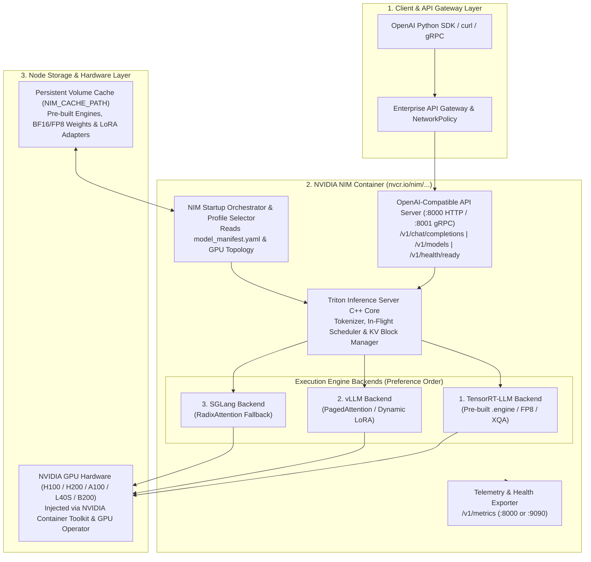
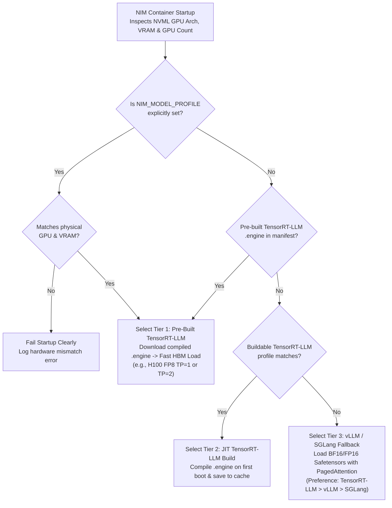
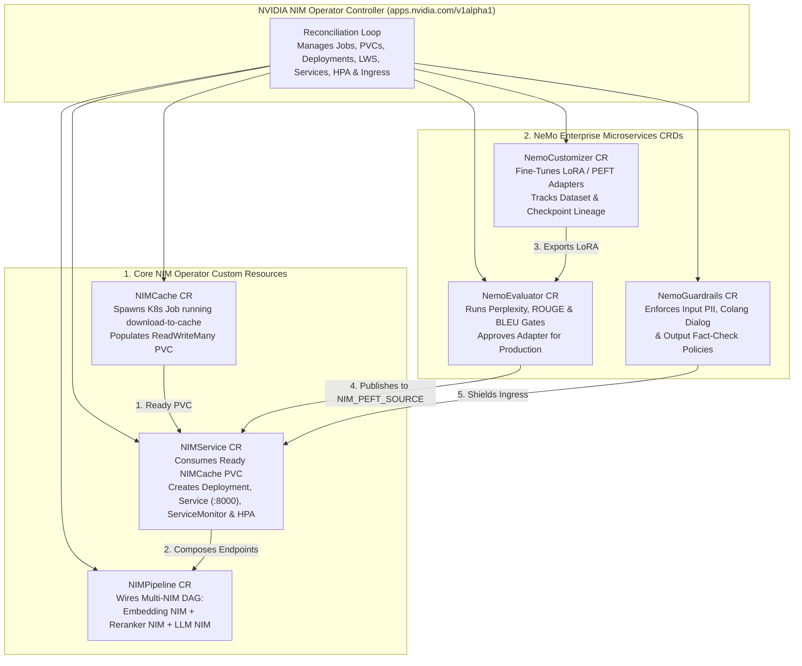

# 15.7 NVIDIA NIM and the NIM Operator

| Field | Value |
|---|---|
| Level | Advanced |
| Priority tier | 1 |
| Lab venue | GCP / GKE + Local Python Verification Lab |
| Part | Part 15: LLM inference and serving |
| Cross-references | Chapter 11.4 (NVIDIA GPU Operator); Chapter 15.3 (vLLM in depth); Chapter 15.5 (TensorRT and TensorRT-LLM); Chapter 15.6 (Triton Inference Server); Chapter 15.10 (Kubernetes inference with KServe) |
| Code | `code/part15/nvidia_nim_operator.py`, `code/part15/nvidia_nim_operator_lab.py` |

## Why this matters for AI infrastructure

Picture a platform team that is told to put Llama-3 into production by next week. Before standardized inference containers existed, that request meant six manual steps and weeks of fragile engineering. First, the team downloaded raw model weights from Hugging Face. Then it compiled hardware-specific TensorRT-LLM engines, which are optimized versions of the model built for one particular GPU type. Next, engineers wrote a custom FastAPI web wrapper so that clients could send requests, and they wired that wrapper into Triton Inference Server or vLLM. They still had to design Kubernetes health probes and keep custom Docker build pipelines working. The hardest part came later. Whenever a new model version or a CUDA security patch arrived, the platform team had to rebuild and re-test the entire stack, because any layer could have shifted under the others. CUDA is NVIDIA's platform for running code on GPUs.

A stack that the team assembled by hand also tends to fail in production in two ways. Both show up at the worst possible moment, during an incident or a traffic spike.

- Cross-vendor support deadlocks. What happens when no single team owns the failure? In Volume 14 Chapter 1, a routine Kubernetes upgrade caused model inference latency to jump by 40 percent. For 6 hours, the Kubernetes team, the runtime team, and the framework maintainers blamed one another's layers. In the end, engineers found that an auto-upgraded CUDA toolkit had altered kernel scheduling outside any tested compatibility matrix.
- Twenty-minute cold-start outages. How long does a scale-out really take? While a lightweight web server image is 20 MB and starts in 2 seconds, Llama-3-70B weights occupy 140 GB. Pulling those weights from an external registry on every pod restart forces each new replica to spend 20 minutes downloading data before it serves a single token. A horizontal autoscaler cannot help during a traffic spike if every new replica needs 20 minutes before it can answer.

NVIDIA NIM, short for NVIDIA Inference Microservices, and the Kubernetes NIM Operator are NVIDIA's answer to both problems. Think of a NIM as a sealed box that already holds everything the team used to assemble by hand. **A NIM packages an OpenAI-compatible API server, Triton Inference Server, pre-optimized TensorRT-LLM and vLLM engines, and a hardware-aware model profile selector into one immutable, SLA-backed container**. Immutable means the image never changes once it is built. SLA stands for service-level agreement, the commitment NVIDIA makes about support for that container. On Kubernetes, the NIM Operator takes over the rest of the work: shared model caching, multi-node deployment, and autoscaling, all described through declarative custom resources.

```text
Production Reference Numbers (Volume 14 Chapters 1, 3, 4, 5, 6, 8 and Labs 01-04; Volume 12 Chapter 5):
- Cold start vs cached startup (Volume 14 Chapter 4):
  Nginx container (20 MB image): 2.0 seconds startup
  Llama-3-70B NIM uncached (140 GB weights over ~116.67 MB/s network): 1,200+ seconds (20+ minutes)
  Llama-3-70B NIM with ReadWriteMany NVMe PVC (/model_cache at 3.5 GB/s): 45.0 seconds (26.78x faster)
- 7B / 8B NIM GPU memory sizing on 40 GB A100 (Volume 14 Lab 01 & Lab 02):
  14 GB weights (13,850 MiB / 13.5 GiB download) + 2 GB framework + 4 GB activations + 2 GB safety = 22 GB required (18 GB margin; ~28 GB active with runtime KV cache)
  Throughput sizing: 50 req/sec per GPU -> 2 replicas (2 GPUs) for 100 req/sec target SLO
- Pre-built TensorRT-LLM engine vs naive PyTorch on 8x H100 GPUs (TP = 8, Volume 12 Chapter 5):
  Inter-token latency drops from 115.0 ms/token to 18.4 ms/token (6.25x speedup)
- Multi-LoRA serving across 10 domain-adapted 8B models (Section 4.2 & Python verification model):
  10 dedicated pods: 10 * (16 GB weights + 2 GB runtime) = 180.0 GB VRAM across 10 GPUs
  1 Multi-LoRA NIM pod (8 GPU LoRAs * 64 MB): 16 GB + 2 GB + 0.512 GB = 18.512 GB VRAM (89.72% VRAM saved)
- NeMo Guardrails latency budget (Volume 14 Chapter 6):
  45 ms base LLM + 15 ms input check + 30 ms intent + 100 ms RAG + 50 ms output check + 10 ms audit = 250 ms (5.56x)
```

Your next model launch should feel like a change to a manifest, not a new engineering project. That is the reason to standardize your inference deployments on NVIDIA NIM and let the NIM Operator manage their cache and scaling lifecycles.

## Prerequisites and outcomes

### Prerequisites
Suppose a NIM pod stays Pending, and its events say the scheduler cannot find a GPU for it. To follow that kind of diagnosis, a few ideas from earlier chapters need to feel familiar. The list below names them.

- Review Kubernetes GPU scheduling, device plugins, and the NVIDIA GPU Operator from Chapter 11.4.
- Review PagedAttention and continuous batching in vLLM from Chapter 15.3, TensorRT-LLM engine compilation from Chapter 15.5, and Triton Inference Server from Chapter 15.6.
- Understand Kubernetes PersistentVolumeClaims, Custom Resource Definitions, and Horizontal Pod Autoscalers.

### Outcomes
A customer's NIM pods start slowly, a new LoRA adapter never shows up, and the autoscaler reacts too late. This chapter works through those problems in order. It starts with the layers inside a NIM container and where NVIDIA's support boundary sits. Next it shows how NIM chooses between pre-built TensorRT-LLM engines and the vLLM or SGLang fallbacks when it starts. Then it covers caching with NIM_CACHE_PATH, air-gapped supply chains, the OpenAI-compatible endpoints and health probes, and Multi-LoRA serving with NIM_PEFT_SOURCE. The last part covers the NIM Operator custom resources, NIMCache, NIMService, NIMPipeline, NemoGuardrails, NemoEvaluator, and NemoCustomizer, and the production fleets built from them.

---

## 1. NVIDIA NIM Container Anatomy and Enterprise Support Boundary

### 1.1 Inside the NIM Container: Unifying API, Triton, and Execution Engines

Suppose your team decides to build its own serving container for a chat model. Within a week you are gluing together a web framework, a request scheduler, an execution engine, and low-level CUDA libraries. Triton Inference Server, TensorRT-LLM, and vLLM come up in every design review, and people often describe them as competitors. A point Volume 09 and Volume 12 both make is that they actually sit at different layers. Triton is the protocol and multi-model serving wrapper, the part that accepts requests and decides which model handles them. TensorRT-LLM is a graph compiler and C++ execution runtime tied to one GPU architecture, so it turns the model into a fast program for one specific chip. vLLM is an execution engine built around PagedAttention, a way of storing the model's working memory in small blocks so that many requests can share the GPU.

NVIDIA ships all of these layers together so that you do not have to. An NVIDIA NIM container packages them into one pre-integrated image that follows the Open Container Initiative (OCI) format. The image is distributed through the NVIDIA NGC catalog, the registry where NVIDIA publishes its containers and models. When you pull `nvcr.io/nim/meta/llama3-8b-instruct:1.0.5`, you get five cooperating parts.

1. The OpenAI-compatible API frontend. This is the top layer, the part your applications talk to. It is a high-concurrency server that accepts HTTP and gRPC requests, where gRPC is a fast binary protocol used between services. HTTP listens on port 8000 and gRPC on port 8001. A client sends a standard request to `/v1/chat/completions`, `/v1/completions`, `/v1/embeddings`, or `/v1/models`, and it never needs to know which GPU or which engine runs underneath.
2. The hardware discovery and profile orchestrator. When the container boots, the NIM entrypoint, which is the startup script that runs first, inspects the physical GPUs on the host. It checks the free HBM (high-bandwidth GPU memory) capacity, the NVLink topology (how the GPUs are wired to each other), and the environment variables. It then queries an embedded manifest to select the best model profile for that exact hardware.
3. The Triton Inference Server core and tokenizer. Request routing, fast C++ tokenization, dynamic request queuing, and in-flight batch coordination all run inside an embedded Triton Inference Server core. Tokenization is the step that turns text into the numeric tokens the model actually reads.
4. The optimized execution backend. Depending on the selected profile, Triton hands token generation to a pre-compiled TensorRT-LLM C++ Executor, a vLLM PagedAttention worker group, or an SGLang runtime. This is the layer where the GPU math happens.
5. The certified CUDA userspace stack. The container bundles matched versions of CUDA, cuDNN (NVIDIA's library of deep learning primitives), TensorRT, and NCCL (the library that moves data between GPUs). Each one has been regression-tested against the NVIDIA AI Enterprise driver branch, so the versions agree with one another and with the driver underneath.



| NIM Subsystem | Architectural Role | Key Interfaces or Files | Operational Benefit |
|---|---|---|---|
| **OpenAI API Server** | Protocol ingress and schema validation | `POST /v1/chat/completions`, `GET /v1/models` | Drop-in replacement for cloud LLM APIs using standard SDKs |
| **Profile Orchestrator** | Hardware inspection and artifact resolution | `model_manifest.yaml`, `list-model-profiles` | Automatically picks the fastest engine for the host GPU |
| **Triton Serving Core** | Request queuing and decoupled streaming | In-process C API, `:8000` HTTP, `:8001` gRPC | Eliminates Python GIL stalls and coordinates token streaming |
| **Execution Backends** | Tensor Core kernel execution and KV paging | TensorRT-LLM `.engine`, vLLM, SGLang | Combines peak compiled speed with broad hardware fallback |
| **Health & Telemetry** | Kubernetes lifecycle and Prometheus metrics | `/v1/health/live`, `/v1/health/ready`, `/v1/metrics` | Prevents premature pod kills and exports TTFT and ITL histograms |

Follow one chat request through the stack to see how the layers cooperate. Your application sends a JSON message to the API frontend. The frontend checks the request against the expected schema and hands it to the Triton core. The Triton core tokenizes the text and places the request in a queue. The scheduler adds the request to the running batch alongside other users' requests. The backend runs the forward passes that produce each new token, and those tokens stream back out through the same frontend. Your code never sees any of those internal hops. It only sees an answer arriving in pieces, which is exactly what the OpenAI-compatible contract promises.

### 1.2 The NVIDIA AI Enterprise Qualification Matrix and Support Boundary

Imagine an error that starts right after a node reboots at midnight. The inference endpoint slows down, the driver team says the kernel is fine, the container team says the library is fine, and nobody can prove anything. A research lab can run any open-source serving container it likes, but a bank or a hospital cannot run an untested mix. When a failure spans the Linux kernel, the GPU driver, the container runtime, and the inference engine, an untested combination of versions leads to hours of finger-pointing.

A compatibility matrix is a table that lists which version of each layer works with which version of the others. NVIDIA AI Enterprise, the company's supported software bundle for enterprises, reduces this risk by publishing a qualified matrix, as Volume 14 Chapters 1 and 2 explain. Instead of chasing the latest commit of each library, platform engineers deploy one frozen, tested snapshot across the whole cluster. When something breaks, everyone is debugging the same set of versions.

| Stack Layer | Primary Owner | Qualified Baseline Example (V14 Lab 01 & Ch. 9) | Verification Command | Escalation Boundary |
|---|---|---|---|---|
| **Business Application** | Customer app team | React UI, RAG orchestrator, prompt logic | Application integration tests | Customer owns 100% of logic and data pipeline |
| **NIM Container** | NVIDIA (binary) / Platform (config) | `nvcr.io/nim/meta/llama3-8b-instruct:1.0.5` (`sha256:a1b2c3d4...`) | `kubectl describe pod \| grep Image` | NVIDIA supports runtime bugs (`4-hour` P1 SLA) |
| **Userspace AI Libraries** | NVIDIA AI Enterprise `24.07` | CUDA `12.4`, cuDNN `9.1.1`, TensorRT `10.1`, NCCL `2.21.5` | Checked inside container boot logs | Bundled and validated inside the NIM image |
| **Kubernetes & GPU Operator** | Platform team & vendor | Kubernetes `1.28.5`, GPU Operator `24.3.0`, Device Plugin `0.15.1` | `kubectl version` and `kubectl get pods -n gpu-operator` | Platform team owns cluster upgrades and storage |
| **OS & GPU Driver** | OEM / Platform / NVIDIA | Ubuntu `22.04 LTS` (`5.15.0-105`), Driver `550.127`, FW `535.104.05` | `nvidia-smi` and `cat /proc/driver/nvidia/version` | NVIDIA supports driver and GPU execution |

Many teams assume that adopting NIM hands the whole stack to NVIDIA. It does not. Your platform team still owns Kubernetes scheduling, PersistentVolume throughput (how fast the shared disk can be read), NetworkPolicy egress rules (which outbound connections pods may open), NGC token rotation, and canary rollback gates. NVIDIA takes responsibility for the container's runtime bugs and for the driver. Your team takes responsibility for everything around them.

Suppose a NIM pod in production starts failing late on a Friday. A digest is the unique fingerprint of an image, so it shows exactly which build is running. Before you escalate a NIM production incident, verify that your driver, CUDA, Kubernetes, and container digest match a qualified NVIDIA AI Enterprise baseline in Git. If they match, you can point NVIDIA to a known state. If they do not, the mismatch may be the fix.

---

## 2. Hardware-Aware Model Profile Selection: TensorRT-LLM vs vLLM Fallback

### 2.1 How `model_manifest.yaml` Resolves GPU Profiles at Startup

Suppose your cluster has an H100 pool and an A100 pool, and a colleague copies an engine file from one pool to the other. The pod on the A100 nodes fails at startup. The file was never meant to move.

Chapter 15.5 showed that a compiled TensorRT-LLM engine file is locked to the GPU architecture, the TensorRT version, and the tensor-parallel world size it was built for. Tensor-parallel world size is the number of GPUs that share one model's layers. An engine compiled for one H100 cannot run on an A100 or an L40S. Platform engineers therefore used to keep a separate compilation pipeline for every GPU model in the cluster.

NIM removes the manual compilation step for you. Every NIM container carries a manifest file, model_manifest.yaml, which is a list of the verified execution profiles for its model family. Think of it as a menu where each dish is labeled with the hardware it fits. At startup, the orchestrator asks NVML, the NVIDIA management library that reports on GPUs, for the GPU architecture, the memory per device, and the number of GPUs the pod can see. It then picks the profile from the menu that matches that hardware.

*Generative AI on Kubernetes* Chapter 1 describes the order in which NIM tries backends, and the order matters at startup. **TensorRT-LLM comes first, vLLM second, and SGLang third.** Read the list as a ranking. NIM goes down it and stops at the first profile that fits the hardware it found.

1. Tier 1, pre-built TensorRT-LLM engine. This is the fast path. Someone has already compiled the engine ahead of time, and NGC hosts it. If a pre-compiled TensorRT-LLM .engine matches the exact GPU model, precision (how many bits each number uses, such as FP8), and GPU count, NIM selects it automatically. For example, on two H100 GPUs, NIM selects an FP8 TensorRT-LLM profile such as tensorrt_llm-h100-fp8-tp2-throughput. The container downloads the pre-compiled engine plan straight into the cache and loads it into GPU HBM, so no compilation happens on your node.
2. Tier 2, buildable TensorRT-LLM profile. Sometimes the hardware supports TensorRT-LLM optimizations for the model's precision, but no pre-compiled binary is cached for this exact topology. In that case NIM can invoke the TensorRT-LLM builder on first startup and persist the resulting .engine to the shared cache volume, so the next pod that mounts that cache can reuse it.
3. Tier 3, vLLM or SGLang fallback. If the pod lands on a GPU model with no matching pre-built engine, or the user asks for a feature that only a generic profile offers, NIM falls back to its embedded vLLM PagedAttention backend, or to SGLang if configured. These profiles use standard BF16 or FP16 Safetensors weights. Safetensors is a file format for model weights. These are the slower but more flexible profiles, and they are the safety net when no faster profile matches.



Read the diagram from the top. The first question is whether someone pinned a profile by hand with `NIM_MODEL_PROFILE`. If nobody did, the orchestrator looks for a pre-built engine first, then a buildable engine, and only then falls back to vLLM or SGLang. Notice the difference between the two branches on the left side. A hardware mismatch on a pinned profile stops the container with a clear error, because the pinned choice was never going to work. A missing pre-built engine does not stop anything, because the fallback path exists for exactly that case. The design goal is that a node with an unusual GPU can still serve traffic, even if it runs a profile that was not picked for speed.

### 2.2 Inspecting Profiles and Sizing GPU Memory

Your capacity planner asks a simple question: will the new A100 nodes get the fast engine or the fallback? Answer it before you deploy, not after the first slow rollout. Before deploying, you can list every profile inside a NIM image by running the container with the `list-model-profiles` command. The command prints the menu of profiles that the image can run. If you want to override the automatic choice, set the `NIM_MODEL_PROFILE` environment variable. Use the override with care, because a profile that does not match the hardware makes the container exit at startup.

```bash
# List all hardware profiles supported by the Llama-3-8B-Instruct NIM image
docker run --rm --gpus all \
  nvcr.io/nim/meta/llama3-8b-instruct:1.0.5 \
  list-model-profiles
```

| Profile ID Example | Backend | Target GPU | Precision | TP Size | Min VRAM / GPU | Selection Scenario |
|---|---|---|---|---|---|---|
| `tensorrt_llm-h100-fp8-tp1-latency` | TensorRT-LLM (Pre-built) | H100 / H200 (`sm_90a`) | FP8 | 1 | `24 GB` | Lowest TTFT and ITL on a single Hopper GPU |
| `tensorrt_llm-h100-fp8-tp2-throughput` | TensorRT-LLM (Pre-built) | H100 / H200 (`sm_90a`) | FP8 | 2 | `40 GB` | Maximum concurrent token throughput across 2 Hopper GPUs |
| `tensorrt_llm-a100-bf16-tp1-lora` | TensorRT-LLM (Pre-built) | A100 (`sm_80`) | BF16 | 1 | `22 GB` | Pre-built Ampere engine with dynamic LoRA support |
| `vllm-generic-bf16-tp1-lora` | vLLM (Fallback) | Any (`A100`, `L40S`, `H100`) | BF16 | 1 | `20 GB` | Automatic fallback when GPU SKU or LoRA config lacks pre-built engine |
| `sglang-generic-bf16-tp1` | SGLang (Fallback) | Any (`sm_80+`) | BF16 | 1 | `20 GB` | Third-tier fallback or structured prefix-heavy agent workloads |

Why does NIM prefer pre-built TensorRT-LLM engines? Think about what a user feels when a long answer streams in slowly. Volume 12 Chapter 5 measured Llama-3-70B on eight H100 GPUs at 150 concurrent sessions. Inter-token latency is the wait between one generated token and the next, which is what a user experiences as typing speed. A compiled TensorRT-LLM engine cut inter-token latency from 115.0 ms per token to 18.4 ms per token, a **6.25x speedup**, and doubled token throughput. An FP8 KV cache also halves the KV memory per token, from 320 KB to 160 KB. The KV cache is the memory that stores past attention keys and values, so the model does not have to recompute them for every new token. For a 4,096-token session, that shrinks the KV footprint from 1.31 GB to 0.65 GB.

Imagine you have a single A100 and a request to schedule a 7B model on it. Before the pod goes in, you want to know whether the memory is enough and whether the node can hit the throughput target. Check the target GPU node against the profile's memory and throughput needs with the sizing model.

```text
GPU Memory and Replica Sizing Model (Volume 14 Lab 01 & Lab 02 — 7B/8B BF16 Model on A100 40GB):
  Model weights (BF16 / FP16):          14.0 GB (13,850 MiB / 13.5 GiB downloaded in Lab 02)
  Framework & CUDA context overhead:  +  2.0 GB
  Activations per request batch:      +  4.0 GB (batch size 8)
  Safety headroom (avoid 100% HBM):   +  2.0 GB
  -------------------------------------------------------------------------
  Minimum required GPU memory:        = 22.0 GB (fits on 40.0 GB A100 with 18.0 GB margin)
  Runtime steady-state VRAM (Lab 02): ~ 28.0 GB (loaded weights + active paged KV cache pool)

  Throughput & Replica Calculation:
  Target cluster throughput SLO:       100.0 requests/sec
  Single-GPU sustained throughput:      50.0 requests/sec/GPU
  Required NIM replicas (total GPUs):  ceil(100.0 / 50.0) = 2 replicas (1 node x 2 GPUs)
```

During capacity planning, run `list-model-profiles` so you know ahead of time whether your target GPU nodes will execute a pre-built TensorRT-LLM engine or fall back to vLLM. Finding out about the fallback on a whiteboard costs far less than finding out after launch, when users are already waiting on slow answers.

---

## 3. Model Caching, NGC Entitlements, and Air-Gapped Supply Chains

### 3.1 Solving the 20-Minute Cold Start with `NIM_CACHE_PATH`

Picture a rolling update that starts several new replicas at once. Each one has to get its model before it can answer a single request. A NIM image does not carry 140 GB of weights in its Docker layers. Docker layers are the stacked file snapshots that make up an image. Baking the weights in would force 150 GB image pulls and copy terabytes of identical weights across every minor software patch. Instead, the image stays small and fetches the chosen profile's weights, or its pre-built TensorRT-LLM engine, from NGC at startup.

An ephemeral container filesystem is one that disappears when the pod goes away. Volume 14 Chapter 4 points out the cost of that design when NIM runs on one. Every time a pod restarts, moves to a new node, or scales from one replica to ten, the container must download the whole model from NGC over the network. This is the cold-start problem: the long wait a new pod spends before it can serve anything.

```text
Cold-Start vs Persistent Volume Cache Math (Volume 14 Chapter 4 & Python Verification Model):
  Baseline stateless web server (Nginx):
    Image size = 20.0 MB -> Startup time = 2.0 seconds

  Llama-3-70B NIM without Persistent Cache (Ephemeral Pod Disk):
    Model weight payload (BF16) = 140.0 GB (140,000 MB)
    Effective NGC download rate = 116.67 MB/s (~1 Gbps egress link)
    Download duration           = 140,000 MB / 116.67 MB/s = 1,200.0 seconds (20.0 minutes)
    Total pod startup time      = 1,200.0 s + 5.0 s engine init = 1,205.0 seconds (20.08 minutes)

  Llama-3-70B NIM with Shared NVMe PersistentVolume (NIM_CACHE_PATH = /model_cache):
    Local NVMe / parallel filesystem read rate = 3.5 GB/s
    Cached weight load into HBM = 140.0 GB / 3.5 GB/s = 40.0 seconds
    Total warm pod startup time = 40.0 s + 5.0 s engine init = 45.0 seconds
    Startup speedup factor      = 1,205.0 s / 45.0 s = 26.78x faster startup
```

To eliminate 20-minute cold starts, production NIM deployments mount a high-speed PersistentVolume at the directory specified by NIM_CACHE_PATH, such as `/model_cache` or `/opt/nim/.cache`. A PersistentVolume is a disk that outlives any single pod, so the weights survive a restart. The first pod downloads the model artifacts once and writes them to the persistent volume. When Kubernetes scales the deployment from 1 to 10 replicas, all new pods detect the cached weights on disk and load them directly into GPU HBM in 45 seconds. The download cost is paid once, and every later pod only pays the much shorter load.

Volume 14 Chapters 4 and 7 give two rules for choosing the storage behind `NIM_CACHE_PATH`. The first question is how many nodes need the cache at the same time. The second is how much room to leave for the next version.
- Which volume type fits? If replicas spread across several Kubernetes worker nodes, use a shared ReadWriteMany (RWX) volume backed by fast NVMe storage or a high-throughput parallel filesystem, not slow legacy NFS. If only ReadWriteOnce (RWO) local NVMe volumes are available, each node must keep its own cache.
- How big should the cache be? Size the cache for more than one version. Provision at least 50Gi for 7B or 8B models and 250Gi to 500Gi for 70B models so the cache holds the active profile and earlier versions for instant rollback.

Read the cold-start block as the story of one pod. The uncached path spends almost all of its time on the network download, and the engine start-up that follows is a small slice. The cached path reverses that picture, because it spends almost all of its time reading the local disk. That difference, more than raw GPU speed, is what the cache buys you. Notice also that the cache does not make the GPU any faster. It only removes the wait that happens before the GPU has anything to work on.

### 3.2 NGC Entitlements, `NGC_API_KEY` Rotation, and Air-Gapped `download-to-cache`

Picture a brand-new cluster where the first pod fails with an authentication error, even though the image name is correct. Usually one of two credentials is missing. Pulling a NIM image and downloading its model profiles need two separate Kubernetes secrets, both backed by your NVIDIA AI Enterprise entitlement, which is the license that lets your organization use the software.
1. The container registry pull secret, referenced as imagePullSecrets, lets kubelet sign in to nvcr.io. Kubelet is the agent on each node that starts containers. The username is the literal text $oauthtoken and the password is your NGC token.
2. The pod runtime entitlement secret, NGC_API_KEY, is injected into the NIM container environment so the startup orchestrator can authenticate against `https://api.ngc.nvidia.com/v2/models` when fetching model weights or engines.

Many regulated enterprises run production clusters behind firewalls with no outbound internet access. A firewall is a gate that blocks any traffic you have not allowed. That changes the rules. Volume 14 Chapters 7 and 8 explain why mutable tags such as :latest, or live downloads at runtime, expose the platform to supply-chain drift. A supply chain is everything that delivers code and data into your cluster, and drift means the thing you tested is no longer the thing that runs. A live download can also fail on an NGC rate limit (HTTP 429) or an expired credential (HTTP 401). *BCM 11 Containerization* Appendix B shows the alternative. Air-gapped staging downloads all container images in a bastion session, which is a single controlled machine that is allowed to cross the boundary, before the artifacts move into the isolated cluster. Of an 8.6 GB base bundle, 8.1 GB is container images, which take about 15 times longer to fetch than the charts and CRDs.

For NVIDIA NIM, platform teams build a three-stage air-gapped supply chain. Each stage hands a verified artifact to the next one.

1. Pin the digest and scan the image in the DMZ. The DMZ (demilitarized zone) is the buffer network between the internet and your internal systems. On an internet-connected staging host, pull the NIM image by tag, resolve its immutable sha256 digest, and scan it with Trivy, a vulnerability scanner. Volume 14 Chapter 7 sets the gate at 0 critical, 0 high, and 0 medium CVEs. A CVE is a publicly catalogued security flaw. Only after the scan passes do you re-tag the image and push it to an internal registry such as Harbor, harbor-internal.company.com.
2. Pre-populate the model cache. Before deploying to production, run the container's built-in `download-to-cache` command in the DMZ or in a staging job. It downloads one profile, or all compatible profiles, into your shared storage volume. No live GPU is needed. The cache is filled before any production GPU is involved, so a failed download shows up in staging, not during a rollout.
3. Run with zero egress. Egress means traffic leaving the cluster. Mount the pre-populated cache volume into your air-gapped production pods and apply a Kubernetes NetworkPolicy that blocks external internet egress. The pods then have everything they need on the inside of the wall.

```bash
# 1. Authenticate to NGC and pull the NIM image by immutable SHA256 digest in the DMZ
docker login nvcr.io --username '$oauthtoken' --password "${NGC_API_KEY}"
docker pull nvcr.io/nim/meta/llama3-8b-instruct@sha256:a1b2c3d4e5f6...

# 2. Mirror the verified image to the internal enterprise Harbor registry
docker tag nvcr.io/nim/meta/llama3-8b-instruct@sha256:a1b2c3d4e5f6... \
  harbor-internal.company.com/nim/llama3-8b-instruct:1.0.5
docker push harbor-internal.company.com/nim/llama3-8b-instruct:1.0.5

# 3. Pre-populate the shared model cache volume using download-to-cache
mkdir -p /mnt/shared_nim_cache
docker run --rm \
  -e NGC_API_KEY="${NGC_API_KEY}" \
  -e NIM_CACHE_PATH=/opt/nim/.cache \
  -v /mnt/shared_nim_cache:/opt/nim/.cache \
  harbor-internal.company.com/nim/llama3-8b-instruct:1.0.5 \
  download-to-cache --profile tensorrt_llm-h100-fp8-tp1-latency
```

| Credential & Governance Control | Production Requirement (Volume 14 Ch. 7 & Ch. 8) | Failure Mode if Omitted |
|---|---|---|
| **Immutable Image Reference** | Pin `image@sha256:...` in GitOps Helm values; retain at least 3 versions (`90` days) | Mutable `:latest` tag pulls untested runtime code during node scale-out |
| **Token Storage & Identity** | Store `NGC_API_KEY` in HashiCorp Vault or AWS Secrets Manager via IRSA; never in `ConfigMap` | Plaintext credentials leaked in Git or unencrypted `etcd` snapshots |
| **Token Scope & Rotation** | Scope read-only token to approved models (`1,000` pulls/hr); rotate every `90` days | Compromised token grants wide access, or unrotated token expires silently |
| **Proactive Expiry Alerting** | Run daily Kubernetes `CronJob` checking NGC API; alert at `< 30` days before expiry | Pod scale-out fails with `401 Unauthorized` (`~15 min` manual recovery outage) |
| **Internal Mirror & Cache** | Mirror images to Harbor (`99.9%` uptime) and pre-stage `/model_cache` via `download-to-cache` | External NGC outage or `429 Too Many Requests` halts all new pod startups |

Keep one rule in view for the whole section. Do not let production NIM pods pull an unverified :latest tag or download 140 GB of weights over the public internet at runtime. A pod that starts with a tag you never checked is a pod you cannot explain later.

---

## 4. OpenAI-Compatible API, Health Probes, and Multi-LoRA Serving

### 4.1 Standardized OpenAI Endpoints and Decoupled Health Probes

An application developer on your team has used the OpenAI client library for months. Now the team wants to swap in a model it hosts itself. Does the application code have to change? Mostly it does not, because the contract stays the same. Every LLM NIM exposes an OpenAI-compatible REST API on port 8000 and gRPC on port 8001. A REST API is a set of web addresses that you call with plain HTTP requests. Because the contract matches, developers do not need to learn a proprietary inference SDK, which is a vendor's own client library. Whether the container runs Llama-3-8B on an L40S or Llama-3-70B across eight H100 GPUs, client code sees the same HTTP contract.

| HTTP Endpoint | Method | Purpose | Operational Usage |
|---|---|---|---|
| `/v1/chat/completions` | `POST` | Multi-turn chat generation with streaming (`stream: true`) | Primary application endpoint for assistants, agents, and tool calls |
| `/v1/completions` | `POST` | Raw prompt text completion (`prompt`, `max_tokens`, `temperature`) | Used for deterministic canary smoke tests (`"What is 2+2?" -> " 4"`) |
| `/v1/embeddings` | `POST` | Dense vector embedding generation (in Embedding NIMs) | Used in retrieval-augmented generation indexing and query pipelines |
| `/v1/models` | `GET` | Lists the active base model and all loaded LoRA adapter IDs | Verifies model registration and dynamic PEFT adapter discovery |
| `/v1/health/live` | `GET` | Checks whether the NIM container process and HTTP server are alive | Bound to Kubernetes `livenessProbe` to recover hung processes |
| `/v1/health/ready` | `GET` | Returns `HTTP 200` only after model weights finish loading into GPU HBM | Bound to Kubernetes `readinessProbe` and `startupProbe` |
| `/v1/metrics` or `:9090/metrics` | `GET` | Exports Prometheus histograms for TTFT, ITL, queue depth, and KV cache | Scraped every `15 s` by Prometheus `ServiceMonitor` and KEDA/HPA |

A NIM process starts in 5 seconds, but loading a 70B model into GPU memory or warming a cache takes several minutes. That gap is the source of a common outage. A liveness probe tells Kubernetes whether to restart a container. A readiness probe decides whether the pod receives traffic. A startup probe gives a slow boot its own, longer window before the other two begin judging the container. Suppose the liveness probe watches readiness and there is no startup probe. Kubelet then decides the container is deadlocked, kills the pod mid-load, and the deployment falls into an endless CrashLoopBackOff. Volume 14 Chapters 3 and 4 therefore treat **separate liveness, readiness, and startup probes as mandatory for production NIM**.

```text
Production Kubernetes Probe Timing Contract (Volume 14 Chapter 4 & Lab 01):
  1. startupProbe (GET /v1/health/ready on port 8000):
     initialDelaySeconds = 0, periodSeconds = 10, timeoutSeconds = 5, failureThreshold = 60
     Maximum allowed startup budget = 60 * 10 s = 600 seconds (10 minutes) for initial model download/load

  2. readinessProbe (GET /v1/health/ready on port 8000):
     initialDelaySeconds = 300, periodSeconds = 10, timeoutSeconds = 5, failureThreshold = 5
     Removes pod from Kubernetes Service endpoints whenever model is not ready to accept traffic

  3. livenessProbe (GET /v1/health/live or /v1/health/ready after startup completes):
     initialDelaySeconds = 60, periodSeconds = 30, timeoutSeconds = 5, failureThreshold = 3
     Restarts container after 3 consecutive failures (3 * 30 s = 90 seconds failure window)
```

Read the probe block as three different questions asked at three different times. The startup probe asks whether the model has finished loading, and it is the most patient of the three, because a large model needs time. The readiness probe asks whether the pod should receive traffic right now. It holds traffic back until the model is loaded, and it can pull a pod out of rotation if the pod falls behind later. The liveness probe asks whether the process is still alive at all. It is the most willing to restart a pod, so it has the least patience. Set its window too short and it restarts healthy pods. Set the startup window too short and it restarts pods that were still loading.

### 4.2 Multi-LoRA Dynamic Adapter Loading (`NIM_PEFT_SOURCE`)

A bank rarely runs one generic model for every department. Its retail team, its contract team, and its security team each want answers in their own vocabulary. One way to get that is to fine-tune separate Low-Rank Adaptation (LoRA) adapters for retail banking, contract review, security triage, and SQL generation. Volume 14 Chapter 5 and Lab 03 produce such adapters with NVIDIA NeMo Framework or NeMo Customizer.

Suppose each fine-tuned model gets its own full-weight NIM deployment. The GPU memory bill grows fast. Ten 8B deployments need ten GPUs holding ten copies of the 16 GB base weights, and every copy holds the same base weights.

NIM avoids this with dynamic Multi-LoRA serving. A LoRA adapter freezes the base weights and trains only two small low-rank matrices, A and B, of rank 16 or 32. A low-rank matrix holds far fewer numbers than the full weight grid it adjusts, which is why the adapter is small. Each domain adapter is therefore only 32 MB to 64 MB on disk. One NIM container loads the shared 16 GB base model into GPU memory once. It then loads dozens of adapters on demand from a local PVC (a PersistentVolumeClaim, which is a request for storage), an S3 bucket, or an NGC registry, whichever `NIM_PEFT_SOURCE` names.

```text
Dedicated Full-Model Pods vs Single Multi-LoRA NIM Instance (10 Domain-Specific 8B Models):
  Option A — 10 Separate Full-Weight NIM Deployments:
    Per-pod VRAM (16.0 GB BF16 weights + 2.0 GB runtime) =  18.0 GB per pod
    Total fleet VRAM across 10 models (10 * 18.0 GB)     = 180.0 GB across 10 GPUs

  Option B — 1 Shared Multi-LoRA NIM Instance (NIM_PEFT_SOURCE = /mnt/peft_adapters):
    Shared base model weights + runtime (16.0 + 2.0 GB)  =  18.000 GB
    Active GPU LoRA cache (NIM_MAX_GPU_LORAS = 8 * 64 MB)=   0.512 GB
    Host CPU pinned LoRA cache (NIM_MAX_CPU_LORAS = 32)  =   0.640 GB (for 10 adapters in host RAM)
    Total GPU VRAM on a single GPU                       =  18.512 GB on 1 GPU
    ---------------------------------------------------------------------------------
    GPU VRAM Saved: 180.0 GB - 18.512 GB = 161.488 GB saved (89.72% VRAM reduction)
```

*Hands-On LLM Serving and Optimization* Chapter 8 explains how this works. Picture a batch with several requests in flight, where each one asks for a different adapter. The scheduler tracks which adapter each prompt in the current continuous batch asks for. A forward pass is one run through the model that produces the next token. During that pass, every request shares the heavy base-weight matrix multiplication, and the engine applies the small adapter projection per request. The expensive part is paid once for the whole batch, and only the small part differs from one request to the next.

```bash
# Launch a NIM container with dynamic Multi-LoRA adapter discovery enabled
docker run -d --name nim-llama3-multilora \
  --gpus '"device=0"' \
  -e NGC_API_KEY="${NGC_API_KEY}" \
  -e NIM_CACHE_PATH=/model_cache \
  -e NIM_PEFT_SOURCE=/peft_adapters \
  -e NIM_PEFT_REFRESH_INTERVAL=60 \
  -e NIM_MAX_GPU_LORAS=8 \
  -e NIM_MAX_CPU_LORAS=32 \
  -v /mnt/nvme_cache:/model_cache \
  -v /mnt/lora_store:/peft_adapters \
  -p 8000:8000 \
  nvcr.io/nim/meta/llama3-8b-instruct:1.0.5

# Query a specific LoRA adapter dynamically by setting the OpenAI "model" field
curl -s http://localhost:8000/v1/chat/completions \
  -H "Content-Type: application/json" \
  -d '{
    "model": "llama3-8b-finance-lora",
    "messages": [{"role": "user", "content": "Summarize Basel III Tier 1 capital ratios."}],
    "max_tokens": 128,
    "temperature": 0.0
  }'
```

Here is the rule of thumb. If several fine-tuned variants share one base model, serve them from a single Multi-LoRA NIM deployment with `NIM_PEFT_SOURCE`. In this example that cuts the GPU footprint by nearly 90 percent, which frees whole GPUs for other work. Multi-LoRA is not a free lunch, though. A shared base model still has to serve every adapter's traffic, so a single busy adapter can crowd out the others. Keep an eye on the per-adapter request rates in staging before you move a busy team onto a shared pod. A dedicated pod still makes sense for a model that needs its own resource limits or its own release schedule.

---

## 5. The Kubernetes NIM Operator, NeMo Microservices CRDs, and Autoscaling

### 5.1 Declarative Orchestration with `NIMCache`, `NIMService`, and `NIMPipeline`

Imagine your staging test works with one container on one GPU, and then production asks for the same thing across a fleet. Running one NIM container with docker run or a static Helm chart is fine for a staging test such as Volume 14 Lab 02. Helm is the package manager that fills Kubernetes manifests with values. At cluster scale, a platform team must also coordinate model pre-caching jobs, ReadWriteMany PVCs, multi-node tensor-parallel pods, Prometheus monitoring objects, and autoscalers. Doing all of that by hand for every model version is where errors creep in.

A controller is a program that keeps the real cluster matching what you declared. The NVIDIA NIM Operator automates that lifecycle with Kubernetes controllers, as *BCM 11 Containerization* Chapter 6 and *Generative AI on Kubernetes* Chapter 1 describe. It lives in the `apps.nvidia.com/v1alpha1` API group, which is the namespace that holds its resource types. It reconciles three core Custom Resource Definitions (CRDs), which are extensions that add new resource types to Kubernetes, and three NeMo Microservices CRDs.



| Custom Resource (`CRD`) | Primary Reconciliation Responsibility | Child Kubernetes Objects Created | Key Operational Benefit |
|---|---|---|---|
| **NIMCache** | Pre-downloads and validates model profiles from NGC or internal mirror | `PersistentVolumeClaim` (`RWX`) + pre-pull Kubernetes `Job` | Guarantees weights are cached on disk before any GPU pod is scheduled |
| **NIMService** | Manages single-node or multi-node NIM inference microservice | `Deployment` or `LeaderWorkerSet`, `Service`, `Ingress`, `HPA`, `ServiceMonitor` | Automates health probes, GPU affinity, and queue-depth autoscaling |
| **NIMPipeline** | Connects multiple `NIMService` instances into a unified workflow | Coordinated `NIMService` objects + internal service discovery | Deploys full RAG pipelines (`Embed -> Rerank -> LLM`) as one unit |
| **NemoCustomizer** | Orchestrates distributed LoRA and full-parameter fine-tuning jobs | Training `Job` / `PyTorchJob` + lineage metadata store | Produces versioned LoRA weights ready for `NIM_PEFT_SOURCE` |
| **NemoEvaluator** | Benchmarks base and fine-tuned models against golden test sets | Evaluation `Job` computing perplexity, ROUGE-1, BLEU, and accuracy | Blocks degraded models from reaching production `NIMService` pods |
| **NemoGuardrails** | Deploys programmable Colang input and output policy shields | Guardrails `Deployment` + `Service` sitting in front of `NIMService` | Prevents prompt injection, PII leaks, and off-topic hallucinations |

Think of each controller as a thermostat. You set the target in a manifest, the controller measures what is actually running, and it takes the smallest step that closes the gap. If the cache job fails, the NIMService waits. If a pod disappears, the Deployment behind the NIMService creates a replacement. The loop never ends, which is why a fleet can recover without someone typing a command at midnight. The same loop also means that a wrong manifest is applied again and again until you fix it, so review changes before you apply them.

### 5.2 Production Manifests: `NIMCache` and `NIMService` with HPA

Picture the first deploy of the day. Without a cache step, the GPU pods would start before any weights sit on disk, and each one would begin its own slow download. The operator prevents that ordering problem. With the operator installed, GPU serving pods never start against an empty cache. You first declare a NIMCache resource, which is a request that says what to cache and where. The operator creates a ReadWriteMany PVC and runs a temporary Kubernetes Job that executes `download-to-cache`, a Job being a one-time task that runs to completion. Only when NIMCache reaches `status.state: Ready` does the NIMService controller schedule the GPU replicas.

```yaml
# 1. Declarative NIMCache CR: Pre-stage Llama-3-8B profiles onto a shared 50Gi RWX NVMe PVC
apiVersion: apps.nvidia.com/v1alpha1
kind: NIMCache
metadata:
  name: meta-llama3-8b-cache
  namespace: nim-production
spec:
  source:
    ngc:
      modelPuller: nvcr.io/nim/meta/llama3-8b-instruct:1.0.5
      pullSecret: ngc-secret
      authSecret: ngc-api-secret
      model:
        engine: tensorrt_llm
        tensorParallelism: "1"
  storage:
    pvc:
      create: true
      storageClass: fast-nvme-rwx
      size: "50Gi"
      volumeAccessMode: ReadWriteMany
---
# 2. Declarative NIMService CR: Mount the Ready NIMCache PVC, expose :8000, and autoscale
apiVersion: apps.nvidia.com/v1alpha1
kind: NIMService
metadata:
  name: meta-llama3-8b-service
  namespace: nim-production
spec:
  image:
    repository: nvcr.io/nim/meta/llama3-8b-instruct
    tag: "1.0.5"
    pullPolicy: IfNotPresent
    pullSecrets:
      - ngc-secret
  authSecret: ngc-api-secret
  storage:
    nimCache:
      name: meta-llama3-8b-cache
      profile: tensorrt_llm-h100-fp8-tp1-latency
  replicas: 2
  resources:
    limits:
      nvidia.com/gpu: 1
      cpu: "8"
      memory: 32Gi
    requests:
      nvidia.com/gpu: 1
      cpu: "4"
      memory: 20Gi
  expose:
    service:
      type: ClusterIP
      port: 8000
  metrics:
    enabled: true
    serviceMonitor:
      interval: 15s
  scale:
    enabled: true
    hpa:
      minReplicas: 2
      maxReplicas: 10
      metrics:
        - type: Pods
          pods:
            metric:
              name: num_requests_waiting
            target:
              type: AverageValue
              averageValue: "10"
```

Some teams already run CNCF KServe, a model-serving project hosted by the Cloud Native Computing Foundation. If your platform team has standardized on it, the NIM containers still fit in. *Generative AI on Kubernetes* Chapter 1 shows that NIM containers also plug into KServe's ServingRuntime and InferenceService. Use `serving.kserve.io/deploymentMode: Standard` or Knative, or KServe 0.16's LLMInferenceService, and mount the NIMCache PVC with `storageUri: pvc://meta-llama3-8b-cache/`. The choice of wrapper changes the YAML, but the cache is still the thing that keeps pods fast to start.

### 5.3 Queue-Depth Autoscaling, Canary Rollout Gates, and NeMo Controls

Picture a traffic spike at the start of the workday. Requests pile up faster than new replicas can start, and users see timeouts before any dashboard turns red. Why does the NIMService manifest above scale on `num_requests_waiting` and not on GPU utilization? Continuous batching means the server keeps adding new requests to the running batch as earlier ones finish, so the GPU stays busy. Under that scheme, one GPU reaches 70 to 95 percent streaming-multiprocessor utilization even with a small active batch. A streaming multiprocessor is the group of compute cores inside a GPU that does the work. A new NIM replica also needs 45 seconds to load weights from the PVC. If scaling waits until utilization crosses 70 percent, it arrives too late, because the request queue has already backed up and broken the p99 latency target. The p99 target is the latency that the slowest requests must still meet. Volume 14 Chapter 4 calls **scaling LLM services on GPU utilization alone an anti-pattern**.

Production NIM fleets therefore combine pre-cached NIMCache volumes with queue-depth and latency autoscaling. They also add automated canary circuit breakers. A canary is a small group of new pods that receives live traffic before everyone else does, and a circuit breaker stops the rollout when that group gets slower.

```text
Autoscaling, Canary Rollout, and NeMo Microservices Thresholds (Volume 14 Chapters 4, 5, 6 & Labs 01-03):
  1. Queue-Depth & Latency Autoscaling Decision Loop (sampled every 30 s):
     Trigger condition: queue_depth > 10 OR requests_waiting_total > 20
     - If p95 latency < 150 ms:       SLO met -> Hold current replica count
     - If p95 latency is 150-200 ms:  Warning band -> Prepare scale-out
     - If p95 latency > 200 ms:       SLO breach -> Scale out (+1 replica, warm load in ~45 s)

  2. Canary Rollout Circuit-Breaker Gates (1 canary replica monitored for 5-30 min at 80% load):
     - Baseline stable revision p95 latency: 180.0 ms
     - Strict canary promotion pass gate:    p95 < 200.0 ms (+10% max tolerance), GPU Util > 50%,
                                             and deterministic prompt test ("What is 2+2?" -> " 4")
     - Warning circuit-breaker threshold:    p95 >= 250.0 ms (+40% slower) -> Pause rollout & alert
     - Critical automatic rollback gate:     p95 >= 300.0 ms (+67% slower) -> Execute helm rollback (< 5 min RTO)

  3. NeMo Customizer & Evaluator Promotion Gate (Volume 14 Chapter 5 & Lab 03):
     - Full 7B domain fine-tune resource budget: 8x A100 80GB GPUs for 168 hours = 640 budgeted GPU-hours (500K examples, 10 GB compressed / 150 GB uncompressed, 100 GB storage)
     - Lab 03 4-GPU 5,000-step job: Training loss drops 2.15 -> 1.87 (eval loss 1.92, 12.8% improvement)
     - NemoEvaluator benchmark on 5,000 test examples:
       Perplexity: 18.7 (baseline) -> 15.2 (fine-tuned, 18.7% reduction)
       ROUGE-1:    0.31 (baseline) -> 0.35 (fine-tuned, +12.9% gain)
       BLEU:       0.24 (baseline) -> 0.28 (fine-tuned, +16.7% gain) -> Status: PASSED

  4. NeMo Guardrails End-to-End Latency Budget (Volume 14 Chapter 6):
     45 ms (base LLM) + 15 ms (PII/length input check, 60 ms cum.) + 30 ms (intent classifier, 90 ms cum.)
     + 100 ms (RAG retrieval, 190 ms cum.) + 50 ms (output fact-check, 240 ms cum.) + 10 ms (audit log, 7-yr retention)
     = 250.0 ms total guarded latency (5.56x / ~5.5x increase over 45 ms unguarded model)
```

Read the decision block from the top down, the way the autoscaler reads it. The first rule is the trigger. Only when the queue grows past its limit does the loop look at latency at all. Then the latency band decides whether to hold, prepare, or scale. The canary block works the same way, with a pass gate, a warning breaker, and a critical rollback, each one stricter than the last. Treat these as starting points to tune in staging, because the right values depend on your model and your traffic.

Put every NIM version upgrade behind an automated canary latency check, so a slow revision never reaches the whole fleet. When you set end-to-end latency targets, budget for the 205 ms that input, retrieval, and output guardrails add. A target that ignores that cost will look met in the lab and missed in production.

---

## 6. How It Fails: Six Production Failure Modes

It is Friday evening. A NIM rollout shows every pod as Running, yet users report slow answers. Where do you start? When a NIM deployment will not start or misses its latency target, Volume 14 Lab 04 teaches a bottom-up order of diagnosis. Check that the artifact exists, then the entitlement scope, network egress, Kubernetes secrets, and GPU hardware. Debug application prompts last. The lower layers are cheap to check and the higher layers depend on them, so a fault low in the stack can look like a prompt problem at the top.

| Failure Mode | Symptom & Telemetry Signal | Root Cause | Exact Diagnostic Command | Remediation |
|---|---|---|---|---|
| **1. Expired or Mis-Scoped `NGC_API_KEY` (`HTTP 401` / `403`)** | Pod stuck in `ImagePullBackOff` (`insufficient_scope`) or `Running` `0/1` (`NotReady`) with `401 Unauthorized` in logs | NGC token expired, truncated, or lacks scope for the target model; or `docker-registry` secret omitted literal `$oauthtoken` username | `kubectl logs <pod> \| grep -iE '401\|entitlement\|unauthorized'` and `kubectl describe pod <pod>` | Rotate `NGC_API_KEY` every `90` days (`30`-day expiry alert), recreate `ngc-secret` with `--docker-username=\$oauthtoken`, and run `kubectl rollout restart`. |
| **2. Uncached `140 GB` Cold Start & Probe Kill Loop** | `70B` pod takes `20+ min` to start or enters `CrashLoopBackOff` every `90 s` mid-download | `NIM_CACHE_PATH` mounted on ephemeral disk instead of `RWX` PVC, or `livenessProbe` fires before `startupProbe` finishes | `kubectl exec <pod> -- df -h /model_cache` and `kubectl get nimcache` | Pre-stage weights with a `NIMCache` CR (`download-to-cache` on fast NVMe `RWX` PVC) and set `startupProbe` `failureThreshold: 60, periodSeconds: 10` (`600 s`). |
| **3. Explicit `NIM_MODEL_PROFILE` Hardware Mismatch** | Container exits immediately at startup with profile incompatibility error | `NIM_MODEL_PROFILE` pinned an `H100` `FP8` `TP=2` engine on a node with `1x A100` `40 GB` or `L40S` GPU | `docker run --rm --gpus all <image> list-model-profiles` and `kubectl exec <pod> -- nvidia-smi` | Remove the invalid `NIM_MODEL_PROFILE` override so NIM auto-selects a compatible `A100` or `vLLM` fallback profile, or fix `nodeSelector`. |
| **4. Silent Precision / Backend Fallback (`+40%` Latency Regression)** | All pods report `1/1 Ready`, yet `p95` latency jumps from `180 ms` to `252 ms` (`+40%`) or `305 ms` (`+67%`) after image upgrade | New NIM revision fell back from a pre-built `FP8` TensorRT-LLM engine to an unquantized `BF16` profile or altered batching defaults | `curl -s http://prometheus:9090/api/v1/query?query=histogram_quantile(0.95,rate(nim_request_duration_seconds_bucket[5m]))` | Enforce canary rollout gates (`warning: 250 ms`, `critical: 300 ms`) and run `helm rollback <release> 0` automatically when `p95 >= 250 ms`. |
| **5. Air-Gapped Firewall or Proxy TLS Failure** | `NIMCache` job or pod hangs on `Attempting model download from NGC...` or logs `x509: certificate signed by unknown authority` | Cluster `NetworkPolicy` blocks egress to `nvcr.io` / `api.ngc.nvidia.com`, or corporate proxy intercepts TLS without CA cert | `kubectl exec <pod> -- nslookup nvcr.io` and `curl -v https://nvcr.io/v2/` | Mirror verified digests (`sha256:...`) to internal Harbor (`harbor-internal.company.com`) and pre-populate `/model_cache` via `download-to-cache` in the DMZ. |
| **6. Reactive GPU-Utilization Autoscaling Thrash** | HPA scales out too late during traffic bursts; `queue_depth` exceeds `25` and client requests time out | HPA configured on GPU SM utilization (`70%`) instead of request queue depth, combined with uncached pod boot delay | `kubectl get hpa` and `curl -s http://localhost:8000/v1/metrics \| grep requests_waiting` | Scale on `num_requests_waiting > 10` (or `requests_waiting_total > 20`) paired with `p95 > 200 ms` and a warm `NIMCache` PVC (`45 s` boot). |

Suppose a pod stays NotReady for a long stretch after a deploy. Several rows in that table share one signature. The pod reports Ready, or the rollout looks healthy, while the users still feel a slowdown. That is why you check the pod status and the latency metric separately. A green status tells you the process is alive, but it says nothing about whether the answers are fast enough.

Before you escalate a NIM readiness failure, read the pod logs for the readiness-check message and check the free space on `/model_cache`. A full cache volume and a readiness message are the two clues to look for first.

---

## 7. Hands-On Lab: NVIDIA NIM and NIM Operator Verification

### 7.1 Lab Venue and Environment Note

You want to rehearse this lab before anyone pays for GPU hours. The lab has two parts, and the first one needs no cluster at all. The setup below describes the environment for the full run.

- Primary venue: a Google Cloud GKE cluster with NVIDIA A100, L40S, or H100 GPUs, NVIDIA GPU Operator 24.3.0 or later, and the Kubernetes NIM Operator. A local Python verification suite accompanies it.
- Verification status: all 25 deterministic self-checks in `code/part15/nvidia_nim_operator_lab.py` ran locally and passed. The kubectl commands in Section 7.3 are adapted. They have not been run on a live GPU cluster.

### 7.2 Part A: Run the Local Deterministic Python Verification Suite

Start on your laptop before you touch a cluster. The self-checking lab tests profile selection with the order TensorRT-LLM, vLLM, SGLang. It also checks GPU memory and replica sizing, the cold-start and cache arithmetic, Multi-LoRA savings, NIM Operator reconciliation, NeMo metrics, and canary rollback gates. A pass here shows that the arithmetic and the decision rules are right. It does not show that a real GPU behaves that way.

```bash
python3 -B code/part15/nvidia_nim_operator_lab.py
```

```text
=== Chapter 15.7 Lab: NVIDIA NIM and the NIM Operator Verification ===
  [PASS] 1. On 2x H100 80GB GPUs (throughput mode), NIM selects pre-built TensorRT-LLM FP8 TP=2 profile
  [PASS] 2. On 1x H100 80GB GPU (latency mode), NIM selects pre-built TensorRT-LLM FP8 TP=1 latency profile
  [PASS] 3. On 1x L40S 48GB GPU without a pre-built L40S TRT-LLM engine, NIM falls back to vLLM before SGLang (TensorRT-LLM > vLLM > SGLang)
  [PASS] 4. When LoRA is required on H100 and H100 FP8 profiles lack LoRA, NIM selects the LoRA-enabled vLLM profile
  [PASS] 5. Explicit NIM_MODEL_PROFILE override ('tensorrt_llm-a100-bf16-tp1-lora') succeeds on 1x A100 40GB
  [PASS] 6. Explicit NIM_MODEL_PROFILE override for H100 TP=2 on a 1x A100 node is rejected with hardware mismatch
  [PASS] 7. V14 Lab 01 sizing: 14 GB weights + 2 GB framework + 4 GB activations + 2 GB safety = 22.0 GB required on 40.0 GB A100 (18.0 GB margin)
  [PASS] 8. V14 Lab 01 throughput sizing: 100 req/sec target at 50 req/sec per GPU requires 2 replicas (2 GPUs)
  [PASS] 9. Llama-3-70B in BF16 (140 GB weights, 156 GB total) exceeds a single 80 GB GPU and fails fit check
  [PASS] 10. Generic Nginx container (20 MB) starts in 2.0 s, whereas 140 GB Llama-3-70B uncached NGC download takes 1200.0 s (20.08 min)
  [PASS] 11. Mounting a fast NVMe PersistentVolume (NIM_CACHE_PATH=/model_cache at 3.5 GB/s) cuts 140 GB startup to 45.0 s (26.78x faster)
  [PASS] 12. Serving 10 dedicated 8B fine-tuned NIM pods requires 10 * 18.0 GB = 180.0 GB VRAM across 10 GPUs
  [PASS] 13. Multi-LoRA NIM serves 10 domain adapters using 16.0 GB base + 2.0 GB runtime + 0.512 GB GPU LoRA pool (8 * 64 MB) = 18.512 GB (89.72% VRAM reduction)
  [PASS] 14. Invalid NGC_API_KEY causes NIMCache Job to fail with 401 Unauthorized and holds NIMService in PendingCache (0 replicas)
  [PASS] 15. Under-provisioned PVC (10Gi < 20Gi required) fails NIMCache validation before serving pods schedule
  [PASS] 16. Valid NIMCache (50Gi RWX PVC) transitions NIMCache, NIMService, and 3-service NIMPipeline to Ready
  [PASS] 17. Queue depth 25 (> 10) with p95 latency 210.0 ms (> 200.0 ms SLO) triggers HPA SCALE_OUT from 2 to 3 replicas
  [PASS] 18. Queue depth 15 (> 10) with p95 latency 175.0 ms (150-200 ms band) enters WARN_PREPARE_SCALE state
  [PASS] 19. Queue depth 12 with p95 latency 120.0 ms (< 150 ms) meets SLO without scaling (SLO_MET_NO_SCALE)
  [PASS] 20. V14 Ch. 6 NemoGuardrails latency budget: 45 ms base + 15 ms input + 30 ms intent + 100 ms RAG + 50 ms output + 10 ms audit = 250.0 ms (5.56x)
  [PASS] 21. V14 Lab 03 NemoEvaluator metrics: test perplexity drops 18.7 -> 15.2 (18.7% reduction), ROUGE-1 0.31 -> 0.35 (+12.9%), BLEU 0.24 -> 0.28 (+16.7%)
  [PASS] 22. V14 Ch. 4 startupProbe (60 * 10 s = 600 s max boot window) and livenessProbe (3 * 30 s = 90 s window) protect 180 s model load
  [PASS] 23. Canary revision at p95=195.0 ms (<= 200 ms gate vs 180 ms baseline, +8.3%), GPU util 68% (> 50%), and deterministic match is promoted
  [PASS] 24. V14 Ch. 4 canary latency regression (+40%, p95=252.0 ms >= 250 ms warning threshold) pauses canary rollout
  [PASS] 25. Critical canary latency regression (p95=305.0 ms >= 300 ms critical threshold) triggers AUTOMATIC_ROLLBACK (helm rollback)
Summary: 25 passed, 0 failed
```

When you read the PASS lines, start with the arithmetic checks, because every later check depends on them. If a sizing line fails, the profile and scaling lines that follow it cannot be trusted either. Each line names the rule it tests, so a failure tells you which rule to reread in the chapter. Treat a green summary as evidence that the decision logic matches the chapter, not as evidence about any particular cluster.

### 7.3 Part B: Deploy and Validate a NIM Service on Kubernetes (not run on live hardware)

The workflow below follows Volume 14 Lab 02, and it runs in its own staging space so that a mistake cannot touch production. A Kubernetes namespace works like a labeled folder inside the cluster. The steps create a nim-staging namespace, add the NGC pull and runtime secrets, deploy NIMCache and NIMService, and check one deterministic completion. A deterministic completion is a prompt that gives the same answer every time, so you know exactly what to expect.

```bash
# 1. Create isolated staging namespace and NGC registry + API secrets
kubectl create namespace nim-staging
kubectl create secret docker-registry ngc-secret \
  --docker-server=nvcr.io \
  --docker-username=\$oauthtoken \
  --docker-password="${NGC_API_KEY}" \
  -n nim-staging

kubectl create secret generic ngc-api-secret \
  --from-literal=NGC_API_KEY="${NGC_API_KEY}" \
  -n nim-staging

# 2. Apply the NIMCache and NIMService manifests and watch reconciliation
kubectl apply -f nim-cache-and-service.yaml -n nim-staging
kubectl get nimcache,nimservice,pods -n nim-staging -w

# 3. Port-forward and verify readiness and deterministic completion (Volume 14 Lab 02)
kubectl port-forward -n nim-staging svc/meta-llama3-8b-service 8000:8000 &
curl -i http://localhost:8000/v1/health/ready
curl -s http://localhost:8000/v1/completions \
  -H "Content-Type: application/json" \
  -d '{"model": "meta/llama3-8b-instruct", "prompt": "What is 2+2?", "max_tokens": 10, "temperature": 0}' | jq .
```

---

## Checkpoint questions

<details>
<summary>1. Which six manual integration steps does an NVIDIA NIM container eliminate compared to building a DIY LLM serving stack?</summary>

A DIY stack means downloading raw Hugging Face weights, compiling hardware-specific TensorRT-LLM engines, writing a FastAPI wrapper, integrating Triton or vLLM, writing Kubernetes readiness logic, and maintaining custom Docker images. NIM pre-integrates all six into one validated container.
</details>

<details>
<summary>2. How do Triton Inference Server, TensorRT-LLM, and vLLM relate to one another inside an NVIDIA NIM container?</summary>

They operate at complementary layers rather than competing. Triton provides the C++ network protocol server, the request router, and the scheduler. TensorRT-LLM provides the pre-compiled, hardware-specific C++ execution engine. vLLM provides the PagedAttention fallback and dynamic runtime engine when a pre-built TensorRT-LLM engine is not used.
</details>

<details>
<summary>3. In what order of preference does NIM select an inference backend at startup when multiple profiles exist in model_manifest.yaml?</summary>

NIM tries TensorRT-LLM first, vLLM second, and SGLang third. Within TensorRT-LLM, it prefers a pre-built .engine matching the exact GPU architecture and Tensor Parallelism count before falling back to a buildable engine or vLLM.
</details>

<details>
<summary>4. What command lets you inspect all hardware and precision profiles supported by a NIM container image without starting the inference server?</summary>

Run the container with the list-model-profiles command, such as `docker run --rm --gpus all nvcr.io/nim/meta/llama3-8b-instruct:1.0.5 list-model-profiles`.
</details>

<details>
<summary>5. In Volume 12 Chapter 5, how much faster is a pre-built TensorRT-LLM engine on 8x H100 GPUs (TP = 8) compared to a naive PyTorch deployment for Llama-3-70B?</summary>

The compiled TensorRT-LLM engine reduces inter-token latency from 115.0 ms per token to 18.4 ms per token, a 6.25x speedup, and doubles token throughput.
</details>

<details>
<summary>6. Using the GPU sizing model, how much GPU memory is required to deploy a 7B or 8B BF16 model on a 40 GB A100 GPU, and how many replicas are needed for 100 requests per second?</summary>

The deployment needs 14 GB for weights, 2 GB for framework overhead, 4 GB for activations, and 2 GB for safety headroom. That totals 22 GB and leaves an 18 GB margin on a 40 GB A100. At 50 requests per second per GPU, a target of 100 requests per second needs 2 replicas on 2 GPUs.
</details>

<details>
<summary>7. Why does deploying a Llama-3-70B NIM without a persistent cache volume break Kubernetes horizontal autoscaling?</summary>

Llama-3-70B weights occupy 140 GB. Without a persistent volume mounted at NIM_CACHE_PATH, every new pod restarted or added by the autoscaler spends 20 minutes downloading weights over the network before it can pass readiness and serve a single request.
</details>

<details>
<summary>8. How much faster does a Llama-3-70B NIM pod start when loading 140 GB of weights from a shared NVMe PersistentVolume at 3.5 GB/s plus 5 seconds of initialization compared to a 1,205-second uncached download?</summary>

Reading 140 GB from the NVMe cache at 3.5 GB/s takes 40 seconds. Engine initialization adds 5 seconds, so the pod starts in 45 seconds instead of 1,205 seconds, a 26.78x speedup.
</details>

<details>
<summary>9. Why must a multi-node NIM deployment use a ReadWriteMany (RWX) NVMe-backed PersistentVolumeClaim rather than ReadWriteOnce (RWO) or slow network NFS?</summary>

A ReadWriteOnce volume can be mounted by only one Kubernetes node, so pods on other GPU nodes cannot share the pre-populated cache. Slow legacy NFS limits throughput during multi-gigabyte weight reads, which NVMe-backed ReadWriteMany storage avoids.
</details>

<details>
<summary>10. How do you pre-stage model weights and TensorRT-LLM engines for an air-gapped Kubernetes cluster that has no internet egress?</summary>

In a DMZ staging environment with NGC access, run the NIM container with the download-to-cache command and mount the shared storage volume at NIM_CACHE_PATH. Then mirror the SHA256-pinned container image into an internal registry such as Harbor.
</details>

<details>
<summary>11. What are the two distinct Kubernetes secrets required by a production NIM deployment, and what username must the docker-registry secret use?</summary>

A NIM deployment requires a `kubernetes.io/dockerconfigjson` secret referenced in imagePullSecrets to pull the container image from nvcr.io. The username is the literal text $oauthtoken. The second secret is an opaque secret that injects NGC_API_KEY into the pod environment to authorize model artifact downloads.
</details>

<details>
<summary>12. According to Volume 14 Chapter 8, how often should NGC API tokens be rotated in production, and when should automated expiry alerts fire?</summary>

Production NGC tokens should be rotated at least every 90 days, and a daily Kubernetes CronJob should trigger an alert whenever a token is within 30 days of expiration.
</details>

<details>
<summary>13. Why must Kubernetes startupProbe, readinessProbe, and livenessProbe be configured with distinct timing windows for NIM pods?</summary>

A 600-second startupProbe, with failureThreshold 60 and periodSeconds 10, protects the pod during the first weight download or HBM load. The readinessProbe on `/v1/health/ready` withholds traffic until the engine is loaded in GPU memory. The livenessProbe on `/v1/health/live` has a 90-second window and restarts the container only if the server process really hangs or crashes.
</details>

<details>
<summary>14. How does NIM's Multi-LoRA serving work, and how much GPU VRAM does it save across 10 fine-tuned 8B domain models?</summary>

Multi-LoRA loads the 16 GB base model into GPU HBM once. It caches the lightweight 64 MB adapters from NIM_PEFT_SOURCE, and with `NIM_MAX_GPU_LORAS=8` the GPU adapter cache is 0.512 GB. Ten separate pods would use 180.0 GB across 10 GPUs. One Multi-LoRA pod uses 18.512 GB on one GPU, which saves 161.488 GB, or 89.72 percent.
</details>

<details>
<summary>15. How does a client select a specific LoRA adapter when calling a Multi-LoRA NIM container's /v1/chat/completions endpoint?</summary>

The client passes the registered adapter identifier in the standard OpenAI model JSON field, such as "model": "llama3-8b-finance-lora". The NIM router and continuous batching scheduler dynamically apply that adapter's weights for that request's tokens.
</details>

<details>
<summary>16. What are the respective roles of the NIMCache, NIMService, and NIMPipeline Custom Resource Definitions in the Kubernetes NIM Operator?</summary>

NIMCache provisions a persistent volume and runs a Kubernetes Job to pre-download and validate model profiles. NIMService mounts that ready cache to manage the serving Deployment, Service, ServiceMonitor, and HPA. NIMPipeline wires multiple NIMService instances, such as embedding, reranking, and generation NIMs, into an end-to-end inference graph.
</details>

<details>
<summary>17. How do the NemoCustomizer, NemoEvaluator, and NemoGuardrails CRDs complement NIMService in an enterprise AI factory?</summary>

NemoCustomizer runs distributed fine-tuning jobs to produce domain-specific LoRA adapters with full dataset lineage. NemoEvaluator benchmarks those adapters on perplexity, ROUGE, and BLEU before promotion. NemoGuardrails places a Colang input and output policy shield in front of NIMService to block prompt injection, PII leaks, and hallucinations.
</details>

<details>
<summary>18. In Volume 14 Chapter 6, how much latency does a full NeMo Guardrails pipeline add to a 45 ms base LLM inference call?</summary>

Input validation adds 15 ms, intent classification 30 ms, RAG retrieval 100 ms, output fact-checking 50 ms, and audit logging 10 ms. Total response time rises from 45 ms to 250 ms, a 5.56x increase.
</details>

<details>
<summary>19. Why should NIM horizontal autoscalers trigger on queue depth and p95 latency rather than GPU compute utilization?</summary>

Continuous batching drives GPU utilization high even at moderate concurrency, and a new pod needs 45 seconds or more to load weights into HBM. Scaling when queue depth exceeds 10, or requests_waiting_total exceeds 20, and p95 latency crosses 200 ms adds capacity before the queue overflows.
</details>

<details>
<summary>20. During a canary rollout with a 180 ms p95 baseline, what happens if the new NIM revision reports all pods Ready but p95 latency rises to 252 ms or 305 ms?</summary>

The pods pass their health probes, but a rise to 252 ms, which is 40 percent slower, trips the 250 ms warning breaker and pauses the rollout. A rise to 305 ms, which is 67 percent slower, trips the 300 ms critical gate and triggers an automatic helm rollback within 5 minutes.
</details>

---

## Key takeaways

Suppose a teammate asks for the five things to remember before the first NIM goes live. These are the answers.

1. One NIM container replaces a hand-built serving stack. It integrates an OpenAI-compatible API server, Triton Inference Server, TensorRT-LLM and vLLM backends, and certified CUDA libraries under a clear enterprise support boundary.
2. At startup, NIM checks the GPU architecture, memory, and GPU count against model_manifest.yaml. It prefers TensorRT-LLM, then vLLM, then SGLang. A matching pre-built engine gave a 6.25x inter-token latency speedup.
3. Pre-staging 140 GB of weights on a persistent volume with download-to-cache cuts pod startup from over 20 minutes to 45 seconds, a 26.78x speedup. It also allows zero-egress, air-gapped operation, which means the cluster never needs an internet connection at runtime.
4. Serving ten domain-adapted 8B models from one base NIM instance with Multi-LoRA cuts GPU memory from 180.0 GB across 10 GPUs to 18.512 GB on one GPU, saving 89.72 percent.
5. The NIM Operator handles day-two operations with NIMCache, NIMService, NIMPipeline, and the NeMo Microservices CRDs. Pair it with queue-depth autoscaling, where queue depth above 10 or p95 above 200 ms scales out, and with automated latency rollback gates.

---

## Exercises

A new platform engineer is handed a NIM capacity plan on her first Monday and must check every number before the review. The exercises below follow the same path, from profile choice to memory, startup, latency, and canary gates.

1. Profile selection. A team has two H100 80 GB GPUs and runs them in throughput mode. Use the rules in Section 2 and the manifest table to name the profile and backend that NIM chooses. Next, consider one L40S 48 GB GPU, where no pre-built engine exists. Which backend does NIM choose there? Last, consider one A100 40 GB GPU where `NIM_MODEL_PROFILE` is pinned to `tensorrt_llm-h100-fp8-tp2-throughput`. What happens at startup?
2. GPU memory sizing. A 7B model runs on a 40 GB A100. Its weights take 14 GB. The framework takes 2 GB. Activations take 4 GB. Safety headroom takes 2 GB. How much memory is required? How much is left free? Each GPU sustains 50 requests per second. How many replicas serve 100 requests per second?
3. Uncached startup. A Llama-3-70B NIM pod must download its weights. The weights total 140 GB. The link delivers 116.67 MB per second. Engine initialization adds 5 seconds. How long does the pod take to start, in seconds? How long is that in minutes? How does that compare with a 20 MB Nginx container that starts in 2 seconds?
4. Cached startup. The same weights now sit on a pre-populated ReadWriteMany NVMe volume. The volume is mounted at `/model_cache`. Reads run at 3.5 GB per second. How long does the warm start take? How many times faster is it than the uncached start?
5. Memory without Multi-LoRA. Ten fine-tuned 8B models each run in their own pod. Each pod needs 16 GB for base weights. Each pod also needs 2 GB for runtime overhead. How much GPU memory is used in total? Across how many GPUs?
6. Memory with Multi-LoRA. One Multi-LoRA pod serves all ten adapters of 64 MB each. The pod runs with `NIM_MAX_GPU_LORAS=8`. How much GPU memory does it use? What percentage does that save against exercise 5?
7. Guardrails latency. The base model takes 45 ms. An input check adds 15 ms. An intent classifier adds 30 ms. Retrieval adds 100 ms. The output validator adds 50 ms. Audit logging adds 10 ms. What is the total? By what factor does it exceed the unguarded model?
8. Fine-tune gain. Volume 14 Lab 03 reports a perplexity change. Perplexity falls from 18.7 to 15.2. The ROUGE-1 score rises from 0.31 to 0.35. BLEU rises from 0.24 to 0.28. How large is each change as a percentage?
9. Canary gates. The stable revision has a p95 latency of 180 ms. The pass gate is 200 ms. The warning gate is 250 ms. The critical gate is 300 ms. A canary measures 195 ms. A canary measures 252 ms. A canary measures 305 ms. What automated action follows each reading?

---

## Sources and review notes

### Primary Sources

```text
1. NVIDIA Zero-to-Hero Volume 14 (Primary Mapped Notes & Labs for 15.7):
   - nvidia-zero-to-hero/volume-14/chapter-03-nvidia-nim-architecture.md (primary mapped source for 15.7)
   - nvidia-zero-to-hero/volume-14/chapter-04-deploying-and-operating-nim-services.md (primary mapped source for 15.7)
   - nvidia-zero-to-hero/volume-14/chapter-01-why-nvidia-ai-enterprise-exists.md
   - nvidia-zero-to-hero/volume-14/chapter-02-platform-architecture-and-support-boundary.md
   - nvidia-zero-to-hero/volume-14/chapter-05-nemo-framework-and-model-customization.md
   - nvidia-zero-to-hero/volume-14/chapter-06-nemo-guardrails-and-enterprise-controls.md
   - nvidia-zero-to-hero/volume-14/chapter-07-ngc-catalog-containers-and-artifacts.md
   - nvidia-zero-to-hero/volume-14/chapter-08-licensing-and-entitlement-operations.md
   - nvidia-zero-to-hero/volume-14/chapter-09-lifecycle-compatibility-and-upgrades.md
   - nvidia-zero-to-hero/volume-14/labs/lab-01-inspect-an-ngc-and-nim-deployment-plan.md
   - nvidia-zero-to-hero/volume-14/labs/lab-02-deploy-and-validate-a-nim-service.md
   - nvidia-zero-to-hero/volume-14/labs/lab-03-build-a-nemo-customization-workflow.md
   - nvidia-zero-to-hero/volume-14/labs/lab-04-troubleshoot-entitlement-and-runtime-failures.md
2. NVIDIA Zero-to-Hero Volume 12 & Legacy V05/V09 Notes:
   - nvidia-zero-to-hero/volume-12/chapter-03-triton-inference-server-architecture.md
   - nvidia-zero-to-hero/volume-12/chapter-05-tensorrt-llm-and-llm-execution.md
   - nvidia-zero-to-hero/volume-12/chapter-06-vllm-tgi-sglang-and-lmdeploy.md
   - nvidia-devops-legacy-v05 (LLM Inference and Serving Masterclass, Section 5.4 NVIDIA NIM)
   - nvidia-devops-legacy-v09 (Hardware & Ecosystem Gauntlet, Module 3.1 NVIDIA NIM)
3. Local Technical Book Corpus (TOON-RAG):
   - Generative AI on Kubernetes (generative-ai-on-kubernetes, Chapters 1, 3, 4: NVIDIA NIM curated container model, automatic backend selection order TensorRT-LLM > vLLM > SGLang, PersistentVolume model caching, and KServe ServingRuntime / InferenceService / LLMInferenceService integration)
   - Hands-On LLM Serving and Optimization (hands-on-llm-serving-and-optimization, Chapters 3, 8: multi-model serving cold-start mitigation, vLLM Scheduler active LoRA adapter tracking, and TensorRT-LLM vs vLLM vs SGLang trade-offs)
   - BCM 11 Containerization Manual (bcm11-containerization, Chapter 6 Kubernetes Operators and Appendices B & C air-gapped Kubernetes container/chart/CRD staging workflows)
   - DGX SuperPOD GB300 Reference Architecture (superpod-gb300-ra, Pages 1-36: NVIDIA AI Enterprise software stack, NIM microservices, NeMo, and Kubernetes GPU Operator integration)
   - Kubernetes for Generative AI Solutions (kubernetes-for-generative-ai-solutions, Chapters 6, 10: HorizontalPodAutoscaler, custom metric scaling, and GPU resource optimization)
   - Additional evaluated corpus books recorded in ledger: computer-networking-problems-and-solutions, learning-python-6th-edition, ai-systems-performance-engineering
```

### Lab Verification and Inferences Note

- All mathematical models, profile selection algorithms, cold-start and Multi-LoRA calculations, NIM Operator reconciliation checks, and NeMo Microservices metrics in `code/part15/nvidia_nim_operator.py` and `code/part15/nvidia_nim_operator_lab.py`, `25/25` checks passing, are verified locally.
- The Kubernetes and Docker GPU deployment commands in Section 7.3 represent production reference patterns adapted from Volume 14 Labs 01, 02, and 04. They are marked untested on live GPU cluster hardware in this local build environment.
- Provenance files for this chapter: `planning/coverage/chapters/15-07.md` (coverage) and `planning/ledgers/15-07.md` (claim and number ledger).
