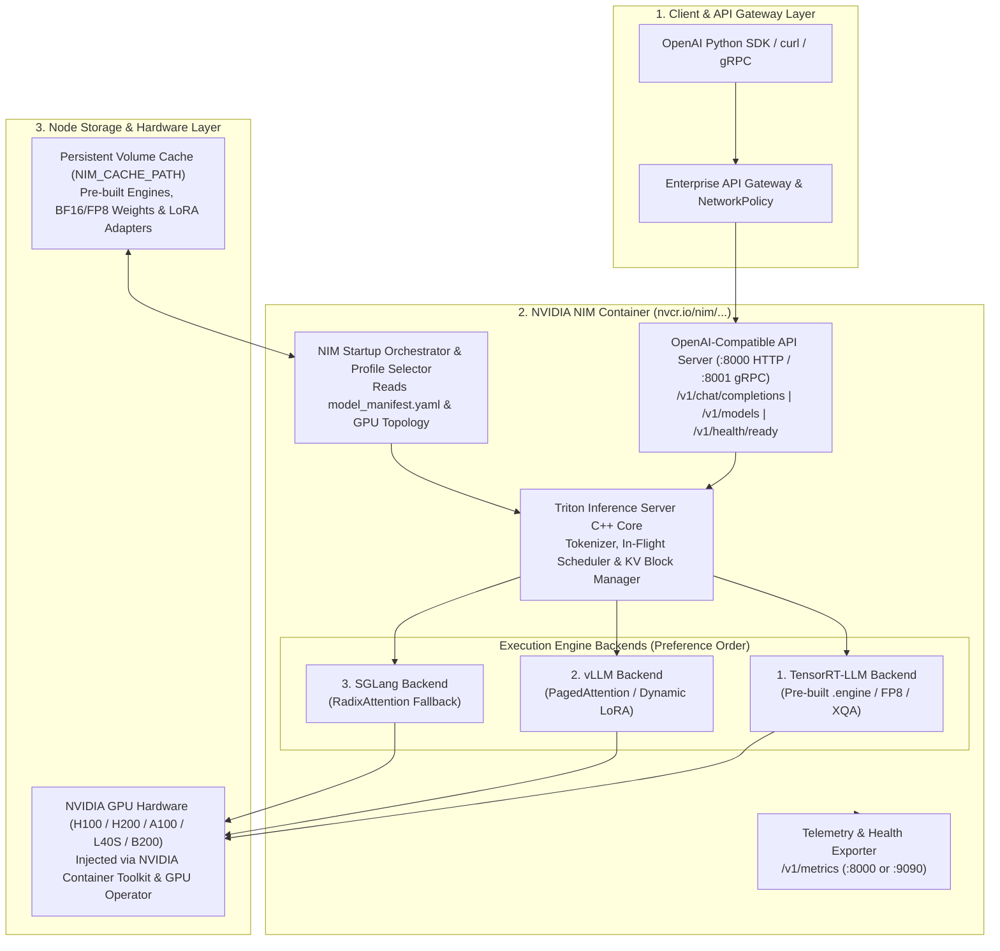
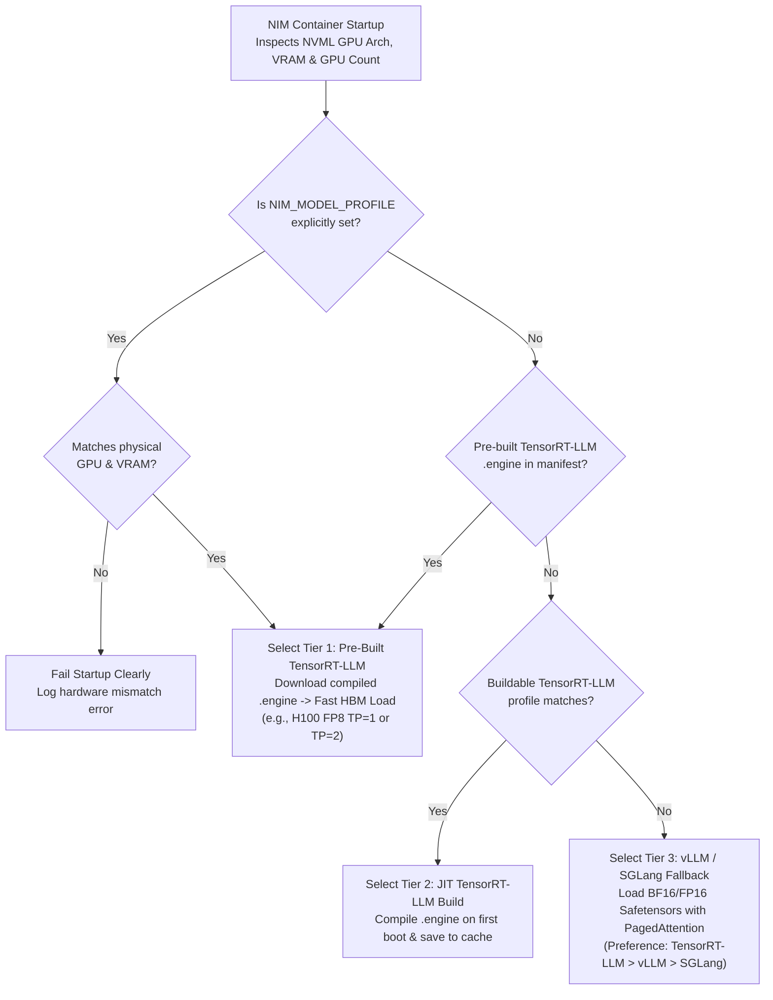
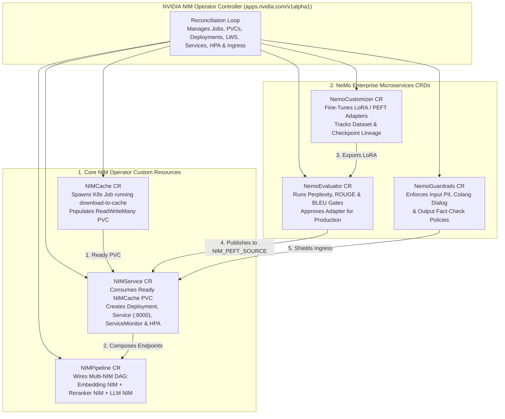

# 15.7 NVIDIA NIM and the NIM Operator

| Field | Value |
|---|---|
| Level | Advanced |
| Priority tier | 1 |
| Lab venue | GCP / GKE + Local Python Verification Lab |
| Part | Part 15: LLM inference and serving |
| Primary sources | NVIDIA Zero-to-Hero Volume 14 (`chapter-03-nvidia-nim-architecture.md`, `chapter-04-deploying-and-operating-nim-services.md`, `chapter-01-why-nvidia-ai-enterprise-exists.md`, `chapter-02-platform-architecture-and-support-boundary.md`, `chapter-05-nemo-framework-and-model-customization.md`, `chapter-06-nemo-guardrails-and-enterprise-controls.md`, `chapter-07-ngc-catalog-containers-and-artifacts.md`, `chapter-08-licensing-and-entitlement-operations.md`, `chapter-09-lifecycle-compatibility-and-upgrades.md`, `labs/lab-01..04`); Volume 12 (`chapter-03-triton-inference-server-architecture.md`, `chapter-05-tensorrt-llm-and-llm-execution.md`); *Generative AI on Kubernetes* Chapters 1, 3, 4; *Hands-On LLM Serving and Optimization* Chapters 3, 8 |
| Cross-references | Chapter 11.4 (NVIDIA GPU Operator); Chapter 15.3 (vLLM in depth); Chapter 15.5 (TensorRT and TensorRT-LLM); Chapter 15.6 (Triton Inference Server); Chapter 15.10 (Kubernetes inference with KServe) |
| Code | `code/part15/nvidia_nim_operator.py`, `code/part15/nvidia_nim_operator_lab.py` |
| Coverage file | `planning/coverage/chapters/15-07.md` |
| Claim & number ledger | `planning/ledgers/15-07.md` |

## Why this matters for AI infrastructure

Building a high-performance model serving stack from raw open-source components takes weeks of fragile engineering. Before standardized inference containers existed, deploying a foundation model like Llama-3 required six manual steps. Engineers had to download raw weights from Hugging Face, compile hardware-specific TensorRT-LLM engines, and write a custom FastAPI web wrapper. They also had to wire that wrapper into Triton Inference Server or vLLM, design Kubernetes health probes, and maintain custom Docker build pipelines. Whenever a new model version or CUDA security patch arrived, the platform team had to rebuild and re-test the entire stack.

Even worse, self-assembled stacks suffer from two operational failure modes in production.

- **Cross-vendor support deadlocks:** In Volume 14 Chapter 1, a routine Kubernetes upgrade caused model inference latency to jump by 40 percent. For 6 hours, the Kubernetes team, the runtime team, and the framework maintainers blamed one another's layers. Finally, engineers discovered an auto-upgraded CUDA toolkit had altered kernel scheduling outside any tested compatibility matrix.
- **Twenty-minute cold-start outages:** While a lightweight web server image is 20 MB and starts in 2 seconds, Llama-3-70B weights occupy 140 GB. Pulling those weights from an external registry on every pod restart forces each new replica to spend 20 minutes downloading data before serving a single token. That delay renders Kubernetes horizontal autoscalers useless during traffic spikes.

NVIDIA NIM, short for NVIDIA Inference Microservices, and the Kubernetes NIM Operator solve both problems. **A NIM packages an OpenAI-compatible API server, Triton Inference Server, pre-optimized TensorRT-LLM and vLLM engines, and a hardware-aware model profile selector into one immutable, SLA-backed container**. On Kubernetes, the NIM Operator automates shared model caching, multi-node deployment, and autoscaling through declarative custom resources.

```text
Production Reference Numbers (Volume 14 Chapters 1, 3, 4, 5, 6, 8 and Labs 01-04; Volume 12 Chapter 5):
- Cold start vs cached startup (Volume 14 Chapter 4):
  Nginx container (20 MB image): 2.0 seconds startup
  Llama-3-70B NIM uncached (140 GB weights over ~116.67 MB/s network): 1,200+ seconds (20+ minutes)
  Llama-3-70B NIM with ReadWriteMany NVMe PVC (/model_cache at 3.5 GB/s): 45.0 seconds (26.78x faster)
- 7B / 8B NIM GPU memory sizing on 40 GB A100 (Volume 14 Lab 01 & Lab 02):
  14 GB weights (13,850 MiB / 13.5 GiB download) + 2 GB framework + 4 GB activations + 2 GB safety = 22 GB required (18 GB margin; ~28 GB active with runtime KV cache)
  Throughput sizing: 50 req/sec per GPU -> 2 replicas (2 GPUs) for 100 req/sec target SLO
- Pre-built TensorRT-LLM engine vs naive PyTorch on 8x H100 GPUs (TP = 8, Volume 12 Chapter 5):
  Inter-token latency drops from 115.0 ms/token to 18.4 ms/token (6.25x speedup)
- Multi-LoRA serving across 10 domain-adapted 8B models (Section 4.2 & Python verification model):
  10 dedicated pods: 10 * (16 GB weights + 2 GB runtime) = 180.0 GB VRAM across 10 GPUs
  1 Multi-LoRA NIM pod (8 GPU LoRAs * 64 MB): 16 GB + 2 GB + 0.512 GB = 18.512 GB VRAM (89.72% VRAM saved)
- NeMo Guardrails latency budget (Volume 14 Chapter 6):
  45 ms base LLM + 15 ms input check + 30 ms intent + 100 ms RAG + 50 ms output check + 10 ms audit = 250 ms (5.56x)
```

Before you build another bespoke model-serving container, standardize your inference deployments on NVIDIA NIM and orchestrate their cache and scaling lifecycles with the NIM Operator.

## Prerequisites and outcomes

### Prerequisites
- Review Kubernetes GPU scheduling, device plugins, and the NVIDIA GPU Operator from Chapter 11.4.
- Review PagedAttention and continuous batching in vLLM from Chapter 15.3, TensorRT-LLM engine compilation from Chapter 15.5, and Triton Inference Server from Chapter 15.6.
- Understand Kubernetes PersistentVolumeClaims, Custom Resource Definitions, and Horizontal Pod Autoscalers.

### Outcomes
After completing this chapter, you will be able to.
1. Explain the internal layered architecture of an NVIDIA NIM container and how it fits within the NVIDIA AI Enterprise support boundary.
2. Predict how NIM's startup hardware discovery selects between pre-built TensorRT-LLM engines, buildable engines, and vLLM or SGLang fallback profiles.
3. Architect persistent model caches using NIM_CACHE_PATH and stage air-gapped model artifacts using download-to-cache and internal Harbor registries.
4. Configure OpenAI-compatible inference endpoints, decoupled Kubernetes health probes, and dynamic Multi-LoRA adapter loading with NIM_PEFT_SOURCE.
5. Orchestrate production inference fleets and safety pipelines on Kubernetes using the NIM Operator CRDs: NIMCache, NIMService, NIMPipeline, NemoGuardrails, NemoEvaluator, and NemoCustomizer.

---

## 1. NVIDIA NIM Container Anatomy and Enterprise Support Boundary

### 1.1 Inside the NIM Container: Unifying API, Triton, and Execution Engines

When an engineering team builds a custom serving container, they must manually glue together a web framework, a request scheduler, an execution engine, and low-level CUDA libraries. As noted in Volume 09 and Volume 12, teams often treat Triton Inference Server, TensorRT-LLM, and vLLM as mutually exclusive competitors. In reality, they operate at different layers of the stack. Triton is the enterprise protocol and multi-model serving wrapper. TensorRT-LLM is a hardware-specific graph compiler and C++ execution runtime. And vLLM is a memory-optimized execution engine powered by PagedAttention.

An NVIDIA NIM container packages all of these layers into a single, pre-integrated Open Container Initiative image distributed through the NVIDIA NGC catalog. When you pull an image such as `nvcr.io/nim/meta/llama3-8b-instruct:1.0.5`, five internal subsystems work together inside the container.

1. **OpenAI-Compatible API Frontend:** At the top layer, a high-concurrency HTTP and gRPC API server listens on port 8000 for HTTP/REST and port 8001 for gRPC. Clients send standard requests to `/v1/chat/completions`, `/v1/completions`, `/v1/embeddings`, or `/v1/models` without knowing which GPU architecture or inference engine sits underneath.
2. **Hardware Discovery and Profile Orchestrator:** At container boot, the NIM entrypoint inspects the host's physical GPUs, available HBM capacity, NVLink topology, and environment variables. It queries an embedded manifest to select the optimal model profile for that exact hardware.
3. **Triton Inference Server Core and Tokenizer:** Request routing, high-speed C++ tokenization, dynamic request queuing, and in-flight batch coordination run inside an embedded Triton Inference Server core.
4. **Optimized Execution Backend:** Depending on the selected profile, Triton dispatches token generation to a pre-compiled TensorRT-LLM C++ Executor, a vLLM PagedAttention worker group, or an SGLang runtime.
5. **Certified CUDA Userspace Stack:** The container bundles matched versions of CUDA, cuDNN, TensorRT, and NCCL that have been regression-tested against the NVIDIA AI Enterprise driver branch.



| NIM Subsystem | Architectural Role | Key Interfaces or Files | Operational Benefit |
|---|---|---|---|
| **OpenAI API Server** | Protocol ingress and schema validation | `POST /v1/chat/completions`, `GET /v1/models` | Drop-in replacement for cloud LLM APIs using standard SDKs |
| **Profile Orchestrator** | Hardware inspection and artifact resolution | `model_manifest.yaml`, `list-model-profiles` | Automatically picks the fastest engine for the host GPU |
| **Triton Serving Core** | Request queuing and decoupled streaming | In-process C API, `:8000` HTTP, `:8001` gRPC | Eliminates Python GIL stalls and coordinates token streaming |
| **Execution Backends** | Tensor Core kernel execution and KV paging | TensorRT-LLM `.engine`, vLLM, SGLang | Combines peak compiled speed with broad hardware fallback |
| **Health & Telemetry** | Kubernetes lifecycle and Prometheus metrics | `/v1/health/live`, `/v1/health/ready`, `/v1/metrics` | Prevents premature pod kills and exports TTFT and ITL histograms |

### 1.2 The NVIDIA AI Enterprise Qualification Matrix and Support Boundary

Running an open-source serving container in a research lab is very different from operating a regulated banking or healthcare platform. When a production failure spans the Linux kernel, the GPU driver, the container runtime, and the inference engine, unvalidated combinations create multi-hour finger-pointing.

Volume 14 Chapters 1 and 2 explain that NVIDIA AI Enterprise solves this integration risk by publishing a strict **Qualified Compatibility Matrix**. Rather than chasing the latest daily commit of each library, platform engineers deploy a frozen, tested snapshot across the entire cluster.

| Stack Layer | Primary Owner | Qualified Baseline Example (V14 Lab 01 & Ch. 9) | Verification Command | Escalation Boundary |
|---|---|---|---|---|
| **Business Application** | Customer app team | React UI, RAG orchestrator, prompt logic | Application integration tests | Customer owns 100% of logic and data pipeline |
| **NIM Container** | NVIDIA (binary) / Platform (config) | `nvcr.io/nim/meta/llama3-8b-instruct:1.0.5` (`sha256:a1b2c3d4...`) | `kubectl describe pod \| grep Image` | NVIDIA supports runtime bugs (`4-hour` P1 SLA) |
| **Userspace AI Libraries** | NVIDIA AI Enterprise `24.07` | CUDA `12.4`, cuDNN `9.1.1`, TensorRT `10.1`, NCCL `2.21.5` | Checked inside container boot logs | Bundled and validated inside the NIM image |
| **Kubernetes & GPU Operator** | Platform team & vendor | Kubernetes `1.28.5`, GPU Operator `24.3.0`, Device Plugin `0.15.1` | `kubectl version` and `kubectl get pods -n gpu-operator` | Platform team owns cluster upgrades and storage |
| **OS & GPU Driver** | OEM / Platform / NVIDIA | Ubuntu `22.04 LTS` (`5.15.0-105`), Driver `550.127`, FW `535.104.05` | `nvidia-smi` and `cat /proc/driver/nvidia/version` | NVIDIA supports driver and GPU execution |

Adopting NIM does not transfer infrastructure ownership to NVIDIA. Your platform team still owns Kubernetes scheduling, PersistentVolume throughput, NetworkPolicy egress rules, NGC token rotation, and canary rollback gates.

Before you escalate a NIM production incident, verify that your driver, CUDA, Kubernetes, and container digest match a qualified NVIDIA AI Enterprise baseline in Git.

---

## 2. Hardware-Aware Model Profile Selection: TensorRT-LLM vs vLLM Fallback

### 2.1 How `model_manifest.yaml` Resolves GPU Profiles at Startup

In Chapter 15.5, we saw that a compiled TensorRT-LLM .engine plan is locked to the exact GPU Streaming Multiprocessor architecture, TensorRT version. Tensor Parallelism world size on which it was built. An engine compiled for a single H100 GPU cannot execute on an A100 or L40S GPU. Historically, that hardware lock-in forced platform engineers to maintain separate compilation pipelines for every GPU SKU in their cluster.

NIM eliminates manual engine compilation through **Hardware-Aware Model Profile Selection**. Every NIM container embeds a manifest file, model_manifest.yaml, that catalogs all verified execution profiles for that model family. When the container starts, the NIM orchestrator queries NVML to detect the GPU architecture, total HBM per device, and the number of visible GPUs assigned to the pod.

As documented in *Generative AI on Kubernetes* Chapter 1, NIM evaluates compatible profiles using a strict backend preference order: **TensorRT-LLM first, vLLM second, and SGLang third**.

1. **Tier 1 — Pre-built TensorRT-LLM Engine Profile:** If NGC hosts a pre-compiled TensorRT-LLM .engine matching the exact GPU model, precision, and GPU count, NIM selects it automatically. For example, on two H100 GPUs, NIM selects an FP8 TensorRT-LLM profile such as tensorrt_llm-h100-fp8-tp2-throughput. The container downloads the pre-compiled engine plan directly into the cache and loads it into GPU HBM with zero local compilation delay.
2. **Tier 2 — Buildable TensorRT-LLM Profile:** If the hardware supports TensorRT-LLM optimizations for that model precision but a pre-compiled binary is not cached for the exact topology, NIM can invoke the TensorRT-LLM builder on first startup and persist the resulting .engine to the shared cache volume.
3. **Tier 3 — vLLM or SGLang Fallback Profile:** If the pod lands on a GPU SKU without a matching pre-built TensorRT-LLM engine. If the user requests a feature only available in a generic profile, NIM automatically falls back to its embedded vLLM PagedAttention backend. SGLang if configured, using standard BF16 or FP16 Safetensors weights.



### 2.2 Inspecting Profiles and Sizing GPU Memory

You can inspect every profile bundled inside a NIM image before deploying it by running the container with the list-model-profiles command. You can also override automatic selection by setting the NIM_MODEL_PROFILE environment variable.

```bash
# List all hardware profiles supported by the Llama-3-8B-Instruct NIM image
docker run --rm --gpus all \
  nvcr.io/nim/meta/llama3-8b-instruct:1.0.5 \
  list-model-profiles
```

| Profile ID Example | Backend | Target GPU | Precision | TP Size | Min VRAM / GPU | Selection Scenario |
|---|---|---|---|---|---|---|
| `tensorrt_llm-h100-fp8-tp1-latency` | TensorRT-LLM (Pre-built) | H100 / H200 (`sm_90a`) | FP8 | 1 | `24 GB` | Lowest TTFT and ITL on a single Hopper GPU |
| `tensorrt_llm-h100-fp8-tp2-throughput` | TensorRT-LLM (Pre-built) | H100 / H200 (`sm_90a`) | FP8 | 2 | `40 GB` | Maximum concurrent token throughput across 2 Hopper GPUs |
| `tensorrt_llm-a100-bf16-tp1-lora` | TensorRT-LLM (Pre-built) | A100 (`sm_80`) | BF16 | 1 | `22 GB` | Pre-built Ampere engine with dynamic LoRA support |
| `vllm-generic-bf16-tp1-lora` | vLLM (Fallback) | Any (`A100`, `L40S`, `H100`) | BF16 | 1 | `20 GB` | Automatic fallback when GPU SKU or LoRA config lacks pre-built engine |
| `sglang-generic-bf16-tp1` | SGLang (Fallback) | Any (`sm_80+`) | BF16 | 1 | `20 GB` | Third-tier fallback or structured prefix-heavy agent workloads |

```text
Why does NIM prioritize pre-built TensorRT-LLM engines whenever possible? As shown in Volume 12 Chapter 5, running Llama-3-70B. Eight H100 GPUs at 150 concurrent sessions with a compiled TensorRT-LLM engine cuts inter-token latency from 115.0 ms per token down to 18.4 ms per token. That represents a **6.25x latency speedup** while doubling overall token throughput. Furthermore, enabling FP8 KV cache cuts Llama-3-70B KV memory per token in half from 320 KB to 160 KB. Reducing a 4,096-token session's KV footprint from 1.31 GB to 0.65 GB.
```

Before scheduling a NIM pod, always verify that the target GPU node meets the profile's memory and throughput requirements using the sizing model from Volume 14 Lab 01.

```text
GPU Memory and Replica Sizing Model (Volume 14 Lab 01 & Lab 02 — 7B/8B BF16 Model on A100 40GB):
  Model weights (BF16 / FP16):          14.0 GB (13,850 MiB / 13.5 GiB downloaded in Lab 02)
  Framework & CUDA context overhead:  +  2.0 GB
  Activations per request batch:      +  4.0 GB (batch size 8)
  Safety headroom (avoid 100% HBM):   +  2.0 GB
  -------------------------------------------------------------------------
  Minimum required GPU memory:        = 22.0 GB (fits on 40.0 GB A100 with 18.0 GB margin)
  Runtime steady-state VRAM (Lab 02): ~ 28.0 GB (loaded weights + active paged KV cache pool)

  Throughput & Replica Calculation:
  Target cluster throughput SLO:       100.0 requests/sec
  Single-GPU sustained throughput:      50.0 requests/sec/GPU
  Required NIM replicas (total GPUs):  ceil(100.0 / 50.0) = 2 replicas (1 node x 2 GPUs)
```

Always run list-model-profiles during capacity planning so you know whether your target GPU nodes will execute a pre-built TensorRT-LLM engine or fall back to vLLM.

---

## 3. Model Caching, NGC Entitlements, and Air-Gapped Supply Chains

### 3.1 Solving the 20-Minute Cold Start with `NIM_CACHE_PATH`

A NIM container image does not bake 140 GB of neural network weights directly into the Docker layers. Baking weights into every container image would create unmanageable 150 GB image pulls and duplicate terabytes of identical weights across minor software patches. Instead, the NIM container image stays lightweight and fetches the selected profile's model weights or pre-built TensorRT-LLM engine from NGC at startup.

As Volume 14 Chapter 4 highlights, that design introduces the **Cold-Start Problem** if you deploy NIM on an ephemeral container filesystem. Every time a pod restarts, reschedules onto a new node. Scales out from 1 to 10 replicas, the container must download the entire model from NGC over the network.

```text
Cold-Start vs Persistent Volume Cache Math (Volume 14 Chapter 4 & Python Verification Model):
  Baseline stateless web server (Nginx):
    Image size = 20.0 MB -> Startup time = 2.0 seconds

  Llama-3-70B NIM without Persistent Cache (Ephemeral Pod Disk):
    Model weight payload (BF16) = 140.0 GB (140,000 MB)
    Effective NGC download rate = 116.67 MB/s (~1 Gbps egress link)
    Download duration           = 140,000 MB / 116.67 MB/s = 1,200.0 seconds (20.0 minutes)
    Total pod startup time      = 1,200.0 s + 5.0 s engine init = 1,205.0 seconds (20.08 minutes)

  Llama-3-70B NIM with Shared NVMe PersistentVolume (NIM_CACHE_PATH = /model_cache):
    Local NVMe / parallel filesystem read rate = 3.5 GB/s
    Cached weight load into HBM = 140.0 GB / 3.5 GB/s = 40.0 seconds
    Total warm pod startup time = 40.0 s + 5.0 s engine init = 45.0 seconds
    Startup speedup factor      = 1,205.0 s / 45.0 s = 26.78x faster startup
```

To eliminate 20-minute cold starts, production NIM deployments mount a high-speed PersistentVolume at the directory specified by NIM_CACHE_PATH, such as `/model_cache` or `/opt/nim/.cache`. The first pod downloads the model artifacts once and writes them to the persistent volume. When Kubernetes scales the deployment from 1 to 10 replicas, all new pods detect the cached weights on disk and load them directly into GPU HBM in 45 seconds.

When choosing a storage backend for NIM_CACHE_PATH, follow two strict rules from Volume 14 Chapters 4 and 7.
- **Use ReadWriteMany, RWX, NVMe-backed storage for multi-node fleets:** If replicas spread. Multiple Kubernetes worker nodes, bind NIM_CACHE_PATH to a shared ReadWriteMany volume backed by fast NVMe storage or a high-throughput parallel filesystem rather than slow legacy NFS. If only ReadWriteOnce, RWO, local NVMe block volumes are available, each node must maintain its own local cache volume.
- **Size the cache for multiple retained versions:** Provision at least 50Gi for 7B or 8B models and 250Gi to 500Gi for 70B models so the cache holds the active profile plus previous versions for instant rollback.

### 3.2 NGC Entitlements, `NGC_API_KEY` Rotation, and Air-Gapped `download-to-cache`

Pulling NIM container images and downloading model profiles require two distinct Kubernetes secrets backed by your NVIDIA AI Enterprise entitlement.
1. **Container Registry Pull Secret, imagePullSecrets,:** Authenticates kubelet against nvcr.io using the literal username $oauthtoken and your NGC token as the password.
2. **Pod Runtime Entitlement Secret, NGC_API_KEY,:** Injected into the NIM container environment so the startup orchestrator can authenticate against `https://api.ngc.nvidia.com/v2/models` when fetching model weights or engines.

```text
In regulated enterprises, production Kubernetes clusters sit behind strict firewalls with zero outbound internet access. Furthermore, as Volume 14 Chapters 7 and 8 emphasize, relying on mutable tags like :latest or live internet downloads exposes your platform to supply-chain drift. NGC rate limits, HTTP 429, or expired credentials, HTTP 401. In *BCM 11 Containerization* Appendix B, air-gapped staging downloads all container images, 8.1 GB out of an 8.6 GB base bundle. Taking 15x longer than charts and CRDs, in a bastion session before moving artifacts into the isolated cluster.
```

For NVIDIA NIM, platform teams implement a three-stage **Air-Gapped Supply Chain and Pre-Caching Pipeline**.

```text
1. **Digest Pinning and Security Scanning in the DMZ:** On an internet-connected staging host in the enterprise DMZ. Pull the NIM image by tag, resolve its immutable sha256 digest, and scan it with Trivy. Volume 14 Chapter 7 enforces a strict gate of 0 critical, 0 high. 0 medium CVEs before re-tagging and pushing the image to an internal registry such as Harbor, harbor-internal.company.com.
```
2. **Pre-Populating the Model Cache with download-to-cache:** Before deploying to production, run the NIM container's built-in download-to-cache command in the DMZ or via a staging job. This command downloads either a specific profile or all compatible profiles into your shared storage volume without requiring a live GPU to serve traffic.
3. **Zero-Egress Production Execution:** Mount the pre-populated cache volume into your air-gapped production pods and apply a Kubernetes NetworkPolicy that blocks external internet egress.

```bash
# 1. Authenticate to NGC and pull the NIM image by immutable SHA256 digest in the DMZ
docker login nvcr.io --username '$oauthtoken' --password "${NGC_API_KEY}"
docker pull nvcr.io/nim/meta/llama3-8b-instruct@sha256:a1b2c3d4e5f6...

# 2. Mirror the verified image to the internal enterprise Harbor registry
docker tag nvcr.io/nim/meta/llama3-8b-instruct@sha256:a1b2c3d4e5f6... \
  harbor-internal.company.com/nim/llama3-8b-instruct:1.0.5
docker push harbor-internal.company.com/nim/llama3-8b-instruct:1.0.5

# 3. Pre-populate the shared model cache volume using download-to-cache
mkdir -p /mnt/shared_nim_cache
docker run --rm \
  -e NGC_API_KEY="${NGC_API_KEY}" \
  -e NIM_CACHE_PATH=/opt/nim/.cache \
  -v /mnt/shared_nim_cache:/opt/nim/.cache \
  harbor-internal.company.com/nim/llama3-8b-instruct:1.0.5 \
  download-to-cache --profile tensorrt_llm-h100-fp8-tp1-latency
```

| Credential & Governance Control | Production Requirement (Volume 14 Ch. 7 & Ch. 8) | Failure Mode if Omitted |
|---|---|---|
| **Immutable Image Reference** | Pin `image@sha256:...` in GitOps Helm values; retain at least 3 versions (`90` days) | Mutable `:latest` tag pulls untested runtime code during node scale-out |
| **Token Storage & Identity** | Store `NGC_API_KEY` in HashiCorp Vault or AWS Secrets Manager via IRSA; never in `ConfigMap` | Plaintext credentials leaked in Git or unencrypted `etcd` snapshots |
| **Token Scope & Rotation** | Scope read-only token to approved models (`1,000` pulls/hr); rotate every `90` days | Compromised token grants wide access, or unrotated token expires silently |
| **Proactive Expiry Alerting** | Run daily Kubernetes `CronJob` checking NGC API; alert at `< 30` days before expiry | Pod scale-out fails with `401 Unauthorized` (`~15 min` manual recovery outage) |
| **Internal Mirror & Cache** | Mirror images to Harbor (`99.9%` uptime) and pre-stage `/model_cache` via `download-to-cache` | External NGC outage or `429 Too Many Requests` halts all new pod startups |

Never allow production NIM pods to pull unverified :latest tags or download 140 GB model weights over the public internet at runtime.

---

## 4. OpenAI-Compatible API, Health Probes, and Multi-LoRA Serving

### 4.1 Standardized OpenAI Endpoints and Decoupled Health Probes

One of NIM's biggest operational advantages is that application developers never need to learn a proprietary inference SDK. Every LLM NIM exposes a drop-in OpenAI-compatible REST API on port 8000 alongside gRPC on port 8001. Whether the container runs Llama-3-8B on an L40S GPU or Llama-3-70B across eight H100 GPUs, client code interacts with the exact same HTTP contract.

| HTTP Endpoint | Method | Purpose | Operational Usage |
|---|---|---|---|
| `/v1/chat/completions` | `POST` | Multi-turn chat generation with streaming (`stream: true`) | Primary application endpoint for assistants, agents, and tool calls |
| `/v1/completions` | `POST` | Raw prompt text completion (`prompt`, `max_tokens`, `temperature`) | Used for deterministic canary smoke tests (`"What is 2+2?" -> " 4"`) |
| `/v1/embeddings` | `POST` | Dense vector embedding generation (in Embedding NIMs) | Used in retrieval-augmented generation indexing and query pipelines |
| `/v1/models` | `GET` | Lists the active base model and all loaded LoRA adapter IDs | Verifies model registration and dynamic PEFT adapter discovery |
| `/v1/health/live` | `GET` | Checks whether the NIM container process and HTTP server are alive | Bound to Kubernetes `livenessProbe` to recover hung processes |
| `/v1/health/ready` | `GET` | Returns `HTTP 200` only after model weights finish loading into GPU HBM | Bound to Kubernetes `readinessProbe` and `startupProbe` |
| `/v1/metrics` or `:9090/metrics` | `GET` | Exports Prometheus histograms for TTFT, ITL, queue depth, and KV cache | Scraped every `15 s` by Prometheus `ServiceMonitor` and KEDA/HPA |

As Volume 14 Chapters 3 and 4 emphasize, **separating liveness, readiness, and startup probes is mandatory for production NIM deployments**. While a container process starts in 5 seconds, loading a 70B model into GPU memory or warming a cache takes several minutes. If you bind livenessProbe to readiness without a startupProbe, kubelet will assume the container is deadlocked, kill the pod mid-load, and trap the deployment in an infinite CrashLoopBackOff cycle.

```text
Production Kubernetes Probe Timing Contract (Volume 14 Chapter 4 & Lab 01):
  1. startupProbe (GET /v1/health/ready on port 8000):
     initialDelaySeconds = 0, periodSeconds = 10, timeoutSeconds = 5, failureThreshold = 60
     Maximum allowed startup budget = 60 * 10 s = 600 seconds (10 minutes) for initial model download/load

  2. readinessProbe (GET /v1/health/ready on port 8000):
     initialDelaySeconds = 300, periodSeconds = 10, timeoutSeconds = 5, failureThreshold = 5
     Removes pod from Kubernetes Service endpoints whenever model is not ready to accept traffic

  3. livenessProbe (GET /v1/health/live or /v1/health/ready after startup completes):
     initialDelaySeconds = 60, periodSeconds = 30, timeoutSeconds = 5, failureThreshold = 3
     Restarts container after 3 consecutive failures (3 * 30 s = 90 seconds failure window)
```

### 4.2 Multi-LoRA Dynamic Adapter Loading (`NIM_PEFT_SOURCE`)

Enterprises rarely deploy a single generic model for every department. A financial institution might fine-tune separate Low-Rank Adaptation adapters—produced via NVIDIA NeMo Framework or NeMo Customizer as shown in Volume 14 Chapter 5 and Lab 03—for retail banking, legal contract review, cybersecurity triage, and SQL code generation.

If you deploy each fine-tuned model as a standalone full-weight NIM deployment, GPU memory costs explode. Ten separate 8B model deployments require ten dedicated GPUs holding ten copies of the 16 GB base weights.

NIM solves this multi-tenancy bottleneck with **Dynamic Multi-LoRA Serving**. Because a LoRA adapter freezes the base model weights and trains only low-rank update matrices. A and B of rank `r = 16` or `r = 32`, each domain adapter occupies only 32 MB to 64 MB on disk. A single NIM container loads the shared 16 GB base model into GPU HBM once and dynamically loads dozens of lightweight LoRA adapters from a local PVC, S3 bucket. NGC registry specified by NIM_PEFT_SOURCE.

```text
Dedicated Full-Model Pods vs Single Multi-LoRA NIM Instance (10 Domain-Specific 8B Models):
  Option A — 10 Separate Full-Weight NIM Deployments:
    Per-pod VRAM (16.0 GB BF16 weights + 2.0 GB runtime) =  18.0 GB per pod
    Total fleet VRAM across 10 models (10 * 18.0 GB)     = 180.0 GB across 10 GPUs

  Option B — 1 Shared Multi-LoRA NIM Instance (NIM_PEFT_SOURCE = /mnt/peft_adapters):
    Shared base model weights + runtime (16.0 + 2.0 GB)  =  18.000 GB
    Active GPU LoRA cache (NIM_MAX_GPU_LORAS = 8 * 64 MB)=   0.512 GB
    Host CPU pinned LoRA cache (NIM_MAX_CPU_LORAS = 32)  =   0.640 GB (for 10 adapters in host RAM)
    Total GPU VRAM on a single GPU                       =  18.512 GB on 1 GPU
    ---------------------------------------------------------------------------------
    GPU VRAM Saved: 180.0 GB - 18.512 GB = 161.488 GB saved (89.72% VRAM reduction)
```

As detailed in *Hands-On LLM Serving and Optimization* Chapter 8, the underlying scheduler tracks which LoRA adapter is requested by each incoming prompt inside the current continuous batch. During the forward pass, all requests in the batch share the heavy base-weight matrix multiplication, and the execution engine applies the lightweight adapter projections per request.

```bash
# Launch a NIM container with dynamic Multi-LoRA adapter discovery enabled
docker run -d --name nim-llama3-multilora \
  --gpus '"device=0"' \
  -e NGC_API_KEY="${NGC_API_KEY}" \
  -e NIM_CACHE_PATH=/model_cache \
  -e NIM_PEFT_SOURCE=/peft_adapters \
  -e NIM_PEFT_REFRESH_INTERVAL=60 \
  -e NIM_MAX_GPU_LORAS=8 \
  -e NIM_MAX_CPU_LORAS=32 \
  -v /mnt/nvme_cache:/model_cache \
  -v /mnt/lora_store:/peft_adapters \
  -p 8000:8000 \
  nvcr.io/nim/meta/llama3-8b-instruct:1.0.5

# Query a specific LoRA adapter dynamically by setting the OpenAI "model" field
curl -s http://localhost:8000/v1/chat/completions \
  -H "Content-Type: application/json" \
  -d '{
    "model": "llama3-8b-finance-lora",
    "messages": [{"role": "user", "content": "Summarize Basel III Tier 1 capital ratios."}],
    "max_tokens": 128,
    "temperature": 0.0
  }'
```

When you serve multiple fine-tuned variants of the same base foundation model, consolidate them into a single Multi-LoRA NIM deployment using NIM_PEFT_SOURCE to cut GPU footprint by nearly 90 percent.

---

## 5. The Kubernetes NIM Operator, NeMo Microservices CRDs, and Autoscaling

### 5.1 Declarative Orchestration with `NIMCache`, `NIMService`, and `NIMPipeline`

Deploying a single NIM container with docker run or a static Helm chart works for initial staging tests, such as Volume 14 Lab 02. At cluster scale, however, platform teams must coordinate model pre-caching jobs, ReadWriteMany PVCs, multi-node Tensor Parallelism LeaderWorkerSet pods, Prometheus ServiceMonitor objects, KServe InferenceService resources, and Horizontal Pod Autoscalers.

To automate this entire lifecycle using Kubernetes-native controllers, *BCM 11 Containerization* Chapter 6 and *Generative AI on Kubernetes* Chapter 1. NVIDIA provides the **NVIDIA NIM Operator** under the `apps.nvidia.com/v1alpha1` API group. The NIM Operator reconciles three core Custom Resource Definitions alongside three **NeMo Microservices CRDs**.



| Custom Resource (`CRD`) | Primary Reconciliation Responsibility | Child Kubernetes Objects Created | Key Operational Benefit |
|---|---|---|---|
| **NIMCache** | Pre-downloads and validates model profiles from NGC or internal mirror | `PersistentVolumeClaim` (`RWX`) + pre-pull Kubernetes `Job` | Guarantees weights are cached on disk before any GPU pod is scheduled |
| **NIMService** | Manages single-node or multi-node NIM inference microservice | `Deployment` or `LeaderWorkerSet`, `Service`, `Ingress`, `HPA`, `ServiceMonitor` | Automates health probes, GPU affinity, and queue-depth autoscaling |
| **NIMPipeline** | Connects multiple `NIMService` instances into a unified workflow | Coordinated `NIMService` objects + internal service discovery | Deploys full RAG pipelines (`Embed -> Rerank -> LLM`) as one unit |
| **NemoCustomizer** | Orchestrates distributed LoRA and full-parameter fine-tuning jobs | Training `Job` / `PyTorchJob` + lineage metadata store | Produces versioned LoRA weights ready for `NIM_PEFT_SOURCE` |
| **NemoEvaluator** | Benchmarks base and fine-tuned models against golden test sets | Evaluation `Job` computing perplexity, ROUGE-1, BLEU, and accuracy | Blocks degraded models from reaching production `NIMService` pods |
| **NemoGuardrails** | Deploys programmable Colang input and output policy shields | Guardrails `Deployment` + `Service` sitting in front of `NIMService` | Prevents prompt injection, PII leaks, and off-topic hallucinations |

### 5.2 Production Manifests: `NIMCache` and `NIMService` with HPA

With the NIM Operator installed, you never launch GPU serving pods against an empty cache. First, you declare a NIMCache resource. The operator creates a ReadWriteMany PVC and launches a temporary CPU or GPU Kubernetes Job that runs download-to-cache. Only after NIMCache reaches status.state: Ready does the NIMService controller schedule the GPU serving replicas.

```yaml
# 1. Declarative NIMCache CR: Pre-stage Llama-3-8B profiles onto a shared 50Gi RWX NVMe PVC
apiVersion: apps.nvidia.com/v1alpha1
kind: NIMCache
metadata:
  name: meta-llama3-8b-cache
  namespace: nim-production
spec:
  source:
    ngc:
      modelPuller: nvcr.io/nim/meta/llama3-8b-instruct:1.0.5
      pullSecret: ngc-secret
      authSecret: ngc-api-secret
      model:
        engine: tensorrt_llm
        tensorParallelism: "1"
  storage:
    pvc:
      create: true
      storageClass: fast-nvme-rwx
      size: "50Gi"
      volumeAccessMode: ReadWriteMany
---
# 2. Declarative NIMService CR: Mount the Ready NIMCache PVC, expose :8000, and autoscale
apiVersion: apps.nvidia.com/v1alpha1
kind: NIMService
metadata:
  name: meta-llama3-8b-service
  namespace: nim-production
spec:
  image:
    repository: nvcr.io/nim/meta/llama3-8b-instruct
    tag: "1.0.5"
    pullPolicy: IfNotPresent
    pullSecrets:
      - ngc-secret
  authSecret: ngc-api-secret
  storage:
    nimCache:
      name: meta-llama3-8b-cache
      profile: tensorrt_llm-h100-fp8-tp1-latency
  replicas: 2
  resources:
    limits:
      nvidia.com/gpu: 1
      cpu: "8"
      memory: 32Gi
    requests:
      nvidia.com/gpu: 1
      cpu: "4"
      memory: 20Gi
  expose:
    service:
      type: ClusterIP
      port: 8000
  metrics:
    enabled: true
    serviceMonitor:
      interval: 15s
  scale:
    enabled: true
    hpa:
      minReplicas: 2
      maxReplicas: 10
      metrics:
        - type: Pods
          pods:
            metric:
              name: num_requests_waiting
            target:
              type: AverageValue
              averageValue: "10"
```

When a platform team already standardizes on CNCF KServe, *Generative AI on Kubernetes* Chapter 1. NIM containers also plug directly into KServe's ServingRuntime and InferenceService, using `serving.kserve.io/deploymentMode: Standard` or Knative, or KServe 0.16's LLMInferenceService by mounting the NIMCache PVC via `storageUri: pvc://meta-llama3-8b-cache/`.

### 5.3 Queue-Depth Autoscaling, Canary Rollout Gates, and NeMo Controls

```text
Why does the NIMService manifest above scale on num_requests_waiting rather than GPU compute utilization? Volume 14 Chapter 4 explains that **scaling LLM services on GPU utilization alone is an operational anti-pattern**. Under continuous batching, a single GPU reaches 70 to 95 percent SM utilization even with a small active batch. Furthermore, because a new NIM replica takes 45 seconds to load weights from the PVC. Reactive scaling triggered after GPU utilization crosses 70 percent arrives too late—the request queue has already backed up and violated your p99 latency SLO.
```

Instead, production NIM fleets combine pre-cached NIMCache volumes with **Queue-Depth and Latency SLO Autoscaling**, supplemented by automated **Canary Rollout Circuit Breakers**.

```text
Autoscaling, Canary Rollout, and NeMo Microservices Thresholds (Volume 14 Chapters 4, 5, 6 & Labs 01-03):
  1. Queue-Depth & Latency Autoscaling Decision Loop (sampled every 30 s):
     Trigger condition: queue_depth > 10 OR requests_waiting_total > 20
     - If p95 latency < 150 ms:       SLO met -> Hold current replica count
     - If p95 latency is 150-200 ms:  Warning band -> Prepare scale-out
     - If p95 latency > 200 ms:       SLO breach -> Scale out (+1 replica, warm load in ~45 s)

  2. Canary Rollout Circuit-Breaker Gates (1 canary replica monitored for 5-30 min at 80% load):
     - Baseline stable revision p95 latency: 180.0 ms
     - Strict canary promotion pass gate:    p95 < 200.0 ms (+10% max tolerance), GPU Util > 50%,
                                             and deterministic prompt test ("What is 2+2?" -> " 4")
     - Warning circuit-breaker threshold:    p95 >= 250.0 ms (+40% slower) -> Pause rollout & alert
     - Critical automatic rollback gate:     p95 >= 300.0 ms (+67% slower) -> Execute helm rollback (< 5 min RTO)

  3. NeMo Customizer & Evaluator Promotion Gate (Volume 14 Chapter 5 & Lab 03):
     - Full 7B domain fine-tune resource budget: 8x A100 80GB GPUs for 168 hours = 640 budgeted GPU-hours (500K examples, 10 GB compressed / 150 GB uncompressed, 100 GB storage)
     - Lab 03 4-GPU 5,000-step job: Training loss drops 2.15 -> 1.87 (eval loss 1.92, 12.8% improvement)
     - NemoEvaluator benchmark on 5,000 test examples:
       Perplexity: 18.7 (baseline) -> 15.2 (fine-tuned, 18.7% reduction)
       ROUGE-1:    0.31 (baseline) -> 0.35 (fine-tuned, +12.9% gain)
       BLEU:       0.24 (baseline) -> 0.28 (fine-tuned, +16.7% gain) -> Status: PASSED

  4. NeMo Guardrails End-to-End Latency Budget (Volume 14 Chapter 6):
     45 ms (base LLM) + 15 ms (PII/length input check, 60 ms cum.) + 30 ms (intent classifier, 90 ms cum.)
     + 100 ms (RAG retrieval, 190 ms cum.) + 50 ms (output fact-check, 240 ms cum.) + 10 ms (audit log, 7-yr retention)
     = 250.0 ms total guarded latency (5.56x / ~5.5x increase over 45 ms unguarded model)
```

Always gate NIM version upgrades behind an automated canary latency check and account for the 205 ms overhead of input, retrieval, and output guardrails when budgeting end-to-end application SLOs.

---

## 6. How It Fails: Six Production Failure Modes

When a NIM deployment fails to start or violates latency targets, Volume 14 Lab 04 teaches **ordered bottom-up diagnosis**. Verify artifact existence, entitlement scope, network egress, Kubernetes secrets, and GPU hardware before debugging application prompts.

| Failure Mode | Symptom & Telemetry Signal | Root Cause | Exact Diagnostic Command | Remediation |
|---|---|---|---|---|
| **1. Expired or Mis-Scoped `NGC_API_KEY` (`HTTP 401` / `403`)** | Pod stuck in `ImagePullBackOff` (`insufficient_scope`) or `Running` `0/1` (`NotReady`) with `401 Unauthorized` in logs | NGC token expired, truncated, or lacks scope for the target model; or `docker-registry` secret omitted literal `$oauthtoken` username | `kubectl logs <pod> \| grep -iE '401\|entitlement\|unauthorized'` and `kubectl describe pod <pod>` | Rotate `NGC_API_KEY` every `90` days (`30`-day expiry alert), recreate `ngc-secret` with `--docker-username=\$oauthtoken`, and run `kubectl rollout restart`. |
| **2. Uncached `140 GB` Cold Start & Probe Kill Loop** | `70B` pod takes `20+ min` to start or enters `CrashLoopBackOff` every `90 s` mid-download | `NIM_CACHE_PATH` mounted on ephemeral disk instead of `RWX` PVC, or `livenessProbe` fires before `startupProbe` finishes | `kubectl exec <pod> -- df -h /model_cache` and `kubectl get nimcache` | Pre-stage weights with a `NIMCache` CR (`download-to-cache` on fast NVMe `RWX` PVC) and set `startupProbe` `failureThreshold: 60, periodSeconds: 10` (`600 s`). |
| **3. Explicit `NIM_MODEL_PROFILE` Hardware Mismatch** | Container exits immediately at startup with profile incompatibility error | `NIM_MODEL_PROFILE` pinned an `H100` `FP8` `TP=2` engine on a node with `1x A100` `40 GB` or `L40S` GPU | `docker run --rm --gpus all <image> list-model-profiles` and `kubectl exec <pod> -- nvidia-smi` | Remove the invalid `NIM_MODEL_PROFILE` override so NIM auto-selects a compatible `A100` or `vLLM` fallback profile, or fix `nodeSelector`. |
| **4. Silent Precision / Backend Fallback (`+40%` Latency Regression)** | All pods report `1/1 Ready`, yet `p95` latency jumps from `180 ms` to `252 ms` (`+40%`) or `305 ms` (`+67%`) after image upgrade | New NIM revision fell back from a pre-built `FP8` TensorRT-LLM engine to an unquantized `BF16` profile or altered batching defaults | `curl -s http://prometheus:9090/api/v1/query?query=histogram_quantile(0.95,rate(nim_request_duration_seconds_bucket[5m]))` | Enforce canary rollout gates (`warning: 250 ms`, `critical: 300 ms`) and run `helm rollback <release> 0` automatically when `p95 >= 250 ms`. |
| **5. Air-Gapped Firewall or Proxy TLS Failure** | `NIMCache` job or pod hangs on `Attempting model download from NGC...` or logs `x509: certificate signed by unknown authority` | Cluster `NetworkPolicy` blocks egress to `nvcr.io` / `api.ngc.nvidia.com`, or corporate proxy intercepts TLS without CA cert | `kubectl exec <pod> -- nslookup nvcr.io` and `curl -v https://nvcr.io/v2/` | Mirror verified digests (`sha256:...`) to internal Harbor (`harbor-internal.company.com`) and pre-populate `/model_cache` via `download-to-cache` in the DMZ. |
| **6. Reactive GPU-Utilization Autoscaling Thrash** | HPA scales out too late during traffic bursts; `queue_depth` exceeds `25` and client requests time out | HPA configured on GPU SM utilization (`70%`) instead of request queue depth, combined with uncached pod boot delay | `kubectl get hpa` and `curl -s http://localhost:8000/v1/metrics \| grep requests_waiting` | Scale on `num_requests_waiting > 10` (or `requests_waiting_total > 20`) paired with `p95 > 200 ms` and a warm `NIMCache` PVC (`45 s` boot). |

Always inspect kubectl logs `<pod>` for Readiness check passed and verify `/model_cache` disk space before escalating a NIM readiness failure.

---

## 7. Hands-On Lab: NVIDIA NIM and NIM Operator Verification

### 7.1 Lab Venue and Environment Note

- **Primary venue:** Google Cloud Platform, GCP / GKE, GPU cluster equipped with NVIDIA A100, L40S. H100 GPUs, NVIDIA GPU Operator 24.3.0+, and the Kubernetes NIM Operator, paired with our local deterministic Python verification suite.
```text
- **Verification status:** All 25 deterministic self-checks in `code/part15/nvidia_nim_operator_lab.py` were executed and verified locally, Summary: 25 passed, 0 failed. The GKE Helm and kubectl deployment commands in Section 7.3 are adapted from Volume 14 Labs 01, 02, and 04. Those live cluster commands have not been executed on a live GPU cluster in this local build environment, untested on live hardware.
```

### 7.2 Part A: Run the Local Deterministic Python Verification Suite

Run the self-checking verification lab to test hardware-aware profile selection, TensorRT-LLM > vLLM > SGLang. GPU VRAM and replica sizing, 140 GB cold-start versus NVMe PVC caching math, Multi-LoRA memory savings, NIM Operator reconciliation, NeMo Microservices metrics, and canary rollback gates.

```bash
python3 -B code/part15/nvidia_nim_operator_lab.py
```

```text
=== Chapter 15.7 Lab: NVIDIA NIM and the NIM Operator Verification ===
  [PASS] 1. On 2x H100 80GB GPUs (throughput mode), NIM selects pre-built TensorRT-LLM FP8 TP=2 profile
  [PASS] 2. On 1x H100 80GB GPU (latency mode), NIM selects pre-built TensorRT-LLM FP8 TP=1 latency profile
  [PASS] 3. On 1x L40S 48GB GPU without a pre-built L40S TRT-LLM engine, NIM falls back to vLLM before SGLang (TensorRT-LLM > vLLM > SGLang)
  [PASS] 4. When LoRA is required on H100 and H100 FP8 profiles lack LoRA, NIM selects the LoRA-enabled vLLM profile
  [PASS] 5. Explicit NIM_MODEL_PROFILE override ('tensorrt_llm-a100-bf16-tp1-lora') succeeds on 1x A100 40GB
  [PASS] 6. Explicit NIM_MODEL_PROFILE override for H100 TP=2 on a 1x A100 node is rejected with hardware mismatch
  [PASS] 7. V14 Lab 01 sizing: 14 GB weights + 2 GB framework + 4 GB activations + 2 GB safety = 22.0 GB required on 40.0 GB A100 (18.0 GB margin)
  [PASS] 8. V14 Lab 01 throughput sizing: 100 req/sec target at 50 req/sec per GPU requires 2 replicas (2 GPUs)
  [PASS] 9. Llama-3-70B in BF16 (140 GB weights, 156 GB total) exceeds a single 80 GB GPU and fails fit check
  [PASS] 10. Generic Nginx container (20 MB) starts in 2.0 s, whereas 140 GB Llama-3-70B uncached NGC download takes 1200.0 s (20.08 min)
  [PASS] 11. Mounting a fast NVMe PersistentVolume (NIM_CACHE_PATH=/model_cache at 3.5 GB/s) cuts 140 GB startup to 45.0 s (26.78x faster)
  [PASS] 12. Serving 10 dedicated 8B fine-tuned NIM pods requires 10 * 18.0 GB = 180.0 GB VRAM across 10 GPUs
  [PASS] 13. Multi-LoRA NIM serves 10 domain adapters using 16.0 GB base + 2.0 GB runtime + 0.512 GB GPU LoRA pool (8 * 64 MB) = 18.512 GB (89.72% VRAM reduction)
  [PASS] 14. Invalid NGC_API_KEY causes NIMCache Job to fail with 401 Unauthorized and holds NIMService in PendingCache (0 replicas)
  [PASS] 15. Under-provisioned PVC (10Gi < 20Gi required) fails NIMCache validation before serving pods schedule
  [PASS] 16. Valid NIMCache (50Gi RWX PVC) transitions NIMCache, NIMService, and 3-service NIMPipeline to Ready
  [PASS] 17. Queue depth 25 (> 10) with p95 latency 210.0 ms (> 200.0 ms SLO) triggers HPA SCALE_OUT from 2 to 3 replicas
  [PASS] 18. Queue depth 15 (> 10) with p95 latency 175.0 ms (150-200 ms band) enters WARN_PREPARE_SCALE state
  [PASS] 19. Queue depth 12 with p95 latency 120.0 ms (< 150 ms) meets SLO without scaling (SLO_MET_NO_SCALE)
  [PASS] 20. V14 Ch. 6 NemoGuardrails latency budget: 45 ms base + 15 ms input + 30 ms intent + 100 ms RAG + 50 ms output + 10 ms audit = 250.0 ms (5.56x)
  [PASS] 21. V14 Lab 03 NemoEvaluator metrics: test perplexity drops 18.7 -> 15.2 (18.7% reduction), ROUGE-1 0.31 -> 0.35 (+12.9%), BLEU 0.24 -> 0.28 (+16.7%)
  [PASS] 22. V14 Ch. 4 startupProbe (60 * 10 s = 600 s max boot window) and livenessProbe (3 * 30 s = 90 s window) protect 180 s model load
  [PASS] 23. Canary revision at p95=195.0 ms (<= 200 ms gate vs 180 ms baseline, +8.3%), GPU util 68% (> 50%), and deterministic match is promoted
  [PASS] 24. V14 Ch. 4 canary latency regression (+40%, p95=252.0 ms >= 250 ms warning threshold) pauses canary rollout
  [PASS] 25. Critical canary latency regression (p95=305.0 ms >= 300 ms critical threshold) triggers AUTOMATIC_ROLLBACK (helm rollback)
Summary: 25 passed, 0 failed
```

### 7.3 Part B: Deploy and Validate a NIM Service on Kubernetes (`untested` on live hardware)

Follow the workflow below from Volume 14 Lab 02 to create an isolated nim-staging namespace. Configure NGC pull and runtime secrets, deploy NIMCache and NIMService, run deterministic inference validation, and test readiness protection under failure injection.

```bash
# 1. Create isolated staging namespace and NGC registry + API secrets
kubectl create namespace nim-staging
kubectl create secret docker-registry ngc-secret \
  --docker-server=nvcr.io \
  --docker-username=\$oauthtoken \
  --docker-password="${NGC_API_KEY}" \
  -n nim-staging

kubectl create secret generic ngc-api-secret \
  --from-literal=NGC_API_KEY="${NGC_API_KEY}" \
  -n nim-staging

# 2. Apply the NIMCache and NIMService manifests and watch reconciliation
kubectl apply -f nim-cache-and-service.yaml -n nim-staging
kubectl get nimcache,nimservice,pods -n nim-staging -w

# 3. Port-forward and verify readiness and deterministic completion (Volume 14 Lab 02)
kubectl port-forward -n nim-staging svc/meta-llama3-8b-service 8000:8000 &
curl -i http://localhost:8000/v1/health/ready
curl -s http://localhost:8000/v1/completions \
  -H "Content-Type: application/json" \
  -d '{"model": "meta/llama3-8b-instruct", "prompt": "What is 2+2?", "max_tokens": 10, "temperature": 0}' | jq .
```

---

## Checkpoint questions

<details>
<summary>1. Which six manual integration steps does an NVIDIA NIM container eliminate compared to building a DIY LLM serving stack?</summary>

A DIY stack requires manually downloading raw Hugging Face weights, compiling hardware-specific TensorRT-LLM engines. Writing a FastAPI wrapper, integrating Triton or vLLM, writing Kubernetes readiness logic, and maintaining custom Docker images. NIM pre-integrates all six into one validated container.
</details>

<details>
<summary>2. How do Triton Inference Server, TensorRT-LLM, and vLLM relate to one another inside an NVIDIA NIM container?</summary>

They operate at complementary layers rather than competing. Triton provides the C++ network protocol server, request router. Scheduler; TensorRT-LLM provides the pre-compiled hardware-specific C++ execution engine; and vLLM provides the PagedAttention fallback and dynamic runtime engine when a pre-built TensorRT-LLM engine is not used.
</details>

<details>
<summary>3. In what order of preference does NIM select an inference backend at startup when multiple profiles exist in model_manifest.yaml?</summary>

NIM evaluates compatible hardware profiles using the strict preference order of TensorRT-LLM first, vLLM second, and SGLang third. Within TensorRT-LLM, it prefers a pre-built .engine matching the exact GPU architecture and Tensor Parallelism count before falling back to a buildable engine or vLLM.
</details>

<details>
<summary>4. What command lets you inspect all hardware and precision profiles supported by a NIM container image without starting the inference server?</summary>

Run the container with the list-model-profiles command, such as `docker run --rm --gpus all nvcr.io/nim/meta/llama3-8b-instruct:1.0.5 list-model-profiles`.
</details>

<details>
<summary>5. In Volume 12 Chapter 5, how much faster is a pre-built TensorRT-LLM engine on 8x H100 GPUs (TP = 8) compared to a naive PyTorch deployment for Llama-3-70B?</summary>

The compiled TensorRT-LLM engine reduces inter-token latency from 115.0 ms per token down to 18.4 ms per token, delivering a 6.25x latency speedup while doubling token throughput.
</details>

<details>
<summary>6. Using the GPU sizing model from Volume 14 Lab 01, how much GPU memory is required to deploy a 7B or 8B BF16 model on a 40 GB A100 GPU, and how many replicas are needed for 100 requests per second?</summary>

```text
The deployment requires 14 GB for weights, 2 GB for framework overhead, 4 GB for activations. 2 GB for safety headroom, totaling 22 GB and leaving an 18 GB margin on a 40 GB A100. At 50 requests per second per GPU, meeting a 100 requests per second target requires 2 replicas across 2 GPUs.
```
</details>

<details>
<summary>7. Why does deploying a Llama-3-70B NIM without a persistent cache volume break Kubernetes horizontal autoscaling?</summary>

Llama-3-70B weights occupy 140 GB. Without a persistent volume mounted at NIM_CACHE_PATH, every new pod restarted or added by the autoscaler spends 20 minutes downloading weights over the network before it can pass readiness and serve a single request.
</details>

<details>
<summary>8. How much faster does a Llama-3-70B NIM pod start when loading 140 GB of weights from a shared NVMe PersistentVolume at 3.5 GB/s plus 5 seconds of initialization compared to a 1,205-second uncached download?</summary>

```text
Reading 140 GB from the NVMe cache at 3.5 GB/s takes 40 seconds plus 5 seconds of engine initialization, totaling 45 seconds. That reduces startup time from 1,205 seconds to 45 seconds, a 26.78x speedup.
```
</details>

<details>
<summary>9. Why must a multi-node NIM deployment use a ReadWriteMany (RWX) NVMe-backed PersistentVolumeClaim rather than ReadWriteOnce (RWO) or slow network NFS?</summary>

ReadWriteOnce volumes can only be mounted by a single Kubernetes node, preventing pods scheduled on other GPU nodes from sharing the pre-populated model cache. Slow legacy NFS introduces severe throughput bottlenecks during multi-gigabyte weight reads compared to NVMe-backed ReadWriteMany storage.
</details>

<details>
<summary>10. How do you pre-stage model weights and TensorRT-LLM engines for an air-gapped Kubernetes cluster that has no internet egress?</summary>

In a DMZ staging environment with NGC access, run the NIM container with the download-to-cache command. Mounting the shared storage volume to NIM_CACHE_PATH, and mirror the SHA256-pinned container image into an internal registry such as Harbor.
</details>

<details>
<summary>11. What are the two distinct Kubernetes secrets required by a production NIM deployment, and what username must the docker-registry secret use?</summary>

A NIM deployment requires a `kubernetes.io/dockerconfigjson` secret referenced in imagePullSecrets to pull the container image from nvcr.io. Using the literal username $oauthtoken, plus an opaque secret injecting NGC_API_KEY into the pod environment to authorize model artifact downloads.
</details>

<details>
<summary>12. According to Volume 14 Chapter 8, how often should NGC API tokens be rotated in production, and when should automated expiry alerts fire?</summary>

Production NGC tokens should be rotated at least every 90 days, and a daily Kubernetes CronJob should trigger an alert whenever a token is within 30 days of expiration.
</details>

<details>
<summary>13. Why must Kubernetes startupProbe, readinessProbe, and livenessProbe be configured with distinct timing windows for NIM pods?</summary>

A 600-second startupProbe, failureThreshold: 60, periodSeconds: 10, protects the pod during initial weight downloads or HBM loading. The readinessProbe, `/v1/health/ready`, withholds traffic. The engine is loaded in GPU memory, while the livenessProbe, `/v1/health/live`, 90 s window, restarts the container only if the server process genuinely hangs or crashes.
</details>

<details>
<summary>14. How does NIM's Multi-LoRA serving work, and how much GPU VRAM does it save across 10 fine-tuned 8B domain models?</summary>

```text
Multi-LoRA loads the 16 GB base model into GPU HBM once and dynamically caches lightweight 64 MB LoRA adapters from NIM_PEFT_SOURCE, `NIM_MAX_GPU_LORAS=8`, 0.512 GB. Compared to 10 separate pods consuming 180.0 GB. 10 GPUs, a single Multi-LoRA NIM pod uses 18.512 GB on 1 GPU, saving 161.488 GB or 89.72 percent of VRAM.
```
</details>

<details>
<summary>15. How does a client select a specific LoRA adapter when calling a Multi-LoRA NIM container's /v1/chat/completions endpoint?</summary>

The client passes the registered adapter identifier in the standard OpenAI model JSON field, such as "model": "llama3-8b-finance-lora". The NIM router and continuous batching scheduler dynamically apply that adapter's weights for that request's tokens.
</details>

<details>
<summary>16. What are the respective roles of the NIMCache, NIMService, and NIMPipeline Custom Resource Definitions in the Kubernetes NIM Operator?</summary>

NIMCache provisions a persistent volume and runs a Kubernetes Job to pre-download and validate model profiles. NIMService mounts that ready cache to manage the serving Deployment, Service, ServiceMonitor, and HPA. NIMPipeline wires multiple NIMService instances, such as embedding, reranking, and generation NIMs, into an end-to-end inference graph.
</details>

<details>
<summary>17. How do the NemoCustomizer, NemoEvaluator, and NemoGuardrails CRDs complement NIMService in an enterprise AI factory?</summary>

NemoCustomizer runs distributed fine-tuning jobs to produce domain-specific LoRA adapters with full dataset lineage. NemoEvaluator benchmarks those adapters on perplexity, ROUGE, and BLEU before promotion. NemoGuardrails places a Colang input and output policy shield in front of NIMService to block prompt injection, PII leaks, and hallucinations.
</details>

<details>
<summary>18. In Volume 14 Chapter 6, how much latency does a full NeMo Guardrails pipeline add to a 45 ms base LLM inference call?</summary>

```text
Adding 15 ms for input validation, 30 ms for intent classification, 100 ms for RAG retrieval, 50 ms for output fact-checking. 10 ms for audit logging increases total response time from 45 ms to 250 ms, a 5.56x latency increase.
```
</details>

<details>
<summary>19. Why should NIM horizontal autoscalers trigger on queue depth and p95 latency rather than GPU compute utilization?</summary>

Continuous batching saturates GPU compute utilization even at moderate concurrency, and new pods require 45 seconds or more to load weights into HBM. Scaling when queue depth exceeds 10, or requests_waiting_total > 20, and p95 latency crosses 200 ms adds capacity before the queue overflows.
</details>

<details>
<summary>20. During a canary rollout with a 180 ms p95 baseline, what happens if the new NIM revision reports all pods Ready but p95 latency rises to 252 ms or 305 ms?</summary>

```text
Even though the pods pass health probes, a rise to 252 ms, +40 percent, trips the 250 ms warning circuit breaker to pause the rollout. A rise to 305 ms, +67 percent, trips the 300 ms critical gate to trigger an automatic helm rollback within 5 minutes.
```
</details>

---

## Key takeaways

1. **Standardize inference packaging with NVIDIA NIM**. A single NIM container integrates an OpenAI-compatible API server, Triton Inference Server, TensorRT-LLM and vLLM backends, and certified CUDA libraries under a clear enterprise support boundary.
2. **Let hardware discovery pick pre-built TensorRT-LLM engines first**. At startup, NIM inspects GPU architecture, VRAM. GPU count against model_manifest.yaml using the strict preference order TensorRT-LLM > vLLM > SGLang, delivering up to a 6.25x ITL speedup when a pre-built engine matches.
```text
3. **Eliminate 20-minute cold starts with NIMCache and ReadWriteMany NVMe storage**. Pre-staging 140 GB model weights onto a persistent volume with download-to-cache cuts pod startup from over 20 minutes down to 45 seconds, a 26.78x speedup. Enables zero-egress air-gapped operation.
```
```text
4. **Consolidate fine-tuned domain models with Multi-LoRA, NIM_PEFT_SOURCE**. Serving 10 domain-adapted 8B models from a single base NIM instance with dynamic GPU and CPU LoRA caches reduces GPU VRAM consumption from 180.0 GB. 10 GPUs to 18.512 GB on 1 GPU, saving 89.72 percent of VRAM.
```
5. **Automate Day-2 operations with the NIM Operator, queue-depth HPA, and canary gates**. Use NIMCache, NIMService, NIMPipeline, and the NeMo Microservices CRDs, NemoCustomizer, NemoEvaluator, NemoGuardrails, alongside queue-depth autoscaling, queue_depth > 10, p95 > 200 ms, and automated latency rollback gates.

---

## Exercises

1. **Hardware-Aware Profile Selection and GPU Memory Sizing**.
   - **, a,** Using the profile selection rules in Section 2, state which profile and backend NIM selects from the manifest table. Deployed on, i, 2x H100 80GB GPUs in throughput mode, ii, 1x L40S 48GB GPU. No pre-built L40S TensorRT-LLM engine exists, and, iii, 1x A100 40GB GPU when NIM_MODEL_PROFILE is erroneously pinned to tensorrt_llm-h100-fp8-tp2-throughput.
```text
- **, b,** Using the Volume 14 Lab 01 sizing model, 14 GB weights. 2 GB framework overhead, 4 GB activations, 2 GB safety headroom on a 40 GB A100 at `50 req/sec/GPU`, calculate the required GPU memory, free VRAM margin. Number of replicas needed to serve `100 req/sec`.
```
2. **Cold-Start Latency vs Persistent Volume Caching, NIM_CACHE_PATH**.
```text
- **, a,** Calculate the uncached startup time in seconds and minutes for a 140.0 GB. 140,000 MB, Llama-3-70B NIM pod downloading weights over a `116.67 MB/s` link with 5.0 s of engine initialization. Compare it to a 20.0 MB Nginx container starting in 2.0 s.
```
   - **, b,** Calculate the warm startup time and speedup factor. Those 140.0 GB weights are loaded from a pre-populated ReadWriteMany NVMe PVC, `NIM_CACHE_PATH=/model_cache`, at `3.5 GB/s` plus 5.0 s of engine initialization.
3. **Multi-LoRA Memory Consolidation, NIM_PEFT_SOURCE**.
   - **, a,** Calculate the total GPU VRAM and GPU count required to host 10 separate fine-tuned 8B NIM deployments where each pod consumes 16.0 GB for base weights and 2.0 GB for runtime overhead.
   - **, b,** Calculate the total GPU VRAM and percentage VRAM reduction. All 10 adapters, 64.0 MB each, are served by a single Multi-LoRA NIM pod configured with `NIM_MAX_GPU_LORAS=8` and `NIM_MAX_CPU_LORAS=32`.
4. **NeMo Microservices Pipeline, Guardrails Latency Budget, and Canary Rollback Gates**.
```text
- **, a,** Sum the six stage latencies from Volume 14 Chapter 6, 45 ms base model. 15 ms input check, 30 ms intent classifier, 100 ms RAG retrieval, 50 ms output validator. 10 ms audit logging, and compute the latency multiplier relative to the unguarded base model. Also state the perplexity reduction, ROUGE-1 gain, and BLEU gain achieved by the fine-tuned model in Volume 14 Lab 03, 18.7 -> 15.2, 0.31 -> 0.35, 0.24 -> 0.28.
```
```text
- **, b,** Given a baseline p95 latency of 180.0 ms and the Volume 14 Chapter 4 canary circuit-breaker thresholds. 200.0 ms pass gate, 250.0 ms warning, 300.0 ms critical rollback, determine the automated rollout action when a canary revision measures 195.0 ms, 252.0 ms, and 305.0 ms.
```

---

## Sources and review notes

### Primary Sources

```text
1. NVIDIA Zero-to-Hero Volume 14 (Primary Mapped Notes & Labs for 15.7):
   - nvidia-zero-to-hero/volume-14/chapter-03-nvidia-nim-architecture.md (primary mapped source for 15.7)
   - nvidia-zero-to-hero/volume-14/chapter-04-deploying-and-operating-nim-services.md (primary mapped source for 15.7)
   - nvidia-zero-to-hero/volume-14/chapter-01-why-nvidia-ai-enterprise-exists.md
   - nvidia-zero-to-hero/volume-14/chapter-02-platform-architecture-and-support-boundary.md
   - nvidia-zero-to-hero/volume-14/chapter-05-nemo-framework-and-model-customization.md
   - nvidia-zero-to-hero/volume-14/chapter-06-nemo-guardrails-and-enterprise-controls.md
   - nvidia-zero-to-hero/volume-14/chapter-07-ngc-catalog-containers-and-artifacts.md
   - nvidia-zero-to-hero/volume-14/chapter-08-licensing-and-entitlement-operations.md
   - nvidia-zero-to-hero/volume-14/chapter-09-lifecycle-compatibility-and-upgrades.md
   - nvidia-zero-to-hero/volume-14/labs/lab-01-inspect-an-ngc-and-nim-deployment-plan.md
   - nvidia-zero-to-hero/volume-14/labs/lab-02-deploy-and-validate-a-nim-service.md
   - nvidia-zero-to-hero/volume-14/labs/lab-03-build-a-nemo-customization-workflow.md
   - nvidia-zero-to-hero/volume-14/labs/lab-04-troubleshoot-entitlement-and-runtime-failures.md
2. NVIDIA Zero-to-Hero Volume 12 & Legacy V05/V09 Notes:
   - nvidia-zero-to-hero/volume-12/chapter-03-triton-inference-server-architecture.md
   - nvidia-zero-to-hero/volume-12/chapter-05-tensorrt-llm-and-llm-execution.md
   - nvidia-zero-to-hero/volume-12/chapter-06-vllm-tgi-sglang-and-lmdeploy.md
   - nvidia-devops-legacy-v05 (LLM Inference and Serving Masterclass, Section 5.4 NVIDIA NIM)
   - nvidia-devops-legacy-v09 (Hardware & Ecosystem Gauntlet, Module 3.1 NVIDIA NIM)
3. Local Technical Book Corpus (TOON-RAG):
   - Generative AI on Kubernetes (generative-ai-on-kubernetes, Chapters 1, 3, 4: NVIDIA NIM curated container model, automatic backend selection order TensorRT-LLM > vLLM > SGLang, PersistentVolume model caching, and KServe ServingRuntime / InferenceService / LLMInferenceService integration)
   - Hands-On LLM Serving and Optimization (hands-on-llm-serving-and-optimization, Chapters 3, 8: multi-model serving cold-start mitigation, vLLM Scheduler active LoRA adapter tracking, and TensorRT-LLM vs vLLM vs SGLang trade-offs)
   - BCM 11 Containerization Manual (bcm11-containerization, Chapter 6 Kubernetes Operators and Appendices B & C air-gapped Kubernetes container/chart/CRD staging workflows)
   - DGX SuperPOD GB300 Reference Architecture (superpod-gb300-ra, Pages 1-36: NVIDIA AI Enterprise software stack, NIM microservices, NeMo, and Kubernetes GPU Operator integration)
   - Kubernetes for Generative AI Solutions (kubernetes-for-generative-ai-solutions, Chapters 6, 10: HorizontalPodAutoscaler, custom metric scaling, and GPU resource optimization)
   - Additional evaluated corpus books recorded in ledger: computer-networking-problems-and-solutions, learning-python-6th-edition, ai-systems-performance-engineering
```

### Lab Verification and Inferences Note

- All mathematical models, profile selection algorithms, cold-start and Multi-LoRA calculations, NIM Operator reconciliation checks, and NeMo Microservices metrics in `code/part15/nvidia_nim_operator.py` and `code/part15/nvidia_nim_operator_lab.py`, `25/25` checks passing, are verified locally.
- The Kubernetes and Docker GPU deployment commands in Section 7.3 represent production reference patterns adapted from Volume 14 Labs 01, 02, and 04. They are marked untested on live GPU cluster hardware in this local build environment.

