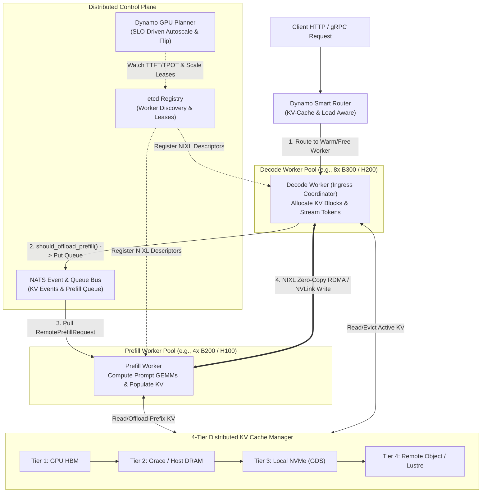
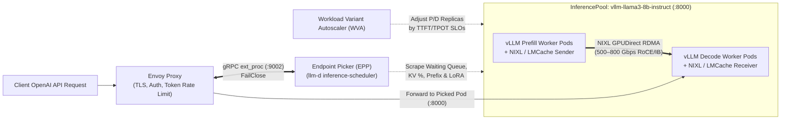

# 15.8 NVIDIA Dynamo, llm-d and disaggregated serving

| Field | Value |
|---|---|
| Level | Advanced |
| Priority tier | 1 |
| Lab venue | GCP / GKE + Local Python Verification Lab |
| Part | Part 15: LLM inference and serving |
| Cross-references | Chapter 15.1 (Anatomy of an inference request); Chapter 15.3 (vLLM in depth); Chapter 15.4 (SGLang and RadixAttention); Chapter 15.5 (TensorRT-LLM); Chapters 15.10–15.11 (Prefill and decode disaggregation and advanced KV tuning) |
| Code | `code/part15/dynamo_disaggregated_serving.py`, `code/part15/dynamo_disaggregated_serving_lab.py` |

## Why this matters for AI infrastructure

A user pastes a long document into a chat while dozens of other users are mid-conversation. The compute-heavy prefill pass for that document takes over the Tensor Cores, and every other token stream freezes until it finishes. Engineers call this prefill-decode interference. It hurts a colocated cluster in three ways.
- A single prompt of several thousand tokens can pause decode iterations for hundreds of milliseconds. Users see frozen text and spikes in Time Per Output Token.
- Prefill is compute bound and likes wide Tensor Parallelism. Decode is memory-bandwidth bound and suffers when cross-GPU synchronization is wide. A colocated server must use one hardware type and one parallelism degree for both.
- Goodput counts only the requests per second that meet both the Time To First Token and the Time Per Output Token targets. Whichever phase saturates first drags down the usable capacity of the whole fleet.

```text
Colocated vs Disaggregated Serving Reference Numbers (*AI Systems Performance Engineering* Chapters 4, 17, 18; *Hands-On LLM Serving and Optimization* Chapter 7; *Generative AI on Kubernetes* Chapter 4):
- MLPerf Inference v5.0 (2025) p99 SLOs:
  Llama-2-70B:       TTFT <= 450 ms,   TPOT <= 40 ms
  Llama-3.1-405B:    TTFT <= 6,000 ms (6 s), TPOT <= 175 ms
- DistServe Colocated vs 2P1D Disaggregated Goodput (P90 TTFT <= 400 ms [0.4 s], P90 TPOT <= 40 ms [0.04 s]):
  Colocated (1 GPU): ~3.0 RPS under TTFT bound, 1.6 RPS under TPOT bound -> Goodput = min(3.0, 1.6) = 1.6 RPS/GPU
  Disaggregated 2P1D (2 Prefill GPUs + 1 Decode GPU = 3 GPUs total):
    Prefill pool: 5.6 RPS/GPU * 2 GPUs = 11.2 RPS; Decode pool: 10.0 RPS on 1 GPU
    Total Goodput = min(11.2, 10.0) = 10.0 RPS across 3 GPUs = 3.33 RPS/GPU (3.3 RPS/GPU, 2.08x per-GPU gain)
  DistServe broad benchmark gains: up to 7.4x higher goodput or 12.6x tighter latency SLOs
- NVIDIA Dynamo + NIXL Fleet Benchmarks:
  Up to 30x higher inference throughput on a 680B-parameter MoE LLM (DeepSeek-R1) on a 72-GPU GB200 NVL72 rack (130 TB/s)
  KV cache offload TTFT speedup: 14x on x86 + H100 PCIe vs recompute; additional 2x on Grace Hopper GH200 (900 GB/s NVLink-C2C)
- Disaggregated KV Transfer Fabric Demand (16 RPS * 1.5 GB KV/req = 24.0 GB/s [~25 GB/s]):
  Fits NVLink 4 (900 GB/s), NVLink 5 (1,800 GB/s), and 400G/800G InfiniBand/RoCE RDMA (50–100 GB/s, 500–600 Gbps pod fabric)
  Saturates non-RDMA PCIe/TCP fallback (10 GB/s) and standard Kubernetes pod Ethernet (10–20 Gbps)
```

Two open-source stacks address this at cluster scale. NVIDIA Dynamo runs separate prefill and decode pools. It uses a Smart Router that knows what each worker has cached, a GPU Planner driven by latency targets, the NVIDIA Inference Transfer Library, and a four-tier KV cache manager. The llm-d project brings disaggregated vLLM serving and the Gateway API Inference Extension into Kubernetes. **Before you scale a large model cluster by adding more monolithic replicas, separate prefill from decode so each phase can scale and route on its own.**

## Prerequisites and outcomes

### Prerequisites
- Inference latency metrics, arithmetic intensity, and KV cache sizing equations from Chapters 15.1 and 15.2.
- PagedAttention block tables, continuous batching, and RadixAttention prefix caching from Chapters 15.3 and 15.4.
- TensorRT-LLM and Triton execution backends from Chapters 15.5 and 15.6.
- GPUDirect RDMA, NVLink, and GPUDirect Storage fundamentals from Parts 12 and 13.

### Outcomes
After this chapter, you will be able to do seven things.
1. Quantify prefill-decode interference and calculate cluster goodput across colocated and disaggregated worker pools under strict TTFT and TPOT Service Level Objectives.
2. Architect an NVIDIA Dynamo cluster using etcd service discovery, NATS request queues, and decode-centric request orchestration.
3. Implement Dynamo Smart Router policies that combine prefix cache hit length, queue depth, KV occupancy, and memory bandwidth into a single routing decision.
4. Configure Dynamo GPU Planner autoscaling rules, Quality of Service capacity reservations, and early rejection admission control.
5. Program nonblocking KV cache transfers with NIXL and collate PagedAttention blocks for RDMA efficiency.
6. Size a four-tier KV cache offloading hierarchy across GPU HBM, Grace CPU DRAM, local NVMe, and remote storage.
7. Deploy llm-d on Kubernetes using InferencePool, InferenceObjective, and the Envoy Endpoint Picker protocol.

---

## 1. Why Colocated Serving Breaks Under Dual SLOs

### 1.1 Prefill-Decode Interference and Head-of-Line Blocking

Every large language model request passes through two distinct computational phases. First, the prefill phase ingests all tokens of the user prompt in parallel to populate the attention Key-Value cache and emit the first token. Second, the decode phase generates subsequent tokens one by one by reading the model weights and the growing KV cache on every step.

Those two phases stress completely different parts of the GPU. Prefill executes large matrix-matrix multiplications that saturate the Tensor Cores and reach high arithmetic intensity. Decode executes skinny matrix-vector products that are starved by High Bandwidth Memory transfer speed. On an eighty-gigabyte H100 GPU with 3,350 GB/s of HBM3 bandwidth, simply reading 140 GB of FP16 weights for a seventy-billion-parameter model takes 41.7 ms per step. That memory wall caps a single decode stream at roughly 24 tokens per second regardless of how much compute the chip has.

When a monolithic server colocates prefill and decode on the same GPU, the scheduler must interleave massive prompt prefills with latency-sensitive decode iterations. If a user submits a multi-thousand-token prompt, that prefill batch locks the GPU for hundreds of milliseconds. Every active user waiting for their next streaming token experiences a sudden pause. Even when chunked prefill slices long prompts into smaller pieces, both phases still compete for the same HBM capacity, memory bandwidth, and CUDA streams.

### 1.2 The Goodput Imperative and DistServe Math

Raw token throughput is a misleading metric for interactive AI services. If a cluster generates thousands of tokens per second while violating user latency budgets, those delayed responses are useless. **Goodput measures the number of completed requests per second that simultaneously satisfy both the Time To First Token and Time Per Output Token Service Level Objectives**.

Consider the benchmark evaluation from DistServe and *AI Systems Performance Engineering* Chapter 17. The service enforces a ninetieth-percentile TTFT budget of 0.4 seconds and a ninetieth-percentile TPOT budget of 0.04 seconds. When prefill and decode are colocated on a single GPU, the server can sustain 3.0 RPS within the TTFT ceiling alone. However, prefill interference degrades token generation so severely that the server can sustain only 1.6 RPS within the TPOT ceiling. Because goodput requires meeting both targets at once, the colocated GPU delivers only 1.6 RPS of goodput.

Now separate the workload into a disaggregated pool with two prefill GPUs and one decode GPU, known as a 2P1D topology. Freed from decode interruptions, each prefill worker reaches 5.6 RPS, giving 11.2 RPS of aggregate prefill capacity across the two prefill GPUs. Freed from heavy prompt GEMMs, the dedicated decode GPU sustains 10.0 RPS within the 40 ms TPOT budget.

```text
DistServe Colocated vs Disaggregated 2P1D Goodput Derivation (*AI Systems Performance Engineering* Chapter 17):
1. Target SLOs:
   P90 TTFT <= 0.4 s (400 ms)
   P90 TPOT <= 0.04 s (40 ms)

2. Colocated Baseline (1 GPU handling both Prefill and Decode):
   Max RPS meeting TTFT SLO:  R_ttft = 3.0 RPS
   Max RPS meeting TPOT SLO:  R_tpot = 1.6 RPS
   Colocated Goodput per GPU: G_colocated = min(3.0, 1.6) = 1.6 RPS/GPU

3. Disaggregated 2P1D Pool (N_p = 2 Prefill GPUs, N_d = 1 Decode GPU, N_total = 3 GPUs):
   Prefill pool capacity:     R_prefill_total = 2 * 5.6 RPS = 11.2 RPS
   Decode pool capacity:      R_decode_total  = 1 * 10.0 RPS = 10.0 RPS
   Cluster Goodput (3 GPUs):  G_cluster       = min(11.2, 10.0) = 10.0 RPS
   Disaggregated Goodput/GPU: G_disagg        = 10.0 RPS / 3 GPUs = 3.33 RPS/GPU (reported as 3.3 RPS/GPU)
   Per-GPU Goodput Speedup:   3.33 / 1.6      = 2.08x higher goodput per GPU
```

| Deployment Architecture | Prefill Pool Capacity | Decode Pool Capacity | Cluster Goodput | Goodput per GPU | Bottleneck & Operational Behavior |
|---|---|---|---|---|---|
| Colocated Monolith (1 GPU) | 3.0 RPS (TTFT bound) | 1.6 RPS (TPOT bound) | 1.6 RPS | 1.6 RPS/GPU | Long prefills stall active decode streams and breach the 40 ms TPOT SLO. |
| Disaggregated 2P1D (3 GPUs) | 11.2 RPS (2 x 5.6 RPS) | 10.0 RPS (1 x 10.0 RPS) | 10.0 RPS | 3.3 RPS/GPU | Isolated phases meet both 400 ms TTFT and 40 ms TPOT SLOs simultaneously (2.08x per GPU). |
| DistServe Full Fleet Range | Tuned per workload | Tuned per workload | Up to 7.4x baseline | Up to 7.4x | Supports up to 12.6x tighter latency SLOs before goodput collapses. |
| NVIDIA Dynamo on GB200 NVL72 | Dedicated Prefill GPUs | Dedicated Decode GPUs | Up to 30x baseline | Up to 30x | 680B MoE model (DeepSeek-R1) across 72 Blackwell GPUs linked at 130 TB/s. |

Before you provision extra GPUs to fix p99 token stalls, check whether colocated prefill bursts are starving your decode loop and calculate the goodput gain of splitting the pools.

---

## 2. NVIDIA Dynamo Architecture: Control Plane, Smart Router, and GPU Planner

### 2.1 The Four Pillars of NVIDIA Dynamo

Disaggregating prefill and decode turns a single-node engine into a distributed pipeline. That pipeline loses its gains in two ways. A router can send a prompt to a worker that lacks the cached prefix. Or the KV cache transfer can stall on TCP sockets.

NVIDIA released the open-source Dynamo framework to run disaggregated serving across multi-node clusters and rack-scale superchips. It is written in Rust and Python and sits above execution engines such as TensorRT-LLM, vLLM, SGLang, and PyTorch. Four subsystems coordinate the cluster.
1. The Smart Router knows which prefixes each worker has cached and how loaded it is. It decides whether a prompt should be prefilled locally or remotely.
2. The GPU Planner watches time to first token, time per output token, queue depth, and KV cache saturation. It scales prefill and decode workers, or flips a GPU from one role to the other.
3. NIXL, the NVIDIA Inference Transfer Library, streams KV cache blocks without blocking, point to point, between GPU HBM, CPU DRAM, local NVMe SSDs, and remote storage.
4. The Distributed KV Cache Manager moves colder KV blocks out of scarce GPU HBM into larger, cheaper tiers and prefetches them back when needed.



### 2.2 Decode-Centric Request Flow with `etcd` and NATS

Dynamo uses etcd for worker registration, health leases, and the exchange of NIXL memory descriptors. It uses NATS for fast messaging and global work queues. No central proxy handles every byte of intermediate state. Instead, each request follows a **decode-centric lifecycle**.
1. At startup, each decode and prefill worker registers itself and its lease in etcd. Each decode worker also registers a pinned GPU HBM region with NIXL and publishes compact transfer descriptors, so peers can write into its memory by a lightweight buffer ID.
2. A new request arrives at a decode worker. Its local scheduler allocates PagedAttention KV blocks for the prompt and runs `should_offload_prefill()` to decide whether remote prefill is worth it.
3. If it is, the decode worker puts a RemotePrefillRequest on the NATS global prefill queue. The message carries the prompt tokens, the origin worker ID, and the target KV block IDs. While it waits, the decode worker keeps decoding other sequences.
4. A free prefill worker pulls the task from NATS and reads any matching prefix blocks from the KV cache pool. It computes the prefill pass for the remaining tokens and uses NIXL to push the resulting KV tensors into the decode worker's GPU HBM over NVLink or GPUDirect RDMA.
5. When the transfer completes, the decode worker adds the request to its continuous batching loop and streams tokens to the client.

```yaml
# NVIDIA Dynamo Heterogeneous Cluster Role Definition (AI Systems Performance Engineering Chapter 17)
roles:
  - name: prefill_worker          # Compute-bound prompt ingestion pool
    model_path: models/llm-70b
    instance_count: 4             # 4 prefill workers
    gpu_type: B200                # Blackwell B200 (or Rubin CPX) for dense GEMM FLOPS
  - name: decode_worker           # Memory-bandwidth-bound token generation pool
    model_path: models/llm-70b
    instance_count: 8             # 8 decode workers
    gpu_type: B300                # Blackwell Ultra B300 (288 GB HBM -> ~218 GB KV pool after 70 GB of weights)
```

### 2.3 Smart Router: Conditional Disaggregation and Composite Cost Scoring

Not every request should go to a remote prefill worker. A five-token greeting, or a prompt that is already ninety percent cached in local HBM, only wastes queue time and RDMA bandwidth if it crosses the network. **The Smart Router disaggregates a request only when the compute saved by remote prefill exceeds the queueing and transfer overhead.**

The router first computes the uncached prompt length, which is the total prompt length minus the matched prefix length. It then checks three runtime thresholds.

```python
# Decode-worker conditional prefill offload policy (B200/B300 tuned, AI Systems Performance Engineering Chapter 17)
def should_offload_prefill(
    prompt_length: int,
    prefix_cached_length: int,
    prefill_queue_size: int,
    decode_active_reqs: int,
    ttft_slo_ms: int = 500,
) -> bool:
    eff_len = max(0, prompt_length - prefix_cached_length)

    PREFILL_LENGTH_THRESHOLD = 256  # split_policy.prompt_length_threshold
    PREFILL_QUEUE_MAX = 10          # max pending tasks before prefill pool is saturated
    DECODE_LOAD_THRESHOLD = 8       # active decode streams on local worker

    long_prefill = eff_len >= PREFILL_LENGTH_THRESHOLD
    prefill_available = prefill_queue_size < PREFILL_QUEUE_MAX

    # 1. Offload when uncached prompt is long and prefill pool has queue headroom
    if long_prefill and prefill_available:
        return True
    # 2. Offload moderate prompts when local decode worker is heavily loaded
    if decode_active_reqs >= DECODE_LOAD_THRESHOLD and eff_len >= 64 and prefill_available:
        return True
    # 3. Otherwise execute prefill locally on the decode GPU
    return False
```

The `PREFILL_QUEUE_MAX` threshold works as a circuit breaker. Suppose a burst of long prompts pushes the global prefill queue to ten or more waiting tasks. `prefill_available` turns false, and decode workers compute prefills locally. When the prefill tier drains its backlog, remote offloading resumes.

Dynamo also exposes this policy declaratively in YAML. It computes a weighted remote prefill score and compares it against `remote_prefill_min_score`.

```yaml
# NVIDIA Dynamo conditional disaggregation scoring policy (AI Systems Performance Engineering Chapter 17)
disaggregated_router:
  enable: true
  policies:
    - metric: prefill_length        # Effective prompt length after prefix cache hit
      threshold: 256
      action: prefer_remote         # Vote for remote prefill when eff_len > 256
      weight: 0.7
    - metric: prefill_queue_depth   # Tasks waiting in global prefill queue
      threshold: 10
      action: prefer_local          # Vote for local prefill when queue > 10
      weight: 0.3
  remote_prefill_min_score: 0.5     # Offload if weighted remote score > 0.5
```

Choosing which worker in a pool gets the request is a separate decision. The Smart Router scores each worker with a latency cost, and the lowest cost wins. A basic load-only router combines GPU occupancy and active request count.

```text
Simple Load Cost = 0.7 * occupancy_percent + 0.3 * active_req_count
```

A load-only router ignores data locality. It will send a request to an idle worker that then recomputes thousands of prefix tokens from scratch. Dynamo's Smart Router listens to KV cache allocation and eviction events that workers publish over NATS. It adds cache locality and memory bus pressure to make a five-factor cost.

```text
Composite Latency Cost (*AI Systems Performance Engineering* Chapter 17, Table 17-3 — lower score is better):
latency_cost = 3.0 * occupancy_percent
             + 1.0 * active_reqs
             - 10.0 * int(cache_match_flag)
             + 0.5 * mem_bw_percent
             - 1.0 * int(recent_prefix_flag)

Worked Routing Comparison:
- Worker 0 (Cold, lightly loaded): occupancy = 1.0, active_reqs = 2, cache_match = 0, mem_bw = 2.0, recent_prefix = 0
  Simple cost    = 0.7*(1.0) + 0.3*(2) = 1.3 (picked by naive router)
  Composite cost = 3.0*(1.0) + 1.0*(2) - 10.0*(0) + 0.5*(2.0) - 1.0*(0) = 6.0
- Worker 1 (Warm, slightly busier): occupancy = 2.0, active_reqs = 3, cache_match = 1, mem_bw = 4.0, recent_prefix = 1
  Simple cost    = 0.7*(2.0) + 0.3*(3) = 2.3
  Composite cost = 3.0*(2.0) + 1.0*(3) - 10.0*(1) + 0.5*(4.0) - 1.0*(1) = 0.0 (picked by KV-aware Smart Router)
```

| Routing Factor | Telemetry Variable | Weight | Engineering Purpose |
|---|---|---|---|
| KV Occupancy (%) | `occupancy_percent` | `+3.0` | Penalizes workers approaching HBM KV pool exhaustion. |
| Active Requests | `active_reqs` | `+1.0` | Penalizes workers with deep in-flight continuous batches. |
| Exact KV Cache Match | `cache_match_flag` | `-10.0` | Strongly rewards workers that already hold the prompt prefix in HBM. |
| Memory Bandwidth (%) | `mem_bw_percent` | `+0.5` | Avoids decode GPUs whose HBM buses are saturated by long sequences. |
| Recent Prefix Use | `recent_prefix_flag` | `-1.0` | Rewards workers where the prefix is warm in L2 or already in flight via NIXL. |

### 2.4 Dynamo GPU Planner, QoS Tiers, and Early Rejection

Good per-request routing does not help if the ratio of prefill to decode GPUs is fixed and traffic shifts. An afternoon surge of document summarization needs heavy prefill and little decode. An evening surge of reasoning requests, with short prompts and outputs thousands of tokens long, needs the opposite.

The Dynamo GPU Planner closes that loop. It scrapes worker telemetry and compares the measured time to first token and time per output token against the targets. When prefill queues grow, it adds prefill replicas or revokes etcd leases on idle decode workers to flip them to prefill. In the Arrow research evaluation, adaptive scaling across shifting input-output ratios served up to 5.6x more requests than a static prefill-decode split.

```yaml
# NVIDIA Dynamo GPU Planner Policy Configuration (AI Systems Performance Engineering Chapter 17)
model: meta-llama/Llama-3.1-70B-Instruct
split_policy:
  prompt_length_threshold: 256
  prefix_cache_weight: 10.0
  queue_length_weight: 1.5
  decode_load_weight: 0.5
  enable_hotspot_prevention: true
cache:
  reuse_prefix: true
  min_cache_hit_ratio: 0.75
autoscale:
  prefill:
    min_replicas: 4
    max_replicas: 12
    scale_up: { queue_length: 8, gpu_utilization: 80 }
    scale_down: { queue_length: 2, gpu_utilization: 40 }
  decode:
    min_replicas: 8
    max_replicas: 24
    scale_up: { queue_length: 16, kv_cache_usage: 75 }
    scale_down: { queue_length: 4, kv_cache_usage: 30 }
qos:
  enable_early_rejection: true
  low_priority_threshold_ms: 500
  reject_on_slo_violation: true
```

When a burst exceeds the physical size of the cluster, autoscaling cannot protect tail latency. If the cluster admits every request, queues build and every user misses the latency target. Dynamo prevents that overload by combining tiered capacity reservations for quality of service (QoS) with early rejection of requests.

```yaml
# NVIDIA Dynamo QoS Tier Reservation Policy (configs/qos.yaml, AI Systems Performance Engineering Chapter 18)
scheduler:
  qos_classes:
    - name: premium
      reserved_fraction: 0.10   # Reserve 10% of prefill/decode workers exclusively for premium
      priority: 100
    - name: standard
      reserved_fraction: 0.30   # Reserve 30% of workers for standard tier
      priority: 50
    - name: free
      reserved_fraction: 0.60   # Share remaining 60% capacity for free/batch tier
      priority: 10
  request_router:
    routes:
      - match: { header: "x-customer-tier: premium" }
        qos: premium
      - match: { header: "x-customer-tier: standard" }
        qos: standard
      - match: {}
        qos: free
```

Before admitting a request into the prefill or decode queues, the QoSController estimates the expected TTFT from the current queue lengths and exponential moving averages of per-request prefill and decode durations. If the estimate exceeds the 500 ms budget and the request belongs to a low-priority tier, the controller sheds the request at once and disables remote prefill for it. Premium and standard traffic keep their latency guarantees. Pair the Smart Router's conditional disaggregation with Planner autoscaling and early rejection, so that a traffic spike degrades gracefully instead of stalling the cluster.

### 2.5 Worker Discovery, Leases, and Role Swapping

A disaggregated pool only works if the router knows which workers are alive. Dynamo uses etcd for worker discovery and leases. A worker that joins becomes visible to the rest of the system, and its lease records that it is still part of the pool.

The Planner uses the same mechanism to reshape the cluster. It scales workers down by revoking their leases. It scales them up by launching new workers, which are discovered automatically. A lease works like a timed pass: revoke it, and the worker leaves the pool.

This matters most at very large scale, where load rises and falls often. You want to move workers between roles as load changes, without restarting the cluster.

---

## 3. NIXL: The NVIDIA Inference Transfer Library

### 3.1 Why Disaggregated Serving Needs NIXL Alongside NCCL

In training and in intra-node Tensor Parallelism, every GPU takes part in synchronized group operations such as AllReduce. NVIDIA NCCL is built for those many-to-many barriers. Disaggregated inference has a different pattern. When a prefill worker finishes a prompt, it must push a multi-gigabyte KV cache to one decode worker, or move cold KV blocks to CPU DRAM or NVMe storage. Both GPUs keep running their own forward passes.

Synchronous NCCL collectives would force these one-to-one handoffs into lockstep barriers. They also cannot address memory tiers such as host DRAM, NVMe SSDs, or S3 object stores. **NVIDIA built NIXL to give one nonblocking, point-to-point transport across GPU HBM, CPU DRAM, local NVMe storage, and network filesystems.**

| Dimension | NCCL (Collective Communication) | NIXL (Point-to-Point Inference Transfer) |
|---|---|---|
| Primary Use Case | Many-to-many collectives (AllReduce, AllGather, ReduceScatter) for training and intra-layer TP. | One-to-one or one-to-few transfers of KV caches and pipeline states across disaggregated stages. |
| Synchronization Semantics | Synchronized group barrier; all participating ranks must invoke the collective together. | Fully asynchronous initiator-to-target read/write (`prepXfer`, `postXfer`, `checkXfer` polling). |
| Supported Memory Tiers | GPU HBM (plus host-staged network buffers). | Unified across GPU HBM (`VRAM_SEG`), CPU DRAM (`DRAM_SEG`), local NVMe SSD via GDS, and remote S3/Lustre. |
| Transport Selection | Rings, trees, NVLS, and SHARP over NVLink and InfiniBand/RoCE. | Interconnect-agnostic via plugins (NVLink/NVSwitch, GPUDirect RDMA / UCX, IBGDA, GPUDirect Storage). |
| Typical Payload Scope | Small-to-medium tensor buckets (e.g., 25 MB to 100 MB gradients) reduced across all ranks. | Large KV cache slabs (hundreds of megabytes to multiple gigabytes) moved point-to-point. |

### 3.2 NIXL 0.5.x Architecture, `nixlAgent` Lifecycle, and IBGDA

NIXL has one endpoint abstraction, `nixlAgent`. Each prefill worker, decode worker, or storage node creates its own agent, configured with transport plugins such as UCX for GPU-to-GPU RDMA and GDS for GPUDirect Storage.

NIXL avoids host CPU bounce buffers and kernel context switches. Inside a server, or inside a 72-GPU GB200 NVL72 rack, it routes transfers over NVLink and the 130 TB/s NVSwitch fabric. Across nodes or racks, it uses GPUDirect RDMA over InfiniBand or RoCEv2. It also supports InfiniBand GPUDirect Async (IBGDA), which lets the GPU itself ring the network card's doorbell and start RDMA writes without waiting for a host CPU thread.

```cpp
// NIXL 0.5.x nonblocking VRAM-to-VRAM transfer lifecycle (AI Systems Performance Engineering Chapter 4)
#include <nixl.h>
#include <nixl_types.h>
#include <cuda_runtime.h>
#include <thread>
#include <vector>

int run_nixl_kv_transfer() {
    nixl_agent_config cfg{};
    cfg.backends = {"UCX"};         // Add "GDS" when offloading to NVMe storage
    cfg.thread_safe = true;

    nixlAgent agentSrc("srcAgent", cfg);
    nixlAgent agentDst("dstAgent", cfg);

    int deviceId = 0;
    cudaSetDevice(deviceId);
    const size_t bytes = 1 << 20;   // 1 MiB (1,048,576 bytes) illustrative slab
    void *d_src = nullptr, *d_dst = nullptr;
    cudaMalloc(&d_src, bytes);
    cudaMalloc(&d_dst, bytes);

    nixl_desc_t srcDesc{reinterpret_cast<uintptr_t>(d_src), bytes, deviceId, VRAM_SEG};
    nixl_desc_t dstDesc{reinterpret_cast<uintptr_t>(d_dst), bytes, deviceId, VRAM_SEG};

    auto srcRegs = agentSrc.registerMem(std::vector<nixl_desc_t>{srcDesc});
    auto dstRegs = agentDst.registerMem(std::vector<nixl_desc_t>{dstDesc});
    auto srcXfer = srcRegs.trim();  // Compact metadata-free descriptors shared via etcd
    auto dstXfer = dstRegs.trim();

    nixlReqH reqHandle = nullptr;
    agentSrc.prepXfer(NIXL_WRITE, srcXfer, dstXfer, "dstAgent", reqHandle);
    agentSrc.postXfer(NIXL_WRITE, srcXfer, dstXfer, "dstAgent", reqHandle);

    // Nonblocking poll while GPU compute stream continues decoding other sequences
    nixl_status_t st;
    do {
        st = agentSrc.checkXfer(reqHandle);
        if (st == NIXL_INPROGRESS) std::this_thread::yield();
    } while (st == NIXL_INPROGRESS);

    agentSrc.releaseReqH(reqHandle);
    agentSrc.deregisterMem(srcRegs);
    agentDst.deregisterMem(dstRegs);
    cudaFree(d_src);
    cudaFree(d_dst);
    return (st == NIXL_SUCCESS) ? 0 : 1;
}
```

### 3.3 PagedAttention Block Collation and Fabric Bandwidth Math

PagedAttention and RDMA interact badly by default. vLLM stores the KV cache in small pages of sixteen tokens, which keeps memory fragmentation near zero. Suppose a prefill worker finishes a 7,500-token prompt and posts 470 separate RDMA writes, one per page. Each write needs its own work queue element and doorbell on the network card. With 470 small writes, that setup overhead chokes the link.

LMCache and *AI Systems Performance Engineering* Chapter 18 report the effect. Sending a 7,500-token KV cache as 470 sixteen-token transfers takes 20 ms. Collating the pages into contiguous slabs of 128 tokens or more in GPU memory before the NIXL transfer cuts that to 8 ms, 2.5 times faster. If the 8 ms transfer runs on its own CUDA stream, overlapped with decode, the visible latency drops close to zero.

```text
Disaggregated KV Cache Transfer Bandwidth and Collation Math (*AI Systems Performance Engineering* Chapters 17 & 18; *Hands-On LLM Serving and Optimization* Chapter 7):
1. PagedAttention Block Collation (7,500-token prompt):
   Default 16-token blocks:  ceil(7,500 / 16)  = 469 (~470) small RDMA transfers -> 20.0 ms transfer time
   Collated 128-token slabs: ceil(7,500 / 128) = 59 large RDMA transfers        ->  8.0 ms transfer time (2.5x faster)

2. Cluster KV Transfer Bandwidth Demand (*Hands-On LLM Serving and Optimization* Chapter 7):
   Per-request KV cache (long-context prompt): 1.0 to 1.5 GB
   Throughput: 16 requests/sec * 1.5 GB/req = 24.0 GB/s (~25 GB/s aggregate KV transfer rate)
   - Intra-node NVLink 4 (H100/H200):          900.0 GB/s bidirectional (2.7% link load -> effortless)
   - Intra-rack NVLink 5 (B200/GB200 NVL72): 1,800.0 GB/s per GPU / 130 TB/s rack (effortless)
   - Inter-node 400G InfiniBand NDR / RoCEv2:   50.0 GB/s per NIC (48% of 1 NIC; effortless across 8 rails)
   - Inter-node 800G ConnectX-8 / XDR IB:      100.0 GB/s per NIC (24% of 1 NIC)
   - Non-RDMA PCIe / Host TCP Socket Fallback: ~10.0 GB/s (or 10–20 Gbps pod Ethernet -> 2.4x oversubscribed, severe stall)
```

Before you enable cross-node prefill-decode disaggregation, collate PagedAttention blocks into slabs of at least 128 tokens and verify that GPUDirect RDMA works.

---

## 4. Distributed KV Cache Manager, Tiered Offloading, and Heterogeneous Pools

### 4.1 The Four-Tier KV Cache Memory Hierarchy

Context windows now reach hundreds of thousands of tokens, and agent sessions stay open for minutes. GPU memory becomes the limit. Take a 70-billion-parameter model with 80 layers, 32 KV heads, and head dimension 128, holding a 250,000-token conversation in FP16. Each token needs 8,192 floats per layer, which is 655,360 floats across all 80 layers, or 1.31 MB per token. Over 250,000 tokens, that one session's KV cache takes 328 GB, more than the whole HBM of four 80 GB GPUs. After FP8 KV quantization and selective-layer caching, it still occupies 100 to 150 GB.

Discarding cached prefixes would mean paying a quadratic prefill recomputation on every turn. Dynamo's Distributed KV Cache Manager avoids that. It uses NIXL and LMCache to spread KV storage over four tiers.
1. Tier 1 is GPU HBM, the hot working set. It holds the weights and the KV blocks of sequences that are running now, at 3.35 to 8.0 TB/s.
2. Tier 2 is CPU or superchip DRAM, the warm session cache. On Grace Hopper (GH200) and Grace Blackwell (GB200) superchips, the GPU reaches hundreds of gigabytes of coherent LPDDR5X over the 900 GB/s NVLink-C2C link. On x86 servers, pinned host DRAM gives roughly 3 times the HBM capacity over 64 GB/s PCIe Gen5.
3. Tier 3 is local NVMe SSD reached through GPUDirect Storage, the cool multi-tenant cache. Evicted KV slabs move between GPU HBM and NVMe through cuFile and NIXL's GDS backend, without touching the CPU. This expands KV capacity by up to 50 times.
4. Tier 4 is remote shared storage and object stores, the cold global pool. It holds shared document contexts and RAG prefixes on Lustre, DeepSeek 3FS, Redis, or S3, so any replica can load warm state without recomputing attention.

```text
Tiered KV Cache Offloading Speedups (*AI Systems Performance Engineering* Chapter 4 Figures 4-9 & 4-10; *Hands-On LLM Serving and Optimization* Chapter 7 Figures 7-25 & 7-27):
- x86 + H100 PCIe System (NIXL DRAM offload vs full prefill recomputation):
  Up to 14x faster TTFT on long input sequences
- ARM Grace Hopper Superchip GH200 (900 GB/s NVLink-C2C vs x86 + H100 PCIe):
  2x faster TTFT than x86 + H100 (28x effective speedup over recomputation)
- LMCache + vLLM Multi-Turn Benchmark (Qwen/Qwen3-14B, 150 GB local CPU cache, 30 prefixes / 5 concurrent streams):
  Capacity expansion: ~3x with CPU DRAM, ~50x with local NVMe SSD
  Warm CPU cache retrieval latency: ~1.0 s TTFT vs 6.0–7.0 s cold prefill recomputation
  Throughput under 5 concurrent long-context streams: 16x higher than vanilla vLLM (75,200 tok/s vs 4,700 tok/s baseline)
```

| KV Storage Tier | Backing Medium & Interconnect | Typical Bandwidth | Capacity Multiplier | Primary Operational Role |
|---|---|---|---|---|
| Tier 1: GPU HBM | HBM3 / HBM3e on GPU package | 3,350–8,000 GB/s | 1.0x (80–192 GB/GPU) | Active forward-pass weights and in-flight batch KV blocks. |
| Tier 2: Superchip / Host DRAM | Grace LPDDR5X (`NVLink-C2C`) or x86 DDR5 (`PCIe Gen5`) | 900 GB/s (`C2C`) / 55–64 GB/s (`PCIe`) | ~3x GPU HBM | Multi-turn conversation history and warm tenant system prompts (14x–28x faster TTFT). |
| Tier 3: Local NVMe SSD | PCIe Gen5 NVMe array via GPUDirect Storage (`GDS`) | 10–50+ GB/s per node | ~50x GPU HBM | Large Cache-Augmented Generation (`CAG`) corpora and multi-tenant context pools. |
| Tier 4: Remote Shared Store | Lustre / 3FS / Redis / S3 over RDMA or Ethernet | 10–100 GB/s fabric | Virtually unbounded | Cluster-wide cross-replica prefix sharing and fault-tolerant KV recovery. |

### 4.2 Heterogeneous Hardware Pairing and Asymmetric Parallelism (`TP_p` vs `TP_d`)

Prefill and decode workers live in separate pools, so they need not use the same GPUs or the same model-parallel layout. **Give prefill compute-dense GPUs and wide parallelism, and give decode memory-rich GPUs and narrow parallelism. That cuts cost per token without hurting latency.**

On the hardware side, prefill can run on compute-optimized accelerators such as Blackwell B200, Hopper H100, or NVIDIA's Rubin CPX context processor. Decode can run on accelerators with more memory capacity and bandwidth, such as Blackwell Ultra B300. A B300 carries 288 GB of HBM3e. If 70 GB of that holds weights, about 218 GB remains for KV cache. Hopper H200 is another decode choice, with 141 GB of HBM3e at 4.8 TB/s against the H100's 80 GB at 3.35 TB/s. Cheaper L40S and A100 GPUs also work.

The Splitwise study paired four H100 GPUs for prefill with four A100 GPUs for decode. It served 2.35 times the requests per second of an eight-GPU homogeneous cluster at the same cost and power. Another configuration gave 1.4 times the throughput at 20 percent lower cost. HexGen-2 reached up to 2.0 times the throughput, 1.3 times on average, or 30 percent lower cost, by tuning the GPU assignment for mixed hardware.

On the parallelism side, prefill handles thousands of prompt tokens at once. Splitting layers across GPUs with Tensor Parallelism (`TP_p` of 2 or 8) and Pipeline Parallelism (`PP_p` of 2) cuts time to first token sharply. Decode produces one token per step, so wide Tensor Parallelism adds per-layer AllReduce cost and Pipeline Parallelism adds idle stage bubbles. Decode pools therefore prefer `PP_d = 1` and the smallest Tensor Parallelism degree that fits the model, which is `TP_d` of 1, 2, or 4.

When `TP_p` and `TP_d` differ, the KV cache layout in memory does not match across pools. Take an 80-layer model with 8 KV heads. If prefill runs `TP_p = 2, PP_p = 2`, each GPU holds 40 layers and 4 KV heads. If decode runs `TP_d = 4, PP_d = 1`, each GPU expects 80 layers and 2 KV heads. Dynamo handles this with a **KV layout transpose kernel** on the receiving GPU, which converts the layout right after the NIXL read completes. Before you deploy asymmetric parallelism, check that the NIXL receiver buffer fits the collated slab and that layout transposition is enabled.

---

## 5. `llm-d` and the Kubernetes Gateway API Inference Extension

### 5.1 Architecture of `llm-d` on Kubernetes

NVIDIA Dynamo is a tightly integrated runtime for NVIDIA AI Factories. A team that runs a multi-vendor Kubernetes cluster, version 1.29 or later, needs a standard Kubernetes-native control plane instead. The open-source llm-d project provides one. It combines Envoy Proxy, the Kubernetes Gateway API Inference Extension (also called IGW or GIE), vLLM's KVConnector, LMCache, and NIXL RDMA sidecars in a declarative stack.



llm-d organizes production rollouts around three "well-lit paths".
1. Intelligent inference scheduling puts vLLM behind Envoy and the Inference Gateway. Requests are routed by prompt length, KV cache usage, waiting queue depth, and prefix cache hits, not by round-robin.
2. Prefill and decode disaggregation splits vLLM pods into dedicated prefill and decode pools. A 500 to 800 Gbps InfiniBand or RoCEv2 RDMA fabric connects them, and NIXL sidecars move KV caches in milliseconds.
3. Wide expert parallelism coordinates Data Parallel attention and Expert Parallelism across multi-node Mixture-of-Experts models such as DeepSeek-V3/R1 and Mixtral.

### 5.2 `InferencePool`, `InferenceObjective` (`InferenceModel`), and Envoy `EPP`

A standard Kubernetes Service balances connections round-robin. It cannot see prompt length, GPU KV cache pressure, cached prefixes, or loaded LoRA adapters. The Gateway API Inference Extension makes Kubernetes aware of these. It adds two Custom Resource Definitions and an Envoy External Processing (`ext_proc`) service.
1. An InferencePool, in `inference.networking.k8s.io/v1`, is a homogeneous group of model-serving pods that share a base model, an accelerator type, and a compute configuration. It exposes up to eight `targetPorts`, such as 8000, and points to an Endpoint Picker service through `endpointPickerRef`.
2. An InferenceObjective, in `inference.networking.x-k8s.io/v1alpha2`, evolved from InferenceModel. It declares priorities, such as `priority: 1` for critical real-time traffic and `priority: 2` for standard traffic, plus latency objectives and LoRA adapter names for an InferencePool.
3. The Endpoint Picker (EPP) listens on port 9002 and speaks the Envoy `ext_proc` gRPC protocol, with `failureMode: FailClose`. For each request, Envoy pauses routing and calls the EPP. The llm-d inference-scheduler EPP reads the JSON body, meaning the model, the prompt tokens, and the priority headers. It combines that with live Prometheus metrics such as `vllm:num_requests_waiting` and `vllm:gpu_cache_usage_perc`, prefix hashes, and loaded LoRA modules. It then returns the exact pod IP to Envoy.

```yaml
# Kubernetes Gateway API Inference Extension Manifests (Generative AI on Kubernetes Chapter 4 Example 4-7)
apiVersion: inference.networking.k8s.io/v1
kind: InferencePool
metadata:
  name: vllm-llama3-8b-instruct
spec:
  targetPorts:
    - number: 8000
  selector:
    matchLabels:
      app: vllm-llama3-8b-instruct
  endpointPickerRef:
    name: vllm-llama3-8b-epp
    port:
      number: 9002
    failureMode: FailClose
---
apiVersion: inference.networking.x-k8s.io/v1alpha2
kind: InferenceObjective
metadata:
  name: high-priority-inference
spec:
  priority: 1
  poolRef:
    group: inference.networking.k8s.io
    name: vllm-llama3-8b-instruct
---
apiVersion: inference.networking.x-k8s.io/v1alpha2
kind: InferenceObjective
metadata:
  name: standard-inference
spec:
  priority: 2
  poolRef:
    group: inference.networking.k8s.io
    name: vllm-llama3-8b-instruct
---
apiVersion: v1
kind: Service
metadata:
  name: vllm-llama3-8b-epp
spec:
  selector:
    app: vllm-llama3-8b-epp
  ports:
    - port: 9002
      targetPort: 9002
```

llm-d adds two caching directions and its own autoscaler to the Endpoint Picker.
- North/south caching (N/S) moves one vLLM instance's KV cache vertically, to local host DRAM and local NVMe storage, through KVConnector.
- East/west caching (E/W) moves cached KV blocks sideways between peer vLLM instances over RDMA, so a prefix computed on pod A can be reused on pod B.
- The Workload Variant Autoscaler (WVA) measures the tokens per second the cluster can really deliver under current memory pressure. It scales the prefill, decode, and batch pools before latency targets are missed.

---

## 6. Commands and Configurations That Matter

### 6.1 LMCache + NIXL Disaggregated Prefill and Decode Configuration

To hand KV caches between vLLM workers through LMCache and NIXL without copies, configure the prefill instance as sender and the decode instance as receiver. Give both a matching GPU transfer buffer of one gigabyte, which is 1,073,741,824 bytes, and set the UCX RDMA transport variables explicitly.

```yaml
# 1. Prefill Worker Configuration: lmcache-prefiller-config.yaml (AI Systems Performance Engineering Chapter 18)
enable_pd: true
transfer_channel: "nixl"
pd_role: "sender"                 # Prefill worker pushes KV blocks via NIXL
pd_proxy_host: "decode-host"      # Decode coordinator host
pd_proxy_port: 7500               # Control-plane port on decode proxy
pd_buffer_size: 1073741824        # 1 GiB (use 2 GiB if FP16 prompts exceed ~7.5k tokens)
pd_buffer_device: "cuda"          # Keep transfer buffer pinned in GPU HBM
```

```yaml
# 2. Decode Worker Configuration: lmcache-decoder-config.yaml (AI Systems Performance Engineering Chapter 18)
enable_pd: true
transfer_channel: "nixl"
pd_role: "receiver"               # Decode worker receives KV blocks into HBM
pd_peer_host: "0.0.0.0"           # Bind address for NIXL peer
pd_peer_init_port: 7300           # NIXL handshake/control port
pd_peer_alloc_port: 7400          # NIXL allocation/data port
pd_buffer_size: 1073741824        # 1 GiB matching sender buffer
pd_buffer_device: "cuda"          # Zero-copy GPU HBM buffer
nixl_backends: [UCX]              # Use UCX (GPUDirect RDMA / CUDA IPC) backend
```

```bash
# 3. Launch Disaggregated Decode Worker with UCX Rendezvous & Deterministic Hash Seed
export PYTHONHASHSEED=0
export UCX_RNDV_THRESH=16384
export UCX_MAX_EAGER_RAILS=1
export UCX_TLS=cuda_ipc,rc,rdmacm,cuda_copy,tcp
CUDA_VISIBLE_DEVICES=1 \
LMCACHE_CONFIG_FILE=lmcache-decoder-config.yaml \
python3 run_vllm_decoder.py --port 8200

# 4. Launch vLLM with LMCache Tiered CPU/NVMe Offloading (Hands-On LLM Serving and Optimization Chapter 7)
export LMCACHE_USE_EXPERIMENTAL=True
export LMCACHE_LOCAL_CPU=True
export LMCACHE_MAX_LOCAL_CPU_SIZE=150.0
nohup vllm serve Qwen/Qwen3-14B \
  --kv-transfer-config '{"kv_connector":"LMCacheConnectorV1","kv_role":"kv_both"}' \
  --max-model-len 40960 \
  --gpu-memory-utilization 0.90 > vllm.log 2>&1 &
```

### 6.2 End-to-End Nsight Systems Profiling of Disaggregated NIXL Transfers

To check that NIXL RDMA transfers overlap with decode kernels and do not fall back to host TCP sockets, capture one Nsight Systems trace. It should cover CUDA hardware, UCX, GPUDirect Storage, and the InfiniBand NIC and switch counters.

```bash
# Correlated CUDA + UCX + GDS + InfiniBand NIC/Switch Nsight Systems Trace (AI Systems Performance Engineering Chapter 17)
nsys profile --trace=cuda-hw,osrt,nvtx,ucx,gds \
  --trace-fork-before-exec=true \
  --cuda-event-trace=true \
  --cuda-graph-trace=node \
  --cuda-memory-usage=true \
  --sample=cpu \
  --gpu-metrics-device=all \
  --nic-metrics=true \
  --ib-switch-metrics-device=<GUIDs> \
  --storage-metrics --storage-devices=all \
  --gds-metrics=driver \
  -o nsys_reports/prefill_decode \
  python3 run_vllm_decoder.py --port 8200
```

Confirm with `ucx_info -f`, `lsmod | grep nvidia_peermem`, and the nsys timeline that KV handoffs travel over GPUDirect RDMA, rc,rdmacm, or cuda_ipc, not host-staged TCP.

---

## 7. How It Fails: Five Disaggregated Serving Failure Modes

| Failure Mode | Symptom | Root Cause | Diagnostic Command / Evidence | Fix |
|---|---|---|---|---|
| **1. Uncollated 16-Token Page RDMA Storm** | Disaggregated TTFT is 15–30 ms slower than expected despite 400G InfiniBand links showing low byte utilization. | Sending a 7,500-token prompt as 470 individual 16-token PagedAttention blocks saturates NIC WQE doorbells (20 ms transfer). | `nsys profile --trace=cuda-hw,ucx --nic-metrics=true` shows hundreds of tiny UCX transfers totaling 20 ms. | Collate KV pages into contiguous slabs of `>= 128` tokens (59 transfers), cutting RDMA handoff time to 8 ms (2.5x speedup). |
| **2. Silent Fallback to Pod Ethernet / Host TCP** | Disaggregated throughput collapses at 16 RPS; host CPU cores hit 100% and TTFT spikes above 2,000 ms. | Missing `/dev/infiniband` passthrough or unloaded `nvidia_peermem` forces 24 GB/s of KV traffic onto 10–20 Gbps pod Ethernet (`~10 GB/s` PCIe/TCP). | `lsmod \| grep nvidia_peermem` empty; `ucx_info -f` or `NCCL_DEBUG=INFO` shows TCP socket fallback. | Load `nvidia_peermem`, mount `/dev/infiniband`, set `UCX_TLS=rc,rdmacm,cuda_copy,cuda_ipc`, and provision 500–800 Gbps RoCE/IB. |
| **3. Asymmetric `TP_p != TP_d` KV Layout Corruption** | Decode worker outputs garbled tokens or crashes with tensor shape mismatch immediately after NIXL KV read. | Prefill runs `TP_p = 2, PP_p = 2` (4 KV heads/rank) while decode runs `TP_d = 4, PP_d = 1` (2 KV heads/rank) without layout conversion. | Worker logs show KV head/layer dimension mismatch on decode step 1 after remote prefill handoff. | Enable Dynamo's on-the-fly `[TP_p] -> [TP_d]` KV transpose kernel after the NIXL read and match `pd_buffer_size`. |
| **4. Cross-Process Prefix Hash Mismatch** | Multi-process workers report `< 10%` prefix cache hit rate on identical RAG prompts and re-run full prefill. | Python's randomized default `PYTHONHASHSEED` produces different block hashes across worker processes. | Compare prefix cache hit counters (`vllm:gpu_prefix_cache_queries` vs hits) across worker processes. | Set `export PYTHONHASHSEED=0` across all prefill, decode, and router containers so KV chunk hashes are deterministic. |
| **5. Static P/D Pool Ratio Starvation Under Workload Shift** | Prefill queue explodes during summarization bursts (or decode KV hits 99% during reasoning bursts) while the other pool sits at 30% utilization. | Fixed `X_p : Y_d` worker allocation cannot adapt when input-to-output token ratios shift over the day. | Prometheus shows `prefill_queue_length > 10` with `decode_kv_usage < 30%` (or vice versa). | Enable Dynamo GPU Planner / `llm-d` Variant Autoscaler (`WVA`) for dynamic role flipping and `QoSController` early rejection at 500 ms. |

---

## 8. Hands-on Lab: Disaggregated Serving, Smart Router, and NIXL Verification

### Lab Venue and Scope
- **Venue:** a local Python verification lab that runs deterministically on any workstation. The multi-node GKE, InfiniBand, and GB200 NVL72 commands in Section 6 are reference configurations. They have not been run on live multi-node GPU hardware.
- **Code files:** `code/part15/dynamo_disaggregated_serving.py` and `code/part15/dynamo_disaggregated_serving_lab.py`.

### Run the Verification Suite

```bash
python3 -B code/part15/dynamo_disaggregated_serving_lab.py
```

### Expected Output (`25 passed, 0 failed`)

```text
=== Chapter 15.8 Lab: NVIDIA Dynamo, llm-d and Disaggregated Serving Verification ===
  [PASS] 1. Colocated 1-GPU goodput under P90 TTFT<=400 ms (3.0 RPS) and P90 TPOT<=40 ms (1.6 RPS) is bounded by min(3.0, 1.6) = 1.6 RPS/GPU
  [PASS] 2. Disaggregated 2P1D (2 prefill GPUs at 5.6 RPS = 11.2 RPS, 1 decode GPU at 10.0 RPS) achieves min(11.2, 10.0) / 3 = 3.33 (3.3) RPS/GPU (2.08x gain)
  [PASS] 3. DistServe reports up to 7.4x goodput and 12.6x tighter SLOs; NVIDIA Dynamo achieves up to 30x throughput on 680B MoE across 72-GPU GB200 NVL72
  [PASS] 4. MLPerf v5.0 p99 SLOs: Llama-2-70B targets 450 ms TTFT / 40 ms TPOT; Llama-3.1-405B targets 6000 ms (6 s) TTFT / 175 ms TPOT
  [PASS] 5. Single-stream 70B FP16 decode on H100 (140 GB / 3350 GB/s HBM3) requires 41.79 ms/token (~23.93 tok/s ceiling)
  [PASS] 6. Smart Router offloads prefill when effective prompt length (1024 - 256 = 768 >= 256) and prefill queue (4 < 10) has capacity (remote score = 1.0 > 0.5)
  [PASS] 7. Smart Router keeps prefill local on decode worker when prefix cache hit leaves eff_len = 124 (< 256) and decode active reqs = 4 (< 8)
  [PASS] 8. Smart Router sheds load back to local prefill when global prefill queue is saturated (12 >= 10)
  [PASS] 9. Smart Router offloads moderate prompt (eff_len = 100 >= 64) when local decode worker is busy (9 >= 8 active streams)
  [PASS] 10. Simple 2-term cost (0.7*occ + 0.3*reqs) picks worker-0-cold (1.3 vs 2.3), whereas 5-factor KV-aware composite cost (+3*occ + 1*reqs - 10*match + 0.5*bw - 1*recent) picks worker-1-warm (0.0 vs 6.0)
  [PASS] 11. Dynamo GPU Planner scales up prefill (4 -> 5 when queue=9 >= 8, util=85% >= 80%) and decode (8 -> 9 when queue=18 >= 16, kv=78% >= 75%)
  [PASS] 12. QoSController estimates TTFT = 9*35 + 18*20 = 675.0 ms (> 500 ms SLO), rejecting low-priority requests while admitting high-priority traffic
  [PASS] 13. Dynamo GPU Planner scales down prefill (6 -> 5 when queue<=2, util<=40%) and decode (10 -> 9 when queue<=4, kv<=30%) and admits low-priority at 75.0 ms TTFT
  [PASS] 14. QoS tier reservations allocate 10% premium (priority=100, 2 workers), 30% standard (priority=50, 6 workers), and 60% free (priority=10, 12 workers) across 20 workers
  [PASS] 15. NIXL 0.5.x VRAM_SEG test buffer is 1 MiB (1,048,576 B) and LMCache/NIXL pd_buffer_size is 1 GiB (1,073,741,824 B) on ports 7300/7400/7500 with UCX_RNDV_THRESH=16384
  [PASS] 16. Collating 7,500-token KV cache from 16-token blocks (469 WQEs, 20.0 ms) into 128-token slabs (59 WQEs, 8.0 ms) cuts RDMA transfer time by 2.5x
  [PASS] 17. At 16 RPS and 1.5 GB KV/req, aggregate transfer rate is 24.0 GB/s (~25 GB/s), fitting NVLink 4 (900 GB/s) and IB NDR RDMA (50 GB/s) but saturating non-RDMA PCIe/TCP (10 GB/s)
  [PASS] 18. 70B 80-layer 32-head MHA KV cache is 1,310,720 B/tok (~1.31 MB/tok, vs 327,680 B/tok GQA), totaling 327.7 GB (~328 GB) in FP16 and 163.8 GB in FP8 for 250,000 tokens
  [PASS] 19. NIXL KV cache offloading to CPU DRAM yields 14x TTFT speedup on x86+H100 and an additional 2x on Grace Hopper GH200 (900 GB/s NVLink-C2C = 28x vs recompute)
  [PASS] 20. LMCache tiered offloading expands KV capacity 3x in CPU RAM and 50x on NVMe SSD, lifting 5-concurrency throughput 16x from 4,700 tok/s to 75,200 tok/s
  [PASS] 21. Heterogeneous & adaptive benchmarks: Splitwise 4xH100+4xA100 achieves 2.35x RPS (and 1.4x at -20% cost), HexGen-2 achieves 2.0x peak / -30% cost, and Arrow achieves 5.6x adaptive scaling
  [PASS] 22. Asymmetric parallelism (prefill TP_p=2, PP_p=2 -> 40 layers, 4 KV heads/rank vs decode TP_d=4, PP_d=1 -> 80 layers, 2 KV heads/rank) requires on-the-fly KV layout transpose
  [PASS] 23. llm-d EPP (port 9002, FailClose) routes request with prefix 'sys-rag-doc' and LoRA 'lora-finance' to vllm-llama3-8b-pod-1 (port 8000, score 42.0 vs -24.0)
  [PASS] 24. On a prefix miss with no LoRA match, llm-d EPP routes to least-loaded vllm-llama3-8b-pod-2 (waiting=1, kv=40%, score -24.0)
  [PASS] 25. Under >95% KV saturation (96.5%, 97.0%), InferenceObjective priority=2 (standard) is shed with HTTP 429 while priority=1 (high-priority) is admitted to pod-sat-0

Summary: 25 passed, 0 failed
```

---

## Key takeaways

1. **Prefill and decode interfere when they share a GPU.** Compute-bound prefills stall memory-bound decode steps, so colocated goodput falls to the weaker phase. In the DistServe example that is 1.6 RPS per GPU, against 3.3 RPS per GPU in a 2P1D pool.
2. The Smart Router offloads prefill only when it pays. The uncached prompt must exceed 256 tokens, or 64 tokens when the decode worker has 8 or more active requests. The global prefill queue must also hold fewer than 10 tasks.
3. The five-factor cost steers requests to cache-warm workers. An exact KV match scores -10.0 and recent prefix use -1.0. KV occupancy adds 3.0, active requests 1.0, and memory bandwidth 0.5.
4. NIXL moves KV caches asynchronously over NVLink, GPUDirect RDMA, IBGDA, CPU DRAM, and GPUDirect Storage. Collating 16-token blocks into slabs of 128 tokens or more cuts a 7,500-token transfer from 20 ms over 470 work queue elements to 8 ms over 59.
5. Offloading cold KV blocks to CPU DRAM gives about 3 times the space and up to a 14x speedup in time to first token on x86, or 28x on GH200. NVMe SSDs give about 50 times the space and a 16x LMCache throughput gain. llm-d's InferencePool, InferenceObjective, Endpoint Picker on port 9002, and Variant Autoscaler bring the same ideas to Kubernetes.

---

## Exercises

1. A colocated single-GPU server sustains 3.0 RPS under a 400 ms P90 TTFT target and 1.6 RPS under a 40 ms P90 TPOT target. What is its goodput per GPU?
2. The same service is split into 2 prefill GPUs at 5.6 RPS each and 1 decode GPU at 10.0 RPS. What is the cluster goodput, the goodput per GPU, and the speedup over exercise 1?
3. State the MLPerf Inference v5.0 p99 TTFT and TPOT targets for Llama-2-70B and for Llama-3.1-405B.
4. Reading 140 GB of FP16 weights on an H100 takes one full pass per token at 3,350 GB/s. What per-token latency and tokens-per-second ceiling does that give for one stream?
5. Use `PREFILL_LENGTH_THRESHOLD = 256`, `PREFILL_QUEUE_MAX = 10`, and `DECODE_LOAD_THRESHOLD = 8`. Does `should_offload_prefill()` offload request A, with prompt 1024, cached 256, queue 4, and 3 active requests? What does it do for request B, with prompt 1024, cached 900, queue 3, and 4 active? And for request C, with prompt 2048, cached 0, queue 12, and 2 active?
6. Compute the simple cost `0.7 * occ + 0.3 * reqs` for worker-0-cold (occupancy 1.0, 2 requests) and worker-1-warm (occupancy 2.0, 3 requests). Which worker does a load-only router pick?
7. Compute the five-factor cost for the same two workers. Worker 0 has no cache match, bandwidth 2.0, and no recent prefix. Worker 1 has a cache match, bandwidth 4.0, and a recent prefix. Which worker does the Smart Router pick, and why does it differ from exercise 6?
8. The Planner has 4 prefill replicas, queue 9, and 85 percent utilization. It has 8 decode replicas, queue 18, and 78 percent KV usage. Scale-up needs prefill queue 8 or utilization 80 percent, and decode queue 16 or KV usage 75 percent. What does the Planner do?
9. Average prefill time is 35 ms and average decode time is 20 ms. The queues hold 9 prefill tasks and 18 decode tasks, and the TTFT target is 500 ms. What TTFT does the QoSController estimate, and does it admit a low-priority request?
10. How many workers do the premium (10 percent), standard (30 percent), and free (60 percent) tiers reserve out of 20?
11. A 7,500-token prompt is sent as 16-token blocks and then as 128-token slabs. How many RDMA transfers does each need, and how much faster is the second?
12. A 70B model has 80 layers, 32 heads, and head dimension 128, which is 1,310,720 bytes of KV per token. How large is the KV cache for 250,000 tokens in FP16 and in FP8?
13. A cluster handles 16 requests per second at 1.5 GB of KV cache each. Does that demand fit on NVLink 4 at 900 GB/s, on NDR InfiniBand at 50 GB/s, or on non-RDMA PCIe and TCP at 10 GB/s?
14. Prefill uses `TP_p = 2, PP_p = 2` and decode uses `TP_d = 4, PP_d = 1` on an 80-layer model with 8 KV heads. How many layers and KV heads does each rank hold on each side?
15. Pod 0 has 6 waiting requests and 70 percent KV usage. Pod 1 has 2 waiting, 50 percent KV usage, the prefix sys-rag-doc, and the adapter lora-finance. Pod 2 has 1 waiting and 40 percent KV usage. Which pod does the llm-d EPP pick for a request that matches sys-rag-doc and lora-finance?

Solution sketch: exercise 1 gives min(3.0, 1.6) = 1.6 RPS. Exercise 2 gives min(11.2, 10.0) = 10.0 RPS over 3 GPUs, so 3.33 RPS per GPU and a 2.08x speedup. Exercise 4 gives about 41.8 ms and 24 tokens per second. Exercise 7 gives costs of 6.0 and 0.0, so worker 1 wins. Exercise 9 gives 9 * 35 + 18 * 20 = 675 ms, so the low-priority request is rejected.

---

## Checkpoint questions

<details>
<summary>**1. Why does colocating prefill and decode on the same GPU cause head-of-line blocking and degrade TPOT?**</summary>

Prefill is compute bound and processes all prompt tokens in parallel through large matrix multiplications, whereas decode is memory-bandwidth bound and generates one token per step. When a long prompt arrives on a colocated GPU, its heavy prefill GEMMs monopolize the Tensor Cores and stall ongoing decode iterations for hundreds of milliseconds, spiking inter-token latency for every active user.
</details>

<details>
<summary>**2. How is Goodput defined in LLM serving, and why did the colocated GPU in the DistServe benchmark achieve only 1.6 RPS of goodput despite reaching 3.0 RPS on TTFT?**</summary>

Goodput counts only the completed requests per second that simultaneously satisfy both the TTFT and TPOT Service Level Objectives. In the DistServe benchmark the targets were a 400 ms P90 TTFT and a 40 ms P90 TPOT. The colocated GPU sustained 3.0 RPS under the TTFT target alone, but interference caused TPOT violations above 1.6 RPS. Goodput is therefore `min(3.0, 1.6) = 1.6 RPS/GPU`.
</details>

<details>
<summary>**3. How do you calculate the per-GPU goodput of the disaggregated 2P1D pool (`2` prefill GPUs at `5.6 RPS` each and `1` decode GPU at `10.0 RPS`), and what speedup does it achieve over the colocated baseline?**</summary>

Two prefill GPUs at 5.6 RPS each provide `2 * 5.6 = 11.2 RPS` of total prefill capacity, while the single decode GPU provides 10.0 RPS. The cluster goodput across all three GPUs is `min(11.2, 10.0) = 10.0 RPS`. Dividing by 3 GPUs gives `10.0 / 3 = 3.33 RPS/GPU`, reported as 3.3 RPS/GPU, which is a 2.08x improvement over the colocated 1.6 RPS/GPU baseline.
</details>

<details>
<summary>**4. What are the MLPerf Inference v5.0 (2025) p99 TTFT and TPOT latency targets for Llama-2-70B and Llama-3.1-405B?**</summary>

MLPerf Inference v5.0 specifies a 99th-percentile SLO of 450 ms TTFT and 40 ms TPOT for Llama-2-70B, and 6,000 ms, 6 seconds, TTFT and 175 ms TPOT for Llama-3.1-405B.
</details>

<details>
<summary>**5. What are the four core architectural components of NVIDIA Dynamo, and what role does each play?**</summary>

1. **Smart Router:** Routes requests based on prefix cache locality, queue depth, KV occupancy, and memory bandwidth, and decides whether to offload prefill remotely.
2. **GPU Planner:** Monitors real-time TTFT/TPOT SLOs and queue depths to autoscale or flip workers between prefill and decode roles.
3. **NIXL, the NVIDIA Inference Transfer Library:** Executes nonblocking point-to-point KV cache transfers across NVLink, RDMA, CPU DRAM, and NVMe storage.
4. **Distributed KV Cache Manager:** Manages the four-tier KV cache hierarchy across GPU HBM, CPU DRAM, local NVMe SSDs, and remote storage.
</details>

<details>
<summary>**6. How do `etcd` and NATS divide control-plane responsibilities inside an NVIDIA Dynamo cluster?**</summary>

Dynamo uses etcd for service discovery, worker health leases, and exchanging NIXL memory registration descriptors at startup. It uses NATS as the low-latency distributed message bus for publishing KV cache allocation/eviction events to the Smart Router and dispatching RemotePrefillRequest tasks through the global prefill queue.
</details>

<details>
<summary>**7. Why does NVIDIA Dynamo use a decode-centric request ingress design where requests arrive at a decode worker first?**</summary>

Prefill workers are already compute saturated executing dense prompt matrix multiplications. If decode workers handle client I/O, session state, and KV block allocation, prefill workers can stay focused on compute. The `should_offload_prefill()` check also lets the decode worker run a short prompt locally at once, or any prompt when the prefill pool is full.
</details>

<details>
<summary>**8. How does `should_offload_prefill()` use `prompt_length`, `prefix_cached_length`, `prefill_queue_size`, and `decode_active_reqs` to make a conditional disaggregation decision?**</summary>

It first computes `eff_len = max(0, prompt_length - prefix_cached_length)`. It offloads prefill to the remote pool in two cases. The first is `eff_len >= 256` with `prefill_queue_size < 10`. The second is a busy local decode GPU, meaning `decode_active_reqs >= 8`, with `eff_len >= 64` and room in the prefill queue. Otherwise it runs prefill locally on the decode GPU.
</details>

<details>
<summary>**9. In Dynamo's five-factor `latency_cost` equation, what are the weights for KV occupancy, active requests, exact cache match, memory bandwidth, and recent prefix use?**</summary>

The composite cost is 3.0 * occupancy_percent + 1.0 * active_reqs - 10.0 * int(cache_match_flag) + 0.5 * mem_bw_percent - 1.0 * int(recent_prefix_flag). Positive weights penalize high HBM occupancy, active request queues, and memory bus saturation, while negative weights, `-10.0` and `-1.0`, strongly favor workers with cached or warm prefixes.
</details>

<details>
<summary>**10. How does Dynamo GPU Planner adapt when a cluster shifts from document summarization to chain-of-thought reasoning, and how does `QoSController` protect SLOs under overload?**</summary>

In a summarization surge, prompts are long and outputs short. The Planner adds GPUs to the prefill pool when `queue_length >= 8` or `gpu_utilization >= 80%`. In a reasoning surge, prompts are short and outputs long. It shifts GPUs to the decode pool when `queue_length >= 16` or `kv_cache_usage >= 75%`. When `est_ttft = Q_p * t_p + Q_d * t_d` exceeds 500 ms, QoSController rejects low-priority requests early and keeps the reserved capacity, 10 percent for premium and 30 percent for standard.
</details>

<details>
<summary>**11. How does NIXL differ from NCCL in communication pattern, synchronization semantics, and supported memory tiers?**</summary>

NCCL is designed for synchronous many-to-many collectives such as AllReduce and AllGather across GPU HBM, where all ranks reach a barrier together. NIXL is designed for asynchronous, nonblocking, one-to-one or one-to-few transfers. It also spans GPU VRAM, CPU DRAM, local NVMe SSD through GDS, and remote object or file storage, without stalling compute streams.
</details>

<details>
<summary>**12. What is the seven-step C++ API call sequence for executing a nonblocking GPU-to-GPU write with `nixlAgent` in NIXL 0.5.x?**</summary>

1. Configure nixl_agent_config, `backends = {"UCX"}`, `thread_safe = true`, and construct nixlAgent, "srcAgent", cfg, and nixlAgent, "dstAgent", cfg.
2. Build nixl_desc_t descriptors with VRAM_SEG.
3. Register buffers via registerMem().
4. Call trim() to obtain compact transfer descriptors.
5. Prepare the transfer with prepXfer, NIXL_WRITE....
6. Submit nonblockingly with postXfer, NIXL_WRITE... and poll completion via checkXfer, reqHandle.
7. Clean up with releaseReqH() and deregisterMem().
</details>

<details>
<summary>**13. Why does sending a 7,500-token KV cache as 16-token PagedAttention blocks take 20 ms over RDMA, and how does page collation reduce this to 8 ms?**</summary>

With 16-token blocks, a 7,500-token prompt needs `ceil(7500 / 16) = 469`, about 470, separate RDMA writes. The setup work for each write and the doorbell overhead on the network card dominate link time, giving 20 ms. Collating pages into contiguous buffers of 128 tokens or more cuts this to 59 large writes. The link is then used efficiently and the transfer takes 8 ms, 2.5 times faster.
</details>

<details>
<summary>**14. At 16 RPS with 1.5 GB of KV cache per request, what is the aggregate KV transfer bandwidth demand, and which interconnects can sustain it?**</summary>

The aggregate transfer rate is 16 requests times 1.5 GB, which is 24.0 GB/s, or about 25 GB/s. Four links sustain it easily: intra-node NVLink 4 at 900 GB/s, NVLink 5 at 1,800 GB/s, 400G InfiniBand NDR or RoCEv2 at 50 GB/s per NIC, and 800G ConnectX-8 at 100 GB/s per NIC. A non-RDMA PCIe or TCP fallback at about 10 GB/s, and standard pod Ethernet at 10 to 20 Gbps, saturate and stall the cluster.
</details>

<details>
<summary>**15. What are the four tiers of Dynamo's Distributed KV Cache Manager, and what TTFT speedups were measured on x86+H100 and Grace Hopper GH200 systems?**</summary>

The four tiers are GPU HBM, CPU or superchip DRAM, local NVMe SSDs through GPUDirect Storage, and remote shared or object storage. Tier 2 is LPDDR5X over 900 GB/s NVLink-C2C, or x86 DDR5 over PCIe. Tier 4 is Lustre, 3FS, Redis, or S3. Offloading KV cache to DRAM on x86 with H100 gave up to a 14x TTFT speedup over recomputing prefill. Grace Hopper GH200, with its 900 GB/s NVLink-C2C link, gave a further 2x over x86 with H100, which is 28x against recompute.
</details>

<details>
<summary>**16. How much KV cache capacity and throughput gain did LMCache achieve when offloading to CPU memory and NVMe SSDs under 5 concurrent long-context streams?**</summary>

Offloading to CPU DRAM expanded KV cache capacity by ~3x, and offloading to local NVMe SSDs expanded capacity by ~50x. Retrieving warm KV blocks from CPU memory took ~1.0 s versus 6.0–7.0 s for cold prefill recomputation. Under 5 concurrent long-context requests, LMCache delivered 16x higher throughput than vanilla vLLM, `75,200 tok/s` vs `4,700 tok/s`.
</details>

<details>
<summary>**17. Why is heterogeneous hardware pairing (such as B200 + B300, H100 + H200/L40S, or Splitwise 4xH100 + 4xA100) effective in disaggregated serving?**</summary>

Prefill is compute bound and benefits from high-FLOPS GPUs such as B200, H100, or Rubin CPX. Decode is bound by memory bandwidth and capacity, so it benefits from large, fast HBM. A B300 has 288 GB of HBM3e, which leaves about 218 GB for KV after 70 GB of weights. An H200 has 141 GB at 4.8 TB/s. Cheaper A100 or L40S GPUs also work. In Splitwise, four H100 GPUs for prefill and four A100 GPUs for decode gave 2.35 times the RPS at the same cost and power.
</details>

<details>
<summary>**18. What happens when the prefill pool and decode pool use different Tensor or Pipeline Parallelism degrees (`TP_p != TP_d`), and how does Dynamo resolve it?**</summary>

When TP_p and TP_d differ, for example, `TP_p = 2, PP_p = 2` vs `TP_d = 4, PP_d = 1`, each prefill GPU holds a different slice of layers and KV heads than each decode GPU expects. Dynamo resolves this by running a fast on-the-fly KV layout transpose kernel, [TP_p] -> [TP_d], on the decode GPU immediately after the NIXL read completes.
</details>

<details>
<summary>**19. In Kubernetes `llm-d` and the Gateway API Inference Extension, how do `InferencePool`, `InferenceObjective` (`InferenceModel`), and the Endpoint Picker (`EPP`) interact with Envoy Proxy?**</summary>

An InferencePool in `inference.networking.k8s.io/v1` selects the model-serving pods on port 8000. It references the Endpoint Picker service on port 9002 with `failureMode: FailClose`. An InferenceObjective in `inference.networking.x-k8s.io/v1alpha2` replaced InferenceModel and defines request priorities, such as `priority: 1` and `priority: 2`. When a request reaches Envoy, Envoy calls the EPP over gRPC ext_proc on port 9002. The EPP picks the best pod from waiting queue depth, KV cache usage, prefix hits, and loaded LoRA adapters.
</details>

<details>
<summary>**20. What are the three "well-lit paths" in `llm-d`, and how do North/South (`N/S`) and East/West (`E/W`) KV caching differ?**</summary>

The three well-lit paths are intelligent inference scheduling, which routes by prefix and load through IGW and the EPP, prefill and decode disaggregation, which uses separate pools with NIXL RDMA KV transfer, and wide expert parallelism, which serves distributed Mixture-of-Experts models. North/south caching moves KV blocks vertically from GPU HBM to local CPU RAM and NVMe on the same node. East/west caching shares KV blocks sideways between peer vLLM instances over RDMA.
</details>

---

## Sources and review notes

### Primary Sources (Read in Full and Cited)

| Source | What was read and used |
|---|---|
| *AI Systems Performance Engineering* (`ai-systems-performance-engineering`, Chapters 4, 15, 17, 18; Ch. 17 *Scaling Disaggregated Prefill and Decode for Inference*) | Prefill-decode interference and head-of-line blocking; MLPerf Inference v5.0 (2025) p99 SLOs (`Llama-2-70B`: `450 ms` TTFT, `40 ms` TPOT; `Llama-3.1-405B`: `6,000 ms` [`6 s`] TTFT, `175 ms` TPOT); DistServe colocated (`1.6 RPS/GPU`, `3.0 RPS` TTFT / `1.6 RPS` TPOT) vs `2P1D` disaggregated (`5.6 * 2 = 11.2 RPS` prefill, `10.0 RPS` decode across `3` GPUs = `3.33` / `3.3 RPS/GPU`, `2.08x` gain; up to `7.4x` goodput and `12.6x` tighter SLOs); NVIDIA Dynamo `30x` throughput on `680B` MoE across `72`-GPU `GB200 NVL72` (`130 TB/s`); Dynamo decode-centric architecture with `etcd` leases, NATS queues, and `B200` prefill (`4` workers) + `B300` decode (`8` workers; this chapter uses `288 GB` HBM, `70 GB` weights, `218 GB` KV, where the book's own example gives `180 GB` and `122 GB`, which does not subtract correctly) roles; Smart Router `should_offload_prefill()` (`PREFILL_LENGTH_THRESHOLD = 256`, `PREFILL_QUEUE_MAX = 10`, `DECODE_LOAD_THRESHOLD = 8`, `eff_len >= 64`), YAML `disaggregated_router` (`0.7` / `0.3` / `0.5`), 2-term cost (`0.7 * occ + 0.3 * reqs`), and Table 17-3 5-factor `latency_cost` (`+3.0`, `+1.0`, `-10.0`, `+0.5`, `-1.0`); Dynamo GPU Planner autoscale policy (`prefill`: `4..12`, `8/80%`, `2/40%`; `decode`: `8..24`, `16/75%`, `4/30%`), `configs/qos.yaml` (`premium 10%/100`, `standard 30%/50`, `free 60%/10`), and `QoSController` (`500 ms`); NIXL `0.5.x` C++ API (`nixlAgent`, `VRAM_SEG`, `1 MiB` = `1,048,576 B`, `registerMem`, `trim`, `prepXfer`, `postXfer`, `checkXfer`), Table 4-5 NCCL vs NIXL, `14x` x86+H100 and `2x` GH200 (`900 GB/s` NVLink-C2C) TTFT speedups; `250,000`-token `70B` MHA KV math (`8,192` floats/layer, `655,360` floats/tok = `1.31 MB/tok`, `328 GB` FP16 -> `100–150 GB` FP8); `7,500`-token page collation (`470` `16`-token blocks at `20 ms` -> `128`-token slabs at `8 ms`, `2.5x`); LMCache + NIXL YAML (`1,073,741,824 B` = `1 GiB`, ports `7300`/`7400`/`7500`, `UCX_RNDV_THRESH=16384`, `PYTHONHASHSEED=0`); `TP_p -> TP_d` transpose; and Splitwise (`2.35x` RPS, `1.4x` at `-20%` cost), HexGen-2 (`2.0x` peak / `1.3x` avg / `-30%` cost), and Arrow (`5.6x`). |
| *Generative AI on Kubernetes* (`generative-ai-on-kubernetes`, Chapter 4: *Running in Production*) | Gateway API Inference Extension (`GIE` / `IGW`), `InferencePool` (`inference.networking.k8s.io/v1`, `targetPorts: 8000`, `endpointPickerRef` port `9002`, `failureMode: FailClose`), `InferenceObjective` and its predecessor `InferenceModel` (`inference.networking.x-k8s.io/v1alpha2`, `priority: 1` and `2`), Envoy External Processing (`ext_proc`) Endpoint Picker (`EPP`), `llm-d` `inference-scheduler` and Workload Variant Autoscaler (`WVA`), KServe `LLMInferenceService`, and disaggregated network requirements (`500–600 Gbps` up to `800 Gbps` RoCE/InfiniBand vs `10–20 Gbps` standard pod Ethernet). |
| *Distributed AI Systems* (`distributed-ai-systems`, Chapter 9: *Production LLM Serving Stack*) | `llm-d` production Kubernetes (`>= 1.29`) architecture combining Envoy Proxy, Inference Gateway (`IGW`), `vLLM`, and `NIXL` RDMA sidecars; North/South (`N/S` local CPU/NVMe) vs East/West (`E/W` peer instance) disaggregated prefix caching via `KVConnector`; the three well-lit paths (Intelligent Inference Scheduling, Prefill/Decode Disaggregation, Wide Expert-Parallelism); and multi-vendor accelerator support. |
| *Hands-On LLM Serving and Optimization* (`hands-on-llm-serving-and-optimization`, Chapter 7: *Advanced LLM Optimization Techniques*) | Prefill-decode disaggregation trade-offs and hardware pairing (`H100` prefill + `H200` `141 GB` `4.8 TB/s` or `L40S` decode); KV cache transfer bandwidth math (`16 RPS * 1.5 GB = 24.0 GB/s` [`~25 GB/s`] over `900 GB/s` NVLink vs `50–100 GB/s` InfiniBand RDMA vs `10 GB/s` non-RDMA PCIe/TCP); layer-by-layer overlapped KV streaming (`< 1%` latency overhead); and `LMCache` tiered KV offloading (`3x` CPU DRAM, `50x` SSD, `150 GB` local CPU cache on `Qwen3-14B` cutting TTFT from `6–7 s` to `1 s` and boosting 5-concurrency throughput `16x` from `4,700 tok/s` to `75,200 tok/s`). |
| NVIDIA Zero-to-Hero Volume 12 (`chapter-01-why-inference-infrastructure-is-different.md`, `chapter-08-kv-cache-memory-and-concurrency.md`, `chapter-09-scaling-multi-gpu-and-multi-node-inference.md`) | Single-stream `70B` FP16 decode memory-bandwidth ceiling on H100 (`140 GB / 3,350 GB/s = 41.79 ms` / `~41.7 ms`, `23.93 tok/s` / `~24 tok/s`); `Llama-3-70B` GQA (`8` KV heads) KV footprint (`327,680 B = 320 KiB/tok`); and intra-node NVLink (`900 GB/s`) vs inter-node InfiniBand NDR (`400 Gbps = 50 GB/s`, `NCCL_NET_GDR_LEVEL=5`) topology rules. |

### Inferences and Unverified Claims Note

| Note Type | Details |
|---|---|
| Hardware runtime notes | Multi-node NVIDIA Dynamo, NIXL C++ / UCX RDMA, `nsys profile` InfiniBand switch counter traces, and Kubernetes `llm-d` `InferencePool` manifests are reference production patterns from the cited sources and have not been executed on live multi-node GPU hardware in this local build environment (not run on live hardware). |
| Deterministic lab verification | All DistServe 2P1D goodput calculations (`1.6 RPS/GPU` vs `3.33` / `3.3 RPS/GPU`), Smart Router conditional offload rules and 5-factor composite latency costs (`6.0` vs `0.0`), GPU Planner autoscale transitions and `QoSController` admission checks (`675.0 ms > 500.0 ms`), NIXL page collation ratios (`469` vs `59` WQEs, `20.0 ms -> 8.0 ms`), 4-tier KV cache capacities (`327.7 GB` FP16 / `163.8 GB` FP8, `14x` / `28x` TTFT, `16x` throughput), `TP_p -> TP_d` layout transpose plans, and `llm-d` EPP scoring rules are verified deterministically by `code/part15/dynamo_disaggregated_serving.py` and `code/part15/dynamo_disaggregated_serving_lab.py` (`25 passed, 0 failed`). |

- Manifest checked against upstream CRDs on 2026-11-11 (versions: InferencePool inference.networking.k8s.io/v1 as shipped in the KServe main CRDs, 2026-11-11 clone).

corrected 2026-11-11: vLLM CLI flags checked against the v0.32.0 source (vllm/engine/arg_utils.py, vllm/config/compilation.py); `--disable-log-requests` and `--max-seq-len-to-capture` do not appear there, so they are removed or marked as older-version flags. Source vllm-project/vllm tag v0.32.0.
- Provenance files for this chapter: `planning/coverage/chapters/15-08.md` (coverage) and `planning/ledgers/15-08.md` (claim and number ledger).
