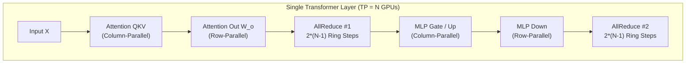
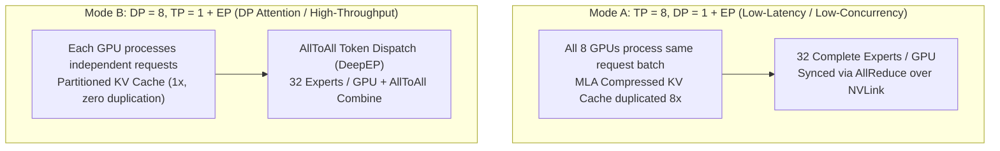
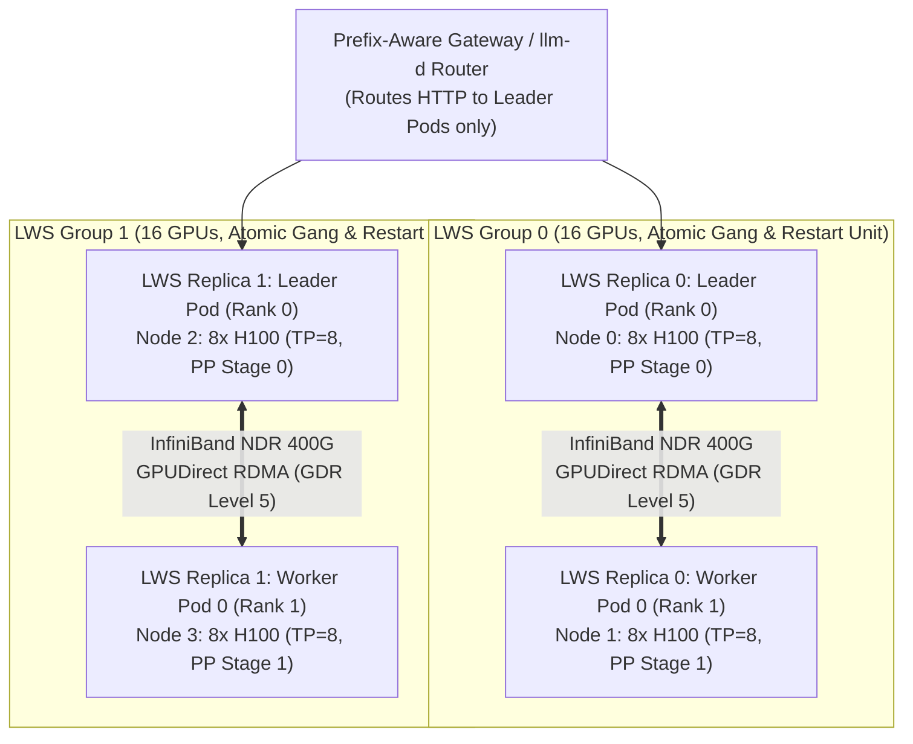

# 15.9 Multinode inference: parallelism, decoding and routing

| Field | Value |
|---|---|
| Level | Advanced |
| Priority tier | 1 |
| Lab venue | GCP / GKE + Local Python Verification Lab |
| Part | Part 15: LLM inference and serving |
| Cross-references | Chapter 11.7 on Kubernetes gang scheduling; Chapter 12.15 on NCCL collectives; Chapter 14.10 on multi-node training; Chapters 15.3 and 15.4 on vLLM and SGLang; Chapters 15.8 and 15.10 on disaggregated serving |
| Code | `code/part15/multinode_inference_parallelism.py`, `code/part15/multinode_inference_parallelism_lab.py` |
| Coverage file | `planning/coverage/chapters/15-09.md` |
| Claim & number ledger | `planning/ledgers/15-09.md` |

## Why this matters for AI infrastructure

Picture a platform team asked to serve a frontier model next quarter. The first estimate says the weights alone will not fit on one server, and the second estimate says the answers must still arrive quickly. A single high-end GPU cannot hold a frontier foundation model. Even an eight-GPU server runs out of memory when serving massive dense models like Llama-3-405B. The same memory wall hits sparse Mixture-of-Experts models like DeepSeek-R1 with 671 billion parameters. A Mixture-of-Experts model is one where each token uses only a few specialist subnetworks, which keeps compute low but still stores every expert in memory. You must split these models across multiple GPUs and multiple physical nodes.

Scaling inference across nodes is much harder than scaling distributed training. Training jobs optimize for aggregate token throughput over hours or days. They can easily hide network latency behind large micro-batches, which are groups of examples processed together. Online inference must deliver each output token in under 25 milliseconds while handling unpredictable user prompts. Partitioning a model places network communication directly on the synchronous critical path of every generated token. In other words, every slow hop between nodes is paid again for every single word the user sees.

This chapter covers the methods that make multinode inference fast for these massive models. It shows how to design distributed serving systems that keep latency low and throughput high. The methods combine hardware features with algorithm changes, so each design choice has to work with the others. Read the rest of the chapter with that dependency in mind, because a choice that looks safe on its own can break a choice made elsewhere.

```text
Multi-Node Inference Scaling Reference Numbers (ASP Ch. 1, 15; Volume 12 Ch. 9; DAI Ch. 6, 11):
- Llama-3-70B (80 layers, 140 GB FP16 weights + 20+ GB KV cache):
  Exceeds 1x 80 GB H100; requires 2 to 8 GPUs via intra-node Tensor Parallelism (TP = 2, 4, or 8)
- DeepSeek-V3 / DeepSeek-R1 (671B total parameters, ~680B nominal, 37B active per token):
  Uses 1 shared expert + 8 routed experts out of 256 per token (9 active experts = 5.51% active parameters)
  Exceeds an 8x 80 GB H100 node (640 GB) in BF16/FP8 once KV cache and workspace are added
- The 160-AllReduce Per-Token Trap (80-layer Transformer under Tensor Parallelism):
  2 synchronous AllReduce calls per layer * 80 layers = 160 AllReduces per generated token
  At 50 tokens/s = 8,000 AllReduce collectives per second
  Ring AllReduce step count per collective = 2 * (N - 1) steps (14 steps at TP = 8; 30 steps at TP = 16)
  Over intra-node NVLink 4 (900 GB/s, < 1.0 us): ~0.13 ms comm/token (ITL ~14.13 ms)
  Over PCIe Gen5 (64 GB/s) or 100GbE TCP (12.5 GB/s, 50-150 us): adds 50 ms to 200 ms per token (> 90% stall)
- Disaggregated Prefill/Decode and Speculative Decoding Gains:
  DistServe PD disaggregation: up to 7.4x higher goodput and 12.6x tighter latency SLOs
  Speculative decoding (EAGLE-3 / Medusa / MTP): 1.96x to 3.6x decode speedup without accuracy loss
```

Three architectural mistakes routinely break multi-node inference clusters in production. Each one looks reasonable on a whiteboard, and each one shows up as a slow cluster that nobody can explain at first.
- Spanning Tensor Parallelism across slow inter-node links. What goes wrong when one model layer is split across two servers? Stretching Tensor Parallelism across two eight-GPU servers forces 160 AllReduce operations per token over PCIe or Ethernet. That single mistake adds up to 200 milliseconds per token. It can also trigger a 30-second NCCL watchdog timeout during startup.
- Unbalanced Mixture-of-Experts and Pipeline stages. Why does one GPU run hot while its neighbors wait? In Mixture-of-Experts serving, a popular expert can drive one GPU to 99 percent utilization while peer GPUs sit at 60 percent. In Pipeline Parallel serving, long prompts can fill nearly all of the KV cache on the first stage while downstream stages sit mostly empty.
- Cache-blind request routing. What does a router lose when it ignores where the cache lives? Every request that lands on the wrong replica pays the full prefill cost again. Using round-robin load balancing across Data Parallel replicas destroys prefix cache locality and leaves half the cluster idle. Conversely, naive prefix hashing without load bounds sends over three times more traffic to a single hot node.

**Align your parallelism dimensions with hardware link boundaries first, then accelerate sequential decode with speculative execution and cache-aware routing.** Put the slow links in your mental map before you add any other trick, because every later optimization depends on that map.

## Prerequisites and outcomes

### Prerequisites
Imagine a senior engineer asking why your new cluster is slow, and you have to answer from the topology rather than from guesses. Three threads from earlier work give you that answer.
- Kubernetes gang scheduling, Kueue, Volcano, and topology-aware pod placement from Chapter 11.7.
- NVLink, NVSwitch, InfiniBand NDR, RoCEv2, GPUDirect RDMA, and NCCL collective algorithms from Part 12.
- PagedAttention, continuous batching, chunked prefill, and RadixAttention from Chapters 15.3 and 15.4.

### Outcomes
A team has a model that fits on a single node and wants to serve a larger one without losing the latency it already has. This chapter works through that problem in order. It starts with the parallelism map that connects each strategy to a hardware link, and it shows why cross-node Tensor Parallelism breaks inter-token latency. Next it covers wide Expert Parallelism for large Mixture-of-Experts models on multi-node clusters and GB200 NVL72 racks, and why Tensor Parallel plus Expert Parallel differs from Data Parallel Attention. Then it covers dynamic MoE routing, with hierarchical AllToAll collectives, wave scheduling, capacity factors, expert collocation, and the DeepSeek Expert Parallelism Load Balancer. After that comes speculative decoding, Medusa, EAGLE, Multi-Token Prediction, Lookahead decoding, and XGrammar constrained decoding. The final part deploys multi-node inference on Kubernetes with Ray and LeaderWorkerSet, tunes bounded-load prefix-aware routing, and works through cross-node NCCL and KV cache starvation incidents.

---

## 1. The 5D Parallelism Taxonomy for Multi-Node Inference

### 1.1 Why Inference Parallelism Differs from Training Parallelism

A colleague who ran a training cluster last year is now on your inference team, and she asks why the same parallelism settings feel wrong. The answer starts with the workload. Distributed training and distributed inference solve different equations. Training processes massive batches of tokens where forward and backward computation dominates communication time. Inference serves interactive requests where batch sizes are small. Every generated token must stream back to the user immediately, so there is no large batch to hide a slow transfer behind.

Every LLM request executes two distinct stages. During prefill, the engine processes all input prompt tokens in parallel. That parallel work makes prefill compute-bound on GPU Tensor Cores. During decode, the engine generates one token per step for each active sequence. It reads all model weights and cached Key-Value tensors from High-Bandwidth Memory for just a handful of operations per byte. Decode is therefore strictly memory-bandwidth bound. The practical lesson is that the two stages want different kinds of help, and a parallelism plan that helps one can hurt the other.

```text
Hardware Roofline and Memory Bandwidth Reference (HLS Ch. 5; Volume 12 Ch. 9):
- Matmul arithmetic intensity: FLOPs / Bytes = (2 * M * N * K) / (2 * (M * K + K * N + M * N))
- NVIDIA L40S (48 GB GDDR6, 864 GB/s HBM, 362.05 TFLOPS FP16/BF16, 733 TFLOPS FP8):
  FP16 Roofline Knee = 362 TFLOPS / 864 GB/s = 419 FLOPS/Byte
  Square matmul M=N=K=64 -> 21 FLOPS/B (memory-bound); M=512 -> 170 FLOPS/B (memory-bound); M=4096 -> 1,365 FLOPS/B (compute-bound)
  LLM hidden_dim h = 4096:
  Prefill (s = 64 -> 62.06 FLOPS/B; s = 512 -> 409.60 FLOPS/B; s = 4096 -> 1,365.33 FLOPS/B compute-bound)
  Decode (s_decode = 1): ~1.0 FLOPS/B regardless of prompt length (strictly memory-bandwidth bound)
- GPU HBM vs Interconnect Bandwidth Gap (H100 SXM vs H200 SXM vs H100 NVL):
  H200 SXM: 141 GB HBM3e, 4.8 TB/s HBM bandwidth, 1,979 TFLOPS BF16, 900 GB/s NVLink 4 (~$6.30/hr)
  H100 SXM: 80 GB HBM3, 3.35 TB/s HBM bandwidth, 1,979 TFLOPS BF16, 900 GB/s NVLink 4 (~$6.20/hr)
  H100 NVL: 94 GB HBM3, 3.9 TB/s HBM bandwidth, 600 GB/s 2-GPU NVLink bridge
  A100 SXM: 80 GB HBM2e, 1.935 TB/s HBM bandwidth, 312 TFLOPS BF16, 600 GB/s NVLink 3 (~$2.70/hr)
  A10:      24 GB GDDR6, 0.6 TB/s HBM bandwidth, 125 TFLOPS BF16, PCIe only (< $1.25/hr)
```

Even inside a single H100 SXM server, local HBM bandwidth at 3.35 TB/s is nearly four times faster than NVLink at 900 GB/s. Therefore, if a model fits on a single GPU after quantization and meets your latency target, keep it on one GPU. That avoids all inter-GPU communication overhead. Quantization here means storing the weights in fewer bits so they take up less memory. When a model exceeds single-GPU memory or requires pooled memory bandwidth, you combine up to five parallelism strategies. Think of them as five different ways to cut the work, and each cut has its own price in traffic between GPUs.

| Parallelism Strategy | Partition Basis | Communication Collective | Primary Interconnect | Impact on TTFT & ITL | KV Cache Layout |
|---|---|---|---|---|---|
| Tensor Parallelism (TP) | Splits weight matrices within each layer (column & row parallel) | 2 synchronous AllReduce calls per layer per token | Intra-node NVLink / NVSwitch (900 to 1,800 GB/s) | Cuts both TTFT and ITL by pooling compute and HBM bandwidth | KV heads sharded across TP ranks or replicated if `H_kv < TP` |
| Pipeline Parallelism (PP) | Splits contiguous blocks of layers across sequential stages | Point-to-point `NCCL_Send` / `Recv` at stage boundaries | Inter-node InfiniBand NDR / RoCEv2 (400 to 800 Gbps GDR) | Increases single-request ITL slightly; scales deep models across nodes | Each stage stores KV blocks only for its assigned layers |
| Expert Parallelism (EP) | Distributes complete MoE experts across GPUs | 2 AllToAll shuffles (dispatch & combine) per MoE layer | NVSwitch intra-rack (NVL72) or Dual-Rail RDMA (`DeepEP`) | Scales MoE capacity to trillions of parameters at constant active FLOPs | Combined with TP or DP Attention (`--enable-dp-attention`) |
| Data Parallelism (DP) | Replicates complete model or TP/PP group across independent instances | Zero inter-replica collectives during forward pass | Standard Ethernet or any cluster fabric behind a router | Scales QPS throughput linearly; zero speedup for single-query latency | Isolated full KV cache pool per replica or per DP Attention rank |
| Context / Helix Parallelism (CP) | Splits input sequence tokens and KV cache across GPUs | Ring or all-gather KV exchange at sequence chunk boundaries | Intra-node NVLink or high-speed RDMA | Cuts TTFT near-linearly on 100k+ to 1M token prompts | Each GPU stores KV cache only for its assigned sequence segment |

### 1.2 Tensor Parallelism Mechanics and Why TP Across PCIe or Ethernet Breaks ITL

Your model is too big for one GPU, so the first move is to split each layer across several GPUs. Tensor Parallelism, pioneered by Megatron-LM, splits the weight matrices of each Transformer block across *N* GPUs. All *N* GPUs compute every token in lockstep, which means none of them can run ahead of the others. Each Transformer block contains two self-attention projections and two feed-forward projections paired as Column-Parallel and Row-Parallel layers. A projection is a matrix multiply that maps one vector to another.
- Column-Parallel Linear Layers. These are used for the Query, Key, and Value projections and the MLP gate and up projections. The input activation tensor is replicated across all Tensor Parallel ranks. The weight matrix is sliced column-wise across the ranks. Each GPU computes its partial column output locally without any inter-GPU communication, so this half of the layer runs without network traffic.
- Row-Parallel Linear Layers. These are used for the attention output projection and the MLP down projection. The weight matrix is sliced row-wise across the ranks. Each GPU multiplies its local activation shard by its local weight rows. Because each rank holds only a partial sum of the full output vector, all ranks must execute a synchronous **AllReduce sum** before the layer normalization. An AllReduce adds up the partial sums from every GPU and gives each GPU the total, so it is the step where every rank waits for the slowest one.



Count the AllReduces on the diagram above, because the count drives everything else in this section. Every Transformer layer contains two Row-Parallel projections, so Tensor Parallelism executes two synchronous AllReduce operations per layer. For an eighty-layer model like Llama-3-70B, generating a single token requires 160 synchronous AllReduce operations. At a streaming rate of fifty tokens per second, the cluster executes 8,000 AllReduce collectives every second. The number is large even though each one is small, and the latency cost comes from how many barriers the token has to pass through.

In a ring AllReduce across *N* GPUs, a ReduceScatter phase is followed by an AllGather phase. A ring is a loop in which each GPU passes data to its neighbor. ReduceScatter splits the sum across the ring, and AllGather copies the finished pieces back to everyone. Each phase takes *N* minus one steps, requiring twice *N* minus one sequential transfer hops per collective. Each hop must finish before the next one can start, so the steps add up in time.

```text
Tensor Parallel AllReduce Volume and Latency Equations (Volume 12 Ch. 5 & 9; ASP Ch. 15):
- AllReduce calls per token:         C_token = 2 * L  (for L = 80 layers -> 160 AllReduces/token)
- Ring steps per AllReduce:          S_ring  = 2 * (N - 1)
  * TP = 8  (single 8-GPU node):     2 * (8 - 1)  = 14 steps/AllReduce -> 160 * 14 = 2,240 ring steps/token
  * TP = 16 (two 8-GPU nodes):       2 * (16 - 1) = 30 steps/AllReduce -> 160 * 30 = 4,800 ring steps/token
- Data volume moved per rank per AllReduce:
  Data_Volume = 2 * ((N - 1) / N) * B * S * H * BytesPerElement
  For B = 1, S = 1, H = 8192, BF16 (2 bytes) -> Tensor size = 16,384 bytes (16 KiB)
  At TP = 8:  2 * (7 / 8) * 16,384 bytes = 28,672 bytes (28 KiB) per AllReduce -> 4.59 MB/token across 160 calls
- Per-token communication time:
  T_comm_token = 2 * L * (Data_Volume / BW_link + Latency_collective)
  * NVLink 4 (900 GB/s, ~0.8 us/collective): 160 * (0.03 us + 0.8 us) = 0.13 ms/token (< 1% of 14.13 ms ITL)
  * PCIe Gen5 / 100GbE TCP (12.5 to 64 GB/s, 300 to 1,250 us/collective):
    160 * (0.3125 ms to 1.25 ms) = 50.0 ms to 200.0 ms/token (> 85% to 93% of execution time spent waiting)
```

Read the equation block as a per-token bill. Each of the 160 AllReduces pays a fixed latency toll, and the data volume adds a second toll on top. On a fast link the toll is tiny. On a slow link the same count of barriers becomes the biggest item on the bill. That math establishes a hard law for inference infrastructure: never span Tensor Parallelism across PCIe-only slots or standard inter-node networks. Within an eight-GPU server connected by NVSwitch at 900 GB/s on H100 or 1.8 TB/s on Blackwell B200, those AllReduces add just 0.13 milliseconds per token. Once Tensor Parallelism crosses a server chassis boundary over PCIe or Ethernet, those 160 barriers add 50 to 200 milliseconds of latency to every single token.

| Interconnect Layer | Physical Interface | Bidirectional Bandwidth | Per-Hop Latency | Viable Parallelism Strategy |
|---|---|---|---|---|
| NVLink 5 (Blackwell B200 / GB200 NVL72) | 18x 100 GB/s links + NVSwitch 4 (130 TB/s rack) | 1,800 GB/s (1.8 TB/s) per GPU | `< 1.0 us` | Intra-node TP (TP = 2..8) & Wide EP / TP up to 72 GPUs (NVL72) |
| NVLink 4 (Hopper H100 / H200 SXM) | 4x NVSwitch 3 full mesh (vs 128 GB/s P2P without NVSwitch) | 900 GB/s per GPU | `< 1.0 us` | Intra-node Tensor Parallelism (TP = 2, 4, 8) & Intra-node EP |
| NVLink 3 (A100 SXM) / H100 NVL Bridge | NVSwitch mesh (A100) or 2-GPU Bridge (H100 NVL) | 600 GB/s per GPU | `< 1.5 us` | Intra-node TP (TP = 2..8 on A100; TP = 2 only on H100 NVL) |
| ConnectX-8 SuperNIC / XDR InfiniBand | PCIe Gen6 + GPUDirect RDMA (1:1 NIC:GPU) | 800 Gbps (100 GB/s) per port | `1.0 - 2.0 us` | Inter-node Pipeline Parallelism (PP), Wide EP, NIXL KV transfer |
| InfiniBand NDR / RoCEv2 (ConnectX-7) | PCIe Gen5 + GPUDirect RDMA (`NCCL_NET_GDR_LEVEL=5`) | 400 Gbps (50 GB/s) per port | `1.5 - 3.0 us` | Inter-node Pipeline Parallelism (PP), EP, Data Parallelism (DP) |
| PCIe Gen5 x16 (Host Bus Switch) | Local PCIe root / switch without NVLink | 64 GB/s per dir (128 GB/s bidir) | `5 - 10 us` | Pipeline Parallelism (PP) or Data Parallel Replicas (DP) |
| Standard 100GbE Ethernet | Host kernel TCP/IP socket stack | 100 Gbps (12.5 GB/s) | `50 - 150 us` | Data Parallel Replicas (DP) ONLY |

Read the interconnect table as a list of places where a parallelism plan can live. Each row names a link, its bandwidth, its latency, and the strategies it can carry without stalling. A strategy that fits a fast row can be a poor fit for a slow one, even though the model and the code are identical. Before you assign a parallelism dimension to a link, find that link's row and check the latency column first, because latency decides whether many small messages stay cheap.

Tensor parallelism is close to linear for compute-bound work. That holds only while the all-reduce of activations stays fast compared with the math. Close to linear means that doubling the GPUs roughly doubles the speed. In inference, TP mainly targets the large matrix multiplies in the attention projections and the MLP networks, because those carry most of the arithmetic.

Activations for one token are small, so those all-reduces are cheap on NVLink. That makes TP a practical way to split giant dense models without approximating their weights. Approximating weights would mean changing the model to make it fit, and TP does not do that. Teams also use it when one expert or one layer is too large for a single GPU, or when they want lower latency per layer.

TP efficiency falls once the group grows past a certain size. The drop is steepest across nodes or racks that connect over InfiniBand or Ethernet. For that reason, TP works best inside one node or one NVLink domain. An NVLink domain is the set of GPUs that can talk to each other over NVLink without leaving the rack or the chassis.

Blackwell systems with fifth-generation NVLink offer up to 1.8 TB/s of aggregate bidirectional bandwidth per GPU. That lets TP scale across a node of 8 to 16 GPUs. In a GB200 or GB300 NVL72 rack, the NVLink Switch provides about 130 TB/s of GPU bandwidth across the 72-GPU domain. The rack is effectively one large node for the purposes of TP.

The NVLink Switch System can join up to 8 racks, or 576 GPUs, into one fully connected fabric. That makes 576-way tensor parallelism possible on paper. Even so, choose TP group sizes with the topology in mind. Keep them inside one NVLink or NVSwitch island when you can, because crossing racks adds switch latency. "On paper" is the key phrase here, because a group that is possible is not always a group that is fast.

### 1.3 Pipeline Parallelism, Context Parallelism, and Helix Parallelism

Picture a model that is still too large for one eight-GPU node, even after quantization. The fix is to combine intra-node Tensor Parallelism with inter-node **Pipeline Parallelism**. Pipeline Parallelism slices the model vertically into contiguous layer stages across *P* nodes. Think of an assembly line in which each station owns a block of the work. For an eighty-layer model with two pipeline stages, the first node runs the first forty layers with eight-way Tensor Parallelism. The second node runs the remaining forty layers with eight-way Tensor Parallelism. The token passes from one node to the next, one station at a time.

Instead of communicating twice per layer, Pipeline Parallelism sends an activation tensor across the network only at stage boundaries. That requires just one point-to-point `NCCL_Send` and `NCCL_Recv` transfer per stage boundary on each forward pass. NCCL is the library that moves tensors between GPUs, and a point-to-point send is a message from one GPU to exactly one other. Better yet, combining Tensor Parallelism within each node with Pipeline Parallelism across nodes shrinks the cross-node transfer size by the Tensor Parallel factor. Each GPU on the upstream stage sends only its local activation shard directly to its same-rail peer on the downstream node. A rail is the matching network path for a given GPU position across the nodes. For a hidden dimension of 8,192 and four-way Tensor Parallelism, each rank transfers only 2,048 elements per token.

Pipeline Parallelism has one major drawback during single-request decoding: pipeline bubbles. While the first stage computes a token step, downstream stages sit idle waiting for the activation baton. A bubble is that idle time, and it is the cost of an assembly line that has only one item moving through it. In production serving, engines reduce that bubble by interleaving micro-batches from multiple concurrent user requests alongside `--enable-chunked-prefill` and `--max-num-batched-tokens 2048`. That keeps every pipeline stage busy on every millisecond, as long as enough users are sending requests at the same time.

For workloads with extreme prompt lengths of one hundred thousand to one million tokens, Context Parallelism partitions the input sequence itself across multiple GPUs. Here the cut runs along the length of the prompt rather than through the layers. This strategy is also called Sequence Parallelism or Helix Parallelism when pipelined across attention and Key-Value dimensions. Using Ring Attention or blocked attention, each GPU stores the Key-Value cache only for its local sequence chunk. The GPUs exchange compact boundary statistics around a logical ring. Context Parallelism cuts prefill Time to First Token roughly in half every time you double the GPU count. On million-token contexts with DeepSeek-V3.1, SGLang's long-context pipeline and sequence parallelism achieves a 3.31x increase in prefill throughput. It also delivers an 81 percent reduction in Time to First Token at 82.8 percent scaling efficiency.

Consider a legal team that uploads a contract bundle of several hundred thousand tokens and asks questions about it all afternoon. The first prefill is the expensive part, and every later question should reuse the cache. Context Parallelism is the tool that makes that first prefill fit in memory and finish in a reasonable time. Context Parallelism is harder to build than the other strategies. Transformers use global self-attention, so every token attends to every earlier token. If you split the sequence naively, GPUs must exchange large amounts of data to compute attention across each partition boundary. Attention is the step where each token looks back at the tokens before it, so every slice of the prompt has to see the others.

Ring parallelism and blocked attention reduce that cost. Each GPU then attends mostly within its own part of the context, plus a small amount of boundary data. In effect, CP works like pipeline parallelism along the sequence length instead of the layer depth. Prompt processing time drops roughly in half each time the GPU count doubles, minus the boundary overhead. Boundary overhead is the extra exchange that happens at the edges of each slice.

CP does not speed up the token-by-token decode step. It helps prefill for very long inputs, where a document is sliced into segments that run at the same time. It also lets a context larger than one GPU's memory fit across the group, because each GPU stores only its own segment of the KV cache. For short prompts, the extra per-layer communication often costs more than it saves. Measure prefill speed and accuracy at your maximum context before you turn CP on. A speed number measured on short prompts tells you nothing about a million-token document.

Always keep Tensor Parallelism inside a single NVLink domain and use Pipeline or Context Parallelism only when model weights or million-token contexts exceed single-node memory. Read that rule as an order of operations. Tensor Parallelism comes first, inside the fastest link you have. Pipeline and Context Parallelism come next, and only when memory forces them.

### 1.4 Disaggregated Prefill and Decode

Picture one long document upload landing on a server that is also streaming answers to dozens of chat users. Every stream stalls while the document is read, and nobody can tell from the dashboard why. Prefill and decode have different needs, so running both on the same GPUs causes trouble. Traditional servers colocate the two stages on the same nodes and batch everything together. That design causes prefill-decode interference. A long prompt prefill can occupy the GPU and delay time-sensitive decode work for other requests, and the reverse also happens.

Prefill is made of large, parallel computations. Decode is made of many small, sequential ones. A shared node must either favor one phase or over-provision hardware to serve both. Favoring one phase means the other one suffers. Over-provisioning means buying extra GPUs that sit partly idle. Neither choice is comfortable, and both waste capacity.

Disaggregation gives each phase its own GPU pool, which removes the direct interference between them. Disaggregation simply means the prefill and decode work is separated onto different machines. The DistServe system reported up to 7.4x more goodput while meeting both TTFT and TPOT constraints. It also handled latency SLOs up to 12.6x tighter. Gains depend on the workload and the network fabric, so results range from moderate improvements to several times higher goodput. Treat the headline numbers as the top of a range, not as a promise for your traffic.

Goodput is the throughput you get while meeting a latency target. Separating the pools cuts the dead time in which decode waits behind prefill, and the reverse. GPUs then do more useful work and sit idle less. Separation also lets each stage be tuned for its own goal, throughput or latency.

Prefill can be batched aggressively on the prefill GPUs to raise throughput, without slowing decode on other GPUs. Decode GPUs can run lower batch sizes, or use a scheduler that puts urgent decode work first. Time to first token (TTFT) is the prefill goal, and time per output token (TPOT) is the decode goal. Before disaggregation, teams had to trade one against the other. Separate pools let both targets be met at once. A team that used to tune one number at the expense of the other can now set two separate targets.

Each pool scales on its own. Prefill workers process the prompt and produce the KV cache. The cache then moves to decode workers, which generate the output tokens one at a time. The two pools talk only during that handoff, so most of the time each pool can run without waiting for the other.

The handoff works only when both sides share the same KV cache layout and dtypes. A dtype is the number format, such as FP16 or FP8. Cross-vendor or cross-architecture pairs often break this rule. Keep prefill and decode on compatible GPU families, so both sides use the same numeric formats and the cache can move without conversion.

The handoff is cheap when the fabric is fast. Multinode clusters with ConnectX-8 SuperNICs reach up to 800 Gb/s per port with GPUDirect RDMA. The recommendation is one NIC per GPU, which helps both disaggregation and MoE all-to-all. A NIC is the network card, and one per GPU means each GPU has its own path out of the node. Monitor NVLink and NIC utilization during KV transfer and all-to-all phases, because a busy link that shows idle elsewhere points to the bottleneck.

Disaggregation adds complexity, too. The KV cache of a long prompt can reach a few gigabytes, and that data must be moved and tracked. Scheduling is harder. At ultra scale, though, the gains from using hardware efficiently are large. Chapters 17 and 18 cover advanced scheduling, routing, and deployment for disaggregated PD. PD is the shorthand for prefill and decode.

A useful test before you split the pools is to ask whether the two phases actually collide in your traces. If your prompts are short and your traffic is steady, colocated serving may be perfectly healthy, and the extra pool would only add operational work. If your prompts are long, or your traffic arrives in bursts, the collision is likely, and the split starts to pay for itself. Measure both situations, because the decision depends on your traffic rather than on the headline benchmark.

### 1.5 Trade-offs of Each Parallelism Strategy

A team is choosing a parallelism plan for a new model, and every option has a good story on its own. Each strategy buys one benefit and pays for it somewhere else. The table below lists the main gain and the main cost of each one. Use it to decide which combination fits your model and your network. Read each row as a trade you are accepting, not as a ranking of the strategies.

| Strategy | Main gain | Main cost |
|---|---|---|
| Tensor | Near-linear speedup on compute-bound layers, with all-reduce overlapped with compute | Frequent all-reduce at every layer, and it needs NVLink-class bandwidth |
| Pipeline | Fits very deep models by splitting layers, and adds throughput for large batches or long inputs | Fill and flush bubbles, weak for one-token decode, and more activation memory |
| Expert | Total capacity grows with GPU count, and each GPU computes only a share of tokens | An all-to-all shuffle at every MoE layer, and load imbalance when gating is uneven |
| Data | Near-linear throughput scaling, and simple to build | No per-query latency gain, and each replica holds a full copy of the model |
| Context | Near-linear prefill speedup for very long sequences | Per-layer boundary communication and custom attention kernels |

Start with the smallest set of strategies that fits the model in memory. Then add the rest only for throughput or context length. Every extra strategy adds one more kind of traffic, one more thing to monitor, and one more way to fail, so it has to earn its place.

---

## 2. Wide Expert Parallelism, DeepSeek-R1 671B, and GB200 NVL72

### 2.1 Sparse Mixture-of-Experts Mechanics and DeepSeek-R1 671B

A product team wants a smarter model, but the budget for each answer is fixed. The obvious move, a bigger dense model, makes every answer more expensive, because every parameter does work on every token. Dense models activate every parameter for every token, causing compute cost and memory bandwidth to grow linearly with model size. Sparse **Mixture-of-Experts** models decouple total parameter capacity from per-token compute. They replace each dense feed-forward network with dozens or hundreds of specialist expert MLPs controlled by a lightweight gating router. An MLP is a small feed-forward network, and the gating router is the small step that picks which experts see each token.

DeepSeek-V3 and DeepSeek-R1 exemplify this hardware-software co-design. Co-design means the model architecture and the hardware are planned together. The full model contains 671 billion parameters, yet activates only 37 billion parameters per token, or just 5.51 percent of the network. In each Mixture-of-Experts layer, every token passes through one shared expert plus eight routed experts chosen out of 256 routed experts. That gives nine active experts per token. The shared expert sees every token, while the routed experts are picked per token by the gate. This sparsity allowed DeepSeek to train DeepSeek-V3 on 2,048 export-restricted H800 GPUs for 5.5 million dollars.

```text
DeepSeek-R1 671B Architecture and Distilled Model Comparison (ASP Ch. 1, 15; DAI Ch. 6, 11; HLS Ch. 5, 6):
- DeepSeek-V3 / DeepSeek-R1 Full MoE Model:
  Total parameters = 671B (~680B with MTP/auxiliary heads); Active parameters/token = 37B (5.51%)
  Expert layout per MoE layer = 1 shared expert + 256 routed experts (top-8 selected -> 9 active experts/token)
  Routed expert activation density = 8 / 256 = 3.125% (> 3.0% threshold where Expert Parallelism beats pure TP)
- Benchmark Comparison (DeepSeek-R1-671B vs DeepSeek-R1-Distill-Llama-70B, HLS Table 6-6):
  * MATH-500 pass@1:       97.3% (671B) vs 94.5% (70B Distill)
  * GPQA Diamond pass@1:   71.5% (671B) vs 65.2% (70B Distill)
  * LiveCodeBench pass@1:  65.9% (671B) vs 57.5% (70B Distill)
- Multi-Node Serving Footprints for DeepSeek-R1 671B:
  * 8x H200 SXM (8 * 141 GB = 1,128 GB HBM3e): Fits full 671B model in FP8 (~671 GB) on a single 8-GPU node
  * 32x H100 80 GB (4 nodes, TP = 4 intra-node x PP = 8 inter-node): ~83.875B (~84B) parameters per PP stage
  * 64-GPU Hybrid MoE Cluster (ASP Ch. 15, 60 layers, 64 experts, 16 groups of 4 GPUs):
    PP = 4 (15 layers/stage) * TP = 2 * EP = 16 (top-2 gating), scaled to 128 GPUs with DP = 2
```

### 2.2 TP+EP vs DP+EP (Data-Parallel Attention) in vLLM and SGLang

Imagine you have just turned on Expert Parallelism and the memory layout on each GPU looks different from what you expected. That is the moment to check how the experts are laid out. Without Expert Parallelism, an inference engine shards every expert's weights across all Tensor Parallel ranks. Every GPU holds a slice of all 256 experts. Enabling **Expert Parallelism** via `--enable-expert-parallel` in vLLM or `--ep` in SGLang changes the weight layout. Each GPU now holds *complete* experts for a subset of the expert pool. A complete expert is never split, so one GPU can run it without asking its neighbors for a piece.

In vLLM, the Expert Parallel group size equals the Tensor Parallel size multiplied by the Data Parallel size. The flag only takes effect when that product exceeds one; if both are set to one, the flag is silently ignored. For DeepSeek-R1 with 256 routed experts on eight GPUs, each GPU hosts 32 complete experts. However, how you form that group of eight GPUs fundamentally changes both network collectives and Key-Value cache memory. The same eight GPUs can be arranged as one tensor group or as eight independent attention groups, and the two arrangements behave very differently.



Read the two flowcharts side by side. Mode A keeps every GPU on the same request, so the work is synchronized but the cache is copied. Mode B lets each GPU own its own requests, so the cache is stored once, but tokens must be shuffled to the right experts at every MoE layer. The choice is a trade between cache memory and shuffle traffic, and the right answer depends on how many requests you serve at once.
- Tensor Parallelism plus Expert Parallelism. Every GPU participates in every request and synchronizes layer outputs using AllReduce. While simple, this mode creates a severe Key-Value cache penalty for models like DeepSeek-R1 that use Multi-Head Latent Attention or Multi-Query Attention. Because Multi-Head Latent Attention compresses Keys and Values into a single shared latent vector, standard Tensor Parallelism cannot split the cache by head. Instead, it replicates the entire KV cache across all eight GPUs. The cache cost is paid eight times over for the same requests.
- Data Parallelism plus Expert Parallelism with DP Attention. Passing `--data-parallel-size 8 --enable-expert-parallel` in vLLM or `--enable-dp-attention --dp-size 8` in SGLang runs the attention layers using Data Parallelism. Each GPU stores the KV cache only for its own assigned requests. That eliminates the eightfold KV cache duplication and increases decode throughput by up to 1.9x. Before the Mixture-of-Experts layer, the GPUs execute an AllToAll collective via `DeepEP` and `DeepGEMM` to route each token to the GPU hosting its selected experts. A second AllToAll returns the expert outputs. The trade is more shuffling in exchange for one cache copy per request instead of eight.

Two numbers in that paragraph are worth keeping in your head. The first is the density that justifies the shuffle. The second is the density below which the shuffle is probably a loss. Between those two numbers you need a measurement, not a rule. Expert Parallelism is beneficial whenever expert activation density exceeds 3 percent, such as DeepSeek-R1's 3.12 percent density. Activation density is the share of experts that actually run for a token. At that density, the memory bandwidth saved by loading fewer expert weights outweighs the AllToAll network cost. For ultra-sparse models with under 1 percent activation density at tiny batch sizes, AllToAll latency can exceed the compute savings. A small batch makes the shuffle cost look large, because there is little compute to hide it behind.

### 2.3 Wide Expert Parallelism on GB200 NVL72

Think about what a Mixture-of-Experts layer does on every token. The token is sent to the GPUs that hold its experts, and the answers are sent back. On traditional eight-GPU servers, scaling Expert Parallelism past eight GPUs forces the twice-per-layer Mixture-of-Experts AllToAll shuffle across the slower inter-node InfiniBand fabric. A slower fabric makes that shuffle the dominant cost. NVIDIA's **GB200 NVL72** rack eliminates that node boundary across 72 Blackwell GPUs. Wide Expert Parallelism means spreading the experts over many GPUs so that each one holds only a few.

Each GB200 NVL72 rack houses 36 Grace CPUs and 72 Blackwell GPUs connected through an on-rack NVLink Switch fabric. Every GPU enjoys 1.8 TB/s of bidirectional NVLink 5 bandwidth, providing 130 TB/s of non-blocking aggregate GPU-to-GPU bandwidth. Non-blocking means every GPU can talk to every other one at full speed at the same time. The rack pools 13,824 GB of HBM3e memory across the 72 GPUs, or 30 TB total memory including Grace CPU RAM inside the same NVLink domain. Furthermore, NVLink Switch Systems can unify up to eight racks into a 576-GPU all-to-all fabric. In MLPerf Inference v5.0, the GB200 NVL72 delivered 3.4x higher inference throughput per GPU than Hopper clusters.

Inside a 72-GPU NVLink domain, engineers deploy Wide Expert Parallelism across 64 or 72 GPUs combined with Data-Parallel Attention. Across 64 GPUs, each GPU hosts just four routed experts of DeepSeek-R1. Because every GPU-to-GPU hop traverses the 130 TB/s NVSwitch backplane in sub-microsecond latency, wide AllToAll expert shuffles execute at intra-node speeds. That leaves over twelve terabytes of HBM3e free for massive concurrent KV caches. The free memory is the payoff, because the same rack can now hold many more users' caches at once.

### 2.4 Dynamic MoE Routing, Wave Scheduling, Capacity Factor, and EPLB

Imagine a Monday traffic spike on a 72-GPU rack. Latency climbs even though the fabric is far from full, and the traces show a few GPUs working while many others wait. Even on fast interconnects, naive Mixture-of-Experts routing creates two production bottlenecks: AllToAll network microbursts and hot-expert stragglers. A microburst is a sudden flood of messages at the same instant. A straggler is one slow participant that holds up everyone else.

First, optimize **expert communication**. If all 72 GPUs in an NVL72 rack execute a monolithic AllToAll simultaneously, every GPU sends a message to 71 peers at the exact same instant. That floods the NVSwitch fabric with 5,112 concurrent messages. Wave scheduling breaks that collective into four staggered waves of 18 GPUs each. Each wave sends only 306 intra-wave messages, a 16.71x reduction in instantaneous switch queue pressure. Queue pressure is how many messages are waiting at once for the same switch port. The engine overlaps communication of the current wave with expert computation of the previous wave using `--enable-two-batch-overlap`. On multi-node InfiniBand clusters, use a two-stage hierarchical AllToAll that shuffles tokens inside the node over NVLink first and crosses InfiniBand only for remote experts. Combine that with butterfly schedules, FP8 or NVFP4 activation casting, and expert collocation, which places frequently co-activated experts on the same GPU.

Second, eliminate hot-expert stragglers. Because AllToAll is a synchronous collective barrier across all participating GPUs, a single overloaded GPU running at 99 percent utilization stalls peer GPUs sitting at 60 percent utilization. A barrier is a point where every GPU must arrive before any of them can continue. Production engines use three defenses to balance expert load.
- Capacity Factor. Caps the maximum tokens an expert processes per pass. With a base average load of 32 tokens per expert, setting a capacity factor of 1.2 gives a twenty percent overflow allowance and caps each expert at 38 tokens. Any excess tokens beyond that cap overflow to the token's second-choice expert or a fallback pass.
- Expert Replication and DeepSeek EPLB. DeepSeek's open-source Expert Parallelism Load Balancer tracks per-expert token routing counters in real time. When a specific expert receives 50 tokens while peers receive 20 to 30, EPLB clones that hot expert's weights onto a redundant GPU slot. Splitting incoming traffic across both copies cuts the peak load from 50 tokens down to 30 tokens.
- Biased Gating Score Adaptive Routing. At runtime, the inference engine wraps the gating softmax and subtracts a dynamic load penalty bias from overloaded experts. Configure Prometheus alerts whenever an expert exceeds 80 percent utilization so the router nudges borderline tokens toward underutilized replicas without retraining.

Always combine Data-Parallel Attention with hierarchical double-buffered AllToAll and EPLB expert replication when serving large Mixture-of-Experts models at scale. Each of the three pieces covers a different weakness, so leaving one out tends to move the bottleneck rather than remove it.

### 2.5 Expert Communication Optimization

A nightly job that used to finish in time starts missing its window after a model upgrade, and the profile shows most of the time sitting in one communication step. That step is usually the MoE all-to-all. It is the step that can dominate inference time. Every MoE layer shuffles token activations between GPUs, so each GPU receives only the tokens its experts need. The exchange repeats at every layer, so small inefficiencies add up quickly. Many layers of a small delay add up to a large delay for the whole reply.

Here is a small example of why the order matters. Imagine a token whose two chosen experts both live on the same remote node. A flat exchange would send the token across the network twice, once for each expert. A hierarchical exchange first moves the token once across the network to that node, and the two experts then share the local copy. The second trip never happens. The saving is small for one token and large across a whole batch.

A hierarchical route cuts the cross-node traffic. Tokens first move between GPUs inside a node over NVSwitch and NVLink, which is fast. Only the tokens that need an expert on another node cross the network in a second stage. The design is like sorting parcels in a local depot before sending the truck out, so the long trip carries fewer, fuller boxes.

Overlap hides much of the remaining latency. High-performance MoE servers use double buffers, which are two staging areas that take turns. While one batch of tokens moves across the network, the previous batch runs its expert computation. Measure link utilization on both the internode NIC and the intranode NVLink paths. Near-optimal all-to-all times depend on keeping the internode fabric busy. An idle NIC during the shuffle is wasted time you are already paying for.

A single global all-to-all barrier leaves GPUs waiting on one another. That wastes bandwidth when not every link is in use. A butterfly schedule, also called a shifted all-to-all, splits the exchange into phased rounds. Every NVLink and NIC then carries part of the traffic, and idle time drops. Each round pairs the GPUs in a different pattern, so no single link gets all the load at once.

All-to-all can run through NCCL's `ncclAllToAll` collective or through grouped send and receive calls. Chunked, pipelined exchanges often run faster, and so do hierarchical schedules such as butterfly across nodes. Test the options and choose the one that fits your topology. The best schedule on one cluster can be the worst on another, because the wiring is different.

Expert collocation reduces traffic further. If experts 5 and 7 often serve the same token, placing them on one GPU removes an extra all-to-all hop. Gating-frequency analysis and profiling tools reveal which pairs to group for your workload. Gating frequency is how often the router picks each expert, and pairs that show up together are good candidates for sharing a GPU.

Compression is another lever. Casting activations to FP8 or NVFP4 on Tensor Cores, with NVIDIA Transformer Engine, lowers the bytes sent over the NIC. Fewer bits per value means fewer bytes on the wire. The precision cost is tiny, and the cast and pack overhead is usually small next to the network savings.

Finally, configure the cluster for all-to-all traffic. Choose the NCCL all-to-all algorithm that suits your topology. Confirm that GPUDirect RDMA is enabled on internode paths. Bond the InfiniBand links so that several physical ports act as one logical channel with combined bandwidth and seamless failover. Bonding means the operating system presents the ports as one interface, so one failed cable does not take the whole path down.

### 2.6 Load Balancing, Capacity Factor, and Expert Replication

A team asks why its MoE model runs at all on a cluster this size, since the full model would never fit on one GPU. At scale, a well-balanced MoE activates all of its experts at once. One token touches only a few experts, but across all users every expert stays busy. Picture an MoE with 100 experts spread over 100 GPUs. If each token activates only two experts, the compute per token looks like a much smaller dense model. That is why expert parallelism lets some very large MoE models run at all.

Top-2 gating is the usual choice. Each token goes to two experts, which keeps quality high and load reasonably balanced. Top-1 gating cuts communication, because each token reaches only one expert. The trade-off is lower model quality and more uneven load. Top-2 doubles the expert outputs compared with top-1. Read the choice as a dial between quality and traffic, with top-2 sitting nearer to quality.

Placement helps as well. Experts that often pair up for the same tokens can share a GPU or a node. Many token assignments then stay local, which reduces traffic. Expert replicas and backup copies also help when a few experts draw most of the traffic.

Training teaches balance first. Google's GLaM introduced load-balancing losses and gating noise to spread tokens evenly across experts during training. A load-balancing loss is an extra training penalty that discourages the gate from favoring one expert. Inference-time gating that reacts to live load is still a research topic. In production, top-2 gating with a modest capacity factor, plus occasional expert swaps or replicas, is the common compromise.

A hot expert creates a straggler effect. The all-to-all waits for every expert to finish, so one overloaded expert stalls the whole pipeline and leaves other GPUs idle. Many MoE servers therefore cap the load per expert with a capacity factor, typically set at 1.2 to 1.5 times the average token load. A capacity factor is the multiplier on the average load that sets the cap.

Tokens above the cap go to a second-choice expert or wait for a second pass. Training-time penalties and gating noise work alongside this cap. Together they keep the token-to-expert load close to even. Inference hotspots still appear when prompts or topics concentrate on a subset of experts. A cap is the simplest guard against them.

In practice, a capacity factor of 1.2 with top-2 gating is common. Each expert takes up to 120 percent of its average load, and the excess moves to the next expert. That smooths the load across the system.

Replication handles experts that stay hot. The system clones a hot expert onto another GPU, and the gate then sends part of the traffic to the clone. The model never sees the replica. The engine registers each copy as a separate expert with its own index, so routing can spread tokens across the original and the clone. From the router's point of view, each copy is simply another expert.

Replicas add memory and must stay identical. Because only a few experts run hot, copying a handful of them costs far less than copying the whole model. Load the replicas from the same checkpoint as the original, and do not update them independently. The router knows about only one expert, so divergent copies would break its assumptions.

### 2.7 Adaptive Expert Routing and Real-Time Monitoring

A chat service is running well at breakfast, then one expert GPU falls behind at lunch. Nothing in the fixed routing table knows that yet. Most expert gates are fixed after training. They rely on routing scores learned in training and ignore current conditions. Adaptive routing changes the gate's decisions at inference time, based on live load. Suppose one expert GPU falls behind. The gate can send some tokens to another expert with a slightly lower score, as long as that expert has spare capacity. The answer is slightly worse for those tokens, and the whole layer finishes sooner.

Doing this well requires monitoring. Each expert should publish utilization and latency metrics, for example to Prometheus and Grafana. The system then adjusts the capacity factor or the gating algorithm based on what it sees. Most gating functions consider only training-time scores, so a truly adaptive system has to run inside the inference engine. Training-time scores are fixed numbers, and they cannot see that a GPU is busy right now.

The engine wraps the forward pass in custom logic. It can intercept the gating softmax and reallocate tokens to other experts. The softmax turns the gate's raw scores into probabilities. It uses live signals, such as per-GPU utilization and per-expert token counts, to decide where tokens should go.

One adaptive approach uses biased gating scores. Training used it first, but a simpler version fits inference. A modified expert-bias rule diverts tokens to alternate experts when the primary experts are heavily loaded. This can reduce needless communication and even out the load.

Adaptive routing also adds cost. It brings extra monitoring, decision logic, configuration to manage, and more logging. Whether the benefit outweighs that cost depends on the workload, so test it before you rely on it. A router that changes its mind too often can make answers less consistent, so measure quality as well as speed.

Nsight Systems helps find imbalance. In the timeline, an all-to-all segment that runs much longer on one GPU usually means that GPU handles more tokens. Use that signal to adjust the gating probabilities, move experts to other GPUs, or add and remove expert replicas.

Spawning new expert replicas during inference is hard. It requires pre-provisioned capacity or very fast model loading, so treat it as an advanced step. Grouping experts differently across GPUs can help too. The GPUs then finish each layer more in step. When imbalance persists, schedulers can add expert replicas on the fly, which softens hotspots caused by uneven gating.

Log every dynamic change the system makes. Set an alert when an expert's utilization rises above a threshold, such as 80 percent. The alert gives you a record of what changed and when. When a customer later asks why an answer changed, that log is the only way to reconstruct the routing decision.

Adaptive MoE systems can scale close to linearly when routing overhead stays low and load stays balanced. Doubling the GPUs can then nearly double throughput. Balanced load comes from top-1 or top-2 gating, capacity-aware gates, and dynamic replication with expert reassignment. Advanced engines can also skip some expert computation, switch off underused experts, or cache results to skip experts for some tokens.

---

## 3. Speculative Decoding, Parallel Token Generation, and Constrained Decoding

### 3.1 The Sequential Decode Bottleneck and Draft-Verify Rejection Math

A chat user is typing a long answer one word at a time, and the GPU looks busy in the monitoring graph while doing very little math. Even with optimal parallelism, standard autoregressive decoding generates only one token per forward pass. Autoregressive means each token depends on the tokens before it, so the model cannot write the next one until the current one is done. Because a single token vector has an arithmetic intensity of roughly 1.0 FLOP per byte, the GPU spends over ninety percent of each decode step waiting on High-Bandwidth Memory reads. Meanwhile, its Tensor Cores sit idle. The graph looks busy because memory is busy, while the math units wait.

**Speculative decoding** turns that spare Tensor Core capacity into lower latency. A fast draft mechanism proposes *K* candidate tokens ahead. The large target model then verifies all *K* tokens in a single parallel forward pass. Because verifying *K* tokens processes a matrix of *K* rows instead of one row, the target model reads its weights from HBM once while performing *K* times more useful computation. The draft is a guess, and the target is the judge. If the judge agrees with most of the guesses, the user gets several tokens for the price of one memory read.

To guarantee that speculative decoding produces the exact same output distribution as standard autoregressive sampling without any quality loss, the engine applies modified rejection sampling sequentially across the *K* drafted tokens. Rejection sampling means each guess is kept or thrown out by a fair test. The test is built so that the final mix of tokens matches what the big model would have produced on its own.
- Token probability comparison. For each drafted token position, the engine compares the target model probability against the draft model probability. Both numbers are the chance each model gave to the same token.
- Guaranteed acceptance case. When the target probability is greater than or equal to the draft probability, the engine accepts the drafted token with 100 percent probability. Suppose the prompt ends with `The soccer team of the United` and the draft model proposes `States` with probability 0.6. When the target model assigns 0.8, the token is immediately accepted. The judge likes this guess at least as much as the draft did, so there is no reason to refuse it.
- Probabilistic acceptance case. When the target probability is lower than the draft probability, the engine accepts the token at the ratio of target-to-draft probability. When the target model assigns 0.4 and the draft model assigned 0.6, the engine accepts the token with probability 66.67 percent. The ratio is a dice roll that keeps the overall mix correct.
- Residual resampling and bonus token. At the first rejected position, the engine discards all subsequent draft tokens and samples one corrected replacement token directly from the target model's residual distribution. When all *K* drafted tokens are accepted, the engine samples one bonus token from the target model's final logit position, yielding *K* plus one tokens in a single target pass. A logit is the raw score for each possible next token, and the bonus token comes from the last of those scores.

```text
Speculative Decoding Expected Tokens and Net Speedup Equations (ASP Ch. 15; HLS Ch. 7):
- Rejection sampling acceptance probability at step i:
  beta_i = min(1.0, p_target(x_i) / q_draft(x_i))
  * Case 1: p_target = 0.8, q_draft = 0.6 -> min(1.0, 0.8 / 0.6) = 1.0000 (100% accepted)
  * Case 2: p_target = 0.4, q_draft = 0.6 -> min(1.0, 0.4 / 0.6) = 0.6667 (66.67% accepted)
- Expected tokens generated per target verification pass (uniform acceptance rate alpha):
  E[tokens] = 1 + alpha + alpha^2 + ... + alpha^K = (1 - alpha^(K + 1)) / (1 - alpha)
  * For K = 4, alpha = 0.8: E[tokens] = (1 - 0.8^5) / (1 - 0.8) = (1 - 0.32768) / 0.2 = 3.3616 tokens/pass
  * For K = 4, alpha = 0.6: E[tokens] = (1 - 0.6^5) / (1 - 0.6) = (1 - 0.07776) / 0.4 = 2.3056 tokens/pass
- Wall-clock net speedup (where c_draft = t_draft / t_target is the single-step draft-to-target cost ratio):
  Speedup = E[tokens] / (1 + K * c_draft)
  * Fast draft model (10x faster, c_draft = 0.10, K = 4, alpha = 0.8):
    Cycle cost = 1 + 4 * 0.10 = 1.40 target-pass units -> Speedup = 3.3616 / 1.40 = 2.40x
  * Slow draft model (< 4x faster, c_draft = 0.35, K = 4, alpha = 0.6):
    Cycle cost = 1 + 4 * 0.35 = 2.40 target-pass units -> Speedup = 2.3056 / 2.40 = 0.96x (net slowdown)
- Positional Acceptance Decay Example (HLS Ch. 7, K = 6):
  Observed position acceptance rates = [0.8, 0.7, 0.6, 0.5, 0.10, 0.02]
  Cumulative prefix survival probs   = [0.8000, 0.5600, 0.3360, 0.1680, 0.0168, 0.0003]
  E[tokens] at K = 4 = 1 + 0.8 + 0.56 + 0.336 + 0.168 = 2.8640 tokens
  E[tokens] at K = 6 = 2.8640 + 0.0168 + 0.0003       = 2.8811 tokens (steps 5 & 6 add only 0.0171 tokens)
```

Read the worked numbers as a budget. The fast draft in the worked example is cheap next to a target pass, and the slow draft is expensive enough to erase the gain. That gap is why the same idea can be a clear win with one draft and a loss with another. The equations are simple, but the inputs decide the answer.

Three operational rules govern two-model speculative decoding in production. First, the draft model must be at least 4x faster than the target model or draft overhead will erase verification gains. Second, both models must share the exact same tokenizer and vocabulary. A tokenizer that splits text differently would make the draft's guesses meaningless to the target. Third, monitor per-position acceptance rates and trim *K* whenever tail positions drop below ten percent acceptance. Trimming *K* means drafting fewer tokens per round, because the later guesses are almost always wasted.

Draft quality decides whether speculation pays off. The draft's predictions must closely match the large model's likely outputs. A draft that often guesses wrong wastes compute, because many of its tokens get rejected. A common fix is a distilled version of the main model, or a smaller model fine-tuned on the same data so its outputs correlate well. Distillation trains the small model to copy the big model's behavior.

The draft also has to be much faster than the target. Typically it should be 4x faster or more, or the speed gain disappears. The draft samples from the same prompt, often at a slightly higher temperature. Temperature controls how random the sampling is, and a slightly higher value raises the draft's chance of matching one of the target's likely continuations. The target then processes all the draft tokens in one batch.

Standard acceptance keeps the target's output distribution. Final samples match the large model when the sampling settings line up. A rejected draft token is replaced, so correctness holds. The only gain is that up to k target calls are skipped when the small model guesses right. Notice what the gain is not. It is not a shortcut that changes the answer. It is only a faster way to produce the same answer.

Engines such as vLLM, SGLang, and TensorRT-LLM include built-in coordination for the draft and target models. Speedups of 1.5 to 2.5 times are common. Careful batching and draft design can push the gains higher. Those numbers come from specific benchmarks, so measure your own workload before you plan around them.

Check the attention kernel too. In PyTorch, `torch.nn.functional.scaled_dot_product_attention` picks a backend, such as FlashAttention or a cuDNN kernel, based on device, shapes, mask, and dtype. A backend is the specific GPU implementation that runs the attention math. You can pin one with `torch.nn.attention.sdpa_kernel()` and an explicit `SDPABackend`. Confirm that the fused backend is active when you benchmark LLM decoding, because a silent fallback to a slower path can make a speculative benchmark look worse than it really is.

### 3.2 Medusa, EAGLE-1/2/3, Multi-Token Prediction (MTP), and Lookahead Decoding

Picture the on-call engineer who must keep a second model's memory, version, and scheduler in step with the first. Deploying a separate draft model complicates cluster operations because you must allocate HBM for two models and coordinate two schedulers. Every extra model is another thing that can be upgraded, mismatched, or forgotten. Modern inference engines therefore favor **single-model self-drafting** and model-free speculation. Self-drafting means the target model proposes its own guesses, and model-free speculation means no neural draft is needed at all.

| Speculative Architecture | Drafting Mechanism | Extra Weights / Training Required | Typical Speedup vs Baseline | Production Sweet Spot |
|---|---|---|---|---|
| Two-Model Draft-Verify | Separate small draft LLM (1.5B or 7B for 70B target) | Separate pretrained / distilled model (same tokenizer) | 1.5–2.5x (3–4x on code/JSON) | General decoding when a matching small family model exists |
| Medusa (Medusa-1 / Medusa-2) | Attaches multiple lightweight decoding heads to top hidden state + tree attention | Fine-tunes heads only (Medusa-1) or joint model + heads (Medusa-2) | 2.2–3.6x (4 tokens/pass cuts 100 tokens to 25 passes) | Single-model serving with parallel tree candidate verification |
| EAGLE (EAGLE-1 / EAGLE-2 / EAGLE-3) | Autoregressive feature-level head or multi-layer direct token fusion | Lightweight auxiliary EAGLE head (~1 Transformer layer) | 3.5x (EAGLE-1), +20%–40% (EAGLE-2), up to 6.5x (EAGLE-3; 1.96x on Qwen3-32B) | Highest single-model acceptance rate in vLLM, SGLang, and TensorRT-LLM |
| Multi-Token Prediction (MTP) | Sequential causal MTP modules trained natively inside DeepSeek-V3 / DeepSeek-R1 | Built into base pretraining (zero external draft setup) | 1.8–2.5x (80%–90% first-token acceptance) | Native speculative decoding on DeepSeek-V3 and DeepSeek-R1 |
| Lookahead / N-gram Prompt Lookup | Matches n-gram subsequences from prompt/context cache or Jacobi n-gram pools | Zero extra parameters, zero training (`method="ngram"`) | +16% to 2x on RAG, templates, and JSON | Zero-memory-overhead acceleration for grounded RAG and code editing |
| Self-Speculative Layer Skipping & Consistent Decoding | Skips every Nth layer / uses FP4 in draft pass (~2x), or trains consistency objective (~3x) | Zero extra weights (layer skip) or consistency fine-tuning | 2x to 3x | Memory-constrained deployments that cannot load draft heads |

Picture a reply that must stream out at a steady pace while the team picks the cheapest method that still keeps quality. Let us examine how each single-model method improves upon two-model drafting. Each one changes a different part of the system, so the choice depends on what you are willing to change.
- Medusa. Instead of running a sequential draft loop, Medusa attaches *M* parallel linear heads to the target model's final hidden state. Each head predicts a specific future token position simultaneously in the same forward pass. Medusa arranges the top candidates from each head into a tree-based attention mask, which is a pattern that lets many candidate branches be checked in one pass. A binary tree of depth two proposes four tokens per pass, which cuts a 100-token reply from 100 iterations to 25 ideal iterations. Medusa verifies all branches in one pass and achieves 2.2x to 3.6x speedups.
- EAGLE, EAGLE-2, and EAGLE-3. Predicting multiple tokens independently from the same hidden state suffers when a later token depends strongly on the immediately preceding choice. EAGLE solves this by running a tiny autoregressive module at the *feature level*. It feeds both the previous hidden state and the sampled token embedding into a single-layer head. EAGLE achieved up to 3.5x speedup on four-token drafts. EAGLE-2 added a context-aware dynamic draft tree that expands or prunes branches based on draft confidence, running 20 to 40 percent faster than EAGLE. EAGLE-3 removed the feature-prediction constraint and fused representations from lower, middle, and upper target layers to predict draft tokens directly. That design achieves up to 1.4x speedup over EAGLE-2 and up to 6.5x over unoptimized baselines.
- Multi-Token Prediction. Introduced in DeepSeek-V3 and DeepSeek-R1, Multi-Token Prediction bakes sequential prediction modules directly into the foundation model during pretraining. Unlike Medusa's independent heads, each module uses a complete causal Transformer block. It takes the previous depth's hidden representation and token embedding to predict the next token. At inference time, those built-in heads act as a native, zero-configuration speculative drafter with high acceptance rates. Zero-configuration means you do not have to attach or train anything after the fact.
- Lookahead and N-gram Prompt Lookup. When users summarize documents, edit code, or fill structured templates, the generated output frequently copies multi-word phrases directly from the prompt. N-gram prompt lookup maintains a fast hash table of prompt n-grams and proposes matching continuations with zero neural network overhead. An n-gram is a short run of consecutive tokens. Lookahead decoding extends this idea by maintaining a two-dimensional window of Jacobi iteration trajectories and cached n-grams in parallel. A Jacobi iteration guesses a whole block of tokens at once and refines the guesses over several passes.

Medusa changes the model itself. It adds extra decoding heads that branch off at certain layers, which is where the name comes from. Those heads let the model propose several next tokens at once. Medusa therefore needs custom training, and the model ends up slightly larger because of the extra head parameters. In other words, you are changing the model you serve, and that change has to be validated like any other model change.

The candidates from the heads form a tree. A binary tree of depth 2 can produce up to 4 tokens, and the model verifies them in parallel. Medusa's tree-based attention keeps the parallel guesses consistent with one another. In theory, that cuts forward passes by up to 4x. In practice, backtracking usually limits the gain to about 2 to 3 times. Backtracking here means throwing away the branches that the verifier rejects, which costs the work already done on them.

Medusa is worth considering when you can train it for your own use case. Once trained, it can give excellent low-latency performance. The cost is the model change and the fine-tuning work, so budget for both before you commit.

EAGLE takes a different route. It predicts at the feature level instead of the token level. It runs a one-step extrapolation of the large model's own intermediate representation to predict the next token's features. Resolving that uncertainty raises the acceptance rate. The practical difference is that EAGLE reuses what the big model already computed, so its guesses start from better information.

### 3.3 Concurrency Trade-Offs and vLLM Speculative Decoding Configuration

A team enables speculative decoding for a busy endpoint, and the benchmark that looked great at one user looks worse at sixteen users. That is the trade-off in this section. Speculative decoding is not a free lunch at high batch concurrency. When concurrency is one, decode is severely memory-bandwidth bound, so verifying four draft tokens takes nearly the exact same wall-clock time as generating one token. The extra math is almost free because the GPU was waiting anyway. When concurrency climbs to 16 or 64 concurrent requests, multiplying the active token batch pushes the GPU across its 419 FLOPS per byte Roofline knee into the **compute-bound regime**. The Roofline knee is the point where a kernel stops waiting on memory and starts waiting on math, and past it the extra draft tokens are no longer free.

```text
vLLM Speculative Decoding Benchmark on Qwen/Qwen3-32B (HLS Ch. 7 Fig. 7-4 & 7-5):
- Setup 1 (Vanilla vLLM baseline):                28.9 tokens/s at C = 1
- Setup 2 (N-gram K = 6, min = 4, max = 6):       Slight gain at C = 1; slower than vanilla at C = 16
- Setup 3 (Improved N-gram K = 4, min = 2, max = 128): +16% throughput (~33.5 tokens/s) at C = 1; slower at C = 16
- Setup 4 (EAGLE-3 K = 3, RedHatAI/Qwen3-32B-speculator.eagle3):
  56.5 tokens/s vs 28.9 tokens/s at C = 1 (1.96x speedup, nearly 2x)
  At C = 16: EAGLE-3 still beats vanilla ITL and throughput, but by a smaller margin and with higher TTFT
```

Read the benchmark block as a map of which setup wins at which load. At C = 1, the EAGLE-3 setup is the clear winner. At C = 16, the margin shrinks, and the N-gram setup falls behind the baseline. The lesson is to match the method to the traffic you actually expect. Below are the production vLLM commands to launch N-gram prompt lookup and EAGLE-3 speculative decoding. Both commands use the same serving flags, and only the speculative configuration changes. That makes the comparison fair, because a difference in the results can be traced to the draft method rather than to a different memory budget.

```bash
# 1. Zero-weight N-gram speculative decoding (ideal for RAG, code edits, and JSON templates)
vllm serve Qwen/Qwen3-32B \
  --speculative-config '{"method": "ngram", "num_speculative_tokens": 4, "prompt_lookup_min": 2, "prompt_lookup_max": 128}' \
  --max-model-len 2048 \
  --gpu-memory-utilization 0.95

# 2. EAGLE-3 speculative decoding (ideal for general low-ITL reasoning and chat)
vllm serve Qwen/Qwen3-32B \
  --speculative-config '{"method": "eagle3", "model": "RedHatAI/Qwen3-32B-speculator.eagle3", "num_speculative_tokens": 3}' \
  --max-model-len 2048 \
  --gpu-memory-utilization 0.95
```

Launch the two commands on a staging endpoint first and compare them under the traffic you expect at peak. The launch line is short, but the effect is large, because the speculative config changes how the server spends its memory and its compute at every step. Keep the same prompt set for both runs, so the comparison measures the method and not the workload.

### 3.4 Constrained Decoding Performance Implications

Picture an agent that calls a billing API. If the model returns a field name that does not exist, the call fails and the whole workflow stops. Production applications frequently require **constrained decoding**, also called structured outputs, to guarantee that generated tokens match a strict JSON schema or context-free grammar for function calling. A grammar is a set of rules that says which token sequences are legal at each point. Naive constrained decoders evaluate valid next tokens on the CPU at every decode step across a 128,000-token vocabulary. That check adds several milliseconds per token and thrashes CPU caches.

To eliminate that bottleneck, TensorRT-LLM, vLLM, and SGLang integrate XGrammar and Outlines. These engines precompile the JSON schema into a compact finite-state machine or pushdown automaton ahead of time. A finite-state machine tracks where you are in the grammar with a small set of states, and a pushdown automaton adds a stack for nested structures. They precompute valid token bitmasks for each state and inject the bitmask directly into the GPU softmax kernel while overlapping mask preparation on the CPU. For moderate JSON schemas at scale, compiled grammar masking keeps latency overhead in the low single-digit percent range. Overly restrictive or deeply nested schemas can still trigger first-request compilation stalls or double-digit backtracking overhead.

Constrained decoding also matters for function calling. OpenAI's function-calling API relies on well-structured outputs. The model must choose the right function, then produce inputs and outputs that match that function's signature. These rules are not negotiable at the application level, because a wrong field breaks the call in front of the user.

Constrained decoding changes token selection. At each step, only valid tokens are allowed. The simplest version is a list of allowed tokens. A more advanced version embeds a formal grammar and runs a state machine that filters out invalid tokens. Each step asks the same question: which next tokens keep the output legal?

The mask is not free. Each step pays some extra latency, and naive implementations can add milliseconds per token. Optimized engines with grammar masks cut that cost sharply, although the exact overhead depends on the runtime, the grammar, and the implementation path. Backtracking happens inside the generation loop, so debugging and profiling need fine-grained telemetry. You cannot see a problem with a grammar from the final output alone, because the rework happened in the middle.

Cache behavior matters as well. Pruning the full probability distribution at every step can blow the caches. The effect is strongest when the allowed token set is very small. Many frameworks therefore compile the JSON grammar ahead of time and precompute the valid tokens for each state. The engine then masks invalid softmax outputs at runtime. That reduces backtracking, improves cache use, and raises acceptance rates.

Simple JSON schemas can run with overhead in the low single-digit percent at scale. Complex grammars or small batches can still reach double-digit overhead. Measure TTFT and tokens per second under your exact schema, because a schema that works for one team can be slow for another.

Several libraries support these techniques, including Hugging Face Transformers, NVIDIA NeMo, and vLLM. TensorRT-LLM exposes guided decoding with JSON schema and context-free grammar support through the XGrammar backend. TensorRT-LLM and Transformers also accept user-defined vocabulary masks, with a negligible speed penalty.

XGrammar compiles constraints on the GPU and avoids large Python-side mask work. Some configurations fall back to slower backends and cause long first-request stalls. Keep grammars compact so the cache and the token-mask bandwidth stay efficient.

You can also push the masking into the kernel, injecting the token mask during the final softmax. Done well, constrained decoding can run as fast as unconstrained decoding. Very restrictive rules, however, turn decoding into a search over a small token space. That means more backtracking and slower generation. Avoid large or overly strict constraints where you can. Letting the model decode normally and filtering the output afterward is one option, but it is not always viable. Profile each option and pick the one that fits your case.

Enable EAGLE-3 or Multi-Token Prediction for low-concurrency interactive workloads, and precompile compact JSON schemas with XGrammar so structured outputs never stall the GPU decode loop.

### 3.5 Self-Speculative and Single-Model Variants

Picture a team that wants speculation but does not want a second model in the cluster at all. Some methods skip the external draft model. The large target model drafts for itself by taking a fast, approximate pass. Self-speculative decoding, also called draft-and-verify, is one example. The model runs only half of its layers, perhaps in reduced precision, for each new token. It skips every other layer and produces draft output much as a smaller model would. The rest of the network is the judge, so the same weights do both jobs.

The second stage is a full forward pass that verifies the k drafted tokens together. If all k match, the system has saved the work of the skipped layers for those tokens. If not, it accepts tokens up to the first mismatch and continues the normal way. When acceptance rates and draft depth cooperate, this approaches a 2x speedup. The gain depends on how often the shortcut draft agrees with the full model, so measure that agreement rather than assuming it.

No second model needs training, maintenance, or memory. The hard part is finding a draft-stage reduction, such as dropping layers or lowering precision, that does not hurt accuracy. Other draft-cost cuts include dynamic depth decoding, which skips layers that matter least for quality. Some teams skip every Nth transformer layer. Others run the draft in FP8 or NVFP4, or use a smaller hidden size during the draft stage.

Consistent decoding trains one LLM to both generate and validate several tokens. That single-model approach reports about 3x speedups without a separate draft model. It shows a broader trend of building speculation into the model's own weights. Because the optimization stays local to the model, the inference engine itself can stay simple.

These methods are active research areas. Some prototypes skip parts of the network or lower precision during decoding, trading accuracy for speed. They are not yet universal in production models. Validate quality and speed on your own tasks before you enable any of them. Future models might also ship a built-in fast-generation mode.

### 3.6 Interleaving Decode Steps Across Requests

A server with many users has a simple problem: while one user's request waits on something, the GPU should be serving someone else. Another way to keep the GPU busy is to interleave decode steps from many concurrent requests. This is mostly an inference-engine feature rather than an algorithm change. It batches work at the token level across users, which fills the gaps that a single sequence leaves behind.

Engines such as vLLM do this through request routing, continuous batching, and token scheduling. If one sequence stalls on I/O or a data dependency, the scheduler runs another sequence's next-token step on that same GPU. Pair the engine's scheduling with CUDA streams. A CUDA stream is an ordered queue of GPU work. Then use Nsight Systems to confirm that token-step kernels overlap with NIC and NVLink transfers, instead of queuing behind each other on one stream.

Interleaving does not shorten a single sequence. It can add a small per-token cost from context switching. It does raise overall throughput and GPU utilization when many users share a server. That lowers the average request latency under heavy load. The trade is clear. A lone user gains nothing, while a busy server gains a lot.

### 3.7 Combining Decoding Techniques and Evaluating Complexity

A platform lead asks which of these tricks to turn on first, since they can all be stacked. These decoding optimizations can be stacked. For example, you could run speculative decoding with a Medusa-enabled target model. In that setup, the big target model verifies several tokens at a time that a small draft predicted. Stacking works only when each layer of the stack has been measured alone first, because a gain from one piece can cancel a loss from another.

Every technique adds complexity. You may need to maintain an extra model, alter the main model, or manage more elaborate control logic. Weigh that cost against the performance gain. For interactive applications, cutting response time by even a few milliseconds can justify the effort, especially at scale. The people paying for the complexity are the same people who will be paged when it breaks.

Each optimization also needs a return on investment. For interactive applications, a 2 to 3x latency improvement is usually worth the work. For simpler use cases, a plain approach may be enough. Start with the largest bottleneck, such as prefill-decode interference. Then add complexity only when you need it, and profile to see which change pays back the most. The order matters because the biggest bottleneck hides the others until it is fixed.

---

## 4. Multi-Node Orchestration on Kubernetes: Ray and LeaderWorkerSet (LWS)

### 4.1 Why Standard Kubernetes Deployments Fail for Multi-Node Sharded LLMs

Picture a Kubernetes cluster where the model fits on one server, and a deployment works without any special care. That easy case is worth understanding before the hard one. When a model fits inside a single server, such as Llama-3-70B on one eight-GPU node, a standard Kubernetes `Deployment` works cleanly. Each pod requests `nvidia.com/gpu: 8`, mounts one complete model replica, and scales horizontally behind a Service. Within a single node, four GPUs typically deliver roughly **3.5x the throughput** of one GPU. A Deployment is the Kubernetes object that keeps a set of identical pods running, and a Service gives them one address.

Once a model like Llama-3-405B or DeepSeek-R1 spans multiple nodes, standard Kubernetes `Deployment` and `StatefulSet` primitives break down for three reasons. A StatefulSet is the variant for pods that need stable identities and storage. The pods of one model instance are no longer interchangeable copies, so the standard tools stop fitting.
- Asymmetric Leader-Worker Roles. A multi-node inference instance is not a collection of identical stateless pods. Exactly one leader pod must host the OpenAI HTTP server, global request scheduler, and Ray head or `torch.distributed` master. The remaining worker pods act as headless GPU shard workers. A headless worker has no public address of its own and only joins the group.
- All-or-Nothing Gang Scheduling. Suppose a two-node model instance has only one pod scheduled while the second pod sits `Pending`. The first pod's eight GPUs sit completely idle burning money. Worse, two partially scheduled jobs can deadlock the cluster. Gang scheduling means the whole group is placed together or not at all.
- Atomic Failure Domain Recovery. If a worker pod crashes due to an uncorrectable ECC error or node drain, the leader pod cannot serve requests with half a neural network. An ECC error is a memory fault the GPU cannot correct. The orchestrator must tear down and recreate the entire multi-node pod group atomically, so that no half-alive group keeps running.

Think of a single-node Deployment as a row of identical cashiers, each able to serve any customer alone. A multi-node model instance is closer to a surgical team, where one lead coordinates and the others each hold a part of the work. You cannot add a surgeon to a team halfway through a procedure, and you cannot run the procedure with one person missing. That picture explains why the standard tools stop fitting, and why the next part of this chapter needs a different object.

### 4.2 Kubernetes LeaderWorkerSet (`LWS`) + GPUDirect RDMA Manifest

A platform engineer has to pick one object that gets all three cases right, without writing a custom controller. The Kubernetes **LeaderWorkerSet** (`leaderworkerset.x-k8s.io/v1`) API solves all three problems natively. A LeaderWorkerSet resource manages a set of *R* model replicas, where each replica is a tightly coupled pod group of one leader pod and *S* minus one worker pods. The group is the unit that gets scheduled, restarted, and counted as one model instance. LeaderWorkerSet provides built-in headless DNS discovery per group and atomic recreate-on-failure semantics via `RecreateGroupOnPodRestart`. DNS discovery lets each worker find its leader by name. It also integrates directly with gang and topology-aware schedulers such as Kueue, NVIDIA KAI Scheduler, and Volcano.



For cross-node Pipeline or Expert Parallelism to achieve 1.5 to 3.0 microsecond latency over 400 Gbps InfiniBand NDR or RoCEv2, containers must enable GPUDirect RDMA via `NCCL_NET_GDR_LEVEL=5` and `NCCL_IB_DISABLE=0`. Without GPUDirect RDMA, every activation tensor copies from GPU VRAM to host CPU RAM, traverses the NIC, copies into remote CPU RAM, and finally copies into remote GPU VRAM. Each of those copies adds delay on the critical path. That host-mediated detour increases point-to-point latency by 4x to 6x. The two environment variables are the switch that tells NCCL to skip the detour.

Think of one LeaderWorkerSet replica as one model instance that happens to span two machines. The replicas field counts how many such instances you want, and the size field counts how many pods make up each one. Changing either field changes the total GPU bill, so review both before a rollout. The manifest below is the reference pattern to copy and then adapt.

Below is a complete production LeaderWorkerSet manifest deploying two replicas of `Meta-Llama-3-405B-Instruct-FP8` across 32 GPUs total. It uses eight-way Tensor Parallelism intra-node over NVLink and two-way Pipeline Parallelism inter-node over InfiniBand NDR with GPUDirect RDMA. Read it top to bottom. The leader template carries the HTTP server and the Ray head, and the worker template only joins the leader.

```yaml
apiVersion: leaderworkerset.x-k8s.io/v1
kind: LeaderWorkerSet
metadata:
  name: vllm-llama-405b-lws
  namespace: ai-serving
  labels:
    kueue.x-k8s.io/queue-name: gpu-nvlink-infiniband-queue
spec:
  replicas: 2                         # 2 independent DP model replicas (32 GPUs total)
  startupPolicy: LeaderCreated
  rolloutStrategy:
    type: RollingUpdate
  leaderWorkerTemplate:
    size: 2                           # 1 Leader Pod (Stage 0) + 1 Worker Pod (Stage 1) = 16 GPUs/replica
    restartPolicy: RecreateGroupOnPodRestart
    leaderTemplate:
      metadata:
        labels:
          role: leader
      spec:
        containers:
          - name: vllm-leader
            image: vllm/vllm-openai:v0.5.4
            env:
              - name: NCCL_DEBUG
                value: "INFO"
              - name: NCCL_IB_DISABLE
                value: "0"            # Enforce InfiniBand / RoCEv2 RDMA transport
              - name: NCCL_NET_GDR_LEVEL
                value: "5"            # Enable GPUDirect RDMA (PCIe switch P2P bypass)
              - name: NCCL_CROSS_NIC
                value: "1"
            command: ["sh", "-c"]
            args:
              - >-
                ray start --head --port=6379 &&
                vllm serve meta-llama/Meta-Llama-3-405B-Instruct-FP8
                --tensor-parallel-size 8
                --pipeline-parallel-size 2
                --enable-chunked-prefill
                --max-num-batched-tokens 2048
                --gpu-memory-utilization 0.90
                --port 8000
            ports:
              - containerPort: 8000
            resources:
              limits:
                nvidia.com/gpu: "8"
                rdma/rdma_shared_device_a: "1"
            volumeMounts:
              - name: dshm
                mountPath: /dev/shm
        volumes:
          - name: dshm
            emptyDir:
              medium: Memory
              sizeLimit: 32Gi
    workerTemplate:
      spec:
        containers:
          - name: vllm-worker
            image: vllm/vllm-openai:v0.5.4
            env:
              - name: NCCL_DEBUG
                value: "INFO"
              - name: NCCL_IB_DISABLE
                value: "0"
              - name: NCCL_NET_GDR_LEVEL
                value: "5"
              - name: NCCL_CROSS_NIC
                value: "1"
            command: ["sh", "-c"]
            args:
              - "ray start --address=$(LWS_LEADER_ADDRESS):6379 --block"
            resources:
              limits:
                nvidia.com/gpu: "8"
                rdma/rdma_shared_device_a: "1"
            volumeMounts:
              - name: dshm
                mountPath: /dev/shm
        volumes:
          - name: dshm
            emptyDir:
              medium: Memory
              sizeLimit: 32Gi
```

Before you apply the manifest, confirm that the queue name in the label exists and that the nodes carry the GPU topology the job expects. A group that cannot be placed as a whole will simply wait, so the label and the node pool have to agree. Always deploy multi-node sharded inference engines with `LeaderWorkerSet` and `RecreateGroupOnPodRestart` so Kubernetes schedules and heals multi-node shards as a single atomic unit.

---

## 5. Multi-Node Request Routing and Prefix-Aware Load Balancing

### 5.1 Why Round-Robin Fails and Unbounded Prefix Hashing Creates Hotspots

Picture a traffic spike where the cluster has plenty of total capacity, yet one replica is overloaded and users see slow replies. The fault is in the router, not in the GPUs. Once you deploy multiple Data Parallel replicas across a cluster, an ingress router must distribute incoming user requests across those replicas. An ingress router is the front door that receives every request. Standard web load balancing algorithms fail badly on LLM traffic, because a request is not a fixed-cost unit the way a web page is.
- Round-Robin Failure. Round-robin sends every fourth request to the first node regardless of prompt length. It also ignores which node already holds the user's cached prefix blocks. Consider a four-node production benchmark where each node supports 60 tokens/s, giving 240 tokens/s of ideal cluster capacity. Round-robin routing caused severe load skew across the four nodes, throttling total cluster throughput to 110 tokens/s, or just 45.83 percent scaling efficiency. Scaling efficiency is the share of ideal capacity the cluster actually delivers.
- Prefix-Aware Routing Advantage. Routing requests that share a common system prompt, RAG document context, or multi-turn conversation history (`session_id`) to the same replica raises prefix cache hit rates above 85 percent. Cached prefixes turn prefill from an expensive matrix multiplication into a fast block pointer lookup. As a result, prefix-aware routing cuts Time to First Token by up to 90 percent. A cache hit means the replica already holds the prompt's KV blocks, so most of the prefill is skipped.
- The Unbounded Prefix Hotspot Trap. Suppose a large share of your traffic comes from a single popular enterprise tenant or shared agent template. Pure prefix-hash routing sends all of those requests to a single replica. In a four-node production incident, pure prefix routing raised the cache hit rate to 70 percent. However, the first node received 3,600 requests while the second node received only 1,100 requests. That 3.27x load imbalance left cluster throughput flat at 110 tokens/s instead of the expected 140 tokens/s. The cache was doing its job, and the single hot node still choked the whole cluster.

```text
Multi-Signal Cache- and Load-Aware Routing Formula (HLS Ch. 6 & 7; Volume 12 Ch. 9; ASP Ch. 17):
- Round-Robin 4-Node Skew Telemetry (Volume 12 Ch. 9):
  Per-node GPU utilization = [95%, 45%, 88%, 22%] (73% spread); KV cache usage = [91%, 32%, 85%, 18%] (73% spread)
  Unbounded Prefix Skew    = Node 0: 3,600 requests (280K tokens) vs Node 1: 1,100 requests (95K tokens) -> 3.27x ratio
- Signals tracked continuously per replica i by NVIDIA Dynamo KV Router / llm-d / SGLang Gateway:
  1. Prefix cache hit ratio:      hit_ratio_i = matched_cached_tokens / prompt_tokens
  2. KV cache memory utilization: kv_usage_i  = vllm:gpu_cache_usage_perc (target < 0.85)
  3. Waiting request queue depth: queue_i     = vllm:num_requests_waiting (target < 5)
  4. Active in-flight tokens:     running_i   = active prefill + decode token load
  5. Request SLO latency budget:  TTFT_slo, ITL_slo
- Bounded-Load Prefix Routing Rule:
  Select replica i maximizing prefix hit_ratio_i SUBJECT TO:
  (kv_usage_i < 0.85) AND (queue_i <= min_j(queue_j) * 1.5)
  If the prefix-owner replica exceeds the load bound, spill to the secondary warm replica or replicate the hot prefix.
```

Read the signal block as a checklist the router runs for every replica, every few seconds. The first signal says how much of the prompt is already cached there. The second and third say how full the cache and the queue are. The fourth says how much work is already in flight, and the fifth says how much latency the request can tolerate. The bounded-load rule combines them into one decision: prefer the replica that holds the prefix, but only while its cache and queue stay under their limits. When the prefix owner is over the limit, the router spills the request to a warm secondary, which is a little less cache-friendly but far less likely to become the next hotspot.

### 5.2 Disaggregated Prefill-Decode Routing and NIXL / LMCache Handoff

Think of the router as the first layer of defense and disaggregation as the second. At cluster scale, even bounded-load prefix routing cannot prevent a long prefill burst from stalling decode streams co-located on the same GPU. As introduced in *AI Systems Performance Engineering* and covered in depth in the companion disaggregation chapters, **Disaggregated Prefill and Decode** separates prefill workers and decode workers into independent GPU pools.
- Independent Phase Optimization. Prefill workers run compute-optimized parallelism at high batch sizes to minimize Time to First Token. Decode workers run memory-bandwidth-optimized parallelism with Wide Expert Parallelism and Data-Parallel Attention to guarantee low Inter-Token Latency. In the DistServe benchmark, disaggregating prefill and decode achieved up to 7.4x more goodput requests within latency targets. It also satisfied 12.6x tighter latency SLOs.
- Zero-Copy KV Cache Transfer via NIXL and LMCache. After a prefill worker computes the prompt's KV cache and first token, NVIDIA NIXL and LMCache transfer the KV blocks directly to the selected decode worker. Zero-copy means the data moves without an extra staging copy in between. They use device-to-device NVLink when co-located on the same node, or GPUDirect RDMA over InfiniBand NDR and ConnectX-8 SuperNICs across nodes. Overlapping layer-by-layer transfer with prefill compute keeps transfer latency overhead below one percent.
- Kubernetes `llm-d` Variant Autoscaler. On Kubernetes, the open-source `llm-d` architecture pairs a KV-aware gateway with a Workload Variant Autoscaler. That autoscaler dynamically shifts GPU replica counts between the prefill pool and the decode pool as prompt-to-output token ratios change.

NIXL picks the transfer path for you. Within a node, it moves data device to device over NVLink and NVSwitch, without host staging. Across nodes, it uses GPUDirect RDMA over InfiniBand or RoCEv2, which avoids host copies. NVIDIA Dynamo and TensorRT-LLM use NIXL to move KV cache over peer-to-peer links and RDMA. vLLM pairs LMCache with NIXL for disaggregated prefilling. You do not pick the path per transfer, but you do need to verify which path was chosen, because the choice is made for you.

A practical check after any routing or transfer change is to replay a fixed set of long prompts and compare two numbers. The first is the time to first token for requests that hit a warm cache. The second is the same measurement for requests that miss. A healthy setup shows a large gap between the two, and a shrinking gap is an early sign that the handoff or the routing has regressed.

When the fabric or the virtualization layer blocks direct peer access, NIXL falls back to host-staged paths. Those paths are slower, so validate end-to-end KV transfer time on your own deployment. A host-staged path is the one that goes through CPU memory, which is the slow route this whole chapter is trying to avoid.

Always pair prefix-aware routing with a hard queue and KV-cache load ceiling so a popular system prompt replicates across workers instead of saturating a single node. The ceiling is the safety valve that keeps the cache benefit from turning into a hotspot.

---

## 6. How It Fails: Multi-Node Production Incidents and Runbooks

A deployment that worked in staging is stuck in `Running` in production, and no one can say why. The four failures below each come with a symptom, the evidence that proves the cause, and the fix. Each one is a case where the topology or the traffic pattern, not the model, is the problem.

### 6.1 Failure Mode 1: Cross-Node `TP=16` NCCL Watchdog Timeout (`Meta-Llama-3-405B`)

- Symptom. An infrastructure team deploys `Meta-Llama-3-405B-Instruct-FP8` across two eight-GPU H100 nodes using `--tensor-parallel-size 16`. Pods stick in `Running` with zero HTTP responsiveness and saturated CPU usage on the Ray head node. Memory is allocated only on the first GPU while the remaining seven GPUs sit empty. After 30 seconds, the worker crashes.
- Diagnosis and evidence. Inspecting `kubectl logs pod/vllm-node-2-worker-0 -c vllm-worker` with `NCCL_DEBUG=INFO` and running `nvidia-smi topo -m` reveals the root cause. Read the topology output first, because it shows which GPUs can reach each other over NVLink.

```text
2026-08-06T15:02:11.412Z [INFO] ncclCommInitRank: Initializing NCCL rank 8 of 16 across hosts node-1, node-2
2026-08-06T15:02:41.890Z [WARN] [NCCL WARN] Transport dev pcie3-0 is not NVLink capable. Falling back to Host TCP sockets.
2026-08-06T15:03:11.902Z [ERROR] [NCCL ERROR] Call to connect returned Connection refused (Socket: node-1:41235)
2026-08-06T15:03:11.905Z [CRITICAL] Watchdog caught timeout in NCCL collective operation AllReduce. Process terminating.
```

Setting sixteen-way Tensor Parallelism forced 160 synchronous AllReduces per token across two separate chassis lacking cross-node NVLink. NCCL fell back to host TCP sockets and tripped the 30-second watchdog timeout. Similarly, a 130B model with eight-way Tensor Parallelism across two four-GPU nodes deadlocks after 300 seconds. The common thread is that Tensor Parallelism was stretched across a link that could not carry it.
- Fix. Restrict Tensor Parallelism strictly to the intra-node NVLink domain via `--tensor-parallel-size 8`. Use Pipeline Parallelism across nodes via `--pipeline-parallel-size 2`, and enable GPUDirect RDMA with `NCCL_IB_DISABLE=0` and `NCCL_NET_GDR_LEVEL=5`. Engine startup drops under 45 seconds, and the 130B cluster starts in under 14 seconds with 88 percent less InfiniBand traffic.

### 6.2 Failure Mode 2: Pipeline Parallel Stage 0 KV Cache Starvation (`99.2%` vs `38.5%`)

- Symptom. A two-node cluster running four-way Tensor Parallelism and two-way Pipeline Parallelism suffers end-to-end request queue delays exceeding 4,500 ms during peak hours. Meanwhile, the second node has over sixty percent of its VRAM free. Free memory on one stage next to a full stage is the clue that the stages are not sharing the work evenly.
- Diagnosis and evidence. Querying `vllm:gpu_cache_usage_perc{job="vllm-pp-cluster"}` in Prometheus shows the first stage pinned at 99.2% while the second stage sits at 38.5%, a `0.607` differential that exceeds the `0.40` imbalance threshold. When clients send massive 8,192-token prompts with short 64-token outputs, the first stage absorbs and holds un-chunked prefill PagedAttention blocks while the second stage processes short decode steps. Un-chunked means the whole prompt is prefilled in one piece, which locks up the blocks for the full duration.
- Fix. Enable `--enable-chunked-prefill` and `--max-num-batched-tokens 2048` so the first stage streams prefill in bounded chunks. Alternatively, if the model fits inside an eight-GPU node like Llama-3-70B, switch from Pipeline Parallelism to two independent Data Parallel replicas with eight-way Tensor Parallelism. Switching to Data Parallel replicas balanced KV cache usage at 72 percent and 74 percent, dropping queue delay to zero.

### 6.3 Failure Mode 3: Inter-Node GPUDirect RDMA Disabled (`45 ms` AllReduce Latency)

- Symptom. A four-node cluster exhibits tenfold higher collective latency than expected. The `nccl_all_reduce_latency_us` metric spikes to `45000` (45 ms) instead of staying under 5 ms. Interface counters on `eth0` also report `TX_DROPPED: 428, RX_ERRORS: 156`. Dropped packets on the Ethernet interface are the sign that traffic is on the wrong network.
- Diagnosis. InfiniBand was disabled or GPUDirect RDMA was unconfigured. As a result, NCCL routed inter-node traffic over lossy host Ethernet sockets.
- Fix. Set `NCCL_IB_DISABLE=0` and `NCCL_NET_GDR_LEVEL=5`, and verify fabric health with `ibdiagnet -o /tmp/fabric.log`. Benchmark raw collective throughput across all four nodes using `./build/all_reduce_perf -b 1M -e 64M -f 2 -t 2 -G 4`. Run the benchmark before and after the change, so you can show the improvement rather than assume it.

### 6.4 Failure Mode 4: MoE AllToAll Hot-Expert Straggler (`99%` vs `60%` Utilization)

- Symptom. A multi-node Mixture-of-Experts deployment delivers forty percent lower token throughput than expected. Inspecting Nsight Systems traces shows `ncclAllToAll` barriers stretching across most of each layer step. One GPU runs at 99 percent utilization while peer GPUs average 60 percent utilization.
- Diagnosis. Domain-skewed user prompts are routing a disproportionate share of tokens to a single hot expert. Every other GPU stalls at the synchronous AllToAll combine barrier. The combine step is the second shuffle that gathers the expert outputs back.
- Fix. Configure a capacity factor of 1.2 for a twenty percent overflow allowance. Enable DeepSeek EPLB hot-expert cloning onto redundant GPU slots alongside `--enable-two-batch-overlap`, and alert whenever per-expert utilization exceeds 80 percent.

```yaml
groups:
  - name: vllm_multinode_distributed_alerts
    rules:
      - alert: NCCLCommunicationDegraded
        expr: rate(nccl_comm_latency_seconds_sum[2m]) / rate(nccl_comm_latency_seconds_count[2m]) > 0.005
        for: 1m
        labels:
          severity: critical
        annotations:
          summary: "NCCL Collective Communication Latency Spike (>5ms)"
      - alert: PipelineStageKVCacheImbalance
        expr: (max(vllm:gpu_cache_usage_perc) - min(vllm:gpu_cache_usage_perc)) > 0.40
        for: 3m
        labels:
          severity: warning
        annotations:
          summary: "Severe KV Cache Imbalance Across Pipeline Stages (>40%)"
```

The alert rules above are the early warning for these four failures. The NCCL rule catches a slow collective before users notice it. The cache-imbalance rule catches a pipeline stage that is filling up while its neighbor sits idle. Neither rule fixes anything by itself. Each one tells you which of the four failure modes to investigate first, so the on-call engineer starts with evidence instead of a guess.

Always inspect `NCCL_DEBUG=INFO` transport selection and per-stage `vllm:gpu_cache_usage_perc` differentials first whenever multi-node serving throughput degrades. Those two signals answer the most common questions quickly. Which link is the traffic really using, and is one stage carrying more than its share? If the answers are clean, move on to the expert and router metrics. If they are not, fix the topology before touching anything else.

---

## 7. Hands-On Verification Lab

Before you spend money on a multi-node GPU reservation, you want to know that the arithmetic in this chapter is right. The lab below checks that on your own machine. It covers the same ideas the chapter taught, from collective counts to speculative acceptance, and it does not need a cluster.

### Lab Venue and Execution Scope
- **Local deterministic verification:** Run `python3 code/part15/multinode_inference_parallelism_lab.py` to execute the deterministic self-checks. The lab verifies Tensor versus Pipeline Parallelism collective math, DeepSeek-R1 Wide Expert Parallelism and GB200 NVL72 sizing, wave scheduling and EPLB load balancing, speculative decoding rejection sampling, and Kubernetes LeaderWorkerSet routing models.
- Live GKE / multi-node H100 cluster (`untested here`): The Kubernetes LeaderWorkerSet YAML, `ibdiagnet`, and multi-node `vllm serve` commands are production reference patterns. They have not been executed on live multi-node InfiniBand hardware in this local build environment.

```bash
python3 code/part15/multinode_inference_parallelism_lab.py
```

When you run the lab, expect the output to look like the block below. Each line starts with a check number, so a failure points you to one specific claim in the chapter.

```text
=== Chapter 15.9 Lab: Multinode Inference Parallelism, Speculative Decoding & Routing ===
  [PASS] 1. 80-layer model (Llama-3-70B) with TP requires 2 AllReduces/layer = 160 AllReduces/token and 8,000 AllReduces/sec at 50 tok/s
  [PASS] 2. Ring AllReduce at TP=8 executes 2*(N-1) = 14 steps per collective (2,240 steps/token) and moves 2*(7/8)*16,384 = 28,672 B per AllReduce
  [PASS] 3. Intra-node TP=8 over NVLink 4 (900 GB/s, 0.8 us/collective) adds only ~0.13 ms comm per token (total ITL ~14.13 ms < 25 ms SLA)
  [PASS] 4. Cross-node TP=16 executes 2*(16-1)=30 ring steps/AllReduce (4,800 steps/token) and adds 80+ ms network stall per token (>85% comm overhead)
  [PASS] 5. Combining TP=4 with PP=8 shards inter-stage activation transfers by 1/TP (8,192 / 4 = 2,048 elements = 4,096 B per hop across 7 stage boundaries)
  [PASS] 6. NVLink 4 (900 GB/s) is 18x faster than 400G NDR IB (50 GB/s) and 72x faster than 100GbE (12.5 GB/s); L40S FP16 roofline knee is 419 FLOPS/B
  [PASS] 7. DeepSeek-V3/R1 (671B total, 37B active = 5.51% active) activates 1 shared + 8 of 256 routed experts (9 total, 3.12% routed density > 3% EP threshold)
  [PASS] 8. EP_SIZE = TP_SIZE * DP_SIZE: 8 GPUs hold 256/8 = 32 complete experts/GPU; 64 GPUs hold 4 experts/GPU; TP=1, DP=1 disables EP (EP_SIZE=1)
  [PASS] 9. TP=8, DP=1 uses AllReduce and duplicates MLA KV cache 8x across ranks, whereas DP=8, TP=1 (--enable-dp-attention) uses AllToAll and 1x KV cache
  [PASS] 10. Serving DeepSeek-R1 671B across 32 GPUs (TP=4, PP=8) places 83.875B (~84B) params/stage; ASP 64-GPU hybrid (PP=4, TP=2, EP=16) puts 15 layers/stage and 128 GPUs at DP=2
  [PASS] 11. GB200 NVL72 unifies 72 GPUs at 1.8 TB/s per GPU (130 TB/s rack aggregate, 13,824 GB HBM3e) and scales to 576 GPUs across 8 racks
  [PASS] 12. On 72-GPU NVL72, monolithic AllToAll launches 72*71 = 5,112 messages; 4 waves of 18 GPUs cut per-wave messages to 18*17 = 306 (16.71x reduction)
  [PASS] 13. MoE base capacity of 32 tokens scales to 32 (CF=1.0), 38 (CF=1.2, 20% overflow), and 48 (CF=1.5); load [50, 28, 30, 20] spills 12 overflow tokens at CF=1.2
  [PASS] 14. Hot expert GPU at 99% vs 60% peers (39% straggler gap) triggers the 80% utilization alert; EPLB cloning cuts peak expert load from 50 to 30 tokens
  [PASS] 15. Rejection sampling accepts with prob min(1, p/q): p=0.8, q=0.6 -> 1.0 (100%); p=0.4, q=0.6 -> 0.6667 (66.67%) while preserving target distribution
  [PASS] 16. For K=4 draft tokens and alpha=0.8, E[tokens] = (1 - 0.8^5)/(1 - 0.8) = 3.3616 tokens/pass; at c_draft=0.10, net speedup is 3.3616 / 1.4 = 2.40x
  [PASS] 17. When draft model is < 4x faster (c_draft=0.35) and alpha=0.6, cycle cost is 2.40 units vs 2.3056 expected tokens, degrading speedup to 0.96x (< 1.0x)
  [PASS] 18. Positional acceptance [0.8, 0.7, 0.6, 0.5, 0.10, 0.02] yields 2.864 tokens at K=4 vs 2.8811 tokens at K=6 (last 2 steps add only 0.0171 tokens)
  [PASS] 19. Medusa depth-2 binary tree (4 tokens/pass) cuts 100-token reply from 100 to 25 ideal passes; EAGLE-3 on Qwen3-32B reaches 56.5 vs 28.9 tok/s (1.96x)
  [PASS] 20. LeaderWorkerSet (replicas=2, size=2, 8 GPUs/pod) schedules 1 leader + 1 worker pod (16 GPUs) per replica and 32 GPUs total with gang semantics
  [PASS] 21. Naive round-robin across 4 DP nodes achieves 110 tok/s vs 240 tok/s ideal (45.83% efficiency) with 73% GPU util spread (95% vs 22%) and 73% KV spread (91% vs 18%)
  [PASS] 22. Unbounded prefix-hash routing creates a 3.27x load imbalance (Node 0: 3,600 requests vs Node 1: 1,100 requests)
  [PASS] 23. PP stage KV cache imbalance (Stage 0 = 99.2% vs Stage 1 = 38.5%, diff = 0.607 > 0.40) triggers PipelineStageKVCacheImbalance alert
  [PASS] 24. GPUDirect RDMA (NCCL_NET_GDR_LEVEL=5) cuts inter-node P2P latency by 4x to 6x; DistServe PD disaggregation delivers up to 7.4x goodput and 12.6x tighter SLOs
  [PASS] 25. Long-context sequence/pipeline parallelism on 1M-token prompts achieves 3.31x prefill throughput and up to 81% TTFT reduction

Summary: 25 passed, 0 failed
```

A green summary tells you the arithmetic and the decision rules agree with the text. It does not tell you that your cluster has the same links, drivers, or traffic. Treat the lab as a rehearsal. Use the reference manifests and commands earlier in this chapter only after you have tested them on a staging cluster of your own.

---

## Key takeaways

Suppose a teammate asks for the short version before a capacity review. These five points are the answer, and each one points back to a section above.

- Keep Tensor Parallelism strictly inside the NVLink domain. Tensor Parallelism executes two synchronous AllReduce operations per layer, or 160 AllReduces per token on an eighty-layer model. Crossing PCIe or Ethernet adds 50 to 200 milliseconds per token. Scale across nodes using Pipeline Parallelism, Expert Parallelism, or Data Parallel replicas over GPUDirect RDMA (`NCCL_NET_GDR_LEVEL=5`).
- Use Data-Parallel Attention with Wide Expert Parallelism for MoE models. On models like DeepSeek-R1 with 37B active parameters across 256 routed experts, pairing `--enable-dp-attention` with AllToAll routing avoids the eightfold Multi-Head Latent Attention KV cache duplication of Tensor Parallelism. That increases decode throughput by up to 1.9x.
- Eliminate MoE network microbursts and hot-expert stragglers. Split large NVL72 AllToAll collectives into staggered waves to cut instantaneous messages by 16.71x. Set a capacity factor of 1.2 and use DeepSeek EPLB to clone hot experts when utilization exceeds eighty percent.
- Accelerate sequential decode with lossless speculative decoding. Draft-verify rejection sampling preserves the exact target distribution while generating multiple tokens per target pass. Single-model methods like EAGLE-3, Medusa, and DeepSeek Multi-Token Prediction deliver 1.96x to 6.5x speedups without managing an external draft model.
- Orchestrate multi-node shards with LeaderWorkerSet and bounded-load prefix routing. Use Kubernetes `LeaderWorkerSet` for gang-scheduled, atomic multi-node pod groups. Combine prefix-cache affinity with a queue and KV-cache ceiling so popular prefixes achieve over 85 percent cache hits without creating a single-node hotspot.

The key is an end-to-end, adaptable architecture that matches algorithmic innovations with high-performance hardware. Engines such as vLLM, SGLang, and NVIDIA Dynamo already combine many of these techniques. The chapters that follow go deeper into adaptive and multinode serving strategies.

---

## Exercises

An on-call engineer is reviewing a multi-node incident report and needs to redo the arithmetic before agreeing with the root cause. The exercises below repeat that work with the same numbers the chapter used.

1. Tensor Parallelism versus Pipeline Parallelism communication math. Consider an eighty-layer model with hidden dimension 8,192 running in BF16 at single-request batch size and single-token decode length. Calculate the number of AllReduce calls per token. Then calculate the ring transfer steps per token at eight-way Tensor Parallelism. Repeat that step at sixteen-way Tensor Parallelism. Finally, calculate the per-AllReduce byte volume per rank at eight-way Tensor Parallelism. Next, compare the per-token communication overhead of eight-way Tensor Parallelism over NVLink 4 at 900 GB/s. Set that against sixteen-way Tensor Parallelism across two nodes over 100GbE TCP at 12.5 GB/s. Last, compute the per-hop byte volume when switching to four-way Tensor Parallelism and eight-way Pipeline Parallelism across 32 GPUs.
2. DeepSeek-R1 Wide Expert Parallelism, NVL72, and EPLB. DeepSeek-R1 has 671B total parameters and 37B active parameters per token. It has one shared expert and 256 routed experts with top-eight gating. Calculate the active parameter percentage. Then calculate the routed expert activation density. Next, calculate the number of complete routed experts per GPU at eight-way Expert Parallelism. Repeat that step at 64-way Expert Parallelism on a GB200 NVL72 rack. On a 72-GPU NVL72 domain, compare the instantaneous message count of a monolithic AllToAll. Set it against four waves of 18 GPUs. Using the base capacity and four expert loads in the Section 2.4 table, calculate the per-expert cap at a 1.2 capacity factor. Then calculate the overflow token count. Finally, calculate the peak expert load after EPLB clones the hottest expert.
3. Speculative decoding rejection sampling and speedup budgeting. Using the Section 3.1 equation block, compute the exact acceptance probability when the draft model assigns 0.6. Use a target value of 0.8 for that calculation. Then repeat it with a target value of 0.4. Next, compute expected tokens per pass and net wall-clock speedup for the fast draft model. Then compute the same two numbers for the slow draft model in Section 3.1. Using the six positional acceptance rates in the Section 3.1 equation block, compute expected tokens at depth four. Then compute expected tokens at depth six. Explain why trimming the draft depth from six to four improves net throughput.
4. Kubernetes LeaderWorkerSet, prefix-aware routing, and PP stage triage. Examine the `LeaderWorkerSet` manifest in Section 4.2 and determine how many leader pods are scheduled across the cluster. Then determine how many worker pods and total GPUs are scheduled. Next, use the Section 5.1 routing block to compute the scaling efficiency under naive round-robin. Then compute the load skew ratio under unbounded prefix routing. In the Section 6.2 Pipeline Parallel incident, the first stage hits 99.2 percent KV cache usage. The second stage sits at 38.5 percent. Compute the stage differential relative to the alert threshold. Finally, state the two architectural fixes.

---

## Checkpoint questions (20)

<details>
<summary>**Why does Tensor Parallelism require two synchronous AllReduce operations per Transformer layer, and how many AllReduces per second does an eighty-layer model execute?**</summary>

Each Transformer block contains two Row-Parallel linear layers: the attention output projection and the MLP down projection. Each Row-Parallel layer produces partial sums across ranks that must be summed via an AllReduce before the residual connection and layer norm. Across eighty layers, generating one token requires 160 AllReduces. At fifty tokens per second, that equals 8,000 AllReduce collectives every second.
</details>

<details>
<summary>**How many sequential ring transfer steps does a single AllReduce execute across N GPUs, and what happens to Inter-Token Latency if Tensor Parallelism crosses nodes over Ethernet?**</summary>

A ring AllReduce executes twice *N* minus one sequential steps, split evenly between ReduceScatter and AllGather. That equals 14 steps per collective across eight GPUs, or 2,240 steps per token, and 30 steps per collective across sixteen GPUs, or 4,800 steps per token. Over PCIe or Ethernet, 160 synchronous AllReduces add 50 to 200 milliseconds of communication stall per token or trigger a 30-second NCCL watchdog timeout.
</details>

<details>
<summary>**How does combining intra-node Tensor Parallelism with inter-node Pipeline Parallelism reduce the activation byte volume transferred across the inter-node network?**</summary>

Pipeline Parallelism communicates only once at each stage boundary across *P* minus one point-to-point hops per pass. When each node runs Tensor Parallelism internally, each GPU sends only its local activation shard of size `batch_size * seq_len * (hidden_size / TP)` to its same-rail peer on the next stage. For a hidden dimension of 8,192 and four-way Tensor Parallelism, each GPU sends 2,048 elements, or 4,096 bytes in BF16, per token.
</details>

<details>
<summary>**What is the difference between H100 PCIe, H100 NVL, H100 SXM, and H200 SXM for multi-GPU inference?**</summary>

- **H100 PCIe:** Provides 128 GB/s PCIe bandwidth without NVSwitch; suitable only for single-GPU Data Parallelism or Pipeline Parallelism.
- **H100 NVL:** Provides 94 GB HBM3 at 3.9 TB/s with a 600 GB/s two-GPU NVLink bridge; supports two-way Tensor Parallelism within a pair, while four GPUs still cross PCIe between pairs.
- **H100 SXM:** Provides 80 GB HBM3 at 3.35 TB/s with four NVSwitches delivering 900 GB/s all-to-all across all eight GPUs.
- **H200 SXM:** Keeps the 1,979 TFLOPS compute and 900 GB/s NVLink 4 of H100 SXM, but upgrades memory to 141 GB HBM3e at 4.8 TB/s so eight GPUs can hold DeepSeek-R1 in FP8.
</details>

<details>
<summary>**When should you enable Context Parallelism (Sequence / Helix Parallelism) during inference, and which latency metric does it improve?**</summary>

Enable Context Parallelism for ultra-long prompts of one hundred thousand to one million tokens that exceed single-GPU KV cache capacity or prefill latency budgets. It partitions the input sequence and KV cache across GPUs using ring or blocked attention. That cuts **Time to First Token** roughly in half per GPU doubling, achieving up to an 81 percent reduction in Time to First Token and 3.31x prefill throughput on million-token contexts.
</details>

<details>
<summary>**How many total and active parameters does DeepSeek-R1 have, and how does vLLM compute the Expert Parallel size and experts per GPU when `--enable-expert-parallel` is set?**</summary>

DeepSeek-V3 and DeepSeek-R1 have 671B total parameters and activate 37B parameters per token, or 5.51 percent of the model. Each token uses one shared expert and eight of 256 routed experts, giving nine active experts per token and a 3.125 percent routed activation density. In vLLM, `EP_SIZE = TP_SIZE * DP_SIZE`, and each GPU holds 32 complete routed experts when deployed across eight GPUs.
</details>

<details>
<summary>**Why is Data-Parallel Attention (`--enable-dp-attention`) preferred over Tensor Parallelism with Expert Parallelism for serving DeepSeek-R1 at high concurrency?**</summary>

DeepSeek-R1 uses Multi-Head Latent Attention, which compresses Key-Value heads into a single shared latent vector. Standard Tensor Parallelism cannot shard a single KV head and therefore duplicates the entire KV cache eightfold across an eight-GPU node. Data-Parallel Attention partitions requests across GPUs with zero KV cache duplication and uses AllToAll (`DeepEP`) to route tokens to experts, increasing decode throughput by up to 1.9x.
</details>

<details>
<summary>**What are the interconnect and memory specifications of an NVIDIA GB200 NVL72 rack, and why does it transform Wide Expert Parallelism?**</summary>

A GB200 NVL72 rack integrates 36 Grace CPUs and 72 Blackwell GPUs connected via NVSwitch 4 at 1.8 TB/s bidirectional NVLink 5 bandwidth per GPU. That provides 130 TB/s aggregate bandwidth across the rack and 13,824 GB of HBM3e memory, or 30 TB including Grace CPU RAM. Because all 72 GPUs share a single sub-microsecond NVLink domain, wide Expert Parallel AllToAll shuffles execute at intra-node speeds without touching slower inter-node NICs.
</details>

<details>
<summary>**How does wave scheduling reduce NVSwitch congestion during a rack-scale Mixture-of-Experts `AllToAll` exchange?**</summary>

A monolithic AllToAll across 72 GPUs launches 5,112 simultaneous point-to-point messages, causing switch buffer microbursts. Splitting the exchange into four staggered waves of 18 GPUs reduces the simultaneous intra-wave message count to 306, a 16.71x reduction in instantaneous burst traffic. It also allows communication of the current wave to overlap with expert computation of the previous wave.
</details>

<details>
<summary>**How do Mixture-of-Experts capacity factor, expert collocation, and DeepSeek EPLB prevent a single hot expert from stalling the cluster?**</summary>

If one GPU hits 99 percent utilization while peers sit at 60 percent, every GPU stalls at the synchronous AllToAll barrier. Setting a capacity factor of 1.2 caps each expert at twenty percent above mean load—38 tokens for a 32-token average—and spills excess tokens to fallback experts. Expert collocation places frequently co-activated experts on the same GPU, while DeepSeek EPLB clones persistently hot experts onto redundant GPU slots.
</details>

<details>
<summary>**How does speculative decoding verify draft tokens without changing the target model's output probability distribution?**</summary>

The target model evaluates all *K* drafted tokens in a single parallel forward pass and accepts each token with probability `min(1, p_target(x_i) / q_draft(x_i))`. At the first rejected token, all remaining draft tokens are discarded and a replacement token is sampled from the adjusted residual distribution. That rejection sampling rule mathematically recovers the exact target distribution with zero accuracy loss.
</details>

<details>
<summary>**What is the formula for expected tokens per verification pass and net speedup in speculative decoding, and why must the draft model be at least four times faster?**</summary>

For uniform acceptance rate *alpha* and draft depth *K*, expected tokens per pass equals `(1 - alpha^(K+1)) / (1 - alpha)`, and net speedup equals `E[tokens] / (1 + K * c_draft)`. For four draft tokens at 0.8 acceptance rate and 0.10 draft cost ratio, expected output is 3.3616 tokens and net speedup is 2.40x. When the draft model is too slow at a 0.35 cost ratio and 0.6 acceptance rate, cycle cost reaches 2.40 units against 2.3056 expected tokens, causing a 0.96x slowdown.
</details>

<details>
<summary>**How do Medusa, EAGLE, DeepSeek Multi-Token Prediction, and N-gram Lookahead differ architecturally?**</summary>

- **Medusa:** Attaches independent parallel heads to the top hidden state and verifies candidates with a tree attention mask for a 2.2x to 3.6x speedup.
- **EAGLE family:** Uses an autoregressive feature-level head in EAGLE for a 3.5x speedup, a dynamic draft tree in EAGLE-2 for 20 to 40 percent higher speed, or multi-layer feature fusion in EAGLE-3 for up to a 6.5x peak speedup and 1.96x on Qwen3-32B.
- **Multi-Token Prediction:** Trains sequential causal Transformer prediction heads natively inside DeepSeek-V3 and DeepSeek-R1.
- **N-gram / Lookahead:** Matches n-grams from the prompt cache (`method="ngram"`) or Jacobi windows with zero extra model weights, gaining 16 percent throughput at single-stream concurrency.
</details>

<details>
<summary>**Why does speculative decoding lose effectiveness or reduce throughput at high request concurrency?**</summary>

Speculative decoding trades extra compute FLOPs by verifying *K* plus one tokens per sequence to save HBM weight reads during memory-bound low-batch decoding. At high concurrency of 16 or more requests, standard continuous batching already saturates GPU Tensor Cores past the Roofline knee. Multiplying active tokens by *K* plus one therefore creates a compute bottleneck and increases Time to First Token.
</details>

<details>
<summary>**How does XGrammar accelerate constrained JSON decoding compared to naive token-level grammar filtering?**</summary>

Naive constrained decoding evaluates valid next tokens across a 128,000-token vocabulary in Python on the CPU at every decode step, adding milliseconds of latency. XGrammar precompiles JSON schemas and context-free grammars into compressed finite-state machines and precomputes valid token bitmasks. It overlaps mask generation on the CPU and applies the mask directly inside the GPU softmax kernel, keeping overhead in the low single-digit percent range.
</details>

<details>
<summary>**Why is Kubernetes `LeaderWorkerSet` used instead of a standard `Deployment` or `StatefulSet` for multi-node LLM inference?**</summary>

A multi-node sharded LLM requires one leader pod and *N* minus one worker pods scheduled together as an atomic unit. `LeaderWorkerSet` provides dual leader and worker pod templates, per-group headless DNS discovery via `LWS_LEADER_ADDRESS`, gang-scheduling integration with Kueue, KAI, and Volcano, and `RecreateGroupOnPodRestart` so the entire shard group restarts atomically if any node fails.
</details>

<details>
<summary>**What does `NCCL_NET_GDR_LEVEL=5` do during multi-node Pipeline or Expert Parallelism, and how much latency does it save?**</summary>

Setting `NCCL_NET_GDR_LEVEL=5` enables full GPUDirect RDMA across PCIe bridges so the InfiniBand NDR or RoCEv2 NIC transfers tensors directly between GPU HBM and the network wire. That path bypasses host CPU RAM copies and kernel context switches, cutting inter-node point-to-point latency by **4x to 6x** down to 1.5 to 3.0 microseconds.
</details>

<details>
<summary>**How does bounded-load prefix-aware routing avoid both the round-robin efficiency drop and the prefix-hotspot skew?**</summary>

Round-robin ignores prompt length and KV cache locality, causing a 73 percent utilization spread across nodes and delivering only 110 tokens/s out of 240 tokens/s across four nodes. Pure prefix hashing achieves over 85 percent cache hits and cuts Time to First Token by up to 90 percent, but sent 3,600 requests to the first node versus 1,100 to the second node. Bounded-load prefix routing sends requests to the prefix-owner replica only while its KV cache usage stays below 85 percent and its queue stays within 1.5x of the cluster minimum, spilling excess load to a secondary replica.
</details>

<details>
<summary>**What causes first-stage KV cache starvation in a Pipeline Parallel cluster, and how do you resolve it?**</summary>

When long 8,192-token prompts with short 64-token outputs arrive without chunked prefill, the first stage allocates and holds massive prefill KV blocks while the second stage processes lightweight decode steps. That causes queue delays above 4,500 ms. Resolve it by enabling `--enable-chunked-prefill` or switching to independent Data Parallel replicas, which balances KV cache usage at 72 percent and 74 percent.
</details>

<details>
<summary>**How do NIXL, LMCache, and Kubernetes `llm-d` work together in a disaggregated prefill-decode cluster?**</summary>

In a disaggregated cluster, DistServe achieves up to 7.4x higher goodput and 12.6x tighter SLOs. On Kubernetes, `llm-d` routes incoming prompts to prefill pods and uses a Variant Autoscaler to adjust prefill versus decode replica counts dynamically. Once prefill completes, LMCache and NIXL transfer the KV cache zero-copy over NVLink or GPUDirect RDMA to the decode pod with under one percent latency overhead.
</details>

---

## Sources and review notes

### Primary Sources (Read in Full and Cited)

| Source | What was read and used |
|---|---|
| *AI Systems Performance Engineering* (`ai-systems-performance-engineering`, Chapters 1, 2, 15, 19) | Chapter 15 *Multinode Inference, Parallelism, Decoding, and Routing Optimizations*: Disaggregated prefill and decode (`DistServe` `7.4x` goodput and `12.6x` tighter SLOs, `ConnectX-8` `800 Gb/s` `1:1` NIC:GPU, `NIXL` + `LMCache`, Kubernetes `llm-d` variant autoscaler); Table 15-1 5D parallelism (`TP`, `PP`, `EP`, `DP`, `CP`), `GB200/GB300 NVL72` (`1.8 TB/s`/GPU, `130 TB/s` rack, `13,824 GB` HBM3e, `30 TB` total, `120–132 kW`, `576` GPUs across `8` racks, `3.4x` MLPerf Inference v5.0 and `2.6x` MLPerf Training v5.0 per-GPU throughput), `64`-GPU (`16 x 4`, `PP=4, TP=2, EP=16, DP=2`) hybrid MoE; speculative decoding (`>= 4x` draft speed, `1.5x–2.5x` two-model, `EAGLE-1` `3.5x`, `EAGLE-2` `+20%–40%`, `EAGLE-3` `1.4x` over EAGLE-2 and `6.5x` over baseline, `Medusa-1/2` `2.2x–3.6x` depth-2 binary tree `4` tokens cutting `100` tokens to `25` passes, self-speculative `~2x`, consistent decoding `~3x`); constrained decoding (`XGrammar` low single-digit percent overhead); and dynamic MoE routing (hierarchical `ncclAllToAll`, double-buffering, butterfly schedules, `72`-GPU -> `4 x 18` wave scheduling `5,112 -> 306` messages, expert collocation `5` & `7`, `FP8`/`NVFP4` activation compression, capacity factor `1.0` vs `1.2` [`20%` overflow] vs `1.5` on `32` tokens, `99%` vs `60%` hot-expert straggler, `EPLB`, and `80%` utilization alerting). |
| `nvidia-zero-to-hero/volume-12/chapter-09-scaling-multi-gpu-and-multi-node-inference.md` (plus `chapter-05-tensorrt-llm-and-llm-execution.md`, `chapter-08-kv-cache-memory-and-concurrency.md`, `chapter-12-volume-12-summary.md`) | Megatron-LM Column/Row-Parallel `TP` mechanics (`2` AllReduces/layer, `160` AllReduces/token for `80`-layer Llama-3-70B, `8,000` AllReduces/s at `50 tok/s`, `2 * (N-1)` ring steps, `2 * ((N-1)/N) * B * S * H * Bytes`); interconnect table (`NVLink 4` `900 GB/s` `< 1.0 us`, `NVLink 3` `600 GB/s` `< 1.5 us`, `PCIe Gen5` `64 GB/s` `5–10 us`, `InfiniBand NDR` `400 Gbps` / `50 GB/s` `1.5–3.0 us` with `NCCL_NET_GDR_LEVEL=5` `4x–6x` P2P latency reduction, `100GbE` `12.5 GB/s` `50–150 us` adding `50–200 ms`/token); prefix-aware routing (`> 85%` hit rate, up to `90%` TTFT reduction); Failure Scenario 1 (`405B` `TP=16` `30 s` timeout fixed to `TP=8, PP=2` `< 45 s`, and `130B` `TP=8` `300 s` deadlock fixed to `TP=4, PP=2` `< 14 s`, `-88%` IB traffic); Failure Scenario 2 (`TP=4, PP=2` Stage 0 `99.2%` vs Stage 1 `38.5%` KV cache starvation and `4,500 ms` queue delay fixed by `--enable-chunked-prefill` or `DP=2, TP=8` at `72%`/`74%`); and troubleshooting tables (`45,000 us` / `45 ms` AllReduce with `TX_DROPPED: 428, RX_ERRORS: 156`, `110` vs `240 tok/s` round-robin skew `95%, 45%, 88%, 22%` GPU / `91%, 32%, 85%, 18%` KV, and `3.27x` prefix skew `3,600` vs `1,100` requests). |
| *Hands-On LLM Serving and Optimization* (`hands-on-llm-serving-and-optimization`, Chapters 5, 6, 7) | Table 5-2/5-3/5-4 GPU interconnect & roofline specs (`H100 PCIe` `128 GB/s`, `H100 NVL` `94 GB` `3.9 TB/s` `600 GB/s` bridge, `H100 SXM` `80 GB` `3.35 TB/s` `900 GB/s` `$6.20/hr`, `H200 SXM` `141 GB` `4.8 TB/s` `1,979 TFLOPS` `$6.30/hr`, `A100 SXM` `80 GB` `1.935 TB/s` `312 TFLOPS` `$2.70/hr`, `L40S` `48 GB` `864 GB/s` `362 TFLOPS` `419 FLOPS/B` knee `$2.25/hr`, `A10` `24 GB` `0.6 TB/s` `125 TFLOPS`); Table 6-6 `DeepSeek-R1-671B` vs `DeepSeek-R1-Distill-Llama-70B` (`97.3%` vs `94.5%` MATH-500, `71.5%` vs `65.2%` GPQA, `65.9%` vs `57.5%` LiveCodeBench); Chapter 7 speculative decoding acceptance math (`0.8 / 0.6 -> 1.0`, `0.4 / 0.6 -> 66.7%`), positional decay `[0.8, 0.7, 0.6, 0.5, 0.10, 0.02]`, and `Qwen/Qwen3-32B` benchmarks (`28.9 tok/s` vanilla vs `+16%` `ngram` vs `56.5 tok/s` `eagle3` at `C=1` and `C=16` trade-offs). |
| *Generative AI on Kubernetes* (`generative-ai-on-kubernetes`, Chapters 3, 7) | Single-node vs multi-node Kubernetes inference (`4` GPUs `~3.5x` throughput intra-node), KubeRay vs Kubernetes `LeaderWorkerSet` (`LWS`) for multi-host sharded LLM inference, gang scheduling and topology-aware placement with Kueue `ResourceFlavor`, NVIDIA KAI Scheduler, and Volcano. |
| *Distributed AI Systems* (`distributed-ai-systems`, Chapters 6, 7, 11) | DeepSeek-V3/R1 `671B` (`37B` active, `256` routed experts, `$5.5M` on `2,048` H800s), vLLM `--enable-expert-parallel` (`EP_SIZE = TP_SIZE * DP_SIZE`, `32` experts/GPU on `8` GPUs, `> 3%` vs `< 1%` activation density, `TP=4, PP=8` across `32` GPUs with `84B`/stage and `8,192 / 4 = 2,048` activation shard), SGLang `--enable-dp-attention` (`1.9x` decode throughput, `DeepEP` + `DeepGEMM` + Two-Batch Overlap), and long-context pipeline parallelism (`3.31x` prefill throughput, `81%` TTFT reduction on `1M` tokens, `82.8%` scaling efficiency). |

### Inferences and Unverified Claims Note

| Note Type | Details |
|---|---|
| Live hardware execution note | Multi-node Kubernetes `LeaderWorkerSet`, InfiniBand `ibdiagnet` / `all_reduce_perf`, and multi-node `vllm serve` commands are production configurations from the cited sources and have not been executed on live multi-node GPU hardware in this local build environment (`untested here`). |
| Deterministic model verification | All collective step counts, bandwidth ratios, Wide EP / NVL72 sizing, wave-scheduled `AllToAll` counts (`5,112 -> 306`), capacity factor / EPLB calculations, speculative decoding expected-token and speedup curves (`3.3616` tokens, `2.40x` speedup, `56.5` vs `28.9 tok/s`), and `LWS` / routing skew metrics (`45.83%` efficiency, `3.27x` skew, `0.607` PP KV diff) are verified deterministically by `code/part15/multinode_inference_parallelism.py` and `code/part15/multinode_inference_parallelism_lab.py` (`25 passed, 0 failed`). |

