# 15.10 Prefill and decode disaggregation

| Field | Value |
|---|---|
| Level | Advanced |
| Priority tier | 1 |
| Lab venue | GCP / GKE + Local Python Verification Lab |
| Part | Part 15: LLM inference and serving |
| Cross-references | Chapter 10.5 (Roofline model); Chapters 12.15–12.17 (NCCL and RDMA fabrics); Chapters 15.1–15.4 (Request anatomy, batching and KV cache, vLLM, SGLang); Chapters 15.8–15.9 (NVIDIA Dynamo, llm-d, multinode inference); Chapter 15.11 (Advanced prefill-decode and KV cache tuning) |
| Code | `code/part15/prefill_decode_disaggregation.py`, `code/part15/prefill_decode_disaggregation_lab.py` |
| Coverage file | `planning/coverage/chapters/15-10.md` |
| Claim & number ledger | `planning/ledgers/15-10.md` |

## Why this matters for AI infrastructure

Picture a voice assistant on a busy afternoon. A customer pastes a long contract into the chat and asks one question about it. A moment later, the answer starts to stream out, one word after another. Behind that simple experience, the GPU is doing two very different kinds of work.

Think of a language model as a writer who first reads everything you gave it and then writes the reply one word at a time. Engineers call the reading part the prefill phase. The engine takes the whole input prompt, processes all of it in parallel, and fills the attention Key-Value cache (KV cache), which is the stored memory of every token the model has seen so far. That pass runs dense matrix-matrix multiplications, the kind of math that keeps the GPU's Tensor Cores busy.

The writing part is the decode phase. The engine produces output tokens sequentially, one step at a time. Each step reads the full model weights and the stored KV cache from High Bandwidth Memory (HBM), the fast memory attached to the GPU, and then does a small amount of math with them. This is a skinny matrix-vector multiplication, and it leaves most of the compute units waiting for memory.

A monolithic serving engine is one that runs both phases on the same pool of GPUs. It mixes them together inside one shared loop called continuous batching, where new requests join and finished requests leave at every step. Under real production traffic, that mixing causes three kinds of trouble.

- **Prefill bubbles stall active decode streams.** What happens when a user submits a long document into an H100 engine in the middle of a busy shift? The unchunked prefill pass takes over the Streaming Multiprocessors, the compute units inside the GPU, for hundreds of milliseconds. Every ongoing chat or voice stream in that batch freezes until the prompt finishes. That stall spikes tail Inter-Token Latency more than eighteenfold.
- **Chunked prefill trades tail spikes for bandwidth contention and context switches.** The obvious fix is to slice long prompts into smaller chunks, which bounds how long any single step can take. However, the chunks still run in the same batch as decode tokens, so both phases keep competing for HBM capacity and bandwidth. Make the chunks too small and the scheduler spends its time switching between work items. Setting the chunk size too small can trigger hundreds of scheduler context switches per second, and that overhead is its own kind of latency.
- **Coupled hardware and parallelism waste cluster Goodput.** Prefill wants high Tensor Parallelism and compute-dense GPUs so that Time To First Token (TTFT) stays low. Decode wants little Tensor Parallelism and GPUs with plenty of memory bandwidth so that Time Per Output Token (TPOT) stays low. A colocated node forces one hardware type and one sharding layout onto both phases, so at least one of them is always compromised.

```text
Colocated Interference vs Disaggregated Goodput Reference (ASP Chapters 15 & 17, DAI Chapter 7, Volume 12 Chapter 7):
1. Opposite Hardware Resource Profiles (DAI Chapter 7 Figure 7.8):
   - Prefill phase (parallel prompt GEMM): 85% GPU compute utilization, 40% HBM bandwidth utilization
   - Decode phase (sequential token GEMV): 25% GPU compute utilization, 90% HBM bandwidth utilization
2. Colocated Continuous Batching Interference (Volume 12 Chapter 7):
   - Request-level dynamic batching (B = 32, tau = 50 ms):
     p99 ITL = 420.0 ms, p99 TTFT = 14.2 s, SM compute occupancy = 18.0% -> Continuous batching: 19.1 ms p99 ITL (3.8x throughput)
   - Unchunked 12,288-token prefill on 4x H100 (TP = 4) with 45 active decode streams:
     Prefill monopolizes SMs for 320.0 ms -> p99 ITL spikes from 18.0 ms to 340.0 ms (18.89x spike, violating < 30.0 ms voice SLA)
     Enabling chunked prefill (max_num_batched_tokens = 2048) restores p99 ITL to 21.4 ms
   - 8,192-token prefill bubble on 15.0 ms decode loop:
     Spikes step time to 380.0 ms (25.33x); 512-token chunked prefill bounds step to 28.0 ms
     (but overly small 512-token chunks can cause 450/sec context switches, raising p99 ITL from 28 ms to 45 ms and TTFT from 180 ms to 320 ms)
3. DistServe Colocated vs 2P1D Disaggregated Goodput (ASP Chapter 17 Figure 17-2):
   - Strict SLO targets: P90 TTFT <= 0.4 s (400 ms) and P90 TPOT <= 0.04 s (40 ms)
   - Colocated baseline (1 GPU): ~3.0 RPS within TTFT bound, 1.6 RPS within TPOT bound -> Goodput = min(3.0, 1.6) = 1.6 RPS/GPU
   - Disaggregated 2P1D (2 Prefill GPUs + 1 Decode GPU = 3 GPUs):
     Prefill pool = 2 * 5.6 RPS = 11.2 RPS; Decode pool = 1 * 10.0 RPS = 10.0 RPS
     Total cluster goodput = min(11.2, 10.0) = 10.0 RPS across 3 GPUs -> 10.0 / 3 = 3.33 RPS/GPU (~3.3 RPS/GPU, 2.08x per-GPU gain)
   - Peak DistServe gains across workloads: up to 7.4x more goodput requests and 12.6x tighter latency SLOs
4. Production Latency Targets (ASP Chapter 17):
   - Interactive chat target: p99 TTFT < 200-300 ms
   - MLPerf Inference v5.0 (2025) p99 SLOs:
     Llama-2-70B: ~450 ms TTFT and 40 ms TPOT | Llama-3.1-405B: ~6,000 ms (6.0 s) TTFT and 175 ms TPOT
```

**Prefill and decode disaggregation solves this conflict by physically separating prompt processing and token generation onto dedicated GPU worker pools connected by zero-copy RDMA or NVLink fabrics**. Disaggregated means the two jobs no longer share a GPU. The prompt side gets its own pool, the token side gets its own pool, and the two pools hand data across a fast network link. By isolating the two phases, each pool can meet its Service Level Objective (SLO, the latency target you promise users) on its own terms, and the cluster as a whole delivers more useful work per GPU.

## Prerequisites and outcomes

This chapter walks through why the two phases fight each other, how the serving systems that split them are built, how many workers each side needs, and what it costs to move the KV cache between them. A sizing sheet for a disaggregated cluster is a set of calculations, and each one can be checked by hand.

### Prerequisites
- End-to-end inference latency decomposition, Roofline arithmetic intensity, and continuous batching mechanics from Chapters 15.1 and 15.2.
- PagedAttention block tables, RadixAttention prefix caching, and Tensor or Pipeline Parallelism from Chapters 15.3, 15.4, and 15.5.
- GPUDirect RDMA, InfiniBand NDR, RoCEv2, and NVLink fabric hierarchy from Chapters 12.15 through 12.17.

### Outcomes
A typical afternoon for an inference platform team looks like this. Latency alerts fire for the chat product, the prefill pool is saturated, and the decode pool sits half idle. The question is whether to add GPUs, move them between pools, or change how the work is split. The material below gives you the tools to answer that question with numbers, starting with why the phases interfere, moving through the serving designs, the worker ratios, the KV transfer costs, and the hardware pairings, and ending with the ways these systems fail in production.

---

## 1. Why Co-Located Prefill-Decode Interference Spikes ITL and Wastes Goodput

### 1.1 Opposite Hardware Profiles: Compute-Bound Prefill vs Bandwidth-Bound Decode

Suppose your dashboard shows a prefill pool with its compute units busy and its memory bandwidth mostly idle, while the decode pool shows the opposite. Someone asks why the two pools look so different. The answer lies inside the GPU, in what each phase asks of the hardware.

During prefill, the engine processes all prompt tokens at the same time. Every linear projection in the attention and feed-forward blocks runs as a dense matrix-matrix multiplication, because the number of tokens in the batch is large. Each weight loaded from High Bandwidth Memory gets reused across hundreds or thousands of input tokens before the GPU needs to fetch it again. That reuse matters, because it means the GPU spends its time doing math instead of waiting for data. Engineers describe this by saying the arithmetic intensity, the amount of math done per byte moved, sits well above the GPU Roofline ridge point, the line that separates compute-bound work from memory-bound work on a given chip. Profiling a prefill worker typically shows roughly 85 percent compute unit utilization and only 40 percent memory bandwidth utilization.

During autoregressive decode, each active sequence produces a single token per step. Unless the batch holds hundreds of concurrent sequences, the weight projections shrink into matrix-vector multiplications. Each weight is used for only one token, so the GPU fetches it from memory and does very little math with it. Meanwhile, self-attention must read the entire history of Key-Value cache entries for every sequence. Arithmetic intensity drops below the Roofline ridge point, and the work becomes limited by memory. Profiling a decode worker shows only 25 percent compute utilization alongside 90 percent memory bandwidth utilization.

Put the two profiles side by side and the conflict is clear. Each phase wants a different kind of GPU, a different batch size, and a different sharding layout. The table below sets out the trade-offs for each design choice.

| Architectural Dimension | Prefill Phase (Prompt Ingestion) | Decode Phase (Token Generation) | Monolithic Colocation Conflict |
|---|---|---|---|
| Primary Kernel Type | Dense Matrix-Matrix Multiplication (GEMM) + Full Context FMHA | Skinny Matrix-Vector Multiplication (GEMV) + Paged FlashDecoding / XQA | Mixing large GEMM tiles with skinny GEMV steps stalls decode warps |
| GPU Compute vs Memory Profile | 85% SM Compute Util, 40% HBM Bandwidth Util (Compute-Bound) | 25% SM Compute Util, 90% HBM Bandwidth Util (Bandwidth-Bound) | Neither compute nor HBM bandwidth stays balanced simultaneously |
| Governing Latency Metric | Time To First Token (TTFT, e.g., `< 200-450 ms` p99) | Inter-Token Latency / Time Per Output Token (ITL / TPOT, e.g., `< 25-40 ms` p99) | Batching for prefill throughput inflates ITL; small batches starve TTFT |
| Optimal Batching Strategy | Small request batch (`B = 1..8`) or micro-window (`2-10 ms`) to minimize TTFT | Large continuous iteration batch (`B = 32..256`) to amortize weight reads | Prefill bursts evict or block high-concurrency decode batches |
| Optimal Parallelism Layout | High Tensor Parallelism (`TP_p = 2..8`) + Pipeline/Context Parallelism (`PP_p`, `CP`) | Low Tensor Parallelism (`TP_d = 1..4`, `PP_d = 1`) or DP Attention to avoid AllReduce tax | Fixed `TP = 8` adds 160 synchronous AllReduce barriers per decode token |
| Optimal Hardware Silicon | High TFLOPS per dollar (H100, B200, Rubin CPX with FP8 / NVFP4) | High HBM capacity and TB/s per dollar (H200, B300, GB200 NVL72, A100, L40S) | Paying top-tier compute prices for GPUs that spend decode waiting on HBM |

### 1.2 How Prefill Bubbles and Chunked Prefill Contention Degrade ITL

Here is the moment a stall happens. Imagine a voice assistant that answers many callers at once, and one caller pastes in a long document. In a colocated serving engine that uses iteration-level continuous batching, the new prompt joins the same GPU loop that is already serving everyone else. The loop runs one iteration at a time, and each iteration has to finish before the next one starts. A long prompt that lands in one iteration makes that iteration very slow, and every other caller waits on it. This head-of-line blocking stall is known as a **prefill bubble**.

Consider a production cluster of four H100 GPUs running Llama-3-70B at four-way Tensor Parallelism, which means the model is split across all four GPUs. Forty-five decode streams are active. During steady decode steps, each iteration completes in 18 ms, which fits inside the 30 ms voice SLA. Now a single user submits a long document without chunking. The scheduler places that entire prefill pass into the next iteration. The prefill GEMM takes over all the Streaming Multiprocessors for 320 ms. Every active decode stream freezes during that step, which pushes p99 Inter-Token Latency up to 340 ms. The p99 figure is a high percentile, meaning it describes the slowest tokens of all, not the average one. On a voice call, that delay is heard as stuttering speech.

Enabling **Chunked Prefill** fixes most of this. The idea was pioneered by Sarathi-Lean. It slices the long prompt into fixed-size chunks and places one chunk in each decode step. The worst-case stall is now bounded, and in the voice scenario p99 ITL drops back to 21.4 ms. The problem is not fully solved, though, because the chunks still share the GPU with the decode work. Several effects remain.

1. **Decode step elongation.** Adding a prefill chunk to a 15 ms decode batch stretches every hybrid iteration to 28 ms. Think of it as a traffic jam that follows the merging car. That slowdown nearly doubles per-token latency for every active user during the whole time the prompt is being ingested.
2. **Scheduler context-switch thrashing.** Suppose an operator lowers `max_num_batched_tokens` to 512 to protect ITL. A long prompt now needs dozens of separate chunks. The GPU keeps switching between CUDA streams and kernel grids, moving between prefill chunks and decode steps hundreds of times per second. That churn degrades p99 ITL to 45 ms and inflates TTFT to 320 ms.
3. **Working-set memory spikes.** Computing prefill activations needs hundreds of megabytes of temporary workspace. Those buffers take HBM pages that the decode workers could otherwise use to hold more concurrent KV caches. Fewer KV caches means fewer requests the decode side can serve at once.

### 1.3 Worked Goodput Math: Colocated vs DistServe 2P1D Disaggregation

Imagine a capacity review where the team proudly reports that the cluster produces a huge number of tokens per second. The product owner then asks how many of those answers arrived in time to be useful. If the honest answer is "fewer than we hoped," then the token count was the wrong thing to celebrate. Throughput counts everything the GPUs produce, including answers that came back too late for the user to care about.

That is why production clusters are sized around **Goodput** instead. Goodput is the maximum number of completed requests per second per GPU that meet both the TTFT and TPOT Service Level Objectives at the same time. A request that is fast on one measure and slow on the other does not count.

The DistServe benchmark shows how cross-phase interference destroys Goodput on a colocated system and how disaggregation restores it. Suppose an application enforces a P90 TTFT target of 400 ms and a P90 TPOT target of 40 ms. P90 is a percentile target, so the great majority of requests must meet it.

```text
DistServe Colocated vs 2P1D Disaggregated Goodput Derivation (ASP Chapter 17 Figure 17-2):
- Service Level Objectives:
  P90 TTFT <= 0.4 s (400.0 ms) AND P90 TPOT <= 0.04 s (40.0 ms)

1. Colocated Monolithic Baseline (1 GPU):
   - Maximum arrival rate meeting P90 TTFT <= 400 ms alone:  R_ttft = 3.0 RPS
   - Maximum arrival rate meeting P90 TPOT <= 40 ms alone:   R_tpot = 1.6 RPS
   - Because prefill bursts delay decode steps, TPOT breaches 40 ms above 1.6 RPS.
   - Effective Colocated Goodput per GPU:
     Goodput_colocated = min(R_ttft, R_tpot) = min(3.0, 1.6) = 1.6 RPS/GPU

2. Disaggregated 2P1D Cluster (2 Prefill GPUs + 1 Decode GPU = 3 GPUs total):
   - Dedicated Prefill Worker capacity (isolated from decode):  5.6 RPS per GPU * 2 GPUs = 11.2 RPS
   - Dedicated Decode Worker capacity (100% continuous decode): 10.0 RPS per GPU * 1 GPU = 10.0 RPS
   - Total 3-GPU Cluster Goodput:
     Goodput_cluster = min(11.2 RPS, 10.0 RPS) = 10.0 RPS
   - Normalized Disaggregated Goodput per GPU:
     Goodput_disagg_per_gpu = 10.0 RPS / 3 GPUs = 3.33 RPS/GPU (~3.3 RPS/GPU)
   - Per-GPU Goodput Improvement:
     3.33 RPS/GPU / 1.6 RPS/GPU = 2.08x (> 2x higher useful throughput per GPU at identical SLOs)
```

Read the 2P1D result slowly, because the arithmetic is simple once you see where each number comes from. The prefill pool can handle more than the decode pool, so the decode pool sets the limit. That limit is the bottleneck, and the cluster can only deliver what its slowest pool can finish. Those three disaggregated GPUs therefore deliver 10.0 RPS of SLO-compliant traffic. By contrast, three independent colocated GPUs could deliver only 4.8 RPS, because each GPU alone hits its TPOT ceiling at a lower rate, so the TPOT limit caps its useful output. Across wider prompt-to-output distributions and stricter tail bounds, DistServe reports gains of up to **7.4x higher Goodput** or support for **12.6x tighter latency SLOs** on the same hardware footprint.

---

## 2. Disaggregated Serving Architectures: DistServe, Splitwise, TetriInfer, Mooncake, SGLang, and Dynamo

### 2.1 Control Plane and Data Plane Topologies: Router-Centric vs Decode-Centric

Imagine you are on call and a request is stuck. Someone asks where it is. The answer depends on which part of the system holds it, because a disaggregated platform has two separate layers. The first is the **control plane**, which decides where each request goes and exchanges small pieces of metadata about buffers. The second is the **data plane**, which moves the large KV cache tensors, sometimes several gigabytes for a long prompt, directly from one GPU to another. Keeping these two layers apart is what lets the system stay fast. Small decisions go through one path, and the heavy bytes take another.

Production systems organize those two planes into two main architectural patterns. The diagram below shows both, and the numbered steps under it walk through each one in order.

```mermaid
flowchart TB
    subgraph PatternA["Pattern A: Router-Centric Direct-Channel (DistServe / SGLang / vLLM + LMCache)"]
        direction LR
        ClientA["Client Request"] --> RouterA["Disaggregated Router<br/>Prefix & Load Aware"]
        RouterA -->|"1. Dispatch Prompt"| PrefillA["Prefill Worker Pool<br/>Compute-Bound GEMM"]
        RouterA -.->|"2. Notify Metadata"| DecodeA["Decode Worker Pool<br/>Bandwidth-Bound GEMV"]
        PrefillA ==>|"3. Direct RDMA / NIXL / Mooncake<br/>KV Push/Pull"| DecodeA
        DecodeA -->|"4. Stream Tokens"| ClientA
    end

    subgraph PatternB["Pattern B: Decode-Centric Global-Queue (NVIDIA Dynamo)"]
        direction LR
        ClientB["Client Ingress"] --> DecodeB["Decode Worker<br/>should_offload_prefill"]
        DecodeB -->|"1. Enqueue RemotePrefillRequest<br/>+ NIXL Descriptor ID"| QueueB["Global Prefill Queue<br/>etcd + NATS Control"]
        QueueB -->|"2. Pull Task"| PrefillB["Prefill Worker Pool<br/>B200 / H100 / Rubin CPX"]
        PrefillB ==>|"3. Zero-Copy NIXL_WRITE<br/>GPUDirect RDMA into Decode HBM"| DecodeB
        DecodeB -->|"4. Stream Tokens"| ClientB
    end
```



1. **Router-centric direct-channel architecture.** This pattern is used by DistServe, SGLang, vLLM with LMCache, and Kubernetes `llm-d`. All client requests arrive at a smart ingress router. In the first phase, the router sends the raw prompt to a prefill worker. At the same time, it tells a chosen decode worker over the control plane that work is coming. In the second phase, the prefill worker sends the computed KV cache blocks straight to the decode worker over an RDMA data-plane pipe such as Mooncake or NIXL. The router is not in that path at all. Raw prompt tokens never touch the decode worker, and the decode worker streams generated tokens back to the client. A helpful way to picture it is a dispatcher who hands out the job ticket and then steps aside while the goods move directly between warehouses.
2. **Decode-centric global-queue architecture.** NVIDIA Dynamo uses this pattern. Because prefill workers are already compute-saturated, Dynamo lands new client requests on the decode worker first. That design lets decode nodes handle client I/O, session state, and routing. The decode worker runs a fast conditional check (`should_offload_prefill`). If the prompt is short or already cached locally, the decode worker runs the prefill itself. If the prompt is long and compute-heavy, the decode worker reserves the target KV blocks in its own HBM. It then attaches lightweight, pre-registered NIXL memory descriptor IDs, which are found through `etcd` leases, and pushes a `RemotePrefillRequest` onto a global prefill queue backed by NATS. An available prefill worker pulls the task, computes the KV cache, writes the blocks directly into the decode GPU's memory with a nonblocking `NIXL_WRITE`, and signals completion. The main difference from pattern one is who holds the queue. Here the decode side decides when to offload, and the work waits in a shared queue until a prefill worker is free.

### 2.2 Evolution of Disaggregated Systems: DistServe, Splitwise, TetriInfer, Arrow, and Mooncake

Suppose your team is choosing a serving stack and someone asks which idea is worth copying. Each system in the table below answered a different version of that question. Some changed how work is placed on hardware, some changed how the scheduler decides, and some changed where the KV cache lives. Read the table as a set of ideas you can borrow, not as a ranking. Over the past two years, five foundational systems established the scheduling, memory, and hardware principles used in modern production engines, and the newer open-source stacks combine several of them.

| System Architecture | Core Architectural Innovation | Control & KV Transfer Mechanism | Key Quantitative Benchmark Result |
|---|---|---|---|
| **DistServe** | Co-designs phase disaggregation with asymmetric intra-node/inter-node parallelism (`TP_p, PP_p` vs `TP_d, PP_d`) and bandwidth-aware placement | Centralized controller + direct worker-to-worker NVLink or GPUDirect RDMA block push | `1.6 RPS/GPU` colocated -> **`3.33 RPS/GPU` (`~3.3 RPS/GPU`)** in 2P1D; up to **`7.4x` Goodput** and **`12.6x` tighter SLOs** |
| **Splitwise** | Heterogeneous GPU pool pairing: assigns compute-dense GPUs (H100) to prefill and cost/power-efficient bandwidth GPUs (A100) to decode | Phase-specific pools transferring KV state over NVSwitch or InfiniBand fabrics | **`2.35x` higher RPS** at iso-cost/iso-power (`4x H100 + 4x A100` vs 8 homogeneous GPUs); **`1.4x` RPS at 20% lower cost**; **25% fewer GPUs (6 vs 8)** |
| **TetriInfer** | Two-level scheduler that packs variable-length requests like Tetris pieces to prevent decode memory/latency hotspots, plus dynamic **"instance flip"** | Request-level load router + cluster-wide bottleneck predictor that flips nodes between prefill and decode roles | Eliminates decode queue stragglers and smooths tail TPOT across mixed summarization and reasoning waves |
| **Arrow** | Adaptive instance scaling that continuously tracks input token rate vs output token rate and pool backlogs to reallocate stateless workers in real time | Integrated request + instance scheduler interfacing with Kubernetes HPA/Cluster Autoscaler or warm role switching | Up to **`5.6x` higher request serving rate** vs static non-adaptive prefill/decode splits under shifting workloads |
| **Mooncake** | **KVCache-centric** disaggregated architecture that decouples KV storage into a distributed cluster pool across GPU HBM, CPU DRAM, and NVMe SSDs | Zero-copy RDMA `mooncake-transfer-engine` + prediction-based **Early Rejection** admission control | Prevents overload cascades by rejecting requests predicted to breach TTFT/TPOT SLOs; adopted natively by SGLang |
| **NVIDIA Dynamo & vLLM + LMCache** | Production open-source stacks unifying NIXL (`0.5.x`) transport, `etcd` lease discovery, GPU Planner autoscaling, and 4-tier KV offloading | Decode-centric global queue (Dynamo) or per-request `LMCacheConnectorV1` / NIXL channels (vLLM) | **30x higher throughput** on `~680B` MoE across 72-GPU GB200 NVL72; LMCache gives **16x throughput** (`75,200` vs `4,700 tok/s`) on long contexts |

When you read the table, look for the pattern behind the numbers rather than the numbers alone. Each row answers one design question. Where does the work run, how is the KV cache moved, and what does the benchmark show when the design is pushed? The benchmark columns come from the systems' own reports, so they describe those workloads and hardware, not yours. A useful habit is to ask what the system gave up to get its gain. A design that wins on tail latency may need more network bandwidth, and a design that wins on throughput may accept a longer queue. Keep those trade-offs in mind when you pick an idea to borrow.

### 2.3 Prefill Worker Pool Design: Latency-First vs Throughput-First Scheduling

Picture a prefill pool in the quiet early hours, when requests trickle in, and then at lunchtime, when they arrive in a flood. The same worker has to behave well in both cases. This is possible because a prefill worker has one simple job. It never runs an autoregressive decode loop, so its memory and scheduler settings can be tuned entirely for prompt ingestion. Its memory holds the model weights and a preallocated working activation buffer, which is the scratch space used while the prompt is being processed. Once a prompt's KV cache is computed and pushed over NIXL or Mooncake to the decode pool, the prefill worker immediately reclaims those KV pages and moves on to the next prompt.

When you configure the prefill scheduler, you choose between two regimes, or you blend them with an adaptive window. The choice comes down to whether you care more about the speed of one request or the total work the pool completes.

- **Latency-first prefill.** Why would you want this? When each user is waiting, you want their prompt to start right away. Prompts run immediately on arrival at batch size 1, without waiting to collect a batch. This mode gives the lowest single-request TTFT, at the cost of lower GPU utilization during light traffic, when the GPU sits idle between prompts.
- **Throughput-first prefill.** Why would you want this? When the cluster is busy and total output matters more than any one wait, you want the GPU to see a full batch. The prefill scheduler collects 8 to 32 prompts per batch, which keeps the GEMM tiles efficient and raises aggregate RPS. The trade is a short queueing delay in exchange for near-peak Tensor Core use.
- **Adaptive micro-batching window and priority fast lanes.** Under low load, the worker runs single requests immediately. Under heavy load, it groups prompts that arrive within a 2 to 10 ms window into one micro-batch, and that window is bounded by the P90 TTFT target so no request waits too long. Meanwhile, short or premium prompts skip batching through a dedicated fast lane. This gives you most of the throughput benefit without making every user pay the batching delay.

### 2.4 Decode Worker Pool Design: Continuous Batching, PDL, and CUDA Graphs

Think about a decode worker as a bus that never stops. Its whole job is to keep producing the next token for every passenger on board, and it cannot afford to pause for a prefill. Decode workers dedicate 100 percent of their cycles and HBM capacity to continuous token generation. Without prefill interruptions, the decode scheduler keeps a rotating pool of `SequenceGroup` instances. When a sequence emits its end-of-sequence token, the scheduler evicts it on that exact iteration, and it slots newly arrived KV caches into the next step. The seat is refilled right away, so the bus stays full.

Between two decode steps, the GPU can waste time in two ways. Some batch slots hold padding, which is filler the GPU must still compute on. Other time goes to kernel launch bubbles, which are short idle gaps while the next piece of work is set up. To eliminate both, production decode pools apply three hardware-software optimizations.

1. **Variable-length sequence bucketing.** Sequences are grouped into length buckets, such as 0 to 512 tokens and 513 to 1,024 tokens. Mixing a very short sequence with a very long one in a naive batch forces the short one to carry padding all the way to the long one's length. Bucketing avoids up to 50 percent padding waste that the naive approach would cause.
2. **Programmatic Dependent Launch and device-initiated CUDA Graphs.** A CUDA Graph records a sequence of GPU work once and then replays it. Instantiating graphs with `cudaGraphInstantiateFlagDeviceLaunch` and enabling Programmatic Dependent Launch lets one decode kernel start the next one directly on the GPU. The device-side launch skips the round-trips to the host CPU and its driver, and those round-trips are exactly where the idle gaps come from.
3. **Aligned vLLM CUDA Graph capture bounds.** Here the detail matters, because a mismatch makes the graphs useless. In older vLLM versions, `--max-seq-len-to-capture` defaulted to 8,192 tokens, and the flag is not in the v0.32.0 source. In current versions the captured batch sizes come from the compilation config, so check `cudagraph_capture_sizes` there. Operators must still align `--max-num-seqs` and `--max-num-batched-tokens` with the captured sizes. That alignment makes runtime batches match the captured graph buckets, so the engine does not fall back to eager mode, which runs without the recorded graphs and is slower.

### 2.5 Conditional Disaggregation and Latency-Aware Routing Policies

Consider a user who types a five-token greeting, such as a short "hello there" with a question attached. Sending that to a remote prefill worker is a bad deal. The request still pays for a queue wait and an RDMA handoff, and it gets almost no compute gain in return. The same logic applies to a prompt that is mostly cached already. The right question is not "where is a free GPU?" but "is moving this work worth the trip?"

NVIDIA Dynamo and modern disaggregated routers answer that question by checking five real-time signals on each incoming request. The first is the effective uncached prompt length, meaning the tokens that still need compute after the cache is subtracted. The second is the prefix cache hit ratio, which tells you how much of the prompt is already stored. The third is the global prefill queue depth, and the fourth is the local decode stream load. The fifth is the request QoS priority, which marks how important the request is compared with the others.

```python
# Conditional prefill offload policy running on a decode worker (ASP Chapter 17, B200/B300 tuned)
def should_offload_prefill(
    prompt_length: int,
    prefix_cached_length: int,
    prefill_queue_size: int,
    decode_active_reqs: int,
    ttft_slo_ms: int = 500,
) -> bool:
    eff_len = max(0, prompt_length - prefix_cached_length)
    PREFILL_LENGTH_THRESHOLD = 256  # split_policy.prompt_length_threshold
    PREFILL_QUEUE_MAX = 10          # saturation guard on global prefill queue
    DECODE_LOAD_THRESHOLD = 8       # active decode streams on local GPU

    long_prefill = eff_len >= PREFILL_LENGTH_THRESHOLD
    prefill_available = prefill_queue_size < PREFILL_QUEUE_MAX

    if long_prefill and prefill_available:
        return True
    if decode_active_reqs >= DECODE_LOAD_THRESHOLD and eff_len >= 64 and prefill_available:
        return True
    return False
```

Read the function as a set of gates. A long prompt goes remote only if the queue still has room. The guard matters during a surge. When the prefill queue reaches or exceeds `PREFILL_QUEUE_MAX`, `should_offload_prefill()` automatically returns `False`. Decode workers then absorb prefill locally, which acts as a natural load-shedding valve. The cluster slows down a little, but it does not pile up a backlog that no one can clear.

Choosing a worker inside a pool is a separate question. A simple round-robin dispatch hands each request to the next worker in line, and that ignores how busy each worker is. To select the optimal worker, latency-aware routers use a composite latency cost model. The cost model balances GPU occupancy against prefix cache locality, which means a worker that already holds the prompt's prefix can win even when it is somewhat busier. Lower cost is better, so the router picks the worker with the smallest score.

```text
Smart Router Composite Latency Cost and Dynamo Score Equations (ASP Chapter 17 Table 17-3):
1. Simple Two-Term Worker Cost (lower is better):
   latency_cost_simple = 0.7 * occupancy_percent + 0.3 * active_req_count

2. Five-Factor Locality-Aware Composite Cost (lower is better):
   latency_cost = + 3.0 * occupancy_percent
                  + 1.0 * active_reqs
                  - 10.0 * int(cache_match_flag)
                  + 0.5 * mem_bw_percent
                  - 1.0 * int(recent_prefix_flag)
   Worked Comparison (code/part15/prefill_decode_disaggregation.py):
   - Worker A (busy: occupancy = 0.60, active = 6, mem_bw = 0.50, cache_match = True, recent_prefix = True):
     cost_A = 3.0*(0.60) + 1.0*(6) - 10.0*(1) + 0.5*(0.50) - 1.0*(1) = 1.80 + 6.0 - 10.0 + 0.25 - 1.0 = -2.95 (Selected!)
   - Worker B (idle: occupancy = 0.20, active = 2, mem_bw = 0.20, cache_match = False, recent_prefix = False):
     cost_B = 3.0*(0.20) + 1.0*(2) - 10.0*(0) + 0.5*(0.20) - 1.0*(0) = 0.60 + 2.0 + 0.10 = +2.70

3. NVIDIA Dynamo YAML Remote Prefill Score (higher = remote offload, threshold = 0.5):
   score = 0.7 * I(prefill_length > 256) + 0.3 * I(prefill_queue_depth <= 10)
   Offload if score > remote_prefill_min_score (0.5)
```

Sometimes a single slow route is the whole problem. For ultra-strict tail latency SLAs, production gateways can add a second layer called **multipath inference**, also known as racing. Racing sends an idempotent request to two routes at the same time. Idempotent means that running the request twice does no harm, so it is safe to race. The first route to emit its first token wins, and the gateway cancels the slower branch right away so it stops consuming GPU time. The price is extra work on the losing branch, which is why racing is reserved for requests where a slow tail really hurts. Gateways can also coordinate **multibranch speculative decoding** across decode workers, which follows the same logic for the token-generation side.

### 2.6 Routing Factors Beyond Prompt Length

Prompt length is the first thing a router looks at, but it is rarely the only thing. Picture a dispatcher deciding whether a job should go to the central team or be handled on the spot. The length of the job matters, but so do how busy the central team is and whether the local desk already has half the paperwork done. Four other factors shape the same decision, and the router weighs them together. The table summarizes how each one pushes the choice toward remote or local prefill.

| Factor | What it measures | Effect on the routing decision |
|---|---|---|
| Prompt length | Input tokens left after any prefix caching | Long prompts mean more compute, so offload once the length passes a threshold. Short prompts run locally. |
| Prefix cache hit | How much of the prompt the decode worker already holds | A large hit makes prefill short and memory-bound, so run it locally. No hit means heavy compute, so offloading likely helps. |
| Prefill queue length | Pending tasks in the global prefill queue | A long queue means keep the request local. A light queue means offload when the other conditions fit. |
| Decode worker load | Ongoing decode tasks on the local worker | A busy decode GPU gains from offloading. An idle decode GPU with a backed-up prefill queue should prefill locally. |
| Latency SLO urgency | How tight the request's latency requirement is | An urgent request may offload to start sooner. A relaxed request can run locally to save prefill capacity. |

Decode worker load works in both directions, and it is easy to get backwards. A decode GPU already busy with many streams should offload a new prompt, because otherwise it would juggle heavy prefill compute and decoding at once, and both would slow down. A nearly idle decode GPU can take a longer prefill itself, since it has the spare cycles and the request would otherwise wait in a queue.

Latency urgency changes the rules for a single request. Consider a request with a tight SLO. It can skip the queue check and go straight to the prefill pool, even when its local decode GPU is free, because waiting would blow its budget. That also keeps the decode GPU available for another high-priority decode task. A low-priority request can skip the prefill pool and run locally, or it can wait for a quieter moment.

The thresholds in these rules are not universal. A threshold such as the prompt length cutoff in the code above is a starting point for your own workload, not a law of nature. Measure it on your own traffic and adjust it as the hardware changes.

### 2.7 Prefill Parallelism: Data and Pipeline Splits

A prefill node is the easiest kind of node to keep busy. Each prefill task pushes all of its input tokens through every model layer in one go, and that is a lot of math. The work keeps thousands of GPU threads occupied, and it can be spread across many GPU nodes when one GPU is not enough. Tensor and pipeline parallelism both help reduce TTFT, but they do it in different ways.

Suppose a single long prompt is too slow on one GPU. You have two main ways to split the work across GPUs. Each one trades something away.

With data parallelism, the whole model is copied onto each GPU. The batch is split into minibatches, each GPU runs its own copy on its share, and the outputs are gathered at the end. Think of several cooks each making a full copy of the same dish. This pools memory bandwidth and compute for one batch, but it lowers how many requests can run at once, because each copy of the model takes up room.

With pipeline parallelism, the layers are cut into stages that sit on separate GPUs, for example GPU 0 and GPU 1. When GPU 0 finishes its work on the first microbatch, it passes the activations along to GPU 1 and picks up the second microbatch. The result is an assembly line, where every device works on a different piece at the same time. The cost is extra communication between GPUs, plus pipeline bubbles, which are idle gaps that appear when the microbatch size or the stage split is unbalanced.

Each extra GPU you dedicate to one request raises throughput for that request and lowers how many requests the cluster can serve at once. On a fixed cluster, the choice of layout comes down to whether your latency target or your throughput target matters more.

### 2.8 Speculative Branches on Top of Routing

Speculative decoding can also sit on top of the router, and the two ideas fit together well. Picture a student who writes down several possible answers to a quiz question at once and then keeps the most likely one. Speculative decoding works the same way. It produces several candidate token branches in parallel and then keeps the most likely one. A router can notice when a branch is uncertain. It can then send several speculative requests to different decode workers at once, so that one of them is likely to land on a worker with room to spare.

Each worker produces one next-token branch, so the unpredictable step is covered from several sides at once. If one branch is right, the answer arrives sooner, even though the step was hard to predict. This trades extra compute for lower latency on hard-to-predict generations. The router has to coordinate those branches, keep track of which one won, and merge the results cleanly. You should also cap how much speculative work is allowed, so the extra branches do not flood the cluster and slow down the requests that were never speculative.

Treat this as an optional tool for ultra-latency-aware inference, not a default. It spends extra compute and memory bandwidth on every branch, and some of that work will be thrown away. Whether the trade pays off depends on how often the speculation hits on your traffic, and you should measure that before you turn it on.

---

## 3. Prefill-to-Decode Worker Ratio Sizing and Asymmetric Parallelism

### 3.1 First-Principles Worker Ratio Sizing

Picture the morning a new product launches and traffic doubles overnight. The team needs to know how many prefill GPUs and how many decode GPUs to run, and a guess is not good enough. A disaggregated cluster behaves like two queues in a row. Requests wait in the first queue for a prefill worker, and then they wait in the second queue for a decode slot. If the prefill pool has too few GPUs for the incoming prompt volume, the prefill queue grows without limit, TTFT breaks its SLA, and the decode GPUs sit idle because no work reaches them. If the decode pool has too few GPUs for the generated output volume, finished prompts pile up with their KV caches waiting for a decode slot, and TPOT gets worse.

Sizing is therefore a balancing act. To size the number of prefill workers and decode workers from first principles, you set the token processing capacity of each pool equal to the arrival demand. Work through the equations in the block below one line at a time, and the sizing logic becomes clear.

```text
First-Principles Prefill-to-Decode Worker Ratio Sizing Equations:
- Let:
  lambda    = cluster request arrival rate (requests/sec)
  S_prompt  = average raw prompt length (tokens)
  r_cache   = prefix cache hit ratio (0.0 <= r_cache < 1.0)
  L_in      = S_prompt * (1 - r_cache) = effective uncached prefill tokens per request
  L_out     = average generated output length (tokens per request)
  T_P       = sustainable prefill throughput per worker within TTFT SLO (prefill tokens/sec/worker)
  T_D       = sustainable decode throughput per worker within TPOT SLO (decode tokens/sec/worker)
  tau_P     = L_in / T_P = GPU-seconds of prefill work per request
  tau_D     = L_out / T_D = GPU-seconds of decode work per request

- Required Worker Counts:
  N_P = ceil( (lambda * L_in) / T_P ) = ceil( lambda * tau_P )
  N_D = ceil( (lambda * L_out) / T_D ) = ceil( lambda * tau_D )

- Exact Prefill-to-Decode Worker Ratio:
  N_P / N_D = (L_in / L_out) * (T_D / T_P) = tau_P / tau_D

Worked Sizing Across Three Canonical Production Regimes (code/part15/prefill_decode_disaggregation.py):
1. Prefill-Heavy RAG / Document Summarization (2:1 to 3:1 Ratio):
   lambda = 10.0 RPS, L_in = 8,192 tokens (r_cache = 0.0), L_out = 128 tokens
   T_P = 27,306.67 tok/s/worker, T_D = 1,280.0 tok/s/worker
   -> Total prefill demand = 81,920 tok/s -> N_P = ceil(81,920 / 27,306.67) = 3 workers
   -> Total decode demand  =  1,280 tok/s -> N_D = ceil(1,280 / 1,280)      = 1 worker  -> Ratio N_P : N_D = 3:1
   (In DistServe 2P1D: T_P_req = 5.6 RPS/GPU vs T_D_req = 10.0 RPS/GPU -> N_P / N_D = 10.0 / 5.6 = 1.79 -> 2:1)

2. Balanced Enterprise Chat / Coding Assistant (1:2 Ratio, Dynamo 4P8D Reference):
   lambda = 16.0 RPS, L_in = 2,048 tokens, L_out = 512 tokens
   T_P = 8,192.0 tok/s/worker, T_D = 1,024.0 tok/s/worker
   -> Total prefill demand = 32,768 tok/s -> N_P = ceil(32,768 / 8,192) = 4 workers (e.g., 4x B200)
   -> Total decode demand  =  8,192 tok/s -> N_D = ceil(8,192 / 1,024)  = 8 workers (e.g., 8x B300) -> Ratio N_P : N_D = 4:8 (1:2)

3. Decode-Heavy Chain-of-Thought Reasoning (1:4 Ratio):
   lambda = 8.0 RPS, S_prompt = 1,024 tokens with r_cache = 0.50 -> L_in = 512 tokens, L_out = 4,096 tokens
   T_P = 4,096.0 tok/s/worker, T_D = 8,192.0 tok/s/worker
   -> Total prefill demand =  4,096 tok/s -> N_P = ceil(4,096 / 4,096)  = 1 worker
   -> Total decode demand  = 32,768 tok/s -> N_D = ceil(32,768 / 8,192) = 4 workers -> Ratio N_P : N_D = 1:4
```

### 3.2 Asymmetric Model Parallelism and On-the-Fly KV Layout Transpose

In a monolithic cluster, both phases are locked into the same parallelism degree. The same sharding has to serve the prompt pass and the token pass, even though those two passes want very different things. Disaggregation frees you from that constraint, so you can pick one parallelism strategy for prefill and another for decode. The table below shows the settings each pool typically uses and the reason behind each one.

| Parallelism Dimension | Prefill Pool Setting (*AI Systems Performance Engineering* Table 18-1) | Decode Pool Setting (*AI Systems Performance Engineering* Table 18-2) | Architectural Rationale |
|---|---|---|---|
| Tensor Parallelism | `TP_p = 2..8` | `TP_d = 1` (default) or `2..4` | Prefill amortizes AllReduce across thousands of prompt tokens to cut TTFT; decode minimizes `TP_d` to avoid 160 synchronous AllReduce barriers per token |
| Pipeline Parallelism | `PP_p = 1..2` | `PP_d = 1` | Prefill streams prompt micro-batches through pipeline stages cleanly; single-token decode suffers severe pipeline bubbles if `PP_d > 1` |
| Sequence / Context Parallelism | `SP_p = 1` (or `CP > 1` for `100k+` prompts) | `SP_d = 1` | Ring/context parallelism splits quadratic prefill attention across GPUs for ultra-long contexts |
| Data Parallelism / DP Attention | `DP_p = 1..2` | `DP_d = 1..8` (`--enable-dp-attention`) | SGLang DP Attention avoids 8x KV cache duplication under `TP = 8` for MLA/low-KV-head models, boosting decode throughput by **1.9x** |

When the prefill pool and decode pool use different Tensor or Pipeline Parallelism degrees, the sharding layout of the KV cache differs between sender and receiver. Think of two teams who each cut the same cake, but with different knives and different slice sizes. The pieces do not line up by default. For example, suppose prefill runs two-way Tensor Parallelism and two-way Pipeline Parallelism across four GPUs on an eighty-layer model with eight KV heads. Each prefill GPU holds forty layers and four KV heads. If the decode pool runs four-way Tensor Parallelism and one-way Pipeline Parallelism across four GPUs, each decode GPU expects all eighty layers but only two KV heads per layer. The shards the prefill side sends are cut the wrong way for the decode side to use directly.

Systems like NVIDIA Dynamo handle this with an on-the-fly **KV layout transpose kernel**. The kernel runs immediately after the NIXL read on the decode GPU. It rearranges the prefill shards into decode order inside local HBM, at terabytes per second. The reason this is acceptable is that the transpose is quick compared with the network transit, and it avoids recomputing the prefill pass from scratch.

---

## 4. KV Cache Transfer Bandwidth Math and NIXL / RDMA Transport

### 4.1 Per-Request KV Cache Sizing Across MHA, GQA, MQA, and MLA

In a colocated engine, the prefill and decode steps share the same GPU memory, so the KV cache never has to leave the card. Disaggregation changes that. The cache is computed on one machine and then has to travel to another. Every remote prefill pass must transmit the prompt's computed Key-Value cache from the prefill worker to the decode worker before the first decode step can run. The cost of that trip is paid in bytes, so the first step in sizing the network is to find out how many bytes one request's cache really is. That depends on the model's attention design, and this section compares four modern designs: Multi-Head Attention (MHA), Grouped-Query Attention (GQA), Multi-Query Attention (MQA), and DeepSeek's Multi-Head Latent Attention (MLA). Sizing the network fabric requires calculating the exact KV cache byte footprint across all four.

```text
KV Cache Transfer Payload Formulas and Canonical Model Footprints (ASP Chapters 17 & 18, HLS Chapter 7, Volume 12 Chapter 8):
1. Standard Attention (MHA / GQA / MQA) KV Cache Formula:
   KV_Bytes_Per_Token = 2 * L * H_kv * d_head * P
   KV_Bytes_Total(S)  = KV_Bytes_Per_Token * S
   (where 2 = Key + Value, L = layers, H_kv = KV heads, d_head = head dim, S = prompt tokens, P = bytes/element: FP16=2, FP8=1)

2. DeepSeek Multi-Head Latent Attention (MLA) KV Cache Formula:
   KV_Bytes_Per_Token_MLA = L * (d_c + d_r) * P
   (where d_c = compressed KV latent dimension = 512, d_r = decoupled RoPE key dimension = 64 -> 576 elements/layer/token)

3. Worked Model Comparison at S = 4,096 Tokens (and Long-Context Scaling):
   a) Llama-13B (L = 40, H_q = 40, d_head = 128, ASP Chapter 17):
      - MHA (H_kv = 40): 2 * 40 * 40 * 128 * 2 =   819,200 B/tok (~0.819 MB/tok) -> 3.36 GB (FP16) | 1.68 GB (FP8) at 4,096 tokens
      - GQA-8 (H_kv = 8): 2 * 40 * 8 * 128 * 2 =   163,840 B/tok (~0.164 MB/tok) -> 0.671 GB (FP16) | 0.336 GB (FP8) (5.0x smaller)
      - MQA-1 (H_kv = 1): 2 * 40 * 1 * 128 * 2 =    20,480 B/tok (~0.020 MB/tok) -> 0.084 GB (FP16) | 0.042 GB (FP8) (40.0x smaller)

   b) Llama-3-8B (L = 32, H_q = 32, H_kv = 8, d_head = 128, HLS Chapter 7):
      - GQA-8 (FP16): 2 * 32 * 8 * 128 * 2 = 131,072 B/tok (128.0 KiB/tok)
      - S = 1,024 tokens:  0.134 GB (~0.1-0.15 GB)
      - S = 10,240 tokens: 1.342 GB (~1.0-1.5 GB)
      - Aggregate cluster transfer bandwidth at 16 RPS (10K prompt):
        16 RPS * 1.342 GB = 21.47 GB/s (or 16 RPS * 1.5 GB = 24.0 GB/s, ~25 GB/s sustained fabric load)

   c) Llama-3-70B (L = 80, H_q = 64, d_head = 128, Volume 12 Chapter 8 & ASP Chapter 18):
      - 64-Head MHA (H_kv = 64): 2,621,440 B/tok (2.50 MiB/tok) -> 10.74 GB (10.0 GiB) at 4K; 312.5 GiB at 128,000 tokens
      - 32-Head MHA (H_kv = 32): 1,310,720 B/tok (1.31 MB/tok, 655,360 floats/tok) -> 327.7 GB (~328 GB FP16) / 100-150 GB FP8 at 250,000 tokens
      - GQA-8 (H_kv = 8): 327,680 B/tok (320.0 KiB/tok FP16, 160.0 KiB/tok FP8) -> 8.0x (87.5%) reduction vs 64-head MHA
        * S = 4,096 tokens:   1.342 GB decimal (1.25 GiB / ~1.31 GB) in FP16 | 0.671 GB decimal (0.625 GiB / ~0.65 GB) in FP8
        * S = 128,000 tokens: 39.06 GiB in FP16

   d) DeepSeek-V3 / R1 671B (L = 61, d_c = 512, d_r = 64, MLA):
      - MLA (FP16): 61 * 576 * 2 = 70,272 B/tok (68.625 KiB/tok) -> 0.288 GB at 4,096 tokens (4.66x smaller than 70B GQA-8; 37.3x smaller than 70B MHA)
      - MLA (FP8):  61 * 576 * 1 = 35,136 B/tok (34.3125 KiB/tok) -> 0.144 GB at 4,096 tokens
```

Notice where the savings come from. Two levers shrink the payload, and they work independently. The first is attention design. Moving from 64-head MHA to 8-head GQA cuts the Llama-3-70B KV transfer payload by 87.5 percent, because the model stores far fewer key and value heads per token. Adopting DeepSeek Multi-Head Latent Attention shrinks the per-token cache by another 4.66x relative to GQA-8. The second lever is precision. Quantizing the KV cache from FP16 to FP8 halves the network payload again, because each number takes one byte instead of two. Since the levers multiply, a team that uses both can move far less data for the same prompt. Remember, though, that these levers are chosen when the model is designed or deployed, so you cannot pick them per request.

### 4.2 RDMA and NVLink NIXL Transfer Latency vs the TTFT Budget

Think of the handoff as a toll on the road between two cities. The toll is worth paying only if it is small compared with the trip. For disaggregation to improve user experience, the KV cache handoff must consume only a small fraction of the Time To First Token budget, because the user is waiting for the first token the whole time the cache is in transit.

Here is what a slow path does to that budget. Suppose transferring a 1.342 GB KV cache for a 4,096-token Llama-3-70B prompt takes 134 ms over a slow host TCP path. Now add the prefill compute itself, which takes 180 ms. The total TTFT reaches 314 ms, which breaches a 250 ms interactive SLO. The handoff is only part of the story, too. Sustaining 16 requests per second at 1.5 GB per request generates 24.0 GB/s of continuous network traffic. That load completely saturates a non-RDMA PCIe host network path, so the network becomes the bottleneck long before the GPUs do.

Modern disaggregated stacks avoid this by using the NVIDIA Inference Xfer Library or the Mooncake Transfer Engine over GPUDirect RDMA and NVLink. Those transports bypass host CPUs and kernel socket buffers entirely. The data moves from GPU memory to GPU memory, and the CPU mostly stays out of the way.

| Interconnect Fabric | Link Bandwidth (GB/s) | 4K 70B GQA FP16 (1.342 GB) Unpipelined Transit | 4K 70B GQA FP8 (0.671 GB) Unpipelined Transit | 4K DeepSeek-V3 MLA FP8 (0.144 GB) Transit | Sustains 16 RPS (24 GB/s)? |
|---|---|---|---|---|---|
| Non-RDMA PCIe / Host TCP Fallback | 10.0 GB/s | 134.22 ms (Violates 250 ms TTFT SLO) | 67.11 ms | 14.39 ms | No (Saturates `< 7 RPS`) |
| Standard 100GbE Kernel TCP | 12.5 GB/s | 107.37 ms (Violates 250 ms TTFT SLO) | 53.69 ms | 11.51 ms | No (Saturates `< 9 RPS`) |
| InfiniBand NDR / RoCEv2 (1x 400G NIC) | 50.0 GB/s | 26.84 ms (0.34 ms layer-pipelined) | 13.42 ms (0.17 ms pipelined) | 2.88 ms | Yes (1 NIC per GPU) |
| PCIe Gen5 x16 (Pinned Host DMA) | 64.0 GB/s | 20.97 ms | 10.49 ms | 2.25 ms | Yes (Local Host Only) |
| ConnectX-8 SuperNIC / XDR (1x 800G NIC) | 100.0 GB/s | 13.42 ms (0.17 ms layer-pipelined) | 6.71 ms (0.08 ms pipelined) | 1.44 ms | Yes (`> 60 RPS` / NIC) |
| 8x NDR 400G Rail-Optimized Node (TP=8) | 400.0 GB/s | 3.36 ms (0.04 ms layer-pipelined) | 1.68 ms | 0.36 ms | Yes (`> 250 RPS` / Node) |
| NVLink 3 (A100 Intra-Node) | 600.0 GB/s | 2.24 ms | 1.12 ms | 0.24 ms | Yes (Intra-Node) |
| NVLink 4 (H100/H200) & GH200 NVLink-C2C | 900.0 GB/s | 1.49 ms | 0.75 ms | 0.16 ms | Yes (Intra-Node / Superchip) |
| NVLink 5 (B200 / GB200 NVL72 Domain) | 1,800.0 GB/s | 0.75 ms | 0.37 ms | 0.08 ms | Yes (130 TB/s Rack Aggregate) |

### 4.3 PagedAttention Block Collation and Layer-by-Layer Overlap

Even on a high-speed InfiniBand NDR fabric, you need two software techniques to get close to a near-zero handoff. The fabric supplies the speed, but the software decides how the bytes are packaged and when they start moving.

1. **PagedAttention block collation.** By default, vLLM allocates KV cache in small PagedAttention blocks, which are like the pages of a book. Picture mailing a book one page at a time, with a separate envelope and a separate receipt for each page. Sending a long KV cache as hundreds of separate page transfers pays that envelope cost again and again, in the form of per-packet doorbell and protocol overhead. Collating those pages into contiguous slabs, which are bigger blocks of memory laid end to end, needs far fewer Work Queue Elements, which are the requests the network card works through. The result is that transfer latency drops by **2.5x**.
2. **Layer-by-layer nonblocking overlap.** Think of a relay race, where the runner hands off the baton before finishing the lap. Because each transformer layer's KV cache is strictly layer-local, the prefill worker does not need to wait until the final layer finishes before starting the transfer. Using a nonblocking NIXL stream (`prepXfer`, `postXfer`, and `checkXfer` with InfiniBand GPUDirect Async), the prefill GPU sends each completed layer's KV blocks in the background. Nonblocking means the GPU does not stop and wait for the send to finish. Meanwhile, its Tensor Cores compute the next layer. Overlapping almost all layers behind the prefill compute pass leaves only the final layer's sub-millisecond transfer exposed, because that is the one piece with nothing left to hide behind. That overlap keeps net disaggregation overhead below 1 percent of TTFT.

```text
PagedAttention Block Collation and Layer-Pipelined Overlap Reference (ASP Chapter 18, HLS Chapter 7):
1. PagedAttention RDMA Collation (7,500-token KV cache on RDMA):
   - Uncollated 16-token blocks: ceil(7,500 / 16) = 469 (~470) separate WQEs -> 20.0 ms RDMA transfer time
   - Collated 128-token slabs:   ceil(7,500 / 128) = 59 contiguous WQEs       ->  8.0 ms RDMA transfer time (2.5x speedup)
2. Layer-by-Layer Nonblocking NIXL Overlap (80-layer Llama-3-70B, 4,096 tokens, 1.342 GB on 50.0 GB/s NDR):
   - Unpipelined 80-layer transfer time: 26.84 ms (180.0 ms prefill + 26.84 ms = 206.84 ms TTFT)
   - Hidden transfer across layers 1..79: 26.50 ms overlapped behind 180.0 ms prefill compute
   - Exposed final-layer transfer (layer 80): 26.84 ms / 80 = 0.34 ms -> 180.34 ms pipelined TTFT (0.19% < 1% overhead)
3. 4-Tier NIXL / LMCache KV Offloading Speedups (ASP Chapter 4, HLS Chapter 7):
   - x86 + H100 PCIe KV offload vs recomputation: 14.0x TTFT speedup
   - Grace Hopper GH200 (900 GB/s NVLink-C2C) vs x86 + H100: 2.0x additional TTFT speedup (28.0x total vs recompute)
```

What happens when a prompt is too long for the GPU's own memory? Then the cache has to live somewhere else, and the question becomes how fast it can come back. NIXL and LMCache manage a four-tier memory hierarchy for this case. The tiers are GPU HBM, CPU DRAM, local NVMe SSDs reached through GPUDirect Storage, and remote storage. Each tier is larger and slower than the one above it. Offloading and fetching KV blocks over NIXL delivers a massive TTFT speedup on x86 H100 servers compared with recomputing long prompts from scratch, because reading a saved cache is much cheaper than running the prefill again. Grace Hopper GH200 superchips double that TTFT speedup again over their coherent NVLink-C2C interconnect, which links the CPU and GPU memory more tightly than a standard PCIe bus does.

### 4.4 KV Cache Offloading, Context Limits, and Memory Hierarchy

Decode workers often run out of KV memory before they run out of compute. That surprises people who expect the math to be the bottleneck. Each sequence keeps key and value tensors for every layer and every past token, and those tensors keep growing as the answer gets longer. Many long sequences in flight can exhaust a GPU, even after the weights are loaded. Decode workers therefore pair an optimized allocator with several extra tactics.

The first tactic is a paged GPU memory allocator. Think of it as a parking garage with numbered spaces instead of one big open lot, so a car can be parked in any free space. vLLM's PagedAttention splits the KV cache into fixed-size pages in the same way. Inactive pages can be swapped out to CPU memory. SGLang and TensorRT-LLM also run paged KV memory managers, and NVIDIA Dynamo builds on these ideas. Some systems add lower tiers in DRAM and NVMe, and they can choose between recomputing a prefix and reading it back. LMCache is one library that works this way.

High-memory GPUs help too, because more room means more sequences can stay in flight at once. A Blackwell B200 has 180 GB of HBM, and a B300 has 288 GB. Paged managers allocate KV in fixed-size pages to cut fragmentation, which is the wasted space left behind when memory is cut into awkward pieces. They also let you reuse prefixes across requests, so two users who share the same system prompt do not each store their own copy.

When GPU memory fills up, decode workers can offload older KV blocks to CPU RAM or NVMe. Suppose a sequence has generated 1,000 tokens, but only some of them are needed right now. The earlier KV can wait in host memory until attention needs it. Offloading adds latency when those blocks come back, so use it carefully. Prefetching and overlapping transfers with compute reduce the penalty, because the data starts moving before the GPU asks for it.

Some deployments cap the output length, which bounds how far the KV cache can grow. Storing KV at lower precision, such as FP16, FP8, or INT8, cuts memory use, because each stored number takes fewer bits. Multiquery attention (MQA) shares one KV vector per token across all heads, which is a model design change, not a runtime switch. Grouped-query attention (GQA) and DeepSeek's Multi-Latent Attention (MLA) also shrink the KV cache, and like MQA they are decided when the model is built.

Disaggregation also simplifies the memory budget. A decode cluster's GPU memory goes to weights and KV cache only. It does not also hold the large temporary memory that a big prefill would need on a monolithic server. A decode GPU usually loads the full weights, unless it uses model parallelism, and gives the rest to KV.

One example puts weights at 70 GB on a 180 GB GPU, which leaves about 122 GB for KV. Note that 180 GB minus 70 GB is 110 GB, so plan with your own GPU's numbers. That budget sets how many tokens across how many sequences can be in flight. Disaggregation does not remove KV limits. It lets you pick decode GPUs for memory capacity and bandwidth, which is the point of separating the two pools in the first place.

---

## 5. Heterogeneous GPU Pairing and Dynamic Cluster Scaling

### 5.1 Matching Silicon to Phase Physics

Imagine a finance review that asks why the cluster bought the same expensive card for every job. Nothing forces that choice. Because prefill and decode workers live in separate pools, they do not need to use the same GPU model, which SKU (stock-keeping unit, the product name a vendor sells) you pick is a separate decision for each pool. Pairing compute-optimized accelerators for prefill with memory-capacity and bandwidth-optimized accelerators for decode lowers total cluster CapEx (the up-front capital spent on hardware) and power draw. It also increases Goodput per dollar, because each pool gets the card that fits its physics instead of a compromise.

| Heterogeneous Pairing Pattern | Prefill Pool Hardware (Compute-Bound) | Decode Pool Hardware (Bandwidth & Capacity Bound) | Quantitative Advantage & Provenance |
|---|---|---|---|
| **Hopper Intra-Generation Split (`HLS` Ch. 7)** | H100 SXM5 (80 GB HBM3, 3.35 TB/s, 989 TFLOPS BF16 / 1,979 TFLOPS FP8) | H200 SXM (141 GB HBM3e, 4.8 TB/s, identical 989 TFLOPS BF16 / 1,979 TFLOPS FP8) | H100 delivers identical prefill FLOPS at lower CapEx; H200 gives **1.76x HBM capacity** and **1.43x HBM bandwidth** for decode |
| **Hopper + Ada Cost-Optimized Split (`HLS` Ch. 7)** | H100 SXM5 (80 GB, 989 TFLOPS BF16) | L40S (48 GB GDDR6, 864 GB/s, lower cost/watt) | Maintains fast H100 TTFT on long prompts while offloading moderate-SLO decode streams to low-cost L40S GPUs |
| **Splitwise Hopper + Ampere Split (*AI Systems Performance Engineering* Ch. 18)** | 4x H100 (high Tensor Core TFLOPS/watt for prompt GEMMs) | 4x A100 80GB (2.0 TB/s HBM2e, lower cost/power decode) | **2.35x higher RPS** at identical cost & power vs 8-GPU homogeneous pool; **1.4x RPS at 20% lower cost**; or **6 GPUs matching 8 (25% savings)** |
| **HexGen-2 Automated Heterogeneous Split (*AI Systems Performance Engineering* Ch. 18)** | High-FLOPS prefill group with joint `TP_p`/`PP_p` optimizer | Cost-efficient decode group with asymmetric `TP_d` | Up to **2.0x peak (1.3x avg) higher throughput** at iso-price, or identical throughput at **30% lower cost** on Llama-2-70B |
| **Blackwell Dynamo Reference Split (*AI Systems Performance Engineering* Ch. 17)** | 4x B200 (180 GB HBM3e, 10 PFLOPS dense NVFP4) | 8x B300 (288 GB HBM3e, 15 PFLOPS dense NVFP4) | B300 provides **1.60x total HBM** and expands post-70B-weight KV capacity from 110 GB (122 GB reported) to **218 GB (1.98x)** |
| **Grace Blackwell Rack & Rubin CPX (*AI Systems Performance Engineering* Ch. 4, 17, 18)** | Rubin CPX (dedicated Context Processing chip) or GB200 prefill nodes | GB200 NVL72 (72 GPUs + 36 Grace CPUs, `~30 TB` unified memory, 130 TB/s NVSwitch) | Dynamo + NIXL on 72-GPU NVL72 delivers **30x higher throughput** on `~680B` MoE models and holds multi-million-token KV pools |

### 5.2 Dynamic Autoscaling, Role Flipping, and QoS Admission Control

Consider a team that sized its pools on a quiet Tuesday and then watched the traffic change shape by lunchtime. Traffic ratios in production rarely stay static. Morning enterprise traffic may bring document summarization bursts with long prompts and short summaries, which is prefill-heavy work. Evening traffic often shifts to multi-step reasoning with short prompts and multi-thousand-token generations, which is decode-heavy work. A pool sized for one shape starves when the shape changes, because the GPUs it does not need sit idle while the ones it does need fall behind.

To prevent pool starvation when the input-to-output ratio shifts, disaggregated platforms combine three dynamic control loops. Each loop reacts on a different timescale, and together they keep both pools fed.
1. **Elastic pool autoscaling.** This loop adds or removes replicas as the load moves. NVIDIA Dynamo's GPU Planner, Arrow, and the Kubernetes `llm-d` variant autoscaler watch queue depths, GPU utilization, and KV cache occupancy. In the Dynamo reference configuration, the prefill pool scales between 4 and 12 replicas, while the decode pool scales between 8 and 24 replicas. Arrow's integrated request-and-instance scheduler achieves up to **5.6x higher request serving rate** than static allocations during rapid workload shifts. The point is not that the scaler is clever. The point is that each pool gets a floor and a ceiling, and it moves between them as the queues change.
2. **Stateless instance flipping.** Sometimes you cannot buy new machines at all. On fixed on-premises clusters where spinning up new cloud nodes is impossible, TetriInfer drains an underutilized decode worker until its active sequences finish and then flips its role to prefill. Draining means no new work is sent to the worker, so the sequences already running can finish cleanly. A minimum cooldown window prevents rapid oscillation, where a worker flips back and forth every few seconds and never does useful work.
3. **QoS capacity reservation and prediction-based Early Rejection.** When traffic exceeds max cluster capacity, queueing every request causes all users to miss their latency SLOs. A long line that nobody can clear helps no one. Instead, production schedulers reserve capacity by customer tier and run `QoSController` admission control (`est_ttft = Q_prefill * t_prefill + Q_decode * t_decode`). The estimate adds up the queue ahead of a request on each side. When `est_ttft` exceeds `ttft_slo_ms`, low-priority requests are immediately rejected with HTTP 429 or 503. Alternatively, they are downgraded to local decode-worker prefill so premium traffic stays within SLA.

### 5.3 Kubernetes Autoscaling for Each Tier

Once the two pools are separate, Kubernetes can treat them as two separate workloads, each with its own scaling rule. Suppose prefill GPU utilization stays high while decode stays low. The orchestrator can trigger an autoscaling event that adds prefill pods or nodes. It may also remove some decode pods or nodes, which frees GPUs for the side that needs them. The key idea is that one tier's signal does not have to drag the other tier up or down with it.

Teams often drive these decisions with metrics such as prefill queue length, because the queue is the earliest sign that a pool is falling behind. Utilization tells you a pool is busy, but a growing queue tells you users are already waiting.

### 5.4 Graceful Degradation Before Rejection

Rejecting a request is harsh, and it is not the only option when load rises. Think of a restaurant on a packed night. It might offer a shorter menu instead of turning people away at the door. A system can do the same for less important requests. It might route them to a smaller model, truncate their prompts, or cap their output tokens. A simple version lowers the maximum prompt or output length for lower-tier requests during high load, so the premium customers keep the full service.

Disaggregation adds one more lever. Remote prefill spends extra cluster resources to protect latency. Under stress, the system can turn remote prefill off for low-priority requests and let the decode worker prefill them. Those requests answer more slowly, but the prefill workers stay free for high-priority traffic.

A router can tag each request with a priority when it arrives. During busy periods, it can skip the offload check for low-priority requests, so their prefill stays local and never joins the shared queue.

Adaptive generation limits are a related guard. If decode threatens to run long enough to break a TPOT target, the system can stop generation early. A request for 1,000 tokens might get only 200 under heavy pressure. The user gets a shorter answer, and the freed GPU time goes to other users. Whether that trade is acceptable depends on the product, so make the choice explicit and tell users when it happens.

### 5.5 Scaling Balance, Shared Decode Pools, and Tail Latency

Disaggregated systems scale in a fairly straight line. Add prefill nodes for more prompt throughput, and add decode nodes for more token throughput. The hard part is balance. Picture a bakery that adds ovens to the baking side but forgets the decorating station. The extra ovens sit idle, and the shop is no faster than before. A large system is more likely to see a traffic shift, so adaptive schedulers matter more as scale grows. A dynamic ratio lets the cluster rebalance prefill and decode on the fly.

Decode capacity can also be shared across models. If two models decode in similar ways, the same decode workers can serve both. This suits several LoRA adapters that reuse one base model architecture. A LoRA adapter is a small add-on that changes how a base model behaves without copying the whole model. The result is a multitenant, multimodel server: a shared decode pool with a separate prefill front end for each model. Each tenant gets its own entry point, but the expensive decode GPUs are pooled.

Tail latency gets harder to control in very large fleets. With thousands or millions of GPU nodes, the chance that one node fails is much higher, and somewhere in the fleet something is always slow. Separating prefill from decode helps here. A slow node on one side will not drastically affect tasks on the other side, because the two sides are not locked together step by step.

Early rejection, two-level scheduling, and KV cache reuse also help absorb stragglers. A straggler is a single slow request or node that holds up the rest. Caching a large part of a request's context means one slow operation does not slow the whole generation as much, since most of the context is already in place. Disaggregated systems hold their latency distribution steadier as concurrency grows, which means the slowest users do not get much slower when the crowd gets bigger.

---

## 6. Commands and Configurations That Matter

### 6.1 SGLang Disaggregated Serving with Mooncake RDMA and NIXL Backends

Suppose you have been asked to bring up a disaggregated SGLang cluster by the end of the week. The first thing you need to know is which flags turn the feature on and which transfer engine moves the KV cache. SGLang provides native prefill-decode disaggregation through `--disaggregation-mode`, paired with `sglang_router` in front of the workers. Each worker is started in one mode or the other, and the router sends each request to a prefill worker first. For the data movement, you choose one of two transfer engines. Operators can select either the Mooncake RDMA transfer engine (`--disaggregation-ib-device`) or NIXL (`--disaggregation-transfer-backend nixl`). The commands below show how the pieces fit together.

```bash
# 1. Install Mooncake RDMA transfer engine (untested here on live multi-node IB hardware)
uv pip install mooncake-transfer-engine

# 2. Launch Compute-Optimized Prefill Worker on GPU 0 (Port 30000, RoCE/IB NIC mlx5_roce0)
python -m sglang.launch_server \
  --model-path Qwen/Qwen2.5-7B-Instruct \
  --disaggregation-mode prefill \
  --port 30000 \
  --disaggregation-ib-device mlx5_roce0

# 3. Launch Memory-Optimized Decode Worker on GPU 1 (Port 30001, RoCE/IB NIC mlx5_roce0)
#    (To use NIXL instead of Mooncake, replace --disaggregation-ib-device mlx5_roce0
#     with --disaggregation-transfer-backend nixl)
python -m sglang.launch_server \
  --model-path Qwen/Qwen2.5-7B-Instruct \
  --disaggregation-mode decode \
  --port 30001 \
  --base-gpu-id 1 \
  --disaggregation-ib-device mlx5_roce0

# 4. Launch PD-Aware Disaggregated Router on Port 8080
python -m sglang_router.launch_router \
  --pd-disaggregation \
  --prefill http://127.0.0.1:30000 \
  --decode http://127.0.0.1:30001 \
  --host 0.0.0.0 \
  --port 8080
```

Mixture-of-Experts models are different. A Mixture-of-Experts model routes each token to a small subset of specialist sub-networks, called experts, instead of running every layer for every token. For Mixture-of-Experts models with Multi-Head Latent Attention, such as DeepSeek-V3 or Qwen3-235B, combine Expert Parallelism with **Data-Parallel Attention** (`--enable-dp-attention`) and **Two-Batch Overlap** (`--enable-two-batch-overlap`). The goal of this combination is memory. Together these settings keep KV caches from being duplicated across Tensor Parallel ranks, which are the GPUs that share one model layer between them.

```bash
# SGLang MoE Worker with DP Attention (1.9x decode throughput) and Two-Batch Overlap
python -m sglang.launch_server \
  --model-path Qwen/Qwen3-235B-A22B \
  --tp 4 --ep 16 --pp 2 \
  --moe-a2a-backend deepep \
  --moe-runner-backend deep_gemm \
  --enable-dp-attention \
  --enable-two-batch-overlap
```

### 6.2 vLLM + LMCache + NIXL Zero-Copy Prefill-Decode Configuration

Now take the vLLM route. Picture the on-call engineer who opens the two config files side by side and wants to know which side sends and which side receives. In vLLM deployments using LMCache and NIXL, the prefill node runs as the NIXL sender and the decode node runs as the NIXL receiver. Both sides allocate a pre-registered 1 GiB GPU HBM transfer buffer. Pre-registered means the memory is set aside for the network card ahead of time, so no registration step happens during a request. Both sides also tune the UCX rendezvous threshold (`UCX_RNDV_THRESH=16384`), which decides when a transfer switches to the rendezvous protocol, where the receiver first agrees to the transfer before the bytes move.

```yaml
# lmcache-prefiller-config.yaml (Prefill Worker - NIXL Sender)
enable_pd: true
transfer_channel: "nixl"
pd_role: "sender"
pd_proxy_host: "decode-host"
pd_proxy_port: 7500
pd_buffer_size: 1073741824   # 1 GiB GPU VRAM buffer (~4K-8K FP16 tokens on 70B; use 2 GiB > 7.5K tokens)
pd_buffer_device: "cuda"
---
# lmcache-decoder-config.yaml (Decode Worker - NIXL Receiver)
enable_pd: true
transfer_channel: "nixl"
pd_role: "receiver"
pd_peer_host: "0.0.0.0"
pd_peer_init_port: 7300      # NIXL handshake/control port
pd_peer_alloc_port: 7400     # NIXL allocation/data port
pd_buffer_size: 1073741824   # 1 GiB matching sender buffer in GPU HBM
pd_buffer_device: "cuda"
nixl_backends: [UCX]
```

```bash
# Launch vLLM + LMCache Decode Worker with UCX RDMA Rendezvous and Deterministic Hash Seed
export PYTHONHASHSEED=0
export UCX_RNDV_THRESH=16384
export UCX_MAX_EAGER_RAILS=1
export UCX_TLS=rc,rdmacm,cuda_copy,cuda_ipc,tcp
export CUDA_VISIBLE_DEVICES=1
export LMCACHE_CONFIG_FILE=lmcache-decoder-config.yaml
python run_vllm_decoder.py --port 8200

# Profile End-to-End CUDA Kernels, UCX RDMA Transfers, GDS, and InfiniBand Switch Telemetry
nsys profile --trace=cuda-hw,osrt,nvtx,ucx,gds \
  --trace-fork-before-exec=true \
  --cuda-event-trace=true \
  --cuda-graph-trace=node \
  --cuda-memory-usage=true \
  --sample=cpu \
  --gpu-metrics-device=all \
  --nic-metrics=true \
  --ib-switch-metrics-device=<GUIDs> \
  --storage-metrics --storage-devices=all \
  --gds-metrics=driver \
  -o nsys_reports/prefill_decode \
  python run_vllm_decoder.py --port 8200
```

### 6.3 NVIDIA Dynamo Heterogeneous Roles, Split Policy, and QoS Configuration

Imagine you are writing the deployment file for a Dynamo cluster. You have to say which pool is which, when a prompt is worth offloading, and what each priority class is allowed to do. Those three decisions live in one configuration, and the file below shows them together. Read it as a map of the policies from the earlier sections, not as a file to copy blindly.

```yaml
# dynamo-disagg-cluster.yaml (ASP Chapters 17 & 18 Reference Configuration)
roles:
  - name: prefill_worker
    model_path: models/llm-70b
    instance_count: 4
    gpu_type: B200             # 180 GB HBM3e, compute-bound prefill pool
  - name: decode_worker
    model_path: models/llm-70b
    instance_count: 8
    gpu_type: B300             # 288 GB HBM3e, memory-capacity/bandwidth decode pool

split_policy:
  prompt_length_threshold: 256
  prefix_cache_weight: 10.0
  queue_length_weight: 1.5
  decode_load_weight: 0.5
  enable_hotspot_prevention: true

cache:
  reuse_prefix: true
  min_cache_hit_ratio: 0.75

autoscale:
  prefill:
    min_replicas: 4
    max_replicas: 12
    scale_up: { queue_length: 8, gpu_utilization: 80 }
    scale_down: { queue_length: 2, gpu_utilization: 40 }
  decode:
    min_replicas: 8
    max_replicas: 24
    scale_up: { queue_length: 16, kv_cache_usage: 75 }
    scale_down: { queue_length: 4, kv_cache_usage: 30 }

qos:
  enable_early_rejection: true
  low_priority_threshold_ms: 500
  reject_on_slo_violation: true
  qos_classes:
    - { name: premium, reserved_fraction: 0.10, priority: 100 }
    - { name: standard, reserved_fraction: 0.30, priority: 50 }
    - { name: free, reserved_fraction: 0.60, priority: 10 }
```

---

## 7. How It Fails: Six Disaggregated Serving Failure Modes

It is the middle of the night and the dashboard for the new disaggregated cluster is red. Users report slow first words, and the on-call channel is full of guesses. Disaggregation adds moving parts, so each failure has its own signature. The table below lists the six failures that show up most often, with the symptom you will see first, the root cause behind it, the command that gives you evidence, and the fix. Read each row as a short case you can match against your own dashboard. Start with the symptom column, because it is the only one you can see before you know the cause. Then use the diagnostic column to confirm or rule out each cause, and only then apply the fix. Changing a flag before you have the evidence is how a small incident turns into a longer one.

| Failure Mode | Observable Symptom & Telemetry | Root Cause | Diagnostic Command / Evidence | Production Fix |
|---|---|---|---|---|
| **1. Non-RDMA Host TCP Fallback Saturating KV Transfer** | Disaggregated TTFT jumps by `+130 ms` per 4K request; throughput caps at `< 7 RPS` instead of 16 RPS (24 GB/s) | Missing GPUDirect RDMA (`nvidia-peermem`) or `UCX_TLS` misconfiguration forces NIXL / Mooncake onto `~10 GB/s` PCIe host TCP sockets | `ucx_info -f`; `NCCL_DEBUG=INFO` or `nsys profile --nic-metrics=true` showing host `cudaMemcpyDtoH` + tcp transport | Load `nvidia-peermem`, set `NCCL_NET_GDR_LEVEL=5`, bind `--disaggregation-ib-device mlx5_roce0`, and set `UCX_TLS=rc,rdmacm,cuda_copy,cuda_ipc` |
| **2. Uncollated 16-Token PagedAttention RDMA WQE Storm** | InfiniBand link utilization stays `< 35%` while 7,500-token KV handoff takes 20.0 ms instead of `< 8.0 ms` | Posting 469 (`~470`) separate 16-token page transfers floods NIC doorbell registers and Work Queue Elements | `nsys profile --trace=ucx` showing hundreds of micro-transfers (`< 5 MB`) per request handoff | Collate 16-token pages into contiguous **`>= 128`-token slabs** (59 WQEs, cutting transfer time `20 ms -> 8 ms`) and set `UCX_RNDV_THRESH=16384` |
| **3. Asymmetric `TP_p` vs `TP_d` KV Layout Corruption or Buffer Overflow** | Decode worker outputs gibberish tokens after remote prefill, or crashes with `NIXL_ERR_BUFFER_OVERFLOW` on `> 7,500`-token prompts | Prefill runs `TP_p = 2, PP_p = 2` while decode runs `TP_d = 4, PP_d = 1` without a post-read KV layout transpose; or 1 GiB `pd_buffer_size` overflows on `8K+` FP16 tokens | Inspect worker logs for shape mismatch `[4, 128]` vs `[2, 128]` KV heads per rank or `pd_buffer_size` exhaustion above 1,073,741,824 B | Enable Dynamo on-the-fly `[TP_p] -> [TP_d]` KV transpose kernel after NIXL read; size `pd_buffer_size` to 2 GiB (2147483648) or enable FP8 KV cache (50% smaller) |
| **4. Static Worker Ratio Starvation Under Workload Shifts** | During reasoning traffic bursts (`L_out = 4,096`), `vllm:gpu_cache_usage_perc` on decode hits 99% and TPOT spikes `> 150 ms` while prefill GPUs sit `< 25%` utilized | Cluster is statically provisioned at `2:1` (RAG ratio) instead of `1:4` (reasoning ratio), starving the decode pool | Query `prefill_queue_length` (`0`) vs `decode_queue_length` (`> 32`) and decode `kv_cache_usage > 95%` in Prometheus | Enable Dynamo GPU Planner / Arrow adaptive scaling (`scale_up` decode at `kv_cache_usage >= 75%`) or TetriInfer stateless **instance flip** |
| **5. Multi-Process Prefix Hash Seed Drift Breaking KV Reuse** | Prefix cache hit ratio drops from 75% to `< 10%` across multi-process prefill/decode workers; LMCache cold recomputations spike TTFT from 1.0 s to 6.0-7.0 s | Python randomizes `hash()` across worker processes by default, causing identical 16-token prefix blocks to map to different keys | Compare block hash keys logged by prefill sender and decode receiver for identical system prompts | Export `PYTHONHASHSEED=0` across all router, prefill, and decode worker containers and align chunk boundaries |
| **6. Unbounded Overload Cascade Without QoS Early Rejection** | Traffic spike drives both TTFT (`> 3.0 s`) and TPOT (`> 120 ms`) into SLA failure for 100% of users, including premium tier | Admission control is disabled; requests queue indefinitely in prefill/decode buffers and trigger PCIe swap thrashing (850 ms ITL) | Check `est_ttft` (`> 500 ms`), `vllm:num_requests_waiting > 100`, and `vllm:cpu_cache_usage_perc > 0` | Set recompute-only preemption (`--swap-space 0` on vLLM before v0.18), enable `QoSController` early rejection (`reject_on_slo_violation: true` at 500 ms), and reserve 10% premium / 30% standard capacity |

---

## 8. Hands-On Lab: Verifying Disaggregated Serving Models

### Lab Venue and Execution Scope

Picture a new teammate who has to confirm that the disaggregation numbers in this chapter are right before anyone quotes them in a capacity plan. The lab gives them a way to check the math on their own laptop. These steps were not run on a live cluster, so treat the multi-node RDMA commands as reference configurations until you have tested them on your own hardware.

| Item | Details |
|---|---|
| Venue | Local Python Verification Lab + GCP / GKE Multi-GPU Reference Manifests |
| Code files | `code/part15/prefill_decode_disaggregation.py`, `code/part15/prefill_decode_disaggregation_lab.py` |
| Hardware execution status | Deterministic mathematical models and 25 self-checks run locally and pass (`25 passed, 0 failed`); live multi-node InfiniBand / RoCEv2 SGLang Mooncake and NIXL cluster commands are reference configurations (`untested here` on live multi-node RDMA hardware) |

Run the verification suite to check all twenty-five deterministic checks. You are not testing the GPUs here. You are testing the arithmetic. The checks cover colocated interference, DistServe 2P1D Goodput math, worker ratio sizing, MHA/GQA/MQA/MLA KV cache transfer payloads, NIXL RDMA latency budgets, page collation, smart routing, and heterogeneous GPU pairings. If a check fails, the formula in the chapter and the code have drifted apart, and you should find out which one is right before going further.

```bash
python3 code/part15/prefill_decode_disaggregation.py
python3 code/part15/prefill_decode_disaggregation_lab.py
```

```text
Expected Output:
DistServe 2P1D goodput: 1.6 RPS/GPU colocated -> 3.33 RPS/GPU (2.08x)
4K KV cache FP16: Llama-3-70B GQA = 1.342 GB (1.25 GiB), DeepSeek-V3 MLA = 0.288 GB
NIXL 4K 70B transfer: NDR 400G single NIC = 26.84 ms -> layer-pipelined exposed = 0.34 ms (0.19%)
=== Chapter 15.10 Lab: Prefill and Decode Disaggregation Verification ===
  [PASS] 1. Prefill utilizes 85% compute / 40% memory bandwidth whereas Decode utilizes 25% compute / 90% memory bandwidth
  ...
  [PASS] 25. GB200 NVL72 (72 GPUs + 36 Grace CPUs, 30 TB unified memory, 130 TB/s NVSwitch) delivers 30.0x throughput on 680B LLMs with Dynamo + NIXL, Arrow adaptive scaling delivers up to 5.6x request rate, and SGLang DP Attention delivers 1.9x decode throughput
Summary: 25 passed, 0 failed
```

---

## Key takeaways

Suppose a colleague stops by your desk before a design review and asks for the short version. These six points are what you would say.

1. **Colocated prefill and decode suffer from opposite hardware profiles and head-of-line blocking.** Prefill is compute-bound on Streaming Multiprocessors, while decode is memory-bandwidth-bound on High Bandwidth Memory. That is why one shared loop serves both badly. In a colocated continuous batching loop, a long unchunked prompt stalls active decode streams for hundreds of milliseconds, and the stall shows up as a spike in tail Inter-Token Latency that users can feel.
2. **Disaggregation more than doubles per-GPU Goodput under strict TTFT and TPOT SLOs.** In the DistServe benchmark under strict TTFT and TPOT budgets, a colocated GPU is limited by decode interference. Splitting the work into a disaggregated prefill and decode cluster isolates both phases, and it more than doubles useful Goodput per GPU.
3. **Router-centric and decode-centric architectures separate control signaling from zero-copy RDMA data movement.** SGLang, DistServe, and vLLM with LMCache route prompts to prefill workers and stream KV blocks directly to decode workers over Mooncake or NIXL RDMA channels. NVIDIA Dynamo lands requests on decode workers first and offloads only compute-heavy prompts, using `etcd` leases, NATS queues, and nonblocking `NIXL_WRITE` descriptors.
4. **Prefill-to-decode worker ratios must match the effective token work ratio.** Document summarization and RAG workloads, with long prompts and short outputs, need a prefill-heavy worker ratio. Balanced enterprise chat needs a moderate decode-heavy ratio. Chain-of-Thought reasoning, with multi-thousand-token outputs, needs a strongly decode-heavy ratio.
5. **Attention architecture, KV quantization, block collation, and layer pipelining govern KV transfer overhead.** Moving from Multi-Head Attention to Grouped-Query Attention or DeepSeek Multi-Head Latent Attention, and quantizing to FP8, shrinks the KV transfer payload dramatically. Collating small PagedAttention pages into contiguous RDMA slabs, and overlapping layer-by-layer transfers behind compute, keeps exposed network latency under 1 percent of TTFT.
6. **Heterogeneous GPU pools and adaptive schedulers maximize Goodput per dollar and per watt.** Pairing compute-dense prefill GPUs such as H100, B200, or Rubin CPX with memory-rich decode GPUs such as H200, B300, GB200 NVL72, or A100 delivers higher RPS at lower cost and power. Meanwhile, Arrow adaptive scaling and Mooncake early rejection protect tail SLOs when traffic arrives in bursts.

---

## Checkpoint questions

<details>
<summary>**1. Why do prefill and decode exhibit opposite hardware utilization profiles on the GPU Roofline model, and what are their typical compute vs memory bandwidth utilization percentages?**</summary>

Prefill processes hundreds or thousands of input tokens in parallel using dense matrix-matrix multiplications. That parallelism amortizes weight reads from HBM across all prompt tokens and achieves roughly **85 percent compute utilization** and **40 percent memory bandwidth utilization**. Decode generates one token per active sequence per step using skinny matrix-vector multiplications while reading all model weights and historical KV caches. That pattern results in roughly **25 percent compute utilization** and **90 percent memory bandwidth utilization**.
</details>

<details>
<summary>**2. In the Volume 12 production voice-assistant incident on 4x H100 GPUs (TP=4), what happened when an unchunked 12,288-token prompt arrived alongside 45 active decode streams, and how did chunked prefill change the numbers?**</summary>

The unchunked 12,288-token prefill monopolized all Streaming Multiprocessors for **320.0 ms** and froze all 45 active decode streams. Tail **p99 ITL spiked from 18.0 ms to 340.0 ms**, an 18.89x jump that breached the 30.0 ms real-time voice SLA. Enabling chunked prefill with `max_num_batched_tokens = 2048` bounded per-step token execution and reduced p99 ITL to **21.4 ms**.
</details>

<details>
<summary>**3. Why does chunked prefill alone not eliminate the need for prefill-decode disaggregation?**</summary>

Even with chunked prefill, co-batching a 512-token prefill chunk with a 15 ms decode batch stretches every hybrid step to **28 ms**. That slowdown delays all active decode streams for the entire duration of prompt ingestion. Furthermore, setting `max_num_batched_tokens` too small triggers hundreds of scheduler context switches per second, degrading both p99 ITL and TTFT. Prefill activations also compete with decode KV caches for HBM capacity and bandwidth, and colocation locks both phases into identical hardware and Tensor Parallelism settings.
</details>

<details>
<summary>**4. Walk through the exact DistServe 2P1D Goodput calculation under a P90 TTFT ≤ 400 ms and P90 TPOT ≤ 40 ms SLO. Why is the colocated system limited to 1.6 RPS/GPU while the 2P1D cluster achieves 3.33 RPS/GPU (~3.3 RPS/GPU)?**</summary>

On a single colocated GPU, the engine sustains 3.0 RPS within the TTFT bound alone, but cross-phase interference causes TPOT to breach its bound above 1.6 RPS. Thus, colocated Goodput is **1.6 RPS/GPU**. In the disaggregated 2P1D cluster with two prefill GPUs and one decode GPU, the two prefill GPUs achieve 5.6 RPS each for 11.2 RPS total, while the decode GPU achieves 10.0 RPS. Dividing the 10.0 RPS cluster Goodput across three GPUs yields **3.33 RPS/GPU** (`~3.3 RPS/GPU`), a **2.08x per-GPU Goodput improvement**.
</details>

<details>
<summary>**5. What are the MLPerf Inference v5.0 (2025) p99 TTFT and TPOT Service Level Objectives for Llama-2-70B and Llama-3.1-405B?**</summary>

For **Llama-2-70B**, MLPerf Inference v5.0 targets a p99 TTFT of **450 ms** and a p99 TPOT of **40 ms**. For **Llama-3.1-405B**, it targets a p99 TTFT of **6,000 ms (6.0 seconds)** and a p99 TPOT of **175 ms**. Interactive consumer chat services often target under 200 to 300 ms p99 TTFT.
</details>

<details>
<summary>**6. How does NVIDIA Dynamo's decode-centric request ingress differ from the router-centric architecture used in DistServe and SGLang?**</summary>

In DistServe and SGLang, an ingress router receives the client request, dispatches the prompt to a prefill worker on the control plane, and notifies a decode worker. The prefill worker then transfers KV blocks directly to the decode worker over the RDMA data plane, bypassing the router. In NVIDIA Dynamo's decode-centric design, requests land on the decode worker first. That placement keeps compute-bound prefill workers free from client I/O and session state. When `should_offload_prefill()` returns `True`, the decode worker allocates target KV blocks and attaches pre-registered NIXL descriptor IDs. It then pushes a `RemotePrefillRequest` onto a global prefill queue. A prefill worker pulls the task and writes the KV cache directly into the decode GPU's HBM via `NIXL_WRITE`.
</details>

<details>
<summary>**7. How does `should_offload_prefill()` decide whether to execute prefill locally on the decode worker or offload it to the remote prefill pool?**</summary>

It computes the effective uncached prompt length `eff_len = max(0, prompt_length - prefix_cached_length)` and checks whether the global prefill queue has capacity (`prefill_queue_size < 10`). It offloads to the remote prefill pool if `eff_len >= 256` and the prefill queue is below its limit. It also offloads if the local decode worker has at least 8 active requests and `eff_len >= 64`. Otherwise, for short prompts, high prefix cache hits, or a saturated prefill queue, it executes prefill locally on the decode worker.
</details>

<details>
<summary>**8. Write the five-factor Smart Router `latency_cost` formula from *AI Systems Performance Engineering* Chapter 17 and explain why a busy worker with a prefix cache hit beats an idle worker without a cache hit.**</summary>

The formula is `latency_cost = 3.0 * occupancy_percent + 1.0 * active_reqs - 10.0 * int(cache_match_flag) + 0.5 * mem_bw_percent - 1.0 * int(recent_prefix_flag)`, where lower cost is preferred. The `cache_match_flag` term carries a `-10.0` weight and `recent_prefix_flag` carries `-1.0`. As a result, a busy worker with a warm prefix match achieves a negative composite score of **-2.95**. That score easily beats an idle uncached worker that scores **+2.70**.
</details>

<details>
<summary>**9. What is the first-principles formula for sizing the prefill-to-decode worker ratio `N_P : N_D`, and what ratios correspond to RAG, enterprise chat, and Chain-of-Thought reasoning?**</summary>

Given arrival rate `lambda`, effective uncached input tokens `L_in`, output tokens `L_out`, prefill throughput `T_P`, and decode throughput `T_D`, the worker counts are `N_P = ceil(lambda * L_in / T_P)` and `N_D = ceil(lambda * L_out / T_D)`. Their ratio is `N_P / N_D = (L_in / L_out) * (T_D / T_P)`. Prefill-heavy RAG requires a **2:1 to 3:1** ratio. Balanced enterprise chat requires a **1:2 (4:8)** ratio, and decode-heavy Chain-of-Thought reasoning requires a **1:3 to 1:4** ratio.
</details>

<details>
<summary>**10. Why do disaggregated clusters configure asymmetric parallelism for prefill vs decode, and how is the resulting KV cache layout mismatch resolved?**</summary>

During prefill, high Tensor and Pipeline Parallelism parallelize dense matrix multiplications across thousands of prompt tokens to minimize TTFT. During single-token decode, high TP incurs two synchronous AllReduce barriers per layer, while multi-stage PP introduces sequential pipeline bubbles. When prefill and decode use different TP or PP degrees, the decode worker runs a fast on-the-fly **KV layout transpose kernel** in HBM. That kernel runs immediately after the NIXL read and rearranges prefill shards into decode layout.
</details>

<details>
<summary>**11. How does SGLang's Data-Parallel Attention (`--enable-dp-attention`) improve decode throughput on MLA or low-KV-head models?**</summary>

Under eight-way Tensor Parallelism, if a model has fewer KV heads than the TP degree, the KV cache must be duplicated across all eight GPUs. That duplication wastes 8x memory on MQA or MLA models. Data-Parallel Attention processes independent request batches across GPUs during the attention phase without duplicating the KV cache. It then runs an AllGather before the Tensor-Parallel MLP layer, delivering up to **1.9x higher decode throughput**.
</details>

<details>
<summary>**12. Calculate the per-token and 4,096-token KV cache sizes in FP16 and FP8 for Llama-13B (`L=40, d_head=128`) across MHA (`H_kv=40`), GQA-8 (`H_kv=8`), and MQA-1 (`H_kv=1`).**</summary>

Using `bytes_per_token = 2 * L * H_kv * d_head * P`:
- **MHA.** `819,200 B/tok` (`0.819 MB/tok`), or **3.36 GB in FP16** and **1.68 GB in FP8** at 4,096 tokens.
- **GQA-8.** `163,840 B/tok` (`5.0x` smaller), or **0.671 GB in FP16** and **0.336 GB in FP8** at 4,096 tokens.
- **MQA-1.** `20,480 B/tok` (`40.0x` smaller), or **0.084 GB in FP16** at 4,096 tokens.
</details>

<details>
<summary>**13. Compare the 4,096-token KV cache transfer payload of Llama-3-70B (`L=80, H_kv=8, d_head=128`) against DeepSeek-V3/R1 (`L=61, d_c=512, d_r=64`, MLA) in FP16 and FP8.**</summary>

- **Llama-3-70B GQA-8.** Consumes `327,680 B/tok` (`320.0 KiB/tok` in FP16, `160.0 KiB/tok` in FP8). At 4,096 tokens, it requires **1.342 GB (`1.25 GiB` / `~1.31 GB`) in FP16** and **0.671 GB (`0.625 GiB` / `~0.65 GB`) in FP8**, which is `8.0x` smaller than 64-head MHA.
- **DeepSeek-V3/R1 MLA.** Consumes `70,272 B/tok` in FP16 and `35,136 B/tok` in FP8. At 4,096 tokens, it requires **0.288 GB in FP16** and **0.144 GB in FP8**, which is **4.66x smaller** than 70B GQA-8 and **37.3x smaller** than 70B MHA.
</details>

<details>
<summary>**14. For an 8B model with 10,240 input tokens (~1.342 to 1.5 GB KV cache per request) running at 16 RPS, what aggregate KV transfer bandwidth is required, and which interconnects can sustain it?**</summary>

At 16 RPS, the cluster must transfer **21.47 GB/s** (`24.0 to 25.0 GB/s` at 1.5 GB per request). Intra-node **NVLink 4 (900 GB/s)** and inter-node **InfiniBand NDR / RoCEv2 (50 GB/s per 400G NIC, 100 GB/s on 800G ConnectX-8)** easily sustain that rate. By contrast, a **non-RDMA PCIe / host TCP path (`~10 GB/s`)** saturates below 7 RPS and throttles the cluster.
</details>

<details>
<summary>**15. Why does sending a 7,500-token KV cache as 16-token PagedAttention pages take 20 ms over RDMA, and how does LMCache reduce that transfer time to 8 ms?**</summary>

At 16 tokens per block, a 7,500-token prompt is split across **469 (`~470`)** tiny non-contiguous buffers. Sending them individually requires 469 separate RDMA Work Queue Elements and doorbell writes that underutilize link bandwidth. Collating those pages into contiguous **128-token slabs** reduces the transfer to **59** large RDMA writes, cutting transfer time from **20.0 ms to 8.0 ms (a 2.5x speedup)**.
</details>

<details>
<summary>**16. How does layer-by-layer pipelined NIXL transfer reduce the exposed network latency of a 4,096-token Llama-3-70B KV cache handoff on a 50 GB/s NDR InfiniBand link to less than 1 percent of TTFT?**</summary>

Unpipelined, transferring 1.342 GB over a single 50 GB/s NDR NIC takes **26.84 ms**. Because KV cache is layer-local, the prefill worker posts a nonblocking `NIXL_WRITE` for each layer as soon as that layer finishes computing. That nonblocking write overlaps network transit with the next layer's compute pass. Across 80 layers, 79 layer transfers are hidden behind the 180 ms prefill compute pass. Only the final layer's **0.34 ms** transfer remains exposed, adding just `0.19%` (`< 1%`) to TTFT.
</details>

<details>
<summary>**17. What are the core API calls in a NIXL 0.5.x nonblocking GPU-to-GPU transfer lifecycle, and how do NCCL and NIXL complement each other?**</summary>

In NIXL 0.5.x, endpoints create `nixlAgent` instances, register VRAM descriptors (`VRAM_SEG`) with `registerMem()`, and strip metadata with `trim()`. They then prepare and submit nonblocking transfers with `prepXfer(NIXL_WRITE, ...)` and `postXfer()`. Next, they poll completion via `checkXfer()` while overlapping compute, and clean up via `releaseReqH()` and `deregisterMem()`. **NCCL** handles synchronous many-to-many intra-stage collectives such as AllReduce and AllToAll. **NIXL** handles asynchronous point-to-point inter-stage KV cache and storage transfers across NVLink, InfiniBand/RoCE RDMA, and GPUDirect Storage.
</details>

<details>
<summary>**18. Why is pairing H100 GPUs for prefill with H200 GPUs for decode (or B200 for prefill with B300 for decode) more cost-effective than a homogeneous cluster?**</summary>

The **H100 SXM5** and **H200 SXM** have identical Tensor Core compute. Thus, the cheaper H100 executes compute-bound prefill at the exact same speed, while the H200 provides **1.76x more HBM (141 GB vs 80 GB)** and **1.43x higher HBM bandwidth (4.8 TB/s vs 3.35 TB/s)** for memory-bound decode. Similarly, pairing **B200 (180 GB HBM3e)** for prefill with **B300 (288 GB HBM3e)** for decode provides **1.60x total HBM**. That pairing expands post-70B-weight decode KV capacity from 110 GB to **218 GB (1.98x)**.
</details>

<details>
<summary>**19. What quantitative throughput and cost improvements were demonstrated by Splitwise, HexGen-2, and Arrow?**</summary>

- **Splitwise.** Pairing 4x H100 for prefill and 4x A100 for decode achieved **2.35x higher RPS** at the same cost and power budget as an 8-GPU homogeneous baseline. It also achieved **1.4x higher throughput at 20 percent lower cost**, or matched baseline throughput using **6 GPUs instead of 8 (25 percent hardware savings)**.
- **HexGen-2.** Achieved up to **2.0x peak (1.3x average) higher serving throughput** at iso-price, or matched baseline throughput at **30 percent lower cost** on Llama-2-70B.
- **Arrow.** Adaptive instance scaling delivered up to **5.6x higher request serving rate** than non-adaptive static pools under shifting input/output traffic.
</details>

<details>
<summary>**20. How do Mooncake's early rejection policy and NVIDIA Dynamo's `QoSController` protect cluster Goodput during traffic surges?**</summary>

Instead of queuing excess requests until every user misses their TTFT or TPOT SLA, `QoSController` continuously estimates queue delay (`est_ttft = Q_prefill * t_prefill + Q_decode * t_decode`). When `est_ttft` exceeds `ttft_slo_ms` (`500 ms`), the controller immediately rejects low-priority requests with HTTP 429 or 503. Alternatively, it forces them to prefill locally on decode workers while preserving reserved cluster capacity of 10 percent for premium and 30 percent for standard traffic.
</details>

---

## Exercises

Your manager wants a sizing estimate for a new chat product by the end of the week, and these exercises are the same calculations you would run for that estimate.

1. **Colocated Interference vs DistServe 2P1D Goodput Calculation.** Your voice product has a long prompt arriving in the middle of a busy shift. What is the unchunked prefill ITL spike ratio, using the parameters below? What is the p99 ITL once chunked prefill is enabled? By what factor does the 2P1D layout raise per-GPU Goodput?
2. **Prefill-to-Decode Worker Ratio Sizing Across Traffic Shifts.** Your team runs three workloads and must size the pools for each one. Using `N_P = ceil(lambda * L_in / T_P)` and `N_D = ceil(lambda * L_out / T_D)`, how many workers does each pool need for each workload? How would Arrow or the Dynamo GPU Planner rebalance the pools when the mix shifts?
3. **KV Cache Transfer Bandwidth Math Across MHA, GQA, MQA, and MLA.** A capacity planner is comparing attention designs before buying network gear. What is the per-token KV footprint in FP16 for each model below? What is the 4,096-token footprint in FP8 for each one?
4. **NIXL / RDMA Transfer Latency Budget, Page Collation, and Layer Overlap.** A 4,096-token Llama-3-70B handoff has to fit inside a tight TTFT budget. How long does the transfer take on each of the six fabrics listed below? What is the 80-layer pipelined time on the NDR fabric? How many WQEs does collating 16-token pages into 128-token slabs remove?
5. **Smart Router Scoring, Asymmetric Parallelism Transpose, and Heterogeneous GPU Sizing.** A router receives two requests and one low-priority request, all shown below. Would `should_offload_prefill()` send the first request to a remote prefill worker? Which request does `QoSController` admission reject? What KV layout transpose connects the prefill pool to the decode pool?

```text
Exercise Input Parameters and Verification Targets (code/part15/prefill_decode_disaggregation_lab.py):
- Exercise 1:
  (a) 4x H100 (TP=4), 45 decode streams, baseline ITL = 18.0 ms (< 30.0 ms SLA); 12,288-token prefill stalls SMs for 320.0 ms -> p99 ITL = 340.0 ms (18.89x); max_num_batched_tokens = 2048 -> 21.4 ms
  (b) P90 TTFT <= 400 ms, P90 TPOT <= 40 ms: colocated = min(3.0, 1.6) = 1.6 RPS/GPU; 2P1D (2 * 5.6 = 11.2 RPS prefill, 10.0 RPS decode, 3 GPUs) = 10.0 / 3 = 3.33 RPS/GPU (~3.3 RPS/GPU, 2.08x)
- Exercise 2:
  (a) RAG: lambda = 10 RPS, L_in = 8,192, L_out = 128, T_P = 27,306.67 tok/s, T_D = 1,280 tok/s -> (N_P = 3, N_D = 1, 3:1)
      Chat: lambda = 16 RPS, L_in = 2,048, L_out = 512, T_P = 8,192 tok/s, T_D = 1,024 tok/s -> (N_P = 4, N_D = 8, 4:8 = 1:2)
  (b) Reasoning: lambda = 8 RPS, S_prompt = 1,024, r_cache = 0.50 -> L_in = 512, L_out = 4,096, T_P = 4,096 tok/s, T_D = 8,192 tok/s -> (N_P = 1, N_D = 4, 1:4)
- Exercise 3:
  (a) Llama-13B (L=40, d=128, S=4,096): MHA (H_kv=40) = 819,200 B/tok (3.36 GB FP16 / 1.68 GB FP8); GQA-8 (H_kv=8) = 163,840 B/tok (0.671 GB FP16 / 0.336 GB FP8, 5.0x); MQA-1 (H_kv=1) = 20,480 B/tok (0.084 GB FP16, 40.0x)
  (b) Llama-3-70B GQA-8 (L=80, H_kv=8, d=128) = 327,680 B/tok (1.342 GB / 1.25 GiB FP16, 0.671 GB / 0.625 GiB FP8); DeepSeek-V3/R1 MLA (L=61, d_c=512, d_r=64) = 70,272 B/tok (0.288 GB FP16, 0.144 GB FP8 -> 4.66x vs GQA-8, 37.3x vs 64-head MHA)
- Exercise 4:
  (a) Payload = 1.34217728 GB, t_prefill = 180.0 ms, TTFT SLO = 250.0 ms across 10 GB/s (134.22 ms), 50 GB/s (26.84 ms), 100 GB/s (13.42 ms), 400 GB/s (3.36 ms), 900 GB/s (1.49 ms), 1,800 GB/s (0.75 ms)
  (b) 80-layer overlap on 50 GB/s NDR: exposed = 26.84 / 80 = 0.34 ms (0.19% < 1%, 180.34 ms TTFT); 7,500 tokens: 16-tok pages = 469 (~470) WQEs (20.0 ms) -> 128-tok slabs = 59 WQEs (8.0 ms, 2.5x)
- Exercise 5:
  (a) Req 1 (prompt=1024, cached=256, Q_p=4, active_d=6) -> eff_len=768, offload=True (score=1.0); Req 2 (prompt=1024, cached=980, Q_p=3, active_d=4) -> eff_len=44, offload=False (score=0.3); QoS (Q_p=12*35 + Q_d=12*20 = 660.0 ms > 500 ms) -> Reject low priority
  (b) H200 (141 GB, 4.8 TB/s) vs H100 (80 GB, 3.35 TB/s) = 1.76x HBM & 1.43x BW; B300 (288 GB) vs B200 (180 GB) = 1.60x HBM & 1.98x KV pool (218 GB vs 110 GB / 122 GB reported); TP_p=2, PP_p=2 (40 layers, 4 KV heads/rank) -> TP_d=4, PP_d=1 (80 layers, 2 KV heads/rank)
```

---

## Sources and review notes

### Primary Sources (Read in Full and Cited)

| Source | What was read and used |
|---|---|
| *AI Systems Performance Engineering* (`ai-systems-performance-engineering`, Chapters 17, 18, 15, and 4) | **Ch. 17 (*Scaling Disaggregated Prefill and Decode for Inference*):** Prefill-decode interference and head-of-line blocking; MLPerf v5.0 (2025) p99 SLOs (Llama 2 70B: `~450 ms` TTFT / `40 ms` TPOT; Llama 3.1 405B: `~6 s` TTFT / `175 ms` TPOT; interactive `< 200-300 ms`); DistServe 2P1D goodput math (`1.6 RPS/GPU` colocated vs `5.6 * 2 = 11.2 RPS` prefill and `10.0 RPS` decode across 3 GPUs = `3.33 RPS/GPU` / `~3.3 RPS/GPU` under `0.4 s` TTFT and `0.04 s` TPOT; up to `7.4x` goodput and `12.6x` tighter SLOs); Dynamo decode-centric roles (4x B200 prefill + 8x B300 decode, Rubin CPX, `etcd` leases, NIXL GPUDirect RDMA); prefill latency-first (`B=1`) vs throughput-first (`B=8..32`, `2-10 ms` window); decode continuous batching, PDL, `cudaGraphInstantiateFlagDeviceLaunch`, `--max-seq-len-to-capture 8192`; Llama-13B (`L=40, H=40, d=128`) 4K KV cache (`0.819 MB/tok` = `3.36 GB` FP16 / `1.68 GB` FP8 MHA, `0.671 GB` FP16 / `0.336 GB` FP8 GQA-8, `0.084 GB` FP16 MQA-1); B200 180 GB HBM with 70 GB weights leaving `~110-122 GB` KV; `should_offload_prefill()` (`256`, `10`, `8`, `64`), Dynamo Planner JSON, 5-factor `latency_cost` (`+3, +1, -10, +0.5, -1`), YAML `remote_prefill_min_score: 0.5` (`0.7`, `0.3`), multipath racing, and `QoSController`. **Ch. 18 (*Advanced Prefill-Decode and KV Cache Tuning*):** 250K-token 70B MHA KV footprint (328 GB FP16 -> 100-150 GB FP8), GB200 NVL72 (36 Grace CPUs + 72 Blackwell GPUs, `~30 TB` memory), LMCache + NIXL YAML configs (1073741824 1 GiB buffer, ports 7500, 7300, 7400, `UCX_RNDV_THRESH=16384`, `PYTHONHASHSEED=0`), 7.5K-token page collation (470 16-tok transfers in 20 ms -> 128-tok slabs in 8 ms, 2.5x), Splitwise (4x H100 + 4x A100 2.35x RPS at iso-cost/power, 1.4x at -20% cost, 6 vs 8 GPUs -25%), HexGen-2 (2.0x peak / 1.3x avg RPS, -30% cost), asymmetric parallelism (`TP_p=2, PP_p=2` vs `TP_d=1..4, PP_d=1`) with NIXL KV transpose, QoS tiers (10% premium, 30% standard, 60% free), TetriInfer instance flip, Arrow (5.6x adaptive scaling), and Mooncake early rejection. **Ch. 4 & Ch. 15:** NIXL 0.5.x C++ API (1 MiB buffer), 14x x86+H100 and 2x GH200 (900 GB/s NVLink-C2C) TTFT speedups, 30x Dynamo on 680B NVL72 (130 TB/s NVSwitch, 800G ConnectX-8), and `llm-d` variant autoscaler. |
| *Hands-On LLM Serving and Optimization* (`hands-on-llm-serving-and-optimization`, Chapter 7: *Advanced LLM Optimization Techniques*) | Prefill-decode disaggregation architecture (DistServe controller, prefill instances, decode instances); heterogeneous GPU pairing (H100 80 GB / 3.35 TB/s for prefill vs H200 141 GB / 4.8 TB/s or L40S for decode); KV cache transfer bandwidth math (8B model with 1,024 tokens = `0.1-0.15 GB`, 10,240 tokens = `1.0-1.5 GB`; at 16 RPS, `24-25 GB/s` transfer rate vs 900 GB/s NVLink, `50-100 GB/s` InfiniBand RDMA, and `~10 GB/s` non-RDMA PCIe bottleneck); layer-by-layer streaming KV overlap (`< 1%` latency overhead); and LMCache (`LMCacheConnectorV1`, 150 GB CPU offload giving 3x CPU / 50x SSD capacity, 1 s vs 6-7 s TTFT, 16x throughput over vanilla vLLM's 4,700 tok/s, and CacheBlend 15% recomputation). |
| *Distributed AI Systems* (`distributed-ai-systems`, Chapter 7: *Cross-Request Optimization with SGLang*) | Opposite hardware utilization profiles (85% compute / 40% memory BW for prefill vs 25% compute / 90% memory BW for decode); SGLang PD disaggregation control plane (router) vs data plane (direct worker-to-worker RDMA via `mooncake-transfer-engine` or `nixl`); CLI launch commands (`--disaggregation-mode prefill`, `--disaggregation-mode decode`, `--disaggregation-ib-device mlx5_roce0`, `--disaggregation-transfer-backend nixl`, `sglang_router.launch_router --pd-disaggregation`); prefill-to-decode worker ratios (2:1 or 3:1 for RAG vs 1:2 for chatbots); and Data-Parallel Attention (`--enable-dp-attention`, 1.9x decode throughput on MLA/low-KV-head models by eliminating 8x KV duplication under `TP=8`) + Two-Batch Overlap (`--enable-two-batch-overlap`). |
| `nvidia-zero-to-hero/volume-12` (`chapter-01`, `chapter-02`, `chapter-07-continuous-and-dynamic-batching.md`, `chapter-08-kv-cache-memory-and-concurrency.md`, `chapter-09-scaling-multi-gpu-and-multi-node-inference.md`, `chapter-10`) | Colocated continuous batching interference (12,288-token prompt on 4x H100 `TP=4` stalling 45 decode streams for 320 ms and spiking p99 ITL `18 ms -> 340 ms` vs 21.4 ms with `max_num_batched_tokens=2048`; 8,192-token prefill bubble spiking 15 ms step to 380 ms vs 28 ms with 512-token chunk; 512-token chunk thrashing at 450/sec switches raising p99 ITL `28 ms -> 45 ms` and TTFT `180 ms -> 320 ms`; request-level dynamic batching p99 ITL = 420 ms, p99 TTFT = 14.2 s, 18% SM occupancy vs 19.1 ms and 3.8x throughput); KV cache sizing across MHA/GQA/MQA (Llama-3-70B `327,680 B = 320 KiB/tok` FP16, `1.25 GiB` / `1.342 GB` at 4,096 tokens, `39.06 GiB` at 128,000 tokens vs `312.5 GiB` MHA, 87.5% / 8x reduction); PCIe swap thrashing (`--swap-space 32` on vLLM before v0.18 degrading ITL `20 ms -> 850 ms`); and interconnect hierarchy (NVLink 4 900 GB/s, NVLink 3 600 GB/s, PCIe Gen5 64 GB/s, InfiniBand NDR 400 Gbps = 50 GB/s, 100GbE 12.5 GB/s). |

### Inferences and Unverified Claims Note

| Note Type | Details |
|---|---|
| Hardware runtime notes | Multi-node SGLang Mooncake RDMA (`--disaggregation-ib-device mlx5_roce0`), vLLM + LMCache + NIXL (`UCX_TLS=rc,rdmacm,cuda_copy,cuda_ipc,tcp`), NVIDIA Dynamo (B200/B300), and `nsys profile --nic-metrics=true` commands are reference production patterns from the cited sources and have not been executed on live multi-node InfiniBand or RoCEv2 GPU clusters in this local build environment (`untested here`). |
| Deterministic lab verification | All colocated interference ratios (18.89x and 25.33x), DistServe 2P1D goodput derivations (`1.6 RPS/GPU -> 3.33 RPS/GPU`, 2.08x), worker ratio sizing (3:1 RAG, 4:8 / 1:2 chat, 1:4 reasoning), MHA/GQA/MQA/MLA KV cache transfer payloads (3.36 GB, 1.342 GB, 0.288 GB), NIXL RDMA transfer latencies (26.84 ms unpipelined -> 0.34 ms / 0.19% layer-pipelined, 20.0 ms -> 8.0 ms collated), Smart Router scores (-2.95 vs +2.70), and heterogeneous GPU ratios (H200/H100 1.76x HBM / 1.43x BW, B300/B200 1.60x HBM / 1.98x KV pool, Splitwise 2.35x) are verified deterministically by `code/part15/prefill_decode_disaggregation.py` and `code/part15/prefill_decode_disaggregation_lab.py` (`25 passed, 0 failed`). |

corrected 2026-11-11: `--swap-space` (swap_space) is no longer a vLLM option; vllm/config/cache.py has it at v0.17.0 and not at v0.18.0 or v0.32.0, and the v0.32.0 docs/configuration/optimization.md says V1 preempts by recompute rather than swap. The swap-thrashing figures in this chapter come from the nvidia-devops material and describe vLLM before v0.18. Sources: vllm-project/vllm tags v0.17.0, v0.18.0, v0.32.0.

corrected 2026-11-11: vLLM CLI flags checked against the v0.32.0 source (vllm/engine/arg_utils.py, vllm/config/compilation.py); `--disable-log-requests` and `--max-seq-len-to-capture` do not appear there, so they are removed or marked as older-version flags. Source vllm-project/vllm tag v0.32.0.
