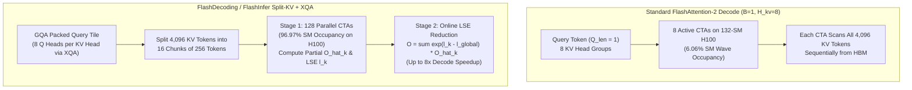
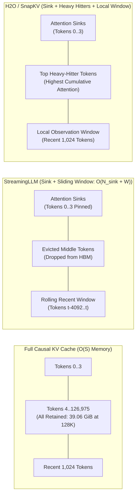
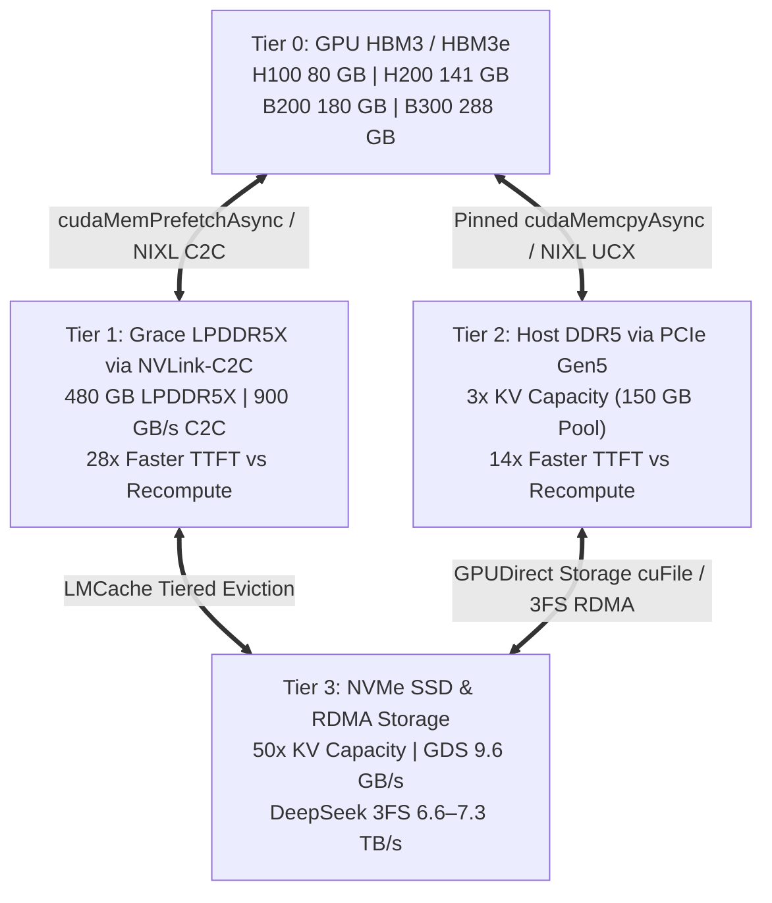

# 15.11 Advanced prefill-decode and KV cache tuning

| Field | Value |
|---|---|
| Level | Advanced |
| Priority tier | 1 |
| Lab venue | GCP / GKE + Local Python Verification Lab |
| Part | Part 15: LLM inference and serving |
| Cross-references | Chapter 10.5 (Roofline model); Chapter 12.19 (GPUDirect RDMA & GDS); Chapters 15.2–15.5 (Batching, KV cache, quantization, vLLM, SGLang, TensorRT-LLM); Chapters 15.8 & 15.10 (NVIDIA Dynamo, llm-d, and prefill-decode disaggregation) |
| Code | `code/part15/advanced_kv_cache_tuning.py`, `code/part15/advanced_kv_cache_tuning_lab.py` |
| Coverage file | `planning/coverage/chapters/15-11.md` |
| Claim & number ledger | `planning/ledgers/15-11.md` |

## Why this matters for AI infrastructure

Picture a platform team whose long-context chat product got slower the week the context window was raised. Nothing changed in the cluster layout, yet every session feels heavier. Separating prefill and decode workers into distinct cluster pools eliminates first-order phase interference, which is the big conflict we looked at in the previous chapter. However, macroscopic disaggregation alone leaves severe hardware bottlenecks on the table. Once a model's context grows past tens of thousands of tokens, the team runs into four low-level physical limits inside the GPU and the network. Each one needs its own fix.

- **The Single-Token Decode Occupancy Cliff:** Why does a GPU sit mostly idle during decode? Standard FlashAttention-2 parallelizes work across the query sequence length during prefill, so there is plenty of work to spread across the chip. During single-token autoregressive decode, the query length drops to one, and only one thread block runs per attention head. On an H100 GPU with 132 Streaming Multiprocessors, serving a Grouped-Query Attention model with eight KV heads at low batch size leaves over 90 percent of the GPU idle. Meanwhile, a handful of blocks scan historical keys one after another.
- **The Long-Context KV Footprint Explosion:** How much memory does one long session really need? A 70B Multi-Head Attention model with 80 layers and 32 heads of dimension 128 generates 1.31 MB of KV state per token in 16-bit precision. A single 250,000-token session consumes 328 GB of KV cache alone, which is far more than the HBM capacity of a single GPU. Even with Grouped-Query Attention, long multi-turn conversations and parallel reasoning branches rapidly exhaust device memory, because every branch keeps its own copy of the history.
- **The Small-Page RDMA Handoff Tax:** Why does a fast network still feel slow? PagedAttention allocates KV memory in 16-token blocks to prevent internal fragmentation, which is the waste that happens when memory is cut into awkward chunks. Naively transmitting a 7,500-token prompt across nodes as 470 separate 16-token RDMA writes burns 20 ms on network work-queue overhead. Each small write pays its own fixed cost, and that delay erases the latency benefits of disaggregation.
- **The Workload Skew and Phase Imbalance Trap:** What happens when the mix of traffic changes? The ratio between input prompt tokens and generated output tokens shifts continuously, moving between summarization bursts and long reasoning chains. Without dynamic token-budget tuning, heterogeneous hardware matching, and SLO-aware admission control, one worker pool starves while the other violates its tail-latency guarantees.

```text
Advanced Prefill-Decode and KV Cache Tuning Reference Numbers (ASP Ch. 2, 4, 5, 17–19; HLS Ch. 7; V12 Ch. 5, 7, 8):
- Split-KV Parallel Decode & Megakernels:
  FlashDecoding (256-token KV splits on 132-SM H100): Up to 8x faster long-context decode throughput
  ThunderMLA vs FlashMLA (DeepSeek MLA decode): 20% to 35% higher decode throughput via dynamic stream packing
  POD-Attention (SM-aware prefill + decode CTA colocation): Up to 29% attention speedup
- Chunked Prefill Token-Budget Tuning (Sarathi-Lean):
  12,288-token prompt burst on 4x H100 (45 active decode streams):
    Unchunked prefill stalls SMs for 320 ms -> p99 ITL spikes from 18 ms to 340 ms
    Chunked prefill (max_num_batched_tokens = 2048): Cuts p99 ITL from 340 ms to 21.4 ms (15.89x reduction)
  SARATHI (10,000-token prompt in five 2,000-token chunks of 50–100 ms): 1.3x to 1.9x throughput gain
- KV Cache Footprint, Quantization, and Block Sizing:
  70B MHA (L=80, H=32, D_head=128) at 250,000 tokens: 655,360 floats = 1.31 MB/token -> 327.68 GB (~328 GB) in FP16 vs 100–150 GB with FP8 + selective layer caching
  Llama-3-70B GQA (L=80, H_q=64, H_kv=8, D_head=128): 327,680 B (320 KiB/tok) FP16 vs 163,840 B (160 KiB/tok) FP8
  Reducing block size 128 -> 32 tokens + FP8 KV + 0.85 VRAM fraction (4x A100, TP=4): Scales sessions from 64 (52% util) to 210 (91% util)
- Fast KV Handoff and Hierarchical Offloading (LMCache, NIXL, NVLink-C2C, GDS):
  LMCache RDMA page collation (7,500 tokens): 470 transfers (16-tok pages) = 20 ms -> 59 transfers (128-tok slabs) = 8 ms (2.5x faster)
  NIXL KV offload TTFT speedup: 14x on x86+H100 (PCIe Gen5 64 GB/s) and 2x additional (28x total) on GH200 NVLink-C2C (900 GB/s)
  LMCache tiered offload (HLS Ch. 7): 3x KV capacity in CPU RAM (150 GB), 50x on NVMe SSD (120 GB), 1.0 s vs 6–7 s warm TTFT, 16x throughput over 4,700 tok/s baseline
- Heterogeneous PD & Adaptive Schedulers:
  Splitwise: 1.4x throughput at 20% lower cost, or 2.35x RPS at identical cost/power (4x H100 prefill + 4x A100 decode; 6 vs 8 GPUs saves 25%)
  HexGen-2 (Llama-2-70B): Up to 2.0x (1.3x avg) throughput at same price or 30% lower cost
  Arrow adaptive instance scaling: Up to 5.6x higher request serving rate (> 90% SLO compliance) under shifting workloads
```

**Peak inference goodput requires co-designing fused split-KV decode kernels, chunked prefill token budgets, quantized and evicted KV layouts, collated RDMA transfers, hierarchical superchip memory tiers, and adaptive SLO-aware schedulers.**

No single fix carries the whole load. A faster decode kernel does not help if the KV cache cannot fit, and a bigger memory tier does not help if the transfer back to the decode GPU is slow. Think of the stack as a chain, where the slowest link sets the pace. The rest of the chapter takes each link in turn and shows how it connects to the next one.

## Prerequisites and outcomes

### Prerequisites
- GPU Streaming Multiprocessor occupancy, shared-memory tiling, and Roofline arithmetic intensity from Chapters 10.2 through 10.5.
- GPUDirect RDMA, GPUDirect Storage, NVLink, NVSwitch, and UCX transport mechanics from Part 12 and Part 13.
- Iteration-level continuous batching, PagedAttention block tables, quantization formats, TensorRT-LLM, vLLM, and disaggregated prefill-decode fundamentals from Chapters 15.2 through 15.10.

### Outcomes
A decode kernel that runs at a fraction of the GPU's speed is the kind of problem this chapter starts from. The chapter follows that problem through the decode kernels, the chunked prefill budget, the KV cache layout and eviction, the zero-copy transfers, the memory tiers, and the scheduler. It covers the techniques by name, the mechanism behind each one, and the tuning knobs that matter in production. It also names the specific systems that introduced each idea, so you can go back to the source when you need more detail. Work through it as a set of six tasks you could hand to a teammate, each one tied to a concrete part of a serving stack.

---

## 1. Split-KV Parallel Decode Attention and Fused Decode Megakernels

### 1.1 Why Standard FlashAttention Underutilizes SMs During Decode

Suppose you are watching a GPU dashboard during a quiet hour. One user is chatting with a long-context model, and the GPU utilization graph looks surprisingly low. Why is a powerful chip barely working? The answer starts with how the attention kernel splits work across the chip, and the split looks very different in prefill and in decode.

During the prefill phase, a transformer processes all prompt tokens at the same time. That gives the kernel a lot of work to share out. Standard FlashAttention-2 achieves near-peak compute utilization by tiling the query matrix along the input sequence dimension. A tile is a small block of the matrix that one thread block handles on its own. The kernel assigns independent thread blocks across both batch items and attention heads, so every Streaming Multiprocessor finds something to do.

During the autoregressive decode phase, every active request generates a single token per step. That changes the shape of the work. Because the query sequence length equals one, standard FlashAttention-2 cannot partition work along the query dimension, since there is only one query row to split. Instead, it launches one Cooperative Thread Array (a group of threads that runs together on one SM) per batch item and KV head. Each thread block then has to walk sequentially over the entire historical KV cache. On an NVIDIA H100 GPU with 132 Streaming Multiprocessors, a single-request Llama-3-70B decode step with 8 Grouped-Query Attention KV heads launches only 8 thread blocks. Over ninety percent of the Streaming Multiprocessors sit completely idle, while the active blocks remain bottlenecked by sequential HBM reads.

### 1.2 Split-KV Parallel Decode: FlashDecoding, FlashInfer, and XQA

The fix is to give the idle SMs something to do. The question is how to find more parallel work when the query side has nothing left to split. The answer is to split along the history instead. To restore full Streaming Multiprocessor occupancy during single-token decode, **FlashDecoding** and **FlashInfer** parallelize attention along the historical KV sequence dimension. They use a two-stage split-KV reduction, where each stage has a clear job.

- **Stage 1, Split-KV Partial Attention:** The kernel partitions the historical KV sequence into fixed-size chunks, such as 256 tokens per chunk. Think of cutting a long reading list into chapters so that several people can read at once. It spawns parallel thread blocks across all Streaming Multiprocessors for every batch item, KV head, and split chunk. Each block loads the single query token alongside its assigned KV chunk into SRAM, which is the fast on-chip memory next to the compute units. It then computes a partial attention output vector, along with its local maximum logit and log-sum-exp denominator. Those two side values are what make the partial results combinable later.
- **Stage 2, Online Log-Sum-Exp Reduction:** A lightweight reduction kernel gathers the partial output vectors and log-sum-exp scalars across all split chunks. Each chunk saw a different slice of history, so each partial answer is weighted differently. Using the associative online softmax rescaling identity, the reduction rescales each partial output by its relative exponential weight. Finally, it sums those rescaled outputs into the exact global attention vector. The result matches the unsplit computation, so the speedup costs no accuracy.

The reduction is cheap compared with the attention work it replaces. Each partial result is only one output vector plus a couple of scalars, so the second stage moves far less data than the first. That is why splitting the history pays off on long contexts, where the history is large, and matters much less for short prompts, where the single-pass kernel already keeps the chip busy enough.

```text
Split-KV Parallel Decode Attention Equations (Volume 12, Chapter 5):
1. Number of KV sequence splits for context length S_kv and split chunk size C_split:
   K_split = ceil(S_kv / C_split)
2. Active thread blocks (CTAs) launched in Stage 1:
   CTAs_FlashAttention2_Decode = B * H_kv
   CTAs_FlashDecoding_Stage1   = B * H_kv * K_split
   Worked H100 example (132 SMs, Llama-3-70B H_kv = 8, B = 1, S_kv = 4,096, C_split = 256):
     Standard FlashAttention-2: 1 * 8 = 8 CTAs -> 8 / 132 = 6.06% SM wave occupancy (124 idle SMs)
     FlashDecoding Stage 1:     1 * 8 * (4096 / 256) = 128 CTAs -> 128 / 132 = 96.97% SM wave occupancy (up to 8x decode speedup)
3. Two-Stage Online Softmax Log-Sum-Exp (LSE) Reduction across split k in {1 .. K_split}:
   Local chunk max:  m_k = max_{j in chunk_k} (q * k_j^T / sqrt(d_head))
   Local chunk LSE:  l_k = m_k + log( sum_{j in chunk_k} exp((q * k_j^T / sqrt(d_head)) - m_k) )
   Local output:     O_hat_k = ( sum_{j in chunk_k} exp((q * k_j^T / sqrt(d_head)) - m_k) * v_j ) / exp(l_k - m_k)
   Global LSE:       l_global = l_max + log( sum_{k=1}^{K_split} exp(l_k - l_max) ),  where l_max = max_k(l_k)
   Global output:    O_global = sum_{k=1}^{K_split} exp(l_k - l_global) * O_hat_k
```

**FlashInfer** extends split-KV execution with a customizable block-sparse PagedAttention template library and a plan-and-run execution model. In plain terms, the library is a set of building blocks that the engine assembles for each batch shape, and the plan step decides the layout before the run step launches the kernels. In production serving stacks, engines pair FlashInfer on Ampere and Ada GPUs with FlashAttention-3 warp-specialized ping-pong schedules on Hopper GPUs. Warp specialization means some groups of threads load data while others do the math, and ping-pong means the two groups take turns so neither sits idle.

In **TensorRT-LLM**, the C++ `MHARunner` dispatches **XQA** kernels specifically engineered for Grouped-Query Attention decode. The runner is the piece that picks which kernel to call for a given shape. In a GQA model such as Llama-3-70B, sixty-four query heads share eight KV heads in groups of eight. Standard execution loads the same KV cache block eight separate times, once for each query head in the group. That repeated loading is pure waste. Instead, XQA packs all query heads belonging to the same KV group into a single Tensor Core matrix-multiply-accumulate instruction. The data is read once and reused for the whole group. That head-group packing raises arithmetic intensity by eightfold inside SM registers and eliminates redundant HBM bandwidth consumption.



### 1.3 Fused Decode Megakernels: FlashMLA, ThunderMLA, FlexDecoding, and POD-Attention

Why stop at one kernel per step? Recent model architectures and compiler stacks push decode optimization further by fusing projections, dynamic stream scheduling, and ragged page tables into unified megakernels. A megakernel is one large kernel that does several steps of work without returning control to the host in between. Each of the designs below attacks a different waste, and it helps to ask which waste your workload actually has.

- **FlashMLA:** Multi-Head Latent Attention projects keys and values into a compressed joint latent vector of dimension 512, plus a 64-element decoupled Rotary Position Embedding key per layer. Rotary Position Embedding (RoPE) is the scheme that tells attention where each token sits in the sequence. Those 576 cached elements per layer match the memory footprint of Grouped-Query Attention with only 2.25 KV groups. FlashMLA absorbs the latent up-projection matrix directly into the query and output projections during decode, so the kernel never has to expand the compressed latent back to full size. It processes multiple heads and time steps in a single fused kernel, which shifts decode toward the Hopper compute roofline.
- **ThunderMLA:** When a batch decodes sequences of widely varying context lengths, thread blocks assigned to short sequences finish early and leave SMs partially idle during the tail of the kernel. Picture a supermarket with one long checkout line while the short-line cashiers stand around. ThunderMLA fuses attention decode with fine-grained dynamic stream scheduling into a single megakernel. As short sequences complete their KV chunks, ThunderMLA dynamically packs and redistributes the remaining long-sequence KV splits across freed SMs. This dynamic packing delivers 20 to 35 percent higher decode throughput than FlashMLA.
- **FlexDecoding:** Built as the decode backend of `torch.nn.attention.flex_attention` and compiled via `torch.compile(mode="max-autotune")`, FlexDecoding uses TorchInductor and OpenAI Triton. It JIT-compiles, meaning it compiles at run time on first use, fused sparse decode kernels without custom CUDA code. It natively batches variable-length sequences without padding, using **Nested Jagged Tensors**, which store each sequence at its own length. It also translates logical PagedAttention or LMCache pages into physical HBM addresses on the fly, using a captured `BlockMask` tensor that records which blocks each query may read.
- **POD-Attention:** On unified nodes that co-execute chunked prefill and decode, launching separate prefill and decode kernels creates alternating compute-bound and memory-bound waves. POD-Attention launches a single fused kernel whose thread blocks inspect per-SM hardware counters at runtime. Each SM dynamically binds a mix of compute-bound prefill CTAs and memory-bandwidth-bound decode CTAs. Overlapping Tensor Core math with HBM fetches on the same SM improves attention throughput by up to 29 percent.

| Kernel / Mechanism | Primary Target & Architecture | Key Hardware / Algorithmic Mechanism | Measured Production Impact |
|---|---|---|---|
| **FlashDecoding** | Long-context MHA/GQA decode (`V12` Ch. 5) | Two-stage split-KV (`C_split = 256`) + online LSE reduction across SMs | Up to `8.0x` faster decode; raises `B=1` H100 CTA count `8 -> 128` (`96.97%` SMs) |
| **FlashInfer** | Block-sparse PagedAttention prefill & decode (`HLS` Ch. 6) | Plan/run JIT template engine with cascade/ragged KV page tables | Default high-speed kernel on Ampere/Ada (`A100`/`L40S`) and cascade prefix reuse |
| **TensorRT-LLM XQA** | GQA / MQA single-token decode (`V12` Ch. 5) | Packs `G = H_q / H_kv` query heads per KV head into one Tensor Core MMA tile | `8x` higher register reuse on `Llama-3-70B` (`64` Q heads / `8` KV heads) |
| **FlashMLA** | DeepSeek-V2/V3/R1 MLA decode (*AI Systems Performance Engineering* Ch. 18, `HLS` Ch. 6) | Fuses absorbed latent KV projections (`576` elements/layer = `2.25` GQA groups) | Shifts decode toward H100 compute roofline; `15x` vLLM TPS gain (`38 -> 600 TPS`) |
| **ThunderMLA** | Variable-length MLA decode megakernel (*AI Systems Performance Engineering* Ch. 18) | Fuses decode attention + dynamic work-stealing stream packing across SMs | `20%–35%` faster decode throughput over `FlashMLA` by eliminating tail idle SMs |
| **FlexDecoding** | PyTorch custom sparse/paged decode (*AI Systems Performance Engineering* Ch. 18) | `torch.compile(mode="max-autotune")` + Nested Jagged Tensors (`NJT`) + `BlockMask` | Zero-padding ragged decode + logical-to-physical `64–128` token page translation |
| **POD-Attention** | Colocated chunked prefill + decode (*AI Systems Performance Engineering* Ch. 18) | Runtime SM-aware CTA binding colocating prefill and decode CTAs on each SM | Up to `29%` attention speedup by smoothing Tensor Core and HBM traffic |

### 1.4 FlexDecoding in Practice: Compiled Decode Kernels Without Custom CUDA

Imagine a product team that wants each user to see only a local window of the conversation, not the whole history. The stock kernels do not offer that pattern, so the team has to decide how to get it. A local window or a block-sparse mask is the kind of pattern that teams ask for. A block-sparse mask lets each query skip most of the keys and read only the blocks it is allowed to see. Writing a custom CUDA kernel for each pattern is slow and hard to maintain, and every new pattern means a new round of testing. FlexAttention lets you JIT-compile fused kernels for arbitrary sparsity patterns from Python. Under the hood, TorchInductor and OpenAI Triton generate a fused kernel that computes only the query-key pairs the pattern allows, so the skipped pairs cost nothing.

Triton applies techniques such as warp specialization and asynchronous copies when they help on the given hardware. Asynchronous copies let the kernel fetch the next block of data while it works on the current one. You can still tune `triton.Config` yourself, for example by setting `num_consumer_groups`, which controls how many groups of threads do the compute work.

FlexDecoding is the decode backend of `torch.nn.attention.flex_attention`. It compiles a specialized kernel for the decode phase, where `Q_len=1`, so each step attends over a growing KV cache with a single query. At runtime it picks that kernel and reuses it across many decode steps. Compiling once and reusing the kernel keeps overhead low, as long as the shapes and dtypes stay compatible from step to step.

Three habits make the tuning easier, and each one protects you from a slow surprise. Choose `torch.compile(mode="max-autotune")` when decode latency matters and recompiles are already under control, because max-autotune spends extra compile time to find faster kernels. Narrow the capture to one layer or one attention block, so ragged batches invalidate fewer graphs when the shapes change. Leave `torch.set_float32_matmul_precision("high")` on, so any leftover FP32 operations can use TF32, a faster matrix format that the Tensor Cores support.

For number formats, FP8 through Transformer Engine (MXFP8) is the default choice for both phases. FP4 (NVFP4) is worth a trial when your accuracy tests pass and the speed gain is real. Be aware that FP4 tooling is still young. In the near term it can run slower than 8-bit and 16-bit formats, so measure before you switch.

Ragged batches are common in LLM serving, because every request has a different length. A padded batch makes every sequence as long as the longest one, and the GPU does useless math on the padding. FlexDecoding handles ragged batches with nested jagged tensors (NJT), which store the sequences with an offsets array instead of padding. Prefer the NJT layout when you batch ragged sequences at decode time. The decode backend also supports grouped-query attention (GQA) and PagedAttention.

FlexDecoding also supports bias terms. It works with PagedAttention through a block mask conversion. That conversion lines up logical KV blocks with the physical cache, so blocks land in place without extra copies. If your KV lives in a shared cache like LMCache on vLLM, point the cache's page table at FlexAttention's `BlockMask`. Logical pages then resolve to physical memory addresses as the kernel runs.

Captured tensors add flexibility. FlexDecoding leverages captured tensors to vary certain mask or bias values on each iteration, without requiring a recompile. That matters when the mask changes every step, because a recompile on each step would wipe out the gain. Developers get Python-level control over custom sparsity, which is useful for MoE model inference. Arbitrary attention patterns can then run close to the speed of dense attention.

A quick way to decide is to ask three questions in order. Does the built-in path already match my pattern? Does a profile show the kernel is actually the bottleneck? Is the gain large enough to justify maintaining my own code? Only a yes to all three is a reason to write custom fusion.

Many of these pieces, such as fused decode attention and NJT batching, already ship in core PyTorch. So custom fusion is less necessary for typical patterns. Before you write your own fused kernel, check whether the built-in path already covers your case. When you do measure, verify the result with Nsight Systems and its hardware-based CUDA traces, and use Nsight Compute for memory and link metrics.

### 1.5 POD-Attention: Matching Prefill and Decode Work on Each SM

Picture a kitchen where one cook only chops and another only fries, and the two take turns at the same stove. The stove sits idle while the chopper works, and the fryer waits while the chopper finishes. That is what happens on a node that runs both phases with separate kernels. One kernel is compute-heavy, and the next is memory-heavy. Each wave leaves part of the chip waiting on the other. The result is alternating bursts of math and memory traffic instead of a smooth load.

POD-Attention takes a different route. It launches one fused kernel with enough thread blocks, or CTAs, to cover both workloads. A CTA is the unit of work the GPU schedules onto an SM. At runtime, each CTA checks which SM it runs on and reads per-SM counters, which are hardware readings of how busy that SM is. It then decides whether to run prefill or decode, based on what else is running on that SM. This avoids isolated bursts of memory traffic and smooths out demand, because each SM now holds a mix of both kinds of work.

Colocating both kinds of work on one SM improves locality, which means the data a block needs is more likely to be close by when it needs it. The fused kernel cuts redundant HBM transactions and overlaps Tensor Core math with memory fetches. The reported gain is up to about 29 percent in attention performance. The key idea is that the hardware placement of CTAs on SMs is decoupled from the software role each CTA plays. In other words, the role is decided at run time, not fixed when the kernel is launched. That is hardware and software codesign aimed at less memory movement.

For an operator, the practical lesson is about what you measure. Average utilization on a node running both phases can look healthy while the SMs alternate between starved and overloaded. A per-kernel profile shows the alternation directly, and that profile is the evidence you need before you adopt a fused kernel such as POD-Attention. Adopt it only when the profile shows the same kind of alternating waste on your own traffic.

---

## 2. Chunked Prefill Token-Budget Tuning and Prefix-Cache Alignment

### 2.1 The Prefill Bubble and Sarathi-Lean Token Budgeting

Think about a customer-service voice call that stutters for no obvious reason. The caller is fine, the network looks fine, and the model is fast on short questions. The stutter lines up with another user who pasted a long document. When an inference engine runs on a unified GPU pool, inserting an unchunked long prompt into a continuous batch causes severe Inter-Token Latency spikes. The same stall occurs when a disaggregated decode worker falls back to local prefill during prefill-pool saturation.

Consider a customer-service voice assistant running Llama-3-70B across four H100 GPUs. When a 12,288-token document prompt arrives alongside 45 active decode streams, an unchunked prefill pass monopolizes all GPU Streaming Multiprocessors for 320 ms. Every active voice stream stalls waiting for that single step to finish, driving tail Inter-Token Latency from 18 ms to 340 ms. The callers hear the stall as a gap in the speech.

**Chunked Prefill**, introduced by the **Sarathi-Lean** architecture, eliminates this head-of-line blocking by slicing long prompts into fixed-size token chunks. Each chunk rides along with the active decode steps, so the decode streams keep moving while the prompt is ingested. Think of a long freight train broken into shorter trains that share the same track with passenger trains. At every iteration step, the scheduler enforces a strict upper bound on the total number of tokens processed across both phases. That upper bound is the token budget, and it is the main knob you tune in this section.

Here is how the budget plays out on one step. Suppose the budget allows a few thousand tokens per iteration and the decode streams already use part of it. The rest of the budget is what the prompt can use on that step. The prompt advances by that many tokens, and the next step takes the next slice. A long prompt therefore takes many steps, but every step is short, and the decode streams see only a small, predictable bump instead of a long freeze. Choosing the budget means balancing those two things: small enough to keep each step short, large enough to keep the GPU busy.

```text
Chunked Prefill Token-Budget and Trade-Off Equations (V12 Ch. 7 & 8; ASP Ch. 19):
1. Per-Iteration Token Budget Constraint:
   Tokens_iter = sum_{i=1}^{M_decode} 1 + sum_{j in PrefillChunks} C_j <= MaxTokensPerIter
   Available prefill chunk capacity in step t:
   C_avail = MaxTokensPerIter - M_decode
2. Worked Voice-Assistant Recovery (V12 Ch. 7 Scenario 1, 4x H100 TP=4):
   Prompt length S_prompt = 12,288 tokens, M_decode = 45 active decode streams, MaxTokensPerIter = 2,048:
   Without chunked prefill: 12,288 tokens in 1 step -> 320 ms SM stall -> p99 ITL = 340.0 ms (breaches 30 ms SLA)
   With chunked prefill:    C_avail = 2,048 - 45 = 2,003 prefill tokens/step (7 steps, or 6 chunks of 2,048) -> p99 ITL = 21.4 ms (15.89x lower)
3. Decode-Maximal Piggybacking (V12 Ch. 8 & ASP Ch. 19 SARATHI):
   V12 Ch. 8 hybrid batch: M_decode = 512 decode tokens + C_prefill = 1,536 prefill chunk tokens = 2,048 tokens -> 22–24 ms step ITL (vs 250 ms unchunked)
   SARATHI 10,000-token prompt: 5 chunks of 2,000 tokens (~50–100 ms per chunk) -> 1.3x to 1.9x overall throughput improvement
```

### 2.2 The Over-Chunking Pitfall and Prefix-Cache Boundary Alignment

Tuning `max_num_batched_tokens` requires balancing two opposing failure modes. Think of it as the size of the lunch box you pack for each step. A box that is too big makes the step slow, and every decode stream waits for it. A box that is too small leaves the GPU hungry and forces constant trips back and forth. Setting the token budget too high reintroduces prefill bubbles that breach Inter-Token Latency SLAs. Setting the token budget too small, however, starves the Tensor Cores and triggers CPU scheduler thrashing.

- **Over-Chunking Context-Switch Thrash:** What goes wrong when the budget is set too small? When `max_num_batched_tokens` is set down to 512 on a 70B model, each prefill chunk executes in 8 ms while each decode step takes 2 ms. The scheduler now alternates between the two, and that schedule forces 450 scheduler context switches and CUDA stream synchronizations per second. Each synchronization is a moment when the GPU and CPU must wait for each other. Because a small tile fails to saturate Hopper Tensor Cores and pays repeated KV cache setup costs, tail Inter-Token Latency worsens from 28 ms to 45 ms. Meanwhile, Time to First Token degrades from 180 ms to 320 ms. Increasing `max_num_batched_tokens` to 2,048 restores arithmetic intensity and removes most of the context-switch overhead.
- **Prefix-Cache Hash Boundary Mismatch:** Why would a cache hit rate fall after you turn on a new feature? In engines that compute prefix-cache keys over whole prompt sequences or unaligned slices, enabling chunked prefill can cause prefix-cache hit rates to plummet from 45 percent down to 8 percent. That represents a 5.625x drop in cache efficiency. The cache is looking for the same prefix in a new shape, so it misses. To preserve high prefix hit rates alongside chunked prefill, configure block-boundary hashing, where prefix hashes are computed at fixed PagedAttention block boundaries. Alternatively, use SGLang RadixAttention trees that match and split cached token edges at arbitrary chunk boundaries.

| Configuration Regime | `max_num_batched_tokens` | Prefill Chunk Latency | Context Switches / Sec | `p99` ITL | `p99` TTFT | Operational Diagnosis |
|---|---|---|---|---|---|---|
| **Unchunked Continuous Batching** | Unbounded (`12,288`+ tokens) | `320.0 ms` (`1` monolithic step) | `~3–30 /s` | `340.0 ms` | `320.0 ms` | Severe decode starvation; breaches `< 30 ms` voice SLA |
| **Over-Chunked Prefill** | `512` tokens | `8.0 ms` chunk + `2.0 ms` decode | `450 /s` | `45.0 ms` | `320.0 ms` | CPU scheduler thrash + low Tensor Core tile occupancy |
| **Tuned Sarathi-Lean Sweet Spot** | `2,048` tokens (`1,536` prefill + `512` decode) | `21.4–24.0 ms` fused step | `~40–45 /s` | `21.4 ms` | `180.0 ms` | Saturates Tensor Cores while keeping `p99` ITL `< 25 ms` |

---

## 3. KV Cache Quantization, Windowed Attention, and Selective Token Eviction

### 3.1 Exact KV Cache Sizing Across MHA, GQA, MQA, and MLA

Before you can pick a quantization or an eviction policy, you need to know how big the cache is. A capacity planner who gets this wrong buys the wrong GPUs. For any transformer, each token stores one key vector and one value vector per layer across all key-value heads. Multiply that out and you get the per-token cost. Total KV cache memory then scales linearly with sequence length and batch concurrency, so doubling either one doubles the bill. The block below gives the formulas and the worked numbers for each attention design.

```text
KV Cache Footprint Reference Breakdowns (ASP Ch. 17 & 18; V12 Ch. 5 & 8):
Formula: M_token = 2 * L * H_kv * D_head * P_bytes
1. 70B MHA Model at 250,000-Token Context (ASP Ch. 18: L = 80, H = 32, D_head = 128):
   Hidden dim = 32 * 128 = 4,096 -> 2 * 4,096 = 8,192 floats/layer -> 80 * 8,192 = 655,360 floats/token
   FP16 (2 B/float): 1,310,720 B/token (~1.31 MB/token) -> 250,000 tokens = 327.68 GB (~328 GB) KV cache per request!
   FP8 (1 B/float) + selective layer caching: Reduces 250,000-token KV cache to 163.84 GB (pure FP8) and 100–150 GB with selective layer caching.
2. Llama-3-70B GQA-8 Model (V12 Ch. 5 & 8: L = 80, H_q = 64, H_kv = 8, D_head = 128):
   FP16/BF16 (2 B): 2 * 80 * 8 * 128 * 2 = 327,680 B = 320 KiB/token (8x smaller than 64-head MHA at 2.5 MiB/token, 87.5% savings)
     - S = 4,096 tokens:   1.25 GiB (1.342 GB / ~1.31 GB) in FP16 vs 0.625 GiB (~0.65 GB) in FP8 (163,840 B = 160 KiB/token) vs 80 KiB/token in INT4
     - S = 128,000 tokens: 39.0625 GiB (~39.06 GiB) in FP16 GQA vs 312.5 GiB in 64-head MHA
3. Llama-13B Model at 4,096-Token Context (ASP Ch. 17: L = 40, H_q = 40, D_head = 128):
   - MHA (H_kv = 40) FP16: 0.8192 MB/token -> 3.355 GB (~3.36 GB); FP8: 1.678 GB (~1.68 GB)
   - GQA (H_kv = 8)  FP16: 0.1638 MB/token -> 0.671 GB;            FP8: 0.336 GB
   - MQA (H_kv = 1)  FP16: 0.0205 MB/token -> 0.084 GB
```

### 3.2 FP8/INT4 KV Cache Quantization, Block Sizing, and Real-Time HQQ Policy Switching

Quantizing the KV cache from FP16 or BF16 down to **FP8** or **INT4** halves or quarters both the HBM capacity footprint and the HBM bytes transferred per decode step. Why does fewer bits help so much? Every decode step reads the whole cache, so the number of bytes stored is also the number of bytes moved on every step. Because attention keys exhibit strong channel-wise outlier structures while values follow smoother token-wise distributions, production engines calibrate per-head or per-channel group-wise scaling factors on representative long-context prompts. A scaling factor is a multiplier that maps the stored values back to their true range. Calibrating those factors on realistic prompts is what keeps quality acceptable.

In **Volume 12, Chapter 5**, a platform running Llama-3-70B on four A100 GPUs crashed with KV cache out-of-memory errors whenever concurrency exceeded 64 sessions. Root-cause profiling uncovered two compounding misconfigurations, and the story is a useful lesson in reading the knobs together. First, `tokens_per_block` was set to 128. Whenever a sequence finished at 129 tokens, the allocator reserved two blocks and wasted nearly half of the allocated slots due to internal fragmentation. That is the awkward-chunk waste from earlier, now showing up in memory. Second, `kv_cache_free_gpu_memory_fraction` was set to 0.95 in FP16, leaving insufficient VRAM for FlashDecoding workspace buffers. The scratch space the kernel needs was squeezed out. Lowering `tokens_per_block` from 128 to 32 cut internal fragmentation at 129 tokens from 49.61 percent down to 19.38 percent. Combining 32-token blocks with **FP8 KV cache quantization** and a 0.85 memory fraction expanded concurrent sessions from 64 to 210, while raising effective KV pool utilization from 52 percent to 91 percent. The fix worked because the two changes addressed different waste, one in the blocks and one in the precision.

For workloads with bursty memory pressure, **AI Systems Performance Engineering (Chapter 19)** introduces **real-time KV cache policy switching** using Hugging Face `QuantizedCache` with the **Half-Quadratic Quantization** or **Quanto** backend. Because transformer decode attends most sharply to recent tokens, the engine keeps a **residual window** of the most recent 128 tokens in full BF16 or FP16 precision. Recent tokens are the ones most likely to matter right now, so they stay sharp. Older tokens are quantized into 8-bit or 4-bit groups of 64 elements. At 32-token chunk boundaries, the runtime queries `torch.cuda.mem_get_info()`, which reports free device memory, and updates an exponential moving average of device memory usage. The moving average smooths out short spikes so the policy does not flip on every noisy reading. When smoothed utilization crosses a 0.90 threshold, subsequent generation chunks automatically drop from INT8 to INT4. That transition achieves a 3.66x compression ratio over FP16 at 4,096 tokens without mid-kernel reallocation stalls, because the switch happens between chunks and never in the middle of a kernel.

### 3.3 Sliding Window Attention, StreamingLLM Attention Sinks, and H2O / SnapKV Eviction

Consider a support agent that runs for weeks on one session, or an agent loop that writes a million tokens of notes. Even with 4-bit quantization, sessions like these eventually exhaust physical memory unless non-essential tokens are evicted from the KV cache. The question is which tokens are safe to drop. The three methods below answer it in different ways.

- **Sliding Window Attention:** Models such as Mistral and Gemma interleave or restrict self-attention to a fixed local window, such as 4,096 tokens. Picture a narrow window on a long train. You only see the last few carriages. Once a sequence exceeds the window size, KV states older than the window are evicted or overwritten in a circular ring buffer, which reuses the same slots over and over. This ring buffer bounds KV memory to a constant size. However, applying naive Sliding Window Attention to a model trained with full causal attention causes catastrophic perplexity collapse. That collapse occurs the moment the very first tokens of the prompt scroll out of the window, because the model was trained to rely on them.
- **Attention Sinks:** Why would a model need the first tokens at all? Softmax requires attention probabilities across all visible tokens to sum to one. Even when a query token has no strong semantic match in the past context, the model still has to put its attention somewhere, so it dumps the excess attention mass onto the initial tokens of the sequence. Those initial tokens act as numerical **attention sinks**, which are like a drain for mass that has nowhere else to go. **StreamingLLM** preserves generation stability over millions of tokens without retraining by pinning four initial sink tokens permanently at the front of the KV cache. It pairs those sinks with a rolling window of recent tokens and assigns contiguous in-window Rotary Position Embeddings at every step, so positions stay consistent inside the window.
- **Heavy-Hitter and Observation-Window Eviction:** Evicting all intermediate tokens between the sink tokens and the local sliding window discards key facts in long-document QA and retrieval tasks. A single fact from page three may be exactly what the question needs. **Heavy-Hitter Oracle (H2O)** tracks cumulative attention scores received by every token during decode. Tokens that keep getting attention are the heavy hitters, and they earn a place in the cache. The method retains a fixed budget split across three subsets: sink tokens, heavy-hitter tokens with the highest cumulative attention mass, and recent tokens. **SnapKV** performs this selection at the end of prefill by pooling attention weights from a tail observation window, which is the last stretch of the prompt. It then clusters the top-scoring prompt KV positions before transferring or decoding. Similarly, **LazyLLM** dynamically prunes low-impact stopword and filler tokens during both prefill and decode, reducing end-to-end long-context latency by 20 to 30 percent. Words like "the" and "of" carry little weight for most questions, so dropping them saves work without losing much meaning.



---

## 4. Zero-Copy KV Cache Transfer, Page Collation, and Phase-Specific Parallelism

### 4.1 KV Transfer Bandwidth Math and LMCache RDMA Page Collation

Think of a relay where the baton has to be passed before the next runner can start. In a disaggregated cluster, every prompt processed on a prefill worker must ship its KV cache across the fabric to a decode worker before token streaming can continue. The decode GPU is waiting at the handoff. If that transfer stalls, the handoff penalty erases the benefit of disaggregation.

Consider an eight-billion-parameter model whose 1,024-token prompt generates up to 0.15 GB of KV cache. Scaling the prompt length tenfold to 10,240 tokens produces up to 1.5 GB of KV data per request. At a throughput of 16 requests per second per worker, the engine must sustain 24 to 25 GB/s of continuous KV cache transfer bandwidth. That transfer rate fits comfortably inside an intra-node NVLink mesh and works across inter-node InfiniBand or RoCEv2 GPUDirect RDMA links. However, it completely saturates a non-RDMA host PCIe path, so the same workload that flies on RDMA crawls on a host copy. Production systems stream the KV cache layer by layer and overlap asynchronous RDMA writes on a dedicated CUDA stream while subsequent transformer layers compute prefill. That overlap pushes prefill-to-decode transfer overhead below 1 percent of end-to-end request latency.

A subtle performance trap arises when pairing PagedAttention with RDMA. PagedAttention defaults to 16-token blocks to minimize internal memory waste. However, posting one RDMA Work Queue Element per 16-token block floods the NIC with tiny descriptors. Each descriptor costs the card a little setup work, and thousands of them add up. In **AI Systems Performance Engineering (Chapter 18)**, transferring a 7,500-token KV cache as 470 separate 16-token RDMA writes took 20 ms. **LMCache** solves this small-IO bottleneck by collating 16-token logical pages into contiguous GPU staging slabs of at least 128 tokens before posting the RDMA write. A staging slab is a temporary buffer that holds the pages in one piece. Collating the 7,500-token transfer into 59 slabs cuts RDMA handoff latency from 20 ms down to 8 ms, a 2.5x speedup.

```text
Zero-Copy KV Transfer, NIXL Buffer Sizing, and Collation Equations (ASP Ch. 4 & 18; HLS Ch. 7):
1. Sustained KV Transfer Bandwidth Requirement:
   BW_KV_req = RPS * S_prompt * M_token
   8B model (1,024 tokens = 0.1 to 0.15 GB; 10,240 tokens = 1.0 to 1.5 GB/req) at 16 RPS: 16 * 1.5 GB = 24.0 GB/s (~25 GB/s)
   Fabric comparison: Intra-node NVLink (900 GB/s H100, 1,800 GB/s B200) >> Inter-node IB RDMA (50–100 GB/s) > 25 GB/s >> Non-RDMA PCIe (~10 GB/s)
2. LMCache RDMA Page Collation (S_prompt = 7,500 tokens):
   Uncollated 16-token pages: ceil(7,500 / 16) = 469 (~470) RDMA writes -> 20.0 ms transfer time
   Collated 128-token slabs:  ceil(7,500 / 128) = 59 RDMA writes        ->  8.0 ms transfer time (2.5x speedup, 60% reduction)
3. NIXL GPU Transfer Buffer Sizing (pd_buffer_size, ports 7300 / 7400 / 7500):
   Start at 1 GiB (1,073,741,824 B) for ~4k–7.5k FP16 tokens on a 70B model; use 2 GiB above 7.5k tokens.
   Round buffer allocations up to a 256 MB (268,435,456 B) boundary:
   Buffer_bytes = ceil( (2 * L * S_max * H_kv * D_head * P_bytes) / 256 MiB ) * 256 MiB
```

### 4.2 Connector Topologies and Phase-Specific KV Transpose

Prefill and decode workers coordinate KV handoffs using one of two connector architectures. The difference is who keeps the list of pending work. One design uses a shared queue, and the other lets the two sides talk directly.

- **Centralized Global Queue:** In NVIDIA Dynamo, decode workers enqueue incoming prompt requests onto a global NATS task queue stamped with a reply-to decode worker ID. The reply-to stamp is the return address, so the answer knows where to go. Any available prefill worker pops the request, computes the prompt KV cache, and pushes the KV blocks directly into the originating decode GPU's VRAM via NIXL RDMA write. Global queues simplify cluster-wide load balancing and multi-tenant failover, because any free worker can pick up any job.
- **Decentralized Direct Channel:** In vLLM with LMCache, prefill and decode processes negotiate a direct per-request LookupBuffer or Pipe over UCX RDMA. A lookup buffer is a small mailbox where the sender leaves a ready flag and the receiver finds it. Direct channels eliminate broker hops for ultra-low tail-latency deployments, because the request never waits in a shared line.

Disaggregation also unlocks **phase-specific parallelism**. Because prefill processes thousands of tokens in parallel, it benefits from wider Tensor Parallelism and Pipeline Parallelism to minimize Time to First Token. Because decode processes a single token per step, Pipeline Parallelism introduces stage bubbles, which are idle gaps between the stages. Excessive Tensor Parallelism adds two AllReduce calls per layer, and each AllReduce is a synchronization point across the GPUs. Decode therefore prefers a single pipeline stage and a smaller Tensor Parallel degree. When prefill and decode use different Tensor Parallel degrees, the KV cache layout differs across pools. For example, prefill may run with four-way Pipeline Parallelism and single-GPU Tensor Parallelism, where each GPU holds all eight KV heads for a subset of layers. Meanwhile, decode may run with four-way Tensor Parallelism, where each GPU expects two KV heads across all layers. The two pools cut the cache in different directions. **NVIDIA Dynamo** executes an on-the-fly **KV transpose kernel** over NVLink immediately after the NIXL read to repartition the KV layout before writing into decode HBM.

### 4.3 Five Strategies for Fast KV Transfer

Moving the bytes fast is only half the job. How the two sides hand the KV over matters just as much, because the handoff decides who waits for whom. Five strategies cover most designs, and each one puts the coordination work in a different place.

**Prefill-side push.** When the prefill worker finishes a prompt, it starts an RDMA write straight into a reserved buffer on the decode GPU. The transfer runs in the background while prefill moves on to other work. The sender does the work, and the receiver just finds the data waiting for it.

**Decode-side pull.** The decode worker can instead RDMA-read from the prefill GPU memory when it is ready to start. Both push and pull avoid CPU copies. Push puts the coordination work on the sender, while pull lets the receiver control the timing, so a busy decode worker never gets data it cannot use yet.

**Shared-memory (CUDA IPC) buffer.** If prefill and decode run on the same machine, they can share a memory handle through CUDA interprocess communication, which lets one process open memory that another process allocated. The copy then uses NVLink or NVSwitch inside the host and never touches the network. It is a local form of zero-copy transfer, and it is the cheapest of the five when the pair fits on one box.

**Connector and queue abstraction.** vLLM hides the transfer method behind one logical interface, a Pipe or a LookupBuffer. Prefill places the KV in that buffer or signals that it is ready, and decode picks it up. Underneath, the transport can be RDMA or a publish-subscribe message, such as NATS for control signals in Dynamo. Because the handoff is decoupled from the transport, you can swap transports without changing the logic that calls it.

**Nonblocking overlap.** Optimized systems keep decoding other requests while KV is in transit. In Dynamo, a decode worker keeps generating tokens for other sequences while a prefill worker writes KV for a new request into GPU memory. A transfer of about 5 ms can overlap with that decode work. The first generated token then sees almost no added delay, because the wait was spent doing useful work for someone else.

With these methods, a KV transfer takes a few milliseconds. Computing the same KV on the prefill worker takes hundreds of milliseconds. Decode can therefore start almost right after prefill finishes, without a long stall.

Before you trust these numbers in your own cluster, measure the transfer on your own hardware. Time the handoff for a few prompt lengths, from short to the longest your product allows, and record the time from the moment prefill ends to the moment the decode worker holds every block. If the measured handoff is much longer than the estimate, look first at the block size, then at whether the transfer really runs on its own stream, and only then at the fabric itself.

### 4.4 Page Size, Collation, and Transfer Buffer Sizing

PagedAttention stores KV in fixed token blocks, commonly 16 tokens per block. Each block is small, and its byte size depends on heads, head dimension, layers, and dtype. Sending thousands of tiny pages over RDMA adds fixed latency and protocol overhead to every transfer. The bandwidth you paid for then goes unused, because the link spends its time on paperwork instead of data.

Engines allow several block sizes, namely 8, 16, 32, 64, or 128 tokens per block. Larger pages help because sustained link throughput rises with larger collated buffers and fewer work queue elements (WQEs). Fewer, bigger transfers mean fewer trips through the card's queue. When possible, collate at least 128-token pages into each RDMA write. Run the transfer on a dedicated CUDA stream, prefer nonblocking streams with event fences, and profile with Nsight Systems to confirm the overlap. An event fence is a marker that tells the stream to wait until a specific step is done, so you know the data is really there.

Size the transfer buffer from the KV formula, because guessing is how buffers overflow in production. Start `pd_buffer_size` at 1 GB, which is roughly the FP16 KV for about 4k to 8k tokens on a 70-billion-parameter model with 80 layers, 32 heads, and 128-dimension heads. Use 2 GB if prompts run past about 7.5k tokens. A quick estimate is `bytes ≈ 2 × L × N × (H × Dh) × bytes_per_val`, where the factor 2 counts keys and values, L is the number of layers, and N is the number of tokens.

If you quantize the KV cache to FP8 or FP4, each token takes fewer bytes. A fixed token count then needs a smaller buffer. You can move more tokens per buffer, or shrink the buffer. A 1 to 2 GiB buffer works for many deployments. Size it from the formula, round up to a 256 MB boundary, and shrink it in proportion when you use FP8 or FP4 KV. Always validate against the largest collated page group you will transfer, so the biggest real request still fits.

Think of the transfer buffer as a loading dock. It has a fixed size, and every truck, which is every request's KV cache, must fit through it. If one large request arrives and the dock is too small, that request either waits or fails. Sizing the dock from the formula, and checking it against the biggest truck you expect, prevents both outcomes. Prefer GPUDirect RDMA with collation to 128-token pages or larger for the best link use. Collate pages before every transfer, because small I/O is inefficient no matter how fast the link is.

### 4.5 Choosing a Connector Pattern and Handling Failures

There are two common coordination designs, and you will meet both when you read production configs. In NVIDIA Dynamo, decode workers push prompt tasks into a global queue that prefill workers consume. In vLLM with LMCache, prefill and decode set up a direct channel for each request. That can be a one-to-one TCP or RDMA connection negotiated at request start. The global queue is simpler for load balancing and failure handling, while direct channels can cut queuing.

Choose by the workload. Ask yourself whether the cluster serves many tenants who need fair sharing, or a small set of fixed pairs that must answer quickly. If you need robust multitenant load balancing and easy failover, and a small queuing delay is acceptable, the global queue is usually the better fit. If you have strict tail-latency needs, a stable set of prefill-decode pairs, and fast interconnects, direct channels reduce hop count and jitter. Benchmark both with your own mix of prompt lengths, concurrency levels, and failure cases, because the right answer depends on your traffic.

The goal is a nonblocking pipeline. While one request decodes, another prompt prefills, and a third request's KV moves across the fabric. No stage sits idle when another stage has work. This is why disaggregation raises throughput at scale, because the three stages overlap instead of taking turns.

Here is a simple timeline to make that concrete. Request A finishes its prefill and starts moving its KV across the fabric. While that transfer runs, request B has just been admitted to a prefill worker, and request C is already decoding on another GPU. Nobody waits for A's transfer to finish before B's prompt starts, and nobody waits for B's prefill before C gets its next token. If any one of the three stages stalls, the other two still keep their own queues moving for a while, which is why you should watch each stage's queue separately.

The first generated token usually does not need to be transferred. The decode worker can recompute the first token's probabilities from the KV. Some systems send that output anyway to save a few hundred microseconds of decode compute. Others keep the design simple and let decode recompute the final layer. Either way, the choice is a small trade between a little extra transfer and a little extra compute.

The same kind of trade shows up in every design in this chapter. Each optimization moves cost from one place to another. A zero-copy path moves work off the CPU and onto the network card. A quantized cache moves cost from memory capacity to a small loss of precision. A remote prefill moves cost from the decode GPU to the fabric. When you evaluate a change, ask where the cost went, and make sure the new place can absorb it at your peak load, not only at the average.

Failures need the same care. If a decode node fails mid-generation, a global KV pool lets another node resume from the saved KV. If a prefill node fails mid-prompt, that prompt can be retried elsewhere. Routers use heartbeat checks and timeouts to spot a stalled transfer, so the request can be reassigned or safely aborted. A heartbeat is a small periodic "still alive" message. One node's failure should never fail the whole request.

When you test this behavior, do not stop at the happy path. Kill a decode worker in the middle of a long generation, and watch whether the request resumes, retries, or fails cleanly. Then do the same for a prefill worker in the middle of a large prompt. Each test shows a different recovery path, and each path should leave the user with a complete answer or a clear error, never a silent hang.

---

## 5. Hierarchical KV Cache Offloading: HBM, Grace LPDDR5X, DDR5, and NVMe/GDS

### 5.1 Four-Tier Memory Hierarchy and Grace Hopper / Blackwell NVLink-C2C

Picture a long-running coding assistant. Yesterday's project context is warm, today's is hot, and the GPU has room for only the hot one. What happens to the warm context? When active and warm contexts exceed GPU HBM capacity, modern serving stacks treat the KV cache as a four-tier virtual memory hierarchy orchestrated by **NIXL** and **LMCache**. The idea is the same as an operating system that pages memory out to disk. Each tier is bigger and slower than the one above it, and the system moves blocks between tiers based on how soon they will be needed again.



```text
Four-Tier KV Cache Memory Hierarchy Specifications and Benchmarks (ASP Ch. 2, 4, 5, 18; HLS Ch. 7):
- Tier 0 (GPU HBM3/HBM3e):
  H100 SXM: 80 GB at 3.35 TB/s | H200 SXM: 141 GB at 4.8 TB/s | B200: 180 GB usable (192 GB physical) at 8.0 TB/s | B300: 288 GB
- Tier 1 (Grace CPU LPDDR5X via Coherent NVLink-C2C):
  Grace CPU: Up to 480 GB LPDDR5X (~500 GB/s) linked via 900 GB/s bidirectional (450 GB/s unidirectional) NVLink-C2C (7.03x PCIe Gen5 64 GB/s)
  GB200 Superchip: 384 GB HBM3e + 480 GB LPDDR5X = 864 GB (~900 GB coherent) | GB200 NVL72 (36 Grace + 72 B200): ~30 TB unified memory
  GB300 NVL72 (36 Grace + 72 B300): 20.7 TB HBM + 18.0 TB LPDDR5X = 38.7 TB (~38 TB) unified memory
  NIXL Offload Speedup: 14x TTFT speedup on x86+H100 (PCIe Gen5) vs recompute; 2x additional (28x total) TTFT speedup on GH200 NVLink-C2C; 30x Dynamo throughput on 680B MoE on GB200 NVL72
- Tier 2 (Host DDR5 RAM via PCIe Gen5 + LMCache):
  3x KV capacity expansion (150.0 GB pool), 4x replica cost reduction
  30-request sequential benchmark (9 prefixes fit in HBM, eviction at request 10): 1.0 s CPU retrieval vs 6.0–7.0 s cold prefill
  5-way concurrent long-context benchmark: 16x higher throughput (75,200 tok/s vs 4,700 tok/s vanilla vLLM ceiling)
- Tier 3 (Local NVMe SSD via GPUDirect Storage + DeepSeek 3FS):
  50x KV capacity expansion (120.0 GB disk pool, 2,048-token chunks)
  gdsio (10 GiB, 1 MiB blocks, 4 workers): 8.0 GB/s (1.25 ms) CPU path (-x 2) -> 9.6 GB/s (1.00 ms) GDS path (-x 0), +20% throughput / -20% latency
  DeepSeek 3FS (68 nodes, RDMA): 6.6 to 7.3 TB/s aggregate read throughput (+1.4 TB/s background) vs 1.1 TB/s Ceph (6.0x faster)
```

Each tier below has a different speed and a different size, and the tier decides how fast a returning conversation can resume.

- **Tier 0, GPU HBM3 and HBM3e:** This is the fastest tier, and it holds model weights and the active KV blocks for currently executing decode sequences. Anything the next decode step needs has to be here.
- **Tier 1, Grace LPDDR5X via NVLink-C2C:** On Grace Hopper and Grace Blackwell superchips, the ARM Neoverse V2 Grace CPU attaches up to 480 GB of LPDDR5X connected to the GPUs via cache-coherent **NVLink-C2C** at 900 GB/s bidirectional. Cache-coherent means the CPU and GPU see the same memory without copying it back and forth. In **AI Systems Performance Engineering (Chapter 4)**, offloading long-context KV caches over PCIe on an x86 and H100 node delivered a **14x TTFT speedup** over recomputing prefill from scratch. Running the same offload on GH200 over NVLink-C2C delivered an **additional 2x TTFT speedup**, reaching **28x faster than recomputation**. Combined with NIXL, NVIDIA Dynamo achieved up to **30x higher inference throughput** on a 680B MoE model on a GB200 NVL72 rack.
- **Tier 2, Host DDR5 via PCIe:** On standard x86 servers, offloading inactive KV pages to pinned host RAM via **LMCache** expands KV cache capacity by **3x** and reduces required multi-tenant model replicas by **4x**. Pinned RAM is memory the operating system is not allowed to move, so the GPU can copy from it directly. In **Hands-On LLM Serving and Optimization (Chapter 7)**, across 30 sequential long-context requests where GPU HBM held only nine prefixes, vanilla vLLM suffered cache evictions from the tenth request onward and recomputed prefill in 6 to 7 seconds. LMCache retrieved the offloaded KV cache from CPU RAM in **1.0 second**. Under five-way concurrent long-context load, vanilla vLLM bottlenecked at 4,700 tokens/s, while LMCache achieved **16x higher throughput**.
- **Tier 3, NVMe SSD, GPUDirect Storage, and DeepSeek 3FS:** Offloading to NVMe SSDs expands KV capacity by **50x**, and it is the slowest tier, so it suits cold context that is rarely needed. Using **NVIDIA GPUDirect Storage** bypasses the host CPU page cache entirely, raising `gdsio` read bandwidth from 8.0 GB/s to **9.6 GB/s** and cutting average latency from 1.25 ms to **1.00 ms**. At cluster scale, DeepSeek's RDMA-native **Fire-Flyer File System** reaches **6.6 to 7.3 TB/s** aggregate read throughput across 68 nodes, outperforming Ceph by **6x**.

How do you pick a tier for a given piece of cache? Ask how soon the block will be needed again and how much a slow reload would cost the user. A block that a live conversation will touch in the next few seconds belongs in HBM or Grace memory. A block for a session that may return next week can sit on NVMe, where a reload is slower but the space is cheap. The tier is a bet on reuse, so review the bet when your traffic changes.

### 5.2 Long-Context CAG vs RAG, CacheGen, and CacheBlend

Picture a support bot that answers questions about one product manual. Every question starts with the same long manual. Should the team retrieve pieces of the manual each time, or should it keep the whole manual cached? Tiered KV offloading enables **Cache-Augmented Generation**, where an entire tenant knowledge base of 100,000 tokens is precomputed into the KV cache once and reused across queries. The trade is memory for compute, and the next paragraph shows the arithmetic.
- **RAG vs Long-Context CAG Math:** Suppose a request has a 500-token cached system prompt and a 500-token user query. Retrieval-augmented generation (RAG) fetches relevant chunks of text on every query. In RAG, retrieving ten dynamic chunks adds 5,000 uncached tokens, totaling 5,500 uncached prefill tokens and a 5.0 s TTFT. In CAG, all 100,000 knowledge tokens are cached alongside the system prompt. Only the 500 user tokens require prefill, shrinking uncached prefill by 11x and cutting TTFT **10x from 5.0 s to 0.5 s**. Under commercial API pricing, RAG costs 0.007 dollars per request whereas CAG costs 0.013 dollars per request. The CAG request costs more per call, but it is faster, and it does not need a retrieval step at all. Self-hosted LMCache offloading captures CAG's 0.5 s TTFT without paying per-token API cache surcharges.
- **CacheGen and CacheBlend:** Why compress a cache at all? **CacheGen** compresses KV tensors into compact arithmetic bitstreams keyed to layer-wise distributional statistics before network or disk transit, so less data has to move. For dynamic RAG workloads where retrieved chunks appear in arbitrary order, naive KV concatenation fails because later chunks cannot attend to earlier chunks, since the cache was built without them in view. **CacheBlend** stores precomputed KV caches per RAG chunk and selectively recomputes attention for only the top **15 percent** of tokens. Focusing on tokens with the largest cross-attention deviations saves **85 percent** of prefill compute, a 6.67x reduction, with negligible quality loss. The idea is to reuse most of each chunk's cache and fix up only the spots where the chunks interact.

Think about what that means for a support team. A manual is split into chunks, and each chunk's cache is computed once. When a question pulls three chunks together, the system does not rebuild all three caches from scratch. It recomputes only the small set of tokens where the chunks should talk to each other. The saving is largest when the chunks are long and independent, and smaller when every chunk depends heavily on the others. Measure answer quality on your own documents before you trust the saving.

### 5.3 Paging KV Blocks and Trading Memory for Compute

Suppose a user returns to a conversation that has been idle for an hour, and the cache for it was pushed out of GPU memory. Should the system recompute the whole history or fetch the saved blocks back? A disaggregated KV pool can page KV blocks between GPU memory and the pool without stalling compute. The paging is asynchronous, so the GPU keeps working while blocks move. That makes ultralong contexts practical. The approach assumes that communication and computation overlap well. If the paging is not hidden behind compute, the wait comes back.

In short, a disaggregated KV pool trades memory, or colder storage, for compute. Keeping a larger KV cache lets the system skip recomputing KV in many cases. Reusing data from DRAM or even SSD is often cheaper than repeatedly redoing large attention matrix multiplications. Those have quadratic cost, O(N2), in sequence length, which means doubling the prompt more than doubles the work. Fetching saved blocks grows much more gently, so the trade pays off most on long prompts.

### 5.4 Exact Prefix Matching, Eviction, and Locality-Aware Routing

Reuse works best when requests share an identical prefix. Picture thousands of requests that all begin with the same company system prompt. Most systems use exact prefix matching for simplicity. If the first N tokens match exactly, the system reuses that chunk. Merging partial overlaps is harder, because the caches must be combined, and that is not always straightforward. So typical caching stays with exact prefix caching, which is easy to reason about and easy to verify.

Keeping every user's KV forever would consume a lot of memory. The system needs an eviction policy, such as LRU (least recently used), which drops the caches that have gone longest without being touched. A scheduler can also keep caches based on their likelihood of reuse, since a system prompt that every request shares is worth more than a one-off document. The goal is to maximize cache hits inside the memory limit.

Routing helps too. If a prefill node already holds part of the KV in local GPU memory or DRAM, sending the request there avoids data transfer. This is data-aware scheduling: send the compute to where the data is, instead of always pulling data to wherever compute is free. It mirrors locality-aware scheduling in distributed systems. Route each request to the server that built its prefix to maximize the chance of a hit. The router pays a small price for this, because the chosen server may be busier, so it has to weigh cache locality against load.

Prefix caching works best with a unified view of KV across requests, stored in a shared place such as the global pool. That beats a siloed, per-request or per-node approach. Even when a user's requests land on different decode servers, they can benefit from each other's cached work.

---

## 6. Heterogeneous Hardware Economics and SLO-Aware Adaptive Schedulers

### 6.1 Heterogeneous Prefill/Decode Pools: Splitwise and HexGen-2

Suppose a finance lead asks why the cluster buys one expensive GPU type for everything. The honest answer is that nobody checked whether both phases need the same chip. Because prefill is compute-bound and decode is memory-bandwidth and capacity-bound, provisioning identical GPUs for both phases wastes capital and power. Each phase leaves the other one's strength unused.
- **Splitwise:** Pairing compute-optimized GPUs for prefill with memory-optimized GPUs for decode delivered **1.4x higher throughput at 20 percent lower cost** than a homogeneous baseline. A homogeneous baseline is the plain setup where every GPU is the same. Under an iso-cost and iso-power budget, a heterogeneous **4x H100 prefill and 4x A100 decode** deployment achieved **2.35x the RPS** of an eight-GPU homogeneous cluster. It also matched baseline throughput using **six GPUs instead of eight, a 25 percent hardware cost savings**. Iso-cost and iso-power mean the two setups were compared at the same budget, so neither one simply spent more money.
- **HexGen-2:** Formulates heterogeneous disaggregated allocation and per-phase parallelism on models such as Llama-2-70B as a joint scheduling optimization problem. In plain terms, it searches for the best mix of hardware and parallel layout at the same time. It delivered **up to 2.0x and 1.3x average higher serving throughput** at the same price point. It also matched baseline throughput at **30 percent lower cost**. Similarly, pairing H100 for prefill with H200 or cost-efficient L40S GPUs for decode optimizes both TTFT and ITL per dollar. Meanwhile, prompts exceeding 5,000 tokens in offline or low-priority tiers can offload prefill to **hybrid GPU-CPU workers**, which the later section on hybrid prefill covers.

### 6.2 Conditional Routing, Mooncake Admission Control, TetriInfer, and Arrow

Picture a Monday morning when a new feature launches and the first wave of traffic lands on a cluster tuned for last week. Latency climbs, and the dashboards show the problem before anyone understands it. Maintaining strict TTFT and TPOT guarantees under shifting traffic requires four runtime control loops. Each loop watches a different signal and makes a different kind of decision, so together they cover the cases that a single fixed rule would miss.

```text
Adaptive Disaggregated Routing and SLO Control Equations (ASP Ch. 17 & 18):
1. Conditional Remote Prefill Offload Rule (should_offload_prefill):
   eff_len = max(0, prompt_length - prefix_cached_length)
   Offload to remote prefill pool iff:
     (eff_len >= 256 and prefill_queue_size < 10)  OR  (decode_active_reqs >= 8 and eff_len >= 64)
2. Multifactor KV-Aware Worker Latency Cost (Table 17-3, lower score selected):
   latency_cost = 3.0 * occupancy_pct + 1.0 * active_reqs - 10.0 * int(cache_match) + 0.5 * mem_bw_pct - 1.0 * int(recent_prefix)
3. Mooncake / QoSController Early Rejection (Admission Control):
   est_ttft = Q_prefill * avg_prefill_time + Q_decode * avg_decode_time
   If est_ttft > ttft_slo_ms (500 ms) and priority == "low": Reject immediately (HTTP 503) to protect accepted requests' goodput.
```

- **Tiered QoS Reservations:** In `configs/qos.yaml`, the scheduler reserves 10 percent of prefill and decode capacity for premium traffic, 30 percent for standard traffic, and 60 percent for free-tier traffic. Incoming requests are mapped by customer-tier HTTP headers, so the tier is decided at the door, before any GPU is involved. This loop protects paying customers by setting aside room for them in advance.
- **TetriInfer Two-Level Scheduler and Instance Flip:** Packs requests across prefill and decode workers using two-level load prediction to prevent long-sequence decode hotspots. The two levels are the request routing and the cluster-wide prediction. It also supports **instance flipping**, where nodes dynamically switch roles between prefill and decode while enforcing a cooldown window to prevent oscillation. The cooldown stops a node from changing roles every few seconds.
- **Arrow Adaptive Instance Scaling:** Continuously compares input versus output token arrival rates and queue backlogs. By dynamically scaling or flipping prefill and decode instances, Arrow achieves **up to 5.6x higher request serving rate** and over 90 percent SLO compliance during workload shifts. This loop moves capacity between pools, rather than reserving it up front.
- **Fault Tolerance via Global KV Pool and `cuda-checkpoint`:** Checkpointing KV blocks to the disaggregated pool allows an alternate decode worker to resume mid-generation without recomputing prefill if a decode node fails. At the OS level, Linux `cuda-checkpoint` paired with **CRIU** snapshots and restores prewarmed GPU processes across nodes. CRIU is a tool that checkpoints and restores a running Linux process, so a warm worker can be moved or revived.

### 6.3 Mixing GPU Generations and Phase-Specific Hardware

Picture the procurement meeting where someone proposes buying a single GPU model for the whole cluster, because it is simpler. Buying one GPU type for both phases wastes money, because the phases need different things. Prefill is compute-bound. It benefits from many TFLOPS, Tensor Cores, high clock rates, and substantial memory bandwidth. It does not need HBM beyond what the prompt's KV requires. Decode needs memory capacity and memory bandwidth more than raw compute.

Because the phases are separate, you can mix hardware generations. Put the latest high-compute GPUs on the prefill cluster. Keep older or cost-efficient GPUs with enough memory bandwidth for decode. That way the newest Tensor Cores are not spent on a task that cannot use them fully. Prefill draws more power because it maxes out the math units. Decode uses far less power on the same GPU, so the power bill follows the same split.

The Splitwise study shows the payoff. Phase-specific hardware reached 1.4x higher throughput at 20 percent lower cost than a homogeneous baseline. Under a fixed cost and power budget, 4x H100 for prefill plus 4x A100 for decode reached 2.35x the RPS of an eight-GPU homogeneous setup. The same traffic could also run on five or six GPUs instead of eight. Six GPUs would save roughly 25 percent of hardware cost. Splitwise also found the KV transfer cost over NVSwitch to be minimal, even between GPU generations.

HexGen-2 treats heterogeneous allocation as an optimization problem. Its scheduler chooses resource allocation, per-phase parallelism, and communication efficiency together, so no one has to guess the mix by hand. On models such as Llama 2 70B, it reaches up to 2x higher serving throughput than state-of-the-art systems at the same price point. Its average gain is about 1.3x. It also matches a high-end baseline while using about 30 percent less cost. That is an automated version of what Splitwise did by hand.

Mixed hardware adds complexity, because you manage several GPU types. It also limits how freely GPUs can move between roles, since a card bought for decode is not always a good prefill card. For large services, the efficiency gain is often worth that cost.

A practical way to decide is to write down the cost of each option in a single table. Include the purchase or rental price, the power draw under each phase, the throughput your benchmark shows for each phase, and the spare parts and drivers you must maintain. Then compare the cost per completed request, not the cost per GPU. A cheaper card that needs twice as many nodes can end up costing more. Revisit the numbers each time the traffic mix changes, because the best split can move as the product moves.

Disaggregating prefill and decode allows specialized hardware and parallelism for each phase. Use high-compute GPUs or multi-GPU nodes for prefill. Use memory-rich GPUs or single GPUs for decode. The goal is lower cost and higher throughput for the same traffic.

### 6.4 Hybrid Prefill with CPU Workers

Imagine a legal team that uploads a book-length contract, and the prompt is too big for the GPU it lands on. What should the system do with it? GPUs are not always the best tool. At extreme scale, very large models and prompts can push past GPU memory. CPUs are much slower at neural network math. But they have ample RAM, no contention for GPU memory bandwidth, and they handle tasks GPUs do less well. Those tasks include very long sequences and nontransformer work such as tokenization and padding, which is splitting text into the tokens the model reads.

In a hybrid prefill, part of the prefill runs on CPUs. One case is a superlong prompt, such as tens of thousands of tokens from a large document. A powerful GPU may struggle with memory for that prompt. The system can run the first layers on a CPU worker with lots of RAM, then stream results to a GPU. Or it can run the whole prefill on the CPU when latency is not the concern. The decode GPU then receives the large KV cache from the CPU worker.

Batch and offline pipelines, such as long-running Deep Research jobs, can use CPU preprocessing for very long texts. That is not common in interactive inference. A practical use is low-priority prefill. A service can accept huge prompts for noninteractive jobs and send them to CPU-only workers. Those workers feed a decode GPU later. Latency is high, but for offline work that is acceptable, and the GPUs stay free for interactive traffic.

Hybrid prefill fits CPU-GPU superchips such as Grace Blackwell best. The chip-to-chip interconnect is very fast, and CPU memory is massive compared to GPU memory. The CPU can buffer or preprocess input tokens while the GPU handles the heavy transformer layers. A Grace Blackwell Superchip can serve a massive context this way. The CPU manages memory and early layers, and the GPU runs dense attention on chunks of the sequence.

The Grace CPU can also spill KV data that does not fit in HBM into CPU DDR memory. That extends the context length the GPU can support. You can slice the transformer across devices. Run the first N layers on the GPU, where most tokens are handled and the sequence is compressed. Offload the next M layers to the CPU, then bring the remaining layers back to the GPU for the final outputs. This layer partitioning adds data movement and orchestration complexity. Justify it only for ultralong contexts or severe GPU memory limits.

In a disaggregated design, the CPU prefill worker becomes a third kind of worker. The scheduler can choose a GPU prefill worker, a CPU prefill worker, or local prefill on the decode GPU. The choice depends on factors such as prompt length or priority. A policy might send any prompt where `prompt_length` > 5,000 to a CPU prefill worker. That path is slow, but it does not tie up GPUs and it has large memory. The decode stage then waits longer for KV.

CPU offload raises TTFT, so it does not suit normal latency-sensitive requests. Treat it as an extensibility and safety-net feature. If the path runs often, track how often. Frequent CPU offloads may mean you need more GPU capacity or model optimization instead. CPU offload handles edge cases, such as very long inputs or GPU bursts, by falling back to a slower path instead of failing. Still, fail fast if processing is too slow and breaks the SLO.

In practice, that means putting a clock on the CPU path. If a CPU prefill has not finished within its budget, the router should return a clear error or send the request to a GPU queue instead of letting the user wait indefinitely. A slow answer that arrives after the user has given up helps nobody. Log every fallback with its prompt length and reason, so that the team can see whether the fallback is rare, as intended, or quietly becoming the normal path.

CPU cores cost less than GPU hours, so some work is more economical on CPUs. Some cloud providers run a mix of GPU and CPU instances for LLM serving. CPUs can do input preprocessing, or even small model inference, before the GPUs take over. Use GPUs for massive parallel compute on moderate sequence lengths. Use CPUs where GPUs are inefficient, such as extremely long sequences, memory-heavy tasks, or low-priority work. The line between the two will blur as superchips such as Grace Blackwell mature.

### 6.5 Adaptive Scheduling: Imbalance, TetriInfer, and Arrow

Picture the afternoon when a support team's traffic flips from quick questions to long reports. A fixed split of prefill and decode workers goes stale, because workloads change. One hour may bring many long questions with short answers, such as summarization. That needs more prefill and less decode. The next hour may bring short questions with long answers, such as reasoning. That needs much more decode. A static ratio that worked in one scenario may not be optimal in another. The best `X_p` versus `Y_d` configuration depends on the workload, and it keeps shifting.

Imbalance is the core problem. If there are too few decode workers, decode tasks queue up and TPOT rises even while prompts process quickly. If prefill is too small, new requests wait to start, TTFT rises, and decode GPUs sit idle. The ideal is both sides near capacity but not overwhelmed. Engines such as vLLM, SGLang, and NVIDIA Dynamo now add load monitoring and dynamic worker assignment. Cloud platforms run custom autoscalers and routers with similar ideas.

TetriInfer is a research prototype scheduler that works at two levels. At the request level, it assigns each incoming request to a prefill or decode instance based on current load. That is normal routing. At the cluster level, it watches utilization and predicts where bottlenecks will form. It then shifts work early to prevent hotspots. If one decode node is collecting many long sequences, the scheduler sends some of them to a more available node. The name hints at packing requests like Tetris pieces, so GPU time fills up without interference.

Arrow, which is not the Arrow data format, is an adaptive instance scaling technique. Disaggregated systems respond slowly to workload change. If the input-to-output mix shifts, the fixed number of prefill and decode workers does not adjust right away. That causes a temporary drop in goodput, because one side becomes the bottleneck. Arrow tracks the input token rate against the output token rate, and the backlog in each pool. It then adjusts how many workers each side gets.

For input-heavy traffic, Arrow watches for growing prefill queue times and rising TTFT percentiles. It then converts some decode workers into prefill workers, or launches extra prefill instances. For output-heavy traffic, such as long reasoning chains, a rising TPOT and a long decode queue are the signs. Arrow then adds decode capacity. It might idle some prefill nodes if prompt arrivals have slowed, or add new decode nodes.

Arrow's design has two parts. Request scheduling decides which node handles which request. Instance scheduling decides when to launch or shut down prefill or decode instances. In effect, Arrow puts an autoscaler inside the LLM inference scheduler. Under a sharply shifting workload, it reaches up to 5.6x the request serving rate of a nonadaptive system. Typical gains were smaller, and the size of the gain depends on how dramatic the shift is.

### 6.6 Elastic Scaling, Instance Flips, and Predictive Scaling

Picture a Kubernetes dashboard where the prefill pods are pegged while the decode pods sit quiet. Someone has to decide whether to add pods, move them, or wait. Dynamic scaling changes the split between prefill and decode in response to load. Arrow does this continuously. In Kubernetes, you can define an autoscale policy for each deployment. For example, you can keep average prefill GPU utilization at 70%. If utilization rises, the system adds a pod or node to the prefill pool. If it falls while decode stays busy, one pod can move from prefill to decode. The rule can be simple, or it can solve for the best X and Y counts at each interval.

TetriInfer describes an instance flip, where a node changes roles when needed. That requires the model to be loaded, sharded, and quantized to handle both roles. Arrow relies on stateless instances. No long-lived session state lives on the worker, so workers can be reassigned freely. The KV cache of an active decode node complicates flipping it to prefill mid-generation. So you often wait until decode finishes its task before switching roles.

Switching roles too quickly causes oscillation and thrashing. Enforce a minimum time that a role must hold before it can change. That keeps the cluster from flipping back and forth. Choosing that minimum is a judgment call. It should be longer than a typical load swing, so a brief spike does not trigger a flip, and it should be short enough that a real shift gets served in time. A good starting point is to measure how long your traffic swings usually last, and then set the hold time a bit longer than the typical swing.

Sophisticated systems use forecasting models, such as ARIMA, to foresee surges and traffic shifts. They use time-of-day patterns for this. If history shows a spike of long outputs at 9 p.m., the scheduler can add decode capacity just in time. The aim is a high share of requests inside SLO, with no manual reconfiguration.

Think of the two as the two hands of a shop manager. One hand adds staff when the queue grows, and the other hand turns customers away at the door when the staff cannot keep up. You need both, because adding staff takes time, and in that gap the door is the only lever you have. Mooncake's early rejection is a prediction-based admission control. It manages demand, while Arrow manages supply. Adaptation can happen on the supply side, by adding or reallocating resources. It can also happen on the demand side, by throttling or rejecting requests. Early rejection sheds load dynamically instead of scaling, and it protects overall performance.

On a fixed on-premises cluster, scaling means reassigning GPUs. A few GPUs that were on prefill switch roles and join the decode pool for a while. That works when each node can run both roles. Switching can cost time, since the model may need different partitions for different parallelism or quantization. Some designs keep all weights loaded on every GPU and feed each one different tasks. That resembles a unified cluster with time sharing, but at a coarse grain.

In the cloud, the same logic can drive Kubernetes autoscaling, adding or removing pods and nodes for each role. Arrow could trigger new prefill pods when load stays high. That gives a fully elastic cluster that grows or shrinks each side as needed. Scaling up new GPU pods can take tens of seconds or more. So the system may need to shed load while it waits, which is what Mooncake does.

Adaptive scheduling needs continuous metrics. Track the prefill queue length, the decode queue length, and TTFT and TPOT percentiles. Teams often feed these into dashboards with Prometheus and custom controllers in Kubernetes. Algorithms then automate the decisions. If one cluster serves several models, GPUs can be repurposed between them on demand. Idle decode GPUs could run a smaller model's inference. That is not yet mainstream as of this writing, but it is conceptually possible.

Think of the feedback loop as a thermostat. It measures, compares the reading with the target, and nudges the system back toward the target. A thermostat that only measured once a day would never keep a room comfortable, and a loop that only looks at averages will miss the spikes that users actually feel. An ultrascale system needs a feedback loop that matches resources to the current workload. Disaggregation removes phase interference, and adaptive disaggregation removes phase imbalance. You need both for the best performance under changing conditions.

### 6.7 Priority Classes, Feedback Loops, and Load Shedding

Requests can carry priority. Paying customers may outrank free-tier users, and interactive queries may outrank offline batch jobs. Disaggregation lets you dedicate part of the prefill and decode workers to high-priority work. For example, you can reserve 10% of capacity for premium traffic and 30% for standard traffic. Here is a QoS configuration for NVIDIA Dynamo that shows this tiered scheduling.

```yaml
# configs/qos.yaml
scheduler:
  # Define QoS classes and their reserved capacity
  qos_classes:
    - name: premium
      reserved_fraction: 0.10  # reserve 10% of prefill/decode workers
      priority: 100
    - name: standard
      reserved_fraction: 0.30  # reserve 30% for standard tier
      priority: 50
    - name: free
      reserved_fraction: 0.60  # share remaining capacity (free tier)
      priority: 10
# Map incoming requests to QoS classes by label
request_router:
  routes:
    - match:
        header: "x-customer-tier: premium"
      qos: premium
    - match:
        header: "x-customer-tier: standard"
      qos: standard
    - match:
        header: "x-customer-tier: free"
      qos: free
    - match:
        # default fallback
      qos: free
```

Here is what that looks like for a busy afternoon. Higher-priority requests are admitted and served with low latency from their reserved capacity. Lower-priority requests queue, or get rejected, while the system is busy with higher-priority work. The reserved slices are what make the promise to premium customers real.

The tradeoff is visible to the business. Reserving capacity for premium traffic means that, during a surge, free-tier users see slower answers or rejections even when the premium slice is idle. Teams usually review the reservation percentages on a schedule, and they compare the premium wait times with the free-tier wait times. If premium traffic rarely uses its slice, the team can lend the capacity to other tiers and take it back when the premium load returns.

Latency monitoring and feedback loops keep this kind of system on target. Track TTFT and TPOT at p99 and p99.9. When metrics approach their SLO limits, the system can scale, reject new load, cap the maximum output length, or temporarily reduce the load. In a disaggregated system, watch the prefill queue and the decode queue separately. That shows which side is the bottleneck. Stop accepting new prompts when prefill backs up. Limit long reasoning outputs when decode saturates.

### 6.8 Fault Recovery When a Node Fails

Imagine a decode node that dies halfway through a long answer. The user sees the answer freeze. Fault tolerance is part of running a robust inference system. If a decode node fails mid-generation, the KV saved in the pool lets another decode worker finish the remaining tokens, perhaps after a small delay. If the KV was not saved, the system must recompute prefill on another node and then continue decoding. For that reason, engines such as vLLM save KV copies to the pool on a schedule, even when disaggregation is not strictly required. Those copies guard against failures.

At the process level, `cuda-checkpoint` plus CRIU (Checkpoint/Restore in Userspace) can suspend and snapshot a Linux process that hosts a GPU worker. The checkpoint can then restore onto another node with the same GPU chip type. That limits the work lost on preemption or failure. The same approach can restore prewarmed GPU memory instead of recompiling graphs and reloading weights on every start. That can cut cold-start latency.

Think of checkpointing as insurance. It has a premium, because writing the snapshot takes time and resources, but it pays out when a node is lost. Teams choose how often to pay the premium based on how expensive a lost request is for them. A long reasoning job that would take minutes to recompute is worth checkpointing often, while a short chat turn is usually not. Checkpointing can hurt latency, but the request can still complete. A prefill node that fails after sending its KV matters less, because the KV is already off that node. A prefill failure during a prompt means that prompt must be retried on another prefill node. The architecture should handle both cases, so one node's failure does not drop the request or cascade into large delays.

---

## 7. Commands and Configurations That Matter

### 7.1 LMCache + NIXL Zero-Copy Prefill-Decode Configuration (*AI Systems Performance Engineering* Ch. 18)

You have a prefill node and a decode node, and the first thing to get right is which side is the sender and which side is the receiver. The two config files below answer that question, one for each side.

```yaml
# 1. Prefill sender configuration (lmcache-prefiller-config.yaml)
enable_pd: true
transfer_channel: "nixl"
pd_role: "sender"
pd_proxy_host: "decode-host"
pd_proxy_port: 7500
pd_buffer_size: 1073741824   # 1 GiB GPU transfer buffer (use 2 GiB for > 7.5k tokens)
pd_buffer_device: "cuda"

---
# 2. Decode receiver configuration (lmcache-decoder-config.yaml)
enable_pd: true
transfer_channel: "nixl"
pd_role: "receiver"
pd_peer_host: "0.0.0.0"
pd_peer_init_port: 7300
pd_peer_alloc_port: 7400
pd_buffer_size: 1073741824   # 1 GiB matching GPU buffer
pd_buffer_device: "cuda"
nixl_backends: [UCX]
```

```bash
# Launch disaggregated decode worker with UCX RDMA rendezvous & deterministic chunk hashing
export PYTHONHASHSEED=0
export UCX_RNDV_THRESH=16384
export UCX_MAX_EAGER_RAILS=1
export UCX_TLS=rc,rdmacm,cuda_copy,cuda_ipc,tcp
CUDA_VISIBLE_DEVICES=1 LMCACHE_CONFIG_FILE=lmcache-decoder-config.yaml \
  python3 run_vllm_decoder.py --port 8200
```

### 7.2 Tiered LMCache Offloading, Chunked Prefill, and GDS Verification (`HLS` Ch. 7, `V12` Ch. 7, *AI Systems Performance Engineering* Ch. 5)

Picture a capacity test that fills CPU RAM and then the NVMe drive, and the question is whether the cache really reads back at the speed the design assumes. The commands below set up the tiers and then measure the GPUDirect Storage path against the CPU-mediated one.

```bash
# 1. Enable LMCache 150 GB CPU RAM + 120 GB NVMe SSD tiered KV offload on vLLM (HLS Ch. 7)
export PYTHONHASHSEED=0
export LMCACHE_USE_EXPERIMENTAL=True
export LMCACHE_LOCAL_CPU=True
export LMCACHE_MAX_LOCAL_CPU_SIZE=150.0
export LMCACHE_CHUNK_SIZE=2048
export LMCACHE_LOCAL_DISK="local_kv_cache/"
export LMCACHE_MAX_LOCAL_DISK_SIZE=120.0

vllm serve Qwen/Qwen3-14B \
  --kv-transfer-config '{"kv_connector":"LMCacheConnectorV1","kv_role":"kv_both"}' \
  --max-model-len 40960 \
  --gpu-memory-utilization 0.90 \
  --enable-chunked-prefill \
  --max-num-batched-tokens 2048 \
  --max-num-seqs 64

# 2. Benchmark CPU-mediated (-x 2) vs GPUDirect Storage (-x 0) NVMe->GPU read path (ASP Ch. 5)
/usr/local/cuda/gds/tools/gdsio -f /mnt/data/kv_cache_store -d 0 -w 4 -s 10G -i 1M -I 0 -x 2
# Expected baseline: Total Throughput: 8.0 GB/s, Average Latency: 1.25 ms
/usr/local/cuda/gds/tools/gdsio -f /mnt/data/kv_cache_store -d 0 -w 4 -s 10G -i 1M -I 0 -x 0
# Expected GDS path: Total Throughput: 9.6 GB/s (+20%), Average Latency: 1.00 ms (-20%)
```

### 7.3 Real-Time HQQ KV Cache Quantization and CUDA Stream KV Prefetching (*AI Systems Performance Engineering* Ch. 19)

Suppose memory pressure rises during a busy hour and you want the cache to shrink without restarting the server. The script below shows the policy switch from INT8 to INT4 under memory pressure, and it uses a separate CUDA stream to prefetch KV blocks before they are needed.

```python
# Dynamic INT8 -> INT4 HQQ QuantizedCache policy switching under memory pressure (ASP Ch. 19)
def select_hqq_cache_config(used_mem_ema: float, threshold: float = 0.90) -> dict:
    nbits = 4 if used_mem_ema >= threshold else 8
    return {
        "backend": "hqq",
        "nbits": nbits,
        "axis_key": 1,
        "axis_value": 1,
        "q_group_size": 64,
        "residual_length": 128,  # Keep recent 128 tokens in full BF16/FP16 precision
    }
```

---

## 8. How It Fails: Six Production Failure Modes

The page comes in at night: a cache that worked yesterday now misses on every request, or a decode pool that was fine an hour ago now queues. The table below matches each symptom to its most likely cause, the evidence that confirms it, and the fix. Use it as a checklist, and confirm the cause with the diagnostic column before you change anything.

| Failure Mode | Symptom & Telemetry Signal | Root Cause | Diagnostic Command | Production Fix |
|---|---|---|---|---|
| **1. Unchunked Prefill Burst Stalling Decode Streams (`V12` Ch. 7)** | Voice streams stutter; average ITL is `18 ms`, but `p99` ITL spikes to `340 ms` during `12,288`-token prompts | `enable_chunked_prefill=False`; `12,288`-token GEMM monopolizes `4x H100` SMs for `320 ms`, blocking `45` decode streams | `curl -s localhost:8000/metrics \| grep -E "iteration_duration\|itl"` | Enable `--enable-chunked-prefill` and set `--max-num-batched-tokens 2048` (`p99` ITL drops `340 ms -> 21.4 ms`) |
| **2. Over-Chunking Scheduler Thrash (`V12` Ch. 7)** | With chunked prefill enabled, `p99` ITL degrades `28 ms -> 45 ms` and `TTFT` rises `180 ms -> 320 ms` | `max_num_batched_tokens=512` (`8 ms` chunk + `2 ms` decode) causes `450` context switches/sec and low SM tile efficiency | `curl -s localhost:8002/metrics \| grep -E "prefill_chunk_duration_ms\|context_switch"` | Raise `max_num_batched_tokens` to `1024` or `2048` to amortize kernel launch and stream sync overhead |
| **3. Chunked Prefill Breaking Prefix-Cache Hits (`V12` Ch. 8)** | Prefix-cache hit ratio drops `5.6x` from `45%` to `8%` immediately after enabling chunked prefill | Whole-sequence prefix hash lookup fails when prompts are sliced into partial chunks | `curl -s localhost:8002/metrics \| grep prefix_cache_hit_ratio` | Align prefix matching to chunk/block boundaries (`16`/`64`/`512` tokens) or use `SGLang` `RadixAttention` |
| **4. Large Block Internal Fragmentation & FP16 KV OOM (`V12` Ch. 5)** | `[TRT-LLM][ERROR] Out of memory during KVCache block allocation` above `64` sessions (`52%` effective KV util) | `tokens_per_block=128` wastes `127/256` slots (`49.61%`) on `129`-token sequences; `0.95` fraction starves workspace | `engine.kv_cache_manager.print_fragmentation_report()` | Set `tokens_per_block=32` (`19.38%` waste at `129` tokens), enable `FP8` KV cache, and set fraction to `0.85` (`64 -> 210` sessions, `91%` util) |
| **5. Uncollated Small-Page RDMA Handoff Bottleneck (*AI Systems Performance Engineering* Ch. 18)** | Disaggregated `7,500`-token KV transfer takes `20 ms` over InfiniBand RDMA, inflating `TTFT` | Posting `469` (`~470`) separate `16`-token PagedAttention RDMA writes saturates NIC WQE processing | `nsys profile --trace=cuda,nvtx,ucx` and `ucx_info -f` | Collate pages into `>= 128`-token slabs (`59` transfers -> `8 ms`), set `UCX_RNDV_THRESH=16384` and `PYTHONHASHSEED=0` |
| **6. Synchronous PCIe Swap Thrashing Under Saturation (`V12` Ch. 7 & 8)** | `p99` ITL jumps `20 ms -> 850 ms` (`42.5x`), GPU util drops to `18%`, PCIe bus saturates at `64 GB/s` | `swap_space=32` evicts `28 GB` (`12` sequences) over PCIe (`4.2` preemptions/s) instead of async LMCache/NIXL or recompute | `curl -s localhost:8000/metrics \| grep -E "cpu_cache_usage\|num_preempted"` | Set recompute-only preemption (`--swap-space 0` on vLLM before v0.18) with `preemption_mode="recompute"` for `S < 8,192`, or use async pinned `NIXL`/`LMCache` prefetching + Mooncake early rejection |

---

## 9. Hands-On Verification Lab

Picture a reviewer who wants proof that the numbers in this chapter match the code before the design goes to a vote. The lab below is for that check, and it runs on a laptop.

**Venue:** GCP / GKE with local deterministic Python verification via `code/part15/advanced_kv_cache_tuning.py` and `code/part15/advanced_kv_cache_tuning_lab.py`.

*Hardware execution note:* The multi-node InfiniBand NIXL and `gdsio` commands in Section 7 are configuration patterns derived from our cited sources and have not been executed on live multi-node GPU hardware in this environment. All mathematical models, kernel occupancy equations, KV footprints, RDMA collation timings, and scheduler policies are deterministically verified below by `code/part15/advanced_kv_cache_tuning_lab.py`.

```bash
python3 -B code/part15/advanced_kv_cache_tuning_lab.py
```

```text
=== Chapter 15.11 Lab: Advanced Prefill-Decode & KV Cache Tuning Verification ===
  [PASS] 1. Standard FlashAttention-2 decode at B=1, H_kv=8 launches only 8 CTAs (6.06% of 132 H100 SMs), whereas FlashDecoding split-KV (C_split=256, S=4096) launches 128 CTAs across 16 splits (96.97% SM occupancy, up to 8.0x speedup)
  [PASS] 2. Two-stage split-KV online log-sum-exp reduction matches exact global softmax LSE within 1e-12 numerical precision
  [PASS] 3. XQA packs G=8 query heads per KV head on Llama-3-70B (64/8), and DeepSeek MLA caches 576 elements/layer (512 latent + 64 RoPE = 2.25 GQA groups equivalent)
  [PASS] 4. ThunderMLA delivers 20%-35% faster decode throughput over FlashMLA (120-135 tok/s vs 100 tok/s) and POD-Attention SM-aware CTA scheduling gains up to 29%
  [PASS] 5. Sarathi-Lean token budget (MaxTokensPerIter=2048) pairs 512 decode requests with a 1,536-token prefill chunk (or 45 decodes + 2,003 prefill tokens across 7 chunks for a 12,288-token prompt)
  [PASS] 6. Enabling Chunked Prefill (max_num_batched_tokens=2048) eliminates the 320 ms prefill stall on 12,288-token bursts and cuts p99 ITL from 340.0 ms to 21.4 ms (15.89x reduction)
  [PASS] 7. SARATHI slices a 10,000-token prompt into 5 chunks of 2,000 tokens (~50-100 ms/chunk), improving throughput by 1.3x to 1.9x
  [PASS] 8. Over-chunking with max_num_batched_tokens=512 (8 ms chunk + 2 ms decode) triggers 450 context switches/sec, degrading p99 ITL from 28 ms to 45 ms and TTFT from 180 ms to 320 ms
  [PASS] 9. Naive whole-sequence prefix matching drops prefix-cache hit ratio from 45% to 8% (5.625x drop) under chunked prefill unless chunk-boundary hashing or RadixAttention is used
  [PASS] 10. A 70B MHA model (80 layers, 32 heads, 128 dim) generates 8,192 floats/layer and 655,360 floats/token (1.31 MB/token in FP16), requiring 327.68 GB (~328 GB) at 250,000 tokens vs 163.84 GB in FP8
  [PASS] 11. Llama-3-70B GQA uses 327,680 B/token in FP16 (1.25 GiB at 4K, 39.06 GiB at 128K vs 312.5 GiB MHA), 163,840 B/token in FP8 (0.625 GiB at 4K), and 81,920 B/token in INT4
  [PASS] 12. Reducing PagedAttention block size from 128 to 32 tokens cuts internal fragmentation at S=129 from 49.61% (127/256) to 19.38% (31/160), and with FP8 KV + 0.85 memory fraction scales sessions from 64 (52% util) to 210 (91% util)
  [PASS] 13. Llama-13B (40 layers, 40 heads, 128 dim) at 4,096 tokens uses 3.36 GB in MHA FP16 (0.8192 MB/tok), 1.68 GB in MHA FP8, 0.671 GB in GQA-8 FP16, 0.336 GB in GQA-8 FP8, and 0.084 GB in MQA FP16
  [PASS] 14. Real-time HQQ QuantizedCache policy switches from 8-bit to 4-bit when EMA memory utilization crosses 0.90, achieving 3.66x KV compression at S=4096 with residual_length=128 in BF16
  [PASS] 15. StreamingLLM retains 4 sink tokens + 4,092 sliding-window tokens (4,096 total, 31.25x reduction at 128K), while H2O/SnapKV retains 2,052 tokens (4 sinks + 1,024 heavy hitters + 1,024 local window)
  [PASS] 16. An 8B model with 10,240-token prompts (1.5 GB KV cache/request) at 16 RPS requires 24.0 GB/s (~25 GB/s) KV transfer bandwidth, fitting inside 900 GB/s NVLink and 50-100 GB/s IB RDMA
  [PASS] 17. LMCache RDMA page collation from 16-token blocks (469 transfers, 20.0 ms) to 128-token slabs (59 transfers) cuts 7,500-token KV handoff latency to 8.0 ms (2.5x speedup, 60.0% reduction)
  [PASS] 18. NIXL allocates a 1 GiB (1,073,741,824 B) GPU transfer buffer (1,280 MiB when 256 MB-aligned for 7.5K FP8 tokens) with UCX_RNDV_THRESH=16384
  [PASS] 19. Phase-specific parallelism transpose converts [TP_p=1, PP_p=4] (8 KV heads/GPU) into [TP_d=4, PP_d=1] (2 KV heads/GPU, 0.25 shard fraction per decode rank)
  [PASS] 20. NIXL KV offload achieves 14.0x TTFT speedup on x86+H100 (PCIe Gen5 64 GB/s) and 2.0x additional (28.0x total) TTFT speedup on GH200 NVLink-C2C (900 GB/s bidirectional, 450 GB/s per direction, 7.03x PCIe Gen5), while GB200 provides 864 GB/superchip and GB300 NVL72 provides 38.7 TB (~38 TB) total memory
  [PASS] 21. LMCache expands KV capacity 3x in CPU RAM and 50x on NVMe SSD (4x replica cost savings), cuts warm retrieval latency to 1.0 s (vs 6-7 s cold prefill), and achieves 16.0x throughput (75,200 vs 4,700 tok/s) under 5-way concurrency
  [PASS] 22. Long-context CAG (100,500 cached + 500 uncached tokens) cuts TTFT 10.0x (5.0 s -> 0.5 s) at $0.013/req vs $0.007/req for RAG, while CacheBlend 15% selective recomputation saves 85.0% of prefill compute (6.67x reduction)
  [PASS] 23. GPUDirect Storage (gdsio -x 0 vs -x 2) boosts NVMe->GPU read bandwidth by 20.0% (8.0 -> 9.6 GB/s) and cuts latency by 20.0% (1.25 -> 1.00 ms), while DeepSeek 3FS reaches 6.6 TB/s (6.0x Ceph's 1.1 TB/s)
  [PASS] 24. Conditional prefill offload router and KV-aware latency cost function (-3.95 cached warm worker vs +3.00 idle cold worker) route requests to prefix-matching workers while shedding overloaded prefill queues
  [PASS] 25. Splitwise achieves 1.4x throughput at 20% lower cost and 2.35x RPS at iso-cost/power (4x H100 + 4x A100, or 25% fewer GPUs), HexGen-2 achieves up to 2.0x throughput or 30% lower cost, Mooncake rejects low-priority requests when est_ttft (550 ms) > 500 ms SLO, and Arrow reaches up to 5.6x request serving rate

Summary: 25 passed, 0 failed
```

---

## Checkpoint questions

<details>
<summary>1. Why does standard FlashAttention-2 suffer low Streaming Multiprocessor occupancy during single-token decode, and how does FlashDecoding resolve it?</summary>

During single-token decode, the query length is one, so standard FlashAttention-2 launches only one thread block per KV head. For Llama-3-70B at batch size one, those eight blocks occupy only 6.06 percent of an H100 while scanning historical KV tokens sequentially. FlashDecoding splits the KV sequence into 256-token chunks across 128 thread blocks, reaching 96.97 percent SM occupancy and up to 8x faster decode.
</details>

<details>
<summary>2. How does TensorRT-LLM's XQA kernel optimize Grouped-Query Attention during the decode phase?</summary>

In Grouped-Query Attention on Llama-3-70B, query heads share KV heads in groups of eight. XQA packs all query heads belonging to a group into the M dimension of a single Tensor Core MMA tile. Each historical KV block is fetched from HBM once per group instead of eight separate times.
</details>

<details>
<summary>3. What is the architectural difference between DeepSeek's FlashMLA and Stanford's ThunderMLA?</summary>

FlashMLA fuses single-token decode attention over DeepSeek's compressed Multi-Latent Attention cache of 576 elements per layer to increase arithmetic intensity. ThunderMLA builds a fused decode megakernel with dynamic stream scheduling. It redistributes remaining long-sequence KV chunks across SMs freed by shorter sequences that finish early, yielding 20 to 35 percent higher decode throughput.
</details>

<details>
<summary>4. How does PyTorch FlexDecoding integrate ragged batches with PagedAttention or LMCache without recompiling graphs on every step?</summary>

FlexDecoding compiles `torch.nn.attention.flex_attention` using `torch.compile(mode="max-autotune")` to represent variable-length decode sequences as Nested Jagged Tensors with offset arrays. It maps logical PagedAttention or LMCache pages to physical memory addresses using a captured `BlockMask` tensor updated in place across iterations.
</details>

<details>
<summary>5. How does POD-Attention improve GPU utilization when prefill and decode execute on the same GPU?</summary>

Instead of launching separate compute-bound prefill kernels and memory-bandwidth-bound decode kernels, POD-Attention uses SM-aware runtime CTA operation binding. It colocates prefill CTAs and decode CTAs on the same Streaming Multiprocessor, overlapping Tensor Core math with HBM fetches for up to a 29 percent attention speedup.
</details>

<details>
<summary>6. How does the Sarathi-Lean chunked prefill token budget protect Inter-Token Latency during a 12,288-token prompt burst?</summary>

Without chunked prefill, a 12,288-token prompt monopolizes the SMs for 320 ms, spiking tail ITL from 18 ms to 340 ms across active decode streams. Enforcing a 2,048-token iteration budget caps each step to 45 decode tokens plus at most 2,003 prefill tokens, cutting tail ITL to 21.4 ms.
</details>

<details>
<summary>7. Why can setting `max_num_batched_tokens` too low degrade both TTFT and p99 ITL under chunked prefill?</summary>

At a 512-token budget, each prefill chunk runs for only 8 ms alongside a 2 ms decode step. That schedule drives 450 scheduler context switches and stream synchronizations per second while under-filling Tensor Core tiles. In Volume 12 Chapter 7, this worsened tail ITL to 45 ms and TTFT to 320 ms until the budget was raised to 2,048 tokens.
</details>

<details>
<summary>8. Why did enabling chunked prefill cause prefix-cache hit rates to drop from 45 percent to 8 percent, and how do you fix it?</summary>

The engine computed prefix-cache hashes over complete prompt sequences. Slicing prompts into partial prefill chunks caused hash lookups to miss the fragmented cache structure. Computing prefix hashes at fixed PagedAttention block or chunk boundaries, or using SGLang RadixAttention, restores the 45 percent hit rate.
</details>

<details>
<summary>9. What is the exact FP16 and FP8 KV cache footprint of a 250,000-token context on a 70B MHA model?</summary>

With 80 layers, 32 KV heads, and head dimension 128, each token produces 655,360 floats, or 1.31 MB per token in FP16. Across 250,000 tokens, the KV cache consumes 327.68 GB in FP16, which drops to 163.84 GB in pure FP8 and 100 to 150 GB when combined with selective-layer caching.
</details>

<details>
<summary>10. How did tuning PagedAttention block size, KV precision, and free memory fraction scale Llama-3-70B concurrency from 64 to 210 sessions on 4x A100 GPUs?</summary>

Reducing `tokens_per_block` from 128 to 32 cut internal fragmentation on 129-token sequences from 49.61 percent down to 19.38 percent. Enabling FP8 KV cache halved per-token memory from 320 KiB to 160 KiB. Setting `kv_cache_free_gpu_memory_fraction` to 0.85 reserved workspace headroom and raised utilization from 52 percent to 91 percent.
</details>

<details>
<summary>11. How does real-time KV cache policy switching with Hugging Face `QuantizedCache` and HQQ avoid mid-generation CUDA reallocation stalls?</summary>

It generates tokens in 32-token chunks and keeps the most recent 128 tokens in full BF16 or FP16 precision. Between chunks, it checks an exponential moving average of `torch.cuda.mem_get_info()` and switches older token groups from 8-bit to 4-bit when device memory utilization reaches 0.90.
</details>

<details>
<summary>12. Why does naive Sliding Window Attention collapse on models trained with full causal attention, and how do StreamingLLM, H2O, and SnapKV prevent it?</summary>

Models trained with full causal attention allocate a large fraction of softmax mass to the initial prompt tokens as numerical attention sinks. Evicting them shifts the softmax denominator and corrupts outputs. StreamingLLM permanently pins four initial sink tokens plus a rolling window of recent tokens. Meanwhile, H2O and SnapKV additionally retain the top heavy-hitter tokens with the highest cumulative or observation-window attention scores.
</details>

<details>
<summary>13. Why does LMCache collate 16-token PagedAttention blocks into 128-token slabs before NIXL or UCX RDMA transfer?</summary>

Sending a 7,500-token KV cache as 470 separate 16-token RDMA writes incurs per-WQE protocol and doorbell overhead totaling 20 ms. Collating pages into 59 contiguous GPU slabs of 128 tokens saturates RDMA links and cuts transfer latency to 8 ms, a 2.5x speedup.
</details>

<details>
<summary>14. When does a disaggregated serving pipeline require an on-the-fly KV transpose kernel during prefill-to-decode transfer?</summary>

A transpose kernel is required whenever the prefill worker pool and decode worker pool use different Tensor Parallel degrees. Suppose prefill uses four-way Pipeline Parallelism with single-GPU Tensor Parallelism while decode uses four-way Tensor Parallelism. NVIDIA Dynamo's transpose kernel rearranges the eight-head KV tensor from prefill into two-head slices per decode GPU before writing to HBM.
</details>

<details>
<summary>15. How do Centralized Global Queues and Decentralized Direct Channels compare for prefill-decode coordination?</summary>

NVIDIA Dynamo's global NATS queue paired with NIXL RDMA push simplifies fleet-wide multi-tenant load balancing and worker failover at the cost of a small queue hop. By contrast, vLLM and LMCache's direct per-request LookupBuffer or Pipe minimizes hop count and queuing jitter for fixed prefill-decode pairs.
</details>

<details>
<summary>16. What TTFT speedups does NIXL KV cache offloading achieve on x86+H100 versus Grace Hopper GH200?</summary>

Offloading KV caches to host DRAM on an x86 and H100 system over PCIe Gen5 improves long-context TTFT by 14x compared to recomputing prefill from scratch. On GH200, the coherent 900 GB/s bidirectional NVLink-C2C link to LPDDR5X delivers an additional 2x TTFT speedup, reaching 28x faster than recomputation.
</details>

<details>
<summary>17. How do RAG and Long-Context Cache-Augmented Generation compare in TTFT, API token cost, and CacheBlend compute savings?</summary>

On a 500-token system prompt and 500-token query, RAG processes 5,500 uncached tokens in 5.0 s TTFT at 0.007 dollars per request. CAG reuses 100,500 cached tokens and prefills only 500 user tokens in 0.5 s TTFT, a 10x speedup, at 0.013 dollars per request on commercial APIs. For dynamic RAG chunks, CacheBlend recomputes only 15 percent of cross-chunk tokens, saving 85 percent of prefill compute.
</details>

<details>
<summary>18. What throughput and latency gains does GPUDirect Storage provide over CPU-staged NVMe reads, and why cannot user-space FUSE filesystems use GDS?</summary>

In `gdsio` benchmarks on a 10 GiB file, GDS raises NVMe-to-GPU read throughput from 8.0 GB/s to 9.6 GB/s and cuts average latency from 1.25 ms to 1.00 ms. User-space FUSE filesystems cannot use GDS because `cuFile` requires kernel-level filesystem drivers supporting direct DMA into GPU BAR memory.
</details>

<details>
<summary>19. What throughput and cost improvements did Splitwise and HexGen-2 demonstrate with heterogeneous prefill and decode GPU pools?</summary>

Splitwise achieved 1.4x higher throughput at 20 percent lower cost, or 2.35x RPS at identical cost and power using 4x H100 for prefill and 4x A100 for decode. It also matched baseline throughput with 25 percent fewer GPUs, while HexGen-2 achieved up to 2.0x higher throughput or 30 percent lower cost on Llama-2-70B.
</details>

<details>
<summary>20. How do Mooncake, TetriInfer, and Arrow prevent overload and phase imbalance in disaggregated inference clusters?</summary>

Mooncake uses prediction-based early rejection when estimated TTFT exceeds the 500 ms SLO. TetriInfer uses a two-level scheduler with role instance flips to prevent long-sequence decode hotspots. Meanwhile, Arrow dynamically scales or reallocates prefill and decode workers based on real-time token rates to achieve up to a 5.6x higher request serving rate.
</details>

---

## Key takeaways

Suppose your team lead asks for the main things to remember from this chapter before the capacity review. These are the points to bring.

- **Parallelize single-token decode across KV splits and GQA head groups:** Standard FlashAttention-2 launches only one CTA per KV head during decode, occupying just 6.06 percent of an H100 at batch size one on an eight-head GQA model. Use FlashDecoding or FlashInfer split-KV kernels for up to an 8x speedup alongside TensorRT-LLM XQA GQA tile packing. Pair DeepSeek FlashMLA and Stanford ThunderMLA for 20 to 35 percent faster decode with PyTorch FlexDecoding and POD-Attention for up to a 29 percent speedup.
- **Right-size Chunked Prefill token budgets and align prefix-cache blocks:** Bound per-step tokens to 2,048 to cut long-prompt burst tail ITL from 340 ms to 21.4 ms and unlock 1.3x to 1.9x SARATHI throughput gains. Avoid over-chunking at 512 tokens to prevent context-switch thrashing. Hash prefixes at chunk or block boundaries so hit rates stay at 45 percent instead of dropping to 8 percent.
- **Compress and selectively evict the KV cache before memory saturates:** Combine 32-token PagedAttention blocks with FP8 KV quantization and a 0.85 VRAM fraction to scale concurrent sessions from 64 to 210 at 91 percent utilization. Layer dynamic HQQ INT8-to-INT4 policy switching for 3.66x compression. Use StreamingLLM attention sinks alongside H2O, SnapKV, or LazyLLM for 20 to 30 percent latency reductions.
- **Collate RDMA KV pages and exploit four-tier superchip memory hierarchies:** Collate 16-token pages into 128-token slabs in LMCache and NIXL to cut 7,500-token RDMA transfers from 20 ms to 8 ms. Tier inactive KV blocks across HBM, Grace LPDDR5X via 900 GB/s NVLink-C2C for a 28x TTFT speedup, and host DDR5 for 3x capacity and 16x concurrent throughput. Extend the lowest tier to NVMe with GPUDirect Storage for 50x capacity at 9.6 GB/s.
- **Match heterogeneous hardware to each phase and enforce SLO admission control:** Pair high-FLOPS prefill GPUs with high-bandwidth decode GPUs for a 2.35x iso-budget RPS gain in Splitwise and a 30 percent cost reduction in HexGen-2. Combine conditional prefill routing, Mooncake early rejection with tiered QoS reservations, and TetriInfer or Arrow dynamic worker scaling for up to a 5.6x serving rate improvement.

---

## Exercises

Your team is about to change the chunk size on a production voice assistant, and you have been asked to check the numbers first. Work through these exercises before the change goes out.

1. **Split-KV Decode Occupancy and Chunked Prefill Budgeting:** How many active CTAs does standard FlashAttention-2 launch, and how many does FlashDecoding launch, using the Exercise 1 parameters below? What single-wave SM occupancy percentage does each one reach? How many query heads does XQA pack per KV head tile?
   Using the voice-assistant parameters below, what is the available prefill token budget per step? How many iterations does the prompt need? Why does lowering `max_num_batched_tokens` to 512 degrade tail ITL from 28 ms to 45 ms?
2. **KV Cache Sizing, Fragmentation, and Dynamic HQQ / Sink Eviction:** What is the per-token and 250,000-token FP16 KV cache footprint of the 70B MHA model, using the Exercise 2 parameters below? How does that compare with Llama-3-70B GQA at 4,096 and 128,000 tokens in FP16, FP8, and INT4?
   What is the internal fragmentation percentage for a 129-token sequence at 128 tokens per block? What is it at 32 tokens per block? What compression ratio does the HQQ INT4 cache reach, and what KV memory reduction factor does StreamingLLM give at 128,000 tokens?
3. **Zero-Copy NIXL / LMCache RDMA Collation and Hierarchical Offloading:** What KV transfer bandwidth does the 8B model need at 16 RPS, using the Exercise 3 parameters below? How many RDMA transfers does collation remove for the 7,500-token cache, and what latency reduction does it buy? What 256 MB-aligned `pd_buffer_size` fits 7,500 FP8 tokens on Llama-3-70B?
   How do the TTFT and API request cost of RAG compare with Long-Context CAG? What prefill compute reduction does CacheBlend give at a 0.15 recompute ratio?
4. **Conditional Disaggregated Routing and SLO Admission Control:** Would `should_offload_prefill` and `latency_cost` route each of the four incoming requests in the parameter block below, and to which worker? What `est_ttft` does the queue state give, using the parameters below?
   Does Mooncake's `QoSController` admit the low-priority request against the TTFT SLO? Does it admit the high-priority request?

```text
Exercises 1–4 Reference Parameters:
- Exercise 1 (Split-KV Decode & Chunked Prefill):
  (a) Llama-3-70B (H_q = 64, H_kv = 8), B = 1, S_kv = 4,096, H100 (132 SMs), FlashDecoding C_split = 256 tokens
  (b) 4x H100 (TP = 4), M_decode = 45 active streams, MaxTokensPerIter = 2,048, S_prompt = 12,288 tokens (vs over-chunked 512 tokens)
- Exercise 2 (KV Cache Sizing, Fragmentation, HQQ & StreamingLLM):
  (a) 70B MHA (L = 80, H = 32, D_head = 128) at S = 250,000 in FP16 vs Llama-3-70B GQA (L = 80, H_kv = 8, D_head = 128) at S = 4,096 and S = 128,000 in FP16, FP8, and INT4
  (b) Sequence length S = 129 at tokens_per_block = 128 vs 32; HQQ INT4 at S = 4,096 with residual_length = 128 in BF16; StreamingLLM at S = 128,000 with N_sink = 4 and W = 4,092 (4,096 total)
- Exercise 3 (RDMA Collation, NIXL Buffer, RAG vs CAG & CacheBlend):
  (a) 8B model at S_prompt = 10,240 tokens (1.5 GB KV/req) and 16 RPS; LMCache S_prompt = 7,500 tokens collated from 16-token pages (20.0 ms) to 128-token slabs (8.0 ms); NIXL 256 MB-aligned pd_buffer_size for 7,500 FP8 tokens on Llama-3-70B (163,840 B/token)
  (b) GPT-5 pricing: $1.25 / 1M regular input tokens, $0.125 / 1M cached input tokens
      RAG request: 500 cached system tokens + 5,500 uncached (5,000 RAG + 500 user) tokens (TTFT = 5.0 s)
      CAG request: 100,500 cached (500 system + 100,000 CAG) tokens + 500 uncached user tokens (TTFT = 0.5 s)
      CacheBlend selective recomputation ratio: blend_recompute_ratios = 0.15
- Exercise 4 (Conditional Offload Routing & Mooncake Admission Control):
  (a) Arrivals (prompt_length, prefix_cached_length, prefill_queue_size, decode_active_reqs):
      Request A = (1024, 512, 4, 3); Request B = (1024, 900, 4, 3); Request C = (1024, 0, 12, 3); Request D = (200, 100, 12, 9)
      Warm cached worker: (occupancy=0.60, active_reqs=5, cache_match=True, mem_bw=0.50, recent_prefix=True)
      Idle cold worker:   (occupancy=0.30, active_reqs=2, cache_match=False, mem_bw=0.20, recent_prefix=False)
  (b) Mooncake Queue State: prefill_queue_len = 6, avg_prefill_ms = 65.0, decode_queue_len = 8, avg_decode_ms = 20.0, ttft_slo_ms = 500.0
```

---

## Sources and review notes

```text
Primary Sources Cited in Chapter 15.11:
1. Gem Book Sources (Local TOON-RAG Corpus):
   - ai-systems-performance-engineering (Chris Fregly):
     * Chapter 18: Advanced Prefill-Decode and KV Cache Tuning (Primary mapped source ASP 18: FlashMLA, ThunderMLA 20%–35% decode speedup, FlexDecoding with Nested Jagged Tensors NJT and BlockMask, POD-Attention up to 29% speedup, disaggregated KV cache pool 250,000-token 70B MHA 328 GB FP16 vs 100–150 GB FP8, GB200 NVL72 ~30 TB unified memory, NIXL and LMCache RDMA collation 7,500 tokens 470 transfers 20 ms -> 128-token slabs 8 ms, 1 GiB pd_buffer_size, UCX_RNDV_THRESH=16384, PYTHONHASHSEED=0, NVIDIA Dynamo global queue vs vLLM+LMCache direct channel, Splitwise 1.4x throughput at 20% lower cost and 2.35x RPS with 4x H100 + 4x A100 or 25% fewer GPUs, HexGen-2 up to 2x / 1.3x avg throughput or 30% lower cost, TP_p/PP_p vs TP_d/PP_d KV transpose kernel, hybrid GPU-CPU prefill > 5,000 tokens, qos.yaml 10%/30%/60% reservation, cuda-checkpoint + CRIU, TetriInfer, Arrow up to 5.6x serving rate, and Mooncake early rejection)
     * Chapter 17: Scaling Disaggregated Prefill and Decode for Inference (Llama-13B 4,096-token KV footprints 3.36 GB MHA FP16, 1.68 GB MHA FP8, 0.671 GB GQA-8 FP16, 0.336 GB GQA-8 FP8, 0.084 GB MQA FP16; conditional prefill offload router PREFILL_LENGTH_THRESHOLD=256, PREFILL_QUEUE_MAX=10, DECODE_LOAD_THRESHOLD=8; Table 17-3 multifactor latency_cost function; QoSController est_ttft > 500 ms early rejection)
     * Chapter 19: Dynamic and Adaptive Inference Engine Optimizations (SARATHI chunked prefill 10,000-token prompt in five 2,000-token chunks of 50–100 ms yielding 1.3x–1.9x throughput; SpeCache and CUDA stream/event 8 MiB asynchronous KV prefetching; Hugging Face QuantizedCache HQQ/Quanto dynamic INT8 -> INT4 switching at 0.90 memory threshold with q_group_size=64 and residual_length=128; Sliding Window Attention SWA and LazyLLM 20%–30% token pruning latency reduction)
     * Chapters 2, 4, 5, 16: Grace Blackwell GB200 (384 GB HBM3e + 480 GB LPDDR5X = ~864–900 GB coherent memory over 900 GB/s bidirectional / 450 GB/s unidirectional NVLink-C2C vs 64 GB/s PCIe Gen5) and GB300 NVL72 (20.7 TB HBM + 18 TB LPDDR5X = ~38.7 TB / ~38 TB total); NIXL nixlAgent C++ API, 14x TTFT speedup on x86+H100 and 2x additional (28x total) TTFT speedup on GH200 NVLink-C2C, 30x Dynamo throughput on 680B MoE on GB200 NVL72; gdsio 8.0 GB/s (1.25 ms) -> 9.6 GB/s (1.00 ms, +20%) GPUDirect Storage benchmark and DeepSeek 3FS 6.6–7.3 TB/s vs 1.1 TB/s Ceph; Table 16-1 inference troubleshooting recipes.
   - hands-on-llm-serving-and-optimization (Chapters 6 & 7):
     * FlashInfer vs FlashAttention-3 kernel selection; DeepSeek MLA 2.25 GQA groups equivalent (576 elements/layer) and 15x vLLM throughput jump (38 -> 600 TPS); 8B model 1,024-token KV (0.1–0.15 GB) -> 10,240-token KV (1.0–1.5 GB) requiring ~24–25 GB/s at 16 RPS across 900 GB/s NVLink vs 50–100 GB/s IB RDMA vs 10 GB/s non-RDMA PCIe, and layer-by-layer streaming (< 1% latency overhead); RAG (5,500 uncached tokens, 5.0 s TTFT, $0.007/req) vs Long-Context CAG (500 uncached tokens, 0.5 s TTFT, $0.013/req on GPT-5 $1.25/$0.125 pricing); LMCache 3x CPU RAM (150 GB) and 50x NVMe SSD (120 GB, chunk_size=2048) expansion, 4x replica cost savings, 1.0 s vs 6–7 s warm TTFT after request 9 of 30, 16x concurrent throughput over 4,700 tok/s baseline, CacheGen bitstream compression, and CacheBlend 15% selective recomputation.
   - distributed-ai-systems (Chapters 6 & 9):
     * Production llm-d Kubernetes disaggregation with Envoy, Inference Gateway (IGW), vLLM, and NIXL sidecars; North/South (local RAM/NVMe) vs East/West (cross-replica RDMA) KV cache sharing; MLA/MQA vs GQA KV cache replication under TP vs DP Attention.
2. Migrated from nvidia-devops (Volume 12):
   - nvidia-zero-to-hero/volume-12/chapter-05-tensorrt-llm-and-llm-execution.md (FlashDecoding split-KV 256-token chunks up to 8x decode speedup on 132-SM H100; XQA and MHARunner; Llama-3-70B 327,680 B = 320 KiB/tok FP16 vs 163,840 B = 160 KiB/tok FP8 KV cache, 1.31 GB vs 0.65 GB at 4,096 tokens, and reducing tokens_per_block 128 -> 32 + FP8 + 0.85 fraction scaling sessions 64 -> 210 and KV util 52% -> 91%).
   - nvidia-zero-to-hero/volume-12/chapter-07-continuous-and-dynamic-batching.md (Sarathi-Lean chunked prefill token budget <= 2,048 cutting 12,288-token burst p99 ITL from 340 ms to 21.4 ms on 4x H100; over-chunking at 512 tokens causing 450 switches/s, p99 ITL 28 -> 45 ms, TTFT 180 -> 320 ms; Swap vs Recompute preemption crossover at S < 8,192 tokens).
   - nvidia-zero-to-hero/volume-12/chapter-08-kv-cache-memory-and-concurrency.md (Llama-3-70B 1.25 GiB at 4K and 39.06 GiB at 128K GQA vs 312.5 GiB MHA; 512 decode + 1,536 prefill chunk = 2,048 token budget -> 22–24 ms ITL vs 250 ms; prefix-cache hit drop 45% -> 8% under naive chunking; PCIe swap thrashing 20 ms -> 850 ms ITL at 4.2 preemptions/s).
   - nvidia-zero-to-hero/volume-12/chapter-09-scaling-multi-gpu-and-multi-node-inference.md (NVLink 900 GB/s vs InfiniBand NDR 400 Gbps / 50 GB/s vs PCIe Gen5 64 GB/s and prefix-aware routing > 85% hit rate).
3. Review Notes & Inferences:
   - All multi-node InfiniBand NIXL and GPUDirect Storage CLI workflows are reference configurations from ASP Chapters 4, 5, and 18 and HLS Chapter 7; they have not been run on live multi-node GPU hardware in this environment, and all numerical claims are verified deterministically by code/part15/advanced_kv_cache_tuning_lab.py.
```

corrected 2026-11-11: `--swap-space` (swap_space) is no longer a vLLM option; vllm/config/cache.py has it at v0.17.0 and not at v0.18.0 or v0.32.0, and the v0.32.0 docs/configuration/optimization.md says V1 preempts by recompute rather than swap. The swap-thrashing figures in this chapter come from the nvidia-devops material and describe vLLM before v0.18. Sources: vllm-project/vllm tags v0.17.0, v0.18.0, v0.32.0.

corrected 2026-11-11: vLLM CLI flags checked against the v0.32.0 source (vllm/engine/arg_utils.py, vllm/config/compilation.py); `--disable-log-requests` and `--max-seq-len-to-capture` do not appear there, so they are removed or marked as older-version flags. Source vllm-project/vllm tag v0.32.0.
