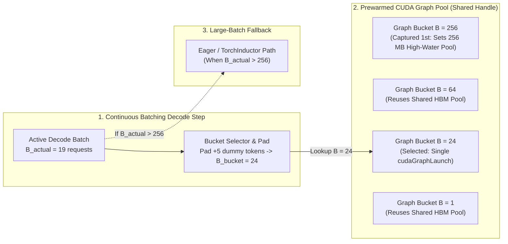
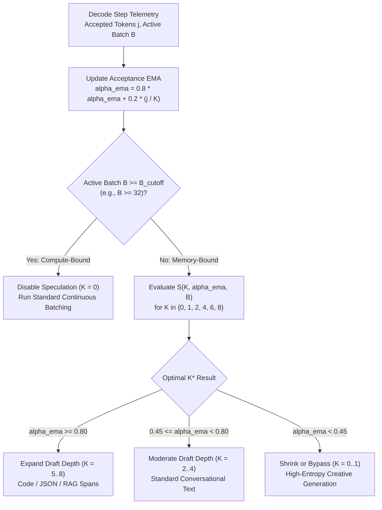
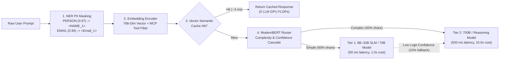

# 15.12 Dynamic and adaptive inference engine optimisations

| Field | Value |
|---|---|
| Level | Advanced |
| Priority tier | 1 |
| Lab venue | GCP / GKE + Local Python Verification Lab |
| Part | Part 15: LLM inference and serving |
| Primary sources | *AI Systems Performance Engineering* Chapters 9, 12, 13, 14, 15, 16, 19; *Hands-On LLM Serving and Optimization* Chapters 4, 10; *AI Engineering* Chapter 9 |
| Cross-references | Chapter 10.18 (CUDA Graphs and device-initiated orchestration); Chapter 10.19 (OpenAI Triton and `torch.compile`); Chapter 10.20 (PyTorch profiling and CUDA Graph pools); Chapters 15.3–15.5 (vLLM, SGLang, TensorRT-LLM) |
| Code | `code/part15/dynamic_adaptive_inference.py`, `code/part15/dynamic_adaptive_inference_lab.py` |
| Coverage file | `planning/coverage/chapters/15-12.md` |
| Claim & number ledger | `planning/ledgers/15-12.md` |

## Why this matters for AI infrastructure

A static serving configuration works only when every user sends the exact same prompt length at a steady arrival rate. Real production traffic is never that predictable. One second your cluster faces a morning rush of short chat queries. A moment later, an autonomous coding agent submits a million-token repository prompt or spawns sixteen parallel reasoning branches.

When an inference engine relies on static settings across those shifting workloads, four expensive failures occur.
- **CPU dispatch stalls during decode.** Autoregressive decoding executes hundreds of tiny memory-bandwidth-bound kernels per token. Without static graph capture and fused operators, the GPU sits idle waiting for Python and the CUDA driver to launch each kernel.
- **Speculative decoding regressions.** A fixed draft length accelerates structured code generation where draft acceptance is high. That same fixed draft length slows the cluster down when creative prompts or large batch sizes cause draft rejections and compute bottlenecks.
- **Wasted depth and precision on trivial tokens.** Running all eighty layers of a frontier model in sixteen-bit precision just to emit a closing bracket or boilerplate phrase wastes memory bandwidth and Tensor Core cycles.
- **Misrouted queries and interconnect hotspots.** Sending a simple factual question to a seven-hundred-billion-parameter model wastes ten times the compute. Inside the rack, firing an uncoordinated all-to-all collective across seventy-two GPUs saturates switch buffers and spikes tail latency.

```text
Dynamic and Adaptive Optimization Reference Gains (ASP Chapters 9, 12, 13, 15, 16, 19; HLS Chapter 10; AIE Chapter 9):
- CUDA Graph capture: collapses 300 kernel launches into 100 and cuts microbenchmark latency from 1.00 ms to 0.75 ms (1.33x speedup).
- FireworksAI decreasing-batch graph pool ([8, 4, 2, 1] at 32 MB/batch unit): reuses a 256.0 MB high-water pool vs 480.0 MB isolated (46.67% saved).
- torch.compile on a 64-expert MoE model: reduces step time from 248.0 ms to 173.0 ms (75.0 ms or 30.24% saved, 1.43x speedup).
- Custom kernel fusion: fusedL2Norm cuts HBM traffic 3.0x (36 B -> 12 B); fused Add+RMSNorm, RoPE, and SwiGLU cut 80-layer launch overhead 3.0x (4.32 ms -> 1.44 ms).
- Speculative decoding: Chinchilla-70B (14.1 ms/tok) + 4B draft (1.8 ms/tok, c = 0.1277) at K = 5, alpha = 0.80 yields 3.6893 tokens in 23.1 ms (6.2614 ms/tok, 2.25x speedup); EAGLE-1/2/3 reaches 3.5x to 6.5x; Medusa reaches 1.9x on HGX H200 and 2.2x to 3.6x overall.
- Early exit, layer skipping, and token pruning: Early exit delivers 30% to 50% speedup; DASH skips 20% to 40% of layers; LazyLLM cuts long-context latency by 20% to 30%.
- Model cascading: routing 60% of queries to a 70B model (50 ms, 1x cost) before a 700B model (500 ms, 10x cost) cuts mean latency from 500 ms to 230.0 ms (260.0 ms with 10% fallback) and reduces compute cost by up to 5.0x.
- Test-time compute prefix sharing: PagedAttention/RadixAttention copy-on-write forks on Best-of-16 (4,096 prompt + 512 generated tokens) cut KV token slots from 73,728 to 12,288 (83.33% saved).
```

Large language models are big, and the traffic they receive is never steady. A setup that runs well at noon can struggle at midnight, when prompts get longer and the mix of requests changes. Settings chosen on day one were tuned for one picture of the workload, and that picture rarely lasts. A single fixed approach is no longer enough.

This chapter covers engines that adjust themselves while they run. They can change how the model is split across GPUs, how many bits each number uses, how kernels are scheduled, and how memory is handled. The main topics are dynamic parallelism switching, precision scaling, real-time cache management, and reinforcement learning (RL) tuning. Every idea starts from one goal: keep the GPUs busy without breaking latency targets.

**An inference engine must continuously observe its own telemetry and adapt in real time.** It should dynamically adjust its graphs, kernels, draft depth, layer execution, routing, and test-time compute budgets. Before you tune any single knob in isolation, design a feedback loop that matches each runtime adaptation to live batch size, sequence length, model confidence, and fabric load.

## Prerequisites and outcomes

### Prerequisites
- Review CUDA Graph capture, stream-ordered memory pools, and device-initiated launches from Chapter 10.18.
- Review PyTorch compiler internals, OpenAI Triton kernels, and profiler workflows from Chapters 10.19 and 10.20.
- Review continuous batching, PagedAttention, RadixAttention, and TensorRT-LLM runtime architecture from Chapters 15.2 through 15.5.

### Outcomes
- Architect decode CUDA Graph pools across padded batch-size buckets using decreasing-batch shared memory handles, stream-ordered allocators, and time-series prewarming.
- Combine TorchCompile and TorchInductor with runtime kernel autotuning, occupancy-aware dynamic shared memory, and custom OpenAI Triton fused kernels for RMSNorm, RoPE, SwiGLU, and one-shot AllReduce.
- Model speculative decoding verification math across Draft-Target, EAGLE, Medusa, and self-speculative pipelines, and build an adaptive controller that adjusts draft length from live acceptance rates and batch sizes.
- Implement dynamic early-exit classifiers, input-aware layer skipping, Mixture of Depths token routing, LazyLLM token pruning, hysteretic FP8 and FP4 precision switching, and real-time quantized KV cache policies.
- Design traffic-driven parallelism pools, congestion-aware NVL72 collective wave schedules, endpoint-level semantic routers, tiered model cascades, test-time compute scaling budgets, and RL-based runtime tuners.

---

## 1. CUDA Graphs for Decode Batch Sizes, Padding Buckets, and Memory Pools

### 1.1 Eliminating Host Dispatch Overhead with Decode CUDA Graphs

During the prefill phase, a single matrix multiplication over thousands of prompt tokens keeps GPU Streaming Multiprocessors busy for tens of milliseconds. During the decode phase, each active request generates only a single token per step. Even with continuous batching across sixteen or thirty-two requests, individual decode kernels finish in just five to twenty microseconds.

In standard eager execution, Python and the CUDA driver require five to fifteen microseconds to validate tensor metadata and enqueue each kernel onto a hardware stream. When an eighty-layer Transformer executes over three hundred small kernels per decode step, the host CPU takes longer to launch the kernels than the GPU takes to execute them. The GPU timeline fragments into tiny bursts of work separated by wide idle gaps.

CUDA Graphs eliminate this host dispatch bottleneck by recording an entire decode forward pass into a static execution graph during engine startup. At serving time, vLLM, SGLang, and TensorRT-LLM replay the entire sequence of hundreds of GPU operations with a single `cudaGraphLaunch` call from the CPU. Capturing a repetitive workload reduces kernel launch transactions from three hundred down to one hundred and cuts step time from 1.00 ms to 0.75 ms.



### 1.2 Decode Batch Padding Buckets and Decreasing-Batch Shared Memory Pools

A captured CUDA Graph hardcodes every kernel's grid dimensions, tensor shapes, and physical GPU memory pointers. If the number of active decode requests changes from sixteen on one step to nineteen on the next step, a single static graph cannot execute the new shape directly.

To support dynamic continuous batching without recapturing graphs on the fly, production serving engines pre-capture a discrete ladder of batch-size buckets. A typical vLLM or SGLang bucket ladder spans power-of-two and stepped sizes from 1 up to 256 or 512. Before launching a decode step, the engine copies the active input tokens into a persistent static input buffer. It then pads any unused slots up to the next bucket boundary with dummy tokens.

| Active Decode Batch (`B_actual`) | Selected Bucket (`B_bucket`) | Dummy Tokens Added | Padding Overhead (`%`) | Execution Path | Why Padding Still Wins |
|---|---|---|---|---|---|
| 1 | 1 | 0 | 0.00% | `CUDAGraph(B=1)` | Eliminates over 2 ms of Python dispatch overhead at minimum latency. |
| 6 | 8 | 2 | 25.00% | `CUDAGraph(B=8)` | Memory-bound GEMV reads the exact same weight bytes for 6 and 8 rows. |
| 19 | 24 | 5 | 20.83% | `CUDAGraph(B=24)` | Stepped bucket 24 vs 32 keeps dummy work under 21% while replaying one graph. |
| 52 | 64 | 12 | 18.75% | `CUDAGraph(B=64)` | Single `cudaGraphLaunch` hides host scheduling across all 80 layers. |
| 300 | 300 | 0 | 0.00% | Eager or Compiled | Above 256 requests, GEMMs are compute-bound and hide CPU launch overhead naturally. |

Padding a batch of nineteen requests up to twenty-four adds five dummy tokens, which is a 20.83% padding overhead. During memory-bandwidth-bound decoding, the GPU spends almost all of its time streaming model weights from HBM into registers rather than doing arithmetic. Computing twenty-four rows instead of nineteen against those already-loaded weights adds almost zero GPU execution time. Meanwhile, replaying the pre-captured graph saves milliseconds of CPU launch delay.

Storing dozens of pre-captured CUDA Graphs creates a second infrastructure hazard: HBM workspace exhaustion. By default, each captured graph reserves its own private memory pool for intermediate activations. If you capture four buckets of sizes 1, 2, 4, and 8 where each batch unit requires 32 MB of workspace, isolated pools consume 480 MB of HBM.

As detailed in *AI Systems Performance Engineering* Chapter 13, the FireworksAI engineering team solved this memory bloat by sharing a single `torch.cuda.graph_pool_handle()` across all buckets. They captured the graphs in **strictly decreasing batch-size order** from 8 down to 1. Because only one decode batch size ever executes at a given instant, the largest batch size of 8 allocates the 256 MB high-water mark first. Every smaller bucket reuses the exact same 256 MB memory addresses inside the shared pool, saving 46.67% of graph workspace memory.

### 1.3 Time-Series CUDA Graph Prewarming and Dynamic Allocator Switching

Even with a shared graph pool, cold-start initialization can violate tail-latency SLAs when a new replica scales up or traffic surges. *AI Systems Performance Engineering* Chapter 19 pairs cluster autoscaling with **Continuous Prewarming of CUDA Graphs and Caches** driven by time-series forecasting models such as ARIMA or Prophet.

```text
CUDA Graph Pool Sizing and Dynamic Allocator Mechanics (ASP Chapters 12, 13, 19):
1. Shared Pool Memory Savings:
   Isolated_Pool_MB = sum(B_i) * Unit_Workspace_MB = (8 + 4 + 2 + 1) * 32.0 MB = 480.0 MB
   Shared_Decreasing_Pool_MB = max(B_i) * Unit_Workspace_MB = 8 * 32.0 MB = 256.0 MB (Saves 224.0 MB = 46.67%)
2. Time-Series Prewarming Workflow:
   Forecast(RPS, Prompt_Length) via ARIMA/Prophet -> Trigger warm-up before 9:00 AM daily spike
   Execute dummy forward passes on low-priority CUDA streams -> Populate JIT SASS cache, KV pools, and CUDA Graph buckets
3. Dynamic Memory-Allocator Switching:
   - Slab Allocator: Pre-partitions fixed-size blocks (e.g., 64 KB per-token [layers, hidden_dim] activation buffers) for zero fragmentation.
   - PyTorch BFC Caching Allocator: Best-Fit with Coalescing; tuned via PYTORCH_ALLOC_CONF=max_split_size_mb:<val>.
   - Stream-Ordered Allocator (cudaMallocAsync): Driver-managed stream-ordered pools; activated on OOM retry in a clean child process via PYTORCH_ALLOC_CONF="backend:cudaMallocAsync".
```

When the time-series predictor forecasts a 9:00 AM traffic spike, a background scheduler runs synthetic warm-up requests across every expected batch bucket using low-priority CUDA streams. Low-priority streams yield hardware resources immediately if live user traffic arrives. On Grace Blackwell superchips, prewarming also stages unified CPU-GPU memory pages via `cudaMemPrefetchAsync` before the first request lands.

Prewarming only helps when the forecast is right. A wrong forecast warms graphs that never get used, so track prediction hit rates and confirm the warm-up pays off. Retrain the forecasting models often, because traffic patterns shift as new user groups arrive. Unplanned events can also change the curve, such as a local holiday that moves usage.

Here is a concrete case. An inference service sees traffic spike every day at 9 A.M. because of time zones. A cron-like job or scheduler can run a few warm-up requests shortly before 9 A.M. Those requests load the model into GPU caches, compile the kernels, and capture CUDA Graphs for the expected batch sizes. Start early enough for resources to finish provisioning.

PyTorch captures a graph inside a `torch.cuda.graph()` context. A replay submits the whole captured workload with one `cudaGraphLaunch`, which skips the Python-to-CUDA dispatch. Graphs are static, so variable shapes are awkward. Serving batches often come in fixed sizes such as 1, 2, 4, 8, and 16, so a pool of captured graphs fits well. A batch of 16 is common at peak, so the server can keep a graph for that size ready.

Each graph in the pool holds its own workspace memory. Watch memory use and evict rarely used graphs when memory gets tight. Graph patching, covered in Chapter 12, can adjust small size differences without a full pool. In practice, though, a pool usually performs better.

Prewarming should also cover scale-out. When a burst of long-prompt requests is scheduled, scale out the prefill workers and run a representative forward pass to warm the CUDA Graphs and KV cache. On the decode side, a speculative draft model can be loaded and warmed along with its KV cache. Fixed-token decode loops can be unrolled too.

CUDA also caches compiled kernels. The path runs from C++ to PTX to SASS, and the first run of a kernel pays a just-in-time (JIT) compile cost. Warm-up removes that cost before users arrive.

Coordinate warm-up with the cluster autoscaler. New GPU instances can run a few warm-up API calls before they join the live pool. That validates the engine, caches JIT output, allocates memory pools, and prepares graphs. Hit as many paths as you can, including every batch size and graph variant. Compare first-request latency during a surge with and without warm-up, so you can tune the timing.

Run prewarm work when GPUs are underutilized. CUDA stream priorities let you place prewarm streams below the live inference stream, so warm-up yields when real traffic arrives. An idle GPU is otherwise wasted, so warm-up there costs little. On Grace Blackwell systems, the CPU and GPU share unified, coherent memory. The CPU can start filling memory the GPU will read, which avoids explicit copies later. Prewarming makes latency more predictable, because expensive compilation and transfers move to times when they are cheap.

Long-running inference servers also suffer from HBM fragmentation when variable-length prompts alternate with small decode steps. PyTorch's default Best-Fit with Coalescing caching allocator reserves large chunks of HBM. Wide gaps between `torch.cuda.memory_reserved()` and `torch.cuda.memory_allocated()` indicate severe fragmentation. An adaptive engine separates long-lived model weights from short-lived 64 KB per-token activation slabs and tunes `max_split_size_mb`. Whenever fragmentation triggers an out-of-memory exception, the engine switches to CUDA's stream-ordered allocator via `PYTORCH_ALLOC_CONF=backend:cudaMallocAsync` in a fresh worker process.

The default allocator in PyTorch is a caching allocator that uses best-fit with coalescing (BFC). It grabs large chunks of GPU memory and splits them to serve requests. That reuses free space and avoids frequent calls to the slow, synchronous `cudaMalloc` and `cudaFree`. It suits most workloads. A server that alternates large and small allocations can still fragment memory. Plenty of memory may be free, but not in one contiguous piece, so a large tensor fails with an OOM.

Allocators differ in how they split memory. A buddy allocator splits blocks into power-of-two sizes. A slab allocator works on top of the buddy system and handles small, fixed-size objects. It preallocates slabs, which are groups of objects of one type, and keeps a free list in each slab. The buddy allocator handles coarse page allocation, and the slab allocator handles fine-grained reuse.

`cudaMallocAsync` takes a different path. It keeps stream-ordered pools, recycles memory when references are released, and merges freed blocks because it knows the order of the frees. It behaves somewhat like a slab allocator combined with a buddy system, and the CUDA driver manages it for you. That makes it a strong default to leave on, if you prefer.

Watch fragmentation before you act on it. `torch.cuda.memory_summary()` reports allocator state. The memory profiler in `torch.profiler`, enabled with `profile_memory=True`, shows which operations allocate the most. Nsight Systems tracks CUDA memory events and Unified Memory page faults on a timeline, and Nsight Compute reports memory workload. Log `torch.cuda.memory_reserved()` and `torch.cuda.memory_allocated()`. Reserved is what the allocator holds. Allocated is what tensors use. A wide gap that keeps growing means memory is reserved but idle.

The split size is set with `PYTORCH_ALLOC_CONF=max_split_size_mb:<value>`. Raise it when large allocations are expected, so they are not chopped into pieces. Lower it when many small requests arrive, so large blocks get reused. A split size that is too small floods the allocator with tiny blocks and extra metadata. One that is too large leaves big holes that stay unused when only part of a block is freed.

Purging the cache returns unused memory to the GPU. Restarting the worker resets the allocator completely. Both are intrusive, and some teams use them on long-running processes with heavy fragmentation. Do them in maintenance windows, or as a rolling restart across a fleet. If you need them often, the underlying cause needs fixing.

Switching allocators at runtime takes care. PyTorch's CUDA caching allocator is created the first time `torch` is imported or the first CUDA context is touched. Reloading a Python module does not unload C++ extensions or tear down the allocator, so changing `PYTORCH_ALLOC_CONF` in the same process does not work. A workaround is to catch the OOM, free memory in the parent, and start a fresh child process with the variable set before `torch` loads. The book's sketch does that with `backend:cudaMallocAsync`:

```
# dynamic_memory_allocator.py
# Retry generation in fresh process with cudaMallocAsync if first attempt OOMs.
# This is the only reliable way to change the CUDA allocator at runtime.
import os
import sys
import gc
import pickle
import tempfile
import subprocess
import importlib
from typing import Callable, Any

def _resolve_factory(factory_path: str) -> Callable[[], Any]:
    """
    Resolves a factory string like "my_package.my_mod:build_model" to a callable.
    The callable must return ready-to-use model with .generate(request) method.
    """
    module_name, func_name = factory_path.split(":", 1)
    module = importlib.import_module(module_name)  # safe to import, no torch yet
    return getattr(module, func_name)

def generate_with_allocator_retry(
    model_factory_path: str,
    request_object: Any,
    *,
    allocator_conf: str = "backend:cudaMallocAsync"
) -> Any:
    """
    Attempts model.generate(request_object) in the current process.
    On torch.cuda.OutOfMemoryError, retries in a fresh subprocess with
    PYTORCH_ALLOC_CONF set to allocator_conf. request_object and the
    returned value must be picklable.
    """
    # Import torch only inside function; avoid importing at module import time.
    import torch

    model_factory = _resolve_factory(model_factory_path)
    model = model_factory()  # user-supplied function builds model, moves to GPU

    try:
        # First attempt uses whatever allocator current process started with.
        return model.generate(request_object)
    except torch.cuda.OutOfMemoryError:
        # Free as much as possible in the parent before spawning the child.
        # Avoids compounding pressure when two processes momentarily overlap.
        try:
            del model
        finally:
            gc.collect()
            torch.cuda.empty_cache()

        # Serialize request to temp file and ask fresh interpreter to do work.
        with tempfile.TemporaryDirectory() as td:
            req_path = os.path.join(td, "request.pkl")
            out_path = os.path.join(td, "output.pkl")
            with open(req_path, "wb") as f:
                pickle.dump(request_object, f)

            # In the child, we want torch to see allocator config at import.
            env = os.environ.copy()
            env["PYTORCH_ALLOC_CONF"] = allocator_conf

            # Re-run this module as a helper child. The child will import torch
            # only after PYTORCH_ALLOC_CONF is set in its environment.
            cmd = [
                sys.executable,
                __file__,
                "--child",
                "--factory", model_factory_path,
                "--request", req_path,
                "--output", out_path,
            ]
            completed = subprocess.run(cmd, env=env, capture_output=True, text=True)
            if completed.returncode != 0:
                # Bubble up child stderr to aid debugging
                raise RuntimeError(
                    f"Retry failed with exit code {completed.returncode}\n"
                    f"stdout:\n{completed.stdout}\n\nstderr:\n{completed.stderr}"
                )
            with open(out_path, "rb") as f:
                return pickle.load(f)

def _child_main(factory_path: str, request_path: str, output_path: str) -> None:
    """
    Child entrypoint: assumes PYTORCH_ALLOC_CONF is already present in env.
    Imports torch only now, builds the model, runs generate, and pickles result.
    """
    # Import torch after env var set by the parent's subprocess.run(env=...).
    import torch

    model_factory = _resolve_factory(factory_path)
    model = model_factory()  # build the model inside the child process
    with open(request_path, "rb") as f:
        request_object = pickle.load(f)
    result = model.generate(request_object)
    with open(output_path, "wb") as f:
        pickle.dump(result, f)

if __name__ == "__main__":
    import argparse
    parser = argparse.ArgumentParser()
    parser.add_argument("--child", action="store_true")
    parser.add_argument("--factory", type=str, default="")
    parser.add_argument("--request", type=str, default="")
    parser.add_argument("--output", type=str, default="")
    args = parser.parse_args()
    if args.child:
        _child_main(args.factory, args.request, args.output)
    else:
        print("This module is intended to be imported.")
```

The model is built inside the child through a factory string, so no CUDA code loads before the variable takes effect. The parent empties its cache first, so two processes do not press on memory at the same time. The request and the result travel through pickle files in a temporary directory.

In a C++ engine, you can build a pure slab allocator for chosen sizes. Per-token activation tensors often have one fixed size, such as a `[layers, hidden_dim]` buffer at 64 KB. A slab for that size avoids fragmentation, and it usually stays with the pool until the whole slab is freed. Modern engines reuse buffers like this for each generated token instead of freeing and reallocating every time.

Allocation choices can differ across the system. The default caching allocator can handle large static weights, which are freed rarely during inference. A custom allocator can handle short-lived per-token buffers. Separate long-lived allocations from short-lived ones in your code, so each can go to the right pool. Plan an OOM fallback too. Many production systems offload to CPU on OOM instead of failing the request. The engine might free the cache, move some layers to the CPU, or compress the cache.

Before you enable CUDA Graphs in production, capture your decode buckets in decreasing batch-size order inside a shared memory pool and warm every bucket on low-priority streams before opening the replica to live ingress traffic.

### 1.4 Adaptive Batching, Chunked Prefill, and Prefill-Decode Scheduling

Batching raises throughput, but a big batch makes each request wait. A long prefill can also block short decode steps behind it. Adaptive batching changes how requests are grouped as load changes. At peak load, use larger batches, such as 8 or 16, because throughput matters most. In quiet periods, use smaller batches so requests finish sooner. A simple rule is to allow larger batches when GPU utilization is above 80%, and to use batch size 1 when it is below 20%. A learned policy can replace the rule later.

Prefill and decode have very different shapes. Prefill processes a whole prompt in one large, compute-heavy pass. Decode produces one token per request, and it is memory-bound. Because the two run for such different times, the book recommends treating them as separate workloads, with their own batches and their own threads or worker pools. Decode gains from larger batches, since that raises its arithmetic intensity. Engines such as vLLM already build separate batches for prefill and decode workers.

Pipeline parallelism suffers from the same mismatch. If one microbatch runs a long prefill while another decodes one token, their durations differ and pipeline bubbles appear. The fix is chunked prefill. Slice a big prefill into small chunks, and slot decode steps between them. Figure 19-7 shows how decode-maximal batches fill the gaps across four requests. The SARATHI paper reports roughly 1.3 to 1.9 times more throughput than naive scheduling with this approach.

Take a 10,000-token prefill. Without chunking, one pass blocks the whole pipeline, and decode requests wait until it finishes. Split it into five 2,000-token chunks, and decode batches can run between them. That closes the bubbles and smooths utilization. A common rule of thumb is to size each chunk to take about 50 to 100 ms. That leaves frequent openings for decode. Depending on the model and GPU, a chunk may be a few thousand tokens.

vLLM's scheduler supports chunked prefill and decode-maximal batching. It monitors token queues and decides whether to run another prefill chunk or a decode batch. The sketch below does the same thing, using GPU utilization as its signal:

```
# Example adaptive scheduler for chunked prefill/decode
import cupy as cp
import torch

# Hardware constraints
SHMEM_LIMIT = 256 * 1024
BLOCK_THREADS = 256
TARGET_UTIL = 0.85
OCC_THRESHOLD = 0.5

# Cache for occupancy results and tile lookup
_occ_cache = {}
_tile_table = {}  # e.g., {L: optimal_T}

# 1) Precompute tile_table offline; here we lazy-initialize on first use
def get_optimal_tile(L):
    if L in _tile_table:
        return _tile_table[L]
    # compute block size by querying for an occupancy-based suggestion
    min_grid, max_grid, block_size = ...  # left out for brevity
    T = min(block_size, L)
    T = max(32, (T // 32) * 32)
    _tile_table[L] = T
    return T

# 2) Cached occupancy query
def get_occupancy(threads, shared_bytes):
    key = (threads, shared_bytes)
    if key in _occ_cache:
        return _occ_cache[key]
    max_blocks = cp.cuda.runtime.cudaOccupancyMaxActiveBlocksPerMultiprocessor(
        attention_kernel_ptr, threads, shared_bytes
    )
    props = torch.cuda.get_device_properties(0)
    warps_per_block = threads // props.warp_size
    max_warps = props.max_threads_per_multi_processor // props.warp_size
    occ = (max_blocks * warps_per_block) / max_warps
    _occ_cache[key] = occ
    return occ

def scheduler_loop():
    stream = cp.cuda.Stream(non_blocking=True)
    while True:
        pending = get_pending_requests()
        util = gpu_utilization()
        if util < TARGET_UTIL and any(r.phase == 'prefill' for r in pending):
            req = select_heaviest_prefill(pending)
            L = req.remaining_length()
            T = get_optimal_tile(L)
            shared_bytes = 3 * T * T * 4
            occ = get_occupancy(BLOCK_THREADS, shared_bytes)
            if occ < OCC_THRESHOLD:
                T = max(32, T // 2)
                shared_bytes = 3 * T * T * 4
            chunk = req.next_prefill_chunk(T)
            # Launch with CuPy RawKernel on our stream
            attention_kernel((...grid...), (BLOCK_THREADS,),
                             (chunk, ...), shared_mem=shared_bytes,
                             stream=stream)
            # Record an event to know when done
            event = cp.cuda.Event()
            event.record(stream)
        elif any(r.phase == 'decode' for r in pending):
            batch = form_decode_batch(pending, max_batch=16)
            # Trace the adaptive logic
            logger.info(f"T={T}, occ={occ:.2f}, util={util:.2f}")
            launch_decode_kernel(batch, stream=stream)
            event = cp.cuda.Event()
            event.record(stream)
        else:
            # Poll the last event rather than sleep
            if not event.query():
                cp.cuda.get_current_stream().synchronize()  # or pass
            continue
```

The scheduler sizes each prefill chunk to use shared memory well. It computes a tile width `T` so the query, key, and value buffers fit the per-SM dynamic shared-memory limit. Then it asks how many blocks fit on each SM. If occupancy falls below 50%, `T` is halved, so more blocks can share an SM. When GPU utilization is below 85% and prefill is waiting, the scheduler takes the largest pending prefill and cuts it into chunks of `T` tokens. The helper `next_prefill_chunk` can shrink or grow the chunk from live metrics, shrinking when occupancy is low and growing when DRAM traffic is high.

Between chunks, the scheduler bundles ready decode requests into one launch with `form_decode_batch`. Short replies then do not wait behind a long prompt. The scheduler always picks the action that keeps SM slots full and wastes the least time. That is a utilization-maximization policy, a bit like an OS scheduler aiming for full CPU use. Log the chosen `T`, the occupancy, and the utilization. Then you can confirm the policy really holds utilization high.

Keep prefill and decode as separate queues with their own SLAs. Clear the latency-sensitive decode work first, using dedicated time slices or CUDA streams, and use the leftover cycles for big prefill jobs. A budget of 1 to 5 ms per decode is one option. Many engines also use a producer-consumer pattern. One thread prepares decode inputs while another prepares prefills, and both feed a single execution stream in an efficient order.

Multinode clusters can split these roles. Send prefill requests to one set of nodes and decode requests to another. Prefill nodes can use GPUs with high FLOPS and modest memory bandwidth, since prefill is compute-bound. Decode nodes can use GPUs with high memory bandwidth and fewer FLOPS. The catch is that mixed hardware can make load balancing harder. If the prefill-to-decode ratio shifts, decode workers with fewer FLOPS may become the bottleneck. Homogeneous nodes are simpler, so specialize only when the ratio is predictable.

Context-aware request routing ties this together. Route by real-time factors such as KV cache hits, queue depth, and load. Then you can split prefill and decode across resources. Throughput stays high on long prompts, and short-prompt replies stay fast.

For batching details, batch decode calls together whenever you can. For prefill, avoid mixing very short and very long prompts. Group requests into length buckets, such as the nearest 512-token bucket, so each batch wastes little compute on padding. Many engines run a token-level scheduler that forms batches at each generation step. It waits a few milliseconds to gather ready tokens, caps batch size to fit memory and occupancy, and uses round-robin or maximum-delay rules to keep long and short prompts fair. Confirm that your engine has this turned on.

Adaptive batching and prefill-decode disaggregation can lift utilization and throughput without much latency cost. A busy GPU wastes less time, so tasks finish sooner overall.

---

## 2. TorchCompile, TorchInductor, Kernel Autotuning, and Custom Triton Fused Kernels

### 2.1 The PyTorch Compilation Pipeline and Inference Modes

While CUDA Graphs remove CPU launch overhead, they do not change the efficiency of the GPU kernels inside the graph. If a model executes five separate elementwise PyTorch operations in a row, each operation still reads its inputs from HBM and writes its outputs back to HBM.

PyTorch's compiler stack via `torch.compile` eliminates those redundant memory round-trips through four lowering stages.
1. **TorchDynamo.** Intercepts Python frame evaluation via PEP 523, extracts FX graphs, and attaches SymPy symbolic shape guards to detect when dynamic sequence lengths require recompilation.
2. **AOTAutograd.** Captures joint forward-and-backward graphs and functionalizes in-place mutations into pure out-of-place operations.
3. **PrimTorch IR.** Decomposes more than two thousand ATen operators down into roughly two hundred fifty canonical primitive operations.
4. **TorchInductor.** Fuses sequences of pointwise and reduction primitives into single OpenAI Triton or C++ kernels, and coordinates cuBLASLt, CUTLASS, and CUDA Graph wrappers.

```text
PyTorch Compiler Modes and MoE Benchmark (ASP Chapters 13, 14, 19):
- default: Balances fast compile time with pointwise/reduction kernel fusion; no automatic CUDA Graphs.
- reduce-overhead: Wraps compiled subgraphs in CUDA Graphs to eliminate Python/driver launch overhead; ideal for small-batch decode.
- max-autotune: Profiles multiple Triton tile configs, cuBLASLt heuristics, and CUTLASS templates plus CUDA Graphs; longest warmup, highest steady-state speed.
- max-autotune-no-cudagraphs: Full kernel autotuning without CUDA Graph capture for workloads with highly dynamic tensor shapes.
- 64-Expert MoE Step Benchmark (ASP Ch. 13 Table 13-5): Eager mode = 248.0 ms -> torch.compile = 173.0 ms (75.0 ms / 30.24% saved, 1.43x speedup).
- Artifact Mega-Cache: Persist compiled binaries across fleet restarts via TORCHINDUCTOR_CACHE_DIR and torch.compiler.save_cache_artifacts().
```

The `torch.compile` call takes a mode, and the mode sets how far the compiler goes. The `default` mode fuses pointwise and reduction kernels but does not capture CUDA Graphs. The `reduce-overhead` mode wraps compiled pieces in CUDA Graphs, which suits small-batch decode. The `max-autotune` mode profiles Triton tile configs, cuBLASLt heuristics, and CUTLASS templates, along with CUDA Graphs. It has the longest warmup and the highest steady-state speed. The `max-autotune-no-cudagraphs` mode keeps the autotuning but skips graph capture, which helps when tensor shapes change a lot.

Compilation and CUDA Graphs fix different problems. Graphs remove CPU launch overhead, but they leave each GPU kernel as it is. The compiler removes the extra trips to HBM between operations. A fast engine often uses both.

On a sixty-four-expert Mixture-of-Experts model where routing and small operators create heavy launch and memory overhead, enabling `torch.compile` cuts step time from 248.0 ms to 173.0 ms, a 1.43x speedup. To prevent cold-start compilation storms when Kubernetes scales out new pods, mount a shared directory across nodes using `TORCHINDUCTOR_CACHE_DIR`. You can then serialize compiled artifacts with `torch.compiler.save_cache_artifacts()`.

### 2.2 Custom OpenAI Triton Fused Kernels for RMSNorm, RoPE, SwiGLU, and AllReduce

Compilers automatically fuse simple pointwise chains, but critical LLM blocks often require custom OpenAI Triton or CUDA kernels to keep intermediate values entirely inside on-chip SRAM and registers. As shown in *AI Systems Performance Engineering* Chapter 9, fusing an L2 normalization kernel (`fusedL2Norm`) reduces global memory traffic by 3.0x, from 36 bytes per element down to 12 bytes per element.

Modern inference engines apply that exact fusion principle to four core Transformer bottlenecks.
- **Fused Add and RMSNorm.** At the entry of every attention and MLP block, the model adds the residual stream and normalizes the activation vector. In unfused eager execution, PyTorch launches four separate kernels and performs five HBM passes over the hidden dimension. A single Triton kernel loads the input and residual once into SRAM, computes the updated residual, reduces the sum of squares in registers, and writes out the results in two or three HBM passes.
- **Fused Rotary Position Embedding.** Unfused RoPE slices query and key tensors, materializes temporary sine and cosine tables in HBM, and concatenates rotated halves. A fused Triton RoPE kernel loads query and key tiles alongside position indices and applies the pairwise rotation directly in registers before writing the rotated tensors in place.
- **Fused SwiGLU Activation.** In Llama and Qwen MLP layers, the gated projection multiplies the SiLU activation of the gate tensor by the up-projection tensor. Unfused execution requires five HBM passes over the 14,336-element intermediate dimension. A fused Triton SwiGLU kernel reads the gate and up tensors once, computes the product in registers, and writes the output once, cutting HBM traffic by 1.67x down to three passes.
- **Custom One-Shot and Two-Shot Fused AllReduce.** During Tensor Parallel decoding across eight GPUs, each layer performs an AllReduce on small activation buffers between 64 KB and 512 KB. Standard ring `ncclAllReduce` requires fourteen sequential link steps and cannot easily fuse with the following RMSNorm. Using PyTorch SymmetricMemory or NVSHMEM via `triton.nvshmem.get()`, a custom one-shot Triton kernel reads peer GPU buffers directly across NVSwitch in a single hop. It fuses the cross-GPU sum with the residual addition and RMSNorm inside one CUDA Graph-capturable kernel.

| LLM Decode Operator Block (80 Layers, B=32, H=4096, I=14336) | Unfused Eager Kernels / Layer | Fused Triton Kernels / Layer | HBM Tensor Passes (Unfused vs Fused) | 80-Layer Launch Overhead (6 us/launch) | Key Hardware Mechanism |
|---|---|---|---|---|---|
| Residual Add + RMSNorm | 4 | 1 | 5 passes vs 2–3 passes | 1.92 ms vs 0.48 ms | On-chip SRAM warp reduction (`tl.sum`) |
| Rotary Position Embedding (RoPE) | 3 | 1 | 4 passes vs 2 passes | 1.44 ms vs 0.48 ms | In-register pairwise sinusoidal rotation |
| Gated MLP Activation (SwiGLU) | 2 | 1 | 5 passes vs 3 passes (1.67x less BW) | 0.96 ms vs 0.48 ms | Single-pass gate sigmoid multiplication |
| TP Decode Synchronization (AllReduce) | 1 (Ring 14 steps) | 1 (Fused w/ Norm) | Separate collective + norm | Host sync gap vs Graph-captured | SymmetricMemory or NVSHMEM 1-shot P2P |
| **Total per Decode Step (80 Layers)** | **720 elemental launches** | **240 fused launches** | **Up to 2.0x–3.0x lower HBM traffic** | **4.32 ms vs 1.44 ms (3.0x faster)** | **Fused SRAM + CUDA Graph capture** |

### 2.3 Runtime Kernel Autotuning, Occupancy-Aware Shared Memory, and Hot-Swapping

A model has many kernels, and each has settings a library usually picks once. Block size, tile shape, and loop unrolling all matter. In an online service, input sizes change from request to request. A choice that suits a 200-token prompt can be wrong for a 4,000-token one. Kernel autotuning picks, or even compiles, the best variant for the work in front of it.

Attention shows this clearly. Standard attention reads its inputs from global memory, which is fine for short sequences. FlashAttention and its variants tile the work and reuse data in shared memory, which wins on long sequences. For very short inputs, the setup cost of tiling can outweigh its benefit. A dynamic engine can switch by sequence length `L`:

```
// Note: example threshold shown here
if (seq_len < 256) {
// global-memory version, best for small L
attn_kernel = standard_attention_kernel;
} else {
// tiled loads, best for large L
attn_kernel = tiled_attention_kernel;
}
output = attn_kernel(Q, K, V, mask);
```

The book notes that a benchmark on your own hardware may put the breakeven near `L = 128`. Measure that point rather than trusting a number. CUTLASS and OpenAI Triton both include autotuners that benchmark tile choices such as `(TILE_Q, TILE_K)` at startup, or even while serving.

Feed-forward layers are two large matrix multiplies with an activation between them. cuBLAS and cuBLASLt can try several GEMM algorithms and keep the fastest. The search usually runs only the first time a given matrix shape appears. A server that sees batch sizes of 1 and 16 may need a different winner for each. The engine can microbenchmark candidates when a new batch size shows up, then reuse the result for later calls.

Some runtimes go further. They use Triton to generate several tile variants, such as 128 × 128 or 64 × 256, and time each one on the real hardware. Programmatic dependent launch (PDL) can also shrink launch gaps where it is available. Profile after you enable it, since the gain is not guaranteed.

Nsight Systems shows the CUDA timeline, including `memcpy` and NVLink activity, so you can compare kernel variants side by side. Nsight Compute reports memory workload, which ties cache and memory behavior to each kernel. It can reveal problems such as L2 cache misses. Hardware under load can surprise you, so empirical tuning beats pure theory. Still, start from sensible values.

Tile size also changes occupancy. A bigger tile reuses data more and cuts launch overhead. It also uses more registers and shared memory, which can cut how many thread blocks run at once. A good autotuner weighs that trade-off for you.

Even a fused kernel cannot use a single static tile size across every request length. In self-attention, a large shared-memory tile of 256 by 128 maximizes data reuse for long prompts by loading Key and Value blocks once from HBM. However, its 128 KB shared-memory footprint restricts the Streaming Multiprocessor to 60% occupancy. For short sequences under 256 tokens, a smaller tile of 64 by 64 or a standard global-memory attention kernel avoids tiling setup overhead and reaches 85% SM occupancy.

| Attention Tile Size (TILE_Q x TILE_K) | Shared Memory per Block (KB) | Achieved SM Occupancy (%) | Achieved Throughput (GOPS) | Optimal Workload Regime (*AI Systems Performance Engineering* Table 19-3) |
|---|---|---|---|---|
| 64 x 64 | 48 KB | 85% | 8.2 GOPS | Short sequences (L ≤ 512), latency-critical small batches |
| 128 x 64 | 64 KB | 78% | 10.5 GOPS | Medium sequences (512 < L ≤ 2,048), balanced reuse and occupancy |
| 128 x 128 | 96 KB | 72% | 9.8 GOPS | High register and SMEM footprint transition zone |
| 256 x 128 | 128 KB | 60% | 11.3 GOPS | Long context prefill (L ≥ 2,048), maximum HBM bandwidth reuse |

As shown in *AI Systems Performance Engineering* Chapter 19, an adaptive engine automates this selection through a six-step runtime loop. The engine measures batch size and sequence length, selects candidate kernels, microbenchmarks them on a background stream, picks the fastest variant, caches the winner by shape signature, and executes. Before launching a tiled attention kernel with tile width T, the runtime computes dynamic shared memory to hold the Query, Key, and Value tiles, and queries `cudaOccupancyMaxActiveBlocksPerMultiprocessor`.

```python
# Occupancy-aware dynamic shared-memory allocation and hot-swapping (ASP Ch. 19)
import torch

def compute_adaptive_attention_launch(seq_len: int, achieved_occ: float, gpu_util: float) -> dict:
    # 1. Dispatch kernel path based on sequence length breakeven (L = 256)
    kernel_name = "standard_attention_kernel" if seq_len < 256 else "tiled_attention_kernel"
    tile_t = 64 if seq_len <= 512 else (128 if seq_len <= 2048 else 256)

    # 2. Halve tile width T if SM occupancy drops below 50% threshold
    if achieved_occ < 0.50:
        tile_t = max(32, tile_t // 2)

    # 3. 3 tiles of T x T float32 elements for Q, K, and V in extern __shared__ float smem[]
    shared_mem_bytes = 3 * tile_t * tile_t * 4
    return {
        "kernel": kernel_name,
        "tile_t": tile_t,
        "shared_mem_bytes": shared_mem_bytes,
        "carveout_hint_smem_pct": 75,  # cudaFuncAttributePreferredSharedMemoryCarveout (75% SMEM / 25% L1)
        "run_prefill_chunk": gpu_util < 0.85,
    }

def hot_swap_compiled_attention(model: torch.nn.Module) -> None:
    # Zero-downtime JIT kernel hot-patching without reloading model weights
    compiled_fn = torch.compile(model.transformer.self_attn.forward, backend="inductor")
    model.transformer.self_attn.forward = compiled_fn
```

When a kernel requires large tiles of 128 or 256, the engine calls `cudaFuncSetAttribute` with `cudaFuncAttributePreferredSharedMemoryCarveout`. That hint shifts the unified L1 and shared-memory pool from a 50% split to 75% shared memory and 25% L1 cache. If a faster kernel implementation such as FlashAttention-3 or a newly compiled TorchInductor graph becomes available, the server drains in-flight requests at an iteration barrier. It then hot-swaps the module's forward function pointer in place without reloading multi-hundred-gigabyte model weights.

The runtime loop works like a database query optimizer that picks a query plan. Here the plan is the kernel. The engine measures batch size and sequence length, lists candidate kernels, benchmarks them briefly, caches the winner, and runs it. Over time it builds a library of tuned paths for short and long prompts and for small and large batches.

Tuning has a cost, so the engine hides it. It can benchmark a candidate on a separate stream while the default kernel keeps serving. It can also tune during quiet periods. At model load, run a warm-up set that includes extremes, such as the maximum sequence length and the maximum batch. That way the hard cases are tuned before live traffic arrives.

Keep watching layer times after startup. If one layer becomes the bottleneck because the inputs changed, revisit its kernel choice. Some frameworks use multiarmed bandit algorithms. These keep exploring alternative kernels and shift to whichever one is winning as conditions change.

Tile choice also depends on shared memory and occupancy, which is how many thread blocks an SM can keep active. Treat the tile width `T` as the number of tokens each thread block handles at once. A tiled attention block needs roughly `T²` floats of shared memory for its query, key, and value chunks, since self-attention is quadratic.

A large tile such as `T = 256` loads each key and value block once and reuses it for many queries. That cuts global-memory traffic. But only a few blocks fit on an SM at that size. The book's example: one block per SM at `T = 256` against four blocks at `T = 128` can mean roughly 30% occupancy at the larger tile. A small tile such as `T = 64` fits more blocks and hides latency better. It reloads the same key and value data more often, though.

The best `T` depends on the sequence length `L`, the shared memory per block, and the SM count. You can benchmark candidates such as 64, 128, and 256 offline. Or compute `T` right before launch:

```
int T = choose_tile(L, gpu_shared_mem_per_block, num_sms);
// calculate shared memory in bytes based on the tile size
// (multiplying by 3 for Q, K, and V)
size_t shared_mem_bytes = 3 * T * T * sizeof(float);
numBlocks = ...
MyAttentionKernel<<<numBlocks, threadsPerBlock, shared_mem_bytes>>>(...);
```

Inside the kernel, the buffer is declared with `extern __shared__`:

```
// holds 3 tiles of T×T floats for Q, K, and V
extern __shared__ float smem[];
// Q tile: smem[0 ... T*T-1]
float* tile_q = smem;
// K tile: smem[T*T ... 2*T*T-1]
float* tile_k = smem + T*T;
// V tile: smem[2*T*T ... 3*T*T-1]
float* tile_v = smem + 2*T*T;
```

Because the size arrives at launch, one kernel binary can run many tile sizes. If occupancy is too low, shrink `T`. If DRAM traffic is thrashing, grow it. The engine can read its own achieved occupancy through the CUDA Occupancy API or DCGM, then adjust `T` on the next iteration.

Registers count too. Unrolled loops speed up one thread but use more of the register file, which can leave fewer warps to schedule. A runtime that sees register limits can switch to a build that uses fewer registers, at the cost of extra instructions.

Profiling shows the trade-off. Nsight Systems and Nsight Compute report achieved occupancy and efficiency per kernel, and DCGM reports SM occupancy for the whole system. Suppose an attention kernel at sequence length 2,048 reaches only 30% occupancy because each block uses a lot of shared memory. The system could split the attention work into two passes to free that memory. That helps only when memory latency is the real limit. For a memory-bound kernel that is not using its ALUs, more shared memory can help even if occupancy drops.

Design kernels so tile and block sizes can change at runtime. CUTLASS provides runtime-tunable variants for this reason. Watch SM utilization too. Under 50% active warps points to idle warps and low occupancy. Over 70% memory stall cycles points to tiles that are too small, which means too much traffic. Either case calls for an adjustment.

Many serving stacks keep a small table that maps sequence-length ranges to launch settings, stored in a JSON or config file. For example, length 512 might use 128 threads and 16 KB of shared memory, while length 4,096 uses 256 threads and 64 KB. That applies autotuning to resource allocation. It is easy to update when models or hardware change.

NVIDIA GPUs share one on-chip pool between L1 cache and shared memory, and the carveout sets the split. A kernel can ask for more shared memory with `cudaFuncSetAttribute` and `cudaFuncAttributePreferredSharedMemoryCarveout`. Moving from a 50% split to 75% shared memory, with 25% L1, suits a large-tile kernel. The carveout is per kernel and is only a hint. Check its effect with profiling.

Before you write custom CUDA C++ from scratch, compile your model with `torch.compile`, fuse residual RMSNorm, RoPE, and SwiGLU in OpenAI Triton, and drive tile sizes from live SM occupancy telemetry.

### 2.4 Runtime Kernel Patching and Hot-Swappable Implementations

New kernels appear all the time, including FlashAttention variants, megakernels, and hardware-specific tweaks. Runtime kernel patching puts a faster kernel into a running server without a full redeploy or a model reload. The goal is to swap a slower function for a faster one while traffic keeps flowing.

Take a server that uses the default PyTorch scaled dot product attention (SDPA) kernel. Suppose a newer kernel such as FlashAttention-3 gives a 20% boost on long sequences in some cases. Normally you would install the library and restart. With runtime patching, you redirect calls to the new kernel while the server keeps running. For a 24/7 service, avoiding a restart matters a lot. In Python, a simple monkey patch can do it:

```
import new_flash_attn_lib
# Monkey-patch the model's attention forward to use the new library
old_attn_forward = model.transformer.self_attn.forward
def new_attn_forward(self, *args, **kwargs):
    return new_flash_attn_lib.forward(*args, **kwargs)
model.transformer.self_attn.forward = (
    new_attn_forward.__get__(
        model.transformer.self_attn,
        type(model.transformer.self_attn)))
```

This binds the new forward to the attention instance, so later calls go through the new code. The replacement must be drop-in compatible. Test it until its outputs match within a sensible numerical tolerance, so you avoid quality regressions.

Another route is JIT patching. A compiler such as PyTorch Inductor or OpenAI Triton builds a faster version at runtime, and you plug it in:

```
compiled_forward = torch.compile(model.transformer.self_attn.forward, backend="inductor")
model.transformer.self_attn.forward = compiled_forward
```

Done after model setup, this is hot patching. It swaps function pointers and avoids a reload. On the CUDA side, the driver API can load a custom PTX module into a live context without resetting the device. NVIDIA Runtime Compilation (NVRTC) can compile PTX from strings at runtime. If the function signatures match, the system updates the pointers. This is harder to build than a Python patch, but a high-performance engine may not run on Python at all.

Thread safety matters. Drain the incoming request queue, or use a barrier, so no thread is inside the function you are replacing. This is the same care an OS takes when it loads a kernel module. Clean module boundaries help. Separate the attention and MLP kernels so you can swap one without touching the other. A monolithic model is harder to patch, though it may run faster, as megakernels can.

Numerical equivalence is the rule. Optimized kernels are usually built to match the old result at the same precision, such as FP16. Patching also helps with quick fixes. If a known sequence of operations triggers a bug, you can patch in a fix right away instead of waiting for a release. Suppose an FP8 kernel misbehaves on unusual inputs. Detect those inputs, route them to a safer kernel, and log each switch.

Roll out new kernels in phases. Send a small share of traffic to the new kernel through shadow testing or a canary. Compare latency and throughput with the old kernel. When the new one performs as expected and its output matches, release it to everyone. A feature flag such as `attention_impl = "fast"` or `"safe"` makes rollback a one-line change. The code must read the flag on every call, or the flag stays frozen and loses its purpose.

Measure the new kernel on live traffic too. If it is not faster there, roll it back. Real hardware, untested batch sizes, and new load patterns can erase a lab win. An autotuner can close the loop by promoting a faster implementation to default once it beats the current one by a set margin. You can also load several implementations and let an RL agent pick one per request type. Keep the cost in mind, though. Each extra implementation takes code space and GPU memory.

Popular engines such as vLLM, SGLang, NVIDIA TensorRT-LLM, and NVIDIA Dynamo already offer a good amount of this. TensorRT-LLM, for example, can load optimized kernels through runtime plugins. Runtime patching is about flexibility. Today's best kernel may not be tomorrow's, and a runtime that can swap quickly keeps up.

---

## 3. Dynamic Speculative Decoding and Draft-Length Adaptation

### 3.1 The Mathematics of Speculative Verification

Autoregressive decoding is bottlenecked by memory bandwidth because reading 140 GB of FP16 weights for a 70B model to produce a single token leaves the GPU's Tensor Cores mostly idle. Speculative decoding exploits those idle FLOPs by turning sequential token generation into parallel token verification.

In a two-model speculative pipeline, a small draft model sequentially proposes K candidate tokens. Next, the large target model executes a single forward pass over all K draft tokens in parallel. Verifying K + 1 tokens in one pass reads the target model's weights from HBM only once. Therefore, the target verification step takes nearly the same wall-clock time as generating a single token, provided the total batch tokens remain below the GPU's Roofline ridge point.

```text
Speculative Decoding Verification Equations and Benchmarks (ASP Ch. 15; AIE Ch. 9):
1. Expected Tokens Generated per Verification Cycle (under token acceptance probability alpha in [0, 1)):
   E[N_tokens] = (1 - alpha^(K + 1)) / (1 - alpha)     (and E[N_tokens] = K + 1 when alpha = 1.0)
2. Verification Cycle Latency and Net Speedup (with draft-to-target cost ratio c = t_draft / t_target):
   T_cycle = K * t_draft + t_verify
   Effective_ITL = T_cycle / E[N_tokens]
   Speedup S(K, alpha, c) = (t_target * E[N_tokens]) / (K * t_draft + t_verify) = E[N_tokens] / (1 + K * c)
3. Concrete Benchmark — Chinchilla-70B Target + 4B Draft (AIE Ch. 9):
   t_target = 14.1 ms/token, t_draft = 1.8 ms/token -> Draft is 7.83x (~8x) faster (c = 1.8 / 14.1 = 0.1277)
   At K = 5 and alpha = 0.80:
   E[N_tokens] = (1 - 0.80^6) / (1 - 0.80) = (1 - 0.262144) / 0.20 = 3.6893 tokens/cycle
   T_cycle = 5 * 1.8 ms + 14.1 ms = 23.1 ms -> Effective_ITL = 23.1 / 3.6893 = 6.2614 ms/token (2.25x speedup)
```

Under standard speculative rejection sampling, the target model compares its exact probability distribution against the draft model's probabilities from left to right. It accepts the longest valid prefix of j draft tokens and always samples one additional bonus token or corrected token from the target distribution at position j + 1. Consequently, every verification cycle guarantees at least 1 valid token and produces up to K + 1 tokens while preserving the exact output distribution of the target model.

### 3.2 Speculative Architecture Variants: Draft-Target, EAGLE, Medusa, and Self-Speculative

Running two separate models in HBM introduces deployment complexity. Both models must share the exact same tokenizer and vocabulary, and the engine must allocate separate KV cache pools for both the draft and target models. Four architectural families address this trade-off across modern serving engines.

| Speculative Paradigm | Architectural Mechanism | Extra VRAM Overhead | Target Distribution Preserved? | Reported Speedup (*AI Systems Performance Engineering* Ch. 15 & *AI Engineering* Ch. 9) |
|---|---|---|---|---|
| **Two-Model Draft-Target** | Distilled or smaller draft LLM (4x–10x faster, e.g., 4B for 70B) proposes K tokens; target verifies in one pass | Draft weights + draft KV cache | Yes, exact lossless sampling | 1.5x–2.5x (2.25x on Chinchilla-70B) |
| **EAGLE-1 / EAGLE-2 / EAGLE-3** | Lightweight autoregressive head extrapolates target hidden features; EAGLE-2 adds dynamic draft trees; EAGLE-3 fuses multi-layer features | Under 2%–5% (1 transformer layer head) | Yes, exact lossless sampling | 3.5x (EAGLE-1), +20%–40% (EAGLE-2), up to 6.5x (EAGLE-3) |
| **Medusa (Medusa-1 / Medusa-2)** | Attaches multiple parallel decoding heads to frozen target model; verifies candidates in a depth-2 binary tree (4 tokens/pass) | Small head parameters only | Yes, with tree-attention verification | 1.9x on HGX H200 (Llama 3.1), 2.2x–3.6x overall |
| **Self-Speculative & Prompt Lookup** | Target model drafts by skipping 50% of its own layers or copying input spans via Inference with Reference | 0 GB extra model weights | Yes, verified by full target pass | ~2.0x (~3.0x consistent decoding) |

As covered in *AI Systems Performance Engineering* Chapter 15, **EAGLE** eliminates the separate draft model by attaching a tiny draft module that predicts future tokens directly from the target model's internal feature representations. EAGLE-1 achieves up to 3.5x speedup on a 4-token draft. EAGLE-2 replaces the single chain with a context-aware dynamic draft tree and runs 20% to 40% faster than EAGLE-1. EAGLE-3 fuses lower, middle, and upper layer features to predict draft tokens directly, achieving 1.4x over EAGLE-2 and up to 6.5x over unoptimized baselines.

**Medusa** attaches multiple independent decoding heads to the top of the LLM, where the k-th head predicts k + 1 positions ahead. Using a tree-based attention mask, a depth-2 binary tree evaluates four token candidates in a single forward pass. That tree verification compresses a 100-token reply into 25 passes and boosts Llama 3.1 throughput by up to 1.9x on HGX H200 GPUs. Finally, **SpeCache** in *AI Systems Performance Engineering* Chapter 19 combines speculative decoding with asynchronous KV prefetching. While decoding the current token and a speculative lookahead token in parallel, a background CUDA stream prefetches the most relevant sixteen-bit KV cache pages from CPU memory into HBM. Using `OffloadedCache` chunks ahead of the next verification step incurs only a five to ten percent throughput penalty.

### 3.3 Dynamic Draft-Length Adaptation Under Varying Acceptance and Batch Load

A static draft length K is a dangerous production anti-pattern. Suppose an engineer configures a fixed draft length of 8 on the Chinchilla-70B setup where the draft takes 1.8 ms and the target takes 14.1 ms. When a user asks the model to refactor Python code or emit JSON, the draft model easily predicts boilerplate syntax with an acceptance rate of 0.85, generating 4.86 tokens per cycle for a 2.41x speedup.

Moments later, another user submits an open-ended creative writing prompt with high temperature, causing the draft acceptance rate to plummet to 0.30. At a draft length of 8 and an acceptance rate of 0.30, the expected output drops to 1.4285 tokens per cycle while the cycle latency balloons to 28.5 ms. The effective inter-token latency degrades to **19.96 ms per token, a 0.71x slowdown** that makes speculative decoding 41.5% slower than running the 70B model alone.



A second failure occurs when request concurrency spikes. Speculative verification is only free when the target model is memory-bandwidth-bound. If active batch size reaches 32 and each request verifies 6 tokens, the target forward pass processes 192 tokens per step. That token volume crosses the GPU's Roofline ridge point of roughly 295 FLOPs per byte on H100, making verification compute-bound and multiplying target step latency.

| Workload Scenario | Live Acceptance Rate (`alpha_ema`) | Active Batch Size (B) | Static K = 8 Speedup | Adaptive K* Selected | Adaptive Speedup (S) | Runtime Action Taken |
|---|---|---|---|---|---|---|
| Structured Code or JSON | 0.85 | 2 | 2.34x (6.03 ms/tok) | K* = 6 | 2.36x (5.98 ms/tok) | Expands K to harvest high draft accuracy |
| Standard Q&A Chat | 0.70 | 4 | 1.49x (9.44 ms/tok) | K* = 4 | 1.69x (8.35 ms/tok) | Caps K at 4 to avoid diminishing tail probabilities |
| High-Entropy Creative | 0.30 | 2 | **0.71x (19.96 ms/tok SLOWDOWN)** | K* = 1 or 0 | **1.01x (13.96 ms/tok)** | Shrinks K immediately to prevent draft waste |
| High-Concurrency Surge | 0.80 | 32 | 0.58x (Compute-bound stall) | K* = 0 | 1.00x (Full batch throughput) | Disables speculation when B reaches 32 |

To prevent both failure modes, adaptive inference engines track an exponential moving average of the acceptance rate and evaluate expected speedup at every iteration. Whenever the active batch size exceeds the compute-bound cutoff of 32 or the acceptance rate drops below the breakeven threshold, the scheduler automatically throttles the draft length down to 1 or 0.

Never deploy speculative decoding with a hard-coded draft length in multi-tenant production; always couple draft depth to an online acceptance-rate EMA and a maximum batch-size cutoff.

### 3.4 Speculative KV Prefetching for Faster TTFT

Time to first token (TTFT) measures how quickly the system produces the first output token. A large share of that wait goes to setting up the KV cache, which stores past keys and values for every layer. If that cache sits in CPU memory or on an SSD, the first decode step can stall while the data is copied back to the GPU.

KV prefetching moves data ahead of time. Once the prompt arrives, the server starts copying the pages it will need. By the time prefill finishes, the first output token already has its data in place. Speculative prefetching goes a step further. It guesses what the next token will need, which matters when several paths are possible, such as multiple replicas or MoE routes.

SpeCache is one example. It compresses the KV cache to 16-bit and moves it off the GPU one layer at a time. After the first token, the model computes a speculative next token and prefetches the matching reduced-precision KV pairs. Each later step decodes two tokens in parallel, the real one and the speculative one. Before each step, the top-k most relevant 16-bit KV pairs for the speculative path are fetched. The book reports TTFT gains from this overlap. Adopt it only after you check your access patterns and storage tiers.

Offloading follows the same idea in general. A KV cache can be very large, because models have many layers, contexts keep growing, and reasoning chains run long. Modern systems swap it across GPU memory, CPU memory, and SSD. Fetching it synchronously, right when it is needed, adds latency. A better design keeps only the current layer's KV on the GPU. It prefetches the next layer while the current one computes, and it writes the previous layer back to the CPU at the same time. The GPU rarely waits. The book still notes a throughput penalty of about 5% to 10% from the extra transfers.

Hugging Face Transformers provides this as `OffloadedCache`. You turn it on with `cache_implementation="offloaded"` in `generate`. Use `"offloaded_static"` when you want static shapes with `torch.compile` and CUDA Graphs:

```
# Dynamic, variable-length serving and sliding layers
# (recommended default)
out = model.generate(..., cache_implementation="offloaded")
# Static shapes + torch.compile and CUDA Graphs
# (highest throughput with fixed shapes, use with torch.compile)
# out = model.generate(..., cache_implementation="offloaded_static")
```

Under the hood, the cache stays one layer ahead. While layer 1 computes, it starts an asynchronous copy of layer 2's KV from CPU to GPU. When the pass reaches layer 2, the data is already local, so the stall that a synchronous copy would cause never happens.

Speculative prefetching reaches beyond that one-layer lookahead. Picture several model replicas, or an MoE model where a token can go to one of several experts. By the end of prefill, ideally every layer's cache is either on the GPU or on its way there. That keeps the model from waiting on transfers once decoding starts. Track TTFT with NVTX markers. Spikes of idle time right after decode begins usually mean a missed prefetch.

To build this in your own stack, use a separate CUDA stream for the copy, as covered in Chapter 11. An event tells the compute stream when the data is ready. The compute stream waits only at the point where the data is needed:

```
// kv_prefetch_overlap.cu
#include <cstdio>
#include <cuda_runtime.h>

// Example sizes
static constexpr size_t KV_BYTES = /* set to your chunk size */ 8ull << 20;  // 8 MiB

__global__ void forward_kernel(/* ... */) {
    // compute logits for current token ...
}

__global__ void consume_prefetched_kv(/* use prefetch_dest */) {
    // consumes KV in prefetch_dest ...
}

int main() {
    // Allocate destination buffer on this GPU
    void* prefetch_dest = nullptr;
    cudaMalloc(&prefetch_dest, KV_BYTES);

    // Example: staging source on host. MUST be pinned for real overlap.
    void* kv_src_host = nullptr;
    cudaMallocHost(&kv_src_host, KV_BYTES);  // pinned (page-locked)
    // Fill kv_src_host with data for the first iteration...

    cudaStream_t compute_stream, prefetch_stream;
    cudaStreamCreateWithFlags(&compute_stream, cudaStreamNonBlocking);
    cudaStreamCreateWithFlags(&prefetch_stream, cudaStreamNonBlocking);

    cudaEvent_t kv_ready;
    cudaEventCreateWithFlags(&kv_ready, cudaEventDisableTiming);

    bool done = false;
    while (!done) {
        // 1) Launch compute for current token
        forward_kernel<<<1, 1, 0, compute_stream>>>();

        // 2) Asynchronously prefetch next KV chunk
        // If your source is another GPU, use cudaMemcpyPeerAsync
        // and enable peer access.
        cudaMemcpyAsync(prefetch_dest, kv_src_host, KV_BYTES,
                        cudaMemcpyHostToDevice, prefetch_stream);
        cudaEventRecord(kv_ready, prefetch_stream);

        // 3) Ensure consumer on compute_stream waits just-in-time
        cudaStreamWaitEvent(compute_stream, kv_ready, 0);

        // 4) Launch work that consumes the prefetched KV
        consume_prefetched_kv<<<1, 1, 0, compute_stream>>>();

        // 5) ...advance state, update kv_src_host for next iteration, set `done`
        done = true;  // demo
    }

    cudaEventDestroy(kv_ready);
    cudaStreamDestroy(prefetch_stream);
    cudaStreamDestroy(compute_stream);
    cudaFree(prefetch_dest);
    cudaFreeHost(kv_src_host);
    return 0;
}
```

Here, `cudaMemcpyAsync` runs on `prefetch_stream` while the forward pass uses `compute_stream`. That lets the driver overlap the transfer with compute. The synchronization happens only when the prefetched KV is needed, through the `kv_ready` event. The host buffer must be pinned, or the copy can serialize and lose the overlap. If the source is another GPU, use `cudaMemcpyPeerAsync` with peer access enabled. On Unified Memory systems such as Grace Blackwell or Vera Rubin, `cudaMemPrefetchAsync` can stage pages ahead of time. CUDA Graphs can capture the sequence when it repeats.

Separate streams keep the pipeline full. While one token computes, the next token's KV is already in flight, which hides the transfer latency. Modern engines do this automatically through paged KV caching. Treat weight and KV movement as part of the pipeline. Always keep the next piece of data in flight while the current one computes.

---

## 4. Early Exit, Layer Skipping, Mixture of Depths, and Dynamic Precision Scaling

### 4.1 Dynamic Early-Exit Networks, DASH Layer Skipping, Mixture of Depths, and LazyLLM

Standard Transformer inference executes every layer for every token, spending the exact same compute on a predictable punctuation mark as on a complex mathematical deduction. Adaptive depth and token-pruning architectures break that rigid allocation along four axes.
- **Dynamic Early-Exit Networks.** Attach lightweight auxiliary classifier heads at intermediate layers. At each exit point, the engine computes the Shannon entropy or top-2 logit margin of the intermediate vocabulary distribution. When confidence exceeds a calibrated threshold, such as exiting at layer 48 of an 80-layer model to save 40.0% of layer executions for a 1.67x layer-count reduction, the token emits immediately. As noted in *AI Systems Performance Engineering* Chapter 19, dynamic early-exit networks deliver **30% to 50% inference speedup** on reasoning tasks without accuracy loss. To keep subsequent tokens valid, the runtime either copies the last computed hidden state into the upper-layer KV cache slots or restricts attention of later tokens to the exited layer depth.
- **Input-Aware Layer Skipping.** Frameworks such as DASH formulate per-token layer execution as a Markov Decision Process. A tiny learned scoring network inspects the incoming activation vector at each layer and decides dynamically whether to execute the Transformer block or bypass it via the residual connection. DASH skips **20% to 40% of layers** across typical NLP benchmarks while preserving task accuracy.
- **Mixture of Depths.** While per-token early exit and MDP skipping vary the number of tokens executing at each layer, Mixture of Depths enforces a fixed per-layer token capacity factor such as 0.25 or 0.50. A lightweight router scores all tokens in the sequence and routes only the top 25.0% fraction through self-attention and the MLP, while the remaining 75.0% of tokens bypass the block along the residual stream. Because the routed token count is known statically for every batch size, Mixture of Depths achieves massive FLOP reductions while preserving static tensor shapes for CUDA Graph capture.
- **Dynamic Token Pruning with LazyLLM.** Long-context prompts contain thousands of stopwords and filler tokens that contribute almost nothing to the final answer. LazyLLM in *AI Systems Performance Engineering* Chapter 19 uses a lightweight attention-importance scoring function to selectively compute and retain KV cache entries only for high-impact tokens. Pruning low-impact tokens out of both prefill and decode achieves a **20% to 30% end-to-end latency reduction** on long-context workloads.

| Adaptive Computation Technique | Granularity of Adaptation | CUDA Graph Compatibility | Reported Speedup or Reduction (*AI Systems Performance Engineering* Ch. 19) | Key Operational Consideration |
|---|---|---|---|---|
| **Dynamic Early-Exit Networks** | Per-token truncation at intermediate layer | Requires state-copy or batch grouping | 30%–50% inference speedup | Must populate or mask upper-layer KV cache slots for future tokens |
| **Input-Aware Layer Skipping (DASH)** | Per-token, per-layer MDP gating | Dynamic shape per layer unless bucketed | Skips 20%–40% of layers | Requires trained gating network per layer |
| **Mixture of Depths (MoD)** | Top-k token routing per layer (capacity 0.25–0.50) | **100% static shapes** (k fixed per batch) | Bypasses 50%–75% of layer tokens | Router top-k gather and scatter overhead must be fused |
| **Dynamic Token Pruning (LazyLLM)** | Selective KV computation and token pruning | Compatible with paged block tables | 20%–30% long-context latency reduction | Must calibrate pruning threshold to preserve needle-in-a-haystack recall |

### 4.2 Hysteretic Token-Level Precision Scaling and Real-Time KV Cache Compression

Modern Hopper and Blackwell GPUs provide hardware Tensor Cores for 16-bit, 8-bit, and 4-bit arithmetic. Because PyTorch's native `torch.autocast` only manages FP16 and BF16, production engines use NVIDIA Transformer Engine via `fp8_autocast` and `DelayedScaling` with `Format.HYBRID`, `amax_history_len=1024`, and `amax_compute_algo="max"` to switch layer and token precision at runtime.

| Precision Configuration (*AI Systems Performance Engineering* Table 19-2) | Relative Memory Usage | Relative Compute Throughput | Typical Quality Impact (Accuracy Delta) | Recommended Runtime Role |
|---|---|---|---|---|
| FP16 or BF16 (Baseline) | 1.00x (100%) | 1.0x (Baseline) | 0.0% (Full fidelity) | High-entropy reasoning tokens and sensitive early input layers |
| FP16 Weights + FP8 Activations | ~0.50x (50%) | ~1.5x (Up to 2.0x compute-bound) | Negligible (< 0.1%) | Default steady-state precision (MXFP8 on Blackwell) |
| INT4 Weights + FP8 Activations (W4A8) | ~0.25x (25%) | ~1.8x (Mixed compute and memory) | ~0.5% drop | Memory-bandwidth-bound decode at moderate concurrency |
| INT4 Weights + FP4 Activations (W4A4) | ~0.20x (20%) | ~3.5x (Peak 4.0x theoretical) | ~1.0% drop | High-confidence continuations and extreme memory pressure |

Lower precision buys speed, but only when the model can afford it. Blackwell brings FP8 and FP4 Tensor Core math, which can speed up work a lot with little quality loss. The risk sits in the wrong places. A few sensitive layers, or a hard token, can break if you push them too low. So the engine needs a signal that says when precision can drop.

One signal is logit sharpness, which is how confident the model is. If one token has an extreme peak, small rounding errors seldom change the winner. The engine can then use FP4 for the next few steps. A flatter distribution means more uncertainty, so the engine should stay in FP8 or FP16. The book measures this with Shannon entropy of the softmax over the vocabulary. Low entropy means a sharper prediction. A threshold tuned on a held-out validation set decides when precision can drop. Another simple rule is to use the lowest precision that keeps accuracy, and move up when the maximum softmax probability falls.

Memory pressure is a second signal. With a very long context or many parallel requests, the engine can store attention keys and values in INT4 instead of INT8. That cuts their footprint by 50%. Check that quantization error does not compound across many decoding steps, and recheck output quality now and then. When the KV cache reaches 90% of memory, new entries can drop from INT8 to INT4, or old entries can be compressed. Attention keeps reading the cache without a stop.

Combining 4-bit weights with 8-bit activations saves memory. Compute-limited kernels with FP8 activations can reach up to 2× throughput on high-bandwidth GPUs, and mixed or memory-bound work can reach 1.5×. FP4 activations push memory savings further, but the error can build up, so tune layer by layer.

PyTorch's `torch.autocast` covers only FP16 and BF16 as of this writing, not FP8 or FP4. PyTorch has FP8 dtypes such as `torch.float8_e4m3` and `torch.float8_e5m2`, but autocast does not manage them. For FP8 and FP4, use NVIDIA's Transformer Engine (TE). On Blackwell, MXFP8 is the recommended default for FP8 paths. NVFP4 fits the KV cache and light layers, after careful regression testing. For latency-critical decode, prefer BF16 over FP16 when you use autocast. Validate numerics per layer on your own workload. The quality numbers in the table above depend on the model and kernel, so measure them on your data.

Precision can also change per layer. Linear layers might default to FP8, while a runtime hook raises or lowers a layer's precision. FP4 suits light layers such as output projections, where a small error is tolerable. Early layers that read raw input often benefit from FP8 or FP16. The next step is per-token control. The engine runs the current token at a default precision, checks confidence, and picks the precision for the next token. Confident steps run low, and uncertain steps run high.

In *AI Systems Performance Engineering* Chapter 19, `decode_with_dynamic_precision` adjusts numerical precision at the token level without stalling the GPU on per-step host synchronizations.
1. **On-device confidence EMA.** At every decode step, the GPU computes the top-2 logit margin and updates an on-device exponential moving average with smoothing factor 0.2.
2. **Interval host re-evaluation.** Synchronizing a float scalar to the host on every token would stall the GPU pipeline on every step. Instead, the host inspects the smoothed confidence only once every 8 steps.
3. **Hysteresis band.** To prevent rapid precision flapping, the loop uses separate entry and exit thresholds of 6.0 and 3.0. The engine upgrades from BF16 to FP8 only when confidence exceeds 6.0, and stays in FP8 until confidence drops below 3.0.

Similarly, when long reasoning chains push GPU memory utilization toward exhaustion, `generate_with_dynamic_quantized_cache` switches the Hugging Face `QuantizedCache` using the HQQ backend (`q_group_size=64` and `residual_length=128`) from 8-bit down to 4-bit across 32-token generation chunks. That transition triggers whenever the smoothed `torch.cuda.mem_get_info()` used ratio reaches 0.90, following an initial 80% high-watermark alert for 8-bit compression.

The book's pattern is a decode loop that switches precision on the fly. The code below still runs when Transformer Engine is missing. In that case it falls back to AMP only:

```python
import contextlib
import torch

# ----------------------------
# Safe Transformer Engine (TE) FP8 autocast import
# ----------------------------
try:
    # TE is only effective if your model actually uses TE-enabled layers
    # (e.g., Linear, LayerNorm wrappers).
    from transformer_engine.pytorch import fp8_autocast as _te_fp8_autocast  # type: ignore
    _TE_AVAILABLE = True
except Exception:
    _TE_AVAILABLE = False

    # No-op stand-in so the code runs without TE installed.
    # It never changes numerical behavior.
    class _NullCtx(contextlib.ContextDecorator):
        def __init__(self, **_): pass
        def __enter__(self): return self
        def __exit__(self, *exc): return False

    def _te_fp8_autocast(**_):
        return _NullCtx()

# ----------------------------
# Helper: choose the precision context *for this step* safely
# ----------------------------
def _precision_context_cuda(use_fp8: bool, prefer_bfloat16: bool, enable_fp8: bool):
    """
    Enter exactly one precision context. If FP8 isn't enabled or TE is
    missing/unused, fall back to AMP (BF16/FP16).
    """
    if use_fp8 and enable_fp8 and _TE_AVAILABLE:
        # Note: fp8_autocast affects only TE-enabled modules. Non-TE modules
        # run at their native dtypes.
        return _te_fp8_autocast(enabled=True)
    amp_dtype = torch.bfloat16 if prefer_bfloat16 else torch.float16
    return torch.autocast(device_type="cuda", dtype=amp_dtype)

def _precision_context(device: torch.device, use_fp8: bool,
                       prefer_bfloat16: bool, enable_fp8: bool):
    if device.type == "cuda":
        return _precision_context_cuda(use_fp8, prefer_bfloat16, enable_fp8)
    return contextlib.nullcontext()

# ----------------------------
# Main decode loop with smoothed, hysteretic precision switching
# ----------------------------
@torch.no_grad()
def decode_with_dynamic_precision(
    model,
    tokens: torch.Tensor,
    max_steps: int,
    *,
    device: torch.device = torch.device("cuda"),
    prefer_bfloat16: bool = True,       # B200: prefer BF16 over FP16 for AMP
    enable_fp8: bool = True,            # Allow FP8 when TE present
    enter_fp8_threshold: float = 6.0,   # hysteresis upper bound (logit margin average)
    exit_fp8_threshold: float = 3.0,    # hysteresis lower bound (avoid flapping)
    reeval_interval: int = 8,           # compute/inspect confidence every N steps
    topk_dim: int = -1,                 # last dimension holds vocabulary logits
    eos_id: int | None = None,
):
    """
    Autoregressive decode that switches between AMP (BF16/FP16) and FP8 (TE)
    without a per-step host sync. Runs AMP only when TE is not installed.
    """
    assert exit_fp8_threshold <= enter_fp8_threshold, "Hysteresis requires exit <= enter threshold"
    model.eval()
    tokens = tokens.to(device, non_blocking=True)

    use_fp8: bool = False                 # start in AMP
    ema_conf: torch.Tensor | None = None  # stays on device; host consults only at intervals
    alpha = 0.2                           # EMA smoothing factor for confidence

    def _update_confidence_ema(logits: torch.Tensor) -> torch.Tensor:
        nonlocal ema_conf
        # logits: [B, vocab] or [B, T, vocab]. Use the last time-step if 3D.
        last = logits if logits.dim() == 2 else logits[:, -1, :]
        top2 = torch.topk(last, k=2, dim=topk_dim).values   # [B, 2]
        margin = (top2[:, 0] - top2[:, 1]).mean()           # scalar tensor on device
        ema_conf = (1 - alpha) * (ema_conf if ema_conf is not None else margin) + alpha * margin
        return ema_conf                                      # device scalar

    for step in range(max_steps):
        # 1) Precision context (exactly one). No nesting, no leakage across iterations.
        with _precision_context(device, use_fp8, prefer_bfloat16, enable_fp8):
            try:
                logits = model(input_ids=tokens)
                if hasattr(logits, "logits"):
                    logits = logits.logits
            except TypeError:
                logits = model(tokens)

        # 2) Pick next token from the *last* position
        last_step_logits = logits if logits.dim() == 2 else logits[:, -1, :]
        next_token = torch.argmax(last_step_logits, dim=-1, keepdim=True)  # [B, 1]
        tokens = torch.cat([tokens, next_token], dim=1)

        # 3) Update on-device EMA every step (no host sync yet)
        conf_dev = _update_confidence_ema(logits)

        # 4) Re-evaluate precision on the host, one sync every N steps
        if (step + 1) % reeval_interval == 0:
            conf_value = float(conf_dev)
            if not use_fp8 and enable_fp8 and _TE_AVAILABLE and (conf_value > enter_fp8_threshold):
                use_fp8 = True
            elif use_fp8 and (conf_value < exit_fp8_threshold):
                use_fp8 = False

        # 5) EOS handling
        if eos_id is not None and (tokens[:, -1] == eos_id).all():
            break
    return tokens
```

The precision context is entered once per step, so contexts never nest or leak between iterations. PyTorch autocast handles BF16 or FP16. TE handles FP8 for modules that use TE layers. The thresholds 6.0 and 3.0 are examples. Calibrate them on a validation set with representative prompts, so faster precision does not hurt accuracy.

The loop reads the confidence signal on the GPU every step, but it asks the host only every 8 steps. Each host check forces one synchronization, so checking on every token would stall the pipeline. The two thresholds form a hysteresis band. The engine moves to FP8 only above 6.0, and it returns to higher precision only below 3.0. That stops it from flapping between two adjacent tokens. The result is an elastic regime. Low-entropy stretches, such as punctuation or boilerplate, run in FP8. Uncertain stretches move back to higher precision.

Always guard dynamic precision and KV cache compression switches with EMA smoothing, interval re-evaluation, and hysteresis bands so the engine never thrashes between modes on adjacent tokens.

### 4.3 Real-Time KV Cache Compression and Policy Switching

The KV cache grows with every token. Over a long chat, a long document, or a long reasoning chain, it can take more GPU memory than anything else. Compressing it is a natural fix. Real-time compression runs on the fly during inference, and a policy decides how much compression to apply at each moment.

The simplest policy lowers precision. Many frameworks keep the cache in FP16 or BF16, since the model's activations are 16-bit. Keys and values can often drop to 8-bit or even 4-bit with little quality loss, especially for the most recent tokens. Hugging Face's `QuantizedCache` supports INT8 and INT4, and one setting turns it on: `cache_implementation="quantized"`. The cost is a little extra work to quantize and dequantize. In most cases, quality holds. If you also offload the cache to the CPU, pin the host buffers so transfers keep their speed.

Figure 19-4 compares several KV cache algorithms, including dense caching with no compression. Compression is one choice among them. Policies can also change over time. One policy keeps the last 128 tokens in full precision and stores older tokens in 4-bit. Recent context usually matters most for the next token, so it stays sharp, while older history takes less space. Models also tend to favor recent context, so reading older compressed tokens often costs little. A policy can widen the full-precision window for very long prompts, or compress harder when GPU memory is tight.

Memory pressure can drive the policy too. One rule compresses the whole cache to 8-bit once GPU memory passes 80%. A multitier version uses 8-bit under mild pressure and 4-bit under extreme pressure. In production, a high-watermark trigger at 80% that switches to 8-bit has been effective at preventing OOM crashes. Values that are small and have low variance can be quantized more aggressively, so the value range is also a useful signal.

A truly real-time switch keeps more than one copy of the cache, such as FP16 and INT8 at once. When memory use crosses the threshold, attention starts reading the INT8 copy with its scale factors, and the FP16 copy is freed. That needs careful synchronization. Double buffering and background compression threads help. A CPU thread can quantize blocks with vectorized INT8 operations, then copy each finished block to the GPU. Make the switch at a safe point, such as the end of an iteration, and hide requantization in a background stream.

Other compression methods exist. Lossless methods use entropy coding and clustering, but they are complex and often too slow in real time, even on a GPU. Chunk-wise ZFP, a floating-point compressor, and generic CPU compression are other options. For production LLM KV paths, though, quantization is still the common choice, since it balances speed against a 2–4× memory reduction. Lossless methods such as ZFP are mostly tested in offline and research settings for now, because their throughput lags quantized cache.

Quantizing the cache works best with per-head, group-wise scaling rather than per-token scaling. Hugging Face's `QuantizedCache` calibrates the value range per attention head. It implements per-channel, group-wise quantization with a configurable group size. It also keeps a residual window of the newest tokens in their original precision. The method is a form of min-max quantization: scale by the largest absolute value in a tensor.

The Half-Quadratic Quantization (HQQ) backend is a useful choice. It needs no calibration step and works on the fly. It supports 2-, 3-, 4-, and 8-bit formats, and it models outliers and heavy-tailed errors with a robust optimization. It ships a PyTorch path and a custom CUDA kernel for fast inference.

Transformers cannot change the bit width of a cache that already exists. Instead, generate in small chunks. At each chunk boundary, build a new cache configuration. If memory is tight, the next chunk starts at 4-bit. This works like falling back to an offloaded cache after an OOM. The example below does exactly that, starting with an INT8 HQQ cache:

```
# dynamic_quantized_cache.py
# Dynamic KV cache policy using Hugging Face Transformers' QuantizedCache (2025).
# Starts with int8 HQQ and drops to int4 when device memory is tight.
# Requires: transformers >= 4.55, hqq (for HQQ backend).
#
# This uses only public APIs:
# - cache_implementation="quantized"
# - cache_config as a dict
#
# References:
# - KV cache strategies docs (QuantizedCache, HQQ/Quanto backends)
from __future__ import annotations
from typing import Dict, Optional
import logging
import torch
from transformers import AutoModelForCausalLM, AutoTokenizer

def make_cache_config(
    *,
    backend: str,
    nbits: int,
    device: torch.device,
    compute_dtype: torch.dtype = torch.float16,
    q_group_size: int = 64,
    residual_length: int = 128,
    axis_key: int = 1,
    axis_value: int = 1,
) -> Dict:
    """
    Build a cache_config dictionary accepted by Transformers' quantized cache.
    HQQ supports nbits in {2, 4, 8}; Quanto supports {2, 4}.
    axis_key/axis_value=1 are recommended for HQQ.
    """
    return {
        "backend": backend,                    # "HQQ" or "quanto"
        "nbits": int(nbits),
        "axis_key": axis_key,
        "axis_value": axis_value,
        "q_group_size": int(q_group_size),     # group size along head_dim
        "residual_length": int(residual_length),  # recent tokens (orig precision)
        "compute_dtype": compute_dtype,        # dequantization compute dtype
    }

def _gpu_used_ratio() -> float:
    """
    Return fraction of device memory used as 1 - free/total.
    Uses CUDA driver info, which reflects true device state,
    not just the PyTorch allocator's reserved bytes.
    """
    free, total = torch.cuda.mem_get_info()
    return 1.0 - (free / total)

@torch.no_grad()
def generate_with_dynamic_quantized_cache(
    model: AutoModelForCausalLM,
    tokenizer: AutoTokenizer,
    prompt: str,
    *,
    max_new_tokens: int = 256,
    chunk_tokens: int = 32,
    memory_threshold: float = 0.90,   # switch policy if used_ratio >= threshold
    backend: str = "hqq",             # "hqq" or "quanto"
    start_bits: int = 8,              # initial cache bit-width
    fallback_bits: int = 4,           # lower bit-width on pressure
    residual_length: int = 128,
) -> str:
    """
    Generate text in chunks while allowing mid-run policy changes.
    The policy applies to each chunk by choosing cache_config for that chunk.
    If memory is tight, we switch from int8 to int4 in subsequent chunks.
    """
    backend = backend.lower()
    assert backend in {"hqq", "quanto"}, "backend must be 'hqq' or 'quanto'"
    if backend == "quanto":
        assert start_bits in {2, 4} and fallback_bits in {2, 4}, "Quanto supports only 2 or 4 bits"
    if backend == "hqq":
        assert start_bits in {2, 4, 8} and fallback_bits in {2, 4, 8}, "HQQ supports 2, 4, or 8 bits"

    device = model.device
    inputs = tokenizer(prompt, return_tensors="pt").to(device)
    generated_ids = inputs["input_ids"]   # [batch=1, seq_len]
    tokens_remaining = int(max_new_tokens)
    current_bits = int(start_bits)

    # Use EOS if available to terminate early.
    eos_id: Optional[int] = tokenizer.eos_token_id

    while tokens_remaining > 0:
        # Decide policy for this chunk based on current memory pressure.
        if torch.cuda.is_available():
            # Smooth the signal to avoid oscillation
            # when multiple processes are active.
            if 'used_ratio' in locals():
                used_ratio = 0.8 * used_ratio + 0.2 * _gpu_used_ratio()
            else:
                used_ratio = _gpu_used_ratio()
            if used_ratio >= memory_threshold:
                current_bits = min(current_bits, fallback_bits)  # drop bits
                logging.info(f"Current bits {current_bits}")

        cache_cfg = make_cache_config(
            backend=backend,
            nbits=current_bits,
            device=device,
            compute_dtype=torch.bfloat16,
            q_group_size=64,
            residual_length=residual_length,
            axis_key=1,
            axis_value=1,
        )

        # Generate a small chunk with the chosen cache policy.
        this_chunk = min(chunk_tokens, tokens_remaining)
        out = model.generate(
            input_ids=generated_ids,
            max_new_tokens=this_chunk,
            do_sample=False,                  # deterministic for clarity; adjust as needed
            use_cache=True,
            cache_implementation="quantized", # select QuantizedCache
            cache_config=cache_cfg,           # pass backend + settings
            pad_token_id=eos_id,
            return_dict_in_generate=False,    # we only need the tokens here
        )

        # 'out' is [1, old_len + this_chunk]; slice out newly generated suffix
        new_tokens = out[:, generated_ids.shape[1]:]
        generated_ids = out
        tokens_remaining -= new_tokens.shape[1]

        # Early termination if the model emitted EOS.
        if eos_id is not None and int(new_tokens[0, -1].item()) == eos_id:
            break

    return tokenizer.decode(generated_ids[0], skip_special_tokens=True)

if __name__ == "__main__":
    # Example usage. Replace with a model that supports your hardware.
    ckpt = "meta-llama/Llama-3.1-8B-Instruct"
    tok = AutoTokenizer.from_pretrained(ckpt)
    mdl = AutoModelForCausalLM.from_pretrained(ckpt, torch_dtype=torch.float16).to("cuda")
    text = generate_with_dynamic_quantized_cache(
        mdl,
        tok,
        "Explain attention key-value caches in one paragraph.",
        max_new_tokens=120,
        chunk_tokens=32,
        memory_threshold=0.90,
        backend="hqq",      # or "quanto" if you installed Quanto
        start_bits=8,
        fallback_bits=4,
        residual_length=128,
    )
    print(text)
```

The example starts with an INT8 HQQ cache and switches to INT4 when free GPU memory drops below the threshold. It reads free and total memory from `torch.cuda.mem_get_info()`, which reflects true device state rather than the allocator's reserved bytes. It also smooths the signal, so one spike does not flip the policy. Log each switch, so you can match compression events with any quality problems later.

The policy can also loosen. If a long conversation ends and a short question follows, compression could stop, or caches could return to higher precision. The gain may be small, so it is not always worth the work. Avoid rapid toggling, though. Add hysteresis and a cooldown, and keep a high compression level until memory falls well below its trigger. Policies can also depend on request metadata. For example, premium users can get full quality while free-tier users get heavier compression.

Eviction is another policy. Some architectures, especially those with sliding-window attention, can drop or downsample very old tokens. Figure 19-5 shows the intuition: the most useful tokens are the most recent ones. Beyond some length, such as 2,048 tokens, a system might decide that older tokens are unlikely to matter, based on heuristics or a smaller model. It can drop them or fold them into a short summary. That takes more model work and more support, but it is a real form of dynamic context management.

Use the quantized cache features your engine provides where you can. They handle scale factors, attention kernels, and allocator monitoring. At minimum, log memory use. When it nears a limit, check whether a compression policy would avoid an OOM without hurting latency. Test output quality in your own domain. Many generative tasks tolerate 4-bit, but check for errors and unexpected outputs before you rely on it.

---

## 5. Adaptive Parallelism, Congestion-Aware Scheduling, and Semantic Model Cascades

### 5.1 Traffic-Driven Adaptive Parallelism Switching and NVL72 Congestion Scheduling

Fixing a single sharding strategy at container boot forces a painful compromise between short-prompt latency and long-context memory capacity. As summarized in *AI Systems Performance Engineering* Table 19-1, an adaptive serving platform pre-provisions logical worker pools with distinct parallelism layouts. The router then dispatches each request to the pool that matches its sequence length and concurrency profile.

| Inference Traffic Pattern (*AI Systems Performance Engineering* Table 19-1) | Recommended Parallelism Strategy | Architectural Rationale |
|---|---|---|
| Many short requests (< 256 tokens, high RPS) | Data Parallel (DP) / Replica Scaling | Zero inter-GPU collective overhead; each replica serves independent requests |
| Few long requests (≥ 8K tokens, low concurrency) | Pipeline Parallelism (PP with microbatches) | Splits layers across GPUs and pipelines microbatches to hold large KV states |
| Mixed load (short interactive + long context) | Hybrid Dynamic (TP pool + TP + PP pool) | Routes short chats to TP-only replicas and long contexts (> 4,096 tokens) to TP + PP |
| Extremely large dense model (> 1 GPU HBM) | Tensor + Pipeline Hybrid (TP + PP) | Balances intra-layer matrix splits (TP) with inter-node stage splits (PP) |
| Sparse MoE inference (DeepSeek-R1 680B / 37B active) | Expert Parallelism (EP + TP / DP) | Distributes 256 total experts across GPUs while activating only 9 (1 shared + 8 routed) per token |

Consider serving DeepSeek-R1 on an eight-GPU Blackwell B200 server with 1,440 GB of total HBM. DeepSeek-R1 has 680B total parameters and activates 37B parameters per token across 256 total experts and 9 active experts. Under normal chat traffic with sequence lengths up to 4,096 tokens and memory utilization up to 0.80, the router dispatches requests to a four-way Tensor Parallel pool to avoid pipeline bubbles. When a request arrives with an ultra-long context over 4,096 tokens or over 1,000,000 tokens, or when GPU memory utilization exceeds 0.80, `choose_worker_pool` routes the job to a two-stage hybrid pool. In that hybrid pool, each four-GPU pipeline stage provides 720 GB of HBM, preventing out-of-memory crashes without resharding weights in place.

```text
Rack-Scale Interconnect and Congestion-Aware Scheduling Numbers (ASP Chapter 19):
- GB200 NVL72 (72 x B200 @ 180 GB = 12,960 GB HBM) & GB300 NVL72 (72 x B300 @ 288 GB = 20,736 GB HBM):
  18 NVLink 5 ports/GPU * 100 GB/s bidirectional/port = 1.8 TB/s per GPU (3.6 TB/s per superchip; > 130 TB/s NVSwitch rack bisection).
- Hop Latency: < 1 us inside NVSwitch domain vs 5–10 us per hop across inter-rack NDR InfiniBand.
- NVTAGS (NVIDIA Topology-Aware GPU Selection): Remaps high-traffic pipeline/expert pairs onto local switches, converting a 50 GB/s cross-node bottleneck into two 25 GB/s intra-node transfers (50% network latency reduction).
- NCCL Ring vs Tree on 72 GPUs: Ring AllReduce requires 71 (= 72 - 1) sequential hops; forcing NCCL_ALGO=Tree reduces latency to 6 (~log2(72)) steps.
- Collective Wave Scheduling: A monolithic 72-GPU all-to-all fires 72 * 71 = 5,112 simultaneous messages (71 senders flooding GPU 0's 18 NVLink ports). Splitting into 4 waves of 18 GPUs (GPUs 1–18, 19–36, 37–54, 55–71) matches the 18-port ingress capacity and caps concurrent heavy transfers at 2–4 (instead of 12).
```

Put numbers on that example. The 1,440 GB total is 180 GB per GPU times eight. A four-way TP pool uses four GPUs and leaves the other four idle. For a single very long request, a two-stage pipeline gives stage 1 GPUs 0–3 and stage 2 GPUs 4–7. Each stage then holds about 720 GB of HBM.

The routing choice can be a small decision function. It reads runtime numbers, such as sequence length, memory use, and concurrency, and returns the pool for the request:

```
def choose_worker_pool(seq_len, gpu_mem_util, concurrent_reqs):
    # For long contexts or high memory pressure,
    # use hybrid pipeline + tensor parallelism
    # (example thresholds shown here)
    if seq_len > 4096 or gpu_mem_util > 0.8:
        return "tp_pp_hybrid"
    # For many simultaneous small requests, stick with tensor parallelism
    if concurrent_reqs > 4:
        return "tensor_parallel"
    # Fallback to tensor-parallel for typical workloads
    return "tensor_parallel"
```

The thresholds here are examples. Your router keeps one replica set for tensor parallelism only, and another for tensor plus pipeline. Long, memory-heavy jobs go to the second set. Short calls stay on the first, which skips pipeline overhead.

Three terms help here. Tensor parallelism (TP) splits each matrix across GPUs. That speeds up matrix multiplies but adds all-reduce traffic. Pipeline parallelism (PP) assigns whole layers to different GPUs. That fixes memory limits but adds pipeline bubbles, the idle gaps while stages fill and drain. Expert parallelism places each expert of a mixture-of-experts model on a GPU, and the router sends each token to its top-k experts. Data parallelism copies the full model to every GPU and load-balances requests. It needs no GPU-to-GPU sync for a single request, which suits many small requests. It fails when the model does not fit on one GPU.

Why not reshard on the fly? Resharding would wreck GPU caches, and moving massive weights would strain memory and network links. So the engine prebuilds the pools and routes requests among them. Figure 19-2 shows two hybrid pools across eight GPUs, one with TP = 4 and one with TP = 2.

Use hardware telemetry for these choices, such as GPU memory use, compute use, and NVLink or NVSwitch traffic. If pipeline bubbles leave GPUs idle while memory has room, collapse to fewer stages. If a stage hits a memory or compute limit, add stages or raise the tensor-parallel degree. The aim is a balance of tensor and pipeline splits that keeps every GPU busy, within memory limits and latency targets.

Inside a Grace Blackwell NVL72 rack, adaptive engines pair `choose_worker_pool` with topology-aware communication scheduling. Using `nvmlDeviceGetNvLinkUtilizationCounter` and NVTAGS, the scheduler places heavily communicating layers on adjacent NVSwitch ports. It also sets `NCCL_ALGO=Tree` to cut all-reduce steps from seventy-one down to six and staggers all-to-all exchanges into four waves of eighteen GPUs. Across racks, it enables `NCCL_CROSS_NIC` over multi-rail InfiniBand links and speculatively prefetches MoE expert assignments to cut cross-node bandwidth by up to thirty percent.

### 5.2 Endpoint-Level Semantic Caching, Routers, and Tiered Model Cascades

Before a request ever reaches a GPU worker pool, an intelligent serving stack evaluates whether the query needs a frontier LLM at all. As detailed in *Hands-On LLM Serving and Optimization* Chapter 10, **Endpoint-Level Semantic Routing** operates above replica-level load balancers by combining four fast stages.
1. **PII Masking via Lightweight NER.** A compact token-classification encoder scans raw user text and replaces sensitive entities such as names and email addresses with placeholders. That masking ensures private data never leaks into vector caches or external model logs.
2. **Embedding Vector Generation and Semantic Cache Lookup.** An embedding model maps the sanitized prompt into a vector and searches a vector database for semantically equivalent prior queries. On a semantic cache hit taking only a few milliseconds, the cached answer returns immediately with zero LLM GPU compute.
3. **MCP Tool Filtering.** For agentic workloads using the Model Context Protocol, the router runs vector similarity over registered tool schemas and injects only the relevant subset of tools into the prompt. That filtering shrinks prefill token count and prevents unintended tool calls.
4. **Complexity Classification and Tiered Model Cascading.** A lightweight encoder classifier such as ModernBERT inspects the prompt embedding. It routes the query across a hierarchy of fine-tuned Small Language Models, a medium workhorse model, or a frontier reasoning model.



In the tiered model cascade analyzed in *AI Systems Performance Engineering* Chapter 16, a seventy-billion-parameter model answers straightforward factual queries in 50 ms. A seven-hundred-billion-parameter frontier model requires 500 ms at ten times the compute cost. When the router sends sixty percent of queries to the smaller model and forty percent directly to the larger model, two operating regimes emerge.
- **Without fallback.** Expected latency drops from 500.0 ms to 230.0 ms, which is more than twice as fast. Relative compute cost drops from 10.0 to 4.6, and higher offload shares achieve up to the **fivefold cost reduction** reported in *AI Systems Performance Engineering*.
- **With a low-confidence sequential fallback.** Suppose ten percent of the small model's answers exhibit high logit entropy and escalate sequentially to the large model. Expected latency becomes 260.0 ms and relative cost is 5.2. Adding a twenty percent semantic cache hit rate further reduces expected latency to 208.6 ms and relative cost to 4.16.

```text
Model Cascade Latency and Relative Cost Equations (ASP Chapter 16; HLS Chapter 10):
- Baseline (100% 700B model): Latency = 500.0 ms, Cost = 10.0
- Cascade without fallback (60% 70B @ 50 ms / 1.0x, 40% 700B @ 500 ms / 10.0x):
  E[Latency] = 0.60 * 50 + 0.40 * 500 = 230.0 ms;  E[Cost] = 0.60 * 1.0 + 0.40 * 10.0 = 4.6
- Cascade with 10% sequential fallback on 70B (0.54 * 50 ms + 0.06 * 550 ms + 0.40 * 500 ms):
  E[Latency] = 260.0 ms;  E[Cost] = 0.60 * 1.0 + 0.46 * 10.0 = 5.2
- With 20% Semantic Cache Hit Rate (3.0 ms lookup, 0 LLM cost):
  E[Latency] = 0.20 * 3.0 + 0.80 * 260.0 = 208.6 ms;  E[Cost] = 0.80 * 5.2 = 4.16
```

Place an endpoint-level semantic cache and ModernBERT classifier in front of your GPU pools so trivial and repeated queries never consume frontier model capacity.

---

### 5.3 Topology-Aware and Congestion-Aware GPU Communication (*AI Systems Performance Engineering* Ch. 19, restored)

Picture a rack of 72 GPUs that can all talk to each other at once. It sounds like the problem is solved, but the fast network is still a shared road. If everyone drives to the same destination at the same minute, you get a traffic jam, and in serving the jam shows up as slow outlier responses. This section is about scheduling the traffic, not just buying the road.

#### The road and its limits

In an NVL72 rack, 72 GPUs sit in one NVLink and NVSwitch domain. Each GPU has 18 NVLink 5 ports, which gives up to about 1.8 TB/s of bidirectional bandwidth per GPU and over 130 TB/s across the whole switch network. A GB200 rack uses B200 GPUs with 180 GB of HBM each, and the GB300 rack uses B300 GPUs with 288 GB each. Any GPU can reach any other in one hop through NVSwitch.

Each port carries 100 GB/s bidirectional, which is 50 GB/s per direction. Those are hard limits. When many GPUs send to one GPU, they all share that one GPU's ingress, and queues build up. The same happens in NVSwitch when every GPU exchanges data at the same moment. Once traffic leaves the rack over InfiniBand or Ethernet, each hop costs 5 to 10 µs for NDR, compared with under 1 µs for an NVSwitch hop.

NVLink provides high-speed point-to-point links between GPUs, and between GPUs and the Grace CPU in Grace Blackwell modules. NVSwitch acts as an on-rack switch that connects all GPUs in an all-to-all topology. Each port carries 100 GB/s in both directions, or 50 GB/s each way. Those are hard limits. When many GPUs send to one GPU, they all share that GPU's ingress, and queues build up. The same happens inside NVSwitch when every GPU exchanges data at once, since the switch has a total throughput limit.

A single GPU can theoretically push 1.8 TB/s in each direction. When several peers aim at it at the same time, though, they split that ingress. Leaving the rack is slower again. An InfiniBand NDR hop adds 5 to 10 µs, while an NVSwitch hop costs under 1 µs. Topology matters for that reason. GPUs on the same tray usually have faster, more direct paths than GPUs in other trays or on other nodes.

**The practical rule:** never assume the topology. Ask for it with the CUDA topology APIs and NCCL's topology hints, query NVML and DCGM for per-port NVLink counters, and use Fabric Manager or NVSwitch tools for switch-level mapping.

#### Seeing congestion before you fix it

You cannot schedule around what you cannot see. NVML exposes per-link throughput through `nvmlDeviceGetNvLinkUtilizationCounter`, and DCGM exposes the same counters for dashboards. The command `nvidia-smi nvlink --status` shows link health and configuration, but NVML and DCGM are the right sources for performance counters. Counters add overhead, so sample at a sensible interval.

The counters reveal hotspot links near 100% while others sit idle. Nsight Systems adds the timeline view, and it can show, for example, every pipeline stage sending activations over the same link at the same instant. Feed the DCGM exporter into Prometheus and Grafana so you see utilisation live and over time. When a hotspot appears, the scheduler can insert a slight delay, overlap work differently, or reassign GPU roles.

#### Adaptive process-to-GPU mapping

Suppose layer 0 on GPU 0 feeds layer 2 on GPU 2, but those GPUs sit at opposite ends of the switch network. Large activations then take a long, shared path. Moving layer 2 to GPU 1, a closer GPU, shortens the path. NVIDIA's Topology-Aware GPU Selection (NVTAGS) automates this. It profiles the topology and assigns GPU affinity from the real communication pattern.

Treat it as a graph problem. The nodes are processes, the edge weights are data volume, and you look for the minimum cut. If two processes exchange tens of GB per second, put them on the same node. A well-chosen move can turn one 50 GB/s cross-node transfer into two 25 GB/s transfers inside nodes, cutting that communication latency by 50%. Moving a layer also moves its weights, which can be many GB, so remap between large batches or when the mapping will stay stable for a while.

Remapping happens at startup and between inferences. Some systems run profiling passes early on to choose a placement. Processes that exchange tens of GB per second belong on the same node when possible. Processes that are compute-bound, or that barely talk to each other, can sit farther apart. This is a placement problem: map the graph of model layers onto GPUs so that communication costs the least. Remapping can also be iterative. Suppose the busiest link after one pass joins processes 3 and 4 across two nodes. The scheduler might swap one of them with a process on the same node, so they can talk locally.

#### Choosing the NCCL algorithm

A ring all-reduce passes data around a closed loop. It keeps every link busy, but latency grows with GPU count: on 72 GPUs the data makes 71 hops. A tree all-reduce organises GPUs as a logical binary tree, with chains inside a node and a pipelined dual-binary tree across nodes. It finishes in about log₂(72), roughly 6 steps. The tree may not saturate every link every moment, but no single link becomes a chokepoint.

For small, latency-sensitive messages, a tree usually wins. For very large messages where bandwidth dominates, a ring usually wins, if the network is not congested. NCCL chooses heuristically, often rings inside NVSwitch nodes and hierarchical or tree variants across nodes. On a single NVL72 rack it is usually better to force a tree for large reductions, using the `NCCL_ALGO` environment variable.

Two further tricks help. First, rotate the ring: if the same GPU pairs always carry the wrap-around traffic, shift the starting GPU between collectives. NCCL's alternating-rings enhancement does part of this, and a scheduler can do more by calling `ncclCommInitRank` with a permuted rank order. Second, use wave scheduling. A single all-to-all among 72 GPUs means 72 × 71 messages at once. Splitting it into 4 waves of 18 GPUs smooths the load. Staggering the waves is called temporal multiplexing, and it also lets later layers' compute overlap with earlier waves' communication.

#### Leaving the rack: multirail and GPUDirect RDMA

Beyond one rack, GPUs talk through NICs and switches. GPUDirect RDMA lets a GPU read and write a remote GPU's memory without the host CPU, but the network is still slower than NVLink, so it becomes the limit unless you schedule it.

GPUDirect RDMA, covered in Chapter 4, lets a GPU send to and receive from a remote GPU's memory without the host CPU in the path. Even so, the network has less bandwidth and more latency than NVLink, so it becomes the limit unless the scheduler manages the traffic. Modern InfiniBand fabrics use adaptive routing, which moves congested flows onto less busy paths. A higher-level scheduler can help by choosing the route for a transfer, or by splitting transfers into smaller chunks so the network can balance them.

Use several NICs, called multirail. Two NICs per node give nearly twice the throughput of one, with a little overhead. NCCL splits rings and trees across NICs, and `NCCL_CROSS_NIC` controls whether a collective may use different NICs on different nodes. Enable it for large collectives on topologies designed for multirail. Also enforce NIC affinity: bind each GPU to the NIC on the same PCIe root complex or CPU complex, for example GPUs 0–3 to NIC 0 and GPUs 4–7 to NIC 1, using a static topology description for NCCL. If one NIC is saturated, move one GPU's traffic to another port for the next round.

For the heaviest MoE clusters, replicate popular experts on several nodes to cut cross-node queries, or reduce hierarchically: aggregate inside each node first, then exchange a summary. NVIDIA SHARP can offload aggregation to the switch, and with network adaptive routing it removes bottlenecks. Treat the network as a schedulable resource, like GPUs and memory, and make the scheduler aware of the full fabric, for example fat-tree or dragonfly.

#### MoE expert rebalancing and regrouping

In an MoE model each token goes to a few experts living on different GPUs, so traffic is all-to-all. With static placement, a popular expert makes its GPU a hotspot, and experts that work on the same tokens may sit at opposite ends of the fabric, say GPU 0 and GPU 71.

In a naive setup, a few popular experts draw most of the traffic, and the GPUs that host them run hot. The scheduler can collect statistics on how often experts talk to each other and to the gating network. It then remaps experts to GPUs so the highest-traffic links shrink. A popular expert might move to a less busy GPU, or be duplicated so its load splits. This is heavy work, because moving an expert moves its weights. Schedule it for maintenance windows, and use logged routing metrics to choose the placement.

The fix is to rearrange the experts. Put frequently co-used experts, for example experts 5 and 19, on the same GPU or node. Spread out or duplicate the very popular expert 7. Group experts that are used together on the same NVSwitch or server, a technique called expert bucketing. Treat it as graph partitioning with a minimum cut over token traffic. Moving an expert moves potentially GB of weights, so do it from logged routing statistics during scheduled maintenance windows. In short: spread the popular experts and colocate the chatty ones. This rearranges the workload to fit the network, not the other way round.

#### Reacting while traffic is running

Static settings are not enough for bursty traffic, so the best systems adapt continuously from telemetry.

Congestion-aware scheduling works like dynamic packet routing in a network. Figure 19-13 shows the idea: steer around a jam as it forms. A scheduler that watches congestion feedback can throttle, reroute, or reorder work. Say one NVLink link is maxed out by a large pipeline activation transfer, and another high-priority transfer also needs that link. The scheduler can hold the second transfer for a few milliseconds. A brief queue is better than an overloaded link. Each tactic below turns that idea into a concrete action.

- **Temporal load balancing:** if a link is saturated by a huge pipeline activation transfer, delay a second transfer by a few milliseconds. Brief queuing beats overload. If a big transfer is idle because its source GPU is computing, use the gap for low-priority data.
- **Software adaptive routing:** with several NVSwitch planes or NIC rails, pick the less busy path for the next transfer, for example by keeping several NCCL communicators mapped to different paths. NVSwitch also offers virtual channels and hardware quality of service, so nonurgent traffic can use a lower-priority channel.
- **Load-dependent scheduling:** if query A is about to run a massive all-gather and query B would add another at the same time, delay B briefly. If 8 parallel queries spike NVSwitch utilisation, try 4 and then 4.
- **Backpressure:** a destination GPU whose buffers are full tells senders to pause. NCCL applies this when receivers cannot keep up, and a scheduler can use the blocked sends as a signal to run other compute meanwhile.

A centralised scheduler can watch all links, backed by a distributed backpressure protocol, using either an RL agent or heuristic rules.

#### Coordinating NVSwitch transfers

NVSwitch is a central crossbar with its own adaptive routing across chips and planes. It also interleaves packets from competing flows fairly. Software can still do better by using application knowledge of pipeline, tensor and expert parallelism.

Take a parameter-server pattern, where GPU 0 collects results from all 71 others. If all send at once, GPU 0's 18 NVLink ports receive 71 inputs and NVSwitch must buffer and serialise them, which causes latency spikes. Instead split senders into four groups: GPUs 1–18 first, then GPUs 19–36 a few microseconds later, and so on. At any instant only about 18 GPUs send, matching GPU 0's 18 ports, so nothing queues. Generalise it with rotating pairwise exchanges, the butterfly or shuffle pattern, or with time-sliced slots that work like time-division multiplexing.

Also limit concurrency. Roughly 2 to 4 simultaneous large expert-gather or broadcast transfers is the sweet spot. For 12 collectives, run 4 at a time and then the next 4. The serialised plan usually finishes sooner because it avoids congestion. Treating the fabric as a shared, scheduled resource keeps tail latency low, which is what serving users cares about.

In short, congestion-aware, topology-aware scheduling is about matching the communication pattern to the hardware layout. Watch link usage in real time and adapt. Place tasks carefully, configure collectives well, route multinode traffic, rearrange MoE experts, and coordinate transfers finely. Treat the network as a schedulable resource, like GPUs and memory. Handled well, the NVLink and NVSwitch fabric behaves like one tightly coupled accelerator.

#### Experimental ideas worth knowing

The book labels these experimental and not widely available. Treat them as things to watch, not defaults.

| Technique | What it does | Reported effect |
|---|---|---|
| Dynamic early-exit networks | Stop computing when confidence is high, using auxiliary classifiers at intermediate layers | 30% to 50% speedup on reasoning tasks without accuracy loss |
| Input-aware layer skipping (DASH) | Per token, decide to execute or skip each layer, modelled as a Markov decision process with a small scoring network | Skips 20% to 40% of layers for many tokens |
| Speculative MoE expert routing | Predict which experts upcoming tokens need and send tokens early; wrong guesses waste work | Up to 30% less cross-node bandwidth than static EP plus TP |
| Dynamic token pruning (LazyLLM) | Compute KV only for important tokens, pruning stopwords and filler in prefill and decode | 20% to 30% lower end-to-end latency on long contexts |
| Edge-oriented MoE memory budgeting | Keep a subset of low-bit experts in GPU memory and swap others from flash by usage | Keeps expert activation high with lower memory |
| Dynamic quantisation and activation-range adjustment | Recompute observer ranges every N tokens from sliding-window statistics; FP8 for low-variance "cool" layers, FP16 for high-variance "hot" layers | Compute and memory savings without noticeable accuracy loss |

A few of these ideas need work before you can use them. Early exit requires auxiliary classifiers at intermediate layers, so the model must be built or trained for it. DASH needs a gating network at each layer, which means a modified model. Speculative MoE routing wastes work when a guess is wrong, and it saves bandwidth only when guesses are good. Edge MoE budgeting keeps a subset of low-bit experts in GPU memory and swaps others in from flash according to usage. Dynamic quantization recomputes observer ranges every N tokens from sliding-window statistics. Low-variance "cool" layers can use FP8, while high-variance "hot" layers stay at FP16 because they need a wider range.

For FP8, the book suggests a hybrid recipe: E4M3 for the forward pass and E5M2 for gradients, with delayed scaling in Transformer Engine. Keep `amax_compute_algo="max"` unless convergence analysis says otherwise.

```python
from transformer_engine.common.recipe import Format, DelayedScaling
recipe = DelayedScaling(
    fp8_format=Format.HYBRID,       # E4M3 forward, E5M2 backward
    amax_history_len=1024,          # delayed scaling window, a common default
    amax_compute_algo="max",
)
```

Source: *AI Systems Performance Engineering*, Chapter 19, sections on congestion-aware scheduling and additional adaptive techniques.

## 6. Test-Time Compute Scaling, Multi-LoRA, Multimodal V1, and RL Runtime Tuning

### 6.1 Test-Time Compute Scaling Budgets: Best-of-N and MCTS with Prefix Sharing

Scaling pretraining compute is no longer the only way to improve model accuracy. Test-time compute scaling dynamically trades additional inference FLOPs for higher reasoning accuracy on hard math, coding, and planning prompts. An adaptive engine maps the router's prompt difficulty score between 0 and 1 to three test-time compute tiers.
1. **Tier 1: System-1 Greedy Decoding.** For difficulty scores under 0.30, the engine emits a single trajectory (`N = 1`) where single-sample accuracy is already near 100%.
2. **Tier 2: Parallel Best-of-N Sampling with Reward Verification.** For difficulty scores from 0.30 to 0.70, the engine generates 4 to 16 independent candidate completions in parallel and scores them with a Process Reward Model. If a hard coding problem has a single-sample pass probability of 0.25, scaling from 1 sample to 8 samples raises multi-sample pass accuracy from **25.00% to 89.99%**, and scaling to 16 samples reaches **99.00%**.
3. **Tier 3: Tree Search and Monte Carlo Tree Search.** For difficulty scores of 0.70 and above, the engine expands 16 trajectories across a tree depth of 4. It interleaves multi-step generation with reward scoring, pruning low-value reasoning branches early under a strict wall-clock SLO and token budget.

```text
Test-Time Compute KV Cache Sharing and Pass@N Math (ASP Ch. 15, 16; HLS Ch. 10):
1. Pass@N Success Probability (under independent single-sample success probability p = 0.25):
   Pass@1  = 1 - (1 - 0.25)^1  = 25.00%
   Pass@4  = 1 - (1 - 0.25)^4  = 68.36%
   Pass@8  = 1 - (1 - 0.25)^8  = 89.99%
   Pass@16 = 1 - (1 - 0.25)^16 = 99.00%
2. PagedAttention / RadixAttention Prefix KV Sharing for Best-of-N (S_prompt = 4,096, S_gen = 512, N = 16):
   Unshared_KV_Tokens = N * (S_prompt + S_gen) = 16 * (4,096 + 512) = 73,728 token slots
   Shared_Prefix_KV_Tokens = S_prompt + N * S_gen = 4,096 + 16 * 512 = 12,288 token slots
   KV_Memory_Saved = 73,728 - 12,288 = 61,440 token slots (83.33% KV memory reduction; 6.0x smaller footprint)
```

Naively running Best-of-16 on a 4,096-token prompt with 512 generated tokens per branch would allocate 73,728 KV cache token slots and recompute the 4,096-token prefill sixteen times. In vLLM PagedAttention and SGLang RadixAttention, the engine computes the 4,096-token prompt prefill **once**. It then bumps the physical page reference count to 16 via zero-copy copy-on-write forking and allocates unique KV blocks only for the 8,192 diverging decode tokens. Total KV cache consumption drops from 73,728 slots to 12,288 slots, an **83.33% memory reduction** that makes parallel test-time compute practical in production.

### 6.2 Multimodal V1 Process Decoupling, Multi-LoRA Punica Kernels, and RL Runtime Tuning

*Hands-On LLM Serving and Optimization* Chapter 10 and *AI Systems Performance Engineering* Chapter 19 highlight three additional runtime architectures that keep GPUs saturated across diverse workloads.
- **Multimodal VLM Process Separation in vLLM V1.** In Vision-Language Models, a single image expands into hundreds of vision tokens, such as 644 image pad tokens. In vLLM V0, synchronous CPU image decoding, cropping, and tensor normalization blocked the main Python thread and starved the GPU. **vLLM V1** splits the engine into two asynchronous OS processes. Process 0 handles the HTTP API, CPU-intensive vision preprocessing, and detokenization. Process 1 exclusively runs the GPU scheduler and launches CUDA kernels without ever stalling on host preprocessing.
- **Multi-LoRA Serving with Punica Kernels.** Many enterprise deployments serve dozens of tenant-specific fine-tuned LoRA adapters whose individual traffic is too low to saturate dedicated GPU replicas. Multi-LoRA co-locates multiple active adapters in HBM alongside the frozen base model. Specialized **Punica** segmented gather-scatter GEMM kernels batch base-model matrix multiplications across all requests and apply each request's distinct low-rank adapter matrices in a single fused pass.
- **RLHF Generation Loops and Online RL System Tuners.** In reinforcement learning pipelines such as OpenRLHF, actor-model sample generation in vLLM or SGLang consumes **eighty percent of total RLHF training time**. That loop requires **batch-invariant deterministic kernels**, as demonstrated by Thinking Machines' work on defeating LLM inference nondeterminism, so batch-shape variations do not corrupt policy-gradient rewards. At the engine control plane, *AI Systems Performance Engineering* Chapter 19 introduces an online Proximal Policy Optimization agent that observes GPU utilization, memory utilization, latency, and queue depth to maximize a continuous SLA-penalized reward.

```text
RL-Based Runtime Autotuner Reward and Safety Kill Switch (ASP Chapter 19):
- Soft Continuous Reward:
  reward = tokens_per_second - lambda * max(0.0, latency_ms - SLA_ms)
  Calibration rule: If 10 ms overshoot is acceptable for +100 tok/s gain, set 10 ms * lambda = 100 -> lambda = 10.0.
  Worked example (850 tok/s, latency = 110 ms, SLA = 100 ms, lambda = 10.0):
  reward_soft = 850.0 - 10.0 * (110.0 - 100.0) = 750.0   (vs hard binary penalty: 850.0 - 1000.0 = -150.0).
- Stability Guardrails:
  1. Action damping: Hold each chosen policy for a minimum cooldown window to prevent oscillation.
  2. Automatic Kill Switch: If p95 latency regresses by > 50% over baseline (e.g., 90 ms -> 140 ms = +55.56%), immediately disable the RL agent, revert to static heuristic defaults, and page the on-call engineer.
```

Start with deterministic heuristics for batching, precision, and routing, and wrap any online RL tuner in action-damping cooldowns and an automatic 50% tail-latency kill switch.

### 6.3 Reinforcement Learning Agents for Runtime Tuning

Many decisions in this chapter trade speed against accuracy, or throughput against latency. You can keep adding rules for each case, or let a reinforcement learning (RL) agent learn the trade-offs. The setup has four parts. The agent is the learner. The environment is the running server. The policy is what the agent chooses. The reward is the feedback that says whether a choice was good.

Each RL step can be one inference request. The agent's actions might include:
- Choose the parallelism mode: single, TP, PP, or hybrid.
- Choose precision: full FP8, or a mix of FP8 and FP4.
- Adjust the batch size or the batch-waiting time.
- Enable or disable cache compression.
- Enable or disable speculative decoding.
- Select a smaller or a larger draft model for speculative decoding.
- Enable or disable speculative KV prefetching.

The state might include GPU utilization, memory utilization, average latency, and queue length. Normalize these inputs before training, such as dividing queue length by a maximum value, so the agent does not have to learn the scale itself. Training can happen offline, using logged data and a simulator. The book points to Hugging Face's TRL libraries for this work.

A simple reward subtracts a latency penalty from throughput: `reward = throughput - λ * max(0, latency - SLA)`. Here `λ` is the penalty weight. A larger `λ` keeps the agent inside the SLA. A smaller one accepts some overshoot for more tokens per second. Pick it so the penalty for a typical overshoot roughly equals the gain you would trade for it. If a 10 ms delay is acceptable to gain 100 tokens per second, set `λ` so that 10 ms × `λ` ≈ 100, which gives `λ = 10.0`.

A hard penalty is coarser. It subtracts a fixed amount whenever the SLA is missed:

```
reward = tokens_per_second - 1000 * (1 if latency > SLA else 0)
```

The soft penalty grows with the overshoot, which gives smoother gradients and a steadier policy. Here is a worked example. At 850 tokens per second, with latency at 110 ms, an SLA of 100 ms, and `λ = 10.0`, the soft reward is 850 − 10 × 10 = 750. The hard binary penalty of 1,000 gives −150 for the same case.

The tuner runs beside the inference service, in a loop like this pseudocode:

```
# Pseudo structure for an RL-driven tuner
# This loop runs in separate thread/process alongside main inference service.
# e.g., {gpu_util:0.7, mem_util:0.9, avg_latency:120ms, req_queue:5}
state = get_system_state()
# e.g., 0 -> high precision, 1 -> low precision
action = rl_agent.select_action(state)
# Map action to actual parameter changes
if action == 0:
    precision_policy = "FP8"
else:
    precision_policy = "FP4"
apply_precision_policy(precision_policy)
# ... After the next token or set of tokens ...
new_state = get_system_state()
reward = compute_reward(old_state, new_state)
rl_agent.update(state, action, reward, new_state)
```

Balancing throughput and latency is a multi-objective problem. A weighted sum is the usual way to combine the goals into one. Modeling the problem as a partially observable decision process, or doing Pareto front analysis, lets the agent learn its own trade-off instead. Proximal policy optimization (PPO) is a common choice for this tuning. It learns steadily in continuous action spaces and changes the policy gradually, which avoids large swings. Grid search struggles with many interacting knobs, so RL is worth trying once the basics are stable.

Damping adds another guard. An action stays in effect for a minimum time or a minimum number of requests, so the agent does not thrash on every request. You can override damping for critical SLO violations, but do that sparingly.

RL agents can make unsafe or poor moves while they learn. Limit the action space to safe ranges. Start from a good default policy built from your heuristics, and let the agent tune around it. You can also train online in shadow mode, where the agent occasionally tries a variant while the best known policy serves traffic. Shape the reward so that hard violations earn a heavy negative value, such as latency past a hard limit or an OOM. Hard-code forbidden actions too, even if the reward seems to favor them.

Log every state, action, and reward. Structured logs, counters, and telemetry dashboards make it easier to debug an agent that starts behaving erratically. Keep a kill switch as well. If p95 latency rises more than 50% after the agent turns on, the system disables the agent, falls back to a static setup, and alerts the on-call engineer.

RL-based online tuning is not yet mainstream in serving engines, but it is emerging. Start with simple heuristics for batching, precision, and routing. Add an RL agent once the basics are stable, as an incremental gain. The agent may find combinations that rules miss. It might learn that long prompts do best with pipeline parallelism and FP4 compression, while short prompts do best with pure tensor parallelism in FP8. Over time, inference servers may tune themselves this way.

---

## 7. Commands, Configurations, and Production Failure Modes

### 7.1 Production Engine Launch Commands That Matter

The commands below configure vLLM with decode CUDA Graph buckets, TorchInductor compilation, EAGLE speculative decoding, prefix caching for Best-of-N test-time scaling, and Prometheus observability on a multi-GPU node.

```bash
# 1. Persist TorchInductor and Triton compiled kernel mega-cache across pod restarts
export TORCHINDUCTOR_CACHE_DIR="/mnt/shared-nvme/torchinductor_cache"
export TRITON_CACHE_DIR="/mnt/shared-nvme/triton_cache"
export PYTORCH_ALLOC_CONF="expandable_segments:True,max_split_size_mb:256"

# 2. Launch vLLM V1 with CUDA Graph capture buckets, TorchCompile, Prefix Caching, and EAGLE Speculative Decoding
vllm serve meta-llama/Llama-3.3-70B-Instruct \
  --tensor-parallel-size 4 \
  --dtype bfloat16 \
  --kv-cache-dtype fp8 \
  --enable-prefix-caching \
  --enable-chunked-prefill \
  --max-num-batched-tokens 2048 \
  --max-num-seqs 256 \
  --cuda-graph-sizes 1 2 4 8 16 24 32 48 64 96 128 192 256 \
  --compilation-config '{"level": 3, "use_cudagraph": true}' \
  --speculative-config '{"method": "eagle", "model": "yuhuili/EAGLE-LLaMA3.1-Instruct-70B", "num_speculative_tokens": 5, "speculative_disable_by_batch_size": 32}' \
  --port 8000
```

Notice that `--speculative-config` sets `speculative_disable_by_batch_size` to 32. That parameter automatically disables speculative drafting whenever the active continuous batch size reaches 32 requests so compute-bound verification never stalls the cluster.

### 7.2 Five Production Failure Modes: Symptom, Diagnosis, and Fix

| Failure Mode | Production Symptom | Root Cause and Telemetry Evidence | Exact Remediation and Configuration Fix |
|---|---|---|---|
| **1. CUDA Graph Pool OOM During Startup Capture** | Engine crashes during warmup with `torch.cuda.OutOfMemoryError` before serving a single request, even though model weights and KV cache fit in HBM. | Too many fine-grained `--cuda-graph-sizes` captured without a shared decreasing-batch pool, or `--gpu-memory-utilization` of 0.95 leaves insufficient workspace for graph buffers. | Lower `--gpu-memory-utilization` to 0.85–0.88, restrict `--cuda-graph-sizes` to stepped buckets up to 256, and ensure decreasing-batch shared pool capture. |
| **2. Dynamic Shape Recompilation Storms** | Tail TTFT spikes from 150 ms to over 12 s sporadically when new prompt lengths arrive; CPU cores peg at 100% running `ptxas`. | `torch.compile` guards triggered on unbucketed variable sequence lengths without `mark_dynamic()` or bucket padding of 10%–20%. | Pad prefill inputs to 512-token buckets, set `torch._dynamo.mark_dynamic()`, mount `TORCHINDUCTOR_CACHE_DIR`, and prewarm extremes before live traffic. |
| **3. Speculative Decoding Throughput Collapse** | Enabling speculative decoding with K=6 speeds up single-user chat by 2.2x but degrades cluster throughput by 30%–45% during peak traffic or creative prompts. | Static K=6 runs during low acceptance (0.30 -> 0.71x slowdown) or when batch size B ≥ 32 pushes verification tokens into the compute-bound regime. | Configure `speculative_disable_by_batch_size` at 32 or 16 and enable dynamic draft-length adaptation driven by live acceptance EMA. |
| **4. Precision or KV Cache Thrashing Oscillation** | Inter-token latency exhibits rhythmic 40 ms jitter every few tokens; logs show hundreds of FP8 to BF16 or INT8 to INT4 switches per second. | Single-threshold controller without EMA smoothing or hysteresis bands reacts to per-token logit noise and synchronizes the host CPU on every step. | Use on-device EMA (0.2), inspect on host only every 8 steps, and enforce hysteresis (`enter_fp8_threshold=6.0`, `exit_fp8_threshold=3.0`). |
| **5. Model Cascade Sequential Tail-Latency Blowup** | Average cost drops, but p99 end-to-end latency jumps from 500 ms to 1,050 ms during complex traffic bursts. | Router misclassifies hard prompts to the small model (> 35% fallback rate), forcing sequential execution of both models on tail requests. | Retrain the ModernBERT router classifier, lower small-model routing threshold for reasoning keywords, or race small and large models in parallel for strict SLAs. |

### 7.3 Profiling-Driven Optimization

Measure before and after every change. NVML, Nsight Systems, Nsight Compute, NVTX markers, and Prometheus metrics show bottlenecks while the server runs. The engine can use the same signals to decide when to apply a graph or kernel change. Some teams also scan telemetry for anomalies, which can point to optimization chances that a fixed dashboard misses.

### 7.4 Putting It Together

A successful inference service handles many users, large inputs, long reasoning chains, and strict latency SLAs, while still supporting very large models. It does this cost-effectively, because it needs less hardware for the same throughput. The network fabric is part of the design, not an afterthought. With good scheduling, NVLink and NVSwitch behave like a tightly coupled accelerator. The strongest setups combine these tools. An RL policy can choose when to switch parallelism or precision, and prewarming keeps the batching scheduler primed.

You do not have to build all of this at once. Start with the easiest wins, such as caching and batching, then add the rest. The goal is a runtime that reconfigures itself as the workload changes. That is how a massive LLM becomes a well-tuned, scalable production service.

Every dynamic optimization introduces a control loop; always pair each adaptive policy with a hard cutoff and a fallback guardrail so a shifting workload cannot push the controller into an unstable regime.

---

## 8. Hands-On Verification Lab

### Venue and Scope

This deterministic verification lab runs locally in Python via `code/part15/dynamic_adaptive_inference.py` and `code/part15/dynamic_adaptive_inference_lab.py` with zero external hardware dependencies. The live GKE and multi-GPU `vLLM` commands in Section 7.1 are marked **untested on live hardware** in this environment. All twenty-eight mathematical and algorithmic models in the Python lab are **tested and verified**.

### Running the Self-Checking Lab

Execute the verification suite from the repository root.

```bash
python3 code/part15/dynamic_adaptive_inference_lab.py
```

Expected output.

```text
=== Chapter 15.12 Lab: Dynamic and Adaptive Inference Engine Optimisations ===
  [PASS] 1. Active decode batch 19 maps to CUDA Graph bucket 24 with 5 dummy tokens (20.83% padding overhead)
  [PASS] 2. Active decode batch 300 (> max_graph_batch_size=256) bypasses CUDA Graph and falls back to eager execution
  [PASS] 3. FireworksAI decreasing-batch capture [8, 4, 2, 1] reuses 256.0 MB shared pool vs 480.0 MB isolated (46.67% saved)
  [PASS] 4. CUDA Graph capture reduces kernel launches from 300 to 100 and cuts latency from 1.00 ms to 0.75 ms (1.33x speedup)
  [PASS] 5. torch.compile on 64-expert MoE cuts step time from 248.0 ms to 173.0 ms (75.0 ms / 30.24% saved, 1.43x speedup)
  [PASS] 6. Fused L2Norm cuts traffic 3.0x (36 B -> 12 B), Fused SwiGLU cuts HBM passes 5 -> 3 (1.67x), and 80-layer launch drops 4.32 ms -> 1.44 ms (3.0x)
  [PASS] 7. ASP Table 19-3 tile sweep identifies 256x128 (128 KB SMEM, 60% occ, 11.3 GOPS) as highest throughput and 64x64 (48 KB, 85% occ, 8.2 GOPS) as highest occupancy
  [PASS] 8. Occupancy-aware scheduler halves tile T from 256 to 128 when occupancy 0.30 < 0.50, allocating 3 * 128^2 * 4 = 196,608 bytes (192.0 KB) dynamic SMEM and scheduling prefill when util 0.70 < 0.85
  [PASS] 9. Chinchilla-70B (14.1 ms) + 4B draft (1.8 ms, c=0.1277) at K=5, alpha=0.80 yields E[N]=3.6893 tokens in 23.1 ms (6.2614 ms/tok, 2.25x speedup)
  [PASS] 10. Static K=8 under low acceptance alpha=0.30 degrades performance to 0.71x (19.9615 ms/tok > 14.1 ms/tok baseline)
  [PASS] 11. Dynamic draft-length controller selects K=6..8 at alpha=0.85 (B=2), shrinks to K=1..2 at alpha=0.25, and disables speculation (K=0) when batch B=32 >= cutoff
  [PASS] 12. Exiting at layer 48 of 80 saves 40.0% of layers (1.67x speedup; ASP Early Exit range 30%–50%)
  [PASS] 13. DASH skips 30% of layers (56 executed; range 20%–40%), MoD (C=0.25) bypasses 75.0% of tokens, and LazyLLM cuts long-context latency by 20%–30%
  [PASS] 14. ASP Table 19-2 precision modes: FP16+FP8 (0.5x mem, 1.5x speed, <0.1% drop), INT4+FP8 (0.25x mem, 1.8x speed), INT4+FP4 (0.20x mem, 3.5x speed)
  [PASS] 15. Hysteretic precision loop (enter=6.0, exit=3.0, reeval=8) upgrades BF16 -> FP8 at step 8 and reverts FP8 -> BF16 at step 16 without per-step host sync
  [PASS] 16. Real-time QuantizedCache (HQQ q_group_size=64, residual_length=128) drops from 8-bit to 4-bit when smoothed GPU memory ratio crosses 0.90
  [PASS] 17. choose_worker_pool routes seq_len=16384 (>4096) or mem=0.85 (>0.80) to 'tp_pp_hybrid' and short concurrent chats to 'tensor_parallel'
  [PASS] 18. 8x B200 node provides 1,440 GB HBM (720 GB per 4-GPU PP stage) for DeepSeek-R1 (680B total / 37B active, 256 total / 9 active experts); GB200 NVL72 = 12,960 GB, GB300 NVL72 = 20,736 GB
  [PASS] 19. GB200/GB300 NVL72 provides 18 NVLink 5 ports/GPU = 1.8 TB/s/GPU (3.6 TB/s/superchip, >130 TB/s rack bisection) and tree all-reduce cuts 72-GPU steps from 71 ring hops to 6
  [PASS] 20. Wave scheduling splits 72*71 = 5,112 all-to-all messages into 4 waves of 18 GPUs (matching 18 NVLink ports), and NVTAGS cuts 50 GB/s cross-node traffic into two 25 GB/s local links (-50% latency)
  [PASS] 21. Semantic router (768-dim embedding, NER PII 0.97/0.95, 8B–32B SLMs) + 70B (50 ms) / 700B (500 ms) cascade at 60% small share cuts latency from 500 ms to 230.0 ms (260.0 ms with 10% fallback, 208.6 ms with 20% cache hits)
  [PASS] 22. 70B/700B cascade reduces relative compute cost from 10.0 to 4.6 without fallback (5.2 with 10% fallback, 4.16 with 20% semantic cache hits; up to 5.0x reported in ASP Ch. 16)
  [PASS] 23. Test-time compute router selects N=1 greedy for easy (d=0.15), Best-of-8 PRM for medium (d=0.50), and MCTS (N=16, depth=4) for hard (d=0.85)
  [PASS] 24. Scaling from N=1 to N=8 and N=16 at single-sample pass p=0.25 raises Pass@N accuracy from 25.0% to 89.99% and 99.0%
  [PASS] 25. PagedAttention/RadixAttention prefix sharing on N=16 (4096 prompt + 512 gen) cuts KV slots from 73,728 to 12,288 (83.33% KV memory saved); OpenRLHF generation is 80.0% of RLHF time
  [PASS] 26. RL soft reward at 850 tok/s, latency=110 ms (10 ms > 100 ms SLA, lambda=10.0) equals 850 - 10*10 = 750.0 vs hard binary reward -150.0
  [PASS] 27. RL p95 latency regression of 22.22% (90 ms -> 110 ms) keeps agent active, whereas 55.56% regression (90 ms -> 140 ms, > 50% threshold) triggers the static fallback kill switch
  [PASS] 28. All 6 adaptive engine subsystems (CUDA Graphs, Fused Kernels/Autotuning, Speculative Decoding, Early Exit/Precision, Adaptive Parallelism/Routing, Test-Time Compute/RL) verified

Summary: 28 passed, 0 failed
```

Run `python3 code/part15/dynamic_adaptive_inference_lab.py` whenever you modify bucket ladders, speculative acceptance thresholds, or router cascade weights to verify your calculations before deploying to GPU nodes.

---

## Checkpoint questions

<details>
<summary>1. Why do LLM serving engines capture CUDA Graphs primarily for the decode phase rather than the prefill phase?</summary>

During the decode phase, each request processes only 1 token per step. That makes decode kernels memory-bandwidth-bound with execution times of 5 to 20 microseconds, which is often shorter than the 5 to 15 microseconds of Python and CUDA driver launch overhead across 300+ kernels. Prefill processes thousands of prompt tokens in large compute-bound GEMMs that run for tens of milliseconds and have variable sequence lengths that violate static CUDA Graph shape requirements.
</details>

<details>
<summary>2. An active decode batch contains 19 sequences against bucket ladder 1, 2, 4, 8, 16, 24, 32, 48, 64. Which bucket is chosen, what is the padding overhead, and why is padding faster than eager execution?</summary>

The engine selects bucket 24 and pads 5 dummy tokens, which is a 20.83% padding overhead. Because small-batch decoding is memory-bandwidth-bound on weight reads from HBM, computing 24 rows instead of 19 against the same weight matrices adds almost zero GPU time. Replaying the pre-captured CUDA Graph eliminates milliseconds of CPU kernel-launch overhead.
</details>

<details>
<summary>3. Why should decode CUDA Graph buckets 8, 4, 2, 1 be captured in decreasing batch-size order using a shared graph pool handle?</summary>

Capturing the largest batch size first allocates the 256.0 MB high-water workspace inside the shared pool. Because only one decode graph executes at a time, all smaller buckets reuse those exact same HBM addresses. That shared pool avoids allocating independent buffers totaling 480.0 MB and saves 46.67% of graph workspace memory.
</details>

<details>
<summary>4. How does torch.compile lower a PyTorch model, and what speedup does it achieve on the 64-expert MoE benchmark in AI Systems Performance Engineering?</summary>

TorchDynamo captures Python bytecode into an FX graph with SymPy guards, and AOTAutograd traces joint functional graphs. Next, PrimTorch decomposes over two thousand ATen operators into roughly two hundred fifty primitives, and TorchInductor generates fused OpenAI Triton or C++ kernels. On the sixty-four-expert MoE benchmark, compilation reduces step time from 248.0 ms to 173.0 ms, a 1.43x speedup.
</details>

<details>
<summary>5. How many HBM tensor passes does a Fused SwiGLU Triton kernel save compared to unfused PyTorch execution, and why?</summary>

Unfused execution performs five HBM passes over the intermediate dimension: read gate, write SiLU of gate, read SiLU of gate, read up, and write the product. A fused Triton SwiGLU kernel reads gate and up once, computes the gated activation in registers, and writes the output once. Cutting five passes to three reduces memory-bandwidth traffic by 1.67x.
</details>

<details>
<summary>6. How do PyTorch SymmetricMemory and NVSHMEM enable custom one-shot fused AllReduce kernels to outperform standard ring ncclAllReduce during Tensor Parallel decoding?</summary>

For small decode activation buffers of 64 KB to 512 KB, standard ring AllReduce suffers multi-hop latency and host-synchronization graph breaks unless specially captured. SymmetricMemory and NVSHMEM map peer GPU HBM addresses directly across NVSwitch. That allows a single Triton or CUDA kernel to read peer pointers in one hop and fuse AllReduce, residual addition, and RMSNorm inside a single CUDA Graph node.
</details>

<details>
<summary>7. According to AI Systems Performance Engineering Table 19-3, why does a 256 x 128 attention tile achieve higher throughput (11.3 GOPS) than 64 x 64 (8.2 GOPS) despite dropping SM occupancy from 85% to 60%?</summary>

For long sequences, the larger tile uses 128 KB of shared memory per block to load Key and Value blocks from HBM once. It then reuses those blocks across many more queries in on-chip shared memory. That reduction in global memory traffic and memory-stall cycles outweighs the lower number of concurrent thread blocks per SM.
</details>

<details>
<summary>8. How much dynamic shared memory is required for a tiled attention kernel with tile width T = 128 in FP32, and how does the adaptive scheduler react if SM occupancy falls to 30%?</summary>

Holding three tiles for Query, Key, and Value of 128 by 128 floats requires 196,608 bytes or 192.0 KB. When achieved occupancy of 0.30 falls below the 0.50 threshold, the adaptive scheduler halves T to free shared memory per block so more thread blocks can co-reside on each SM.
</details>

<details>
<summary>9. In the Chinchilla-70B (14.1 ms/tok) and 4B draft (1.8 ms/tok) speculative decoding setup with K = 5 and acceptance rate 0.80, what is the expected tokens per cycle, cycle latency, and net speedup?</summary>

Expected tokens per cycle is 3.6893 tokens. Cycle latency is 23.1 ms, yielding an effective inter-token latency of 6.2614 ms per token and a net speedup of 2.25x.
</details>

<details>
<summary>10. What happens if you keep a static draft length of K = 8 on that same Chinchilla-70B setup when a high-entropy creative prompt drops the acceptance rate to 0.30?</summary>

Expected tokens per cycle drops to 1.4285 tokens while cycle latency rises to 28.5 ms. Effective inter-token latency becomes 19.9615 ms per token, which is a 0.71x slowdown or 41.5% slower than standard decoding without a draft model.
</details>

<details>
<summary>11. How do EAGLE, Medusa, and Self-Speculative decoding differ from two-model Draft-Target speculative decoding?</summary>

Instead of hosting a separate multi-billion-parameter draft LLM, EAGLE attaches a lightweight feature-extrapolation head and reaches 3.5x to 6.5x speedup across its three versions. Medusa attaches parallel decoding heads verified via tree attention for 1.9x speedup on H200 and up to 3.6x overall. Self-Speculative decoding drafts by skipping half of the target model's own layers for roughly 2.0x speedup with zero extra model weights.
</details>

<details>
<summary>12. How does Mixture of Depths differ from Dynamic Early-Exit networks and DASH input-aware layer skipping in terms of CUDA Graph compatibility?</summary>

Early Exit and DASH decide dynamically per token whether to halt or skip a layer, causing variable active batch sizes across layers. Mixture of Depths enforces a static top-k capacity factor per layer, such as routing a fixed quarter of tokens through attention and MLP while bypassing the rest via the residual stream. That fixed capacity preserves deterministic static tensor shapes for CUDA Graphs.
</details>

<details>
<summary>13. Why does decode_with_dynamic_precision use an on-device EMA, an 8-step re-evaluation interval, and separate entry (6.0) and exit (3.0) thresholds?</summary>

Updating the top-2 logit margin EMA on the GPU avoids stalling the CPU and GPU with a device-to-host synchronization on every single token. Checking the EMA only every 8 steps with a hysteresis band between 6.0 and 3.0 prevents rapid precision flapping between BF16 and FP8.
</details>

<details>
<summary>14. How does generate_with_dynamic_quantized_cache change KV cache bit-width from INT8 to INT4 at runtime when Hugging Face QuantizedCache does not support in-place bit-width mutation?</summary>

It generates output tokens in 32-token chunks and monitors true GPU memory utilization via `torch.cuda.mem_get_info()`. When the smoothed used ratio reaches the 0.90 threshold, it starts the next chunk with a new HQQ cache configuration set to 4 bits. That configuration uses a group size of 64 and keeps the most recent 128 tokens in full precision.
</details>

<details>
<summary>15. How does an 8-GPU Blackwell B200 node (1,440 GB HBM) dynamically serve DeepSeek-R1 across both short low-latency queries and 1M-token long-context requests?</summary>

The cluster pre-provisions a four-way Tensor Parallel worker pool for short concurrent queries up to 4,096 tokens and 0.80 memory utilization to avoid pipeline bubbles. It routes longer sequences or high-memory requests to a two-stage hybrid pool where each four-GPU stage provides 720 GB of HBM.
</details>

<details>
<summary>16. On a 72-GPU GB200 NVL72 rack (18 NVLink 5 ports/GPU at 100 GB/s bidirectional = 1.8 TB/s/GPU), why are tree AllReduce and 4-wave collective scheduling preferred over a monolithic ring or all-to-all?</summary>

A 72-GPU ring AllReduce requires 71 sequential hops, whereas a binary tree completes in 6 steps. In an all-to-all or parameter gather, having all 71 peers send to GPU 0 simultaneously generates 5,112 messages and oversubscribes the receiver's 18 NVLink ports. Splitting senders into four waves of 18 GPUs matches the hardware ingress without switch queueing.
</details>

<details>
<summary>17. What are the four stages of the endpoint-level Semantic Router in Hands-On LLM Serving and Optimization Chapter 10?</summary>

First, NER PII masking replaces sensitive entities such as names and emails with placeholders. Second, an encoder generates a 768-dimensional embedding for vector similarity lookup in the semantic cache. Third, Model Context Protocol vector filtering selects relevant agent tools. Fourth, a ModernBERT classifier routes requests across small language models and frontier reasoning models.
</details>

<details>
<summary>18. In a model cascade pairing a 70B model (50 ms, 1x cost) with a 700B model (500 ms, 10x cost) where 60% of queries route to the 70B model and 10% of those escalate sequentially to the 700B model, what are the expected latency and relative cost?</summary>

Fifty-four percent of total traffic finishes on the smaller model in 50 ms, six percent escalates sequentially in 550 ms, and forty percent goes directly to the larger model in 500 ms. That yields 260.0 ms expected latency and 5.2 relative cost, compared to 230.0 ms and 4.6 without fallback.
</details>

<details>
<summary>19. For a Best-of-16 test-time compute query with a 4,096-token prompt and 512 generated tokens per branch, how much KV cache memory does PagedAttention or RadixAttention prefix sharing save, and how does Pass@16 compare to Pass@1 at p = 0.25?</summary>

Sharing the prompt KV blocks across all sixteen branches via copy-on-write reduces allocated KV token slots from 73,728 down to 12,288, saving 83.33%. Meanwhile, multi-sample pass accuracy rises from 25.00% at one sample to 89.99% at eight samples and 99.00% at sixteen samples.
</details>

<details>
<summary>20. How is the RL runtime tuner reward formulated in AI Systems Performance Engineering Chapter 19, how is lambda calibrated, and when does the safety kill switch trip?</summary>

The continuous soft reward subtracts lambda times the SLA latency overshoot from tokens per second. If a 10 ms SLA overshoot is acceptable for a 100 tokens per second throughput gain, lambda equals 10.0. The automatic kill switch disables the RL agent and reverts to static heuristics whenever p95 latency regresses by more than 50% over baseline.
</details>

---

## Key takeaways

1. **Capture decode CUDA Graphs in decreasing batch-size order.** Pre-capturing padded decode buckets from largest to smallest inside a shared pool handle eliminates host launch gaps for a 1.33x speedup. It also saves 46.67% of graph workspace memory across buckets.
2. **Fuse memory-bound decode operators in OpenAI Triton and TorchInductor.** Combining `torch.compile` with custom fused Triton kernels for Add+RMSNorm, RoPE, SwiGLU, and one-shot SymmetricMemory AllReduce cuts eighty-layer kernel launch overhead by 3.0x.
3. **Make speculative draft length adaptive to acceptance rate and batch size.** While a five-token draft at 0.80 acceptance accelerates Chinchilla-70B by 2.25x, a static eight-token draft at 0.30 acceptance causes a 0.71x slowdown. Always drive draft length from an online acceptance EMA and disable speculation at large batch sizes.
4. **Skip redundant layers, tokens, and precision bits with hysteresis.** Dynamic Early Exit, DASH layer skipping, Mixture of Depths, LazyLLM token pruning, hysteretic BF16 to FP8 switching, and HQQ KV cache compression reclaim HBM and FLOPs without quality collapse.
5. **Coordinate topology-aware worker pools, semantic cascades, and shared-prefix test-time compute.** Route traffic across pre-sharded pools, stagger NVL72 collectives into eighteen-GPU waves with tree AllReduce, filter requests through a semantic cache and model cascade, and share prompt KV prefixes across Best-of-N branches to save 83.33% of KV memory.

---

## Exercises

1. **Decode CUDA Graph Bucket Padding and Shared Pool Sizing.**
   - **(a)** Use `select_cuda_graph_bucket()` with the default bucket ladder up to 256. Compute the selected bucket, dummy tokens added, and percentage padding overhead for active decode batches of 19 and 52, and explain what happens at batch size 300.
   - **(b)** Calculate the total HBM workspace allocated for buckets 8, 4, 2, and 1 at 32.0 MB per batch unit under isolated graph pools versus a FireworksAI decreasing-batch shared pool. State the exact megabytes and percentage saved.
2. **Fused Triton Kernels and Occupancy-Aware Attention Autotuning.**
   - **(a)** Consider an eighty-layer LLM decoding 32 tokens with hidden size 4,096 and intermediate size 14,336 in BF16. Compare the HBM passes moved by unfused versus fused SwiGLU and the total launch time at 6 microseconds per launch when replacing nine unfused kernels per layer with three fused Triton kernels.
   - **(b)** From *AI Systems Performance Engineering* Table 19-3, identify which attention tile maximizes throughput and which maximizes SM occupancy. Calculate the dynamic shared memory in bytes and kilobytes after the adaptive scheduler halves T from 256 to 128 when achieved occupancy drops to 0.30.
3. **Speculative Decoding Verification Math and Dynamic Draft Adaptation.**
   - **(a)** Chinchilla-70B takes 14.1 ms per token and its 4B draft model takes 1.8 ms per token. Compute expected tokens per cycle, cycle latency, effective inter-token latency, and net speedup for K=5 at 0.80 acceptance versus K=8 at 0.30 acceptance.
   - **(b)** Explain why an active continuous batch size of 32 causes speculative verification to become compute-bound and why `speculative_disable_by_batch_size` must cut the draft length to zero.
4. **Semantic Model Cascades, Test-Time Compute Scaling, and RL Runtime Rewards.**
   - **(a)** A cascade pairs a 50 ms small model at 1.0 cost with a 500 ms large model at 10.0 cost. Sixty percent of requests route to the small model, ten percent of those escalate sequentially to the large model, and a semantic cache intercepts twenty percent of all requests in 3.0 ms. Calculate the expected latency and relative compute cost with and without the semantic cache.
   - **(b)** Consider a Best-of-16 reasoning query with a 4,096-token prompt, 512 generated tokens per branch, and single-sample pass probability 0.25. Compute Pass@1, Pass@8, Pass@16, and the exact KV token slots saved by PagedAttention prefix sharing. Then compute the soft RL runtime reward at 850 tokens per second, 110 ms latency, 100 ms SLA, and lambda 10.0, and check whether a p95 jump from 90 ms to 140 ms trips the kill switch.

---

## Sources and review notes

### Primary Sources Cited

```text
Book Sources (Local TOON-RAG Corpus):
1. Chris Fregly, "AI Systems Performance Engineering" (O'Reilly, 2025) [corpus: ai-systems-performance-engineering]:
   - Chapter 19: "Dynamic and Adaptive Inference Engine Optimizations" (Table 19-1 traffic-to-parallelism mapping; 8x B200 1,440 GB / 720 GB DeepSeek-R1 680B/37B 256/9 experts choose_worker_pool; Table 19-2 FP16/FP8/INT4+FP8/INT4+FP4 trade-offs; decode_with_dynamic_precision enter=6.0, exit=3.0, reeval=8, alpha=0.2; Transformer Engine DelayedScaling Format.HYBRID amax_history_len=1024; Table 19-3 attention tile autotuning 64x64..256x128; dynamic shared memory 3*T*T*sizeof(float) and 75%/25% L1/SMEM carveout; SpeCache and OffloadedCache 8 MiB two-stream KV prefetching; QuantizedCache HQQ INT8->INT4 at 0.90 mem ratio with q_group_size=64, residual_length=128; RL runtime tuner reward = throughput - lambda * max(0, latency - SLA) and >50% p95 kill switch; 64 KB slab vs BFC vs cudaMallocAsync allocator retry; ARIMA/Prophet CUDA Graph prewarming; SARATHI 1.3x–1.9x chunked prefill 10,000 -> 5x 2,000 tokens; GB200/GB300 NVL72 18 * 100 GB/s = 1.8 TB/s/GPU, NVTAGS 50 GB/s -> 2x 25 GB/s, NCCL_ALGO=Tree 6 vs 71 steps, 4 waves of 18 GPUs for 5,112 messages; Early Exit 30%–50%, DASH 20%–40%, speculative MoE -30% BW, LazyLLM 20%–30%).
   - Chapter 9: "Increasing CUDA Kernel Efficiency and Arithmetic Intensity" (fusedL2Norm 36 B -> 12 B, 3.0x memory traffic reduction).
   - Chapter 12: "Dynamic Scheduling, CUDA Graphs, and Device-Initiated Kernel Orchestration" (Table 12-1 CUDA Graph 300 -> 100 launches, 1.00 -> 0.75 ms, 1.33x speedup).
   - Chapter 13: "Profiling, Tuning, and Scaling PyTorch" (Table 13-5 torch.compile 64-expert MoE 248.0 -> 173.0 ms, 1.43x speedup; FireworksAI decreasing-batch [8, 4, 2, 1] shared CUDA Graph pool; SymmetricMemory & NVSHMEM on-device collectives).
   - Chapter 14: "PyTorch Compiler, OpenAI Triton, and XLA Backends" (TorchDynamo PEP 523, AOTAutograd, PrimTorch ~250 prims, TorchInductor modes, dynamic shape bucket padding ±10%–20%).
   - Chapter 15: "Multinode Inference, Parallelism, Decoding, and Routing Optimizations" (Speculative decoding, EAGLE-1 3.5x, EAGLE-2 +20%–40%, EAGLE-3 1.4x / 6.5x, Medusa 2.2x–3.6x, self-speculative 2.0x, consistent decoding 3.0x, XGrammar guided decoding).
   - Chapter 16: "Profiling, Debugging, and Tuning Inference at Scale" (W4A8 / NVFP4 fused quant-dequant, SGLang RadixAttention LRU tree, and 70B 50 ms vs 700B 500 ms model cascading achieving up to 5.0x cost reduction at 60% small-model routing).
2. Yuan Tang, "Hands-On LLM Serving and Optimization" (O'Reilly, 2025) [corpus: hands-on-llm-serving-and-optimization]:
   - Chapter 10: "Advancements in LLM Serving" (Endpoint-level vs replica-level semantic caching and routing; NER PII masking PERSON 0.97 / EMAIL 0.95; 768-dim embedding vector lookup; ModernBERT classifier routing to 8B–32B SLMs; MCP tool filtering; 3-layer Serving/Framework/Runtime profiling funnel; VLM 644-token <|image_pad|> multimodal serving and vLLM V1 Process 0 / Process 1 separation; edge TOPS/W NPUs and thermal scheduling; Multi-LoRA Punica kernels; OpenRLHF 80% sample-generation time and batch-invariant deterministic inference).
   - Chapter 4: "Model Serving Best Practices" (Enterprise speculative decoding and model orchestration layers).
3. Chip Huyen, "AI Engineering" (O'Reilly, 2025) [corpus: ai-engineering]:
   - Chapter 9: "Inference Optimization" (Speculative decoding acceptance/verification loop; DeepMind Chinchilla-70B 14.1 ms/tok + 4B draft 1.8 ms/tok = 7.83x faster draft; Inference with Reference 2.0x speedup; Lookahead Jacobi decoding; Medusa 1.9x speedup on HGX H200 for Llama 3.1).
```

### Inferences and Verification Notes

- **Verified against source text and self-checking code.** All tables, formulas, and numerical examples in Sections 1 through 8 are verified by the twenty-eight passing checks in `code/part15/dynamic_adaptive_inference_lab.py` and traced in `planning/ledgers/15-12.md`.
- **Labelled engineering synthesis.** The eighty-layer HBM pass and launch breakdown, the decreasing-batch pool instantiation, the Mixture of Depths static-shape comparison, and the Best-of-16 KV slot savings are deterministic first-principles calculations. All four models are implemented in `code/part15/dynamic_adaptive_inference.py` to make the book concepts concrete and testable.
- **Hardware execution status.** The multi-GPU `vLLM` CLI deployment command in Section 7.1 is a production reference template and was **not run on live GPU hardware** during this documentation build. The Python verification lab in `code/part15/dynamic_adaptive_inference_lab.py` was executed and verified locally with 28 passed and 0 failed checks.

