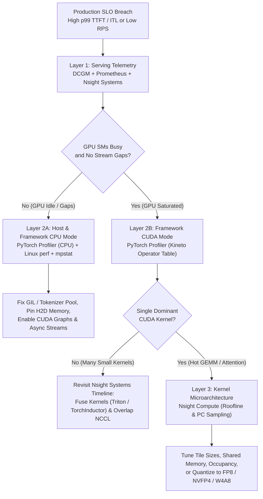

# 15.13 Profiling, debugging and tuning inference at scale

| Field | Value |
|---|---|
| Level | Advanced |
| Priority tier | 1 |
| Lab venue | GCP / GKE + Local Python Verification Lab |
| Part | Part 15: LLM inference and serving |
| Primary sources | *AI Systems Performance Engineering* Chapters 4, 12, 13, 15, 16, 19; *Hands-On LLM Serving and Optimization* Chapters 2, 5, 10; *Distributed AI Systems* Chapters 6, 7, 10; *AI Engineering* Chapter 9; NVIDIA Zero-to-Hero Volume 12 (`chapter-01..12`, `labs/lab-04-troubleshoot-a-slow-inference-pipeline.md`, `index.md`) |
| Cross-references | Chapter 10.18 (CUDA Graphs); Chapter 10.20 (PyTorch profiling and memory allocators); Chapters 15.2–15.5 (Batching, vLLM, SGLang, TensorRT-LLM); Chapters 15.8–15.12 (Disaggregated serving, multi-node inference, adaptive engine optimizations) |
| Code | `code/part15/profiling_debugging_inference.py`, `code/part15/profiling_debugging_inference_lab.py` |
| Coverage file | `planning/coverage/chapters/15-13.md` |
| Claim & number ledger | `planning/ledgers/15-13.md` |

## Why this matters for AI infrastructure

Traditional stateless web services fail and slow down in predictable ways. Each microservice call performs roughly the same work and returns within a uniform time window. Large language model serving behaves very differently. A single inference endpoint receives short chat prompts alongside massive document digests. Each request transitions from a compute-bound prefill phase into a memory-bandwidth-bound autoregressive decode loop.

When tail latency spikes or throughput collapses across an LLM cluster, intuition often misleads engineers. Teams frequently assume the GPUs are saturated. Upon closer inspection, they discover that the Streaming Multiprocessors sit idle while a single host CPU core is pinned at 100% inside a Python tokenizer. In other incidents, `nvidia-smi` reports 100% GPU utilization while a deadlocked NCCL rank spins inside a busy-wait loop. That single deadlocked pod silently drops 12.5% of customer traffic into a black hole.

```text
Production Inference Profiling and Tuning Reference Benchmarks (ASP Chapters 13 & 16; HLS Chapters 5 & 10; Volume 12 Chapters 1-12 & Lab 04):
- Volume 12 Production SLO Targets:
  TTFT < 200 ms | ITL < 25 ms/tok | TPOT < 30 ms/tok | P99 Queue < 50 ms | KV Cache Util 70% - 85% | Model Load < 30 s
- 3-Layer Profiling Funnel (ASP Chapter 13 Tables 13-2..13-4):
  PyTorch Kineto top CUDA ops on 64-expert MoE: aten::matmul = 43.00 ms (128 calls) + aten::linear = 35.50 ms (64 calls) = 78.50 ms; dispatch (18.70 ms) + combine (12.10 ms) = 30.80 ms
  Nsight Systems CUPTI GPU projection (nvtx_gpu_proj_sum): train_step = 138.0 ms (60.5 ms forward + 58.3 ms backward + 19.2 ms optimizer_step across 130 kernel calls)
  Nsight Compute Roofline: baseline 50% FLOPS / 70% DRAM BW / 60% occupancy (memory-bound) -> optimized 85% FLOPS / 40% DRAM BW / 80% occupancy (compute-bound)
  Linux perf on Grace-Blackwell: 1.58 IPC vs 8.0 max Neoverse V2 IPC; 45.0% py::forward, 20.5% aten::matmul, 10.2% dataloader, 8.7% ncclAllReduce, 5.3% read
- Host CPU and GIL Bottlenecks (Volume 12 Chapter 2 & Lab 04):
  Lab 04 unfixed single-threaded CPU preprocessing: 14.85 s (13.47 RPS), total p99 = 1,410.20 ms (CPU p99 = 1,395.80 ms, Triton GPU p99 = 18.10 ms at < 20% SM util)
  Lab 04 ProcessPoolExecutor remediation: 1.92 s (104.17 RPS, 7.73x gain), total p99 = 44.80 ms (31.48x p99 reduction); --cpus="0.5" CFS throttle spikes p99 > 3,500 ms
  Python GIL BPE tokenizer: 320.0 ms (77.1% of 415.0 ms) at 120 RPS -> 16-thread Rust tokenizer 1.4 ms (228.6x faster) and 780 RPS (6.5x gain)
- Scheduling, KV Cache Preemption, and Multi-GPU Collectives (ASP Chapter 16 Tables 16-5..16-7; Volume 12 Chapters 5, 7, 8, 9, 11):
  20K prompt chunked prefill (4 x 5K chunks): attention QK ops [12.5M, 37.5M, 62.5M, 87.5M] sum to 200M (exact T(20K) = 200,010,000); bounds max stall per step without changing total FLOPs
  Latency-aware scheduling on 2 GPUs for [6K, 2K, 6K, 2K, 2K, 2K]: cuts critical-path QK ops from 38,007,000 (FIFO) to 22,005,000 (42.10% reduction)
  PCIe Gen4 (64 GB/s) 4 GB KV swap: 62.5 ms one-way / 125.0 ms round-trip, spiking p99 ITL from 20.0 ms to 850.0 ms (42.5x); recompute wins for S < 8,192
  80-layer Llama-3-70B TP=8: 160 AllReduces/token (8,000/s at 50 tok/s); NVSwitch ITL = 18.4 ms vs 115.0 ms naive (6.25x); XID 62 DB-ECC deadlock blackholes 12.5% (1/8) of traffic
```

**Metrics, hardware counters, and timeline traces are the only ground truth in a production inference cluster.** Operating at scale requires a disciplined observe-hypothesize-tune loop. That workflow connects high-level Prometheus alerts to framework operator breakdowns and microarchitectural GPU counters. Before changing batch sizes, quantization formats, or parallelism degrees, profile the end-to-end request path to prove which stage actually owns the latency budget.

## Prerequisites and outcomes

### Prerequisites
- Review CUDA Graph capture, PyTorch Profiler, and CUDA memory allocators from Part 10.
- Review continuous batching, PagedAttention, RadixAttention, and TensorRT-LLM execution from earlier chapters in Part 15.
- Review disaggregated prefill and decode, multi-node inference parallelism, and adaptive engine optimizations from recent chapters in Part 15.

### Outcomes
- Execute the three-layer inference profiling funnel across Prometheus and DCGM telemetry, Nsight Systems timelines, PyTorch Kineto operator tables, Nsight Compute Roofline reports, and Linux `perf` call graphs.
- Diagnose Time To First Token spikes versus Inter-Token Latency stalls using Roofline arithmetic intensity, chunked prefill triangular attention math, and latency-aware batch reordering.
- Isolate and remediate host CPU scheduling bottlenecks, Python GIL tokenization locks, container CFS quota throttling, pageable PCIe transfer stalls, and Server-Sent Events socket buffering.
- Debug KV cache preemption storms, PCIe swap thrashing, prefix-cache eviction anomalies, and PyTorch caching allocator memory fragmentation.
- Triage multi-GPU NCCL AllReduce tail latency, Mixture-of-Experts all-to-all stragglers, CUDA Graph capture and replay bugs, hardware XID deadlocks, and full-stack quantization and application-level guardrails.

---

## 1. The Three-Layer Inference Profiling Funnel and Observability Stack

### 1.1 The Observe-Hypothesize-Tune Loop and Three-Layer Profiling Funnel

Modern inference clusters combine API gateways, asynchronous tokenizers, continuous batching schedulers, PagedAttention block allocators, and multi-GPU collectives. When tail latency breaches its Service Level Objective, running a heavyweight kernel profiler blindly across hundreds of nodes wastes hours. It also perturbs live customer traffic.

Effective performance engineering follows an iterative **observe-hypothesize-tune loop**. That workflow is organized as a three-layer funnel.
1. **Serving Layer:** Always-on Prometheus scrapers, NVIDIA Data Center GPU Manager exporters, and OpenTelemetry spans track request-level TTFT, ITL, TPOT, queue depth, KV cache occupancy, and hardware health counters. When an optimization is ready, validate it via canary rollouts on a small traffic slice before cluster-wide promotion.
2. **Framework Layer:** When serving telemetry flags a regression, capture a targeted window with PyTorch Profiler and Linux `perf`. Use CPU mode to spot Python interpreter overhead or GIL locks. Use CUDA mode to rank high-level ATen operators by total GPU execution time.
3. **Runtime and Microarchitecture Layer:** Use NVIDIA Nsight Systems to inspect microsecond-level timelines across CPU threads, CUDA streams, DMA copy engines, and NCCL collectives. Once Nsight Systems or Kineto isolates a single dominant CUDA kernel, use NVIDIA Nsight Compute or low-overhead CUDA Program Counter Sampling to inspect warp stall reasons, achieved occupancy, and Roofline utilization.



### 1.2 Production Telemetry with DCGM, Prometheus, and Alertmanager Rules

Because LLM request durations vary widely across prompt lengths, average latency hides severe tail degradation. Production dashboards must correlate application percentiles for TTFT and ITL with engine counters and hardware telemetry exported by DCGM.

At the engine layer, track active queue depth via `vllm:num_requests_waiting`, KV cache saturation via `vllm:gpu_cache_usage_perc`, and preemption counts via `vllm:num_preemptions_total`. Measure prefix cache effectiveness by dividing `vllm:gpu_prefix_cache_hits` by `vllm:gpu_prefix_cache_queries`. At the hardware layer, DCGM exposes SM active ratio, DMA copy engine utilization, framebuffer memory, power draw, thermal and power clock-throttle bitmasks, XID faults, and per-link NVLink bandwidth.

| Metric or Hardware Counter | Alert Condition | Severity | Diagnostic Meaning and Immediate Triage Action |
|---|---|---|---|
| GPU SM Utilization (`DCGM_FI_DEV_GPU_UTIL`) | `< 10%` for `> 60 s` | Idle | GPU starved by upstream CPU tokenization, I/O wait, or deadlocked NCCL rank. |
| GPU SM Utilization (`DCGM_FI_DEV_GPU_UTIL`) | `> 90%` sustained | Bottleneck | Compute or bandwidth saturation; cap batch size at 90% headroom or scale replicas. |
| GPU Memory Usage (`DCGM_FI_DEV_FB_USED`) | `> 80%` / `> 95%` | Warning / Critical | Approaching KV cache exhaustion and OOM; lower memory fraction or enable FP8 KV cache. |
| GPU Temperature | `> 85 °C` / `> 95 °C` | Warning / Critical | Approaching thermal slowdown or hardware shutdown; check liquid cooling or cap clocks (`nvidia-smi -lgc`). |
| NVLink Replay / Recovery Errors | `>= 1` | Critical | Physical link retry on NVSwitch fabric; inspect `nvidia-smi nvlink` and reseat or drain node. |
| NVLink CRC Errors | `> 100 errors/sec` | Critical | High cyclic redundancy check failure rate degrading TP AllReduce tail latency. |
| PCIe Replay Errors | `>= 1` | Critical | Packet retries on host-device PCIe bus; check riser cards and NUMA socket affinity. |
| Uncorrectable ECC Errors (`XID 62`) | `>= 1` | Critical | Double-bit HBM corruption; immediately cordon, drain, and reset GPU (`nvidia-smi --gpu-reset`). |

Combining metrics exposes root causes that single counters miss. Suppose SM utilization drops below thirty percent while copy engine utilization spikes above eighty percent and framebuffer memory sits near ninety-five percent. The inference engine is not idle from low traffic. Instead, it is thrashing the PCIe bus by swapping KV cache pages between GPU HBM and host DRAM.

### 1.3 NVTX Instrumentation, CUPTI Projection, and Nsight Systems / Compute

When you step down from cluster dashboards into Nsight Systems and PyTorch Profiler, raw timelines contain thousands of cryptic kernel names. Instrumenting the runtime with **NVIDIA Tools Extension** range markers labels logical serving stages directly on the timeline.

In C++ serving backends, use the NVTX C API (`nvtxRangePushEx` and `nvtxRangePop`) with explicit ARGB color codes. Using the C API directly rather than Python wrappers ensures markers carry zero overhead when no profiler is attached. Always name distinct CUDA streams with `nvtxNameCudaStreamA` so host enqueue ranges align visually with the corresponding GPU hardware stream lanes.

```cpp
// C++ NVTX v3 instrumentation for prefill/decode and multi-stream overlap (ASP Ch. 16)
#include <nvtx3/nvToolsExt.h>

#define NVTX_PUSH(name, argb)                                      \
  do {                                                             \
    nvtxEventAttributes_t a{};                                     \
    a.version = NVTX_VERSION;                                      \
    a.size = NVTX_EVENT_ATTRIB_STRUCT_SIZE;                        \
    a.colorType = NVTX_COLOR_ARGB;                                 \
    a.color = static_cast<unsigned int>(argb);                     \
    a.messageType = NVTX_MESSAGE_TYPE_ASCII;                       \
    a.message.ascii = (name);                                      \
    nvtxRangePushEx(&a);                                           \
  } while (0)
#define NVTX_POP() do { nvtxRangePop(); } while (0)

void instrument_streams_and_steps(cudaStream_t transfer_stream, cudaStream_t compute_stream) {
  nvtxNameCudaStreamA(transfer_stream, "transfer_stream");
  nvtxNameCudaStreamA(compute_stream, "compute_stream");

  NVTX_PUSH("Prefill", 0xFF4F86F7);
  // Launch context FMHA and MLP GEMMs on compute_stream
  NVTX_POP();

  NVTX_PUSH("Decode", 0xFFFF8C00);
  // Launch single-token decode step while overlapping D2H logit copy on transfer_stream
  NVTX_POP();
}
```

Because CPU threads enqueue CUDA kernels asynchronously, a host NVTX range might finish in fifty microseconds while its launched GPU kernels run for tens of milliseconds. When you run `nsys stats --report=nvtx_gpu_proj_sum`, Nsight Systems uses the **CUDA Profiling Tools Interface** to project asynchronous GPU kernel start and end timestamps back onto the host NVTX intervals that launched them.

```text
Multi-Layer Profiling Breakdown on a 64-Expert MoE Workload (ASP Chapter 13 Tables 13-2..13-4):
1. PyTorch Profiler (Kineto) Top 10 CUDA Operators (sort_by="self_cuda_time_total"):
   - aten::matmul:      43.00 ms (128 calls: 64 experts x 2 passes)
   - aten::linear:      35.50 ms ( 64 calls) -> Combined GEMM time = 78.50 ms
   - dispatch:          18.70 ms (  2 calls: token-to-expert shuffle)
   - combine:           12.10 ms (  2 calls: expert output gather) -> Combined MoE comm = 30.80 ms
   - aten::layer_norm:  10.20 ms ( 16 calls) | aten::softmax: 5.70 ms (4 calls)
   - aten::scatter:      4.10 ms ( 16 calls) | aten::gather:  3.60 ms (16 calls)
   - aten::to:           2.90 ms (  8 calls) | aten::add_:    2.20 ms (64 calls)

2. Nsight Systems NVTX GPU Projection Summary (nsys stats --report=nvtx_gpu_proj_sum):
   - train_step:     Total GPU = 138.0 ms | Self GPU =  0.0 ms | Child GPU = 138.0 ms | Instances =   1
   - forward:        Total GPU =  60.5 ms | Self GPU = 60.5 ms | Child GPU =   0.0 ms | Instances = 130
   - backward:       Total GPU =  58.3 ms | Self GPU = 58.3 ms | Child GPU =   0.0 ms | Instances = 130
   - optimizer_step: Total GPU =  19.2 ms | Self GPU = 19.2 ms | Child GPU =   0.0 ms | Instances =   1 (brackets 64 aten::add_ launches)
   - Projected Subrange Sum: 60.5 ms + 58.3 ms + 19.2 ms = 138.0 ms (exact match across tools)

3. Nsight Compute (ncu) GEMM Roofline Before vs After Fusion & Precision Tuning:
   - Baseline GEMM:  50% of peak FLOPS | 70% of peak DRAM BW | 60% achieved occupancy -> Memory-bound (stalling on HBM transfers)
   - Optimized GEMM: 85% of peak FLOPS | 40% of peak DRAM BW | 80% achieved occupancy -> Compute-bound (near hardware Roofline)

4. Linux perf Host CPU & Grace-Blackwell NVLink-C2C PMU Analysis:
   - perf stat: 0.600 CPUs utilized, 1,200.345 msec task-clock, 2,400,567,890 cycles, 3,800,123,456 instructions
   - Measured IPC = 1.58 instructions/cycle vs 8.0 max theoretical IPC on ARM Neoverse V2 (Grace CPU); 0.32% cache misses, 0.12% branch misses
   - perf record -F 2000 -g --call-graph dwarf hotspots:
     45.0% py::forward | 20.5% aten::matmul | 10.2% dataloader_iter_next | 8.7% ncclAllReduce | 5.3% read syscalls
```

On live production servers where full Nsight Compute kernel replay would halt traffic, enable **Nsight Compute CUDA Program Counter Sampling** first. That mode localizes instruction-level stalls with minimal overhead. When profiling on Grace-Blackwell superchips, set the kernel module parameter `NVreg_RestrictProfilingToAdminUsers=0`. That setting allows non-root engineers to access CUPTI SM counters alongside Linux `perf` NVLink-C2C PMU events. Always start your investigation with low-overhead telemetry and narrow your scope before invoking per-kernel replay.

---

## 2. Diagnosing TTFT Spikes vs ITL / TPOT Stalls and Latency-Aware Scheduling

### 2.1 Prefill vs Decode Roofline Mechanics

To diagnose why an inference service violates its latency targets, you must first separate **Time To First Token** from **Inter-Token Latency** and **Time Per Output Token**. Those two metrics measure two completely different hardware regimes on the GPU Roofline chart.

Consider multiplying an activation matrix of shape `s` by `h` against a weight matrix of shape `h` by `h` in FP16 precision. Dividing total floating-point operations by HBM byte traffic yields the arithmetic intensity.

| Sequence Length (`s`) | Hidden Dimension (`h`) | Prefill Arithmetic Intensity (`FLOPS/B`) | Decode Arithmetic Intensity (`s = 1`, `FLOPS/B`) | Roofline Regime on NVIDIA L40S (`419 FLOPS/B` Ridge Point) |
|---|---|---|---|---|
| 64 | 4,096 | 62.06 | ~1.00 | Memory-bandwidth-bound for both prefill and decode. |
| 512 | 4,096 | 409.60 | ~1.00 | Near Roofline knee (`419 FLOPS/B`) for prefill; memory-bound for decode. |
| 4,096 | 4,096 | 1,365.33 | ~1.00 | Strongly compute-bound on prefill; strictly memory-bound on decode. |

On an NVIDIA L40S GPU delivering 362 TFLOPS of compute and 864 GB/s of memory bandwidth, the Roofline ridge point sits at 419 FLOPS/Byte. On an H100 SXM, the ridge point sits at 295.4 FLOPS/Byte. When sequence length reaches four thousand ninety-six during prefill, arithmetic intensity reaches 1,365.33 FLOPS/Byte, which is more than triple the ridge point. **TTFT spikes are therefore compute-bound, queueing-bound, or prefix-cache-bound.** Conversely, single-request decoding has an arithmetic intensity of roughly one FLOP per byte. **ITL and TPOT stalls are memory-bandwidth-bound, host-launch-bound, or stalled behind a colocated prefill burst.**

### 2.2 Stall-Free Scheduling (Chunked Prefill) and Triangular Attention Math

In a colocated continuous batching server, a single incoming long prompt can freeze every active decode stream on the GPU. In our production incident on a four-GPU H100 node serving forty-five concurrent chat streams, a single 12,288-token prefill burst monopolized the GPU for 320 ms. That burst spiked tail ITL from 18.0 ms to 340.0 ms.

Enabling **stall-free scheduling**, also known as chunked prefill, splits long prompts into fixed token chunks and interleaves them with active decode steps. Setting `--enable-chunked-prefill` with a token budget of 2,048 tokens restored tail ITL to 21.4 ms. However, over-chunking with a budget of 512 tokens triggered 450 kernel context switches per second. That excessive switching degraded tail ITL from 28.0 ms to 45.0 ms and inflated TTFT from 180.0 ms to 320.0 ms.

A critical insight from *AI Systems Performance Engineering* is that **chunked prefill smooths per-iteration latency and improves overlap, but it does not reduce total self-attention FLOPs**. Because causal self-attention is lower-triangular, a prompt of length N performs `N * (N + 1) / 2` query-key dot products per head per layer. For a twenty-thousand-token prompt, that equals 200,010,000 exact operations. When you split that prompt into four equal chunks, each subsequent chunk must still attend to all previously cached KV chunks.

| Chunk Size | Number of Chunks | Per-Chunk Self-Attention QK Dot Products (`~N^2 / 2`) | Cumulative Attention Ops | Total MLP Tokens Processed |
|---|---|---|---|---|
| `20K` (`20,000`) | 1 | `200.0M` (`200,010,000` exact) | `200.0M` | `1 x 20K = 20K` |
| `10K` (`10,000`) | 2 | `50.0M + 150.0M` | `200.0M` | `2 x 10K = 20K` |
| `5K` (`5,000`) | 4 | `12.5M + 37.5M + 62.5M + 87.5M` | `200.0M` | `4 x 5K = 20K` |

The four five-thousand-token chunks perform 12.5M, 37.5M, 62.5M, and 87.5M attention operations, summing to the exact same 200.0M total as the unchunked pass. Chunking bounds the worst-case single-step stall to 87.5M operations instead of 200.0M. That cap allows decode tokens to piggyback on every chunk without head-of-line blocking.

### 2.3 Latency-Aware Scheduling vs FIFO Queueing

Even with variable-length fused attention kernels such as FlashAttention or cuDNN SDPA, naive First-In-First-Out batching creates severe load imbalance across multi-GPU replicas. Self-attention scales quadratically with sequence length while MLP layers scale linearly. Mixing two long prompts into the same GPU batch therefore creates a massive straggler.

Consider a scenario where six prompts of lengths six thousand and two thousand tokens arrive simultaneously at a two-GPU serving node.

```text
FIFO vs Latency-Aware Batch Scheduling Across 2 GPUs (ASP Chapter 16 Tables 16-6 & 16-7):
Exact Triangular Self-Attention Formula: T(N) = N * (N + 1) / 2
- T(2,000) = 2,000 * 2,001 / 2 =  2,001,000 QK dot products
- T(6,000) = 6,000 * 6,001 / 2 = 18,003,000 QK dot products (9.0x heavier than a 2K prompt!)

1. Naive FIFO Scheduler (splits by arrival order):
   - GPU 1 Batch [6K, 2K, 6K]: 18,003,000 + 2,001,000 + 18,003,000 = 38,007,000 QK ops | 14,000 MLP tokens
   - GPU 2 Batch [2K, 2K, 2K]:  2,001,000 + 2,001,000 +  2,001,000 =  6,003,000 QK ops |  6,000 MLP tokens
   - Cluster Critical Path (GPU 1): 38,007,000 QK ops (6.33x imbalance across GPUs)

2. Latency-Aware Scheduler (reorders and balances by T(N) and shortest-job-first):
   - GPU 1 Batch [2K, 2K, 6K]:  2,001,000 + 2,001,000 + 18,003,000 = 22,005,000 QK ops | 10,000 MLP tokens
   - GPU 2 Batch [2K, 2K, 6K]:  2,001,000 + 2,001,000 + 18,003,000 = 22,005,000 QK ops | 10,000 MLP tokens
   - Cluster Critical Path: 22,005,000 QK ops -> 42.10% (~42%) critical-path reduction!
```

The latency-aware scheduler balances quadratic attention weight across both GPUs and orders the lighter prompts ahead of the heavier prompt inside each batch. That reordering cuts critical-path self-attention work by **42.10%** and lets short requests enter decoding immediately. Always size your chunked prefill token budget and router queues using quadratic attention cost rather than raw request counts.

---

## 3. Host CPU Scheduling Overhead, GIL Bottlenecks, and Streaming I/O Stalls

### 3.1 Deconstructing Non-GPU Latency: Python GIL and Single-Threaded Preprocessing

Across production inference deployments, **up to 60% of end-to-end request latency can occur outside the GPU**. Non-GPU time accumulates across TLS ingress, CPU tokenization, tensor serialization, PCIe transfers, and SSE socket flushing. When clients report tail latency violations while `nvidia-smi dmon` shows GPU SM utilization below twenty percent, the bottleneck lies in the host control plane.

In our tokenization benchmark, a single-process Python BPE tokenizer locked by the **Python Global Interpreter Lock** consumed 320.0 ms out of 415.0 ms total request latency. That single-threaded lock accounted for 77.1% of the request budget and capped throughput at 120 RPS. Offloading tokenization to a sixteen-thread native Rust and C++ tokenizer pool dropped tokenization latency to 1.4 ms, a 228.6x speedup, and lifted cluster throughput to 780 RPS.

We see the exact same signature in our pipeline troubleshooting lab across two hundred concurrent requests against NVIDIA Triton Inference Server.

| Pipeline Configuration | Total Test Duration (`s`) | Throughput (`RPS`) | Total Pipeline `p99` (`ms`) | CPU Preprocess `p99` (`ms`) | Triton GPU Infer `p99` (`ms`) | Host & GPU Hardware Evidence |
|---|---|---|---|---|---|---|
| Unfixed (`ThreadPoolExecutor` + GIL lock) | 14.85 | 13.47 | 1,410.20 (`mean 585.40`) | 1,395.80 (`mean 572.10`) | 18.10 (`mean 11.80`) | `mpstat -P ALL`: Core 0 at `100.0% %usr`, Cores 1–7 at `99.0% %idle`; GPU `sm% < 20%`. |
| Remediated (`ProcessPoolExecutor` multi-core) | 1.92 | 104.17 (`7.73x`) | 44.80 (`31.48x` faster) | 31.00 (`mean 25.40`) | 13.50 (`mean 11.20`) | All 8 CPU cores balanced; Triton `nv_inference_queue_duration_us < 2 ms`. |
| Container CFS Quota Throttled (`--cpus="0.5"`) | > 66.0 | < 3.00 | > 3,500.00 | > 3,480.00 | ~15.00 | Linux `cgroup` CFS throttles worker threads; GPU sits at `0%` SM utilization. |

### 3.2 vLLM V1 Process Decoupling, Pinned PCIe Transfers, and SSE Streaming Flow Control

Multimodal Vision-Language Models amplify host CPU bottlenecks. High-resolution images must be decoded, resized, normalized, and expanded into placeholder tokens, such as 644 image pad tokens, before GPU prefill begins. To prevent host work from stalling kernel launches, **vLLM V1 decouples the runtime into two isolated OS processes connected via ZeroMQ IPC**.
- **Frontend and Multimodal Process:** Runs the HTTP and gRPC API server, fast tokenization, CPU-heavy vision preprocessing, and output detokenization asynchronously.
- **Dedicated GPU Engine Process:** Runs the continuous batching scheduler, PagedAttention block manager, and CUDA Graph launch loop on an isolated CPU core without ever waiting on HTTP sockets or image decoding.

Once host tensors are ready, copying them from standard pageable host memory over a PCIe Gen5 bus achieves only 12.0 GB/s nominal bandwidth. Pageable transfers are slow because the CUDA driver must stage data through an internal page-locked buffer. Allocating host buffers in **pinned memory** via `cudaHostAlloc` or `pin_memory=True` allows the GPU DMA copy engine to read host RAM directly on a dedicated transfer stream. That pinned path reaches 58.5 GB/s nominal bandwidth and delivers a **4.88x transfer speedup**.

On the egress path, human readers process two hundred to three hundred words per minute. That reading pace corresponds to **4 to 7 tokens per second**, or up to **13 tokens per second** for fast readers. If a hundred-token response generates at twenty tokens per second, waiting for full completion forces the user to stare at a blank screen for 5.0 seconds. Streaming batches of five tokens over Server-Sent Events delivers the first chunk in 0.25 seconds. When tuning streaming egress in production, enforce three network guardrails.
1. **Disable Nagle's algorithm and proxy buffering:** The interaction between Nagle's algorithm and TCP delayed ACKs adds up to 200 ms of packet stall. Default Nginx response buffering also stalls SSE token delivery for 600 ms. Always set `TCP_NODELAY` and `proxy_buffering off`.
2. **Bound slow-client backpressure buffers:** A mobile client on a lossy connection can advertise a zero TCP receive window. Maintain an asynchronous network sender thread with a bounded buffer of **50 to 100 tokens** per request. If a slow or disconnected client overflows that cap, abort generation and reclaim the KV cache blocks immediately.
3. **Debounce duplicate submissions:** Add a **2 to 5 ms debouncing window** at the gateway to coalesce accidental double-clicks or rage-click resubmissions before they consume GPU prefill compute.

Always profile CPU core utilization, PCIe DMA copy lanes, and socket flush latencies before blaming GPU kernels for slow responses.

---

## 4. KV Cache Thrashing, Preemption Debugging, and Memory Fragmentation Triage

### 4.1 Diagnosing Preemption Storms: Recompute vs PCIe Swap Thrashing

In an LLM serving cluster, High-Bandwidth Memory is shared between static model weights, runtime activation workspaces, and the dynamic Key-Value cache. For an eighty-layer seventy-billion-parameter model using Grouped-Query Attention with eight KV heads of dimension one hundred twenty-eight, each token consumes 327,680 bytes. That equals **320 KiB per token** in half precision, or **160 KiB per token** in eight-bit precision, compared to 2.56 MiB per token under standard Multi-Head Attention. A single four-thousand-ninety-six-token sequence occupies 1.25 GiB, or 1.31 GB, of half-precision KV cache.

When concurrent sequences grow longer than expected and `vllm:gpu_cache_usage_perc` reaches one hundred percent, the continuous batching scheduler can no longer allocate new physical blocks for the next decode token. To prevent a hard CUDA Out-of-Memory crash, the scheduler preempts the lowest-priority running request using one of two policies.
1. **Recomputation:** Evicts the victim request's KV blocks immediately via `PreemptionMode.RECOMPUTE` and returns the request to the waiting queue. When memory frees up, the engine re-runs the full prefill forward pass on the original prompt plus all previously generated tokens.
2. **Host-Device Swapping:** Copies the victim request's KV blocks across the PCIe bus into pinned host CPU RAM via `--swap-space` and pages them back into GPU HBM when the sequence resumes.

```text
Production Log and Telemetry Evidence for KV Preemption and Prefix Routing (ASP Chapter 16; Volume 12 Chapters 7 & 8):
1. vLLM KV Cache Preemption Log Warning:
   WARNING 2025-05-03 14:22:07 scheduler.py:1057 Sequence group 0 is preempted by
   PreemptionMode.RECOMPUTE because not enough KV cache space.
   total_cumulative_preemption_cnt=1

2. PCIe Swap Thrashing Math on 4 GB Evicted KV Cache (PCIe Gen4 x16 = 64 GB/s):
   - One-way swap-out latency:   4.0 GB / 64.0 GB/s =  62.5 ms
   - Round-trip swap-out + in:   2 * 4.0 GB / 64.0 GB/s = 125.0 ms per preemption cycle
   - Production Impact (Volume 12 Ch. 8): At 4.2 preemptions/s with --swap-space 32,
     DCGM_FI_DEV_MEM_COPY_UTIL saturates while p99 ITL spikes from 20.0 ms to 850.0 ms (42.5x degradation)!
   - Recompute vs Swap Crossover: For sequence lengths S < 8,192 tokens on Hopper H100 (989 TFLOPS),
     recomputing prefill in Tensor Cores is faster than round-trip PCIe swapping.

3. NVIDIA Dynamo KVRouter Prefix-Cache Hit vs Miss Dispatch Log:
   [Router] 2025-05-03T14:23:11Z INFO KVRouter: prefix-cache hit (90%) for
   model=DeepSeek-R1; routing to local vLLM worker
   [Router] 2025-05-03T14:23:12Z INFO KVRouter: cache miss; dispatching remote
   prefill to GPU-node-03
```

### 4.2 Prefix Cache Anomalies and PyTorch Caching Allocator Fragmentation

Prefix caching in vLLM and RadixAttention in SGLang eliminate redundant prefill compute when requests share system prompts, few-shot examples, or multi-turn chat histories. Asking ten separate questions over the same long document encodes the document once and reuses its KV blocks across the remaining nine queries. That reuse delivers a **10x prefill speedup**.

However, prefix caching introduces two subtle failure modes that require active monitoring of the prefix cache hit ratio.
- **Shard routing skew and tokenizer mismatch.** A load balancer using round-robin routing instead of prefix-aware hashing will scatter matching prompts across different workers. Upstream services that inject dynamic timestamps at the start of the system prompt also cause prefix hashes to miss and push hit rates below 60%.
- **Radix tree eviction thrashing on zero-overlap bursts.** In our prefix caching incident, a burst of non-overlapping unit-test prompts hit SGLang at a static memory fraction of 0.85. That burst forced RadixAttention to spend heavy CPU cycles splitting and evicting LRU radix-tree leaves on every step, spiking tail TTFT by **400%**. Raising `--mem-fraction-static` to 0.92 or disabling the radix cache for zero-overlap batch jobs restored TTFT to 22.0 ms.

PagedAttention reduces KV block fragmentation from **20% to 30% down to under 4%**, leaving just 12 unused slots across 32 blocks for a five-hundred-token sequence. Outside the PagedAttention KV pool, however, variable-length prefill activations and MoE token-routing buffers can severely fragment **PyTorch's CUDA caching allocator**. When free HBM drops over a day or two while active request count stays flat, tune `PYTORCH_CUDA_ALLOC_CONF` and capture an allocator snapshot.

```bash
# Prevent PyTorch caching allocator fragmentation on variable-length LLM / MoE workloads (ASP Ch. 13 & V12 Ch. 11)
export PYTORCH_CUDA_ALLOC_CONF="max_split_size_mb:256,roundup_power2_divisions:[256:1,512:2,1024:4,>:8],backend:cudaMallocAsync,expandable_segments:True"
```

Setting `max_split_size_mb:256` prevents the allocator from splintering large contiguous blocks above 256 MB. Specifying `roundup_power2_divisions` divides the five-hundred-twelve-megabyte to one-gigabyte range into two equal sub-buckets. A 600 MB activation request therefore rounds up deterministically to **768 MB** for immediate reuse across iterations. Enabling `expandable_segments:True` and `backend:cudaMallocAsync` allows virtual memory segments to grow and return unused pages to the driver without synchronous stalls. Always inspect allocator snapshots via `_record_memory_history` and `_dump_snapshot` before blindly shrinking batch sizes on OOM errors.

---

## 5. Multi-GPU NCCL Tail Latency, CUDA Graph Bugs, and Hardware Fault Triage

### 5.1 Diagnosing NCCL AllReduce and MoE AllToAll Tail Latency

When a model is sharded with Tensor Parallelism across multiple GPUs, every Transformer layer executes **two synchronous AllReduce collectives** on the critical path. An eighty-layer model therefore executes **160 synchronous AllReduces per generated token**, or **8,000 AllReduces per second** at a streaming rate of fifty tokens per second. At eight-way Tensor Parallelism, each ring AllReduce executes 14 sequential transfer steps and moves 28,672 bytes per rank per call for a single token.

On an eight-GPU H100 SXM node connected via NVSwitch at 900 GB/s per GPU, TensorRT-LLM combines custom two-shot AllReduce with FlashDecoding. At one hundred fifty concurrent sessions, those kernels cut ITL from 115.0 ms down to **18.4 ms**, delivering a **6.25x speedup**. If Tensor Parallelism accidentally spills across nodes over PCIe at 64 GB/s or Ethernet TCP at 12.5 GB/s, those barriers add **50 ms to 200 ms per token**. The GPUs then sit stalled on network waits for over ninety percent of execution time.

In Mixture-of-Experts serving, token dispatch and combine rely on all-to-all collectives. You should log and alert whenever an all-to-all exchange exceeds **5.0 ms**. If a degraded NIC or congested switch port slows down one expert GPU, raise the MoE **capacity factor to 1.2 to 1.5**. That setting allows twenty to fifty percent overflow tokens, expanding a 32-token base cap to 38 to 48 tokens so excess traffic spills over to a secondary expert replica on a healthy network rail. You should also enable InfiniBand **SHARP** in-network reductions for a **10% to 20% throughput gain** on large collectives.

### 5.2 Debugging CUDA Graph Capture, Replay, and Numerical Bugs

While CUDA Graphs eliminate host launch gaps, improper stream isolation or dynamic tensor mutations cause subtle crashes or silent output corruption.
1. **Illegal operations during stream capture:** Allocating new GPU memory, evaluating host conditionals on GPU tensors, or launching work on an uncaptured stream while capture is active raises `operation not permitted when stream is capturing`. Fix this by running warm-up steps on a dedicated capture stream and synchronizing before and after graph capture. Use `CUDAPluggableAllocator` with `ncclMemAlloc` and `torch.cuda.MemPool` for zero-copy NCCL buffers.
2. **Unsynchronized output reads and in-place weight updates:** Because `g.replay()` executes asynchronously and overwrites `static_output` in place, reading `static_output` without stream synchronization or cloning returns half-written garbage. Similarly, modifying weights outside the graph without recapturing leaves the graph pointing to stale HBM addresses. Pass `--enforce-eager` in vLLM or `mode="max-autotune-no-cudagraphs"` in `torch.compile` to isolate whether a bug comes from graph capture.
3. **Memory corruption and silent NCCL dropouts:** Run `compute-sanitizer --tool memcheck` during staging tests to catch out-of-bounds kernel writes and shared-memory race conditions. In production, set `NCCL_DEBUG=WARN` to surface communication failure logs and poll `ncclCommGetAsyncError` with `ncclCommAbort` so a failed rank aborts cleanly instead of hanging the cluster.

### 5.3 The Zombie Pod Problem: Hardware XID 62 Deadlocks and Kubernetes Probes

The most dangerous failure mode in production LLM serving is the **Zombie Pod**. In our production reliability case study, an eight-GPU HGX node serving a seventy-billion-parameter model with eight-way Tensor Parallelism suffered an uncorrectable Double-Bit ECC memory error, **NVIDIA XID 62**, on the fourth GPU. The hardware fault deadlocked the CUDA context on that GPU. That single deadlocked device caused the remaining seven GPUs to spin forever at zero useful throughput inside their synchronous NCCL AllReduce barrier.

Because the Python HTTP server runs on the host CPU, it remained completely unaffected and kept returning HTTP success codes to naive Kubernetes health checks. The cluster load balancer continued sending **12.5%**, or one in eight, of all customer requests into that deadlocked pod until client connections timed out. Conversely, in our scaling incident, expanding a deployment from four to twelve replicas saturated shared NFS weight storage and added a 1.2-second I/O delay. That storage stall caused an aggressive one-second readiness probe on `/v1/models` to fail with a timeout, evicting all four healthy pods and causing a **cluster-wide outage**.

| Failure Scenario / Symptom | Root Cause & Telemetry Signature | Production Remediation and Guardrail |
|---|---|---|
| `SM utilization < 50%` (`ASP` Table 16-1) | Small batch sizes, unfused elementwise kernels, or upstream CPU GIL bottleneck. | Increase batch size, enable FlashAttention / cuDNN SDPA / Triton fused kernels, and profile with `nsys --trace=cuda,nvtx`. |
| `p95 latency > 200 ms` (`ASP` Table 16-1) | Decode-node hotspot, head-of-line prefill blocking (`340 ms` ITL), or degraded RoCEv2 link (`45,000 us` AllReduce, `TX_DROPPED: 428, RX_ERRORS: 156`). | Enable `--enable-chunked-prefill --max-num-batched-tokens 2048`, inspect router logs, enable speculative decoding, and verify `NCCL_NET_GDR_LEVEL=5` & PFC. |
| Readiness probe `504` cascade during HPA scale-out (`V12` Ch. 11) | `timeoutSeconds: 1` on `/v1/models` times out when new pods saturate shared NFS (`1.2 s` delay). | Separate `startupProbe` (`failureThreshold: 60, periodSeconds: 10` = `600 s`), `readinessProbe` (`/health`, `timeoutSeconds: 5`), and `livenessProbe` (`/ping`), and cache weights on local NVMe. |
| Zombie Pod `12.5%` request blackhole (`V12` Ch. 11) | GPU 3 suffers `XID 62` DB-ECC deadlock (`dmesg: NVRM: Xid 62`); TP=8 NCCL hangs while CPU HTTP server returns `200 OK`. | Deploy DCGM Exporter + Kubernetes Node Problem Detector (`Xid 62\|Xid 79\|Xid 92 -> CordonAndDrainNode`), drain node, and run `nvidia-smi --gpu-reset -i 3`. |
| FP8 `NaN` / garbage output spikes (`V12` Ch. 11) | Out-of-range activation outliers or corrupted `scale_inv` factors in custom FP8 GEMM or AllReduce kernels. | Alert on `NaN` token rate `> 0.01%`, isolate replica, and pass `--disable-custom-all-reduce` or recalibrate scales on `1,000` representative prompts. |

Never invoke a model forward pass inside a Kubernetes liveness probe, and always wire DCGM hardware XID alerts directly into automated node cordoning.

---

## 6. Full-Stack Quantization and Application-Level Tuning at Scale

### 6.1 Real-Time Inference Quantization: FP8, NVFP4, GPTQ, AWQ, SmoothQuant, and W4A8

Once profiling confirms that your kernels are memory-bandwidth-bound on weight reads or compute-bound on Tensor Core GEMMs, **quantization** delivers the largest single-node throughput leap. Reducing precision shrinks weight storage, slashes HBM bandwidth traffic per decode step, frees HBM for larger KV cache batches, and doubles or quadruples Tensor Core math rate.

| Precision & Quantization Scheme | Weight / Activation Bits | Memory Ratio vs FP16 | Throughput Speedup vs FP16 | Accuracy Retention & Calibration Mechanics (`ASP` Ch. 16 & 19) |
|---|---|---|---|---|
| `FP16` / `BF16` Baseline | `16-bit` / `16-bit` | `1.00x` | `1.0x` | Full baseline accuracy (`2.0x` faster than FP32 on Tensor Cores). |
| `FP8` (`E4M3` weights/acts, `E5M2` KV) | `8-bit` / `8-bit` | `0.50x` | `1.5x` (`2.0x` peak math) | `< 0.1%` accuracy loss; Transformer Engine static calibration or `amax` dynamic scaling. |
| `GPTQ` / `AWQ` (`W4A16` weight-only) | `4-bit` / `16-bit` | `0.25x` (`~4x` smaller) | `~2.0x` | `99%+` accuracy retained; GPTQ uses 2nd-order Hessian PTQ; AWQ scales salient activation channels. |
| `SmoothQuant` (`W8A8` INT8) | `8-bit` / `8-bit` | `0.50x` | `~1.6x–1.9x` | `< 1.0%` accuracy loss; shifts activation outliers to weights via per-channel mathematical scaling. |
| Hybrid `W4A8` (`INT4` weights + `FP8` acts) | `4-bit` / `8-bit` | `0.25x` | `1.8x+` | Unpacks `INT4` weights and dequantizes to `FP8` in registers via **fused quant-dequant kernels** for `FP8` Tensor Cores. |
| `NVFP4` (`FP4` with Block-32 microscaling) | `4-bit` / `4-bit` or `8-bit` | `~0.20x` (`1.8x` vs FP8, `3.5x` vs FP16) | `up to 3.5x` | Hardware per-block microscaling (`1` scale per `32` elements) in Blackwell Transformer Engine preserves dynamic range. |

When applying Post-Training Quantization, calibrate on a representative dataset of at least **1,000 production prompts** using percentile clipping or loss-aware scaling. Always **fuse quantize-dequantize steps directly into the GEMM prologue and epilogue** so separate conversion kernels do not erase your bandwidth savings.

### 6.2 Application-Level Optimizations and Production Capacity Guardrails

Beyond low-level kernels and quantization, five application-level and systems-level levers reduce cluster cost without touching model weights.
1. **Prompt compression and dialogue summarization:** Because prefill self-attention scales quadratically with token length, trimming input length yields quadratic compute savings. A standard production policy triggers when conversation history reaches **75% of the maximum context length** and summarizes the **oldest 25% of messages**. Compressing three thousand oldest tokens into a three-hundred-token summary shrinks a twelve-thousand-token prompt to 9,300 tokens. That reduction cuts triangular self-attention work from 72,006,000 down to 43,249,650 dot products, saving **39.94% of attention compute**.
2. **Prompt cleansing and learned config tokens:** Strip redundant HTML markup and whitespace before tokenization. For repeated system policies, fine-tune the model to recognize **config tokens**, replacing a **200-token natural-language system prompt with 10 special tokens** for a **20.0x prompt reduction**.
3. **Model cascading and tiered fallback routing:** Pair a fast seventy-billion-parameter model at 50 ms latency with a frontier seven-hundred-billion-parameter model at 500 ms latency and ten times the cost. Routing **60% of straightforward queries** to the smaller model cuts expected latency from 500.0 ms to **230.0 ms**, or 260.0 ms with a ten percent sequential fallback. That tiered architecture reduces compute cost by up to **5.0x**. During traffic surges, dynamically route free-tier users to the smaller model as graceful degradation.
4. **The 90% headroom buffer and warm spare capacity:** Never run production GPUs at full peak batch saturation. Small arrival jitters at the knee of the latency-throughput curve cause exponential queuing spikes and thermal clock throttling. Target **90% of peak throughput** by scaling max batch size back from 16 to 8, and maintain **10% to 15% prewarmed idle replica buffer capacity** during steady state.
5. **Token output limits and server timeouts:** Enforce a strict per-request output cap, such as **4,096 tokens** for chat completions, and a **30-second server-side timeout**. Those guardrails prevent runaway generations or adversarial prompts from monopolizing GPU KV blocks.

Combine application-level prompt hygiene and tiered routing with kernel-level profiling to minimize total cost per generated token.

---

## 7. Hands-on lab: End-to-end profiling, debugging, and tuning verification

### 7.1 Lab Venue and Production Diagnostic Commands

| Parameter | Specification |
|---|---|
| Lab venue | GCP / GKE (`a3-highgpu-8g` or `g2-standard-48`) + Local Python Verification Lab |
| Production CLI tools | `nsys`, `ncu`, `perf`, `mpstat`, `nvidia-smi dmon`, `compute-sanitizer`, `curl` (`:8000` / `:8002/metrics`) |
| Verification scripts | `code/part15/profiling_debugging_inference.py`, `code/part15/profiling_debugging_inference_lab.py` |

The following production diagnostic sequence captures Nsight Systems NVTX projections, Nsight Compute Roofline counters, Linux `perf` call graphs, and live CPU and GPU pipeline telemetry. This command block is a reference template and was **not run on live GPU hardware** during this documentation build.

```bash
# 1. Profile an inference / MoE worker with Nsight Systems and project GPU time onto NVTX ranges (ASP Ch. 13 & 16)
nsys profile --output=profile --stats=true -t cuda,nvtx python3 serve_worker.py
nsys stats --report=nvtx_gpu_proj_sum profile.nsys-rep

# 2. Run Nsight Compute Roofline analysis on the hot matmul / attention kernel (ASP Ch. 13)
ncu --target-processes all --kernel-name-regex "matmul" \
  --metrics gpu__time_duration.avg,gpu__dram_throughput.avg.pct_of_peak_sustained_elapsed,lts__throughput.avg.pct_of_peak_sustained_elapsed,sm__sass_thread_inst_executed_op_fp32_pred_on.sum,sm__warps_active.avg.pct_of_peak_sustained_active \
  --csv full -o matmul_roofline_report python3 serve_worker.py

# 3. Diagnose host CPU GIL locks vs GPU starvation (Volume 12 Lab 04 & ASP Ch. 13)
mpstat -P ALL 1 5
nvidia-smi dmon -s u -d 1
perf record -F 2000 -g --call-graph dwarf -o perf.data python3 serve_worker.py
perf report --stdio -n -g -i perf.data
```

### 7.2 Running the Self-Checking Python Verification Lab

The companion script `code/part15/profiling_debugging_inference_lab.py` deterministically verifies all twenty-eight mathematical models, profiling tables, scheduling formulas, and failure diagnostics from this chapter. Run it locally with `python3 -B code/part15/profiling_debugging_inference_lab.py`.

```text
=== Chapter 15.13 Lab: Profiling, Debugging, and Tuning Inference at Scale ===
  [PASS] 1. PyTorch Kineto Table 13-2 top ops: aten::matmul = 43.00 ms (128 calls), aten::linear = 35.50 ms (64 calls), GEMM total = 78.50 ms
  [PASS] 2. PyTorch Kineto Table 13-2 MoE dispatch (18.70 ms, 2 calls) + combine (12.10 ms, 2 calls) = 30.80 ms total
  [PASS] 3. Nsight Systems CUPTI GPU projection (Table 13-3): train_step = 138.0 ms (60.5 ms forward + 58.3 ms backward + 19.2 ms optimizer_step)
  [PASS] 4. Nsight Compute Roofline (Table 13-4): baseline 50% FLOPS / 70% BW / 60% occ (memory_bound) -> optimized 85% FLOPS / 40% BW / 80% occ (compute_bound)
  [PASS] 5. Linux perf on Grace-Blackwell: 1.58 IPC vs 8.0 max IPC; call-graph hotspots 45.0% py::forward, 20.5% aten::matmul, 10.2% dataloader, 8.7% ncclAllReduce, 5.3% read
  [PASS] 6. Prometheus Alertmanager Table 16-3: Idle < 10% for > 60 s, Bottleneck > 90%, Memory 80%/95%, Temp 85C/95C, NVLink CRC > 100/s, ECC >= 1
  [PASS] 7. HLS Table 5-10 Roofline on L40S (ridge ~419 FLOPS/B): prefill AI = 62.06 (s=64), 409.60 (s=512), 1365.33 (s=4096) vs decode ~1.0 FLOPS/B
  [PASS] 8. ASP Table 16-5 20K chunked prefill into 4 x 5K chunks: attention ops [12.5M, 37.5M, 62.5M, 87.5M] sum to 200M (exact T(20K) = 200,010,000) and 20K MLP tokens
  [PASS] 9. ASP Tables 16-6 & 16-7 FIFO [6K, 2K, 6K] (38,007,000 ops, 14K tokens) vs Latency-Aware [2K, 2K, 6K] (22,005,000 ops, 10K tokens) cuts critical path by 42.10%
  [PASS] 10. V12 Ch. 7 12,288-token prefill burst: unfixed p99 ITL = 340.0 ms -> chunked (2,048) = 21.4 ms vs over-chunked (512) = 450 switches/s, 45.0 ms ITL, 320.0 ms TTFT
  [PASS] 11. V12 Lab 04 unfixed single-threaded CPU pipeline: 14.85 s (13.47 RPS), total p99 = 1,410.20 ms (CPU p99 = 1,395.80 ms vs Triton GPU p99 = 18.10 ms)
  [PASS] 12. V12 Lab 04 ProcessPoolExecutor fix: 1.92 s (104.17 RPS, 7.73x gain), total p99 = 44.80 ms (31.48x reduction); --cpus=0.5 CFS throttle spikes p99 > 3,500 ms
  [PASS] 13. V12 Ch. 2 Python GIL BPE tokenizer: 320.0 ms (77.1% of 415.0 ms) at 120 RPS -> 16-thread Rust tokenizer 1.4 ms (228.6x faster) and 780 RPS (6.5x gain)
  [PASS] 14. PCIe Gen5 H2D pinned (58.5 GB/s) vs pageable (12.0 GB/s) = 4.88x speedup; SSE 5-token flush at 20 tok/s delivers first chunk in 0.25 s vs 5.0 s wait
  [PASS] 15. Llama-3-70B GQA KV cache = 327,680 B/tok (320 KiB) in FP16 and 163,840 B/tok (160 KiB) in FP8
  [PASS] 16. PCIe Gen4 (64 GB/s) 4 GB KV swap takes 62.5 ms one-way / 125.0 ms round-trip, spiking p99 ITL from 20.0 ms to 850.0 ms (42.5x); recompute wins for S < 8,192
  [PASS] 17. PagedAttention cuts KV fragmentation from 20%-30% (unpaged) to < 4% (32 blocks / 12 wasted slots at S=500, B=16); prefix cache gives 10x speedup on 10 queries
  [PASS] 18. PyTorch caching allocator roundup_power2_divisions:[256:1,512:2,1024:4,>:8] with max_split_size_mb:256 rounds a 600 MB request to 768 MB
  [PASS] 19. 80-layer Llama-3-70B TP=8 executes 160 AllReduces/token (8,000/s at 50 tok/s) across 14 ring steps moving 28,672 B per call for B=1, H=8192 FP16
  [PASS] 20. TensorRT-LLM TP=8 over NVSwitch cuts ITL from 115.0 ms to 18.4 ms (6.25x); degraded RoCEv2 link (TX_DROPPED: 428, RX_ERRORS: 156) stalls AllReduce to 45,000 us
  [PASS] 21. MoE AllToAll > 5.0 ms straggler mitigation: capacity factor CF = 1.2 to 1.5 expands 32-token base cap to 38-48 tokens; SHARP adds 10%-20% throughput
  [PASS] 22. V12 Ch. 11 Zombie Pod XID 62 DB-ECC deadlock blackholes 12.5% (1/8) of requests; startupProbe allows 60 * 10 s = 600 s and readinessProbe uses 5 s timeout
  [PASS] 23. Quantization tiers: FP8 (0.50x mem, 1.5x speed), GPTQ/AWQ W4A16 (0.25x mem, ~2.0x speed, 99%+ acc), W4A8 INT4+FP8 (0.25x mem, 1.8x speed), NVFP4 Block-32 (1.8x vs FP8, 3.5x vs FP16)
  [PASS] 24. PTQ calibration uses 1,000 representative prompts and SmoothQuant W8A8 preserves accuracy within < 1.0% loss
  [PASS] 25. Prompt compression at 75% context threshold (12,000 / 16,000) summarizes oldest 25% (3,000 -> 300 tokens), cutting active prompt to 9,300 tokens and saving 39.94% triangular attention
  [PASS] 26. Config token compression replaces a 200-token system prompt with 10 special tokens (20.0x reduction)
  [PASS] 27. Model cascade (70B 50 ms / 1x cost + 700B 500 ms / 10x cost at 60% share): expected latency = 230.0 ms (260.0 ms with 10% fallback), cost = 4.6 (5.2 with fallback, up to 5.0x savings)
  [PASS] 28. Production guardrails: 90% peak-throughput headroom buffer (scaling batch 16 -> 8), 10%-15% warm spares (100% critical), 2-5 ms debouncing, 4,096 max tokens, 30 s timeout
Summary: 28 passed, 0 failed
```

---

## Checkpoint questions

<details>
<summary>1. How does the three-layer inference profiling funnel guide you from a cluster latency alert down to a specific CUDA kernel?</summary>

Start at the Serving Layer with Prometheus, DCGM, and Nsight Systems to determine whether the GPU SMs are actually busy or waiting on host gaps. If the GPU is underutilized, use PyTorch Profiler in CPU mode and Linux `perf` to fix host tokenization or I/O stalls. If the GPU is saturated, run PyTorch Profiler in CUDA mode to rank operators by GPU time. Then use Nsight Compute or CUDA Program Counter Sampling on the single hottest kernel.
</details>

<details>
<summary>2. What does it mean when GPU SM utilization drops below thirty percent while copy engine utilization spikes above eighty percent and framebuffer memory exceeds ninety-five percent?</summary>

The GPU is not idle from lack of user traffic. Framebuffer memory is exhausted, and the inference engine is thrashing the PCIe bus by swapping KV cache pages in and out of host DRAM. That PCIe copy bottleneck starves the Streaming Multiprocessors of compute work.
</details>

<details>
<summary>3. How does Nsight Systems compute the NVTX GPU Projection Summary, and why does a single optimizer step marker report 19.2 ms?</summary>

Nsight Systems uses CUPTI to record host NVTX push and pop timestamps. It then projects the actual GPU execution start and end timestamps of every asynchronous kernel launched inside that host window. The single optimizer step marker brackets all sixty-four expert addition kernel launches, summing their GPU durations to 19.2 ms within the 138.0 ms step.
</details>

<details>
<summary>4. Why should you prefer Nsight Compute CUDA Program Counter Sampling over full section-based Nsight Compute profiling when investigating a live production inference server?</summary>

Full Nsight Compute profiling replays kernels multiple times to collect exhaustive hardware counters. That replay freezes request processing and violates production SLOs. CUDA Program Counter Sampling samples instruction program counters at low overhead to pinpoint hot instructions and stall reasons on live servers before you isolate the kernel offline.
</details>

<details>
<summary>5. In the Nsight Compute Roofline analysis, how do the hardware counters prove that kernel optimization shifted the GEMM from memory-bound to compute-bound?</summary>

In the baseline run, the kernel achieved only 50% of peak FLOPS while consuming 70% of peak DRAM bandwidth at 60% SM occupancy. Those counters proved it was stalling on HBM transfers. After kernel fusion and precision tuning, achieved FLOPS rose to 85%, DRAM bandwidth dropped to 40%, and occupancy reached 80%.
</details>

<details>
<summary>6. On the Grace-Blackwell Linux perf profile, what did the 1.58 IPC metric and DWARF call-graph percentages reveal?</summary>

Measuring 1.58 instructions per cycle against the 8.0 theoretical maximum IPC of an ARM Neoverse V2 core showed host-side stalls. The call graph attributed 45.0% of CPU samples to Python forward overhead and 20.5% to matrix multiplication. The remaining samples went to data loading at 10.2%, NCCL AllReduce at 8.7%, and read syscalls at 5.3%.
</details>

<details>
<summary>7. Using the NVIDIA L40S Roofline ridge point of 419 FLOPS/Byte, why do TTFT spikes and ITL stalls have fundamentally different root causes?</summary>

For hidden dimension four thousand ninety-six in half precision, prefill arithmetic intensity rises from 62.06 FLOPS/Byte at sixty-four tokens to 1,365.33 FLOPS/Byte at four thousand ninety-six tokens. That makes TTFT strongly compute-bound, queueing-bound, or prefix-cache-bound. Single-token decoding has an arithmetic intensity of roughly 1.0 FLOPS/Byte, making ITL strictly memory-bandwidth-bound, host-launch-bound, or blocked behind a colocated prefill.
</details>

<details>
<summary>8. When a twenty-thousand-token prompt is split into four equal chunks with chunked prefill, how many attention QK dot products does each chunk execute, and does chunking reduce total attention FLOPs?</summary>

The four five-thousand-token chunks execute 12.5M, 37.5M, 62.5M, and 87.5M query-key dot products, which sum to 200M operations, or 200,010,000 exact operations. Chunked prefill does not reduce total attention work. Instead, it caps the per-iteration stall so active decode tokens can interleave without head-of-line blocking.
</details>

<details>
<summary>9. Why did setting max_num_batched_tokens to 2,048 fix the 340.0 ms tail ITL spike on a long prefill burst, whereas setting it to 512 degraded both ITL and TTFT?</summary>

A chunk budget of 2,048 tokens split the 12,288-token prompt into manageable iterations and dropped tail ITL from 340.0 ms to 21.4 ms. Shrinking the budget to 512 tokens forced 450 context switches per second. That switching added kernel launch and KV page table overhead that pushed tail ITL to 45.0 ms and TTFT to 320.0 ms.
</details>

<details>
<summary>10. Given six prompts of lengths six thousand and two thousand tokens arriving at a two-GPU server, how much critical-path self-attention work does latency-aware scheduling save compared to FIFO?</summary>

Naive FIFO sends two heavy prompts and one light prompt to the first GPU for 38,007,000 QK dot products and sends three light prompts to the second GPU for 6,003,000 dot products. Latency-aware scheduling places two light prompts and one heavy prompt on each GPU for 22,005,000 dot products per GPU. That balanced assignment cuts critical-path attention work by 42.10% and allows the shorter prompts to finish first.
</details>

<details>
<summary>11. In the pipeline troubleshooting lab, how did mpstat, nvidia-smi dmon, and Triton metrics prove that the 1,410.20 ms tail latency violation was a host CPU bottleneck, and what did ProcessPoolExecutor achieve?</summary>

During the spike, `nvidia-smi dmon` showed GPU SM utilization below twenty percent and Triton queue duration stayed under two milliseconds. Meanwhile, `mpstat` showed the first CPU core pinned at 100.0% user time while the remaining cores sat idle. Replacing single-threaded preprocessing with multi-core `ProcessPoolExecutor` raised throughput 7.73x from 13.47 RPS to 104.17 RPS. It also cut tail latency 31.48x from 1,410.20 ms to 44.80 ms.
</details>

<details>
<summary>12. How does vLLM V1 prevent heavy multimodal image preprocessing from causing GPU idle bubbles during decoding?</summary>

vLLM V1 separates the runtime into a frontend process for the HTTP server, tokenization, vision preprocessing, and detokenization, and an engine process for the dedicated GPU scheduler and kernel launch loop. Because the two processes communicate asynchronously over ZeroMQ IPC, CPU-heavy image decoding in the frontend never blocks the engine process from launching decode CUDA Graphs.
</details>

<details>
<summary>13. Why must streaming LLM gateways set TCP_NODELAY, disable proxy buffering, and enforce a bounded backpressure buffer?</summary>

Humans read at 4 to 7 tokens per second, or up to 13 tokens per second. Flushing five tokens at twenty tokens per second delivers the first chunk in 0.25 seconds instead of waiting 5.0 seconds. Setting `TCP_NODELAY` prevents 200 ms Nagle and delayed-ACK stalls, `proxy_buffering off` prevents 600 ms Nginx buffer pauses, and a bounded buffer of 50 to 100 tokens keeps slow or dropped clients from stalling the GPU loop.
</details>

<details>
<summary>14. Why does PCIe KV cache swapping often degrade tail ITL worse than recomputation when KV memory saturates?</summary>

Swapping four gigabytes of evicted KV cache across a 64 GB/s PCIe bus takes 62.5 ms one-way and 125.0 ms round-trip. At 4.2 preemptions per second, that bus traffic spiked tail ITL from 20.0 ms to 850.0 ms, a 42.5x degradation. For sequences shorter than 8,192 tokens, recomputing prefill in high-TFLOPS Tensor Cores is faster than round-trip PCIe transfers.
</details>

<details>
<summary>15. How do max_split_size_mb:256, roundup_power2_divisions, and expandable_segments:True prevent PyTorch CUDA caching allocator OOMs?</summary>

Keeping blocks up to 256 MB unsplit preserves contiguous HBM for large layers. Dividing the half-gigabyte to one-gigabyte range into two sub-buckets rounds a 600 MB tensor allocation up to 768 MB so variable-length MoE and prefill buffers reuse the same cached blocks. Meanwhile, `expandable_segments:True` releases fragmented virtual segments back to the driver.
</details>

<details>
<summary>16. Why does an eighty-layer model with eight-way Tensor Parallelism execute 160 AllReduces per token, and how do you mitigate MoE AllToAll network outliers above 5.0 ms?</summary>

Each Transformer layer executes two synchronous AllReduces after attention output projection and MLP down-projection. That totals 160 barriers per token, or 8,000 per second at fifty tokens per second. For MoE all-to-all outliers exceeding 5.0 ms, setting the capacity factor to 1.2 to 1.5 allows twenty to fifty percent excess tokens to spill over to secondary expert replicas on healthy network paths.
</details>

<details>
<summary>17. What causes "operation not permitted when stream is capturing" during CUDA Graph capture, and why must you synchronize before reading static_output on replay?</summary>

The capture error occurs when code dynamically allocates GPU memory, calls `.item()` or `print()`, or launches kernels on an uncaptured stream during capture. Because `g.replay()` runs asynchronously and overwrites `static_output` in place, reading `static_output` without synchronizing the replay stream returns stale or partially written data.
</details>

<details>
<summary>18. What is the Zombie Pod problem during an NVIDIA XID 62 fault, and how should Kubernetes health probes and node detectors be configured to prevent it?</summary>

An uncorrectable Double-Bit ECC error (`XID 62`) on one GPU deadlocks all eight GPUs in a Tensor Parallel NCCL AllReduce group while the CPU HTTP server keeps returning success codes, blackholing 12.5% of cluster traffic. Prevent this by pairing DCGM Exporter with Kubernetes Node Problem Detector to auto-cordon and drain faulted nodes. Also separate the 600-second startup probe, the 5-second `/health` readiness probe, and the `/ping` liveness probe.
</details>

<details>
<summary>19. Compare FP8, GPTQ/AWQ W4A16, SmoothQuant W8A8, hybrid W4A8, and NVFP4 microscaling for production inference.</summary>

FP8 cuts memory 0.50x with 1.5x speedup and under 0.1% accuracy loss. GPTQ and AWQ W4A16 cut weight memory fourfold with roughly 2.0x speedup and over ninety-nine percent accuracy retention. SmoothQuant W8A8 shifts activation outliers to weights for under 1.0% loss. Hybrid W4A8 unpacks four-bit weights to FP8 in fused quant-dequant kernels for 1.8x speedup, and NVFP4 uses thirty-two-element block microscaling for 1.8x reduction over FP8 and 3.5x over FP16.
</details>

<details>
<summary>20. How much self-attention compute does the 75% / 25% prompt compression policy save on a twelve-thousand-token chat history, and why do production clusters target a 90% headroom buffer?</summary>

Summarizing the oldest quarter of messages from three thousand tokens down to three hundred tokens when a chat reaches twelve thousand tokens shrinks the prompt to 9,300 tokens. That compression cuts triangular self-attention from 72,006,000 to 43,249,650 operations, saving 39.94%. Capping batch size at 90% of peak throughput by scaling batch size back from 16 to 8 avoids exponential queuing spikes at the latency knee and prevents thermal clock throttling.
</details>

---

## Key takeaways

1. **Drive every investigation through the three-layer profiling funnel.** Use DCGM, Prometheus, and Nsight Systems first to separate host gaps from GPU saturation. Next, use PyTorch Profiler Kineto operator tables and Linux `perf` call graphs, and invoke Nsight Compute Roofline or CUDA PC Sampling only on confirmed hot kernels.
2. **Distinguish compute-bound TTFT spikes from memory-bound ITL stalls.** Use chunked prefill with a 2,048-token budget to bound single-step prefill stalls without over-chunking, and use latency-aware batch scheduling to cut quadratic critical-path attention work by 42.10%.
3. **Eliminate host CPU, GIL, PCIe, and streaming socket bottlenecks.** Offload tokenization and vision preprocessing to multi-process C++ or Rust workers or the vLLM V1 frontend process. Stage host tensors in pinned memory at 58.5 GB/s instead of 12.0 GB/s, and stream small SSE token chunks with `TCP_NODELAY`, `proxy_buffering off`, and a bounded backpressure cap.
4. **Stop KV cache swap thrashing and allocator fragmentation early.** Prefer recomputation over PCIe swapping for sequences under 8,192 tokens and monitor prefix-cache hit rates above sixty percent. Configure `PYTORCH_CUDA_ALLOC_CONF` with `max_split_size_mb:256`, power-of-two bucket divisions, `cudaMallocAsync`, and `expandable_segments:True`.
5. **Harden multi-GPU collectives, Kubernetes probes, quantization, and application guardrails.** Keep Tensor Parallelism inside NVSwitch domains, raise the MoE capacity factor for network stragglers, and automate XID node cordoning. Deploy fused quantization calibrated on 1,000 prompts, compress prompts at seventy-five percent context capacity, and operate at a 90% throughput headroom buffer with warm spares.

---

## Exercises

1. **Three-Layer Profiling Attribution and Roofline Regime Analysis.**
   - **(a)** Use `evaluate_nvtx_kineto_and_ncu_profile()` to compute the combined GPU time of matrix multiplication and linear layers versus MoE dispatch and combine. Verify that the Nsight Systems CUPTI projected subranges sum to 138.0 ms, and explain why the optimizer step shows one instance for sixty-four kernel calls.
   - **(b)** Use `compute_prefill_decode_roofline()` to calculate the prefill and decode arithmetic intensities on an NVIDIA L40S for sequence lengths 64, 512, and 4,096 at hidden dimension 4,096. Classify each phase as memory-bound or compute-bound against the 419 FLOPS/Byte ridge point.
2. **Chunked Prefill Triangular Math and Latency-Aware Batch Scheduling.**
   - **(a)** For a twenty-thousand-token prompt split into four equal chunks, compute the per-chunk quadratic attention operations, their 200M sum, and the exact triangular count of 200,010,000. Explain why chunked prefill reduces tail ITL without reducing total attention FLOPs.
   - **(b)** Six prompts of lengths six thousand and two thousand tokens arrive at a two-GPU server. Compute the exact triangular QK dot products and MLP token counts per GPU under naive FIFO versus Latency-Aware scheduling, and verify the 42.10% critical-path reduction.
3. **Host CPU GIL Triage, KV Cache Swap Thrashing, and PyTorch Allocator Bucketing.**
   - **(a)** Compare the throughput and tail latency in the troubleshooting lab before and after switching from a single-threaded pool at 13.47 RPS and 1,410.20 ms to `ProcessPoolExecutor` at 104.17 RPS and 44.80 ms. Also compute the first-chunk delivery time when streaming one hundred tokens at twenty tokens per second in five-token batches.
   - **(b)** Compute the per-token half-precision and eight-bit KV cache footprint for a seventy-billion-parameter GQA model. Then calculate the one-way and round-trip PCIe transfer time for a four-gigabyte KV swap and the rounded allocation size for a 600 MB tensor under `roundup_power2_divisions`.
4. **Multi-GPU NCCL Collectives, Zombie Pod XID Remediation, and Application-Level Tuning.**
   - **(a)** Consider an eighty-layer model with eight-way Tensor Parallelism decoding one token with hidden dimension 8,192 in half precision at fifty tokens per second. Calculate the AllReduces per token, AllReduces per second, ring steps per call, and 28,672 bytes moved per rank per call, plus the traffic fraction blackholed when one of eight pods deadlocks on XID 62.
   - **(b)** A chat session reaches twelve thousand tokens on a sixteen-thousand-token window and summarizes the oldest quarter of messages from three thousand tokens into three hundred tokens. Calculate the new 9,300-token prompt length and the 39.94% reduction in exact triangular attention. Finally, compute the expected latency and relative cost of a two-tier cascade at sixty percent small-model share with and without a ten percent sequential fallback.

---

## Sources and review notes

### Primary Sources Cited

```text
Book Sources (Local TOON-RAG Corpus):
1. Chris Fregly, "AI Systems Performance Engineering" (O'Reilly, 2025) [corpus: ai-systems-performance-engineering]:
   - Chapter 16: "Profiling, Debugging, and Tuning Inference at Scale" (Primary mapped source ASP 16: observe-hypothesize-tune loop & canary validation; DCGM & Prometheus metrics DCGM_FI_DEV_GPU_UTIL, DCGM_FI_DEV_MEM_COPY_UTIL, DCGM_FI_DEV_FB_USED, DCGM_FI_DEV_NVLINK_TX_BANDWIDTH_L*, DCGM_FI_DEV_CLOCK_THROTTLE_REASONS, DCGM_FI_DEV_POWER_USAGE, vllm:gpu_prefix_cache_queries/hits; NVTX v3 C API nvtxRangePushEx/nvtxRangePop 0xFF4F86F7 Prefill / 0xFFFF8C00 Decode & nvtxNameCudaStreamA; Nsight Compute CUDA Program Counter Sampling; Table 16-1 troubleshooting recipes <50% SM util, PreemptionMode.RECOMPUTE total_cumulative_preemption_cnt=1, p95 > 200 ms, <60% cache hit rate with NVIDIA Dynamo KVRouter 90% local hit vs GPU-node-03 remote prefill; Table 16-2 full-stack optimization layers; compute-sanitizer --tool memcheck, NCCL_DEBUG=WARN, ncclCommGetAsyncError; Table 16-3 Prometheus Alertmanager rules <10% for >60 s, >90%, >80%/>95% memory, >85C/>95C temp, >=1 NVLink/PCIe/ECC errors, >100 CRC errors/s; Table 16-4 static vs dynamic 2-10 ms vs continuous batching & continuous scheduling; Table 16-5 20K chunked prefill T(N)=N(N+1)/2=200,010,000 (~200M) across 20K/10K/5K chunks; Tables 16-6 & 16-7 FIFO [6K,2K,6K] 38,007,000 vs latency-aware [2K,2K,6K] 22,005,000 QK ops = 42.10% reduction; GB200/GB300 NVL72 130 TB/s overlap, SHARP 10%-20% gain, MoE capacity factor 1.2-1.5 for >5 ms AllToAll, 90% headroom buffer scaling batch 16->8, 10%-15% to 100% warm spares, nvidia-smi -lgc/-pl, 20%-30% unpaged fragmentation; FP8/NVFP4 32-element microscaling 1.8x vs FP8 / 3.5x vs FP16, GPTQ 99%+ / 2x speed / 4x size, AWQ, SmoothQuant <1% loss, 1,000-prompt calibration, W4A8 INT4+FP8 fused quant-dequant; prompt compression 75% threshold summarizing oldest 25%, 200->10 config tokens <POLICY_A> for 500 words, 10x prefix caching & SGLang RadixAttention LRU tree, 70B 50 ms vs 700B 500 ms cascade 60% share -> 5x cost cut, 200-300 wpm = 4-7 to 13 tok/s reading rate, 2-5 token SSE flush 5/20 = 0.25 s vs 5.0 s, Nagle 200 ms TCP_NODELAY, 50-100 token buffer, 50 ms pooling, 2-5 ms debouncing, 4,096-token / 30 s timeout).
   - Chapter 13: "Profiling, Tuning, and Scaling PyTorch" (Table 13-1 profiling tools matrix; Table 13-2 Kineto top 10 CUDA ops aten::matmul 43.00 ms [128 calls], aten::linear 35.50 ms [64 calls], dispatch 18.70 ms, combine 12.10 ms; Table 13-3 nsys stats --report=nvtx_gpu_proj_sum CUPTI GPU projection train_step 138.0 ms = 60.5 + 58.3 + 19.2 ms across 130 calls; Table 13-4 Nsight Compute Roofline 50% FLOPS / 70% BW / 60% occ -> 85% FLOPS / 40% BW / 80% occ; Linux perf on Grace-Blackwell 0.600 CPUs, 1,200.345 ms, 2,400,567,890 cycles, 3,800,123,456 instructions = 1.58 IPC vs 8.0 Neoverse V2 max, and DWARF call graph 45.0% py::forward, 20.5% aten::matmul, 10.2% dataloader, 8.7% ncclAllReduce, 5.3% read; nvidia_nvlink_c2c0_pmu_0/cycles & NVreg_RestrictProfilingToAdminUsers=0; CUDA Graph capture/replay lifecycle, FireworksAI decreasing-batch [8,4,2,1] pool, PYTORCH_ALLOC_CONF max_split_size_mb:256,roundup_power2_divisions:[256:1,512:2,1024:4,>:8],backend:cudaMallocAsync rounding 600 MB -> 768 MB, _record_memory_history, and CUDAPluggableAllocator ncclMemAlloc).
   - Chapters 4, 12, 15, and 19: Supporting material on NCCL pitfalls, CUDA Graph launch reduction (300 -> 100 launches, 1.00 -> 0.75 ms), MoE capacity factors, and dynamic quantization/routing tables.
2. Yuan Tang, "Hands-On LLM Serving and Optimization" (O'Reilly, 2025) [corpus: hands-on-llm-serving-and-optimization]:
   - Chapter 10: "Advancements in LLM Serving" (Figure 10-3 3-layer Serving/Framework/Runtime profiling funnel with Nsight Systems, PyTorch Profiler CPU/CUDA modes, and Nsight Compute; VLM 644-token <|image_pad|> 151652/151655/151653 multimodal input and vLLM V1 Process 0 / Process 1 asynchronous CPU-GPU separation).
   - Chapters 2 & 5: "Large Language Model Serving" and "Challenges When Serving LLMs" (Tables 5-2..5-10 GPU specs, H100 SXM 900 GB/s NVSwitch vs 600 GB/s NVL bridge vs 128 GB/s PCIe vs 50 GB/s NDR IB, L40S 362 TFLOPS / 864 GB/s = 419 FLOPS/B Roofline ridge point, and prefill s=64/512/4096 AI = 62.06/409.60/1365.33 FLOPS/B vs decode ~1.0 FLOPS/B).
3. "Distributed AI Systems" [corpus: distributed-ai-systems]:
   - Chapters 6, 7, and 10: vLLM PagedAttention, SGLang RadixAttention & zero-overhead scheduler, and distributed inference benchmarking metrics (TTFT, TPOT, ITL, goodput).
4. Chip Huyen, "AI Engineering" (O'Reilly, 2025) [corpus: ai-engineering]:
   - Chapter 9: "Inference Optimization" (TTFT and TPOT latency decomposition, speculative decoding verification math, and Medusa on HGX H200).

NVIDIA Zero-to-Hero Volume 12 Sources (nvidia-devops/docs/nvidia-zero-to-hero/volume-12/):
- index.md & chapter-12-volume-12-summary.md (KPI targets: TTFT < 200 ms, ITL < 25 ms/tok, TPOT < 30 ms/tok, P99 Queue < 50 ms, KV Cache Util 70%-85%, Model Load < 30 s).
- labs/lab-04-troubleshoot-a-slow-inference-pipeline.md (200 requests, concurrency=8: unfixed single-threaded CPU pipeline 14.85 s, 13.47 RPS, total p99 = 1,410.20 ms, CPU p99 = 1,395.80 ms, Triton GPU p99 = 18.10 ms at <20% SM util and Core 0 100% %usr in mpstat -> ProcessPoolExecutor fix 1.92 s, 104.17 RPS [7.73x], total p99 = 44.80 ms [31.48x], CPU p99 = 31.00 ms, Triton p99 = 13.50 ms; --cpus="0.5" CFS quota <3 RPS and >3,500 ms p99).
- chapter-01-why-inference-infrastructure-is-different.md & chapter-02-the-end-to-end-inference-request-path.md (Up to 60% latency outside GPU; Python GIL 320 ms [77.1% of 415 ms] at 120 RPS -> 16-thread Rust tokenizer 1.4 ms and 780 RPS; pageable malloc 10-14 GB/s [12.0 GB/s] vs pinned cudaHostAlloc 55-62 GB/s [58.5 GB/s] on PCIe Gen5 64 GB/s; Nginx proxy_buffering off and tcp_nodelay on fixing 600 ms / 4 KB SSE stalls).
- chapter-05-tensorrt-llm-and-llm-execution.md, chapter-06-vllm-tgi-sglang-and-lmdeploy.md, chapter-07-continuous-and-dynamic-batching.md, chapter-08-kv-cache-memory-and-concurrency.md, chapter-09-scaling-multi-gpu-and-multi-node-inference.md, chapter-10-performance-metrics-and-benchmarking.md, & chapter-11-production-reliability-and-troubleshooting.md (Llama-3-70B TP=8 160 AllReduces/tok, ITL 115.0 ms -> 18.4 ms, 327,680 B/tok FP16 vs 163,840 B/tok FP8 KV cache; 12,288-token prefill spiking 45 decode streams p99 ITL 18 -> 340 ms fixed to 21.4 ms at chunk=2048 vs 512 over-chunking 450 switches/s, 45 ms ITL, 320 ms TTFT; 4 GB PCIe swap 62.5 ms one-way / 125.0 ms round-trip spiking ITL 20 -> 850 ms vs recompute S < 8,192; SGLang radix thrashing 400% TTFT spike -> 22 ms; 45,000 us RoCEv2 AllReduce with TX_DROPPED: 428, RX_ERRORS: 156; Zombie Pod XID 62 DB-ECC deadlock blackholing 12.5% traffic, 600 s startupProbe, 5 s /health readinessProbe vs 1 s NFS 504 storm, /ping livenessProbe, and expandable_segments:True).
```

### Inferences and Verification Notes

- **Verified against source text and self-checking code.** All profiling tables, Roofline calculations, chunked prefill attention sums, and failure metrics in this chapter are verified by the twenty-eight passing checks in `code/part15/profiling_debugging_inference_lab.py`. Every claim and number is also recorded in `planning/ledgers/15-13.md`.
- **Labelled engineering synthesis.** The exact triangular attention savings of 39.94% under the prompt compression policy and the sequential fallback latency of 260.0 ms in the model cascade are deterministic first-principles calculations. Both models are implemented in `code/part15/profiling_debugging_inference.py` from the rules in *AI Systems Performance Engineering* Chapter 16.
- **Hardware execution status.** The `nsys`, `ncu`, `perf`, and `nvidia-smi dmon` CLI commands in the lab section are production reference templates and were **not run on live GPU hardware** during this documentation build. The Python verification lab in `code/part15/profiling_debugging_inference_lab.py` was executed and verified locally with 28 passed and 0 failed checks.

