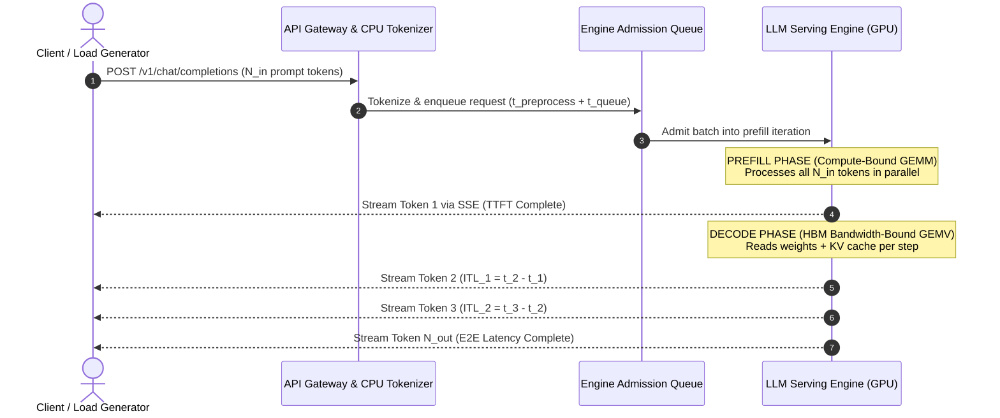
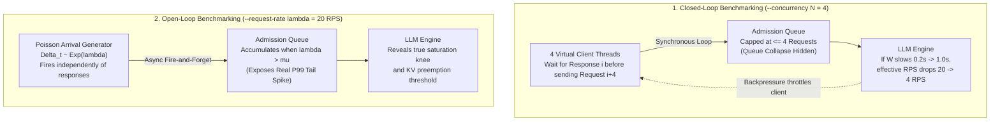

# 15.14 Benchmarking: genai-perf, latency percentiles and goodput

| Field | Value |
|---|---|
| Level | Advanced |
| Priority tier | 1 |
| Lab venue | GCP / GKE + Local Python Verification Lab |
| Part | Part 15: LLM inference and serving |
| Cross-references | Chapter 10.1 (AI systems performance and Goodput); Chapter 12.17 (nccl-tests and fabric benchmarking); Chapters 15.1–15.6 (Request anatomy, batching and KV cache, vLLM, SGLang, TensorRT-LLM, Triton); Chapters 15.10–15.13 (Prefill-decode disaggregation, adaptive tuning, profiling) |
| Code | `code/part15/benchmarking_genai_perf_goodput.py`, `code/part15/benchmarking_genai_perf_goodput_lab.py` |
| Coverage file | `planning/coverage/chapters/15-14.md` |
| Claim & number ledger | `planning/ledgers/15-14.md` |

## Why this matters for AI infrastructure

Suppose you are on call for a chat product, and a manager asks why the service feels slow even though the dashboard looks healthy. The usual tools do not answer that question well. Traditional web microservices finish a request in a single database query or function call. Site reliability engineers, the people who keep those services running, usually benchmark them with aggregate HTTP Requests Per Second and end-to-end response time. Large language model serving breaks both of those metrics. A single prompt that generates five hundred tokens runs five hundred and one separate forward passes through the neural network. A forward pass is one full calculation through the model that produces the next piece of output. The first pass is a compute-bound matrix-matrix multiplication over the entire input prompt, so the GPU spends its time on math. The next five hundred passes are memory-bandwidth-bound matrix-vector multiplications that emit one token at a time, so the GPU spends its time reading model weights from memory. The weights are read again on every step, so that repeated work shapes every latency number you will see in this chapter.

Because generation streams across hundreds of steps, end-to-end response time hides what users actually experience. Picture two serving clusters that both take 5 seconds to write a thousand-word essay. The first cluster sits silent for 4.9 seconds and then dumps all one thousand words onto the screen at once. Users assume the application has hung and close the tab. The second cluster emits the first word in 0.2 seconds and streams the remaining text smoothly over the next 4.8 seconds. Both systems report the exact same 5-second response time, yet the first system fails in production while the second feels fast. The lesson is that a single total-time number cannot tell you when the first word arrived or how evenly the rest of the text came out, so you need metrics that split the wait into parts.

Flawed benchmarking methodology hides even larger capacity disasters before launch. Each of the three mistakes below looks harmless in a test report, which is exactly why they are dangerous.
- **Closed-loop concurrency tests mask admission queue collapse.** When a load test uses a fixed pool of client threads that wait for each response before sending the next request, the client automatically slows down whenever the server slows down. That artificial feedback loop caps queue depth and hides the tail latency explosion that occurs under real open-loop traffic.
- **Short synthetic prompts hide quadratic prefill stalls.** Benchmarking a retrieval-augmented generation cluster with fixed 64-token prompts reports high token throughput and sub-50-millisecond first-token latency. When production users submit 4,096-token document prompts, prefill compute jumps sixty-four-fold per token. Tail latency then spikes past 6 seconds and triggers widespread gateway timeouts.
- **Headline token throughput ignores Service Level Objective compliance.** Running massive batch sizes saturates GPU memory bandwidth and maximizes raw tokens per second. However, it starves individual streams and violates both first-token and inter-token latency budgets.

```text
Production Benchmarking Reference Numbers (Volume 12 Chapter 10 & Labs 02-04, DAI Chapter 10, HLS Chapter 9, ASP Chapter 17):
1. Latency Phase Decomposition & Production SLO Targets (Volume 12 Chapter 10, AIE Chapter 9):
   - 500-token response = 501 forward passes (1 compute-bound prefill pass + 500 memory-bandwidth-bound decode passes)
   - Two 5.0 s E2E essay systems (1,000 words): System 1 waits 4.9 s TTFT + 0.1 s dump vs System 2 at 0.2 s (200 ms) TTFT + 4.8 s stream
   - Production p95 SLOs: TTFT < 200 ms (interactive chat) or < 1,000 ms (long-context RAG); ITL / TPOT < 25-30 ms (> 33.3-40.0 tok/s)
   - Cost & latency asymmetry (AIE Chapter 9): 1 output token has the latency impact of ~100 input tokens and costs 2x-4x more
2. Mean vs Tail Percentile Illusion (DAI Chapter 10):
   - System A: 100.0 ms mean latency with all requests tightly bounded between 90 ms and 110 ms (P99 = 110.0 ms)
   - System B: 80.0 ms mean latency with 95% of requests at ~58 ms and 5% of requests taking 500.0 ms (P95 = 500.0 ms, P99 = 500.0 ms)
   - P99 / P50 ratio of 10.0x (500 ms / 50 ms) diagnoses queueing stalls, garbage collection, or prefill-decode head-of-line blocking
3. Synthetic 64-Token Test vs 4,096-Token Production RAG Collapse on 4x H100 Llama-3-70B (Volume 12 Chapter 10):
   - Synthetic test (64 prompt tokens, 128 output tokens): 45.0 req/s, 3,400 out tok/s, p95 TTFT = 38.0 ms (p99 = 45.0 ms), p95 ITL = 16.2 ms, 42.0 GB VRAM
   - Production RAG trace (4,096 prompt tokens, 256 output tokens): 6.2 req/s (-86%), p95 TTFT = 4,820.0 ms (+12,584%, p99 = 6,400.0 ms, 24% HTTP 504), p95 ITL = 28.4 ms (+75%), 78.4 GB VRAM (+86%)
   - Chunked prefill remediation (--enable-chunked-prefill --max-num-batched-tokens 2048 --max-num-seqs 128): restores p95 TTFT to 290.0 ms and p95 ITL to 18.2 ms at 15.0 req/s
4. Goodput vs Raw Throughput & MLPerf Inference v5.0 SLOs (ASP Chapter 17, Volume 12 Chapter 10):
   - High-batch trap (B = 128): 180.0 tok/s raw throughput, but p99 TTFT = 1,200.0 ms (only 800 / 4,000 = 20.0% <= 200 ms) and p99 ITL = 85.0 ms (only 300 / 3,900 = 7.69% <= 25 ms)
   - DistServe Goodput under P90 TTFT <= 400 ms (0.4 s) & P90 TPOT <= 40 ms (0.04 s): colocated = min(3.0, 1.6) = 1.6 RPS/GPU vs 2P1D disaggregated = min(2 * 5.6, 10.0) / 3 = 3.33 RPS/GPU (~3.3 RPS/GPU, 2.08x gain, up to 7.4x max)
   - MLPerf Inference v5.0 (2025) Server p99 SLOs: Llama 2 70B = 450 ms TTFT / 40 ms TPOT; Llama 3.1 405B = 6,000 ms (6.0 s) TTFT / 175 ms TPOT (GB200 NVL72 delivers 3.4x inference and 2.6x training speedups)
```

**Rigorous inference benchmarking measures Goodput**. Goodput is the sustainable throughput per GPU that satisfies both Time to First Token and Inter-Token Latency percentile Service Level Objectives under open-loop traffic and realistic prompt distributions.

## Prerequisites and outcomes

### Prerequisites
- Request lifecycle stages, Roofline arithmetic intensity, PagedAttention Key-Value cache math, and continuous batching from Chapters 15.1 through 15.4.
- TensorRT-LLM compilation, Triton Inference Server dynamic and decoupled batchers, and NVIDIA NIM containers from Chapters 15.5 through 15.7.
- Prefill-decode disaggregation, adaptive runtime optimizations, and Nsight Systems profiling from Chapters 15.10 through 15.13.

### Outcomes
Picture yourself asked to certify a chat endpoint before a launch. You first need to split latency into the parts a user actually feels. Then you need a load pattern that reveals where the queue starts to fall apart, and tools that record those numbers without lying to you. After that you compare configurations by Goodput, measure what quantization and parallelism really buy you, and check the common ways a benchmark misleads. The chapter follows that path in order. It covers the latency percentiles, the queueing math behind open-loop traffic, the benchmark tools (GenAI-Perf, Perf Analyzer, AIPerf, vLLM `benchmark_serving.py`, SGLang `genai-bench`, and Locust), the Pareto frontier of Goodput, the end-to-end optimization studies, the failure cases, and a local lab that checks the arithmetic.

---

## 1. Deconstructing GenAI Latency Percentiles and Throughput Metrics

### 1.1 Time to First Token, Inter-Token Latency, Time Per Output Token, and End-to-End Latency

A user types a long question into a chat window and presses Enter, then stares at a blank reply box. Somewhere behind that box, a client has sent an HTTP POST request to your inference endpoint, and the request now travels through four timing stages before the first word appears. HTTP POST is the standard web request for sending data to a server, and here the data is the prompt. First, the payload crosses the network and waits in the admission queue, which is the line of requests that have not yet been given a slot, until scheduler slots and Key-Value cache blocks become available. The Key-Value cache is the memory that holds the attention data for every token seen so far, and it is split into fixed-size blocks. Second, the CPU tokenizes the prompt text, which means it turns words into numeric token IDs, and transfers those IDs to GPU memory. Third, the GPU executes the parallel prefill forward pass across all input tokens to fill the initial Key-Value cache and pick the first output token. Fourth, the engine runs an autoregressive decode loop, which means it feeds each new token back into the model and appends one more token per iteration until generation completes. Each of those four stages leans on a different part of the hardware, so a slow answer can come from any one of them.



Each stage stresses a different hardware subsystem, so platform engineers split the total request duration into four latency metrics. Splitting the time this way tells you which stage to fix, instead of leaving you with one vague number. Think of it as timing each leg of a trip separately, so you know whether the delay was at the airport gate or on the highway.
- **Time to First Token (TTFT).** Measures the elapsed time from request dispatch until the client receives the first streamed output token. Time to First Token sums network ingress, CPU tokenization, admission queue wait time, and prefill GPU compute time. Self-attention across the prompt scales quadratically with sequence length unless bounded by cache hits, making prefill **compute-bound** on GPU Tensor Cores. Self-attention is the step where every token looks at every other token, so a longer prompt costs more than proportionally. Production Service Level Objectives require 95th-percentile TTFT below 200 milliseconds for interactive chat and below 1,000 milliseconds for long-context retrieval-augmented generation. A Service Level Objective, or SLO, is the target a team promises to meet, and the 95th percentile means that the slowest requests at the top of the distribution still have to meet it.
- **Inter-Token Latency (ITL).** Measures the elapsed time between consecutive output tokens streamed during the decode phase. Each decode iteration reads all model parameters and the growing Key-Value cache from High Bandwidth Memory into on-chip SRAM to produce one token per sequence. High Bandwidth Memory is the large, fast memory package next to the GPU, and SRAM is the small, faster memory on the chip itself. Decode is therefore **memory-bandwidth-bound**, because the speed of each token is set by how fast those reads can move, not by how much math the GPU can do. Production Service Level Objectives target 95th-percentile ITL below 25 to 30 milliseconds. That pace streams more than 33 to 40 tokens per second and exceeds human reading speed.
- **Time Per Output Token (TPOT).** Measures the average decode latency per generated token across an entire sequence. Across a completed response, mean TPOT equals mean ITL. The two numbers answer slightly different questions. ITL looks at each gap between tokens, while TPOT takes the whole decode phase and divides it by the number of tokens. As noted in *AI Engineering* Chapter 9 and *AI Systems Performance Engineering* Chapter 17, some observability dashboards also call this metric Time Between Tokens. In Anyscale benchmarks cited in *AI Engineering* Chapter 9, generating a single output token adds the same latency impact as processing 100 input tokens. That cost asymmetry explains why commercial API providers price output tokens two to four times higher than input tokens. In other words, a long answer is expensive mostly because of the decode loop, not because of the prompt.
- **End-to-End Request Latency (E2E).** Measures the total wall-clock time from request submission until the final token arrives at the client. Wall-clock time is the time you would read on a kitchen clock, not the time the GPU was busy. End-to-End Latency equals Time to First Token plus the sum of all Inter-Token Latencies across the remaining output tokens plus network teardown overhead. Teardown is the closing handshake after the last token, when the connection is shut down cleanly.

```text
Core Latency Equations and Phase Dominance Rules (Volume 12 Chapter 10, DAI Chapter 10):
1. Time to First Token (TTFT):
   TTFT = t_queue + t_preprocess + t_prefill_compute

2. Inter-Token Latency (ITL) and Time Per Output Token (TPOT):
   ITL_i = t_token_i - t_token_{i-1}      for i in {2, ..., N_out}
   TPOT  = (E2E - TTFT - t_network) / (N_out - 1)   = mean(ITL)

3. End-to-End Latency (E2E):
   E2E = TTFT + (N_out - 1) * ITL + t_network

4. Worked Calculation (Llama-3-70B ShareGPT mean values: TTFT = 142.18 ms, ITL = 16.42 ms, N_out = 189 tokens):
   E2E  = 142.18 ms + (189 - 1) * 16.42 ms = 142.18 ms + 3,086.96 ms = 3,229.14 ms (~3.23 seconds)
   TPOT = (3,229.14 ms - 142.18 ms) / 188  = 16.42 ms/token

5. Phase Dominance Rules (DAI Chapter 10):
   - Short outputs (N_out = 10 to 20 tokens): TTFT dominates E2E -> optimize prefill compute, prefix caching, and queue delay
   - Long outputs (N_out = 200 to 1,000+ tokens): ITL dominates E2E -> optimize HBM bandwidth, weight quantization, and decode batching
```

### 1.2 Why Percentile Latencies (P50, P90, P95, P99) Beat Averages

Picture a capacity review where the report says the average latency is fine, and the on-call pager still goes off every afternoon. Reporting only mean latency is one of the most common mistakes in distributed systems benchmarking. The mean is a single number that gets pulled around by every outlier. Request latencies in LLM serving never follow a symmetric bell curve. Instead, variable prompt lengths, dynamic batching delays, Key-Value cache block evictions, and long-context prefill stalls produce heavy right-skewed distributions. Right-skewed means most requests finish quickly while a long thin tail of slow requests stretches out to the right. Percentiles show that tail, and the mean hides it.

*Distributed AI Systems* Chapter 10 illustrates why averages mislead capacity planners by comparing two serving clusters over a hundred requests. Walk through System A first. Every request lands between 90 and 110 milliseconds, so the mean is 100 milliseconds, and the 99th percentile is 110 milliseconds. Nothing in that table would make a manager nervous. Now look at System B. Most of its requests, 95 percent of them, finish in roughly 58 milliseconds. The other 5 percent get stuck behind long prefills, which are the big prompt-processing jobs that hold up everything queued behind them, and they take 500 milliseconds. System B boasts a better average latency of 80 milliseconds, yet its P95 and P99 latencies spike to 500 milliseconds. That tail is more than four and a half times worse than System A. A planner who only read the averages would pick System B and then get paged for its slow requests.

| Percentile Metric | Mathematical Definition on Cumulative Distribution Function (CDF) | Engineering Role in Production LLM Serving | Typical Production Target |
|---|---|---|---|
| **Mean (Average)** | Arithmetic sum of latencies divided by request count | Useful for Little's Law capacity math, but easily skewed by outliers or bimodal distributions | Contextual only; never use alone for SLAs |
| **P50 (Median)** | Value where the empirical CDF crosses 50% | Represents typical user experience under steady-state continuous batching | `< 100-150 ms` TTFT; `< 15-20 ms` ITL |
| **P90** | Value where the empirical CDF crosses 90% | Standard academic Goodput threshold (used in DistServe benchmarks) | `< 400 ms` TTFT; `< 40 ms` TPOT |
| **P95** | Value where the empirical CDF crosses 95% (1 in 20 requests) | Primary enterprise SLA alert threshold in Prometheus (`histogram_quantile(0.95, ...)`) | `< 200 ms` chat TTFT (`< 1,000 ms` RAG); `< 25 ms` ITL |
| **P99** | Value where the empirical CDF crosses 99% (1 in 100 requests) | Captures worst-case tail stalls, MLPerf Server compliance, and gateway timeout risk | `< 450 ms` 70B TTFT (`< 6,000 ms` 405B); `< 40 ms` TPOT |

Beyond individual percentiles, the **tail-to-median ratio** acts as an immediate diagnostic signal. It is simply P99 divided by P50, and it tells you how far the slowest requests drift from the typical one. In a healthy continuous batching engine with chunked prefill enabled, P99 latency typically sits within two to four times P50 latency. In *Distributed AI Systems* Chapter 10, a P50 latency of 50 milliseconds alongside a P99 latency of 500 milliseconds yields a **10x P99-to-P50 ratio**. That ratio shows that most requests execute quickly while a subset hits severe stalls. Those stalls stem from admission queueing, head-of-line prefill blocking, host garbage collection, or cold cache misses. Head-of-line blocking is the case where one slow item at the front of a line holds up every item behind it.

### 1.3 Token and Request Throughput Metrics

Imagine a finance lead asking how many requests your cluster served last week. The honest answer depends on what the requests looked like. A cluster that served many tiny prompts and a cluster that served a few giant ones can report the same request count while using very different amounts of GPU time. While latency percentiles govern user experience, throughput metrics govern cluster capacity and unit economics. Because prompt lengths and output lengths vary across requests, measuring Requests Per Second alone cannot tell you whether a GPU is idle or saturated. Engineers therefore track four complementary throughput rates over a measurement window of duration `T` seconds. Each rate counts something different, so you read them together.

| Throughput Metric | Exact Formula | Hardware Bottleneck Measured | Primary Engineering Use Case |
|---|---|---|---|
| **Request Throughput (RPS)** | `Completed_Requests / T` | End-to-end API gateway, tokenizer, and scheduler capacity | Sizing load balancers, rate limiters, and replica counts |
| **Input Token Throughput (Input TPS)** | `sum(Prompt_Tokens) / T` | GPU Tensor Core prefill FLOP/s and prefix cache hit rate | Sizing prefill worker pools and evaluating chunked prefill |
| **Output Token Throughput (GTPS)** | `sum(Generated_Tokens) / T` | GPU High Bandwidth Memory read bandwidth and decode batch efficiency | Primary driver of serving cost and decode worker sizing |
| **Total Token Throughput (Total TPS)** | `sum(Prompt_Tokens + Generated_Tokens) / T` | Aggregate cluster token processing rate | High-level system efficiency and cloud billing comparisons |

### 1.4 Scaling Efficiency, Memory Efficiency, and Cost per Token

Raw throughput must always be normalized against hardware count and cost. Picture a budget meeting where someone proudly reports that the cluster processes 10,000 tokens per second. That number sounds fast until you learn it runs on 64 GPUs that sit mostly idle. As *Distributed AI Systems* Chapter 10 emphasizes, the per-GPU view is what decides whether the spend makes sense. Three efficiency metrics connect benchmark numbers to infrastructure budgets, and each one answers a different budget question.
1. **Scaling Efficiency.** Quantifies how effectively adding GPUs multiplies throughput. When an 8-GPU node delivers 6.5x single-GPU throughput, its scaling efficiency is 81.25 percent, losing nearly 20 percent to inter-GPU coordination. Inter-GPU coordination is the time the cards spend talking to each other instead of computing. In the 64-GPU case study from *Distributed AI Systems* Chapter 10, a cluster at 45 percent GPU utilization and 52 percent scaling efficiency delivers only 33 effective GPUs. Across a two-week run of 336 hours, the idle 31 GPUs waste roughly 50,000 dollars. The useful check is simple. Divide the measured throughput by the single-GPU throughput times the GPU count, and compare the result with the scaling tiers listed later in this chapter.
2. **Memory Efficiency.** Measures the fraction of physical GPU High Bandwidth Memory actively holding model weights and usable Key-Value cache blocks rather than lost to fragmentation. Fragmentation means the free memory is split into scraps too small to use. Without PagedAttention, contiguous memory fragmentation can leave 20 gigabytes nominally free while failing to allocate a 10-gigabyte tensor. PagedAttention avoids that problem by storing the cache in small blocks that do not need to sit side by side.
3. **Cost per Million Tokens (Dollars per Token, DTP).** Combines output token throughput with hourly instance pricing, power, and cooling to calculate the dollar cost per million generated tokens. As *LLMs in Production* Chapter 6 notes, the fastest hardware configuration is rarely the most cost-optimal configuration. Teams therefore evaluate a matrix of GPU instance types under load to minimize dollars per token while meeting latency SLAs. A faster GPU that costs much more per hour can lose to a slower one on this metric.

### 1.5 Rigorous Benchmarking Methodology: Warmup, Synchronization, and Iteration Counts

Picture two engineers who each benchmark the same model on the same GPU. One reports a result that looks much faster than the other. Neither made an arithmetic error, but one of them timed the first request, which included startup work the second one skipped. Even with the right metrics defined, sloppy execution turns benchmarks into random noise. Three rules from *Distributed AI Systems* Chapter 10 apply to every microbenchmark and serving test.
- **Warm up before starting the clock.** PyTorch and CUDA initialize lazily on the first forward pass, which means they do the setup work only when it is first needed. Early requests trigger CUDA JIT kernel compilation, cuBLAS workspace allocation, CUDA Graph capture, and Key-Value cache page table warming. JIT stands for just-in-time, so the kernel is compiled at the moment it is first used. Run 5 to 10 warmup iterations for standard eager PyTorch. Eager mode runs each operation as soon as Python reaches it. Increase warmup to 20 to 50 iterations when `torch.compile`, TensorRT-LLM, or CUDA Graphs capture execution shapes. Those tools do more setup work up front, so they need more warmup before the numbers settle.
- **Synchronize the GPU before and after timing.** CUDA kernel launches are asynchronous on the host CPU. The CPU hands work to the GPU and moves on right away. Recording `time.perf_counter()` in Python without calling `torch.cuda.synchronize()` measures only how fast the CPU enqueues kernels to the driver buffer, not when the GPU finishes. The timer then stops early and the benchmark looks faster than it is. Always call `torch.cuda.synchronize()` immediately before starting the timer after warmup and immediately before stopping the timer.
- **Run at least 100 iterations and report full statistics.** A single timing run cannot separate true performance from thermal clock throttling, background daemon jitter, or network congestion. Thermal throttling is when a hot GPU lowers its clock speed to protect itself. A daemon is a background service that wakes up on its own schedule. Execute at least 100 timed iterations, or 1,000 to 2,000 prompts for online serving benchmarks. Report the mean, standard deviation, P50, P90, P95, and P99 alongside fixed random seeds. A fixed seed makes the random prompt mix the same on every run, so two runs can be compared fairly.

Before you compare two models or serving engines, lock down your warmup count, synchronization barriers, and percentile reporting. That discipline makes sure every measurement reflects steady-state GPU execution, which is the stage where the GPU is running at its normal speed rather than still getting ready.

---

## 2. Queueing Theory, Little's Law, and Open-Loop vs Closed-Loop Load Models

### 2.1 Little's Law (`L = lambda * W`) and Admission Queue Saturation

Late on a Friday, the dashboard shows that the queue in front of your model server is growing, and nobody can say whether that is a bad day or a bad capacity plan. Queueing math gives you a way to reason about it. An LLM inference server is a stochastic queueing system, which is a fancy way of saying that requests arrive at random times and wait in line for a limited service. Requests arrive at an average rate `lambda` and wait in an admission queue when active batch slots or Key-Value cache blocks are full. Each request spends an average total residency time `W` inside the system before completing its final token. Residency time is the full stay, including the wait in line and the time being served. **Little's Law** states that the long-term average number of in-flight requests `L` equals the arrival rate `lambda` multiplied by the average residency time `W`. The law needs no assumption about how the arrivals are spread out, which is why engineers trust it for quick capacity checks. Read it as a rule of thumb: if requests take longer to finish, more of them are in the system at the same moment. The block below shows the law at work with real measurements. Notice that the arrival rate and the residency time are both measured, and the concurrency is what you get by multiplying them. You do not need a separate counter to estimate how many requests are in flight, because the law gives you that number from the two measurements you already have.

```text
Little's Law and M/M/1 Queueing Delay Equations (Volume 12 Chapter 10):
1. Little's Law (applies to the whole system, the admission queue, or the active GPU batch):
   L         = lambda * W
   L_queue   = lambda * W_queue
   L_service = lambda * W_service
   where W = W_queue + W_service = E2E_Latency (in seconds)

2. Worked Verification on the Llama-3-70B vLLM Benchmark (Section 3.3):
   - Measured throughput (lambda): 14.04 req/s
   - Mean output length: 189,410 / 1,000 = 189.41 tokens
   - Mean residency time (W): 0.14218 s + (189.41 - 1) * 0.01642 s = 3.2359 seconds
   - Mean in-flight concurrency (L): 14.04 req/s * 3.2359 s = 45.43 concurrent requests in flight
   - Clean sizing example: At lambda = 20.0 RPS and W = 1.60 s -> L = 20.0 * 1.60 = 32.0 concurrent requests

3. Non-Linear Queue Explosion Near Capacity (M/M/1 Reference with Service Capacity mu = 25.0 RPS):
   Utilization: rho = lambda / mu
   Mean Queue Wait: W_queue = rho / (mu * (1 - rho))
   Mean Total Residency: W = 1 / (mu - lambda)
   - At lambda = 15.0 RPS (rho = 0.60): W_queue =  60.0 ms | W_total =   100.0 ms
   - At lambda = 22.5 RPS (rho = 0.90): W_queue = 360.0 ms | W_total =   400.0 ms (4.0x total jump, 6.0x queue jump)
   - At lambda = 24.5 RPS (rho = 0.98): W_queue = 1,960 ms | W_total = 2,000.0 ms (20.0x total jump, 32.67x queue jump)
```

Queueing theory explains a pattern many teams see in their first load test. Tail latency stays flat at low load, then rises sharply across a small increase in traffic. Think of a checkout line in a shop. With one cashier and few shoppers, nobody waits. Add shoppers until the cashier is nearly always busy, and each extra shopper waits behind a much longer line. Because average queue wait time scales inversely with idle headroom, pushing cluster utilization from 60 percent to 90 percent multiplies queueing delay sixfold. Pushing utilization to 98 percent multiplies total residency time twentyfold. The headroom is the spare capacity you leave on purpose, and it is the cushion that absorbs a burst. Once the arrival rate exceeds the engine's maximum service rate, the system becomes unstable and the admission queue grows without bound until requests time out.

### 2.2 Closed-Loop Concurrency Sweeps vs Open-Loop Poisson Arrivals

Imagine two load tests of the same endpoint. The first one reports a smooth, healthy curve all the way up. The second one, run with a different tool, shows the latency wall the users complain about. The difference is not the server. It is how the load generator sends requests, and that decides whether your benchmark exposes the saturation knee, the point where latency starts to climb steeply, or hides it completely. Load generators operate in one of two fundamental modes: **closed-loop** or **open-loop**. The mode decides whether the client waits for the server or keeps sending on its own clock.



In a **closed-loop benchmark** (`--concurrency`), the test harness spawns a fixed number of virtual client threads. Each thread sends one request, blocks until the entire streamed response finishes, and only then dispatches its next request. A virtual client thread is a worker that pretends to be a user, and it waits for its own answer before asking again. Walk through what happens when the server slows down. By Little's Law, if the server becomes overloaded and response time slows down fivefold from 0.20 seconds to 1.00 second at concurrency 4, the closed-loop clients automatically throttle their request arrival rate down fivefold from 20.0 RPS to 4.0 RPS. The test quietly asks less of the server exactly when the server is struggling. Because total in-flight requests can never exceed the thread count, the admission queue never accumulates. That cap hides tail TTFT spikes and paints a falsely optimistic picture of cluster stability. Conversely, when a closed-loop tool waits for whole batches of requests to finish before issuing the next batch, synchronization bubbles can also under-report achievable throughput. In Volume 12 Chapter 10, closed-loop testing on Llama-70B measured 120 tokens per second while open-loop arrivals at 20 requests per second sustained 180 tokens per second, a 50 percent increase. So closed-loop numbers can be too pessimistic in one case and too optimistic in another, which is why you should not trust either mode alone.

In an **open-loop benchmark** (`--request-rate`), the load generator dispatches requests according to a stochastic arrival process at a target rate regardless of how many prior requests have completed. Picture a crowd of real users who arrive on their own schedule, whether or not the last person has been served. That is the situation an open-loop test copies. Standard open-loop benchmarks model independent multi-tenant users with a **Poisson arrival process**. In that process, the inter-arrival time between consecutive requests is drawn from an exponential distribution. Tools such as `vllm bench serve` also generalize this to a Gamma inter-arrival distribution controlled by `--burstiness`. Setting `--burstiness 1.0` produces standard Poisson traffic, while smaller values inject sharper traffic bursts. Because the arrivals keep coming when the server is slow, the queue grows, and you see the failure the way production would show it. If your open-loop run looks fine, you can trust it more than a closed-loop run that looks fine, because the open-loop run was not allowed to slow down for the server.

| Dimension | Closed-Loop Benchmarking (`--concurrency N`) | Open-Loop Benchmarking (`--request-rate lambda`) |
|---|---|---|
| Dispatch Mechanism | Virtual client `k` waits for response `i` to finish before sending request `i + N` | Requests fire on an independent stochastic schedule (`Delta_t ~ Exp(lambda)`) |
| Queue Depth Behavior | Artificially bounded at `L <= N`; queue backlog can never grow unboundedly | Unbounded when `lambda > mu`; accurately reproduces admission queue buildup |
| Response to Server Slowdown | Self-throttling (`lambda_eff = N / W` drops automatically as `W` increases) | Unforgiving; arrival rate stays at `lambda`, exposing preemption loops and HTTP 504s |
| Best Engineering Use Case | Controlled microbenchmarks, Roofline batch-size sweeps, and max saturation probing | Production capacity sizing, SLA verification, and ingress rate-limit calibration |

The choice between the two modes changes the story you tell. If you only run the closed-loop sweep, you will report a capacity that looks generous, because the test never let the queue grow. If you only run the open-loop test, you may miss the best batch size, because the arrivals were too uneven to show it. Each mode is honest about one half of the picture. A practical order of work follows from this. Start with closed-loop concurrency sweeps, because they are good at mapping how the hardware scales as batch sizes grow. Then run open-loop Poisson arrival sweeps, because they are the honest test for certifying production Service Level Objectives and for setting admission queue limits. Doing it in that order keeps you from certifying a capacity number that only the closed-loop test could produce.

---

## 3. Benchmarking Tooling: GenAI-Perf, Perf Analyzer, AIPerf, vLLM, and genai-bench

### 3.1 NVIDIA GenAI-Perf and AIPerf

Your team runs several different serving engines, and each one has its own home-made benchmark script. Each script reports latency a little differently, so the numbers cannot be compared. That is the problem NVIDIA's tools try to solve. To standardize load testing across Triton Inference Server, TensorRT-LLM, vLLM, SGLang, and NVIDIA NIM endpoints, NVIDIA provides **GenAI-Perf** (`genai-perf`) and its next-generation successor **AIPerf** (`aiperf`). AIPerf is an open-source, multiprocess Python benchmarking toolkit designed for disaggregated and multimodal AI endpoints. Multiprocess means it runs several worker processes at once, so the load generator itself does not become the bottleneck. Unlike traditional HTTP load testers that only time complete responses, GenAI-Perf and AIPerf parse Server-Sent Events token by token to compute exact TTFT, ITL, TPOT, and token throughput percentiles. Server-Sent Events is the streaming format where the server pushes each token to the client as soon as it is ready.

**GenAI-Perf is being phased out.** Its README says NVIDIA no longer develops new features for it and tells new users to use AIPerf instead. The two commands below are the legacy GenAI-Perf form, kept because existing dashboards and runbooks still use it. The AIPerf form follows them.

```bash
# 1. Closed-loop concurrency sweep with synthetic prompt/output normal distributions (Volume 12 Chapter 10)
genai-perf profile \
    -m meta-llama/Meta-Llama-3-8B-Instruct \
    --service-type openai \
    --endpoint-type chat \
    --url http://127.0.0.1:8000 \
    --streaming \
    --concurrency 32 \
    --synthetic-input-tokens-mean 1024 \
    --synthetic-input-tokens-stddev 128 \
    --output-tokens-mean 256 \
    --output-tokens-stddev 32 \
    --measurement-interval 10000 \
    --generate-plots

# 2. Open-loop Poisson arrival benchmark against an OpenAI-compatible vLLM / NIM endpoint
genai-perf profile \
    -m meta-llama/Meta-Llama-3-70B-Instruct \
    --service-type openai \
    --endpoint-type chat \
    --url http://127.0.0.1:8000 \
    --streaming \
    --request-rate 15.0 \
    --synthetic-input-tokens-mean 4096 \
    --synthetic-input-tokens-stddev 512 \
    --output-tokens-mean 256 \
    --output-tokens-stddev 32 \
    --num-prompts 1000 \
    --extra-inputs "ignore_eos:true"
```

For new work, use AIPerf. If you already have the open-loop command above, you can move it over with a new command name, because the AIPerf CLI reference accepts the same flag names for the arguments below as aliases. A few flags do not carry over, though. The `--service-type`, `--measurement-interval` and `--generate-plots` flags are not in the AIPerf CLI reference, so drop them. The AIPerf README shows `aiperf profile` with `--streaming`, `--endpoint-type chat`, `--tokenizer`, `--url` and `--concurrency`, which is a good starting point when you read the help text. This handbook did not run AIPerf, so check the flags against `aiperf profile --help` for your installed version before you trust the output.

```bash
# AIPerf form of example 2 (flags from the AIPerf CLI reference; not run here)
aiperf profile \
    --model meta-llama/Meta-Llama-3-70B-Instruct \
    --endpoint-type chat \
    --url http://127.0.0.1:8000 \
    --streaming \
    --request-rate 15.0 \
    --synthetic-input-tokens-mean 4096 \
    --synthetic-input-tokens-stddev 512 \
    --output-tokens-mean 256 \
    --output-tokens-stddev 32 \
    --num-prompts 1000 \
    --extra-inputs ignore_eos:true
```

Here is why the flag matters. When you benchmark a fixed output length, you want every request to generate the same amount of work. An end-of-sequence token is the marker the model emits to say it is finished. If the engine stops early on that marker, some requests produce fewer tokens than planned, and the decode throughput you compute is wrong. So when benchmarking fixed-output targets, pass `--extra-inputs "ignore_eos:true"` so the serving engine does not stop early on an end-of-sequence token. Early termination would otherwise skew decode throughput calculations. Both tools also leave files behind for later comparison. GenAI-Perf writes structured JSON and CSV artifacts (`profile_export_genai_perf.json` and `profile_export_genai_perf.csv`). AIPerf names its exports `profile_export_aiperf.json` and `profile_export_aiperf.csv` plus latency-versus-throughput plots inside the `artifacts/` directory. Keep those files with the command that produced them, so you can always reproduce a chart later.

| GenAI-Perf / AIPerf Flag | Parameter Purpose | Production Guidance |
|---|---|---|
| `-m` / `--model` | Target model identifier passed in the JSON request body | Must match `/v1/models` ID exactly |
| `--service-type` / `--endpoint-type` | Selects `triton` (KServe v2 gRPC) vs `openai` (`chat` `/v1/chat/completions` or `completions`) | Always include `--streaming` so SSE token timestamps are captured |
| `--concurrency <N>` vs `--request-rate <lambda>` | Selects closed-loop thread count `N` vs open-loop Poisson arrival rate `lambda` (RPS) | Sweep `--request-rate` across `0.25 * mu .. 1.10 * mu` for SLA sizing |
| `--synthetic-input-tokens-mean` / `--stddev` | Generates synthetic prompts sampled from `Normal(mu_in, sigma_in)` | Use to probe specific context buckets (`512`, `4096`, `16384`) |
| `--output-tokens-mean` / `--stddev` | Sets target output generation length (`max_tokens`) | Pair with `ignore_eos:true` for controlled decode bandwidth tests |
| `--input-file` / `--input-dataset` | Replays real conversational JSONL payloads or standard datasets (ShareGPT) | Mandatory before production sign-off to capture real length skew |

### 3.2 Triton Perf Analyzer (`perf_analyzer`)

Suppose a colleague asks why the legacy tool reports a number that differs from what Triton's own logs say. The answer is that the legacy `genai-perf` does not measure on its own. Under the hood, it drives **Triton Perf Analyzer** (`perf_analyzer`), which is the load tool that ships with Triton. You can also invoke `perf_analyzer` directly for vision, embedding, reranking, or decoupled TensorRT-LLM backends over HTTP or gRPC. gRPC is a binary request protocol that often carries less overhead than plain HTTP. Perf Analyzer breaks down total client latency into network transport plus three server-side phases reported by Triton. Those phases are queue wait time, compute input H2D copy time, and compute infer GPU kernel execution time. H2D means host to device, the copy of input data from CPU memory to the GPU. Reading the phases separately tells you whether the time went to waiting, copying, or computing.

```bash
# Sweep concurrency 1..64 and compare against open-loop mode on Triton gRPC (:8001)
perf_analyzer -m dense_net_conservative -u localhost:8001 -i grpc \
    --shape data_0:3,224,224 --concurrency-range 1:64:4 --percentile=99

perf_analyzer -m llama-70b -u localhost:8001 -i grpc \
    --concurrency=128 --load-model=open_loop
```

Imagine you have just set a batch delay on a Triton model and want to know whether it helped. A sweep is the answer. In Volume 12 Lab 02, running `perf_analyzer` across concurrency 1 to 64 on a DenseNet-121 ONNX model demonstrates how batch scheduler parameters shift the latency-throughput trade-off. The batch scheduler waits a little while to collect requests into one group, and that wait is exactly the knob the table below is about. Read each row as a different setting of that knob, with the same model and the same load. Start with Profile A, where batching is switched off. Every request runs alone, so the GPU keeps starting small jobs and finishing them, and the throughput is low. Profile B shows what a short wait buys you. At concurrency 64 the scheduler gathers many requests into each batch, and the throughput rises sharply while the tail latency falls. Profile C is the greedy version. It waits longer and fills bigger batches, which lifts the peak throughput, but a lone request at low concurrency now sits in the timer for most of a wait it did not need. The last row shows the danger of a delay that is longer than the batch can ever fill. Requests wait out the whole timer, and the batch never forms.

| Triton Batching Profile (`C = 64` unless noted) | `max_batch_size` & `max_queue_delay_microseconds` | Realized Avg Batch Size | Throughput (`infer/sec`) | p99 Latency (`ms`) | Engineering Diagnosis |
|---|---|---|---|---|---|
| **Profile A (`dense_net_nobatch`)** | `0` (batching disabled) | `1.0` | `520.0 RPS` | `121.5 ms` | GPU starves on 1-sample launches; 63 requests wait in serial queue |
| **Profile B (`dense_net_conservative` at `C = 1`)** | `16` / `5,000 us` (`5 ms`) | `1.0` | `450.0 RPS` | `3.1 ms` | Baseline single-stream latency (`200 us` queue + `1,600 us` compute) |
| **Profile B (`dense_net_conservative` at `C = 64`)** | `16` / `5,000 us` (`5 ms`) | `13.0` | `2,850.0 RPS` (`5.48x`) | `8.9 ms` | Sweet spot: `5.48x` throughput and `13.65x` lower p99 than No-Batch |
| **Profile C (`dense_net_aggressive` at `C = 64`)** | `64` / `50,000 us` (`50 ms`) | `48.2` | `3,400.0 RPS` (`6.54x`) | `48.5 ms` | Highest peak throughput, but `51.2 ms` p99 at `C = 1` due to `50 ms` timer wait |
| **Misconfigured `500 ms` Delay (`C = 2`)** | `64` / `500,000 us` (`500 ms`) | `2.0` | `4.0 RPS` | `> 500.0 ms` | Two concurrent requests never reach `preferred_batch_size: [16, 32]`, waiting full `500 ms` |

### 3.3 vLLM Benchmark Suite (`benchmark_serving.py` and `vllm bench serve`)

Say you want to know how your OpenAI-compatible endpoint behaves on realistic chat traffic, not on one neat synthetic prompt. For that job, the native vLLM benchmark suite (`benchmark_serving.py` or `vllm bench serve`) is the workhorse most teams reach for. It is built for open-loop dataset replay. It samples real variable-length prompts and target output lengths from datasets such as **ShareGPT**, which is a public collection of real chat conversations, or from synthetic **Prefix Repetition** workloads, where many requests share the same starting text. It then dispatches those prompts at a configured Poisson arrival rate, so the traffic looks like real users arriving at random moments.

```bash
# Execute Open-Loop Poisson Traffic Benchmark (15.0 RPS) on Llama-3-70B with ShareGPT (Volume 12 Chapter 10)
python3 vllm/benchmarks/benchmark_serving.py \
    --backend vllm \
    --host 127.0.0.1 \
    --port 8000 \
    --model meta-llama/Meta-Llama-3-70B-Instruct \
    --dataset-name sharegpt \
    --dataset-path ./ShareGPT_V3_unfiltered_cleaned_split.json \
    --num-prompts 1000 \
    --request-rate 15.0 \
    --seed 42 \
    --trust-remote-code
```

```text
Representative vLLM Serving Benchmark Output (Volume 12 Chapter 10 — 1,000 ShareGPT Prompts at 15.0 RPS):
============ Serving Benchmark Result ============
Successful requests:             1000
Benchmark duration (s):          71.24
Total input tokens:              241,042
Total generated tokens:          189,410
Request throughput (req/s):      14.04
Input token throughput (tok/s):  3383.52   (241,042 / 71.24)
Output token throughput (tok/s): 2658.76   (189,410 / 71.24)
Total token throughput (tok/s):  6042.27   ((241,042 + 189,410) / 71.24)
--------------- Time to First Token (TTFT) ---------------
Mean TTFT (ms):                  142.18
Median TTFT (ms):                112.40
P95 TTFT (ms):                   284.10
P99 TTFT (ms):                   492.50
--------------- Inter-Token Latency (ITL) ----------------
Mean ITL (ms):                   16.42
Median ITL (ms):                 15.80
P95 ITL (ms):                    21.10
P99 ITL (ms):                    28.40
==================================================
```

Read the output the way an on-call engineer would, and look at how the TTFT and ITL rows relate to each other. The two rows describe different stages, so they behave differently. Because ShareGPT contains prompts ranging from a few words to thousands of tokens, the TTFT distribution is heavily right-skewed. A long prompt needs a long prefill, and the users who sent long prompts are the ones who wait. Specifically, P99 TTFT is 4.38x higher than Median TTFT. By contrast, continuous batching steps all active decode sequences together in uniform memory-bound iterations, keeping the ITL distribution tight. Every active sequence gets its next token on the same beat, so the gap between tokens barely changes from one request to the next. Its P99 ITL is only 1.80x higher than Median ITL.

### 3.4 SGLang `genai-bench`, Locust Load Testing, and Dataset Profiling

Three additional workflows from *Distributed AI Systems* Chapter 10, *Hands-On LLM Serving and Optimization* Chapter 9, and *LLMs in Production* Chapter 6 complete the benchmarking toolkit. Each one answers a question the earlier tools leave open, so it helps to know which question you are asking before you pick one.
- **SGLang `genai-bench`.** Automates structured test matrices across deterministic traffic scenarios such as 100 input and 100 output tokens. A test matrix is a grid of prompt and output sizes, so one command covers every cell of the grid. *Distributed AI Systems* Chapter 10 notes a classic technology selection failure where a team evaluated vLLM and SGLang using only fixed-length prompts and saw vLLM win by a tiny margin. When they re-tested with realistic variable prompts ranging from 50 to 5,000 tokens, SGLang's RadixAttention prefix tree delivered **40 percent higher throughput**. The prefix tree is a structure that lets requests share the cached work for their common opening words. The lesson in that story is that a fixed-length test can pick the wrong winner.
- **Dataset Inspection (`inspect_dataset.py`, *HLS* Chapter 9).** Before launching a benchmark, always inspect the token length distribution of your dataset. A benchmark is only as honest as the prompts it sends, and the length spread is the first thing to check. Sampling 100 records from ShareGPT with Qwen3-14B reveals a prompt length mean of 232.60 tokens and a median of 141.50 tokens. The mean and the median differ because a few very long prompts pull the average up. The output length mean is 220.61 tokens with a median of 164.50 tokens. To stress-test prefix caching, *HLS* Chapter 9 pairs ShareGPT with the synthetic **Prefix Repetition** dataset.
- **Locust End-to-End Service Load Testing (*LLMs in Production* Chapter 6).** When testing complete web gateways with authentication and rate limiters, Locust ramps up 50 concurrent users at 1 user per second while recording custom streaming TTFT and TPS metrics. Locust is an open-source load tool that simulates users from Python code, and TPS here means tokens per second. In the *LLMs in Production* Chapter 6 benchmark, ramping to 50 users immediately exposes the service bottleneck at **34 active users**. At that threshold, Queries Per Second peaks and starts declining as response latency climbs. Watch for that peak. Past it, adding users only makes the queue longer.

```text
Dataset Inspection & Locust Load Testing Reference (HLS Chapter 9, DAI Chapter 10, LLP Chapter 6):
1. ShareGPT 100-Sample Token Distribution (inspect_dataset.py --dataset-name sharegpt --model Qwen/Qwen3-14B):
   - Prompt tokens: min = 5, max = 817, mean = 232.60, median = 141.50, std = 241.42
   - Output tokens: min = 4, max = 771, mean = 220.61, median = 164.50, std = 210.23
2. Prefix Repetition Synthetic Cache Benchmark (inspect_dataset.py --dataset-name prefix_repetition):
   - Parameters: --num-prompts 50 (or 1000), --prefix-repetition-prefix-len 256, --prefix-repetition-suffix-len 256,
     --prefix-repetition-num-prefixes 5 (or 10), --prefix-repetition-output-len 128
3. SGLang genai-bench Scenarios (pip install genai-bench):
   - Deterministic scenarios: D(100,100) and D(512,512)
   - Variable prompt length benchmark (50 to 5,000 tokens): SGLang RadixAttention achieves +40% throughput over vLLM
4. Locust Headless Ramp Test (LLP Chapter 6 Figure 6.11):
   - Command: locust -f locustfile.py --host http://0.0.0.0:8000 --csv=llm --headless -u 50 -r 1 -t 10m
   - Result: Ramping to 50 users at 1 user/s hits QPS saturation knee at 34 active users
```

When you are choosing a tool, match it to the layer you want to test. Pick `genai-perf` or `vllm bench serve` when you want engine-level token streaming numbers. Pick `genai-bench` when you need a whole matrix of scenarios for one engine. Pick Locust when the thing you are testing is the full API gateway and its rate limiters, because those parts sit in front of the engine and can be the real bottleneck.

## 4. Goodput, the Latency-Throughput Pareto Frontier, and MLPerf Inference

### 4.1 Defining Goodput vs Raw Headline Throughput

Picture a manager who celebrates a graph that climbs to 180 tokens per second, then gets a flood of complaints from users who say the app feels broken. Both facts can be true at once. In *AI Systems Performance Engineering* Chapters 1 and 17, Chris Fregly draws a sharp boundary between raw throughput and **Goodput**. Raw throughput counts every token or request a GPU emits per second regardless of how long the user waited. **Goodput** measures the sustainable rate of completed requests or generated tokens per GPU that simultaneously satisfy both the Time to First Token Service Level Objective and the Inter-Token Latency Service Level Objective. In short, Goodput counts only the work that arrived on time.

To see why raw throughput fails as a production north star, inspect the high-throughput troubleshooting scenario. A serving cluster configured with an aggressive maximum batch size of 128 sequences achieves 180 tokens per second, easily meeting its raw throughput target. Yet users report severe lag because P99 TTFT hits 1,200 milliseconds against a 200-millisecond SLO, and P99 ITL hits 85 milliseconds against a 25-millisecond SLO. Scraping the Prometheus histograms reveals that only 800 out of 4,000 requests finish prefill within 200 milliseconds. Prometheus is the metrics system that stores these histogram buckets, which count how many requests fell under each time limit. Worse still, only 300 out of 3,900 decode steps finish within 25 milliseconds. Despite 180 tokens per second of raw output, cluster-level SLO-compliant Goodput is zero. The batch was so large that the engine was busy, but almost none of that busy time was delivered on time. A simple way to picture Goodput is to count the requests that met both limits, using the histogram buckets from your monitoring system. A request that missed either limit adds nothing to the count, however many tokens it produced. The equations below give the formal version, which asks how fast you can send traffic before the percentile crosses its limit.

```text
Goodput and DistServe Pareto Frontier Equations (ASP Chapter 17 Figure 17-2, Volume 12 Chapter 10):
1. Cluster-Level and Per-GPU Goodput Definition:
   Let R_TTFT = max arrival rate lambda where P_q(TTFT) <= SLO_TTFT
   Let R_TPOT = max arrival rate lambda where P_q(TPOT) <= SLO_TPOT
   Cluster_Goodput_RPS = min(R_TTFT, R_TPOT)
   Goodput_per_GPU     = Cluster_Goodput_RPS / N_GPUs

2. High-Batch Throughput Trap (Volume 12 Chapter 10 — Batch Size B = 128):
   - Raw throughput = 180.0 tok/s, but p99 TTFT = 1,200.0 ms (> 200 ms SLO) and p99 ITL = 85.0 ms (> 25 ms SLO)
   - Prometheus histogram buckets: ttft_bucket{le="200"} = 800 / 4,000 (20.0% pass); itl_bucket{le="25"} = 300 / 3,900 (7.69% pass)

3. DistServe Colocated vs 2P1D Disaggregated Goodput Worked Math (ASP Chapter 17):
   - Configured SLOs: P90 TTFT <= 400.0 ms (0.4 s) and P90 TPOT <= 40.0 ms (0.04 s)
   - Colocated Monolithic Baseline (1 GPU):
     Sustains R_TTFT = 3.0 RPS under the TTFT bound alone, but only R_TPOT = 1.6 RPS under the TPOT bound
     Colocated Goodput = min(3.0, 1.6) / 1 GPU = 1.60 RPS/GPU
   - Disaggregated 2P1D Pool (2 Prefill GPUs + 1 Decode GPU = 3 GPUs):
     Prefill pool capacity = 2 GPUs * 5.6 RPS/GPU = 11.2 RPS (under P90 TTFT <= 400 ms)
     Decode pool capacity  = 1 GPU  * 10.0 RPS/GPU = 10.0 RPS (under P90 TPOT <= 40 ms)
     Cluster Goodput = min(11.2, 10.0) = 10.0 RPS across 3 GPUs
     Disaggregated Goodput per GPU = 10.0 RPS / 3 GPUs = 3.33 RPS/GPU (~3.3 RPS/GPU -> 2.08x per-GPU gain)
   - Peak DistServe gains across workloads: up to 7.4x more Goodput requests or 12.6x tighter SLO compliance
```

### 4.2 Constructing the Latency-Throughput Pareto Frontier

Here is the picture you want in your head before you read the table. Suppose you sweep concurrency from 1 up to 128 on one GPU setup. Each step gives you one point, with throughput on the vertical axis and tail latency on the horizontal axis. The points trace a curve that bends upward and then shoots right, because past a certain load the latency cost grows faster than the throughput gain. That curve is the **Latency-Throughput Trade-off Curve**. Now compare several engine setups on the same plot, such as different sequence caps, batched token budgets, quantization precisions, or Tensor Parallelism degrees. The outer edge of all those points, where no setup can add throughput without making latency worse, is the **Pareto Frontier**. A point on that edge is a fair trade. A point inside it is a setup that somebody else beats on both counts.

| Concurrency (`C`) | Raw Output Throughput (`tok/s`) | P95 TTFT (`ms`, SLO `<= 300 ms`) | P95 ITL (`ms`, SLO `<= 25 ms`) | SLO Compliance Status | Goodput (`tok/s`) | Operating Regime on Pareto Curve |
|---|---|---|---|---|---|---|
| `C = 1` | `58.0 tok/s` | `62.0 ms` | `14.5 ms` | PASS | `58.0 tok/s` | Latency-optimal floor (HBM bandwidth underutilized) |
| `C = 8` | `420.0 tok/s` | `110.0 ms` | `16.2 ms` | PASS | `420.0 tok/s` | Linear scaling zone (weights amortized across 8 sequences) |
| `C = 16` | `780.0 tok/s` | `165.0 ms` | `18.4 ms` | PASS | `780.0 tok/s` | Healthy continuous batching zone |
| **`C = 32`** | **`1,340.0 tok/s`** | **`245.0 ms`** | **`22.8 ms`** | **PASS (Optimal)** | **`1,340.0 tok/s`** | **Pareto-Optimal Goodput Knee (Max tok/s within SLOs)** |
| `C = 64` | `1,890.0 tok/s` | `480.0 ms` | `29.5 ms` | FAIL (Both breached) | `0.0 tok/s` | Over-batched zone (`+550 tok/s` raw, but breaks user SLA) |
| `C = 128` | `2,150.0 tok/s` | `1,420.0 ms` | `54.0 ms` | FAIL (Queue collapse) | `0.0 tok/s` | Saturation cliff (`810 tok/s` above Goodput ceiling) |

Now draw the two SLO limits on the table as vertical lines, one at 300 milliseconds for P95 TTFT and one at 25 milliseconds for P95 ITL. Any row that crosses either line is out of bounds. Read the rows from top to bottom and the answer jumps out. Concurrency 32 is the last row that stays inside both lines, so it is the maximum usable capacity of the replica. Running at concurrency 128 generates 2,150.0 tokens per second on paper, but all 810.0 tokens per second of extra raw throughput lies in the SLA-violating saturation zone. A capacity planner who quoted the 128 row would be promising users a speed the replica cannot keep.

### 4.3 MLPerf Inference Benchmark: Server vs Offline Scenarios

Suppose a vendor claims its new GPU is the fastest for chatbots. How would you check that claim without trusting the vendor's own test? The **MLCommons MLPerf Inference** benchmark exists for that situation. It gives every submitter the same rules, so the results can be compared across hardware generations and serving stacks. Think of the rules as the referee in a race. Everybody runs the same course, and the timing is checked by someone who did not build the car. Those rules are enforced by the MLPerf LoadGen harness, which is the shared load generator, plus logging and verification utilities that check the run was done correctly. Datacenter LLM submissions are evaluated under two primary scenarios, and the two scenarios ask very different questions.

| MLPerf Scenario | LoadGen Traffic Pattern | Latency SLO Constraint (`P99` TTFT & `P99` TPOT) | Primary Metric Reported | Real-World Production Analog |
|---|---|---|---|---|
| **Offline Scenario** | Sends all queries in a single batch at `t = 0` | None (unbounded latency) | Maximum raw token throughput (`tokens/s` or `samples/s`) | Overnight batch document summarization, synthetic data generation, bulk embeddings |
| **Server Scenario** | Open-loop Poisson arrivals (`Delta_t ~ Exp(lambda)`) | **Strict 99th-percentile TTFT and TPOT ceilings** | Maximum sustainable Goodput (`QPS` / `tokens/s` within `P99` SLOs) | Live customer chat, coding copilots, interactive voice and RAG APIs |
| **Llama 2 70B (`v5.0` Server)** | Open-loop Poisson queries | **`P99 TTFT <= 450 ms`** and **`P99 TPOT <= 40 ms`** | Sustainable `tokens/s` at `99%` / `99.9%` FP32 accuracy target | Enterprise 70B interactive assistant SLA |
| **Llama 3.1 405B (`v5.0` Server)** | Open-loop Poisson queries | **`P99 TTFT <= 6,000 ms` (`6.0 s`)** and **`P99 TPOT <= 175 ms`** | Sustainable `tokens/s` at `99%` / `99.9%` FP32 accuracy target | Frontier 405B reasoning and long-context synthesis SLA |

Read the Server rows as the ones that matter for a live product. An offline job can take as long as it likes, but a chat assistant has to answer while the user is still watching. The round of results worth remembering here is the one below. In MLPerf Inference v5.0, pairing hardware-software co-design on an NVIDIA GB200 NVL72 rack delivers up to **3.4x higher inference performance** and **2.6x higher training performance** compared to previous-generation architectures. Co-design means the hardware and the software are tuned together, so a gain can come from either side. Treat such a headline as a claim to check against the scenario and the latency limits it was measured under.

### 4.4 Cold Starts, Multi-Step Reasoning Agents, and Profiler Correlation

Three specialized benchmarking regimes from *Distributed AI Systems* Chapter 10 need their own measurements, because a steady-state sweep misses them. Each one starts from a situation you are likely to meet.
1. **Cold-Start vs Warm Decode Latency.** Imagine a traffic spike at midnight and a new replica that has to load its model before it can answer anyone. The very first request after loading a model incurs weight deserialization, CUDA JIT kernel compilation, and cache population. Deserialization is the step that turns the stored file back into live tensors in memory. Cold-start latency is much slower than warm decode for small models, and even slower for mid-size LLMs where kernel compilation and cache fill dominate. For large foundation checkpoints, cold starts can take half a minute or several minutes to load from disk compared to a sub-second warm request. Always benchmark cold-start duration separately and configure Kubernetes Horizontal Pod Autoscaler minimum replica floors so scale-to-zero policies never expose live users to long cold starts. The Horizontal Pod Autoscaler is the Kubernetes component that adds and removes replicas, and a replica floor is the smallest number it is allowed to keep running.
2. **Multi-Step Reasoning and Agentic Workflows.** Chain-of-thought models and tool-using agents execute multiple LLM calls interleaved with web searches, database queries, and code execution. Think of a user who asks an agent to book a trip. The agent calls the model, searches flights, calls the model again, queries a database, and so on. Benchmarking only a single model forward pass misses the user's true wait time. When *Distributed AI Systems* Chapter 10 decomposes end-to-end agent session latency into per-step LLM generation versus external tool invocations, more than three-fifths of total session latency typically comes from external API and database calls rather than GPU inference. So a faster GPU may barely change what the user waits for.
3. **Correlating Load Tests with PyTorch Profiler and Nsight Systems.** Load generators tell you when a percentile breaches its SLO, while profilers tell you why. Picture the moment the load test shows a P99 spike, and you need to find out what the GPU was doing at that instant. Use `torch.profiler` with a scheduled warmup and active trace window for high-level phase attribution in TensorBoard or Chrome Tracing. Phase attribution means splitting the time into named stages such as prefill and decode. Drop down to **NVIDIA Nsight Systems** (`nsys profile --trace=cuda,nvtx,osrt`) to inspect individual CUDA kernel launch gaps, PCIe transfers, and NCCL collective stalls. Each of those names is a specific place where time can disappear, and the timeline shows the gap directly.

Always evaluate serving optimizations by measuring Goodput per GPU at your P95 or P99 latency ceiling rather than quoting unconstrained Offline token throughput. A number that ignores the latency ceiling flatters the optimization, and the users who hit the ceiling are the ones who notice.

---

## 5. End-to-End Optimization Benchmarks: Quantization, Prefix Caching, and Multi-GPU Scaling

### 5.1 Step-by-Step Optimization Benchmark: `Qwen3-14B` FP16 vs AWQ 4-Bit on NVIDIA L40S

Suppose you have one GPU and a model you want to serve to many users at once. Before you change anything, you need to know where the memory goes. In *Hands-On LLM Serving and Optimization* Chapter 9, Yuan Tang demonstrates how systematic benchmarking guides real-world optimization of Qwen3-14B on an AWS g6e.2xlarge instance equipped with a single **NVIDIA L40S GPU**. VRAM is the memory on the graphics card itself, and everything the model needs has to fit inside it. That GPU provides 46 GiB of total VRAM.

Launching the FP16 baseline (`vllm serve Qwen/Qwen3-14B`) consumes 27.52 GiB of GPU memory for model weights, leaving only **11.00 GiB for the Key-Value cache**. FP16 means each weight is stored as a 16-bit number. The Key-Value cache is what lets the engine remember each conversation without recomputing it, and it grows with every active request. That pool holds **72,064 tokens**, which severely restricts long-context concurrency. Because model weights consume nearly two-thirds of total VRAM, high concurrency rapidly exhausts Key-Value cache blocks. In practice, the cache is the number that limits how many users fit at once, not the raw GPU speed.

```bash
# 1. Inspect GPU hardware state before benchmarking (HLS Chapter 9)
nvidia-smi --query-gpu=name,compute_cap,memory.free,memory.used,memory.total --format=csv

# 2. Run Open-Loop ShareGPT Benchmark (2,000 prompts at 10 RPS, burstiness 1.0, max-concurrency 10)
vllm bench serve \
    --backend vllm \
    --base-url "http://localhost:8000" \
    --dataset-name sharegpt \
    --dataset-path ShareGPT_V3_unfiltered_cleaned_split.json \
    --num-prompts 2000 \
    --request-rate 10 \
    --burstiness 1.0 \
    --max-concurrency 10 \
    --model Qwen/Qwen3-14B \
    --save-result --append-result --result-filename test_serve_results.txt

# 3. Run Prefix Repetition Benchmark (1,000 prompts at 5 RPS, 10 unique 256-token prefixes + 256-token suffixes)
vllm bench serve \
    --backend vllm \
    --base-url "http://localhost:8000" \
    --model Qwen/Qwen3-14B \
    --dataset-name prefix_repetition \
    --num-prompts 1000 \
    --request-rate 5 \
    --prefix-repetition-prefix-len 256 \
    --prefix-repetition-suffix-len 256 \
    --prefix-repetition-num-prefixes 10 \
    --prefix-repetition-output-len 128 \
    --max-concurrency 10
```

Now try the obvious fix, which is to make the weights smaller. Switching to 4-bit Activation-Aware Weight Quantization (`Qwen/Qwen3-14B-AWQ`) shrinks the model weights nearly threefold down to **9.36 GiB**, freeing more than 18 GiB of HBM. Quantization stores each weight in fewer bits, so there is less to read on every step and less to keep in memory. The memory you free does not vanish. It goes to the Key-Value cache, which jumps to **29.15 GiB**, expanding token capacity to **191,056 tokens**. That is the mechanism behind the speedup in the table below.

| Benchmark Configuration (`1x NVIDIA L40S 46 GB`) | Weight Memory (`GiB`) | KV Cache Memory & Capacity (`GiB` / Tokens) | Total Token Throughput (`tok/s`) | Output Token Throughput (`tok/s`) | Mean TTFT (`ms`) | Mean / Median / P99 ITL (`ms`) |
|---|---|---|---|---|---|---|
| **`Qwen3-14B` FP16 — ShareGPT (`2,000` reqs, `1,810.09 s`)** | `27.52 GiB` | `11.00 GiB` (`72,064` tok, `1.76x`) | `474.38 tok/s` | `227.64 tok/s` (`1.10 RPS`) | `104.15 ms` (`103.61 ms` Fig 9-2) | `43.24` / `42.43` / `72.15 ms` |
| **`Qwen3-14B` FP16 — Prefix Repetition (`1,000` reqs, `569.00 s`)** | `27.52 GiB` | `11.00 GiB` (`72,064` tok, `97%` util) | `1,123.13 tok/s` (`2.37x`) | `223.31 tok/s` (`1.76 RPS`) | `104.64 ms` | `43.95` / `42.82` / `59.22 ms` |
| **`Qwen3-14B-AWQ` 4-Bit — ShareGPT (`2,000` reqs)** | **`9.36 GiB`** | **`29.15 GiB` (`191,056` tok, `4.66x`)** | **`1,280.0 tok/s` (`2.70x`)** | Higher batch decode | **`59.29 ms` (`-42.78%` / `-42%`)** | Lower HBM weight read tax |

Two critical engineering lessons emerge from this table, and both are worth slowing down for. First, on the exact same FP16 model, switching from diverse ShareGPT conversations to the Prefix Repetition workload more than doubles total token throughput at identical TTFT. The model did not get faster. The traffic simply repeated the same beginnings, so the engine could reuse work it had already done. Automatic prefix caching achieves that gain by reusing prefix blocks across requests. *AI Engineering* Chapter 9 similarly shows Anthropic prompt caching cutting TTFT by **79 percent** and cost by **90 percent** on a long book prompt. Second, AWQ 4-bit quantization delivers a **2.7x total throughput gain** and cuts mean TTFT by **42 percent** by combining smaller weight reads with a much larger Key-Value cache pool. Both gains came from the same place, which is memory that was freed up and used well. When you read a benchmark table, ask where each gain came from before you believe it.

### 5.2 Vertical (`TP`) vs Horizontal (`DP`) Multi-GPU Scaling: PCIe (`g6e`) vs NVLink (`p4d`)

Does sharding a model across multiple GPUs with Tensor Parallelism (`--tensor-parallel-size`) always improve performance? It is a fair question, because adding GPUs sounds like it must help. Tensor Parallelism splits one model across several cards so they work on each token together. Data Parallel runs whole copies of the model side by side, and each copy serves its own requests. Step 8 of *Hands-On LLM Serving and Optimization* Chapter 9 answers this question by benchmarking Qwen3-14B-AWQ across single-GPU and multi-GPU layouts on two AWS instances with different interconnects. The interconnect is the wire or bus that moves data between the cards, and its speed decides how much the splitting costs.
- **AWS g6e.12xlarge (L40S GPUs connected via PCIe only, no NVLink).** The **single-GPU setup outperforms multi-GPU Tensor Parallelism** in both total throughput and TTFT latency. Tensor Parallelism executes two synchronous AllReduce collectives per Transformer layer on every single token. An AllReduce is a step where every GPU must share and combine its partial results before any of them can continue. Running those collectives across high-latency PCIe bridges costs more time than splitting the small quantized model saves. The lesson is that splitting only helps when the wire is fast enough to pay for the conversation.
- **AWS p4d.24xlarge (A100 GPUs connected via high-speed NVLink).** Here four-way Tensor Parallelism scales cleanly over NVLink, cutting TTFT in half from **66.0 milliseconds down to 33.0 milliseconds** while achieving **3,926 TPS** total throughput. NVLink is NVIDIA's fast link between GPUs in the same server. However, when the model already fits on a single GPU and meets its latency target, running **four independent single-GPU Data Parallel replicas achieves 9,816 TPS**. That horizontal layout delivers **2.50x the total throughput** of the single Tensor Parallel instance with zero inter-GPU communication overhead. In short, the fastest way to serve more users can be to copy the model rather than split it.

### 5.3 Distributed Scaling Efficiency, Amdahl's Law, and Accuracy Validation Gates

Picture a model that no longer fits on one card, so you add more cards, and the throughput rises by less than you hoped. That gap is what this section measures. When models exceed single-GPU memory, or when benchmarking multi-GPU training and inference clusters, *Distributed AI Systems* Chapter 10 establishes four quantitative rules for scaling and accuracy validation. Most of those rules are about how much you really gain from extra hardware, and the last one is about making sure a faster result is still a correct result.

```text
Distributed Scaling Efficiency, Amdahl's Law, and Accuracy Gate Reference (DAI Chapter 10):
1. Scaling Efficiency Formula & Interpretation Tiers:
   Scaling_Efficiency(N) = Throughput_N / (Throughput_1 * N)
   - > 90%:   Excellent scaling (minimal communication or serialization overhead)
   - 70-90%:  Good scaling (typical for well-tuned NVLink / InfiniBand workloads; e.g., 6.5x on 8 GPUs = 81.25%, predicting ~13x on 16 GPUs)
   - 50-70%:  Moderate scaling (significant communication overhead; e.g., 52% on 64 GPUs = 33.28 effective GPUs, wasting ~31 GPUs / ~$50,000 over 336 hours)
   - < 50%:   Poor scaling (severe network, synchronization, or data-loading bottleneck)

2. Iteration Communication Growth & Amdahl's Law Ceiling:
   - Scaling from 1 GPU to 16 GPUs (DAI Chapter 10 Figure 10.1):
     Iteration time drops from 155.0 ms (0% communication) to 33.0 ms, but AllReduce communication grows to 55.0% of total step time
   - Amdahl's Law: S_max(N) = 1 / (s + (1 - s) / N)
     With s = 0.10 (10% serial work: data loading, tokenization, or unoverlapped sync), even infinite GPUs cannot exceed 1 / 0.10 = 10.0x speedup

3. Statistical Accuracy Validation Gates (Speed Means Nothing if Output Is Wrong):
   - Example quantization trap (DAI Chapter 10): INT8 quantization boosts throughput 2.0x, but math benchmark accuracy drops 15.0% -> reject
   - Two-sample statistical significance test on benchmark delta (e.g., 0.5% accuracy drop):
     If p = 0.30 (> alpha = 0.01): statistically indistinguishable from evaluation noise
     If p = 0.001 (< alpha = 0.01): statistically significant regression -> fail CI/CD gate
   - Standard Accuracy Suites: MMLU (knowledge), HumanEval Pass@k (code), GLUE/SuperGLUE, HELM, BLEU/ROUGE/BERTScore, NVIDIA NeMo Evaluator
```

Here is the decision in plain terms. Use Tensor Parallelism over NVLink when the model is too big for one card, or when you need to cut per-request latency in half. Use Data Parallel replicas when you want the most cluster throughput per GPU and the model already fits on one card. Whichever layout you pick, never approve a quantization speedup without passing an automated accuracy gate. A gate is a check that stops the release when the output quality drops, and it runs every time, not just once.

---

## 6. How It Fails: Production Benchmarking Failure Modes and Remediation

### 6.1 Failure Mode 1: Short Synthetic Prompts Hiding Quadratic RAG Prefill Collapse

- **Symptom.** Prior to launching an enterprise retrieval-augmented generation service on a four-GPU H100 Llama-3-70B cluster, a team benchmarks the endpoint with fixed short synthetic prompts. The benchmark reports high request throughput and sub-50-millisecond first-token latency. Upon opening the cluster to production traffic, the API gateway returns HTTP 504 Gateway Timeout on nearly a quarter of requests. First-token tail latency spikes past 6 seconds, and GPU compute utilization pins at 99 percent while output token throughput collapses. Nothing in the pre-launch report hinted at trouble. Every number in it was accurate for the short prompts it sent, which is exactly the trap. The benchmark was honest about the wrong workload.
- **Root Cause.** Production RAG prompts include retrieved document chunks averaging **4,096 input tokens**, which is **64x longer** than the 64-token synthetic test. Re-running `genai-perf` with a 4,096-token mean prompt reproduces the exact collapse. Request throughput drops by 86 percent, P95 TTFT explodes to **4,820.0 milliseconds**, and GPU memory usage jumps to **78.4 GB**. Without chunked prefill, each long prefill monopolizes GPU Tensor Cores and blocks all co-scheduled requests. Chunked prefill is the fix that cuts a long prompt into smaller slices, so decode work for other users can run between the slices. Picture a single long document read aloud to a room, where everyone else in the room must wait until it finishes.
- **Remediation.** Enable **Chunked Prefill** and bound the per-iteration token budget (`--enable-chunked-prefill --max-num-batched-tokens 2048 --max-num-seqs 128 --gpu-memory-utilization 0.90`). Re-running the long-context open-loop trace restores P95 TTFT down to **290.0 milliseconds** and P95 ITL to **18.2 milliseconds**. The important detail is that the test was rerun on the long-context trace. A fix that is only checked on the short prompts would have proved nothing.

### 6.2 Failure Mode 2: Open-Loop Arrival Spikes Triggering KV Cache Preemption Loops

- **Symptom.** During an open-loop capacity step test on a Llama-3-70B cluster configured with a high sequence cap, increasing the Poisson arrival rate from 20 to 30 requests per second causes waiting requests to surge to **340 requests** in 15 seconds. Simultaneously, P99 TTFT explodes to **18,200.0 milliseconds** and output token generation stalls. Picture the users at that moment. Their first word has not appeared for many seconds, so many of them give up and retry, which adds still more load to a queue that is already full.
- **Root Cause.** Inspecting Prometheus shows `vllm:gpu_cache_usage_perc` pinned at **0.99**. Because `--max-num-seqs 512` allows the scheduler to admit hundreds of concurrent requests without a batched token cap, active decode sequences exhaust all physical PagedAttention Key-Value blocks. The scheduler is forced to **preempt running decode sequences**, evicting their Key-Value blocks to make room for new prefills. When those preempted sequences resume, their prompts must be recomputed from scratch, creating a catastrophic **preemption thrashing loop**.
- **Remediation.** Cap active sequence concurrency (`--max-num-seqs 64`), enforce `--max-num-batched-tokens 2048 --enable-chunked-prefill`, and configure an ingress NGINX or Envoy circuit breaker to return HTTP 429 Too Many Requests whenever waiting requests exceed 50. Re-testing at **35.0 requests per second** holds waiting requests at **8**, keeps preempted requests at **0**, and stabilizes P99 TTFT at **340.0 milliseconds**. The circuit breaker is what keeps the queue short. It rejects the extra requests early with HTTP 429, which tells the client to back off, instead of letting them sit in line until they time out.

### 6.3 Failure Mode 3: Single-Threaded Gateway CPU Tokenization Masquerading as a Slow GPU

- **Symptom.** An inference pipeline serving concurrent requests violates its 1,000-millisecond SLA with a P99 total pipeline latency of **1,410.20 milliseconds** and throughput of only **13.47 RPS**. However, `nvidia-smi dmon` shows GPU Streaming Multiprocessor utilization below 20 percent. When the client container is restricted to half a core (`--cpus="0.5"`), Linux CFS quota throttling collapses throughput below 3 RPS and spikes P99 latency past **3,500.0 milliseconds**.
- **Root Cause.** Decomposing client-side timestamps against Triton's `/metrics` endpoint shows server queue time below 2 milliseconds and Triton P99 inference latency at only **18.10 milliseconds**. Running `mpstat -P ALL 1 5` on the frontend host reveals that a single CPU core is pinned at 100 percent user utilization while all other cores sit idle. Single-threaded Python preprocessing and tokenization under the Global Interpreter Lock accounts for **1,395.80 milliseconds** of the P99 latency. The Global Interpreter Lock, or GIL, is the Python rule that lets only one thread run Python code at a time, so extra threads cannot use extra cores for this work. The GPU was idle because it was waiting for the CPU, not because it was slow. A good way to check your own service is to ask the same question. Compare the GPU utilization with the CPU utilization during a load test, and if the CPU core is pinned while the GPU sits idle, the bottleneck is on the front door, not in the model.
- **Remediation.** Parallelize CPU preprocessing across cores with a multi-process worker pool (`ProcessPoolExecutor`) or Rust and C++ Fast Tokenizers, and remove aggressive Kubernetes CPU limits. In Volume 12 Lab 04, switching to `ProcessPoolExecutor` drops CPU preprocessing P99 to **31.00 milliseconds**. Total pipeline P99 drops to **44.80 milliseconds**, and throughput jumps to **104.17 RPS**. A process pool runs the preprocessing in separate processes, and each process has its own interpreter lock, so the work finally spreads across cores.

```text
Failure Mode Quantitative Comparison Table (Volume 12 Chapter 10 Scenarios 1 & 2, Volume 12 Lab 04):
1. Failure Mode 1 — Synthetic 64-Token Test vs 4,096-Token Production RAG on 4x H100 Llama-3-70B:
   - Synthetic Test (64 prompt tokens):     45.0 req/s | p95 TTFT =    38.0 ms (p99 = 45.0 ms)   | p95 ITL = 16.2 ms | VRAM = 42.0 GB
   - Unchunked Production RAG (4,096 tok):   6.2 req/s | p95 TTFT = 4,820.0 ms (p99 = 6,400.0 ms)| p95 ITL = 28.4 ms | VRAM = 78.4 GB
   - Variance (64x tokens, 4,096x attn):     -86% RPS  | +12,584% p95 TTFT (24% HTTP 504)        | +75% p95 ITL      | +86% VRAM
   - Remediated (chunked prefill = 2,048):  15.0 req/s | p95 TTFT =   290.0 ms (16.62x faster)   | p95 ITL = 18.2 ms | Stable VRAM
   - Short-Prompt Troubleshooting Case:     45-tok avg bench = 200 tok/s & 45 ms p99 ITL vs 3,200-tok avg / 16K p99 prod = 80 tok/s & 280 ms p99 ITL (6.2x worse)

2. Failure Mode 2 — Open-Loop Concurrency Collapse (20 -> 30 req/s at max_num_seqs = 512):
   - Unbounded (max_num_seqs = 512):        gpu_cache_usage_perc = 0.99 | waiting = 2 -> 340 in 15 s | p99 TTFT = 180.0 -> 18,200.0 ms (101.11x spike)
   - Remediated (max_num_seqs = 64 @ 35/s): gpu_cache_usage_perc < 0.85 | waiting = 8 (HTTP 429 > 50)| p99 TTFT = 340.0 ms | preemptions = 0

3. Failure Mode 3 — Gateway Single-Threaded CPU Tokenization Bottleneck (Volume 12 Lab 04, 200 Requests @ Concurrency 8):
   - Unfixed (ThreadPoolExecutor GIL):      14.85 s |  13.47 RPS | Total p99 = 1,410.20 ms | CPU p99 = 1,395.80 ms | Triton p99 = 18.10 ms
   - CFS Quota Throttled (--cpus="0.5"):            | < 3.00 RPS | Total p99 > 3,500.00 ms | GPU SM util ~ 0%
   - Remediated (ProcessPoolExecutor):       1.92 s | 104.17 RPS | Total p99 =    44.80 ms | CPU p99 =    31.00 ms | Triton p99 = 13.50 ms (7.73x RPS, 31.48x p99)
```

### 6.4 Prometheus Telemetry and Alerting Rules for SLO Enforcement

Benchmarks happen once, before launch. Production happens every day, and latency can drift upward slowly for weeks without anyone noticing. To catch TTFT and ITL percentile regressions in production before they trigger outages, scrape the serving engine's Prometheus endpoint and alert directly on `histogram_quantile` rates. The `histogram_quantile` function turns the bucket counts back into a percentile, so the alert fires on the same P95 number your benchmark used. The two rules below show the pattern for first-token latency and for per-token latency.

```yaml
groups:
  - name: vllm_performance_slo_alerts
    rules:
      - alert: LLMTimeToFirstTokenSLOViolation
        expr: histogram_quantile(0.95, sum(rate(vllm:time_to_first_token_seconds_bucket[5m])) by (le)) > 1.0
        for: 2m
        labels:
          severity: critical
        annotations:
          summary: "vLLM p95 Time to First Token > 1.0s"
          description: "Prefill phase tail latency on {{ $labels.instance }} exceeded 1.0s. Check prompt length distribution and vllm:num_requests_waiting."

      - alert: LLMInterTokenLatencyDegraded
        expr: histogram_quantile(0.95, sum(rate(vllm:time_per_output_token_seconds_bucket[5m])) by (le)) > 0.040
        for: 2m
        labels:
          severity: warning
        annotations:
          summary: "vLLM p95 Inter-Token Latency > 40ms (< 25 tok/s)"
          description: "Decode phase generation speed degraded below 25 tokens/sec. Check HBM bandwidth saturation, batch size, or KV cache preemptions."
```

A benchmark sign-off is only half the job. Once the service is live, pair it with continuous Prometheus `histogram_quantile` alerts on first-token latency, output-token latency, Key-Value cache occupancy, and preemption counters. Those four signals tell you when the same failures from this section are starting to come back, long before users start filing tickets. Set the alert thresholds from your benchmark numbers, not from a guess, so that an alert means the same thing the benchmark meant. When an alert fires, the first question is which of the four failure stories fits the graph, because each story has a different fix.

---

## 7. Hands-On Lab: Deterministic Verification of Latency Percentiles, Little's Law, and Goodput

### 7.1 Lab Venue and Scope

- **Venue.** This lab has two halves. The first is a local Python Verification Lab, which runs on any workstation or CI runner and needs no live GPU. The second is a set of GCP and GKE production reference commands (`genai-perf`, `perf_analyzer`, `vllm bench serve`) that you can adapt when you do have a cluster. CI runner means the automated build machine that runs checks on every change.
- **Verification note.** The GPU serving commands in Sections 3, 5, and 6 are production reference configurations, Volume 12 Labs 02–04, and *Hands-On LLM Serving and Optimization* Chapter 9. Treat them as a starting point to check against your own hardware. They have not been executed on live hardware during this build (`untested` on live GPUs). The math is different. All mathematical models, percentile distributions, Little's Law queueing curves, and Pareto Goodput frontiers are verified deterministically by `code/part15/benchmarking_genai_perf_goodput_lab.py`.

### 7.2 Running the 25-Check Verification Suite

Your first step is to open a terminal in the repository root, which is the top folder of the project, the one that holds the code directory. Then run the self-checking script once. It prints one PASS or FAIL line per check, and the summary at the bottom tells you whether the whole set held. The script needs only Python, not a GPU.

```bash
python3 -B code/part15/benchmarking_genai_perf_goodput_lab.py
```

```text
Expected Output (25/25 Deterministic Self-Checks Passing):
=== Chapter 15.14 Lab: Benchmarking, Latency Percentiles, and Goodput Verification ===
  [PASS] 1. Generating 500 output tokens requires 501 forward passes (1 prefill + 500 decode), and two 5.0 s E2E systems differ between 4.9 s TTFT + 0.1 s dump vs 0.2 s TTFT + 4.8 s stream
  [PASS] 2. Exact E2E latency E2E = TTFT + (N_out - 1) * ITL yields 3,229.14 ms for TTFT = 142.18 ms, N_out = 189, ITL = 16.42 ms, and TPOT = (E2E - TTFT) / (N_out - 1) = 16.42 ms
  [PASS] 3. Production p95 SLOs target < 200 ms TTFT for chat, < 1,000 ms TTFT for RAG, and < 25 ms ITL (> 40.0 tok/s), with 1 output token having the latency impact of ~100 input tokens
  [PASS] 4. vLLM benchmark_serving.py on Llama-3-70B (1,000 ShareGPT prompts at 15.0 RPS in 71.24 s; 241,042 in + 189,410 out tokens) achieves 14.04 RPS, 3,383.52 input tok/s, 2,658.76 output tok/s, and 6,042.27 total tok/s
  [PASS] 5. Llama-3-70B ShareGPT percentiles report TTFT (mean 142.18 ms, P50 112.40 ms, P95 284.10 ms, P99 492.50 ms) and ITL (mean 16.42 ms, P50 15.80 ms, P95 21.10 ms, P99 28.40 ms)
  ...
  [PASS] 25. Troubleshooting & Accuracy Validation: Short-prompt benchmarks over-report throughput (200.0 vs 80.0 tok/s) and p99 ITL (45.0 ms vs 280.0 ms, 6.22x worse at 16K p99 context), while INT8 2.0x speedup with 15.0% math drop or 0.5% drop at p = 0.001 (< 0.01) vs p = 0.30 is caught by statistical accuracy gates
Summary: 25 passed, 0 failed
```

---

## Checkpoint questions

<details>
<summary>1. Why does a single LLM request generating five hundred output tokens require five hundred and one forward passes, and why does End-to-End response time fail to distinguish between a broken and a responsive streaming experience?</summary>

An LLM processes the entire input prompt in parallel during a single compute-bound prefill forward pass to populate the initial Key-Value cache and emit the first token. It then executes five hundred sequential memory-bandwidth-bound decode forward passes to generate the remaining tokens autoregressively. Two clusters can both report a 5.0-second response time for a thousand-word essay. If the first cluster stalls silently for 4.9 seconds and dumps all words at once, users perceive the application as hung. If the second cluster emits the first token in 0.2 seconds and streams smoothly over 4.8 seconds, users experience fast responsiveness.
</details>

<details>
<summary>2. How do you compute End-to-End Latency and Time Per Output Token from Time to First Token and Inter-Token Latency?</summary>

Time to First Token sums queue wait, preprocessing, and prefill compute time. End-to-End Latency equals TTFT plus the remaining output tokens multiplied by mean ITL. For the Llama-3-70B ShareGPT run, adding the 142.18 ms prefill phase to 188 decode steps at 16.42 ms each gives **3,229.14 ms** total E2E latency. Dividing the decode phase duration by the number of decode steps yields a Time Per Output Token equal to mean ITL.
</details>

<details>
<summary>3. How do the dominant hardware bottlenecks and production Service Level Objectives differ between TTFT and ITL, and why do commercial APIs price output tokens higher than input tokens?</summary>

Time to First Token is governed by the parallel prefill phase. That phase is **compute-bound** on GPU Tensor Cores with production p95 SLOs below **200 ms** for interactive chat and below **1,000 ms** for long-context RAG. Inter-Token Latency is governed by the autoregressive decode phase, which is **memory-bandwidth-bound** because every step reads all model weights and Key-Value caches from High Bandwidth Memory. Its production p95 SLO sits below **25 ms**, which exceeds human reading speed. Anyscale benchmarks show that generating a single output token has the same latency impact as processing 100 input tokens, which explains why output tokens cost two to four times more.
</details>

<details>
<summary>4. In Distributed AI Systems Chapter 10, why does System B deliver a worse user experience than System A despite having a lower average latency, and what does a high P99-to-P50 ratio diagnose?</summary>

Although System B has a lower mean latency of 80 ms compared to 100 ms on System A, five percent of its requests stall behind long prefills and take **500 ms**. That tail drives both its P95 and P99 latencies to 500 ms, violating typical interactive SLAs for one in twenty users. A tenfold P99-to-P50 ratio indicates severe tail latency outliers. Those outliers are caused by admission queueing delays, head-of-line blocking behind unchunked long prompts, Key-Value cache eviction, or host garbage collection pauses.
</details>

<details>
<summary>5. In the vLLM ShareGPT benchmark on Llama-3-70B, what are the four throughput rates and why is the P99-to-P50 spread much wider for TTFT than for ITL?</summary>

Dividing the completed requests and token counts by the 71.24-second duration yields **14.04 requests per second**, **3,383.52 input tokens per second**, **2,658.76 output tokens per second**, and **6,042.27 total tokens per second**. Time to First Token exhibits a wide tail-to-median spread between 492.50 ms and 112.40 ms because ShareGPT prompt lengths vary from a few tokens to thousands of tokens. Inter-Token Latency exhibits a tight spread between 28.40 ms and 15.80 ms because continuous batching steps all active decode sequences together in uniform memory-bound iterations.
</details>

<details>
<summary>6. How does Little's Law determine average in-flight concurrency from request arrival rate and average residency time?</summary>

Little's Law states that average in-flight concurrency equals the request arrival rate multiplied by average residency time. Multiplying 20.0 RPS by 1.60 seconds yields **32.0 concurrent in-flight requests**. For the 70B ShareGPT run, multiplying 14.04 RPS by the 3.2359-second mean residency time yields **45.43 concurrent in-flight requests**.
</details>

<details>
<summary>7. Why does closed-loop concurrency benchmarking hide admission queue collapse when a server slows down, and how can synchronized closed-loop batching in Perf Analyzer also under-report achievable token throughput?</summary>

In a closed-loop test with a fixed number of client threads, each thread waits for its current response to finish before sending the next request. That feedback loop caps queue depth at the thread count and forces the effective arrival rate to throttle down automatically whenever server latency increases. Conversely, when Perf Analyzer waits for synchronized closed-loop batches to complete before issuing the next batch, tail stragglers create inter-batch idle bubbles. On Llama-70B, closed-loop mode reported 120.0 tokens per second while open-loop arrivals achieved **180.0 tokens per second**.
</details>

<details>
<summary>8. In an M/M/1 queue with service capacity 25.0 RPS, why do mean queue wait time and total residency time explode as arrival rates approach capacity?</summary>

Queueing delay scales inversely with idle capacity headroom. At 15.0 RPS or sixty percent utilization, mean queue wait is **60.0 ms** and total residency is **100.0 ms**. At 22.5 RPS or ninety percent utilization, queue wait jumps sixfold to **360.0 ms** and total residency reaches **400.0 ms**. At 24.5 RPS or ninety-eight percent utilization, queue wait explodes to **1,960.0 ms** and total residency reaches **2,000.0 ms**.
</details>

<details>
<summary>9. Which NVIDIA GenAI-Perf CLI flags control open-loop vs closed-loop load generation, synthetic prompt and output token normal distributions, and fixed-length decode verification without early EOS termination?</summary>

The `--concurrency` flag sets closed-loop virtual client count, whereas `--request-rate` dispatches open-loop Poisson arrivals. Synthetic length distributions are controlled by `--synthetic-input-tokens-mean`, `--synthetic-input-tokens-stddev`, `--output-tokens-mean`, and `--output-tokens-stddev`. Passing `--extra-inputs "ignore_eos:true"` alongside `--streaming` forces every request to generate the full target output length without stopping early on an end-of-sequence token.
</details>

<details>
<summary>10. In Volume 12 Lab 02 at concurrency 64, why did Conservative dynamic batching outperform both No-Batch and Aggressive batching for an interactive SLA, and why did setting a long queue delay at concurrency 2 collapse throughput?</summary>

At concurrency 64, Conservative batching with a 5 ms delay achieved **2,850.0 RPS** and an **8.9 ms** p99 latency, while keeping single-stream concurrency 1 latency at 3.1 ms. Aggressive batching with a 50 ms delay reached **3,400.0 RPS** at concurrency 64, but its 50 ms timer inflated single-stream p99 latency to **51.2 ms**. When the queue delay was misconfigured to 500 ms with preferred batch sizes of 16 and 32 and tested at concurrency 2, two concurrent requests could never fill a preferred batch. Every batch waited the full timeout, collapsing throughput to **4.0 RPS**.
</details>

<details>
<summary>11. Define Goodput and explain how DistServe 2P1D disaggregation more than doubles Goodput per GPU compared to colocated serving.</summary>

**Goodput** is the maximum request or token throughput per GPU that simultaneously satisfies both the TTFT and TPOT percentile Service Level Objectives. On a single colocated GPU under P90 TTFT below 400 ms and P90 TPOT below 40 ms, cross-phase interference limits TPOT-compliant throughput to **1.60 RPS/GPU**. In the disaggregated 2P1D pool across three GPUs, two prefill GPUs sustain 11.2 RPS combined and one decode GPU sustains 10.0 RPS. Dividing the 10.0 RPS cluster Goodput across three GPUs yields **3.33 RPS/GPU**, a **2.08x per-GPU Goodput gain**.
</details>

<details>
<summary>12. How do the MLPerf Inference Server and Offline scenarios differ in query arrival pattern, latency constraints, and primary reported metric, and what are the MLPerf v5.0 Server p99 SLOs for Llama 2 70B and Llama 3.1 405B?</summary>

The **MLPerf Offline** scenario sends all queries at time zero with no latency constraint and reports maximum unconstrained batch throughput. The **MLPerf Server** scenario dispatches queries via an open-loop Poisson process. It reports maximum sustainable Goodput subject to strict P99 TTFT and P99 TPOT latency ceilings and FP32 accuracy retention. In MLPerf Inference v5.0, the Server p99 SLOs are **450 ms TTFT and 40 ms TPOT** for **Llama 2 70B**, and **6,000 ms TTFT and 175 ms TPOT** for **Llama 3.1 405B**.
</details>

<details>
<summary>13. In Hands-On LLM Serving and Optimization Chapter 9, how did quantizing Qwen3-14B from FP16 to 4-bit AWQ on an NVIDIA L40S GPU change weight memory, KV cache capacity, ShareGPT throughput, and mean TTFT?</summary>

On the L40S GPU, FP16 Qwen3-14B consumed **27.52 GiB** for weights and left **11.00 GiB** for the Key-Value cache, holding **72,064 tokens** and achieving **474.38 tokens per second** on ShareGPT. Quantizing to 4-bit **Qwen3-14B-AWQ** reduced weight memory to **9.36 GiB** and expanded the Key-Value cache to **29.15 GiB** or **191,056 tokens**. That expansion boosted ShareGPT total throughput **2.7x to 1,280 tokens per second** and reduced mean TTFT by **42 percent to 59.29 ms**.
</details>

<details>
<summary>14. Why did single-GPU serving outperform multi-GPU Tensor Parallelism on AWS g6e.12xlarge (L40S), whereas four-way TP on AWS p4d.24xlarge (A100) cut TTFT in half? On the p4d instance, how did Data Parallel replicas compare to Tensor Parallelism in total throughput?</summary>

The L40S GPUs in g6e.12xlarge lack NVLink and communicate only over PCIe, so per-layer Tensor Parallel AllReduce latency outweighed the compute speedup of splitting a small quantized model. The A100 GPUs in p4d.24xlarge communicate over high-bandwidth NVLink, allowing four-way Tensor Parallelism to cut TTFT by **50 percent from 66 ms to 33 ms** at **3,926 TPS**. However, running four independent single-GPU Data Parallel replicas eliminated all inter-GPU communication and achieved **9,816 TPS**, which is **2.50x** the total throughput of the Tensor Parallel deployment.
</details>

<details>
<summary>15. How does cold-start latency compare to warm decode across model sizes, and what share of end-to-end latency in multi-step agentic workflows typically comes from external tool calls?</summary>

Cold-start latency is **3x to 5x warm decode** for small models and roughly **16x** for mid-size LLMs where CUDA JIT compilation and cache population dominate. For large 70B checkpoints that take half a minute or more to load from disk, cold starts are **50x or more** slower than warm execution. In multi-step reasoning and agentic workflows, **60 percent or more** of total end-to-end session latency comes from external tool invocations, API requests, and database queries rather than GPU model inference.
</details>

<details>
<summary>16. How many warmup iterations and measurement iterations are recommended for eager PyTorch vs compiled or CUDA-Graph workloads, and why must torch.cuda.synchronize() be called both before starting and before stopping the benchmark timer?</summary>

Run **5 to 10 warmup iterations** for standard eager PyTorch and **20 to 50 warmup iterations** when `torch.compile` or CUDA Graphs perform early-step graph capture and compilation. Follow warmup with **at least 100 timed measurement iterations**. Because CUDA kernel launches are asynchronous on the CPU, calling `torch.cuda.synchronize()` before starting the timer ensures warmup work has finished on the GPU. Calling `torch.cuda.synchronize()` before stopping the timer ensures all measured GPU kernels have completed execution rather than merely being queued.
</details>

<details>
<summary>17. In Volume 12 Chapter 10 Failure Scenario 1, why did moving from 64-token synthetic prompts to 4,096-token production RAG prompts cause a massive TTFT spike and gateway timeouts, and what vLLM flags remediated the outage?</summary>

Increasing prompt length sixty-four-fold from 64 to 4,096 tokens caused unchunked prefill passes to monopolize GPU Streaming Multiprocessors. Request throughput dropped by 86 percent to **6.2 RPS** and queued requests stalled to **4,820 ms** p95 TTFT. Enabling `--enable-chunked-prefill --max-num-batched-tokens 2048 --max-num-seqs 128 --gpu-memory-utilization 0.90` sliced long prefills into bounded iterations, restoring p95 TTFT to **290.0 ms** and p95 ITL to **18.2 ms**.
</details>

<details>
<summary>18. In Volume 12 Chapter 10 Failure Scenario 2, what Prometheus metrics diagnosed the open-loop concurrency collapse, and what two-layer fix stabilized traffic with zero preemptions?</summary>

Prometheus showed `vllm:gpu_cache_usage_perc` reaching **0.99**, `vllm:num_requests_waiting` surging to **340**, and `vllm:num_preempted_requests_total` climbing rapidly. Setting `--max-num-seqs 512` admitted more sequences than Key-Value cache blocks could hold, triggering a preemption-and-recompute thrashing loop. The two-layer remediation combined engine-level bounding (`--max-num-seqs 64 --max-num-batched-tokens 2048 --enable-chunked-prefill`) with ingress admission control returning HTTP 429 when queue depth exceeded 50. That fix held 35 RPS at **340 ms** p99 TTFT and **0** preemptions.
</details>

<details>
<summary>19. In Volume 12 Lab 04, how did the engineer prove that a 1,410.20 ms p99 pipeline latency was caused by single-threaded CPU tokenization rather than the GPU, and what speedup did ProcessPoolExecutor achieve?</summary>

Three signals isolated the CPU bottleneck. First, `nvidia-smi dmon` showed GPU SM utilization below 20 percent. Second, Triton's `/metrics` and client timers showed Triton p99 inference took only **18.10 ms** while CPU preprocessing took **1,395.80 ms**. Third, `mpstat -P ALL 1 5` showed a single CPU core pinned at 100 percent user utilization under the Python GIL. Parallelizing preprocessing across cores with `ProcessPoolExecutor` reduced total pipeline p99 to **44.80 ms** and increased throughput to **104.17 RPS**.
</details>

<details>
<summary>20. Why must every inference optimization benchmark be paired with an accuracy evaluation suite, and how do you distinguish evaluation noise from a real regression when a quantized model drops 0.5% on MMLU?</summary>

Aggressive optimizations such as INT8 or INT4 quantization, speculative decoding, or kernel fusion can silently degrade output quality. For example, INT8 quantization can double throughput while dropping math accuracy by 15 percent. Evaluate every candidate using standardized accuracy benchmarks such as MMLU, HumanEval, GLUE, HELM, or NVIDIA NeMo Evaluator with a two-sample statistical significance test. A 0.5 percent drop with a p-value of **0.30** is identified as random sampling noise, whereas a p-value of **0.001** proves a statistically significant regression that must block deployment.
</details>

---

## Key takeaways

If you remember only a few things from this chapter, let them be the points below. Each one is a habit that catches a benchmark before it misleads a launch.

1. **Decompose LLM latency into phase-specific percentiles.** Never size or monitor an LLM service using average HTTP response time. Track P50, P90, P95, and P99 separately for Time to First Token in the compute-bound prefill phase and Inter-Token Latency in the memory-bandwidth-bound decode phase.
2. **Use open-loop Poisson arrivals to expose Little's Law queue collapse.** Closed-loop concurrency sweeps self-throttle arrival rates when latency rises. Open-loop Poisson benchmarks keep firing independently of completions, exposing the non-linear queueing cliff and Key-Value cache preemption loops.
3. **Benchmark with realistic prompt and prefix distributions.** Fixed short-prompt synthetic tests hide long-context prefill stalls, while ignoring variable-length prefix reuse hides RadixAttention and prefix cache speedups. Always replay ShareGPT, Prefix Repetition, or recorded production traces via `genai-perf`, `aiperf`, `vllm bench serve`, or `genai-bench`.
4. **Optimize for Goodput per GPU on the Pareto Frontier.** Raw Offline token throughput is unusable if it breaches latency SLAs. Size clusters using Goodput per GPU and MLPerf Inference Server P99 constraints.
5. **Match quantization and parallelism to hardware topology.** Quantizing Qwen3-14B from FP16 to 4-bit AWQ on an L40S shrinks weights, expands the Key-Value cache, boosts ShareGPT throughput, and cuts TTFT. Across GPUs, only use Tensor Parallelism over NVLink and prefer Data Parallel replicas when a model fits on a single GPU.
6. **Protect the pipeline with chunked prefill, sequence caps, multi-core tokenizers, and accuracy gates.** Prevent tail collapses with `--enable-chunked-prefill`, bounded `--max-num-seqs`, ingress HTTP 429 queue limits, multi-process or Rust tokenizers, and statistical accuracy regression tests.

---

## Exercises

1. **Latency Decomposition, Throughput Math, and Little's Law Queueing.** Your Llama-3-70B ShareGPT run has just finished, and the team wants every number explained. Start with the four throughput metrics for that run. Use the parameters in the block below to compute them. Then work out the mean residency time and the Little's Law concurrency. Next, compute the M/M/1 open-loop queueing delays at the three arrival rates. Last, compare those delays with a closed-loop test.
2. **Goodput vs Raw Throughput and the Pareto Frontier.** A DistServe comparison has landed on your desk, and someone asks which setup earns more per GPU. Compute the colocated Goodput per GPU first. Then compute the total cluster Goodput and the disaggregated 2P1D Goodput per GPU from the DistServe parameters below. Next, find the Pareto-optimal Goodput point in Section 4.2. Last, calculate the over-batched token throughput at maximum concurrency.
3. **Quantization, Prefix Caching, and Multi-GPU Scaling Trade-offs.** Your Qwen3-14B results on the L40S raise several questions about memory, cache reuse, and GPU count. Start by calculating the Key-Value cache token capacity multiplier from the numbers below. Then calculate the Prefix Repetition speedup and the AWQ ShareGPT throughput speedup. Next, calculate the AWQ TTFT reduction percentage. Last, calculate the multi-GPU scaling efficiencies and the Amdahl's Law speedup limit.
4. **Diagnosing and Remediating Production Benchmarking Failures.** A synthetic test passed, and then the long-context RAG workload fell over in production. Compute the exact percentage changes in request rate, P95 TTFT, P95 ITL, and VRAM between the short synthetic test and the long-context RAG workload in Failure Scenario 1. Name the remediating vLLM flags. Then calculate the throughput speedup and P99 latency reduction achieved by `ProcessPoolExecutor`.

```text
Exercise Input Parameters and Verification Targets (code/part15/benchmarking_genai_perf_goodput_lab.py):
- Exercise 1:
  (a) Llama-3-70B ShareGPT (1,000 prompts in 71.24 s; 241,042 in + 189,410 out = 430,452 total tokens; mean TTFT = 142.18 ms, mean ITL = 16.42 ms):
      RPS = 14.04 req/s | Input TPS = 3,383.52 tok/s | Output GTPS = 2,658.76 tok/s | Total TPS = 6,042.27 tok/s
      Mean residency W = 0.14218 + (189.41 - 1) * 0.01642 = 3.23589 s (~3.2359 s) -> Little's Law L = 14.04 * 3.23589 = 45.43 requests
  (b) M/M/1 queue (mu = 25.0 RPS):
      lambda = 15.0 RPS (rho = 0.60) -> W_queue = 60.0 ms, W = 100.0 ms
      lambda = 22.5 RPS (rho = 0.90) -> W_queue = 360.0 ms (6.0x), W = 400.0 ms (4.0x)
      lambda = 24.5 RPS (rho = 0.98) -> W_queue = 1,960.0 ms (32.67x), W = 2,000.0 ms (20.0x)
      Closed-loop N = 4: W = 0.20 s -> 20.0 RPS; W = 1.00 s -> 4.0 RPS (5.0x self-throttling)
- Exercise 2:
  (a) DistServe (P90 TTFT <= 400 ms, P90 TPOT <= 40 ms):
      Colocated (1 GPU) = min(3.0, 1.6) = 1.60 RPS/GPU
      2P1D (2 * 5.6 = 11.2 RPS prefill, 10.0 RPS decode, 3 GPUs) = min(11.2, 10.0) / 3 = 3.33 RPS/GPU (~3.3 RPS/GPU, 2.08x gain)
  (b) Concurrency sweep C in {1, 8, 16, 32, 64, 128} under P95 TTFT <= 300 ms & P95 ITL <= 25 ms:
      Pareto-optimal Goodput at C = 32 (1,340.0 tok/s, 245.0 ms TTFT, 22.8 ms ITL); at C = 128 (2,150.0 tok/s), 810.0 tok/s violates SLOs
- Exercise 3:
  (a) Qwen3-14B on L40S (46,068 MiB total, 45,469 MiB free):
      KV token capacity gain = 191,056 / 72,064 = 2.65x | Prefix Repetition gain = 1,123.13 / 474.38 = 2.37x
      AWQ ShareGPT throughput gain = 1,280.0 / 474.0 = 2.70x (2.7x) | AWQ TTFT reduction = (103.61 - 59.29) / 103.61 = 42.78% (~42%)
  (b) Scaling efficiency: 6.5x on 8 GPUs = 81.25%; 52.0% on 64 GPUs = 33.28 effective GPUs (30.72 / ~31 idle GPUs over 336 hours)
      Amdahl's Law at s = 0.10 (10.0% serial): S_max = 1 / 0.10 = 10.0x
- Exercise 4:
  (a) Scenario 1 (64 -> 4,096 tokens = 64.0x tokens, 4,096.0x quadratic):
      RPS: 45.0 -> 6.2 req/s (-86.22% / -86%) | P95 TTFT: 38.0 -> 4,820.0 ms (+12,584.21% / +12,584%)
      P95 ITL: 16.2 -> 28.4 ms (+75.31% / +75%) | VRAM: 42.0 -> 78.4 GB (+86.67% / +86%)
      Fix: --enable-chunked-prefill --max-num-batched-tokens 2048 --max-num-seqs 128 -> 290.0 ms P95 TTFT (16.62x faster), 18.2 ms P95 ITL
  (b) Lab 04 CPU Remediation: 13.47 -> 104.17 RPS (7.73x speedup) | 1,410.20 -> 44.80 ms P99 latency (31.48x reduction; CPU 1,395.80 -> 31.00 ms)
```

---

## Sources and review notes

### Primary Sources Cited

```text
1. Migrated from nvidia-devops (planning/MIGRATION_MAP.md — Volume 12):
   - nvidia-zero-to-hero/volume-12/chapter-10-performance-metrics-and-benchmarking.md:
     Primary mapped source. Covers TTFT, ITL, TPOT, and E2E latency equations; 500-token 501 forward passes; 5.0 s essay comparison (4.9 s vs 0.2 s TTFT); RPS, Input TPS, Output GTPS, and Total TPS; Closed-Loop vs Open-Loop Poisson arrivals; vllm benchmark_serving.py Llama-3-70B ShareGPT benchmark (1,000 prompts at 15.0 req/s, 71.24 s, 241,042 in / 189,410 out tokens, 14.04 req/s, 2,658.76 out tok/s, 6,042.27 total tok/s, TTFT 142.18 / 112.40 / 284.10 / 492.50 ms, ITL 16.42 / 15.80 / 21.10 / 28.40 ms); NVIDIA genai-perf CLI flags; Worked Failure Scenario 1 (64-token synthetic 45 req/s, 38 ms p95 TTFT vs 4,096-token RAG 6.2 req/s, 4,820 ms p95 TTFT, 6,400 ms p99 TTFT, 24% HTTP 504, fixed by --enable-chunked-prefill --max-num-batched-tokens 2048 --max-num-seqs 128 -> 290 ms TTFT, 18.2 ms ITL); Worked Failure Scenario 2 (20 -> 30 req/s open-loop spike at --max-num-seqs 512, 0.99 KV cache, 2 -> 340 waiting in 15 s, 180 -> 18,200 ms p99 TTFT, fixed by --max-num-seqs 64 + HTTP 429 at queue > 50 -> 340 ms p99 TTFT at 35 req/s); Prometheus alerting rules; and Production Troubleshooting tables (200 vs 80 tok/s on 45 vs 3,200 avg prompt tokens; 120 vs 180 tok/s closed-loop vs open-loop perf_analyzer; B=128 1,200 ms TTFT / 85 ms ITL buckets; 45 ms vs 280 ms p99 ITL at 16K p99 context).
   - nvidia-zero-to-hero/volume-12/chapter-12-volume-12-summary.md:
     Master metrics reference table (vllm:time_to_first_token_seconds, vllm:time_per_output_token_seconds, vllm:gpu_cache_usage_perc, vllm:num_requests_waiting, vllm:num_preempted_requests_total) and SA interview cheat sheet.
   - nvidia-zero-to-hero/volume-12/labs/lab-02-benchmark-dynamic-batching.md:
     Triton perf_analyzer concurrency sweeps C=1..64 on dense_net (No-Batch 520 RPS / 121.5 ms p99, Conservative B=16, 5 ms 2,850 RPS [5.48x] / 8.9 ms p99 / batch 13.0, Aggressive B=64, 50 ms 3,400 RPS [6.54x] / 48.5 ms p99 at C=64 / 51.2 ms at C=1 / batch 48.2, and 500,000 us [500 ms] delay at C=2 dropping to 4 RPS).
   - nvidia-zero-to-hero/volume-12/labs/lab-03-deploy-an-llm-with-vllm.md:
     Custom async aiohttp streaming benchmark client measuring TTFT (44.83 ms mean, 47.72 ms p95) and ITL (12.72 ms mean, 13.05 ms p95) on Qwen/Qwen2.5-Coder-1.5B-Instruct, and --gpu-memory-utilization 0.25 120-block KV cache oversubscription test.
   - nvidia-zero-to-hero/volume-12/labs/lab-04-troubleshoot-a-slow-inference-pipeline.md:
     End-to-end latency decomposition across Gateway, CPU Tokenization, Triton Queue, PCIe H2D, and GPU Compute; 13.47 RPS and 1,410.20 ms p99 (1,395.80 ms CPU vs 18.10 ms Triton) remediated via ProcessPoolExecutor to 104.17 RPS (7.73x) and 44.80 ms p99 (31.48x), plus --cpus="0.5" CFS throttling > 3,500 ms p99.

2. Book Sources from the Local TOON-RAG Corpus:
   - Distributed AI Systems (distributed-ai-systems, DAI Chapter 10: "Distributed Benchmarking and Performance Optimization"):
     P50/P95/P99 percentiles and System A (100 ms avg, 90-110 ms) vs System B (80 ms avg, 5% at 500 ms); 10x P99/P50 ratio (500 ms / 50 ms); Scaling Efficiency (81.25% at 6.5x on 8 GPUs; 52% on 64 GPUs = 33 effective / 31 idle GPUs = ~$50,000 wasted over 336 hours at $4-$5/GPU-hr), Memory Efficiency (20 GB free vs 10 GB tensor), and Cost per Token; Warmup (5-10 eager vs 20-50 compiled/CUDA Graph), >= 100 iterations, and torch.cuda.synchronize(); Training iteration breakdown (155 ms 0% comm on 1 GPU vs 33 ms 55% comm on 16 GPUs), PyTorch Profiler, Nsight Systems (nsys), and Amdahl's Law (10% serial = 10x max speedup); genai-bench (D(100,100), D(512,512), and SGLang 40% RadixAttention throughput advantage over vLLM on variable 50-5,000 token prompts); Cold-start vs warm decode (3-5x on 1-3B, ~16x on mid-size, 50x+ on 70B+, 30 s vs 100 ms); Multi-step reasoning agents (>= 60% external tool/API latency); and Accuracy validation (INT8 2x speedup vs 15% math drop; p = 0.001 vs p = 0.30; MMLU, HumanEval, GLUE, HELM, BLEU/ROUGE/BERTScore, NVIDIA NeMo Evaluator, MLPerf Inference).
   - Hands-On LLM Serving and Optimization (hands-on-llm-serving-and-optimization, HLS Chapter 9: "LLM Optimization in Practice" and Chapter 2: "Large Language Model Serving"):
     8-step optimization workflow on Qwen/Qwen3-14B with vLLM on AWS g6e.2xlarge (1x L40S, 46,068 MiB total, 45,469 MiB free, compute cap 8.9, P8 vs P0/P1); inspect_dataset.py ShareGPT stats (100 samples: prompt mean=232.60, median=141.50, std=241.42, min=5, max=817; output mean=220.61, median=164.50, std=210.23, min=4, max=771) and Prefix Repetition (prefix=256, suffix=256, num_prefixes=5..10, output=128); vllm bench serve --burstiness 1.0; FP16 baseline (27.5185 GiB weights in 5.27 s, 11.00 GiB KV = 72,064 tokens, 1.76x concurrency -> 474.38 tok/s ShareGPT at 104.15 ms TTFT / 43.24 ms ITL / 72.15 ms P99 ITL and 1,123.13 tok/s Prefix Repetition at 97% GPU util) vs 4-bit Qwen3-14B-AWQ (9.3619 GiB weights, 29.15 GiB KV = 191,056 tokens, 4.66x concurrency -> 1,280 tok/s [2.7x] and 59.29 ms TTFT [-42% vs 103.61 ms]); and g6e.12xlarge 4x L40S PCIe (TP=1 beats TP=2/4) vs p4d.24xlarge 8x A100 NVLink (TP=4 cuts TTFT -50% 66 -> 33 ms at 3,926 TPS, while 4x DP=1 reaches 9,816 TPS [2.5x]).
   - LLMs in Production (llms-in-production, LLP Chapter 4: "Evaluating LLMs" and Chapter 6: "Large language model services: A practical guide"):
     Locust streaming load testing (locust -f locustfile.py --host http://0.0.0.0:8000 --csv=llm --headless -u 50 -r 1 -t 10m) finding the 34-user saturation knee out of 50 users; Seldon V2 gRPC Protobuf serialization for long prompts; and Cost Engineering Dollars per Token (DTP) instance matrices.
   - AI Systems Performance Engineering (ai-systems-performance-engineering, ASP Chapter 1: "Introduction and AI System Overview" and Chapter 17: "Scaling Disaggregated Prefill and Decode for Inference"):
     Goodput definition and DistServe 2P1D Pareto math (1.6 RPS/GPU colocated vs 3.33 RPS/GPU [~3.3 RPS/GPU, 2.08x, up to 7.4x max and 12.6x tighter SLOs] under P90 TTFT <= 400 ms and P90 TPOT <= 40 ms), MLPerf Inference v5.0 (2025) Server p99 SLOs (Llama 2 70B: 450 ms TTFT / 40 ms TPOT; Llama 3.1 405B: 6,000 ms [6.0 s] TTFT / 175 ms TPOT), and GB200 NVL72 3.4x inference / 2.6x training speedups.
   - AI Engineering (ai-engineering, AIE Chapter 4: "Evaluate AI Systems" and Chapter 9: "Inference Optimization"):
     TTFT vs TPOT/TBT, Anyscale 1 output token = ~100 input tokens latency ratio and 2x-4x API price ratio, MFU vs peak FLOP/s, and Anthropic prompt caching Table 9-3 (100K book 11.5 -> 2.4 s [-79%, -90% cost]; 10K many-shot 1.6 -> 1.1 s [-31%, -86% cost]; 10-turn chat ~10 -> ~2.5 s [-75%, -53% cost]).
```

### Inferences and Verification Notes

- **Analytical M/M/1 and Pareto sweep models.** The worked M/M/1 queueing progression at service capacity 25.0 RPS in Section 2.1 and the six-point concurrency Pareto sweep peaking in Goodput at concurrency 32 in Section 4.2 are analytical queueing and Roofline-batching models constructed in `code/part15/benchmarking_genai_perf_goodput.py` to illustrate Little's Law and Goodput cutoffs. They are labeled as analytical models and verified deterministically by `code/part15/benchmarking_genai_perf_goodput_lab.py` with 25 passed and 0 failed checks.
- **Hardware execution status.** The multi-GPU `vllm bench serve`, `genai-perf`, and `perf_analyzer` CLI commands in Sections 3, 5, and 6 are production reference templates from the cited sources and were not executed on live GPU hardware (`untested` on live GPUs) during this build.

corrected 2026-11-11: GenAI-Perf is being phased out and NVIDIA points new benchmarking to AIPerf (`aiperf profile`); source GenAI-Perf README (triton-inference-server/perf_analyzer) and AIPerf README plus docs/cli-options.md (ai-dynamo/aiperf), read 2026-11-11.
