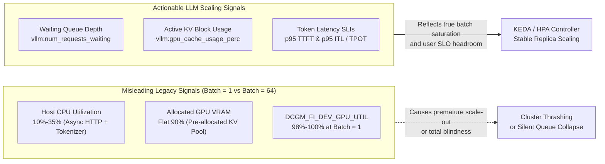
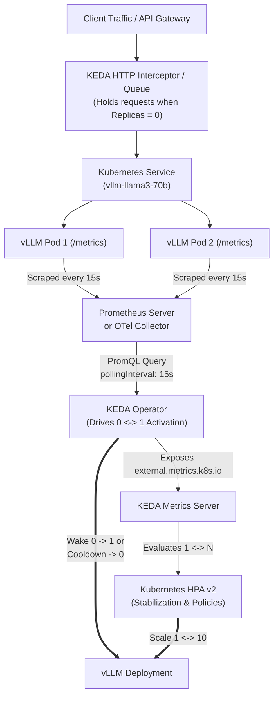

# 15.15 Autoscaling inference: HPA, KEDA and scale-to-zero

| Field | Value |
|---|---|
| Level | Advanced |
| Priority tier | 1 |
| Lab venue | GCP / GKE + Local Python Verification Lab |
| Part | Part 15: LLM inference and serving |
| Primary sources | *Generative AI on Kubernetes* Chapters 1–5; *Kubernetes for Generative AI Solutions* Chapters 6, 7, 10, 12; *LLMs in Production* Chapter 6; *Hands-On LLM Serving and Optimization* Chapters 2–5, 8, 9; *Distributed AI Systems* Chapter 9; *Scalable Kubernetes Infrastructure for AI Platforms* Chapter 4; *Production Kubernetes* Chapter 13; NVIDIA DevOps Volume 5 (`volume-05/03-ai-autoscaling-rag-masterclass.md`) and Volume 12 (`chapter-08` through `chapter-12`) |
| Cross-references | Chapter 11.6 (Kubernetes GPU Operator & DRA); Chapter 15.3 (vLLM PagedAttention); Chapter 15.6 (Triton Inference Server); Chapter 15.8 (Disaggregated prefill and decode); Chapter 15.14 (Inference benchmarking & SLOs); Chapter 15.16 (Production reliability & health probes) |
| Code | `code/part15/autoscaling_inference_keda.py`, `code/part15/autoscaling_inference_keda_lab.py` |
| Coverage file | `planning/coverage/chapters/15-15.md` |
| Claim & number ledger | `planning/ledgers/15-15.md` |

## Why this matters for AI infrastructure

Stateless web microservices scale predictably on CPU and memory utilization. When incoming HTTP traffic doubles, processor usage rises proportionally. A Kubernetes HorizontalPodAutoscaler then launches lightweight containers that become ready in a few seconds. Large language model serving breaks every assumption behind that traditional control loop.

In a modern serving engine such as vLLM, SGLang, or TensorRT-LLM, the host CPU only parses HTTP requests, runs fast tokenization, and dispatches asynchronous GPU kernels. Meanwhile, the engine pre-allocates nearly all GPU High-Bandwidth Memory at startup to store model weights and the PagedAttention KV cache pool. A single active user streaming tokens in a continuous batching loop keeps the GPU kernel engine active nearly 100 percent of the time.

```text
LLM Autoscaling Physics and Reference Numbers (Volume 5 Ch. 3, Volume 12 Ch. 8-11, GAK Ch. 4, HLS Ch. 5 & 9):
- Static VRAM Pre-Allocation (GAK Ch. 4 Example 4-3 on an 80 GB GPU):
  total_gpu_memory = 79.14 GiB * gpu_memory_utilization (0.90) = 71.22 GiB allocated at startup
  Breakdown: 14.99 GiB model weights + 0.12 GiB non-torch + 1.19 GiB peak activations + 54.93 GiB KV cache pool
  Result: GPU memory utilization sits flat at 90% whether 0, 1, or 64 requests are running.
- 8B FP16 Model Memory Growth (GAK Ch. 4 sidebar, context = 2048):
  Batch size 1: 16 GB weights + 1 GB infra (300 MB-2 GB) + 900 MB activations (200-300 MB at 512) + 400 MB output = 17.3 GB (18.3 GB with full infra reserve)
  Batch size 10: KV cache and activation expansion push total VRAM past 28 GB (28.1 GB).
- Why DCGM_FI_DEV_GPU_UTIL Fails Under Continuous Batching (Volume 5 Ch. 3, LLP Ch. 6):
  A single autoregressive decode stream (batch = 1) runs a forward pass every 18-42 ms, driving DCGM_FI_DEV_GPU_UTIL to 98%-100% while true SM occupancy (DCGM_FI_PROF_SM_ACTIVE) is under 2%.
- Cold-Start Penalty for Llama-3-70B (140 GB FP16 weights):
  Uncached cloud node boot (90-120 s) + 5 GB runtime image pull (20-60 s) + 140 GB weight load over shared storage (112-280 s) + CUDA Graph capture (8-20 s) = 2 to 8 minutes.
```

Wiring standard CPU, memory, or raw GPU utilization metrics into an untuned autoscaler triggers three severe production failures.

- **Single-request thrashing and premature scale-out**: One request drives GPU activity near 100 percent, so an autoscaler watching raw GPU utilization scales the deployment to its maximum replica ceiling during light traffic. Conversely, a tiny queue threshold of 5 on a fast 8B model causes a brief burst of 50 requests to trigger eight new GPU pods. Those pods take 60 seconds to boot, long after the original two pods cleared the burst in under two seconds.
- **Scale-down amputation during micro-lulls**: By default, the Kubernetes HorizontalPodAutoscaler can remove 100 percent of excess replicas every 15 seconds after a 300-second window. Terminating a multi-GPU pod takes seconds, but replacing it when traffic returns requires minutes of weight loading. Brief traffic dips therefore turn into prolonged latency outages.
- **Shared-storage probe cascades**: When an autoscaler launches eight new Llama-3-70B pods at once and each pod pulls 140 GB of weights from a shared NFS volume, storage bandwidth saturates. If existing pods use a tight one-second readiness probe on the main engine thread, transient I/O stalls cause Kubernetes to mark all healthy pods unready. The cluster then drops 100 percent of user traffic.

**Autoscaling LLM inference requires replacing hardware utilization signals with queue depth, KV cache saturation, and token latency metrics, while pairing asymmetric scale-down policies with sub-minute weight streaming**.

## Prerequisites and outcomes

### Prerequisites
- Review Kubernetes GPU scheduling, Node Feature Discovery, GPU Feature Discovery, and the NVIDIA GPU Operator from Chapter 11.6.
- Review continuous batching, PagedAttention block tables, and chunked prefill mechanics from Chapters 15.2 and 15.3.
- Review inference latency decomposition into Time to First Token and Inter-Token Latency from Chapter 15.14.

### Outcomes
- Explain why CPU usage, pre-allocated GPU memory, and `DCGM_FI_DEV_GPU_UTIL` fail as LLM scaling signals, and distinguish compute occupancy from memory bandwidth saturation.
- Design PromQL scaling queries around `vllm:num_requests_waiting`, `vllm:gpu_cache_usage_perc`, TTFT and ITL histograms, and NVIDIA Triton ensemble queue counters.
- Configure Kubernetes HPA v2 stabilization windows, asymmetric scale-up and scale-down policies, and rolling-update GPU surge budgets without triggering VPA conflicts.
- Architect event-driven autoscaling and scale-to-zero pipelines using KEDA ScaledObjects, the KEDA HTTP Add-on, KServe Standard and Knative modes, and the llm-d Workload Variant Autoscaler.
- Minimize pod and node cold-start latency using Karpenter, OCI modelcars, Kubernetes native OCI image volume mounts, Run:ai Model Streamer, and NVIDIA GPUDirect Storage.

---

## 1. Why Legacy Autoscaling Signals Fail for LLM Serving

### 1.1 The Decoupling of CPU, Memory, and GPU Activity

In a traditional web application, every incoming HTTP request allocates heap memory and consumes CPU cycles proportional to its work. When concurrency rises, both CPU and memory climb linearly. LLM inference engines invert this relationship by isolating token generation inside pre-allocated GPU memory pools.

When vLLM starts on an 80 GB GPU with `--gpu-memory-utilization 0.90`, it profiles the model and reserves 90 percent of physical VRAM before serving a single user request. On an H100 reporting 79.14 GiB of usable device memory, vLLM claims 71.22 GiB at startup. For an 8B parameter model in 16-bit precision, the weights consume 14.99 GiB, peak PyTorch activations take 1.19 GiB, and the remaining 54.93 GiB is locked into the PagedAttention KV cache pool.

Because those KV blocks remain reserved by the process for its entire lifetime, container memory metrics and `DCGM_FI_DEV_FB_USED` report a flat 90 percent utilization whether the pod is idle or serving 64 concurrent streams. Host CPU utilization is equally flat when sized properly. Once a Rust tokenizer and asynchronous API server are in place, host CPU usage stays below 35 percent even when the GPU KV cache is full. Ironically, if an engineer under-provisions host CPU cores for the HTTP layer, the pod throttles on CPU before requests ever reach the GPU, preventing a GPU-based autoscaler from ever firing.

### 1.2 Why `DCGM_FI_DEV_GPU_UTIL` Misleads Under Continuous Batching

When teams realize CPU and memory remain flat, their first instinct is to scale on `DCGM_FI_DEV_GPU_UTIL` exported by NVIDIA DCGM Exporter. In production LLM serving, raw GPU utilization is a trap.

`DCGM_FI_DEV_GPU_UTIL` measures the percentage of time over a sampling interval during which at least one CUDA kernel was executing on any Streaming Multiprocessor. It does not measure how many Streaming Multiprocessors are occupied or how full the matrix multiplication tiles are. Under iteration-level continuous batching, a single user generating a 500-token response forces the GPU to run 500 consecutive decode steps back to back. During those several seconds, a CUDA kernel runs on the GPU nearly 100 percent of the time, even though 98 percent of the GPU compute units sit idle waiting for HBM weight reads.



To distinguish between a lightly loaded GPU running a single decode stream and a truly saturated GPU, operators must separate engine-level queue and cache metrics from low-level DCGM hardware counters.

| Metric Name | Source | What It Actually Measures | Behavior at Batch = 1 | Behavior at Batch = 64 | Suitable for Autoscaling? |
|---|---|---|---|---|---|
| `container_cpu_usage_seconds_total` | Kubelet / cAdvisor | Host CPU core time for HTTP and tokenization | 5% to 10% | 25% to 45% | No. Only reflects API overhead. |
| `DCGM_FI_DEV_FB_USED` | DCGM Exporter (`:9400`) | Total GPU HBM allocated by CUDA context | 90% (flat) | 90% (flat) | No. Static PagedAttention reservation. |
| `DCGM_FI_DEV_GPU_UTIL` | DCGM Exporter (`:9400`) | Fraction of time any CUDA kernel is active | 98% to 100% | 100% | No. Saturates on 1 active request. |
| `DCGM_FI_PROF_SM_ACTIVE` | DCGM Exporter (`:9400`) | Fraction of SMs actively executing warps | 1% to 3% (decode) | 65% to 92% | Diagnostic only (compute saturation). |
| `DCGM_FI_DEV_MEM_COPY_UTIL` | DCGM Exporter (`:9400`) | HBM memory controller bandwidth utilization | 60% to 75% | 85% to 95% | Secondary signal (decode bandwidth). |
| `vllm:num_requests_waiting` | vLLM Engine (`:8000`) | Requests queued in `WAITING` state | 0 | 15 to 100+ | **Yes (Primary backlog trigger).** |
| `vllm:gpu_cache_usage_perc` | vLLM Engine (`:8000`) | Fraction of PagedAttention KV blocks in use | 1% to 2% | 80% to 100% | **Yes (Primary memory capacity trigger).** |
| `vllm:time_to_first_token_seconds` | vLLM Engine (`:8000`) | Prefill + queue latency histogram | 35 to 110 ms | 280 to 4,800 ms | **Yes (Direct prefill SLO trigger).** |

Pipeline parallelism adds a second trap for hardware utilization metrics. When a model is partitioned across nodes using pipeline parallelism, sequential stage dependencies introduce pipeline bubbles where downstream GPUs briefly wait for upstream activations. Consequently, average GPU utilization across a pipeline-parallel group never reaches 100 percent even when the admission queue is overflowing.

Before you configure any autoscaler for an LLM service, remove CPU, memory, and `DCGM_FI_DEV_GPU_UTIL` from its scaling triggers and expose the serving engine metrics endpoint to Prometheus.

---

## 2. Custom Prometheus Metrics: Queue Depth, KV Cache, and Latency SLIs

### 2.1 Scaling on Scheduler Queue Depth (`vllm:num_requests_waiting`)

Every production LLM serving engine maintains two internal scheduling queues. The `RUNNING` queue holds sequences actively using PagedAttention KV blocks in the current continuous batch. The `WAITING` queue holds newly arrived requests waiting for either token budget or free KV cache blocks. In vLLM, these queues are exported on `/metrics` as `vllm:num_requests_running` and `vllm:num_requests_waiting`.

A golden rule of LLM cost engineering is to never scale up at a queue depth of 1. If your autoscaler adds a new GPU replica the moment a single request waits, your realized batch size stays near 1. That configuration ruins GPU throughput and inflates cost per million tokens by an order of magnitude. Instead, each GPU replica should fill its active batch first and accumulate a modest admission queue before spawning additional replicas.

In a multi-replica deployment, querying the raw sum of waiting requests is insufficient. You must normalize the backlog by the number of active replicas. The standard PromQL trigger query divides total waiting requests by the count of running instances.

```text
PromQL Queue-Depth Trigger for vLLM (Volume 5, Chapter 3):
  Query:
    sum(vllm:num_requests_waiting{model_name="llama3-70b"})
    /
    count(vllm:num_requests_running{model_name="llama3-70b"})
  Target Threshold: 20 waiting requests per active replica

PromQL Bottleneck Queue Delay Trigger for NVIDIA Triton Inference Server (Volume 5, Chapter 3 Appendix):
  Query:
    sum(nv_inference_queue_duration_us{model="vision-trt"})
    /
    sum(nv_inference_request_success{model="vision-trt"}) > 500000
  Target Threshold: 500,000 microseconds (0.5 seconds average queue wait)
  Engine Context: Paired with dynamic_batching { preferred_batch_size: [32, 64, 128], max_queue_delay_microseconds: 50000 }
```

When serving multi-model ensembles on NVIDIA Triton Inference Server, do not scale the deployment on the front-end ensemble wrapper. Instead, target the bottleneck model average queue wait time by dividing `nv_inference_queue_duration_us` by `nv_inference_request_success`. When the dynamic batcher uses a 50-millisecond delay window, an average queue wait exceeding 500,000 microseconds proves the GPU instance groups are saturated.

### 2.2 Scaling on KV Cache Saturation (`vllm:gpu_cache_usage_perc`)

Queue depth alone can miss silent memory exhaustion during long-context workloads. Suppose a Llama-3-70B replica configured with a 64-sequence limit receives 25 RAG requests, each carrying an 8,192-token document context. Because 25 is well below the 64-sequence concurrency limit, `vllm:num_requests_waiting` remains 0. However, those 25 long-context sequences consume nearly 100 percent of the physical PagedAttention KV blocks.

When the next token generation step requires a new KV block and none are free, the vLLM scheduler must preempt running sequences. It logs swap or recompute warnings and increments `vllm:num_preemptions_total`. Once preemption starts, Inter-Token Latency spikes from 18 ms to over 850 ms, and throughput collapses.

To prevent preemption storms, production clusters scale proactively on KV cache block utilization via `vllm:gpu_cache_usage_perc`, exported as a ratio from 0.0 to 1.0.

| Operating Zone | `vllm:gpu_cache_usage_perc` Range | Scheduler & Memory State | Autoscaling & Gateway Action |
|---|---|---|---|
| **Safe Zone** | `0.00` to `0.80` (0%–80%) | Zero preemptions; full continuous batching headroom for new prefill chunks | Normal operation; allow scale-down only below `0.35` after stabilization window. |
| **Warning Zone** | `0.80` to `0.90` (80%–90%) | High efficiency; a sudden burst of long prompts could exhaust free KV blocks | **Trigger KEDA / HPA scale-up at `0.80` (80%)** so new pods warm up before exhaustion. |
| **Emergency Zone** | `> 0.90` to `1.00` (90%–100%) | Active sequence preemption (`SWAP` / `RECOMPUTE`); `vllm:num_preemptions_total > 0` | Trip API gateway circuit breaker at `0.95` (HTTP 429 / fallback to 8B model or cloud API). |

### 2.3 Scaling on Token Latency SLIs (TTFT and ITL) and `llm-d` WVA

Queue depth and KV cache utilization measure internal engine pressure. Time to First Token and Inter-Token Latency measure the actual user experience. In OpenMetrics and Prometheus, vLLM exports `vllm:time_to_first_token_seconds_bucket` and `vllm:time_per_output_token_seconds_bucket`, while OpenTelemetry semantic conventions standardize on `gen_ai.server.time_to_first_token` and `gen_ai.server.time_per_output_token`.

```text
PromQL Latency SLI Queries and Production Targets (Volume 5 Ch. 3, Volume 12 Ch. 10, GAK Ch. 5):
1. p95 Time to First Token (Prefill + Queueing SLI):
   histogram_quantile(0.95, sum(rate(vllm:time_to_first_token_seconds_bucket[5m])) by (le))
   Target SLO: < 0.200 s (200 ms) for interactive chat; < 1.0 s (1,000 ms) for long-context RAG.
2. p95 Inter-Token Latency / TPOT (Decode Bandwidth SLI):
   histogram_quantile(0.95, sum(rate(vllm:time_per_output_token_seconds_bucket[5m])) by (le))
   Target SLO: < 0.025 s (25 ms/token, or 40 tok/s) for real-time assistants; alert at > 0.040 s (40 ms).
   Human reading baseline: ~180 words/min (~3 words/s, or 4-5 tok/s minimum in GAK Ch. 5; 11 tok/s comfortable stream in LLP Ch. 6).
3. Pod Output Token Throughput (GTPS):
   sum(rate(vllm:generation_tokens_total[1m])) by (pod)
```

For heterogeneous workloads where prompt lengths vary from 64 tokens to 32,000 tokens, the llm-d project introduces the **Workload Variant Autoscaler (WVA)**. Instead of treating every request as an identical unit, WVA inspects each replica token processing capacity and accounts for variable input and output token distributions. It then scales replica pools directly against p95 TTFT and TPOT latency targets. In disaggregated serving architectures, WVA independently scales compute-bound prefill replicas when TTFT rises and memory-bandwidth-bound decode replicas when KV cache usage or ITL rises.

Always combine a fast leading indicator such as queue depth or KV cache usage at 80 percent with a lagging latency SLI so your cluster scales out before users feel latency degradation.

---

## 3. Kubernetes HPA Mechanics, Stabilization Windows, and Scaling Policies

### 3.1 The HPA Control Loop Equation and Deadband Tolerance

Whether you configure a native Kubernetes HorizontalPodAutoscaler with Prometheus Adapter or let KEDA manage the HPA object on your behalf, the Kubernetes HPA controller executes the underlying replica calculation. Every 15 seconds by default, the controller queries the registered metrics API and evaluates the ratio between current metric values and the target value.

```text
Kubernetes HPA Replica Calculation Equation (LLP Ch. 6, K8GS Ch. 6):
  desiredReplicas = ceil[ currentReplicas * ( currentMetricValue / desiredMetricValue ) ]

Deadband Tolerance Rule:
  Default --horizontal-pod-autoscaler-tolerance = 0.10 (10%)
  If 0.90 <= (currentMetricValue / desiredMetricValue) <= 1.10, HPA makes no change.

Worked Example (code/part15/autoscaling_inference_keda.py):
  - Current state: currentReplicas = 3, desiredMetricValue = 20.0 waiting requests/pod
  - Case A (Small fluctuation): currentMetricValue = 21.5 -> ratio = 1.075 (within 10% tolerance) -> desiredReplicas = 3
  - Case B (Traffic surge): currentMetricValue = 50.0 -> ratio = 2.50 -> raw desiredReplicas = ceil(3 * 2.50) = 8 replicas
```

When multiple metrics are specified in a single HPA or KEDA configuration, the HPA controller evaluates the formula for each metric independently. It then selects the **maximum** desired replica count across all triggers.

### 3.2 Tuning Stabilization Windows and Asymmetric Scaling Policies

Relying on default HPA scaling behavior is one of the most destructive mistakes in production LLM operations. The default scale-up stabilization window of 0 seconds reacts quickly to traffic surges. However, the default scale-down policy allows Kubernetes to terminate **100 percent of excess pods every 15 seconds** once the 300-second stabilization window elapses.

For a stateless Go microservice that boots in 800 milliseconds, dropping from 10 pods to 2 pods in 15 seconds is harmless. For a Llama-3-70B deployment where each pod claims four or eight H100 GPUs and takes two to five minutes to initialize, terminating pods is a semi-irreversible action. If a brief two-minute lull triggers an aggressive scale-down, the next traffic wave hits the surviving replicas while replacement pods are stuck loading 140 GB of weights.

```yaml
# Production HPA v2 Behavior Block for LLM Serving (VL5 Ch. 3, K8GS Ch. 6, LLP Ch. 6)
behavior:
  scaleUp:
    stabilizationWindowSeconds: 0
    selectPolicy: Max
    policies:
      - type: Percent
        value: 100
        periodSeconds: 15
      - type: Pods
        value: 2
        periodSeconds: 15
  scaleDown:
    stabilizationWindowSeconds: 300
    selectPolicy: Min
    policies:
      - type: Pods
        value: 1
        periodSeconds: 60
      - type: Percent
        value: 10
        periodSeconds: 300
```

This asymmetric `behavior` configuration enforces three critical invariants.

- **Immediate, bounded scale-up**: With a 0-second stabilization window and `selectPolicy: Max`, the cluster responds immediately to queue or KV cache spikes. It doubles replicas or adds at least 2 pods every 15 seconds. For our 3-replica cluster needing 8 raw replicas, the 100 percent policy caps the single-step jump to 6 replicas in the first 15-second tick. That cap prevents a single telemetry spike from exhausting cluster quota.
- **Lookback peak tracking**: During scale-down, the HPA controller inspects all desired replica recommendations computed over the past 300 to 600 seconds and scales to the highest recommendation in that window. This stabilization window must always exceed your pod end-to-end deployment and warmup time.
- **Gradual scale-down**: Even after traffic remains low for 5 full minutes, `selectPolicy: Min` drains at most 1 pod per minute. That pacing gives the load balancer time to finish active streaming connections gracefully.

### 3.3 Why VPA Conflicts with HPA and How to Size Rolling Updates

Kubernetes also offers the VerticalPodAutoscaler, which adjusts container CPU and memory requests and limits across four operating modes. The `Off` mode only generates sizing recommendations, which tools like Fairwinds Goldilocks display. The `Initial` mode applies recommendations only at pod creation. The `Recreate` and `Auto` modes evict and restart running pods to apply new resource sizes.

**Never run VPA in Auto or Recreate mode alongside HPA on the same LLM deployment**. First, Kubernetes GPUs cannot be vertically resized in place. Second, when VPA mutates a pod CPU or memory request and evicts the pod, it fights the HPA utilization ratio calculation and destroys the pod in-memory GPU KV cache. Use VPA strictly in `Off` mode with Goldilocks in staging to right-size the host CPU and RAM requests of your vLLM container.

A related capacity trap occurs during Deployment rolling updates. Suppose your cluster runs a 5-replica deployment where each replica requests an entire 8-GPU node, consuming 40 GPUs total, and your cluster has zero idle 8-GPU nodes. Under standard web defaults where `maxSurge` is 1 and `maxUnavailable` is 0, Kubernetes attempts to schedule a sixth 8-GPU pod before terminating any old pod. Because no spare 8-GPU node exists, the new pod sits in `Pending` and the rollout deadlocks forever. In GPU-constrained clusters without dedicated surge capacity, you must either provision temporary burst capacity via Karpenter or set `maxSurge: 1` and `maxUnavailable: 3`. That setting allows three replicas to terminate first, freeing 24 GPUs while two replicas remain online so replacement pods can schedule.

Always set your HPA scale-down stabilization window longer than your worst-case model cold-start time, and restrict scale-down policies to a single pod per minute.

---

## 4. KEDA Architecture, `ScaledObject`, Scale-to-Zero, and KServe Concurrency

### 4.1 Why KEDA Replaces `prometheus-adapter` for AI Factories

To feed custom Prometheus metrics into a standard Kubernetes HPA, platform teams historically deployed `prometheus-adapter`. However, `prometheus-adapter` has two severe limitations in multi-tenant AI clusters. First, every new PromQL scaling query must be written into a global cluster ConfigMap using complex regex discovery rules, requiring cluster-admin privileges for every model team. Second, native Kubernetes HPA enforces a hard lower bound of 1 replica. It cannot scale a deployment down to zero or wake it from zero.

**Kubernetes Event-Driven Autoscaling (KEDA)** solves both problems. KEDA runs three control-plane components inside the cluster.

- **The KEDA Operator (`keda-operator`).** Polls external event sources such as Prometheus, Kafka, RabbitMQ, AWS SQS, or OpenTelemetry at a configurable polling interval of 15 seconds. Crucially, the operator directly controls the 0-to-1 and 1-to-0 replica transitions on the target Deployment or StatefulSet.
- **The KEDA Metrics Server (`keda-operator-metrics-apiserver`).** Registers as the cluster `external.metrics.k8s.io` provider and feeds evaluated trigger metrics to the native Kubernetes HPA controller, which manages scaling between 1 and N replicas.
- **The KEDA Admission Webhooks (`keda-admission-webhooks`).** Validates ScaledObject manifests to prevent conflicting scalers from targeting the same workload.



### 4.2 Production KEDA `ScaledObject` and KServe Integration

A KEDA ScaledObject encapsulates the target workload, replica bounds, polling and cooldown intervals, HPA behavior overrides, failure fallback replicas, and Prometheus triggers in a single namespace-scoped manifest.

```yaml
apiVersion: keda.sh/v1alpha1
kind: ScaledObject
metadata:
  name: vllm-llama3-70b-scaler
  namespace: ai-factory
spec:
  scaleTargetRef:
    apiVersion: apps/v1
    kind: Deployment
    name: vllm-llama3-70b
  minReplicaCount: 1
  maxReplicaCount: 10
  pollingInterval: 15
  cooldownPeriod: 300
  fallback:
    failureThreshold: 3
    replicas: 4
  advanced:
    restoreToOriginalReplicaCount: true
    horizontalPodAutoscalerConfig:
      behavior:
        scaleDown:
          stabilizationWindowSeconds: 300
          selectPolicy: Min
          policies:
            - type: Pods
              value: 1
              periodSeconds: 60
        scaleUp:
          stabilizationWindowSeconds: 0
          selectPolicy: Max
          policies:
            - type: Percent
              value: 100
              periodSeconds: 15
  triggers:
    - type: prometheus
      metadata:
        serverAddress: http://prometheus-operated.monitoring.svc.cluster.local:9090
        threshold: "20"
        activationThreshold: "1"
        query: |
          sum(vllm:num_requests_waiting{model_name="llama3-70b"})
          /
          clamp_min(count(vllm:num_requests_running{model_name="llama3-70b"}), 1)
    - type: prometheus
      metadata:
        serverAddress: http://prometheus-operated.monitoring.svc.cluster.local:9090
        threshold: "0.80"
        query: |
          max(vllm:gpu_cache_usage_perc{model_name="llama3-70b"})
```

Notice two production safeguards in this ScaledObject. First, the `fallback` block guarantees that if Prometheus becomes unreachable for 3 consecutive polls, KEDA pins the deployment at 4 safe replicas instead of scaling down or crashing. Second, wrapping `count(vllm:num_requests_running)` in `clamp_min` with a lower bound of 1 prevents PromQL from returning `NaN` when all pods are temporarily restarting or scaled to zero.

In KServe, you can choose between three deployment modes depending on your scaling and traffic architecture.

- **Standard mode (`serving.kserve.io/deploymentMode: Standard`).** Creates a standard Kubernetes Deployment without Knative or Istio sidecars. By adding `serving.kserve.io/autoscalerClass: "keda"`, KServe automatically generates the KEDA ScaledObject from the InferenceService specification. It supports either `PodMetric` scraping via a local OpenTelemetry sidecar or `External` queries against cluster Prometheus. KServe 0.16 further introduces LLMInferenceService and LLMInferenceServiceConfig on top of Standard mode to wire KV-cache-aware routing and multi-node parallelism.
- **Knative mode (`serving.kserve.io/deploymentMode: Knative`).** Wraps each predictor in a Knative Service using the Knative Pod Autoscaler. Every pod receives a `queue-proxy` sidecar that enforces `containerConcurrency` and reports active request concurrency to the autoscaler. KPA evaluates a **60-second stable window** during normal operation, but automatically switches to a **6-second panic window** whenever short-term concurrency reaches **200 percent** of the target. Because Knative injects both `queue-proxy` and Istio sidecars, KServe provides the `qpext` metric aggregator via `serving.kserve.io/enable-metric-aggregation: "true"` so Prometheus can scrape both vLLM and sidecar metrics from a single port.
- **ModelMesh mode.** Designed for high-density packing of thousands of small predictive ML models. It is unsuitable for large foundation models.

### 4.3 The Mechanics of Scale-to-Zero (`minReplicaCount: 0`)

Setting `minReplicaCount: 0` in KEDA or Knative eliminates GPU spend during idle nights, weekends, or low-volume LoRA endpoints. However, **you cannot wake a deployment from 0 replicas using pod-internal metrics alone**. When `replicas` equals 0, no vLLM pods are running, so `vllm:num_requests_waiting`, `vllm:gpu_cache_usage_perc`, and `DCGM_FI_DEV_GPU_UTIL` do not exist.

To wake a model from zero, the architecture must include an **external request buffer** that remains in the data path even when zero GPU pods exist.

- **Asynchronous Queue Broker.** For batch, document-ingestion, or asynchronous agent tasks, requests land in a durable queue such as Amazon SQS, Kafka, or RabbitMQ. When queue depth exceeds the activation threshold, KEDA scales the deployment from 0 to 1, and HPA scales from 1 to N.
- **KEDA HTTP Add-on Interceptor.** For synchronous HTTP APIs in Standard mode, client traffic routes to the KEDA HTTP interceptor proxy service. When the backend deployment has 0 endpoints, the interceptor holds the incoming HTTP connection open in an in-memory pending queue and signals KEDA to wake the deployment from 0 to 1. Once the new pod passes its `/health` readiness probe, the interceptor forwards the held request.
- **Knative Activator.** In KServe Knative mode, when a revision scales to zero after its idle window, Knative swaps the Activator into the network data path. When a request arrives, the Activator buffers the HTTP request, triggers KPA to launch a pod, and proxies the request once `queue-proxy` reports ready.

Use scale-to-zero only for bursty, non-critical, or small-to-medium models where cold starts can be engineered below 30 seconds, or pair it with a gateway fallback to a warm shared endpoint.

---

## 5. Cold-Start Anatomy: Image Pulls, Node Provisioning, and Weight Streaming

### 5.1 Deconstructing the Five Phases of an LLM Cold Start

Dynamic autoscaling fails if a newly requested replica takes seven minutes to serve its first token. To engineer sub-minute scale-out, you must decompose cold-start latency into its five sequential physical stages.

```text
End-to-End LLM Cold-Start Equation (GAK Ch. 2 & 4, VL5 Ch. 3, HLS Ch. 5, K8GS Ch. 6):
  T_cold = T_node_provision + T_image_pull + T_init + T_weight_load + T_cuda_graph_warmup

Stage Breakdown for Llama-3-70B (140 GB FP16 weights):
1. T_node_provision (Cluster Autoscaler vs Karpenter):
   - Legacy Cluster Autoscaler (ASG node groups): 180 to 480 seconds
   - Karpenter (NodePool + EC2NodeClass): ~33.66 ms pod match + ~117 seconds VM boot & driver init
   - Pre-warmed Standby Node / Warm Pool: 0 seconds (node already Ready)
2. T_image_pull (vLLM + CUDA runtime image ~5 GB):
   - Uncached pull (imagePullPolicy: Always @ 0.25 GB/s): ~20 to 60 seconds
   - Pre-pulled image (imagePullPolicy: IfNotPresent): 0 seconds
3. T_init (Python interpreter + Uvicorn + CUDA context init): ~1.0 second
4. T_weight_load (140 GB FP16 weights from storage -> Host DRAM -> PCIe Gen5 -> GPU HBM):
   - Remote S3 / Hugging Face Hub download (0.5 GB/s): 280.0 seconds
   - Shared NFS PVC (10 Gbps = 1.25 GB/s single pod): 112.0 seconds (or ~900 s when 8 pods contend)
   - Local NVMe SSD single-thread safetensors (7.0 GB/s): 20.0 seconds
   - Local NVMe / PVC + Run:ai Model Streamer (16 threads @ 11.2 GB/s): 12.5 seconds
   - Local NVMe RAID + NVIDIA GPUDirect Storage (GDS cuFile DMA @ 28.0 GB/s): 5.0 seconds
5. T_cuda_graph_warmup (KV pool profiling + CUDA Graph capture): 8.0 seconds
```

### 5.2 Node Autoscaling: Cluster Autoscaler vs. Karpenter and Pre-Warmed Standby Nodes

When HPA or KEDA increases a deployment replica count and existing GPU nodes are full, the new pods enter `Pending` with `Insufficient nvidia.com/gpu`. At that point, node-level autoscaling takes over.

Traditional Cluster Autoscaler polls predefined cloud Auto Scaling Groups or GKE Node Auto-Provisioning limits and provisions fixed-template nodes. By contrast, **Karpenter** watches unschedulable pods directly via the Kubernetes API server, solves bin-packing constraints in **33.66 milliseconds**, and provisions optimal GPU instances using `NodePool` and `EC2NodeClass` resources. When jobs finish or KEDA scales pods down, Karpenter `WhenEmptyOrUnderutilized` consolidation automatically applies the `karpenter.sh/disrupted:NoSchedule` taint, drains empty nodes, and terminates the cloud instance within minutes.

However, even Karpenter requires roughly 90 to 120 seconds for the cloud hypervisor to boot the VM, load the NVIDIA kernel driver, and register the device plugin. To eliminate node provisioning time completely for latency-critical services, AI factories maintain **Pre-Warmed Standby Nodes**. In this pattern, GPU nodes stay booted and joined to the cluster running low-priority, preemptible batch jobs assigned a low Kubernetes PriorityClass. When KEDA scales up a high-priority vLLM pod, the Kubernetes scheduler immediately preempts the batch pod in 0 seconds of node boot time and schedules the inference pod on the warm GPU.

### 5.3 Storage Packaging and Weight Streaming (`modelcar`, OCI Volumes, `runai_streamer`, `GDS`)

Once the pod is scheduled on a node, two rules govern container image startup.

- **Never bake 140 GB model weights into the application container image**: Baking weights into the Docker image creates a monolithic 145 GB artifact that bloats registry pulls on every code change. It also doubles disk usage during extraction and exposes proprietary weights inside standard container registries.
- **Set `imagePullPolicy: IfNotPresent` and pin immutable image digests**: The vLLM runtime container image is roughly 5 GB because it bundles CUDA user-space libraries. Pre-pulling that 5 GB runtime image via a DaemonSet or cloud VPC endpoint reduces `T_image_pull` to 0 seconds.

For mounting and loading the model weights themselves, five production architectures exist across modern Kubernetes AI platforms.

| Weight Delivery Strategy | How It Works | Storage Efficiency | Startup Time (`140 GB` `70B` / `16 GB` `8B`) | Key Operational Trade-Offs |
|---|---|---|---|---|
| **1. Remote S3 / HF Init-Container Copy** | `storage-initializer` downloads objects into node `emptyDir` on every pod start | Low (duplicates per pod) | `~426 s` (cold node) / `~289 s` (warm) | Slowest startup; saturates NAT/egress bandwidth unless KServe local NVMe cache is enabled. |
| **2. Shared `ReadOnlyMany` PVC (NFS / Ceph / Filestore)** | Mounts `/mnt/models` directly without copying files (`pvc://llama-pvc/`) | Highest (single shared copy) | `~121 s` (`70B` single pod) | Simple for 10–20 replicas, but concurrent scale-out saturates NFS I/O (`V12` Ch. 11 cascade). |
| **3. KServe OCI `modelcar` Sidecar** | `shareProcessNamespace: true`; sidecar symlinks `/proc/$$$$/root/models` -> `/mnt/models` (`< 10 MB` RAM) | High (shares OCI layers across LoRAs) | `~29 s` (cached OCI layers on NVMe) | Zero file copy; requires `shareProcessNamespace: true` (Incompatible with strict Istio sidecar isolation). |
| **4. K8s Native OCI Image Volume Mount (`1.31` / `1.35`)** | Mounts OCI model artifact directly via `volumes[].image` (`subPath: models`, read-only) | High (native kubelet layer cache) | `~29 s` (cached on local NVMe) | Cleanest Kubernetes-native standard; requires CRI-O `v1.33+` or containerd `v2.2.0+`. |
| **5. `Run:ai Model Streamer` / `Tensorizer` / `GDS`** | Multi-threaded streaming (`concurrency: 16`) or `cuFile` DMA directly from NVMe/S3 to GPU HBM | High (works with PVC, S3, or local NVMe) | **`21.5 s` (`70B`) / `6.5 s` (`8B`)** with Streamer; **`14.0 s` (`70B`)** with GDS | Fastest cold start; `runai_streamer` needs zero model repackaging (`GAK` Example 4-5). |

Let us examine why **Run:ai Model Streamer** and **NVIDIA GPUDirect Storage** achieve such dramatic speedups. In standard PyTorch and vLLM loading, a single CPU thread reads `.safetensors` files sequentially into host page cache. It then copies tensors into pinned DRAM at 50 to 200 GB/s and transfers them across PCIe to GPU HBM. By passing `--load-format runai_streamer` with 16 threads, vLLM streams tensor chunks in parallel directly from local NVMe or object storage into GPU memory without repackaging the model. When paired with **GPUDirect Storage** over local NVMe drives, the `cuFile` DMA engine transfers weight blocks directly from NVMe controllers across the local PCIe Gen5 switch into GPU HBM. That path bypasses CPU bounce buffers entirely and loads a 140 GB model in 5 seconds, achieving 14.0 seconds total pod readiness.

Eliminate network downloads from the scaling path by caching weights on local NVMe or OCI image volumes and enabling `--load-format runai_streamer` with 16 concurrent threads.

---

## 6. Production Failure Modes, Probe Design, and FinOps Cost Engineering

### 6.1 Failure Mode 1: Queue-Depth Thrashing on Fast Models

- **Symptom**: A Llama-3-8B deployment configured with KEDA scales violently from 2 replicas to 10 replicas every few minutes, sits idle for 5 minutes, and drops back to 2 replicas. User tail latency degrades during every scale-up wave despite low average utilization.
- **Root Cause**: The KEDA trigger was configured with a naive queue threshold of 5 on `vllm:num_requests_waiting`. Because Llama-3-8B processes batches rapidly at roughly 15 requests per second per replica, a micro-burst of 50 requests creates a momentary queue of 25 requests per pod. KEDA computes 10 desired replicas and launches 8 new pods. However, the 2 existing pods drain all 50 requests in **1.67 seconds**, whereas the 8 new pods take **60 seconds** to cold-start. By the time the 8 new pods become ready, the queue is 0, wasting 2,400 GPU-pod-seconds during the 300-second cooldown window.
- **Fix**: Raise the queue threshold to 100 to match the GPU batch capacity of 128 so micro-bursts are absorbed by continuous batching without spawning unneeded pods. Smooth the metric in PromQL with `avg_over_time(vllm:num_requests_waiting[1m])` or scale on queue wait time exceeding 2 seconds.

### 6.2 Failure Mode 2: Readiness Probe Cascading Outage During HPA Scale-Out

- **Symptom**: During a traffic surge, HPA scales a Llama-3-70B deployment from 4 replicas to 12 replicas. Within 90 seconds of scaling starting, all 4 original healthy pods are marked unready with HTTP 504 probe timeouts, causing a 100 percent cluster-wide HTTP 503 outage.
- **Root Cause**: All pods loaded 140 GB weights from a shared 10 Gbps NFS volume providing 1.25 GB/s aggregate bandwidth. When 8 new pods started pulling weights simultaneously at 156.25 MB/s per pod, shared storage I/O saturated completely. Because the deployment used an aggressive readiness probe hitting `/v1/models` with a 1-second timeout, the storage stall delayed the Python event loop on the 4 existing pods to **1.2 seconds**. Kubelet timed out at 1.0 second and removed all 4 healthy pods from the Service endpoints.
- **Fix**: Move weights off uncached shared NFS to local NVMe or OCI volumes, and decouple Kubernetes health probes into three distinct endpoints. Configure `startupProbe` on `/health` with `periodSeconds: 10` and `failureThreshold: 60` to allow 600 seconds for initial weight loading. Configure `readinessProbe` on `/health` with `timeoutSeconds: 5` to tolerate transient jitter. Configure `livenessProbe` on `/ping` with `timeoutSeconds: 3` and never execute a GPU forward pass inside a liveness check.

### 6.3 Failure Mode 3: Multi-Turn Prefix Cache Miss Storm Across Autoscaled Replicas

- **Symptom**: As KEDA scales a conversational RAG deployment from 2 pods to 10 pods behind a standard Round-Robin Kubernetes Service, p95 TTFT degrades by 3x to 5x even though per-pod request rate is low.
- **Root Cause**: Under Round-Robin routing across 10 pods, Turn 1 of a user conversation lands on Pod A, which computes and caches the 4,096-token system and RAG prefix in PagedAttention blocks. However, Turn 2 has a **90 percent probability** of landing on Pods B through J. The receiving pod suffers a prefix cache miss and must recompute the entire prefill from scratch, dropping the cluster prefix-cache hit rate from over 85 percent to roughly 10 percent.
- **Fix**: Deploy the **Kubernetes Gateway API Inference Extension** using an `InferencePool` backed by an Envoy External Processing Endpoint Picker service on port 9002, or configure `Chat-Session-ID` sticky session affinity at the Ingress gateway. The Endpoint Picker routes matching prefixes or session IDs to the warm replica. That routing preserves over 85 percent cache hit rates and cuts TTFT by up to 90 percent until that replica KV cache exceeds 95 percent saturation.

### 6.4 FinOps Cost Engineering: How Autoscaling Thresholds Govern `$/1M` Tokens

In an AI Factory, the ultimate measure of autoscaling efficiency is **Cost per 1 Million Tokens**.

```text
AI Factory FinOps Cost Equation (Volume 5, Chapter 3):
  Cost per 1M Tokens = ( Node_Cost_Per_Hour / 3600 ) / Throughput_tok_per_s * 1,000,000

Per-Tenant Chargeback PromQL Query (Volume 5, Chapter 3 Appendix):
  sum(
    increase(vllm:generation_tokens_total{tenant_id=~".*"}[1h]) * 0.000005
  ) by (tenant_id)
```

Let us compare how autoscaling thresholds and model quantization transform unit economics across real benchmarks from our sources.

| Hardware & Model Configuration | Hourly Cost (`$/hr`) | KV Cache Capacity (Tokens) | Realized Throughput (`tok/s`) | Cost per `1M` Tokens (`$`) | Engineering Interpretation |
|---|---|---|---|---|---|
| `8x H100 SXM` (`Llama-3-70B` FP16, `V12` Ch. 10 ShareGPT optimal batch) | `$49.60` (`8 * $6.20`) | `~128,000` | `2,658.76` (output) / `6,042.27` (total) | **`$5.18` (output)** / `$2.28` (total) | Optimal KEDA threshold (`20` waiting/pod) keeps continuous batches full. |
| `8x H100 SXM` (`Llama-3-70B` FP16, premature scale at `queue = 1`, `batch = 1`) | `$49.60` (`8 * $6.20`) | `~128,000` | `24.0` (output) | **`$574.07` (output)** | **110.82x cost penalty** from scaling up too early (`batch = 1`). |
| `1x L40S 48 GB` (`Qwen3-14B` BF16 `27.52 GiB` weights, `HLS` Ch. 9) | `$2.25` | `72,064` (`11.00 GiB` KV) | `474.38` (total) / `227.64` (output) | **`$1.32` (total)** / `$2.75` (output) | Weights consume `> 65%` of VRAM, capping max concurrency at `1.76x` (`40K` ctx). |
| `1x L40S 48 GB` (`Qwen3-14B-AWQ` 4-bit `9.36 GiB` weights, `HLS` Ch. 9) | `$2.25` | **`191,056` (`29.15 GiB` KV, `2.65x`)** | **`1,280.0` (total, `2.70x`)** | **`$0.49` (total, `-62.9%`)** | Quantization frees `17+ GiB` for KV cache (`4.66x` at `40K` ctx), cutting replica needs by `2.7x`. |

Quantizing weights from 16-bit to 4-bit AWQ or 8-bit FP8 does not merely accelerate matrix math. It expands the PagedAttention KV cache pool from 72,064 tokens to 191,056 tokens on the exact same 48 GB L40S GPU. Because each pod can hold 2.65x more concurrent tokens before `vllm:gpu_cache_usage_perc` hits the 80 percent scale-up threshold, the cluster requires 2.7x fewer GPU nodes to absorb peak traffic.

Before lowering your autoscaler threshold to chase a few milliseconds of latency, calculate the resulting drop in batch size and its multiplier on cost per million tokens.

---

## Commands and configurations that matter

### 1. Production KServe `InferenceService` with KEDA and OpenTelemetry / Prometheus (`GAK` Example 4-4)

```yaml
apiVersion: serving.kserve.io/v1beta1
kind: InferenceService
metadata:
  name: meta-llama-3-8b
  namespace: ai-factory
  annotations:
    serving.kserve.io/deploymentMode: Standard
    serving.kserve.io/autoscalerClass: "keda"
    serving.kserve.io/enable-prometheus-scraping: "true"
    sidecar.opentelemetry.io/inject: "meta-llama-3-8b"
spec:
  predictor:
    minReplicas: 1
    maxReplicas: 5
    model:
      modelFormat:
        name: huggingface
      storageUri: oci://quay.io/ai-factory/llama-3-8b-modelcar:v1
      args:
        - --model_name=llama3
        - --load-format=runai_streamer
        - --model-loader-extra-config={"concurrency":16}
        - --enable-chunked-prefill
        - --max-num-batched-tokens=2048
        - --gpu-memory-utilization=0.90
      resources:
        limits:
          nvidia.com/gpu: "1"
          cpu: "8"
          memory: 32Gi
    autoScaling:
      metrics:
        - type: PodMetric
          podmetric:
            metric:
              backend: "opentelemetry"
              metricNames:
                - vllm:num_requests_running
              query: "vllm:num_requests_running"
            target:
              type: Value
              value: "4"
```

### 2. Kubernetes Gateway API Inference Extension `InferencePool` (`GAK` Example 4-7)

```yaml
apiVersion: inference.networking.k8s.io/v1
kind: InferencePool
metadata:
  name: vllm-llama3-8b-instruct
  namespace: ai-factory
spec:
  targetPorts:
    - number: 8000
  selector:
    app: vllm-llama3-8b-instruct
  endpointPickerRef:
    name: vllm-llama3-8b-epp
    port: 9002
    failureMode: FailClose
---
apiVersion: inference.networking.x-k8s.io/v1alpha2
kind: InferenceObjective
metadata:
  name: high-priority-chat
  namespace: ai-factory
spec:
  priority: 1
  poolRef:
    group: inference.networking.k8s.io
    name: vllm-llama3-8b-instruct
```

### 3. Diagnostic Commands for Autoscaling, Probes, and Cold Starts

```bash
# 1. Inspect live vLLM queue, KV cache usage, and preemption counters on a pod
kubectl exec -n ai-factory deploy/vllm-llama3-70b -- \
  curl -s http://localhost:8000/metrics | grep -E "vllm:(num_requests_waiting|num_requests_running|gpu_cache_usage_perc|num_preemptions_total)"

# 2. Verify KEDA ScaledObject status, active triggers, and underlying HPA events
kubectl get scaledobject,hpa -n ai-factory
kubectl describe hpa keda-hpa-vllm-llama3-70b-scaler -n ai-factory

# 3. Measure Karpenter GPU node provisioning latency and consolidation events
kubectl logs -n kube-system -l app.kubernetes.io/instance=karpenter --tail=50 | grep -E "found provisionable pod|initialized nodeclaim|tainted node|deleted node"
```

---

## Hands-on lab

### Venue and Scope
- **Primary venue.** Local Python verification lab using `code/part15/autoscaling_inference_keda.py` and `code/part15/autoscaling_inference_keda_lab.py`, plus Kubernetes manifests for GCP GKE or AWS EKS.
- **Verification note.** The deterministic Python verification lab below was executed locally and passed all 28 self-checks. The multi-node GKE and EKS Kubernetes manifests are configuration templates not verified on live GPU hardware during this local run.

### Part 1: Run the Self-Checking Autoscaling & Cold-Start Verification Lab

Run `python3 code/part15/autoscaling_inference_keda_lab.py` from the repository root to verify all 28 chapter models.

```bash
python3 code/part15/autoscaling_inference_keda_lab.py
```

Expected output.

```text
=== Chapter 15.15 Lab: Autoscaling Inference (HPA, KEDA, and Scale-to-Zero) ===
  [PASS] 1. GAK Example 4-3 vLLM startup budget: 79.14 GiB * 0.90 = 71.22 GiB usable (14.99 GiB weights, 0.12 GiB non-torch, 1.19 GiB activation peak, 54.93 GiB KV cache)
  [PASS] 2. Static PagedAttention VRAM pre-allocation holds allocated VRAM flat at 90.0% across 0, 1, and 80 requests
  [PASS] 3. Single active decode request (batch=1) drives DCGM_FI_DEV_GPU_UTIL to 98.0% while SM occupancy is only 1.4% and KV cache is 1.6%
  [PASS] 4. At 80 active requests (max_batch_capacity=64), 64 run and 16 wait in queue with 100.0% KV cache usage (Emergency zone)
  [PASS] 5. GAK 8B FP16 VRAM sizing at 2048 context: 17.3 GB at batch=1 (16 GB weights + 1 GB infra + 0.9 GB act + 0.4 GB out) vs 28.1 GB (> 28 GB) at batch=10
  [PASS] 6. PromQL queue depth 30 / 2 replicas = 15.0 (<= 20), max KV 0.72 (< 0.80), TTFT 142 ms, ITL 18 ms does not trigger scale-up
  [PASS] 7. PromQL queue depth 75 / 3 replicas = 25.0 (> 20), max KV 0.84 (>= 0.80), p95 TTFT 284 ms (> 200 ms), and Triton queue 620,000 us (> 500,000 us) fire scale-up
  [PASS] 8. HPA formula ceil(3 * (50 / 20)) = 8 raw replicas; capped to 6 replicas in one 15s period under 100% / 2-pod Max scaleUp policy
  [PASS] 9. Metric ratio 21.5 / 20.0 = 1.075 (within 10% HPA deadband tolerance) holds replicas steady at 4
  [PASS] 10. Conservative scaleDown policy (1 pod per 60s) limits drop from 8 to 7 replicas instead of crashing to ceil(8 * 5/20) = 2
  [PASS] 11. LLP Listing 6.9 rolling update on 5x 8-GPU pods (40 GPUs): maxUnavailable=0 stalls with 0 spare GPUs, whereas maxUnavailable=3 frees 24 GPUs (2 pods active) so rollout progresses
  [PASS] 12. KEDA stays at 0 replicas when pending_requests == 0 and wakes 0 -> 3 replicas when 45 requests arrive (threshold=20)
  [PASS] 13. KEDA holds 3 replicas during 300s cooldown (at t=120s) and scales to 0 after cooldown expires (at t=305s)
  [PASS] 14. Knative KPA enters panic mode when 6s panic concurrency (25.0) reaches 250.0% (>= 200%) of target (10.0) and scales to 3 replicas
  [PASS] 15. Uncached node + S3 download (0.5 GB/s) + image pull (20s) + Karpenter VM boot (117s) takes 426.0s (7.1 min) for 140 GB Llama-3-70B
  [PASS] 16. Warm node + shared NFS PVC (1.25 GB/s) takes 112.0s weight load and 121.0s total cold start
  [PASS] 17. Warm node + local NVMe standard safetensors (7.0 GB/s) takes 20.0s weight load and 29.0s total cold start
  [PASS] 18. Warm node + Run:ai Model Streamer (16 concurrent threads @ 11.2 GB/s) cuts 140 GB weight load to 12.5s (21.5s total, 5.63x faster than NFS)
  [PASS] 19. Warm node + NVIDIA GPUDirect Storage (GDS cuFile DMA @ 28.0 GB/s) loads 140 GB weights in 5.0s (14.0s total, 30.43x faster than cold S3 node)
  [PASS] 20. Llama-3-8B (16 GB FP16) with Run:ai Model Streamer loads weights in 1.5s and reaches Ready in 6.5s
  [PASS] 21. VL5 Scenario 1: Llama-3-8B with naive threshold=5 scales 2 -> 10 on a 50-request burst, but burst drains in 1.67s (< 60s cold start), wasting 2,400 GPU-pod-seconds
  [PASS] 22. Raising queue threshold to 100 (matching 128 batch capacity) keeps Llama-3-8B at 2 replicas and eliminates thrashing
  [PASS] 23. V12 Scenario 1: Scaling 4 -> 12 pods over 10 Gbps (1.25 GB/s) NFS leaves 156.25 MB/s per new pod and stalls /v1/models to 1.2s (> 1.0s timeout), causing 100% HTTP 503
  [PASS] 24. Decoupled 600s startupProbe (60 * 10s) and 5.0s /health readinessProbe preserves all 4 healthy pods during scale-out
  [PASS] 25. VL5 FinOps equation: 8x H100 node ($49.60/hr) at 2,658.76 tok/s costs $5.18 per 1M output tokens
  [PASS] 26. Scaling prematurely at queue_depth=1 (batch=1, 24.0 tok/s) inflates cost to $574.07 per 1M tokens (110.82x cost penalty)
  [PASS] 27. HLS Ch 9 Qwen3-14B on L40S ($2.25/hr): AWQ 4-bit expands KV cache 2.65x (72,064 -> 191,056 tokens) and lifts throughput 2.70x (474.38 -> 1,280.0 tok/s)
  [PASS] 28. Quantizing Qwen3-14B to AWQ 4-bit cuts total token cost on L40S from $1.32 to $0.49 per 1M tokens

Summary: 28 passed, 0 failed
```

---

## Key takeaways

- **Never scale LLM pods on CPU, memory, or raw GPU utilization**: PagedAttention pre-allocates 90 percent of GPU VRAM at startup. Furthermore, a single active decode request drives `DCGM_FI_DEV_GPU_UTIL` to 98 to 100 percent while true SM occupancy sits below 2 percent.
- **Scale on queue backlog, KV cache saturation, and token latency SLIs**: Trigger scale-up when normalized waiting requests exceed 20 per pod or when `vllm:gpu_cache_usage_perc` reaches 0.80. Combine those leading signals with p95 TTFT and p95 ITL histogram thresholds.
- **Enforce asymmetric HPA stabilization and rate limits**: Scale up immediately with a 0-second window and a 100 percent or 2-pod step limit. Hold scale-down behind a 300-to-600-second stabilization window and drain at most 1 pod per 60 seconds.
- **Use KEDA or Knative for scale-to-zero backed by an external request buffer**: Because pod metrics vanish at 0 replicas, waking from zero requires an external queue, KEDA HTTP Add-on interceptor, or Knative Activator.
- **Attack weight loading to conquer cold starts**: Combine pre-pulled runtime images, local NVMe or OCI image volume mounts, and `--load-format runai_streamer` or GPUDirect Storage. Together they shrink 140 GB model loads from minutes to 14 to 22 seconds.
- **Protect healthy pods during scale-out and route with KV affinity**: Isolate slow initialization behind a 600-second startup probe, use a 5-second readiness probe and lightweight liveness probe, and deploy the Gateway API Inference Extension to preserve multi-turn prefix cache hit rates.

---

## Checkpoint questions

<details>
<summary>1. Why does container memory utilization remain flat at 90% on a vLLM pod regardless of whether 0 or 64 users are active?</summary>

At startup, vLLM profiles the model and statically pre-allocates `gpu_memory_utilization` of physical HBM. On an 80 GB GPU reporting 79.14 GiB, it reserves 71.22 GiB total and locks 54.93 GiB into the PagedAttention KV cache pool. Because those HBM blocks remain held by the CUDA process for its entire lifetime, OS and container memory counters never fluctuate with request traffic.
</details>

<details>
<summary>2. Why does DCGM_FI_DEV_GPU_UTIL jump to nearly 100% when only a single user is generating tokens?</summary>

`DCGM_FI_DEV_GPU_UTIL` measures the percentage of sampling intervals during which at least one CUDA kernel is executing on any SM, not how many SMs are occupied. A single autoregressive decode stream executes a forward pass every 18 to 42 milliseconds continuously, keeping `DCGM_FI_DEV_GPU_UTIL` at 98 to 100 percent while `DCGM_FI_PROF_SM_ACTIVE` sits below 2 percent.
</details>

<details>
<summary>3. Which DCGM metrics distinguish compute-bound prefill saturation from memory-bandwidth-bound decode saturation?</summary>

`DCGM_FI_PROF_SM_ACTIVE` measures the fraction of Streaming Multiprocessors actively executing warps, which spikes during compute-bound prefill. By contrast, `DCGM_FI_DEV_MEM_COPY_UTIL` measures HBM memory controller bandwidth utilization, which dominates during memory-bandwidth-bound decode.
</details>

<details>
<summary>4. Why is scaling on vllm:num_requests_waiting alone insufficient for long-context RAG workloads?</summary>

A small number of long-context RAG requests, such as 25 requests with 8,192-token prompts on a replica with a 64-sequence limit, stays below the sequence concurrency cap so `vllm:num_requests_waiting` remains 0. However, those long sequences can still exhaust 100 percent of physical PagedAttention KV cache blocks and trigger swap or recompute preemption storms.
</details>

<details>
<summary>5. What are the three operating zones for vllm:gpu_cache_usage_perc, and at what threshold should KEDA trigger scale-up?</summary>

The three zones are the Safe Zone from 0 to 80 percent, the Warning Zone from 80 to 90 percent, and the Emergency Zone above 90 percent where sequence preemptions occur. KEDA should trigger scale-up at 0.80 so new replicas finish warming up before KV cache usage enters the preemption zone, while the API gateway trips a circuit breaker at 0.95.
</details>

<details>
<summary>6. How do you write a PromQL trigger for NVIDIA Triton Inference Server when serving a multi-model ensemble?</summary>

Instead of scaling on the front-end ensemble wrapper, query the bottleneck model average queue delay by dividing `nv_inference_queue_duration_us` by `nv_inference_request_success`. Trigger scale-up when that ratio exceeds 500,000 microseconds, which equals 0.5 seconds of average wait time in the dynamic batcher queue.
</details>

<details>
<summary>7. How does the Kubernetes HPA v2 replica equation handle small metric fluctuations around the target value?</summary>

HPA multiplies current replicas by the ratio of current metric value to desired metric value and rounds up to the next integer, but it applies a default 10 percent deadband tolerance. If the metric ratio lies between 0.90 and 1.10, such as 21.5 divided by 20.0 equaling 1.075, HPA makes no scaling change.
</details>

<details>
<summary>8. Why is the default Kubernetes HPA scaleDown policy dangerous for 70B LLM deployments?</summary>

By default, the HPA scale-down policy allows terminating 100 percent of excess pods every 15 seconds after a 300-second window. Because terminating a GPU pod takes seconds while loading 140 GB of weights takes minutes, a brief traffic dip wipes out warm capacity and causes severe latency spikes when traffic resumes.
</details>

<details>
<summary>9. Why must you never enable VerticalPodAutoscaler in Auto or Recreate mode alongside HPA on an LLM deployment?</summary>

First, Kubernetes cannot vertically resize GPU counts in place. Second, VPA in Auto or Recreate mode evicts and restarts pods to change their CPU or memory requests, which conflicts with the HPA replica loop and destroys the pod in-memory GPU KV cache. VPA should only be used in Off mode with Goldilocks to generate right-sizing recommendations.
</details>

<details>
<summary>10. Why does a rolling update of a 5-replica, 8-GPU-per-pod deployment deadlock under default maxSurge settings when the cluster has 40 GPUs total, and how do you fix it?</summary>

With 5 replicas using all 40 GPUs, setting `maxSurge: 1` and `maxUnavailable: 0` tries to schedule a sixth 8-GPU pod before terminating any existing pod, leaving the new pod stuck in Pending. Setting `maxUnavailable: 3` allows Kubernetes to terminate up to three old replicas first, freeing 24 GPUs while two replicas remain active so new pods can schedule.
</details>

<details>
<summary>11. How do keda-operator and keda-operator-metrics-apiserver divide responsibility between 0-to-1 scaling and 1-to-N scaling?</summary>

Because the native Kubernetes HPA controller cannot scale to or from 0 replicas, `keda-operator` directly polls triggers and transitions the target Deployment between 0 and 1 replica. Once at least 1 replica is active, `keda-operator-metrics-apiserver` exposes the metric via `external.metrics.k8s.io` so the Kubernetes HPA controller drives scaling between 1 and `maxReplicaCount`.
</details>

<details>
<summary>12. Why does a PromQL query dividing vllm:num_requests_waiting by count(vllm:num_requests_running) fail at 0 replicas, and how do you prevent it?</summary>

When 0 pods are running, `count(vllm:num_requests_running)` evaluates to 0, producing division by zero, and no pod exists to emit `vllm:num_requests_waiting`. You prevent division by zero using `clamp_min` with a lower bound of 1, and you drive 0-to-1 activation from an external queue, API gateway counter, or KEDA HTTP Add-on interceptor.
</details>

<details>
<summary>13. How does the Knative Pod Autoscaler switch between its stable window and panic window in KServe Knative mode?</summary>

KPA normally averages request concurrency reported by each pod `queue-proxy` sidecar over a 60-second stable window. If the 6-second panic window average concurrency reaches or exceeds 200 percent of `containerConcurrency`, KPA enters panic mode and scales immediately on the 6-second average.
</details>

<details>
<summary>14. How does the llm-d Workload Variant Autoscaler improve upon simple request-count autoscalers?</summary>

Simple request-count autoscalers treat a 32-token prompt and a 32,000-token prompt as identical work. The Workload Variant Autoscaler models the token capacity of each replica and accounts for variable input and output token lengths across workload variants. It then scales pods directly to maintain TTFT and TPOT latency targets at higher cluster utilization.
</details>

<details>
<summary>15. How does Karpenter differ from the legacy Kubernetes Cluster Autoscaler when provisioning GPU nodes?</summary>

Cluster Autoscaler relies on pre-configured cloud node groups and polling loops, taking 3 to 8 minutes. Karpenter watches unschedulable pods directly on the API server and solves bin-packing constraints in 33.66 milliseconds. It dynamically selects optimal instance types via NodePool and EC2NodeClass in roughly 117 seconds, and consolidates underutilized nodes via `WhenEmptyOrUnderutilized`.
</details>

<details>
<summary>16. How do KServe OCI modelcars and Kubernetes 1.31/1.35 OCI image volume mounts avoid copying 140 GB of weights at pod startup?</summary>

Init-container storage initializers copy gigabytes of weights into an `emptyDir` on every pod restart. A KServe modelcar runs a lightweight sidecar using under 10 MB of RAM with `shareProcessNamespace: true` that creates a symbolic link from `/proc/$$$$/root/models` to `/mnt/models` with zero file copying. Kubernetes native OCI image volume mounts attach the read-only OCI image layers directly via kubelet without needing shared process namespaces.
</details>

<details>
<summary>17. How do Run:ai Model Streamer and NVIDIA GPUDirect Storage accelerate model weight loading into GPU HBM?</summary>

Run:ai Model Streamer replaces single-threaded sequential file reads with 16 concurrent streaming threads from NVMe or S3 without repackaging `.safetensors` files, cutting a 140 GB load to 12.5 seconds. NVIDIA GPUDirect Storage uses `cuFile` DMA to transfer weights directly from local NVMe drives across the PCIe switch into GPU HBM without CPU bounce buffers, loading 140 GB in 5.0 seconds.
</details>

<details>
<summary>18. What causes a 50-request burst on a Llama-3-8B service with KEDA threshold=5 to waste 2,400 GPU-pod-seconds, and what fixes it?</summary>

With a threshold of 5, a burst of 50 requests across 2 pods scales the deployment from 2 to 10 pods. However, Llama-3-8B clears the 50 requests in 1.67 seconds while the 8 new pods take 60 seconds to cold-start and then sit idle for the 300-second cooldown, wasting 2,400 GPU-pod-seconds. Raising the threshold to 100 to match GPU batch capacity or smoothing with `avg_over_time` over 1 minute prevents the false scale-up.
</details>

<details>
<summary>19. How must Kubernetes startupProbe, readinessProbe, and livenessProbe be configured on a 70B LLM container to prevent cascading 503 outages?</summary>

Use a generous `startupProbe` on `/health` with `periodSeconds: 10` and `failureThreshold: 60` to allow 600 seconds for initial weight loading. Point `readinessProbe` to `/health` with `timeoutSeconds: 5` so storage I/O jitter does not drop healthy pods. Point `livenessProbe` to a lightweight `/ping` check that never runs a GPU forward pass.
</details>

<details>
<summary>20. How does premature scale-out at queue_depth=1 impact Cost per 1M Tokens on an 8x H100 node ($49.60/hr), and how does 4-bit AWQ quantization change autoscaling capacity on an L40S ($2.25/hr)?</summary>

On an 8x H100 node costing 49.60 dollars per hour, full continuous batching at 2,658.76 tokens per second yields 5.18 dollars per 1M output tokens. Scaling prematurely at a batch size of 1 and 24.0 tokens per second inflates cost to 574.07 dollars per 1M tokens, a 110.82x penalty. On an L40S costing 2.25 dollars per hour, quantizing Qwen3-14B from BF16 to 4-bit AWQ expands the KV cache pool 2.65x and raises throughput 2.70x, cutting total token cost from 1.32 to 0.49 dollars per 1M tokens.
</details>

---

## Exercises

Use the parameters in the block below and the functions in `code/part15/autoscaling_inference_keda.py` to solve the four design exercises.

```text
Exercise Parameter Reference (code/part15/autoscaling_inference_keda.py):
- Exercise 1a (vLLM HBM & Signal Fidelity):
  total_gpu_memory = 79.14 GiB, gpu_memory_utilization = 0.90, weights = 14.99 GiB,
  non_torch = 0.12 GiB, peak_activations = 1.19 GiB, max_batch_capacity = 64; evaluate at active_requests = 1 vs 80.
- Exercise 1b (8B FP16 Sizing at 2,048 context):
  weights = 16.0 GB, infra = 1.0 GB, base_activations = 0.9 GB, output = 0.4 GB,
  per_extra_req = 1.2 GB; evaluate at batch_size = 1 vs 10.
- Exercise 2a (HPA v2 Replica Math):
  currentReplicas = 3, desiredMetricValue = 20.0, scaleUp = max(100%, 2 pods)/15s; evaluate at currentMetricValue = 21.5 vs 50.0.
  Then evaluate scaleDown (1 pod/60s Min) from currentReplicas = 8 at currentMetricValue = 5.0.
- Exercise 2b (Rolling Update GPU Budget):
  replicas = 5, gpus_per_pod = 8 (40 GPUs total), spare_cluster_gpus = 0; compare maxUnavailable = 0 vs 3 (with maxSurge = 1).
- Exercise 3a (Llama-3-70B 140.0 GB Cold-Start Strategies, init = 1.0 s, warmup = 8.0 s):
  (i) Cold S3 node (117.0 s VM boot + 20.0 s image pull + 0.5 GB/s S3), (ii) Warm NFS (1.25 GB/s),
  (iii) Local NVMe (7.0 GB/s), (iv) Run:ai Model Streamer 16 threads (11.2 GB/s), (v) GPUDirect Storage (28.0 GB/s).
- Exercise 3b (Llama-3-8B 16.0 GB Cold Start):
  Warm node, init = 1.0 s, warmup = 4.0 s, Run:ai Model Streamer = 10.67 GB/s.
- Exercise 4a (Failure Mode Diagnostics):
  Llama-3-8B burst: 2 initial pods, 15 req/s/pod, 50-request burst, 60 s cold start, 300 s cooldown, threshold = 5 vs 100.
  Llama-3-70B NFS probe cascade: 4 -> 12 pods over 1.25 GB/s NFS, 1.2 s response stall, 1.0 s naive timeout vs 5.0 s /health + 600 s startupProbe.
- Exercise 4b (FinOps Token Cost):
  8x H100 ($49.60/hr) at 2,658.76 tok/s vs batch = 1 (24.0 tok/s);
  1x L40S ($2.25/hr) Qwen3-14B BF16 (72,064 KV tokens, 474.38 tok/s) vs AWQ 4-bit (191,056 KV tokens, 1,280.0 tok/s).
```

1. **VRAM Pre-Allocation, Signal Fidelity, and 8B Batch Sizing**: Run `evaluate_vllm_memory_and_signal_fidelity` to compute usable GPU memory and reserved KV cache capacity, and contrast hardware utilization against KV cache saturation at light versus saturated load. Then run `compute_8b_vram_sizing` to compare total VRAM consumption at single-stream versus batched execution.
2. **HPA v2 Replica Math, Asymmetric Policies, and Rolling Update GPU Budgets**: Run `compute_hpa_desired_replicas` to determine how deadband tolerance and asymmetric scale-up and scale-down policies bound replica jumps. Then run `evaluate_rolling_update_gpu_budget` to explain how `maxUnavailable` prevents rollout deadlocks on multi-GPU nodes.
3. **Cold-Start Anatomy and Weight Streaming Optimization**: Run `compare_weight_loading_strategies` and `compute_cold_start_anatomy` to quantify how local NVMe caching, Run:ai Model Streamer, and NVIDIA GPUDirect Storage compress model initialization latency.
4. **Failure-Mode Diagnostics and FinOps Token Cost Engineering**: Run `diagnose_queue_thrashing_and_probe_cascade` to diagnose burst thrashing and NFS readiness probe cascades, and run `compute_token_cost_and_quantization_roi` to quantify the dollar-per-million-token impact of batch saturation and weight quantization.

---

## Sources and review notes

```text
Primary Sources, Mapped Notes, and Corpus Books Cited in Chapter 15.15:
1. Migrated nvidia-devops Notes (Primary Mapped Sources):
   - volume-05/03-ai-autoscaling-rag-masterclass.md (VL5 Ch. 3: AI Autoscaling, RAG, and Agentic Masterclass - KEDA ScaledObject vllm-llama3-70b-scaler, PromQL sum(vllm:num_requests_waiting)/count(vllm:num_requests_running) threshold 20, Triton nv_inference_queue_duration_us > 500000 us and max_queue_delay_microseconds 50000, Cost per 1M Tokens equation, Scenario 1 Llama-3-8B queue thrashing 2->10->2 at threshold=5, Scenario 3 10-pod Round-Robin KV cache miss vs Chat-Session-ID sticky routing, DCGM metrics, and cold-start mitigation).
   - nvidia-zero-to-hero/volume-12/chapter-08-kv-cache-memory-and-concurrency.md, chapter-09-scaling-multi-gpu-and-multi-node-inference.md, chapter-10-performance-metrics-and-benchmarking.md, chapter-11-production-reliability-and-troubleshooting.md, chapter-12-volume-12-summary.md, index.md (V12 Ch. 8-12: KV cache operating zones 0-80% Safe, 80-90% Warning, >90% Emergency; ShareGPT 2,658.76 tok/s output / 6,042.27 tok/s total benchmark; Ch. 11 Scenario 1 HPA 4->12 replica NFS 1.2s stall vs 1s readiness probe timeout causing 100% 503 outage; 600s startupProbe, 5s /health readinessProbe, and /ping livenessProbe; Prefix-aware routing >85% hit rate).

2. Corpus Books (TOON-RAG):
   - generative-ai-on-kubernetes (GAK Ch. 1 Deploying Models, Ch. 2 Model Data, Ch. 3 Kubernetes and GPUs, Ch. 4 Running in Production, Ch. 5 Model Observability): Example 4-3 vLLM memory log (79.14 GiB * 0.90 = 71.22 GiB, 14.99 GiB weights, 0.12 GiB non-torch, 1.19 GiB activation peak, 54.93 GiB KV cache), 8B FP16 sizing (17.3 GB at batch=1 vs >28 GB at batch=10), HPA vs Knative KPA vs KEDA Example 4-4 (PodMetric OpenTelemetry vs External Prometheus) vs llm-d Workload Variant Autoscaler (WVA), 6-phase vLLM startup optimization, Example 4-5 Run:ai Model Streamer (--load-format runai_streamer --model-loader-extra-config '{"concurrency":16}'), KServe modelcar (/proc/$$$$/root/models, <10 MB RAM) and K8s 1.31/1.35 OCI image volume mounts, qpext metric aggregator, and Example 4-7 Gateway API Inference Extension (InferencePool v1 + InferenceObjective v1alpha2 + Envoy ext_proc Endpoint Picker port 9002 + LMCache / NIXL over 500-600 Gbps / 800 Gbps RDMA).
   - kubernetes-for-generative-ai-solutions (K8GS Ch. 6 Scaling GenAI Applications on Kubernetes, Ch. 7 Cost Optimization, Ch. 10 Optimizing GPU Resources, Ch. 12 Observability): HPA v2 behavior policies (stabilizationWindowSeconds 180 / 0), VPA Auto vs Off (Goldilocks) conflict with HPA, KEDA ScaledObject minReplicaCount 0 (aws-sqs-queue and Prometheus http_requests_total / DCGM_FI_DEV_GPU_UTIL triggers), Cluster Autoscaler vs Karpenter (NodePool + EC2NodeClass WhenEmptyOrUnderutilized, 33.66 ms pod provisioning match, ~117s g6.2xlarge node ready, 2-min Spot notice), and DCGM Exporter port 9400.
   - llms-in-production (LLP Ch. 6 Large language model services: A practical guide): HPA equation desiredReplicas = ceil[currentReplicas * (currentMetricValue / desiredMetricValue)], 5 HPA tuning knobs (target parameter, target threshold 50 vs 80 and pipeline-parallel bubble ceiling, min/max replicas, scaling policies 100%/15s default vs 1 pod/60s or 10%/300s), why scale-from-zero fails on resource metrics, Listing 6.8 GCP GKE NAP resourceLimits, Listing 6.9 rollingUpdate on 8-GPU pods (replicas: 5, maxSurge: 1, maxUnavailable: 3), and 5 LLM storage strategies (object store, FUSE, baking weights antipattern, mounted SSD volume, hybrid volume).
   - hands-on-llm-serving-and-optimization (HLS Ch. 2, Ch. 3, Ch. 4, Ch. 5, Ch. 8, Ch. 9): Table 5-4 GPU specs and cloud hourly costs (H200 141 GB $6.30/hr, H100 80 GB $6.20/hr, A100 80 GB $2.70/hr, L40S 48 GB $2.25-$3.75/hr, A10 24 GB $1.25-$2.00/hr), Table 5-5 storage-to-GPU bandwidth (SSD 0.5-14 GB/s, CPU DRAM 50-200 GB/s, GPU HBM 300 GB/s-4.8 TB/s), Ch. 9 Qwen3-14B BF16 (27.52 GiB weights, 11.00 GiB KV = 72,064 tokens, 474.38 tok/s) vs Qwen3-14B-AWQ 4-bit (9.36 GiB weights, 29.15 GiB KV = 191,056 tokens, 1,280 tok/s, 2.7x gain).
   - distributed-ai-systems (Ch. 9 Production LLM Serving Stack, Ch. 10 Distributed Benchmarking): llm-d Inference Gateway (IGW), NIXL RDMA KV cache transfer, and Variant Autoscaler.
   - scalable-kubernetes-infrastructure-for-ai-platforms (Ch. 4 Model Deployment and Monitoring): KServe RawDeployment, Serverless Knative, ModelMesh, OCI Modelcars, and vLLM metrics (gauge_gpu_cache_usage, num_requests_waiting, num_requests_running).
   - production-kubernetes (Ch. 13 Autoscaling), llmops (Ch. 9 Scaling: Hardware, Infrastructure, and Resource Management), & llm-engineers-handbook (Inference Pipeline Deployment): Kubernetes HPA/VPA/CA mechanics, 4-layer LLM observability, shadow vs A/B testing, and cloud bursting.
   - terraform-up-and-running-3rd-edition, computer-networking-problems-and-solutions, & learning-python-6th-edition: Inspected from corpus search; general Terraform HCL, classical network transport, and Python syntax (nothing new for LLM autoscaling).
```

### Inferences and Verification Notes
- The per-stage cold-start breakdown in `code/part15/autoscaling_inference_keda.py` is deterministically derived from the Llama-3-70B FP16 weight footprint, the Karpenter VM startup log, and the storage bandwidth ranges in our cited sources.
- All mathematical models and self-checks in `code/part15/autoscaling_inference_keda_lab.py` were verified locally (`Summary: 28 passed, 0 failed`), while multi-node GKE and EKS manifests are marked as `untested` on live hardware.

