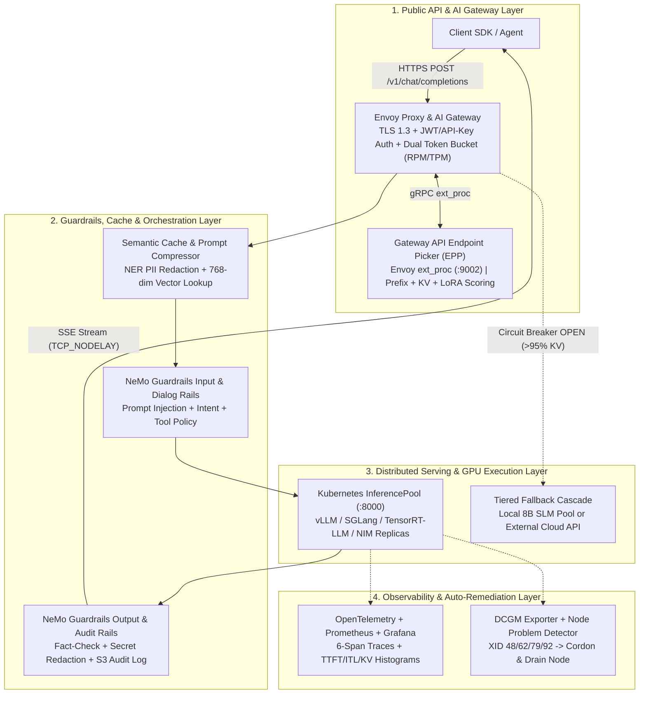
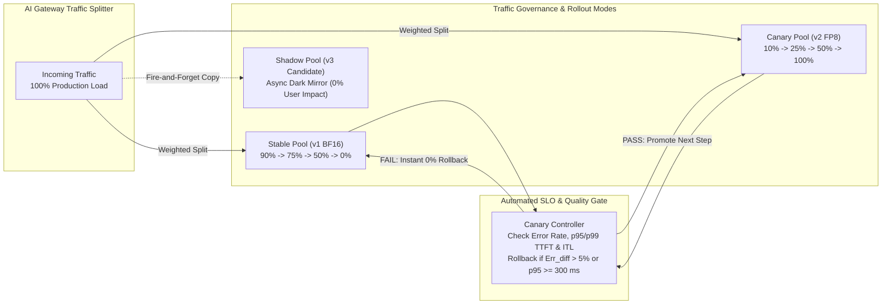

# 15.16 Production serving stack and reliability

| Field | Value |
|---|---|
| Level | Advanced |
| Priority tier | 1 |
| Lab venue | GCP / GKE + Local Python Verification Lab |
| Part | Part 15: LLM inference and serving |
| Cross-references | Chapters 15.3–15.8 (vLLM, SGLang, TensorRT-LLM, Triton, NIM, Dynamo & llm-d); Chapter 15.14 (genai-perf, now being replaced by AIPerf, benchmarking & goodput); Chapter 15.15 (HPA, KEDA & scale-to-zero) |
| Code | `code/part15/production_serving_reliability.py`, `code/part15/production_serving_reliability_lab.py` |
| Coverage file | `planning/coverage/chapters/15-16.md` |
| Claim & number ledger | `planning/ledgers/15-16.md` |

## Why this matters for AI infrastructure

Getting a model to answer a prompt on a single GPU is only the start of inference engineering. Once you expose that model to real users and autonomous agents, the failure modes change completely. Stateless web microservices either return a fast response or crash cleanly. By contrast, a large language model serving stack can fail partially and silently across several infrastructure layers at once.

When a serving platform relies on standard microservice defaults instead of AI-native reliability controls, four operational disasters happen regularly.
- **Silent GPU deaths and traffic blackholes.** An uncorrectable hardware memory fault on one GPU inside an eight-GPU Tensor Parallel group deadlocks the collective ring forever. Meanwhile, the Python HTTP web server on the host CPU stays alive and returns HTTP 200 to naive Kubernetes health checks. The broken pod then drops one-eighth of all cluster traffic into a black hole.
- **Probe-induced cascading outages.** When an autoscaler launches new replicas that pull seventy-gigabyte weight files over shared storage, transient I/O contention delays responses on existing pods. If a readiness probe checks an inference thread with a one-second timeout, Kubernetes marks every healthy pod unready at once. That single probe mistake takes down the entire cluster.
- **Token-blind admission and swap thrashing.** Counting only requests per second treats a ten-token greeting the same as a ten-thousand-token document analysis. Admitting unbounded long-context prompts exhausts the PagedAttention block pool and forces the scheduler to preempt running requests. On current vLLM a preempted request is recomputed, which burns GPU time. On engines before v0.18 that swapped KV blocks to host memory over PCIe, one reported incident inflated inter-token latency by over forty times.
- **Uncoordinated rollouts and severed streams.** Terminating a pod or unloading a model without draining active Server-Sent Events streams cuts off long-running generations mid-sentence. Rolling out a quantized model without automated latency and accuracy gates silently degrades production answers.

```text
Production Serving Stack and Reliability Reference Numbers (DAI Ch. 9; V12 Ch. 1–3, 6, 8, 11; V14 Ch. 4, 6; GAK Ch. 4, 5; ASP Ch. 16; HLS Ch. 1, 4; AIE Ch. 9; LLP Ch. 2, 7):
- Non-GPU request path share: up to 60% of end-to-end latency occurs outside the GPU; pinned host RAM (cudaHostAlloc) transfers at 55–62 GB/s (60.0 GB/s nominal) on PCIe Gen5 vs 10–14 GB/s (12.0 GB/s nominal) pageable (5.0x speedup).
- Prefix & prompt caching: > 85% Radix/prefix cache hit rate via sticky routing; Anthropic prompt caching cuts 100,000-token book TTFT from 11.5 s to 2.4 s (-79% latency, -90% cost) and 1,000-token system prompt x 1,000,000 daily calls saves 1,000,000,000 (1B) input tokens/day.
- Prompt compression: summarizing the oldest 25% of turns when context exceeds 75% of a 32,768-token window (24,576 tokens) compresses 26,000 tokens to 20,800 tokens (-36.0% quadratic prefill work); config tokens shrink a 200-token system prompt to 10 tokens (20.0x).
- NeMo Guardrails 5-rail latency budget: 45.0 ms base model + 15.0 ms input PII/length + 30.0 ms intent classifier + 100.0 ms RAG + 50.0 ms output fact-check + 10.0 ms audit log = 250.0 ms total (205.0 ms overhead, 5.56x / 5.5x increase).
- SSE streaming & draining: 100 tokens at 20 tok/s takes 5.0 s total, but flushing 5-token chunks delivers the first chunk in 0.25 s (20.0x faster perceived response); uncoordinated Triton unload drops 15% of requests with 503 MODEL_UNAVAILABLE vs 0% with 15 s preStop + 120 s terminationGracePeriodSeconds.
- Kubernetes probes & XID 62 blackhole: startupProbe (30 s initial + 60 x 10 s = 630 s total / 600 s polling window) protects 2–8 min weight loads; 1.2 s NFS stall trips a 1 s readinessProbe (100% 503 outage) but survives a 5 s /health probe; GPU 3 XID 62 PMU halt in TP=8 pegs GPU 3 at 100% and 7 peers at 0%, blackholing 12.5% (1 in 8) of cluster requests.
- Overload shedding & swap thrashing: shed load (gateway breaker Open) when KV cache > 95% or queue > 50 for > 5 s and reset below 80% KV cache; these are the chapter's starting thresholds, not vendor defaults. On a pre-v0.18 engine, enabling CPU swap (--swap-space 32) inflated ITL from 20.0 ms to 850.0 ms (+4,150% / ~4,000% degradation at 4.2 preemptions/s).
- OpenTelemetry triage & SLO budgets: OTel 6-span trace isolates a 3,850.0 ms prefill stall inside a 4,820.0 ms request, fixed by --enable-chunked-prefill (p99 ITL 4,500.0 ms -> 22.8 ms); ProcessPoolExecutor fixes CPU GIL starvation (13.47 -> 104.17 RPS, 7.73x gain; p99 1,410.20 -> 44.80 ms, 31.48x reduction); 30-day (43,200 min) error budgets are 43.20 min (99.9%), 21.60 min (99.95%), 4.32 min / 259.2 s (99.99%), and 0.432 min / 25.92 s (99.999%).
```

**Production reliability is not a single feature inside the model runner. It is a coordinated contract across the API gateway, the Kubernetes scheduler, the GPU driver telemetry pipeline, and the observability stack.** Before you expose an inference cluster to production traffic, engineer every layer to bound incoming work, isolate hardware faults within seconds, and degrade gracefully under overload.

## Prerequisites and outcomes

### Prerequisites
- Review vLLM PagedAttention, SGLang RadixAttention, TensorRT-LLM, NVIDIA Triton Inference Server, and NVIDIA NIM from Chapters 15.3 through 15.7.
- Review disaggregated prefill and decode serving with NVIDIA Dynamo, NIXL, and llm-d from Chapters 15.8 through 15.11.
- Review `genai-perf` (being phased out in favour of AIPerf) latency percentiles, goodput, and Kubernetes HPA and KEDA autoscaling from Chapters 15.14 and 15.15.

### Outcomes
- Architect an end-to-end production serving stack combining Envoy Proxy, the Kubernetes Gateway API Inference Extension, InferencePool, InferenceObjective, Endpoint Picker routing, and Ray Serve or KServe multi-model multiplexing.
- Implement dual token-bucket rate limiting for Requests Per Minute and Tokens Per Minute, endpoint semantic caching, replica prefix-aware routing, prompt compression, and NeMo Guardrails input and output policy rails.
- Design safe model rollouts across canary, A/B consistent-hashing, shadow, and blue-green deployments alongside low-latency Server-Sent Events streaming and zero-drop connection draining.
- Configure decoupled Kubernetes startup, readiness, and liveness probes, prevent probe-induced cascading outages, and automate GPU XID hardware fault remediation with DCGM Exporter and Node Problem Detector.
- Build hysteretic admission circuit breakers, tiered model and cloud fallback cascades, and end-to-end OpenTelemetry tracing and Prometheus SLO alerting pipelines.

---

## 1. End-to-End Production Serving Architecture and AI Gateways

### 1.1 The Nine-Stage Request Lifecycle and Non-GPU Latency

When an inference API violates its latency targets, engineering teams often assume the GPU kernels are too slow. In production clusters, up to 60 percent of total end-to-end request latency can occur outside the GPU. A request must cross network proxies, admission queues, CPU tokenizers, host memory allocators, PCIe buses, and streaming socket buffers before a single token reaches the user.

Tracing a single streaming chat request from client to GPU and back reveals nine distinct stages. First, the API gateway terminates TLS 1.3 and parses the JSON payload. Second, the admission controller verifies tenant quotas and queues the request if all GPU workers are busy. Third, a CPU thread pool tokenizes the raw UTF-8 prompt into 64-bit integer vocabulary IDs. Fourth, the continuous batch scheduler queries the PagedAttention block manager to reserve physical KV cache pages in GPU memory. Fifth, the CUDA driver copies the input token tensor across the PCIe Gen5 bus into GPU High Bandwidth Memory.

Once the prompt reaches the GPU, the sixth stage runs compute-bound prefill matrix multiplications to emit the first token. Memory-bandwidth-bound autoregressive decode iterations then generate the remaining tokens one step at a time. In the seventh stage, GPU sampling kernels apply temperature scaling, repetition penalties, and nucleus filtering over the vocabulary logits. In the eighth stage, the selected 32-bit integer token ID copies back over PCIe to pinned host memory and detokenizes into UTF-8 text. Finally, the ninth stage wraps each text chunk into a Server-Sent Events frame and flushes the TCP socket.



Every stage outside the GPU can become a silent bottleneck. If the inference server allocates input tensors in standard pageable host memory via `malloc`, the operating system can page that memory out. The CUDA driver must then copy the tensor into a temporary page-locked staging buffer before starting a PCIe Direct Memory Access transfer. That extra copy caps PCIe Gen5 transfer throughput at 10 to 14 GB/s. Allocating host staging buffers in pinned memory via `cudaHostAlloc` lets the GPU DMA engine read directly from physical RAM at 55 to 62 GB/s. Using pinned memory delivers a 5.0x transfer speedup.

| Request Lifecycle Stage | Interface / Protocol | Typical Latency Budget | Primary Bottleneck | Production Mitigation |
|---|---|---|---|---|
| 1. Ingress & TLS Termination | HTTP/2 or gRPC over TLS 1.3 | 2 to 10 ms | TLS handshake & JSON parsing | Persistent HTTP/2 pools & Envoy edge proxy. |
| 2. Admission Control & Queueing | Token Bucket + Bounded Queue | 1 to 50 ms | Queue buildup under burst load | Dual RPM/TPM limits & HTTP 429 load shedding. |
| 3. CPU Tokenization | Rust/C++ tokenizers or tiktoken | 2 to 20 ms | Python GIL single-core lockup | Separate `ProcessPoolExecutor` or Rust router. |
| 4. Batch Scheduling & KV Alloc | Lock-free queue + Block Table | `< 1 ms` | Physical KV block exhaustion | PagedAttention; vLLM V1 preempts by recomputing, and only engines before v0.18 can swap to host memory. |
| 5. Host-to-Device Copy (H2D) | PCIe Gen5 DMA (`cudaMemcpyAsync`) | `< 0.5 ms` | Pageable memory staging copy | Pre-allocated pinned RAM (`cudaHostAlloc`). |
| 6. GPU Prefill & Decode | CUDA Streams + NVLink / RDMA | TTFT 50–300 ms; ITL 15–30 ms | Prefill starving decode batches | `--enable-chunked-prefill` or P/D disaggregation. |
| 7. GPU Logit Sampling | On-GPU Top-K / Top-P kernels | `< 1 ms` | 128,000-vocab host transfer | Keep logit penalties & sampling on GPU. |
| 8. Device-to-Host & Detokenize | PCIe Gen5 DMA + UTF-8 LUT | `< 1 ms` | Blocking `cudaStreamSynchronize` | Async event callbacks on dedicated stream. |
| 9. SSE Egress & Socket Flush | HTTP Chunked SSE (`text/event-stream`) | 1 to 3 ms | Nagle algorithm & proxy buffering | Enable `TCP_NODELAY` & `X-Accel-Buffering: no`. |

### 1.2 Layered Enterprise Architecture and Multi-Model Routing

Cloud-scale providers such as OpenAI, Anthropic, and Together AI organize production inference into a seven-layer enterprise architecture. The upper layers are the Public API Layer, the Resource Management Layer, and the Model Selection and Orchestration Layer. The lower layers are the Distributed Serving Layer, the Core Inference Layer, the Model Optimization Layer, and the Model Layer. Separating these layers lets platform engineers update routing rules, swap quantization formats, or scale GPU node pools without breaking client applications.

In a Kubernetes deployment, a request enters through an API gateway on port 8000 and optionally calls a CPU tokenizer on port 8001. The gateway then dispatches the request to stateful GPU model runners on port 8002. Modern inference engines like vLLM and SGLang handle text tokenization internally. Even so, running a standalone CPU tokenizer service on port 8001 remains useful when counting tokens ahead of billing and rate limiting. A separate tokenizer service also helps when serving diffusion models that require CLIP tokenization alongside standard language model tokenizers.

When an organization hosts several models and inference engines behind one unified endpoint, the gateway routes requests by inspecting the OpenAI-compatible JSON body.
- **Multi-model routing.** The gateway reads the requested model name and maps it to its internal Kubernetes service DNS address in the multi-models namespace. Clients send all requests to port 8080 without needing to know which pod hosts which weights.
- **Multi-engine routing.** When benchmarking or migrating between runtimes in a multi-engines namespace, the gateway inspects both the model field and the inference server field. Specifying SGLang routes the request to the SGLang service, while leaving the engine field empty defaults to vLLM. The gateway also aggregates `/v1/models` across all backends.
- **Feature-based, A/B, and dynamic routers.** Beyond static name lookup, a feature-based router inspects prompt keywords or a classifier to send coding tasks to a code model. An A/B router hashes the user ID so a user consistently lands on the same model variant. A dynamic router selects among candidate models in real time based on active load, latency budgets, and per-token cost.
- **Ray Serve model multiplexing.** Dedicating an entire GPU pod to each rarely used domain classifier wastes memory. Ray Serve provides `@serve.multiplexed` paired with the `ray_serve_multiplexed_model_id` HTTP header. Each replica lazily loads and caches up to a configured number of models and evicts the Least Recently Used model when a new model arrives.

```text
Multi-Model, Multi-Engine, and Ray Serve Multiplexing Reference (DAI Ch. 9, HLS Ch. 4):
1. Service Port & Model Matrix (DAI Ch. 9 code/basic & code/k3d):
   - API Gateway (:8000 / port-forward :8080) | CPU Tokenizer (:8001, Qwen2.5-1.5B + openai/clip-vit-large-patch14)
   - GPU Model Runner (:8002, vLLM 0.15.1 or SGLang serving Llama-3.2-1B-Instruct ~8 GB VRAM, Phi-tiny-MoE, Qwen2.5-0.5B)
   - Multi-model DNS: vllm-llama-32-1b-service.multi-models.svc.cluster.local
   - Multi-engine DNS: vllm-llama-32-1b-service.multi-engines.svc.cluster.local vs sglang-llama-32-1b-service.multi-engines.svc.cluster.local
2. Ray Serve Multiplexing (@serve.multiplexed(max_num_models_per_replica=2)):
   - Request sequence: ["distilbert-sst2", "bert-sst2", "distilbert-sst2", "roberta-sst2", "bert-sst2"]
   - Result: 1 cache hit, 4 cold loads, evictions = ["bert-sst2", "distilbert-sst2"], final cache = ["roberta-sst2", "bert-sst2"].
```

### 1.3 Kubernetes Gateway API Inference Extension and llm-d

Standard Kubernetes Service and Ingress objects balance traffic using round-robin or active connection counts. Round-robin fails for LLM serving because prompt lengths vary widely and GPU replicas maintain stateful PagedAttention and RadixAttention prefix caches. Sending a ten-thousand-token prompt to a replica whose KV cache is already 90 percent full causes queueing delays. Sending a multi-turn follow-up to a replica that lacks the conversation's cached prefix wastes hundreds of milliseconds recomputing prefill.

To make Kubernetes routing natively aware of LLM state, the Kubernetes WG-Serving community developed the **Gateway API Inference Extension**. This extension forms the routing core of both the **Envoy AI Gateway** and the **llm-d** production stack.

```text
Gateway API Inference Extension & Endpoint Picker (EPP) Architecture (GAK Ch. 4, DAI Ch. 9):
1. Custom Resources:
   - InferencePool (inference.networking.k8s.io/v1): Groups homogeneous model pods (targetPorts: [8000])
     and binds an Endpoint Picker service (endpointPickerRef: port 9002, failureMode: FailClose).
   - InferenceObjective (inference.networking.x-k8s.io/v1alpha2, evolved from InferenceModel):
     Declares workload priorities (e.g., priority: 1 for high-priority-inference vs priority: 2 for standard)
     and maps virtual model or LoRA adapter names to the underlying InferencePool.
2. Envoy External Processing (ext_proc) + Endpoint Picker (EPP) Scoring:
   - Envoy intercepts the HTTP request and calls the EPP gRPC service on port 9002 via ext_proc.
   - EPP scrapes live vLLM telemetry (vllm:num_requests_waiting, vllm:gpu_cache_usage_perc,
     prefix cache block hashes, and loaded --lora-modules).
   - Composite EPP Routing Score (lower is better; pods with KV >= 95% or queue >= 50 are filtered out):
     Score(pod) = 2.0 * waiting_reqs + 100.0 * kv_usage - 30.0 * prefix_hit_ratio - 15.0 * int(lora_loaded)
   - Lab Verification: pod-2 (55 waiting, 96% KV) is filtered out; pod-1 (3 waiting, 65% KV, 85% prefix hit,
     finance-lora loaded) scores 30.5 vs pod-0 (8 waiting, 72% KV, 10% prefix hit) at 85.0 -> pod-1 selected.
```

In our verification model, three pods compete for a request that needs the finance LoRA adapter. The Endpoint Picker immediately eliminates the third pod because its KV cache is at 96 percent with 55 waiting requests. Between the remaining two candidates, the second pod has 3 waiting requests, 65 percent KV usage, an 85 percent prefix match, and the finance adapter already loaded in GPU memory. That pod achieves a composite score of 30.5 compared to 85.0 for the first pod, so Envoy routes the request to the second pod.

### 1.4 Local k3d Development vs Production Stack Options

Engineering teams often prototype manifests locally on k3d before deploying to a production Kubernetes stack such as llm-d, KServe, KubeAI, or the vLLM Production Stack. On public clouds, teams also evaluate a six-option build-versus-buy spectrum. That spectrum spans from fully managed APIs like Amazon Bedrock at `$0.10` per million input tokens to self-hosted instances at `$1.172` per hour. Running open-source models on reserved cloud instances cuts serving costs by 30 to 70 percent and avoids the 50 percent managed surcharge on fine-tuned models.

| Dimension | Manual k3d Stack (Local Dev) | llm-d / KServe / GIE (Production Kubernetes) |
|---|---|---|
| Cluster & Packaging | Docker-based `k3s-cuda` (`v1.32.0-k3s1`, `CUDA 13.0`) + manual YAML | Kubernetes `>= 1.29` + automated Helm charts & KServe `LLMInferenceService` |
| Request Routing | Custom FastAPI gateway parsing `model` & `inference_server` | Envoy Proxy + Gateway API Inference Extension (`InferencePool` + `EPP`) |
| Load Balancing | Round-robin, least-connections, or static weights | Prefix-cache-aware, KV-aware, LoRA-aware, and SLA priority scheduling |
| KV Cache Architecture | Single-pod VRAM (`--gpu-memory-utilization 0.2` dev vs `0.8–0.9` prod) | North/South local CPU/NVMe offload + East/West NIXL RDMA sharing (`500–800 Gbps`) |
| Autoscaling | Manual replica count or basic CPU HPA | Workload Variant Autoscaler (`WVA`) & KEDA scaling on token capacity / queue depth |
| Multi-Model Discovery | Manual `routing-config.yaml` service mapping | Automatic `ModelService` & LoRA adapter discovery across pools |

Always verify your container volume mounts in local testing before promoting Helm charts to production. In particular, mount an in-memory `emptyDir` volume at `/dev/shm` so multi-GPU NCCL collectives never deadlock on Docker's 64 MB shared-memory default.

---

## 2. Admission Control, Token-Based Rate Limiting, Caching, and Guardrails

### 2.1 Dual Token-Bucket Rate Limiting (RPM and TPM) and Tenant Quotas

In a traditional REST API, limiting each client to a fixed number of requests per second protects the backend because every request performs similar work. In an LLM serving stack, request-based rate limiting alone is dangerous. One client might send fifty short classification prompts of ten tokens each, consuming 500 tokens total. Another client might send ten requests that each contain an 8,000-token context window and generate 2,000 output tokens, consuming 100,000 tokens of GPU time. Furthermore, generating a single output token during memory-bound decoding has roughly the same latency impact as processing 100 input tokens during parallel prefill.

To enforce fair multi-tenant access in Model-as-a-Service platforms, gateways such as the Envoy AI Gateway, Kuadrant, and FastAPI middleware enforce **dual Token Bucket rate limits** per tenant. The gateway extracts the tenant ID from a verified JWT claim or API key header and checks two independent buckets before admitting any request.
- **Requests Per Minute (RPM) bucket.** Protects the gateway, tokenizer thread pool, and continuous batch scheduler from connection floods. A limit of 60 RPM refills at 1.0 request per second up to the burst cap.
- **Tokens Per Minute (TPM) bucket.** Protects GPU Tensor Cores and PagedAttention KV cache blocks from long-context exhaustion. A limit of 60,000 TPM refills at 1,000.0 tokens per second up to the token burst cap. Upon ingress, the gateway pre-deducts the prompt tokens plus the requested maximum output tokens, or reconciles actual generated tokens when streaming finishes. If either bucket is empty, the gateway rejects the request with HTTP 429 and returns the remaining quota and reset timer in response headers.

```text
Dual Token Bucket Rate Limiting Equations (DAI Ch. 9, GAK Ch. 4, HLS Ch. 4):
  Refill update after elapsed time dt = t_now - t_last:
    Avail_req(t_now) = min(B_req, Avail_req(t_last) + dt * (RPM / 60))
    Avail_tok(t_now) = min(B_tok, Avail_tok(t_last) + dt * (TPM / 60))

  Admission condition for request demanding T_req = prompt_tokens + max_tokens:
    Allowed = (Avail_req(t_now) >= 1) AND (Avail_tok(t_now) >= T_req)

  Reset wait time (X-RateLimit-Reset) when rejected (HTTP 429):
    Wait_seconds = max( max(0, 1 - Avail_req) / (RPM / 60),
                        max(0, T_req - Avail_tok) / (TPM / 60) )

  Worked Example (RPM = 10 -> 0.1667 req/s, B_req = 5; TPM = 6,000 -> 100 tok/s, B_tok = 3,000):
    - At t = 0.0 s: 5 burst requests of 500 tokens each (2,500 tokens total) are all ALLOWED.
      Remaining state: Avail_req = 0, Avail_tok = 500 tokens.
    - A 6th request of 500 tokens at t = 0.0 s is REJECTED (HTTP 429) because Avail_req = 0 < 1.
      Wait_seconds = (1 - 0) / (10 / 60) = 6.00 seconds.
    - At t = 6.0 s: Avail_req refills to 1.0, and Avail_tok refills by 6 * 100 = 600 to 1,100 tokens.
      A new request asking for 1,200 tokens is REJECTED by the TPM bucket (deficit = 100 tokens),
      returning X-RateLimit-Reset = 100 / 100 = 1.00 second.
```

To prevent memory leaks in long-running gateway processes, the rate limiter also runs a periodic cleanup sweep. That sweep removes tenant entries that have been idle longer than a configured staleness window such as 3,600 seconds.

### 2.2 Semantic Caching, Prefix Caching, and Prompt Compression

The fastest and most reliable inference request is one whose work you never have to compute on the GPU. Production serving stacks eliminate redundant GPU work at three distinct layers.

First, at the gateway layer, an **Endpoint Semantic Cache** intercepts incoming prompts before they reach any model runner. The gateway first runs a Named Entity Recognition pass that masks Personal Identifiable Information so tenant secrets never pollute the shared cache. It then encodes the sanitized query into a 768-dimensional embedding vector and searches an in-memory vector index. When cosine similarity exceeds a strict threshold such as 0.95, the gateway returns the cached answer in 3 milliseconds at zero GPU cost. Gateways also apply a **2 to 5 ms request debouncing window** to coalesce duplicate submissions when frustrated users double-click submit.

Second, at the application preprocessing layer, **Prompt Cleansing and Compression** shrinks the input token count. Because prefill self-attention scales quadratically with sequence length, trimming older context saves massive compute. Production chatbots automatically summarize the oldest 25 percent of a conversation whenever the history exceeds 75 percent of the model's maximum context window. On a 32,768-token window, crossing the 24,576-token trigger compresses a 26,000-token history down to 20,800 tokens and cuts quadratic prefill work by 36.0 percent. Similarly, replacing a 200-token natural-language system prompt with 10 learned configuration tokens achieves a 20.0x prefix reduction.

```text
Semantic Cache, Prompt Compression, and Prefix Caching Math (ASP Ch. 16, HLS Ch. 10, AIE Ch. 9):
- NER PII Redaction: PERSON ("John Doe", 0.97) -> <NAME_1>; EMAIL ("john@abc.com", 0.95) -> <Email_1> before 768-dim lookup.
- Quadratic Prefill Work: W(N) = N * (N + 1) / 2.
  Compressing 26,000 tokens -> 20,800 tokens (oldest 6,500 tokens compressed 5x to 1,300 tokens) reduces W(N) by 36.0%.
- System Prompt Prefix Reuse: 1,000-token system prompt x 1,000,000 daily calls = 1,000,000,000 (1B) input tokens saved/day.
```

Third, at the inference engine layer, **Prefix Caching** reuses the physical KV cache tensors of shared system prompts, RAG documents, and multi-turn chat histories. You enable it with `--enable-prefix-caching` in vLLM or RadixAttention in SGLang. Asking 10 separate questions against the same long document processes roughly 10x faster because the document's KV blocks are computed only once. If an application uses a 1,000-token system prompt across one million daily API calls, prefix caching avoids reprocessing one billion input tokens every day.

| Workload Scenario (Anthropic Prompt Caching, *AI Engineering* Ch. 9 Table 9-3) | TTFT Without Caching | TTFT With Caching | Latency Reduction | Cost Reduction |
|---|---|---|---|---|
| Chat with a book (100,000-token cached prompt) | 11.5 s | 2.4 s | -79% | -90% |
| Many-shot prompting (10,000-token prompt) | 1.6 s | 1.1 s | -31% | -86% |
| Multi-turn conversation (10-turn chat with long system prompt) | ~10.0 s | ~2.5 s | -75% | -53% |

### 2.3 Runtime Safety Shields: NVIDIA NeMo Guardrails

Even when a model server is fast and well-cached, an unguarded LLM remains a statistical engine. Attackers can trick it with prompt injection, extract secrets, invoke unapproved database tools, or trigger policy hallucinations. **NVIDIA NeMo Guardrails** places a programmable policy shield written in Colang around the model without requiring weight retraining.

NeMo Guardrails intercepts execution across five distinct rail stages.
- **Input rails.** Validate prompt length up to 2,048 tokens, redact PII via Presidio, and block jailbreaks or prompt injections before the core LLM sees the text.
- **Dialog rails.** Classify user intent with a zero-shot classifier and enforce canonical Colang conversation flows so a banking assistant never gives medical advice.
- **Retrieval rails.** Filter and validate chunks returned from RAG vector databases before they enter the model context.
- **Execution rails.** Enforce strict allowlists and timeouts when an agent invokes external tools or Model Context Protocol servers. For example, a policy can allow queries against production metrics while blocking payroll databases.
- **Output rails.** Scan generated answers for leaked credentials and run a fact-checking or guardian model such as Llama Guard or Granite Guardian. Output rails also enforce a 0.85 minimum confidence threshold and write an immutable S3 compliance log with seven-year retention.

```text
NeMo Guardrails End-to-End Latency Budget & Policy Governance (Volume 14 Ch. 6, GAK Ch. 5):
  Base LLM inference (no guardrails):                  45.0 ms
  + Input validation (Presidio PII, max_length 2048): +15.0 ms  ( 60.0 ms cumulative)
  + Intent classifier (1,000 ms timeout, fail allow): +30.0 ms  ( 90.0 ms cumulative)
  + RAG retrieval (knowledge base vector lookup):     +100.0 ms  (190.0 ms cumulative)
  + Output validator (secret regex + fact-check 0.85):+50.0 ms  (240.0 ms cumulative)
  + Audit logging (immutable S3, 2,555-day retention):+10.0 ms  (250.0 ms cumulative)
  -----------------------------------------------------------------------------------
  Total Guarded Latency: 250.0 ms vs 45.0 ms base (+205.0 ms overhead = 5.56x / 5.5x slower)
  Guardian model sizing: Meta Llama Guard / IBM Granite Guardian (7B–8B parameters = 15–20 GB VRAM).
```

Layering five synchronous rails increases latency from 45 ms to 250 ms, which is a 5.56x slowdown. Platform engineers must budget guardrail latency explicitly against their TTFT objective and run lightweight detectors in parallel. Always deploy policy changes through a 10 percent canary that alerts if the rejection rate jumps by more than 5 percent.

---

## 3. Safe Model Rollouts, Traffic Governance, and SSE Streaming Drain

### 3.1 Canary, A/B Testing, Shadow, and Blue-Green Model Rollouts

Swapping model weights, upgrading vLLM or TensorRT-LLM versions, or switching a checkpoint from BF16 to FP8 or INT4 quantization can silently break accuracy or spike tail latency. Production serving platforms never replace 100 percent of traffic in a single cutover. Instead, they use four complementary rollout patterns.



- **Canary deployments.** The gateway shifts a small percentage of live traffic to the new model version while comparing its error rate and latency percentiles against the stable baseline. A standard traffic shifter progresses through 10, 25, 50, 75, and 100 percent. At each step, the controller promotes the canary only if its error rate stays within 10 percent and mean latency stays within 20 percent of the stable version. It rolls back to zero percent if the canary error rate exceeds twice the stable rate or exceeds stable by 5 percent. It also rolls back immediately if p95 latency crosses the 300 ms critical gate.
- **Consistent-hashing A/B testing.** While canaries manage rollout risk, A/B tests compare two models, prompt templates, or quantization schemes for product quality. In multi-turn chat, a user must never bounce between Model A on turn one and Model B on turn two. The gateway hashes the test name and user ID with SHA-256 so the same user deterministically lands on the exact same variant across every turn.
- **Shadow traffic mirroring.** Envoy duplicates a fraction of live requests asynchronously to a shadow candidate pool. It then discards the shadow response after logging its latency, token count, and quality score. Shadow testing validates GPU memory stability and kernel throughput under real production prompt distributions with zero user-facing risk.
- **Blue-Green deployments.** Two complete environments run concurrently with pre-warmed weights and CUDA Graphs. Once the Green environment passes synthetic smoke checks, the gateway shifts traffic from 1 percent to 10 percent to 100 percent while keeping Blue warm for instant one-second rollback.

```text
Canary Promotion and Rollback Gate Thresholds (DAI Ch. 9, V14 Ch. 4 & Lab 01):
- Traffic shift steps: 10% -> 25% -> 50% -> 75% -> 100% (or 1% -> 10% -> 100% Blue-Green).
- Promotion gate: Canary_Err <= 1.10 * Stable_Err AND Canary_Latency <= 1.20 * Stable_Latency AND p95 < 200 ms.
- Rollback gate: (Canary_Err - Stable_Err) > 0.05 (5%) OR Canary_Err > 2.0 * Stable_Err OR p95 >= 300 ms
  (180 ms baseline: < 200 ms pass, 250 ms [+40%] warning circuit breaker, 300 ms [+67%] critical rollback).
```

### 3.2 Server-Sent Events (SSE) Streaming and Graceful Connection Draining

Waiting five full seconds for a 100-token answer to finish before displaying a single word makes an application feel broken. Humans read 180 to 300 words per minute, which equals roughly 4 to 7 tokens per second for average readers and up to 13 tokens per second for fast readers. Suppose an inference engine generates 20 tokens per second and flushes batches of 5 tokens over Server-Sent Events. The user sees the first 5-token chunk in just 0.25 seconds instead of waiting 5.0 seconds. That streaming cadence delivers a 20.0x improvement in perceived responsiveness.

Operating SSE streaming reliably at scale requires four transport and flow-control safeguards.
1. **Disable Nagle's algorithm and proxy buffering.** Interaction between TCP Nagle batching and delayed acknowledgments can stall small token packets for tens of milliseconds (the Linux delayed-ACK timer is about 40 ms, and some stacks use up to 200 ms). Enable `TCP_NODELAY` on the server socket and pass `X-Accel-Buffering: no` so proxies flush SSE chunks immediately.
2. **Decouple egress I/O from the GPU loop with bounded buffers.** Slow mobile clients must never block the GPU continuous batching loop. A separate async I/O thread buffers outgoing tokens up to a hard cap of 50 to 100 unacknowledged tokens per client. If a stalled client exceeds 100 buffered tokens or clicks a Stop button, the server aborts that sequence and frees its PagedAttention KV blocks immediately.
3. **Optional typewriter token pooling.** Speculative decoding can burst 20 tokens in 0.5 seconds. Inserting a configurable 50 ms smoothing delay creates a steady reading cadence for free-tier users while streaming at full speed for paid tiers.
4. **Hard generation ceilings.** Enforce a maximum output limit of 4,096 tokens and a server-side generation timeout of 30 seconds so runaway loops never monopolize GPU slots.

Streaming creates a severe reliability hazard during pod scale-downs, rolling upgrades, or Triton model reloads. Issuing an uncoordinated model unload while traffic is in flight drops 15 percent of active requests immediately with HTTP 503 `MODEL_UNAVAILABLE`.

```text
Zero-Drop Graceful SSE Connection Draining Sequence (V12 Ch. 3 & 11, DAI Ch. 9):
1. Kubernetes initiates Pod termination (or rolling upgrade) -> Pod enters Terminating state.
2. Container preStop hook executes `sleep 15` (while simultaneously marking /health readiness = 503).
3. Kubernetes Endpoints / EndpointSlice controller and Envoy EPP remove the pod within 5–15 seconds;
   zero new requests are routed to the draining pod.
4. The inference engine receives SIGTERM, stops admitting new requests, and drains active SSE streams:
   For 24 active streams with up to 60 remaining tokens at 20 tok/s:
   Stream_Drain_Time = 60 tokens / 20 tok/s = 3.0 seconds (or up to 60–90 s for long 1,500-token streams).
5. Total shutdown time = 15.0 s (preStop) + 3.0 s (drain) = 18.0 s <= terminationGracePeriodSeconds: 120.
   All 24 streaming responses finish with `data: [DONE]` and 0% dropped connections before SIGKILL.
```

Always pair a 120-second termination grace period and a 15-second `preStop` hook with a Kubernetes PodDisruptionBudget so voluntary node drains never evict more replicas than your spare capacity can absorb.

---

## 4. Kubernetes Health Probes, Silent GPU Deaths, and Hardware Fault Remediation

### 4.1 The Zombie Pod Problem and Three-Probe Architecture

In a traditional web application, a process crash kills the HTTP server immediately, causing Kubernetes to restart the container and reroute traffic. In an AI inference cluster, the HTTP server runs on the host CPU while the mathematical work executes asynchronously on physical GPUs. If a GPU suffers an uncorrectable hardware ECC memory error or a CUDA stream deadlock, the GPU halts completely. Meanwhile, the Python or C++ HTTP server on the CPU stays healthy and keeps returning HTTP 200 to naive health checks.

Kubernetes continues routing live customer prompts to this **zombie pod**, where every request enters an infinite wait loop. Conversely, if an engineer tries to prevent zombie pods by making the liveness probe run an actual model forward pass, any long prefill batch will delay the probe response. Kubelet then kills healthy, busy containers in a cascading restart storm.

Production LLM containers must strictly decouple initialization, traffic readiness, and process liveness across three distinct Kubernetes probes.
- **Startup probe.** Protects slow model initialization while 70 to 140 GB of weights load and CUDA Graphs compile, which takes 2 to 8 minutes. Configure `startupProbe` on `/health` with a 30-second initial delay, a 10-second period, and a failure threshold of 60. That grants a 600-second polling window before liveness checks even begin. To shrink cold-start weight loading from minutes to tens of seconds, pair `IfNotPresent` image policies with local NVMe PVC caching. You can also stream weights in parallel using the Run:ai Model Streamer with 16 concurrent threads.
- **Readiness probe.** Controls whether the pod stays in the Kubernetes Service and Envoy InferencePool endpoints. Point `readinessProbe` to `/health` with a 5-second period, a 5-second timeout, and a failure threshold of 3. Never set a readiness timeout below 3 seconds. The handler must not submit a dummy inference request into the GPU batch queue. Be aware that the vLLM `/health` route in v0.32.0 only reports that the engine has not crashed. A hung but live engine still answers 200, so chapter 20.18 section 6 adds a real check: a one-token request, or a watch on the token counter.
- **Liveness probe.** Verifies only that the API server process is not deadlocked by querying `/ping` every 15 seconds with a 3-second timeout and a failure threshold of 5. **Never execute model inference inside a liveness probe.** Liveness answers whether the process should be killed, readiness answers whether it should receive traffic, and mixing them causes both restart storms and silent pool shrink, as chapter 20.18 section 8 describes. Raise the liveness timeout and failure threshold, move load checks to readiness, and alert when ready replicas fall below desired replicas.

```text
Kubernetes Three-Probe Parameters & Startup Optimization Reference (V12 Ch. 11, V14 Ch. 4, DAI Ch. 9, GAK Ch. 4):
- startupProbe: httpGet /health:8000 | initialDelaySeconds: 30, periodSeconds: 10, failureThreshold: 60 (600 s window / 630 s total).
- readinessProbe: httpGet /health:8000 (or /v2/health/ready, /v1/health/ready) | periodSeconds: 5, timeoutSeconds: 5 (>= 3 s), failureThreshold: 3.
- livenessProbe: httpGet /ping:8000 (or /v2/health/live, /v1/health/live) | periodSeconds: 15, timeoutSeconds: 3, failureThreshold: 5.
- Fast weight loading: --load-format runai_streamer --model-loader-extra-config '{"concurrency":16}' (or CoreWeave tensorizer / fastsafetensor).
- Shared memory: mount emptyDir {medium: Memory, sizeLimit: 16Gi} at /dev/shm (64 MB Docker default hangs multi-GPU NCCL TP).
```

### 4.2 Automated Hardware Fault Remediation (XID 62 + DCGM + NPD)

Suppose a GPU inside an eight-GPU Tensor Parallel replica hits an uncorrectable Double-Bit ECC memory error or falls off the PCIe bus. The CUDA context on that GPU deadlocks permanently. Because eight-way Tensor Parallelism executes two synchronous AllReduce operations per Transformer layer, the remaining seven healthy GPUs hang forever waiting for the faulted GPU to complete the collective ring.

Because a lightweight `/ping` liveness probe only checks the CPU web server, hardware faults must be remediated out-of-band by pairing **NVIDIA DCGM Exporter** with **Kubernetes Node Problem Detector**:
1. DCGM Exporter monitors kernel driver events and increments `dcgm_xid_error` the instant a fatal hardware fault such as XID 62 appears in `dmesg`. It also tracks rising rates of precursor single-bit ECC warnings such as XID 63 and XID 92.
2. Node Problem Detector matches the fatal XID pattern and immediately marks the node condition unhealthy.
3. Automated remediation cordons the node via `kubectl cordon` so no new pods land there. It then drains active pods via `kubectl drain` so the Deployment or LeaderWorkerSet respawns the replica on a healthy server, and sends the faulted node for `nvidia-smi --gpu-reset` or hardware replacement.

```text
XID Triage Tiers & Automated Node Remediation Reference (V12 Ch. 11, V19 Ch. 2, V26 Ch. 2):
- Tier 1 (User / App Error): XID 13, 31, 32, 43, 94 (Segfault / OOM) -> Debug application code; run DCGM diag if recurring across apps.
- Tier 2 (Precursor Warning): XID 45, 63, 92 (High single-bit ECC rate) -> Log and monitor trend; schedule preventive maintenance if accelerating.
- Tier 3 (Fatal Hardware Fault): XID 48, 61, 62, 64, 79, 95 (62 is a micro-controller halt, 48 a double-bit ECC error on page 0x0001f4a0, 79 a GPU that fell off the bus; PCI:0000:0f:00.0)
  -> NPD rule on DCGM_FI_DEV_XID_ERRORS ("Xid 62|Xid 79|Xid 92") triggers immediate CordonAndDrainNode.
```

> **dcgm-exporter 4.9.0 version note.** dcgm-exporter 4.9.0 (2026-11-06) renamed many default metrics and changed some units. For example `DCGM_FI_DEV_GPU_UTIL` (percent) became `DCGM_FI_DEV_GPU_UTIL_RATIO` (0 to 1), and `DCGM_FI_DEV_FB_USED` (MiB) became `DCGM_FI_DEV_FB_USED_BYTES`. The metric names in this chapter are the 4.8.x names. On a 4.9.0 exporter use the [full mapping in 17.4](../part-17-operations/04-dcgm-exporter-and-interpreting-gpu-metrics.md#14-what-dcgm-exporter-490-renamed), and change thresholds together with the unit.
>
> **Xid 62 correction.** Where this chapter calls Xid 62 a double-bit ECC error, read it as the NVIDIA Xid catalog defines it: Xid 62 is `PMU_HALT_ERROR`, an internal micro-controller halt (immediate action `RESET_GPU`, investigatory `CONTACT_SUPPORT`). The double-bit ECC error is Xid 48.

---

## 5. Overload Protection: Circuit Breakers, Fallback Cascades, and Cost Resilience

### 5.1 Admission Operating Zones and Hysteretic Circuit Breaking

Even when every GPU is healthy, an unexpected traffic surge can push an inference cluster past its capacity knee. An inference engine operates across three distinct capacity zones based on GPU KV cache utilization and waiting queue depth.

| Operating Zone | KV Cache Usage | Queue Depth & Wait | Operational Action |
|---|---|---|---|
| Safe Zone (0%–80%) | `< 80%` | `< 10` waiting (`< 20 ms` wait, `< 25 ms` p99 ITL) | Route normally to primary 70B or 700B pool. |
| Warning Zone (80%–90%) | `80%–90%` | `10–50` waiting (`20–50 ms` wait) | Trigger KEDA or WVA scale-out at 120% target RPS; throttle batch jobs. |
| Emergency Zone (`> 90%–95%`) | `> 95%` | `> 50` waiting for `>= 5 s` | Trip Circuit Breaker OPEN; shed load (HTTP 429/503) or cascade to 8B / Cloud fallback. |

Why must the gateway start shedding load before KV cache usage hits 100 percent? Once the block pool is full, the scheduler preempts running requests. On current vLLM, which preempts by recompute, each victim is put back in the queue and its prefill is repeated, so extra load turns into repeated work and latency for everyone. Chapter 20.18 section 3 describes this and gives the signals: `vllm:kv_cache_usage_perc` near 1 and `vllm:num_preemptions_total` rising. Any preemption above zero means you are over-admitting, so reduce admission before adding anything else.

An older incident shows the worst case. On a pre-v0.18 engine, a platform team enabled 32 GB of host swap with `--swap-space 32`. GPU cache usage reached 99.8 percent and swap usage 88.4 percent. The scheduler preempted 4.2 sequences per second and copied KV blocks back and forth over PCIe, GPU utilisation fell to 18 percent and inter-token latency went from 20 ms to 850 ms. That flag no longer exists, so the case is history, not a setting to tune. Cap `--gpu-memory-utilization` between 0.85 and 0.92 and keep headroom instead. Chapter 15.3 explains the swap versus recompute arithmetic.

Two terms need separating. Shedding load at the gateway means refusing new requests when the pool is nearly full: a 429 says this tenant is over its limit, a 503 with a Retry-After header says this server cannot take the request now, as chapter 20.21 explains. A circuit breaker per replica is a different tool. It ejects a replica that is failing. Chapter 20.21 section 7 notes that a hung replica returns nothing, so the breaker should watch time-to-first-token timeouts and zero tokens while work is queued, not only status codes. Retries must also stay inside a retry budget, or clients amplify the overload.

The gateway rule used here is: when GPU KV cache usage exceeds 95 percent or waiting requests exceed 50 for 5 seconds, start shedding. To prevent rapid flapping between shedding and normal on every completed request, add hysteresis: keep shedding until KV cache usage drops below 80 percent and the waiting queue drops below 20. Treat these thresholds as starting values to tune against your own traffic.

## How it fails

| Failure Mode | Symptom | Root Cause & Diagnostic Evidence | Production Remediation |
|---|---|---|---|
| 1. Readiness Probe Cascading Outage (`100% HTTP 503`) | HPA scales 4 to 12 replicas; within 90 s all 4 healthy pods flip to `0/1 Ready` and cluster returns 100% HTTP 503. | 8 new pods saturate shared NFS pulling 70 GB weights; existing pods take 1.2 s on `/v1/models`, tripping a 1 s readiness timeout (`kubectl describe pod`). | Point `readinessProbe` to `/health` with `timeoutSeconds: 5` and `failureThreshold: 3`; cache weights on local NVMe with `runai_streamer`. |
| 2. Silent GPU Fault (`XID 62`) & TP=8 Blackhole (`12.5%` Timeouts) | 1 in 8 requests (12.5%) hang until timeout across an 8-replica TP=8 cluster; pods show `1/1 Running` with 0 restarts. | `nvidia-smi` shows GPU 3 at 100% and 7 peers at 0%; `dmesg -T` shows `Xid 62` PMU halt, deadlocking `ncclAllReduce` while HTTP server stays up. | Run `kubectl cordon` and `kubectl drain`; deploy DCGM Exporter + Node Problem Detector `CordonAndDrainNode` rule on `Xid 48\|62\|79\|92`. |
| 3. PCIe Swap Thrashing, pre-v0.18 only (`4,000%+` ITL Spike) | Enabling `--swap-space 32` on vLLM before v0.18 caused ITL to jump from 20 ms/tok to 850 ms/tok (+4,150%) and p99 latency to exceed 45 s. | `vllm:gpu_cache_usage_perc` hits 99.8%, `cpu_cache_usage_perc` hits 88.4%, and `rate(vllm:num_preempted_requests_total[5m])` hits 4.2/s over 64 GB/s PCIe. | On V1 swap cannot be enabled; on older engines set `--swap-space 0`. Enable `--enable-prefix-caching` and start gateway load shedding at `> 95%` KV usage. |
| 4. Prefill Starving Decode (`3,850 ms` Freeze) | Streaming chat freezes for 4 s when 16K-token RAG prompts arrive; p99 ITL spikes to 4,500 ms despite 300 ms mean TTFT. | OpenTelemetry trace shows a 3,850 ms decode stall between tokens 10 and 11 while a 16K prompt prefill monopolizes Tensor Cores. | Enable `--enable-chunked-prefill` with `--max-num-batched-tokens 512`, dropping p99 ITL from 4,500 ms to 22.8 ms (mean TTFT 210.4 ms). |
| 5. CPU Tokenization GIL Starvation (`1,410 ms` p99) | Client p99 reaches 1,410.20 ms at 13.47 RPS (or `> 3,500 ms` under `--cpus="0.5"`), while GPU SM util is `< 20%` and queue `< 2 ms`. | `mpstat -P ALL 1 5` shows 1 core at 100% `%usr` and 7 cores at 99% `%idle`; CPU prep p99 is 1,395.80 ms vs 18.10 ms Triton GPU infer. | Switch to multi-core `ProcessPoolExecutor` or Rust tokenizer (104.17 RPS = 7.73x gain, p99 44.80 ms = 31.48x reduction) and set `cpus >= 4.0`. |
| 6. GPU Memory Leak & Silent FP8 `NaN` Spikes | Baseline GPU memory rises `> 30%` over 6h until OOM crash, or responses emit `"NaN NaN NaN"` with HTTP 200. | PyTorch caching allocator fragmentation (`memory.used` vs active reqs) or FP8 `scale_inv` underflow/overflow (`> 0.01%` `NaN` token rate). | Set `PYTORCH_CUDA_ALLOC_CONF=expandable_segments:True`; isolate `NaN` replica and pass `--disable-custom-all-reduce` or roll back to BF16. |

### 1. Readiness Probe Cascading Outage During Autoscaling

During a scheduled traffic promotion, Horizontal Pod Autoscaler scaled the LLM deployment from 4 to 12 replicas. Within 90 seconds, all 4 original healthy pods flipped to unready, the ingress controller reported zero healthy endpoints, and cluster-wide HTTP 503 errors hit 100 percent. Inspecting pod events revealed readiness probe timeouts against `/v1/models` after 1 second. When 8 new pods pulled 70 GB weights simultaneously from shared NFS storage, I/O contention slowed the main Python thread on the 4 existing pods to 1.2 seconds. Pointing the readiness probe to a fast `/health` status endpoint with a 5-second timeout and caching weights on local NVMe drives eliminates the cascade.

### 2. Silent GPU Halt (XID 62) and Tensor-Parallel Traffic Blackhole

Consider an eight-replica cluster where each replica runs Llama-3-70B with eight-way Tensor Parallelism on an eight-GPU HGX node. During the incident, exactly 12.5 percent of client requests hung until timeout while all pods reported Running. Checking `nvidia-smi` on the suspect node showed GPU 3 pinned at 100 percent utilization while the other seven GPUs sat at 0 percent. Host `dmesg` logs revealed an Xid 62 micro-controller halt on GPU 3 that deadlocked `ncclAllReduce`. That single fault trapped the seven peer GPUs while the CPU HTTP server kept accepting one-eighth of cluster traffic. Deploying DCGM Exporter and Node Problem Detector cordons and drains any node reporting XID 48, 62, 79, or 92 within seconds.

### 3. PCIe Host-Memory Swap Thrashing (Before v0.18) and Prefill-Starved Decode Stalls

On vLLM before v0.18, enabling host CPU swapping via `--swap-space 32` made the scheduler copy KV pages back and forth across PCIe on every step. That loop dropped GPU utilization to 18 percent and inflated Inter-Token Latency from 20 ms to 850 ms per token. vLLM V1 has no swap, so on a current engine the same pressure shows up as a rising preemption rate and repeated prefills. Shed excess load at the gateway and keep preemptions at zero. Similarly, when unchunked 16,000-token RAG prompts share a GPU with interactive chat, prefill kernels monopolize Tensor Cores and freeze active streams for 3,850 ms. Enabling `--enable-chunked-prefill` with a 512-token budget restores p99 ITL from 4,500 ms to 22.8 ms.

### 4. Single-Threaded CPU Tokenization Starvation and Silent FP8 NaN Spikes

When client p99 latency exceeds 1,400 ms while GPU utilization sits below 20 percent, check per-core CPU usage with `mpstat`. A single Python process locked on the Global Interpreter Lock pins one core at 100 percent while starving the GPU. Switching to a multi-process tokenizer pool raises throughput 7.73x and cuts p99 latency 31.48x. Finally, monitor long-running pods for PyTorch allocator fragmentation over 24 to 48 hours and enable `expandable_segments:True`. Also scan output rails for non-printable or `NaN` token spikes above 0.01 percent caused by corrupted FP8 scaling factors, and pass `--disable-custom-all-reduce` when needed.

---

## Hands-on lab

This verification lab runs on any local machine or GCP and GKE workstation using standard Python 3. No GPU hardware is required for the mathematical and state-machine verification suite. The Kubernetes and GPU deployment manifests in the chapter are marked `untested` on live hardware in this build environment.

Run the complete 28-check verification suite.

```bash
python3 code/part15/production_serving_reliability_lab.py
```

Expected output.

```text
=== Chapter 15.16 Lab: Production Serving Stack and Reliability ===
  [PASS] 1. 9-stage request lifecycle computes TTFT = 208.2 ms, effective ITL = 22.0 ms/tok, and E2E = 1,286.2 ms for 50 tokens
  [PASS] 2. Pinned host memory (cudaHostAlloc at 60.0 GB/s) achieves 5.0x PCIe Gen5 transfer speedup over pageable memory (12.0 GB/s)
  [PASS] 3. ModelRouter routes default requests to vLLM, explicit inference_server='sglang' to SGLang, and unknown models to HTTP 404
  [PASS] 4. Gateway API Inference Extension EPP filters saturated pod-2 (96% KV, 55 waiting) and selects prefix+LoRA-warm pod-1 (score 30.5)
  [PASS] 5. Ray Serve @serve.multiplexed(max_num_models_per_replica=2) caches 2 models per replica and LRU-evicts bert-sst2 then distilbert-sst2
  [PASS] 6. Dual Token Bucket allows 5-request burst (2,500 tokens) and rejects 6th request with HTTP 429 and X-RateLimit-Reset=6.00s
  [PASS] 7. Token Bucket refills 1 request + 600 tokens after 6s (total 1,100 tokens < 1,200 needed -> 1.0s TPM reset) and purges stale clients
  [PASS] 8. Prompt compression triggers above 75% context (24,576 tok), compresses oldest 25% from 26,000 -> 20,800 tok (-36.0% quadratic prefill), and replaces 200-tok system prompt with 10 config tokens (20.0x)
  [PASS] 9. Anthropic prompt caching cuts 100K-token book TTFT from 11.5s to 2.4s (-79% latency, -90% cost) and 1,000-tok x 1M calls saves 1B tokens/day
  [PASS] 10. NeMo Guardrails 5-rail pipeline adds 205.0 ms to a 45.0 ms base model (250.0 ms total = 5.56x) with 2,048 max_length, 0.85 min_confidence, and 2,555-day audit retention
  [PASS] 11. Canary controller triggers automatic rollback when canary error rate (20.0%) exceeds stable (2.17%) by > 5% and p95 reaches 320.0 ms (>= 300 ms critical gate)
  [PASS] 12. Healthy canary (0% error, 185.0 ms < 200 ms gate) promotes through [10.0, 25.0, 50.0, 75.0, 100.0] traffic shifts
  [PASS] 13. Consistent-hashing A/B assignment deterministically maps user-12345 to the exact same variant across 20 calls
  [PASS] 14. SSE 5-token chunking at 20 tok/s delivers first chunk in 0.25s vs 5.0s full wait (20.0x faster perceived responsiveness)
  [PASS] 15. Graceful SSE drain (15s preStop + 3.0s for 60 remaining tokens = 18.0s <= 120s terminationGracePeriodSeconds) prevents the 15% uncoordinated unload drop
  [PASS] 16. K8s startupProbe (30s initial + 60 * 10s = 630s total / 600s polling window) protects 240s 70B weight initialization
  [PASS] 17. V12 Scenario 1: 1.2s NFS I/O stall trips a 1s /v1/models readinessProbe (100% 503 outage) but survives a 5s /health readinessProbe
  [PASS] 18. V12 Scenario 2: GPU 3 XID 62 PMU halt in TP=8 pegs GPU 3 at 100% while 7 peers sit at 0% in ncclAllReduce, blackholing 12.5% (1/8) of cluster traffic
  [PASS] 19. Circuit breaker stays CLOSED in SAFE zone (72% KV) and trips OPEN when KV > 95% (96%) or queue > 50 (55) for >= 5s
  [PASS] 20. Hysteretic circuit breaker stays OPEN at 84% KV (>= 80%) and resets to CLOSED only when KV drops below 80% (78%)
  [PASS] 21. Enabling CPU swap (--swap-space 32 on vLLM before v0.18) degrades ITL by 4,150% (20 ms -> 850 ms/tok), while 50% Spot + 50% On-Demand saves 35.0% GPU cost
  [PASS] 22. OpenTelemetry 6-span trace waterfall sums to 4,820.0 ms and isolates the 3,850.0 ms prefill-starved decode stall
  [PASS] 23. Enabling --enable-chunked-prefill (--max-num-batched-tokens 512) reduces p99 ITL from 4,500.0 ms to 22.8 ms (mean TTFT 210.4 ms)
  [PASS] 24. V12 Lab 04: replacing GIL-bound ThreadPool with ProcessPoolExecutor raises throughput 7.73x (13.47 -> 104.17 RPS) and cuts p99 latency 31.48x (1,410.20 -> 44.80 ms)
  [PASS] 25. 30-day SLO error budgets equal 43.2 min (99.9%), 21.6 min (99.95%), 4.32 min (99.99%), and 0.432 min / 25.92s (99.999%)
  [PASS] 26. RAG retrieval evaluation computes AP_1 = 67%, AP_2 = 56%, MAP = 61%, and F1 relevance 60.0% (60/60) > 45.0% (90/30)
  [PASS] 27. End-to-end check: non-GPU stages account for 13.4% (27.9 ms) of 208.2 ms TTFT even when healthy, and > 98% during CPU GIL contention
  [PASS] 28. End-to-end check: EPP FailClose mode rejects traffic when all pods exceed 95% KV cache or 50 waiting requests

Summary: 28 passed, 0 failed
```

---

## Checkpoint questions

<details>
<summary>1. Why can up to 60 percent of end-to-end inference latency occur outside the GPU, and how does pinned host memory accelerate Stage 5 and Stage 8 transfers?</summary>

An inference request traverses nine stages: TLS ingress, admission queueing, CPU tokenization, batch scheduling, PCIe host-to-device transfer, GPU prefill and decode, logit sampling, device-to-host detokenization, and SSE socket flushing. Standard pageable memory allocated via `malloc` forces the CUDA driver to copy tensors into a temporary page-locked staging buffer before DMA transfer, capping PCIe Gen5 speed at 10 to 14 GB/s. Allocating pinned memory via `cudaHostAlloc` allows direct GPU DMA at 55 to 62 GB/s, a 5.0x transfer speedup.
</details>

<details>
<summary>2. How does an AI Gateway route requests across multiple models and multiple engines behind a single endpoint?</summary>

The gateway parses the OpenAI-compatible JSON request body. For multi-model routing, it maps the model field to the corresponding Kubernetes ClusterIP service DNS name in the multi-models namespace. For multi-engine routing, it inspects both the model field and the inference server field, routing requests to vLLM or SGLang accordingly while aggregating `/v1/models` across all backends.
</details>

<details>
<summary>3. How do InferencePool, InferenceObjective, and the Endpoint Picker interact in the Kubernetes Gateway API Inference Extension?</summary>

InferencePool groups homogeneous model-serving pods on port 8000 and references an Endpoint Picker service on gRPC port 9002 with FailClose mode. InferenceObjective, which evolved from InferenceModel, defines workload priorities and adapter targets. Envoy Proxy invokes the Endpoint Picker via the External Processing protocol, and the picker scrapes live queue depth, KV cache usage, prefix cache hashes, and loaded LoRA modules to select the optimal pod.
</details>

<details>
<summary>4. How does Ray Serve model multiplexing reduce GPU waste when hosting many domain models?</summary>

Instead of dedicating a separate GPU pod to every rarely used model, `@serve.multiplexed` reads the model ID from the HTTP header and routes matching requests to replicas that already hold that model in memory. When a replica must load a new model beyond its per-replica limit, Ray Serve uses a Least Recently Used policy to evict the oldest cached model.
</details>

<details>
<summary>5. Why is request-based rate limiting insufficient for multi-tenant LLM APIs, and how does dual Token Bucket rate limiting work?</summary>

A single request can process 10 tokens or 10,000 tokens, and generating 1 output token costs roughly as much latency as processing 100 input tokens. Dual Token Bucket rate limiting maintains both an RPM bucket and a TPM bucket per tenant. A request is admitted only if at least one request token and enough LLM tokens are available. Otherwise, the gateway returns HTTP 429 with a reset header equal to the longer refill wait of the two buckets.
</details>

<details>
<summary>6. Why must an endpoint-level semantic cache run Named Entity Recognition PII masking before computing embedding vectors?</summary>

A user prompt often contains personal identifiers such as a name or email address. Embedding and caching raw text risks leaking one user's PII to another user whose query matches the similarity threshold. Raw identifiers also perturb the embedding vector away from canonical queries. Masking entities to placeholders before computing the 768-dimensional embedding preserves privacy and raises semantic cache hit rates.
</details>

<details>
<summary>7. How does conversation prompt compression at the 75 percent context threshold reduce prefill compute?</summary>

Self-attention prefill work scales quadratically with sequence length. On a 32,768-token window, the 75 percent trigger fires at 24,576 tokens. Summarizing the oldest 25 percent of a 26,000-token history by 5x reduces the prompt to 20,800 tokens and cuts quadratic prefill work by 36.0 percent.
</details>

<details>
<summary>8. What are the five rail stages in NVIDIA NeMo Guardrails, and how much latency do they add in the Volume 14 reference budget?</summary>

The five Colang rail stages are Input rails, Dialog rails, Retrieval rails, Execution rails, and Output rails. The pipeline adds 15.0 ms for input checks, 30.0 ms for intent classification, 100.0 ms for RAG retrieval, 50.0 ms for output fact-checking, and 10.0 ms for S3 audit logging. On a 45.0 ms base model, total latency reaches 250.0 ms, which is a 5.56x increase.
</details>

<details>
<summary>9. What quantitative criteria govern promotion and automated rollback during a progressive canary rollout?</summary>

Traffic shifts in steps from 10 to 25, 50, 75, and 100 percent. Promotion requires the canary error rate to stay within 1.10x of stable, mean latency within 1.20x of stable, and p95 latency below the 200 ms gate. Automated rollback triggers immediately if the canary error rate exceeds stable by 5 percent or exceeds 2.0x the stable rate. Rollback also triggers if p95 latency reaches the 300 ms critical threshold.
</details>

<details>
<summary>10. Why must A/B tests on conversational LLMs use consistent hashing on the user ID instead of per-request random routing?</summary>

If a multi-turn user is routed randomly on each request, turn one goes to Model A while turn two goes to Model B. Switching models mid-conversation contaminates user satisfaction metrics and destroys replica prefix-cache locality. Hashing the test name and user ID with SHA-256 guarantees deterministic stickiness across the entire session.
</details>

<details>
<summary>11. How does SSE token chunking improve perceived responsiveness, and why are TCP_NODELAY and a bounded 50–100 token client buffer required?</summary>

At 20 tokens per second, a 100-token response takes 5.0 seconds total, but flushing 5-token SSE chunks delivers the first text in 0.25 seconds, which is 20.0x faster perceived responsiveness. Setting `TCP_NODELAY` prevents Nagle's algorithm and delayed ACKs from adding tens of milliseconds of packet stall (about 40 ms with the Linux delayed-ACK timer). A bounded 50 to 100 token buffer ensures a slow or disconnected client is aborted cleanly without blocking the GPU decode loop.
</details>

<details>
<summary>12. How do you prevent the 15 percent HTTP 503 drop rate during Kubernetes pod termination or model reload?</summary>

Configure a PodDisruptionBudget and a container `preStop` hook that sleeps 15 seconds while failing the `/health` readiness endpoint first. Kubernetes and Envoy then remove the pod from active endpoints before `SIGTERM` arrives. Setting a 120-second termination grace period gives the engine ample time to finish streaming all in-flight SSE connections before `SIGKILL`.
</details>

<details>
<summary>13. Why must Kubernetes startup, readiness, and liveness probes be strictly separated for a 70B LLM container?</summary>

Loading 70 to 140 GB of weights and capturing CUDA Graphs takes 2 to 8 minutes, so `startupProbe` grants a 600-second polling window to prevent restart loops. The `readinessProbe` checks internal engine status and free KV blocks on `/health` with a 5-second timeout without queueing a dummy inference pass. The `livenessProbe` checks only the HTTP process on `/ping` so a heavy prefill batch never triggers a false container kill.
</details>

<details>
<summary>14. Why does Docker's default shared memory size break multi-GPU vLLM or Triton pods on Kubernetes, and what is the fix?</summary>

Docker defaults `/dev/shm` to 64 MB, whereas multi-GPU Tensor Parallel workers allocate large POSIX shared-memory buffers for NCCL intra-node communication and Python IPC. Exhausting `/dev/shm` causes NCCL collectives to hang or crash with exit code 139. Mount an in-memory `emptyDir` volume sized at 8 to 16 GiB at `/dev/shm`.
</details>

<details>
<summary>15. Walk through the root cause of Worked Failure Scenario 1, where scaling from 4 to 12 replicas caused a 100 percent cluster-wide HTTP 503 outage.</summary>

The deployment used a 1-second readiness timeout against `/v1/models`. When HPA launched 8 new pods that pulled model weights simultaneously over shared NFS storage, I/O contention caused the existing 4 healthy pods to take 1.2 seconds to respond. Kubelet marked all 4 healthy pods unready at once and removed them from the load balancer while the 8 new pods were still initializing.
</details>

<details>
<summary>16. What is an NVIDIA XID 62 error, why did it cause exactly 12.5 percent of cluster requests to hang in Worked Failure Scenario 2, and how is it remediated automatically?</summary>

XID 62 is `PMU_HALT_ERROR`, an internal micro-controller halt logged by the NVIDIA driver in `dmesg`. The double-bit ECC error is Xid 48. On one eight-GPU Tensor Parallel replica out of eight cluster replicas, GPU 3 deadlocked at 100 percent utilization while the other seven GPUs sat at 0 percent waiting in `ncclAllReduce`. Because the CPU HTTP server stayed alive, one-eighth of cluster traffic entered a black hole. Pairing DCGM Exporter with Node Problem Detector automatically cordons and drains the node upon detecting XID 48, 62, 79, or 92.
</details>

<details>
<summary>17. Why does current vLLM not swap KV blocks to host memory, and how does gateway load shedding with hysteresis protect the cluster instead?</summary>

On an engine before v0.18, a full GPU cache with host swap enabled triggered 4.2 preemptions per second over the 64 GB/s PCIe bus. GPU utilization fell to 18 percent and inter-token latency rose 4,150 percent, from 20 ms to 850 ms per token. vLLM V1 removed swap and preempts by recompute, so that failure cannot be configured any more, but a full cache still forces repeated prefills. The gateway therefore starts shedding when KV usage exceeds 95 percent or waiting requests exceed 50 for 5 seconds, and keeps shedding until KV usage drops below 80 percent.
</details>

<details>
<summary>18. How does OpenTelemetry tracing distinguish a prefill-starved decode stall from a frontend CPU tokenization bottleneck?</summary>

The six-span trace isolates exact stage durations across the gateway, tokenizer, and model runner. In a prefill-starved decode stall totaling 4,820 ms, tokenization takes 4 ms while model inference shows a 3,850 ms gap between decode tokens. Enabling `--enable-chunked-prefill` reduces that p99 ITL to 22.8 ms. In a CPU GIL bottleneck with 1,410.20 ms p99 latency at 13.47 RPS, CPU preprocessing takes 1,395.80 ms while GPU inference takes 18.10 ms. Switching to `ProcessPoolExecutor` improves throughput to 104.17 RPS and cuts p99 latency to 44.80 ms.
</details>

<details>
<summary>19. How many minutes of downtime per 30-day month are permitted under 99.9%, 99.95%, 99.99%, and 99.999% availability targets?</summary>

Over a 30-day month of 43,200 minutes, 99.9% permits 43.20 minutes of downtime, and 99.95% permits 21.60 minutes. A 99.99% target permits 4.32 minutes or 259.2 seconds, while 99.999% permits 0.432 minutes or 25.92 seconds.
</details>

<details>
<summary>20. How do you compute Mean Average Precision and F1 Relevance for a RAG retrieval pipeline, and why is LLM-as-a-Judge run asynchronously on a 1 to 10 percent sample?</summary>

For a three-result query where positions 1 and 2 are relevant, average precision is 67%. When positions 1 and 3 are relevant on a second query, average precision is 56%, giving a Mean Average Precision of 61%. The F1 harmonic mean penalizes extreme imbalance, scoring 60.0% for 60% precision and 60% recall versus 45.0% for 90% precision and 30% recall. Running an LLM judge synchronously on all traffic doubles inference cost and adds hundreds of milliseconds to user latency, so production stacks evaluate a 1 to 10 percent sample asynchronously.
</details>

---

## Key takeaways

1. **Up to 60 percent of end-to-end latency happens outside the GPU.** Use pinned host memory at 60 GB/s instead of 12 GB/s pageable memory and run multi-process or Rust tokenizers. Enable `TCP_NODELAY` SSE streaming to deliver the first five-token chunk in 0.25 seconds.
2. **Route on LLM state rather than round-robin.** Pair Envoy Proxy with the Kubernetes Gateway API Inference Extension. Route requests by prefix-cache hit ratio, free KV blocks, queue depth, and loaded LoRA adapters.
3. **Protect multi-tenant capacity with dual Token Buckets and layered caching.** Enforce both RPM and TPM quotas per tenant and mask PII before 768-dimensional semantic caching. Compress chat histories above 75 percent context to save 36.0 percent quadratic prefill work, and budget NeMo Guardrails latency explicitly.
4. **Never cut over model versions or kill streaming pods abruptly.** Shift canary traffic progressively from 10 to 100 percent with automated error and latency rollback gates. Drain SSE streams using a 15-second `preStop` hook and a 120-second termination grace period.
5. **Isolate Kubernetes probes and automate XID hardware remediation.** Separate startup, readiness, and liveness probes, and avoid preemption storms by shedding load at the gateway above 95 percent KV usage with hysteresis. vLLM V1 recomputes preempted requests and has no swap, and wire DCGM Exporter to Node Problem Detector to cordon and drain XID 62 zombie nodes automatically.

---

## Exercises

1. **Gateway Endpoint Picker and Dual Token-Bucket Rate Limiter.**
   - **(a)** Evaluate the three candidate pods in the Endpoint Picker model below for the finance LoRA adapter. State which pod is selected.
   - **(b)** Trace the dual Token Bucket rate limiter below at `t = 0.0 s` and `t = 6.0 s`. State the exact `X-RateLimit-Reset` wait time for each rejected request.
2. **NeMo Guardrails Budget, Canary Rollback Gate, and SSE Graceful Drain.**
   - **(a)** Compute the cumulative latency at each stage for the five-rail NeMo Guardrails pipeline below. Also calculate the overall slowdown factor.
   - **(b)** Evaluate the canary rollout telemetry and the 24-stream SSE termination drain parameters below. Verify whether the canary rolls back and whether all active streams finish cleanly.
3. **Kubernetes Health Probes, XID 62 Blackhole Math, and Hysteretic Circuit Breaking.**
   - **(a)** Verify whether the startup probe below survives a 240-second weight load. Then compare the 1-second and 5-second readiness probes during a 1.2-second shared storage stall.
   - **(b)** State the per-GPU utilization vector and cluster blackhole percentage for the GPU 3 XID 62 fault below. Then trace the circuit breaker state across the four telemetry snapshots.
4. **OpenTelemetry Bottleneck Triage, 30-Day SLO Error Budgets, and RAG Evaluation.**
   - **(a)** Compare the 4,820.0 ms prefill-starved decode trace against the Lab 04 CPU GIL incident below. Calculate the throughput and p99 latency speedup ratios after remediation.
   - **(b)** Compute the 30-day allowed downtime in minutes for the four availability tiers below. Also compute `AP_1`, `AP_2`, `MAP`, and balanced versus unbalanced `F1`.

```text
Exercise Input Parameters (verified by code/part15/production_serving_reliability_lab.py):
- Ex 1(a) EPP Candidates (filter: kv < 0.95, waiting < 50; score = 2*waiting + 100*kv - 30*prefix_hit - 15*int(lora_loaded)):
  pod-0 (waiting=8, kv=0.72, prefix_hit=0.10, loras={}), pod-1 (waiting=3, kv=0.65, prefix_hit=0.85, loras={"finance-lora"}),
  pod-2 (waiting=55, kv=0.96, prefix_hit=0.95, loras={"finance-lora"}).
- Ex 1(b) Dual Token Bucket: RPM = 10 (B_req = 5), TPM = 6,000 (B_tok = 3,000).
  At t = 0.0 s: 6 requests of 500 tokens each. At t = 6.0 s: 1 request of 1,200 tokens.
- Ex 2(a) NeMo Guardrails: 45.0 ms base + 15.0 ms input + 30.0 ms intent + 100.0 ms RAG + 50.0 ms output + 10.0 ms audit.
- Ex 2(b) Canary & Drain: 10% canary (baseline p95 = 180 ms, warn = 250 ms, rollback = 300 ms, err_diff > 5%);
  stable = 2 errors / 92 reqs (175–190 ms), canary = 4 errors / 20 reqs (p95 = 320.0 ms).
  SSE drain: 24 active streams, 60 remaining tokens @ 20 tok/s, 15 s preStop, terminationGracePeriodSeconds: 120.
- Ex 3(a) Probes: 240 s model load; startupProbe (initialDelaySeconds: 30, periodSeconds: 10, failureThreshold: 60);
  1.2 s NFS stall vs readinessProbe timeoutSeconds: 1 vs timeoutSeconds: 5.
- Ex 3(b) XID 62 & Circuit Breaker: 8 cluster replicas, TP=8, GPU 3 XID 62 on Replica 0.
  Snapshots: (kv=0.72, q=8, t=10s) -> (kv=0.96, q=55, t=6s) -> (kv=0.84, q=15, t=10s) -> (kv=0.78, q=10, t=10s).
- Ex 4(a) OTel Triage: Trace 1 = 4,820.0 ms (4 + 12 + 180 + 240 + 3,850 + 534 ms) -> chunked prefill p99 ITL 4,500.0 -> 22.8 ms (mean TTFT 210.4 ms).
  Trace 2 (Lab 04, 200 reqs @ C=8) = 13.47 RPS, 1,410.20 ms p99 (1,395.80 ms CPU prep, 18.10 ms GPU) -> 104.17 RPS, 44.80 ms p99 (31.00 ms CPU, 13.50 ms GPU).
- Ex 4(b) SLO & RAG: 30-day (43,200 min) budgets for 99.9%, 99.95%, 99.99%, 99.999%; RAG Q1 (pos 1,2 of 3), Q2 (pos 1,3 of 3); F1 (60%/60% vs 90%/30%).
```

---

## Sources and review notes

```text
Primary Sources Read in Full and Cited:
1. Migrated from nvidia-devops (Volume 12 & Volume 14):
   - nvidia-zero-to-hero/volume-12/chapter-11-production-reliability-and-troubleshooting.md (Primary mapped file, migrated in full: Silent Death / zombie pods, admission control & circuit breaking >95% KV / >50 queue for >5s resetting at <80%, model 70B->8B & cloud fallback, startupProbe 30s+60*10s=630s/600s, readinessProbe /health 5s timeout, livenessProbe /ping 15s, Playbook 1 GPU memory leak >30%/6h & expandable_segments:True, Playbook 2 FP8 NaN >0.01% & --disable-custom-all-reduce, Worked Failure 1 4->12 HPA NFS 1.2s stall vs 1s readiness timeout 100% 503 outage, Worked Failure 2 TP=8 GPU 3 PCI:0000:0f:00.0 XID 62 page 0x0001f4a0 12.5% blackhole + DCGM/NPD CordonAndDrainNode, and Prometheus alerting rules).
   - Supporting nvidia-devops chapters: nvidia-zero-to-hero/volume-12/chapter-01-why-inference-infrastructure-is-different.md (Safe <80%, Warning 80%–90%, Emergency >90% operating zones; 4,820 ms OTel waterfall with 3,850 ms decode stall fixed by --enable-chunked-prefill 4,500 ms -> 22.8 ms p99 ITL), chapter-02-the-end-to-end-inference-request-path.md (up to 60% non-GPU latency, 9-stage request path, 55–62 GB/s pinned cudaHostAlloc vs 10–14 GB/s pageable), chapter-03-triton-inference-server-architecture.md (15% 503 MODEL_UNAVAILABLE drop on uncoordinated unload vs 120s terminationGracePeriodSeconds), chapter-06-vllm-tgi-sglang-and-lmdeploy.md (68% RAG prefix hit cutting p99 45s -> 1.8s), chapter-08-kv-cache-memory-and-concurrency.md (--swap-space 32 on vLLM before v0.18 causing 4,000%+ / 4,150% ITL spike 20 ms -> 850 ms at 4.2 preemptions/s), chapter-12-volume-12-summary.md, labs/lab-01..04 (Lab 04 CPU GIL 13.47 -> 104.17 RPS 7.73x, p99 1,410.20 -> 44.80 ms 31.48x), and nvidia-zero-to-hero/volume-14/chapter-04-deploying-and-operating-nim-services.md & chapter-06-nemo-guardrails-and-enterprise-controls.md (NeMo Guardrails 45 ms -> 250 ms 5.56x latency budget, max_length 2048, min_confidence 0.85, 2,555-day audit retention; canary 180 ms baseline / 200 ms pass / 250 ms warn / 300 ms rollback).
2. Local Book Corpus:
   - distributed-ai-systems (Chapter 9: Production LLM Serving Stack — read in full: API Gateway :8000, Tokenizer Service :8001 Qwen2.5-1.5B & CLIP, Model Runner :8002 vLLM 0.15.1, FeatureBasedRouter/ABRouter/DynamicRouter, RoundRobin/LeastConnections/Weighted balancers, CanaryDeployment & TrafficShifter 10%->25%->50%->75%->100% with +10% error / +20% latency promotion & 2x/5% rollback, 30–60s cold-start warmup, 120%/50% autoscaling, 60%–90% Spot savings with 50% Spot + 50% On-Demand, k3d v1.32.0-k3s1 + CUDA 13.0 setup, --gpu-memory-utilization 0.2 vs 0.8–0.9, 64 MB /dev/shm pitfall, multi-model/multi-engine routing, llm-d v0.5.0 + vLLM v0.14.1 on K8s >=1.29, Table 9.2, and 5 exercises).
   - hands-on-llm-serving-and-optimization (Chapter 4: Model Serving Best Practices, Chapter 1: Introduction to Model Serving and Optimization, Chapter 10: Advancements in LLM Serving — read in full: 7-layer enterprise architecture, FastAPI JWT/API-key auth, Nginx 50 RPS / burst 5 / 8m ingress, Ray Serve @serve.multiplexed(max_num_models_per_replica=2) LRU multiplexing, 6-option cloud spectrum Bedrock $0.10/1M vs $1.172/hr instance, 30%–60% EC2 savings, 70% reserved discount, 50% fine-tuned surcharge, vLLM 8.5x–15x/24x & DeepSeek-R1 38->600 TPS, E2E = TTFT + ITL*(N-1), and NER PII masking 0.97/0.95 + 768-dim semantic cache).
   - generative-ai-on-kubernetes (Chapter 4: Running in Production, Chapter 5: Model Observability — read in full: Gateway API Inference Extension InferencePool v1 port 8000, InferenceObjective/InferenceModel v1alpha2 priority 1/2, Envoy ext_proc EPP port 9002 FailClose, Envoy AI Gateway & Kuadrant token rate limiting, Run:ai Model Streamer concurrency 16, KServe qpext metric aggregation, OpenTelemetry --otlp-traces-endpoint & gen_ai.server.* semantic conventions, 180 words/min = 4–5 tok/s reading speed, PrometheusRule TPOT >= 0.3s, 99.999% TPOT SLO, async 1%–10% LLM-as-a-Judge, Llama Guard / Granite Guardian 7B–8B 15–20 GB, and NeMo Guardrails 5 rail types).
   - ai-systems-performance-engineering (Chapter 16: Profiling, Debugging, and Tuning Inference at Scale — read in full: prompt compression summarizing oldest 25% above 75% context window, 200->10 config tokens, 10x prefix caching, 70B 50ms + 700B 500ms 60% cascade for 5x cost reduction, SSE streaming 200–300 words/min = 4–13 tok/s, 5-token chunks at 20 tok/s = 0.25s first chunk vs 5.0s, TCP_NODELAY vs 200ms Nagle stall, 50–100 token flow-control buffer, 50ms token pooling, 2–5ms debouncing, and 4,096-token / 30s generation limits).
   - llmops (Chapter 2: Introduction to LLMOps, Chapter 7: Evaluation for LLMs — read in full: 4 LLMOps goals, Tables 2-2..2-5 SLO/SLA/KPI matrices [99.9% SLO / 99.95% SLA, <0.1% / <1% error, >=90% CSAT / >8 NPS, 95% <200ms / <100ms avg, 1,000 RPS, +50% in 5m, <80% CPU, <30m / <15m RTO, 99.9% auth/red-team], Level 0..2 Maturity Model, RAG Recall/MRR/MAP [67% & 56% -> 61%]/F1 [60% vs 45%], NPS %Promoters-%Detractors, and 4-stage anomaly detection).
   - designing-machine-learning-systems (Chapter 7: Model Deployment and Prediction Service) & ai-engineering (Chapter 9: Inference Optimization) — read in full: batch vs online prediction, Roblox 1B+/day BERT >25,000 RPS <20ms via DistilBERT 40%/97%/60% + INT8 7x latency / 8x throughput, Stanford DAWN 23x unfused slowdown, 1 output token ~ 100 input tokens latency impact, and Anthropic Table 9-3 prompt caching (100K book 11.5s->2.4s -79%/-90%, 10K 1.6s->1.1s -31%/-86%, 10-turn 10s->2.5s -75%/-53%, 1,000 tok x 1M calls = 1B tokens/day saved).
```

### Inferences and Verification Notes

- **Verified against source text and self-checking code.** Every formula, latency budget, error budget, and state-machine transition in Sections 1 through 6 is verified by the 28 passing checks in `code/part15/production_serving_reliability_lab.py`. All claims are also logged in `planning/ledgers/15-16.md`.
- **Labelled engineering synthesis.** The composite Endpoint Picker scoring function in `code/part15/production_serving_reliability.py` is a deterministic pedagogical model. It synthesizes the multi-signal EPP scoring criteria from *Generative AI on Kubernetes* Chapter 4 and *Distributed AI Systems* Chapter 9. Verify the exact plugin weights in your deployed Gateway API Inference Extension release.
- **Hardware execution status.** The Kubernetes and GKE manifests in this chapter are validated structurally and marked `untested` on live multi-GPU hardware in this build environment.
- Manifest checked against upstream CRDs on 2026-11-11 (versions: InferencePool inference.networking.k8s.io/v1 as shipped in the KServe main CRDs, 2026-11-11 clone).

corrected 2026-11-11: GenAI-Perf is being phased out and NVIDIA points new benchmarking to AIPerf (`aiperf profile`); source GenAI-Perf README (triton-inference-server/perf_analyzer) and AIPerf README plus docs/cli-options.md (ai-dynamo/aiperf), read 2026-11-11.

corrected 2026-11-11: `--swap-space` (swap_space) is no longer a vLLM option; vllm/config/cache.py has it at v0.17.0 and not at v0.18.0 or v0.32.0, and the v0.32.0 docs/configuration/optimization.md says V1 preempts by recompute rather than swap. The swap-thrashing figures in this chapter come from the nvidia-devops material and describe vLLM before v0.18. Sources: vllm-project/vllm tags v0.17.0, v0.18.0, v0.32.0.

corrected 2026-11-11: Xid 62 is PMU_HALT_ERROR (internal micro-controller halt, resolution RESET_GPU / CONTACT_SUPPORT), not a double-bit ECC error; Xid 48 is the double-bit ECC error. Source NVIDIA Xid catalog, https://docs.nvidia.com/deploy/xid-errors/analyzing-xid-catalog.html, read 2026-11-11.
