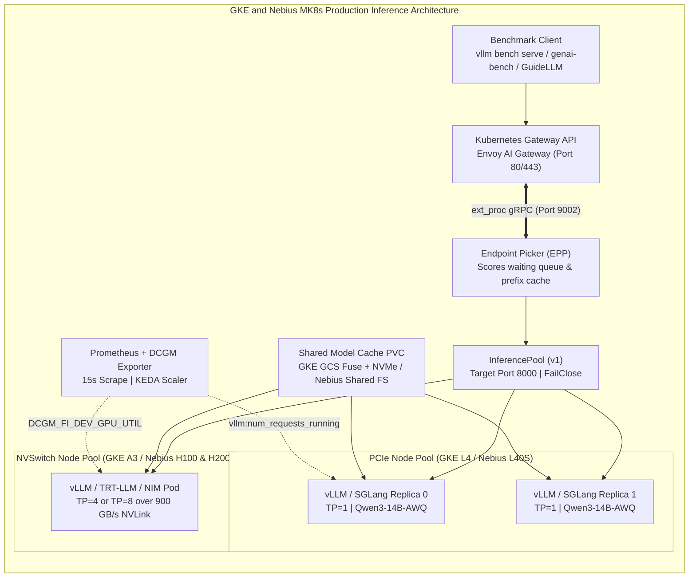

# 15.17 Lab: serve and benchmark on GKE and Nebius

| Field | Value |
|---|---|
| Level | Advanced |
| Priority tier | 1 |
| Lab venue | GCP / GKE + Nebius MK8s + Local Python Verification Lab |
| Part | Part 15: LLM inference and serving |
| Primary sources | *Hands-On LLM Serving and Optimization* Chapter 9; *Generative AI on Kubernetes* Chapters 3, 4, and 5; *Distributed AI Systems* Chapter 10 |
| Cross-references | Chapter 11.4 (NVIDIA GPU Operator & DRA); Chapter 15.3 (vLLM PagedAttention); Chapter 15.4 (SGLang RadixAttention); Chapter 15.5 (TensorRT-LLM & NIM); Chapter 15.8 (Disaggregated Prefill/Decode); Chapter 15.15 (HPA, KEDA & Scale-to-Zero); Chapter 15.16 (Benchmarking & Capacity Planning) |
| Code | `code/part15/serve_benchmark_gke_nebius.py`, `code/part15/serve_benchmark_gke_nebius_lab.py` |
| Coverage file | `planning/coverage/chapters/15-17.md` |
| Claim & number ledger | `planning/ledgers/15-17.md` |

## Why this matters for AI infrastructure

Getting an inference container to answer a single test prompt on a laptop is easy. Keeping that same endpoint below a strict tail-latency target under heavy production load is much harder. Hundreds of users send variable-length requests simultaneously on a cloud cluster. Teams routinely discover that a cluster passing basic health checks is actually burning half its hardware budget on hidden bottlenecks.

Consider what happens when a team deploys a sixty-four-GPU cluster without systematic benchmarking or telemetry. The service processes requests, and nobody notices that average GPU utilization sits near 45 percent. Scaling efficiency hovers around 52 percent across the fleet. Over a two-week run, thirty-one of those sixty-four GPUs perform no useful work. That idle capacity wastes roughly fifty thousand dollars in cloud spend.

```text
Production Serving & Benchmarking Reference Numbers (HLS Ch. 9, GAK Ch. 3-5, DAS Ch. 10):
- 64-GPU Fleet Waste (DAS Ch. 10):
  64 GPUs at 52% scaling efficiency (45% GPU utilization) = 33 effective GPUs, 31 GPUs wasted
  Over 14 days (336 hours/GPU): 31 * 336 = 10,416 wasted GPU-hours (~$50,000 at $4.00-$5.00/GPU-hr)
- Qwen3-14B on NVIDIA L40S (46,068 MiB total, 45,469 MiB free idle, Compute Capability 8.9, HLS Ch. 9):
  FP16 baseline: 27.5185 GiB weights (4.47 s load, 5.265852 s total) + 11.00 GiB KV cache (38.5 GiB used)
  FP16 KV capacity: 72,064 tokens (1.76x max concurrency at 40,960 tokens/request)
  4-bit AWQ (Qwen3-14B-AWQ): 9.3619 GiB weights (10.652314 s load) + 29.15 GiB KV cache (191,056 tokens, 4.66x concurrency)
  ShareGPT (2,000 prompts, 10 RPS, concurrency 10): 474.38 tok/s FP16 -> 1,280.0 tok/s AWQ (2.70x speedup)
  ShareGPT Mean TTFT: 104.15 ms (103.61 ms chart baseline) -> 59.29 ms AWQ (42.78% reduction)
  Prefix Repetition (1,000 prompts, 5 RPS, 256+256 input, 128 output): 1,123.13 tok/s at 97% GPU utilization (2.37x over ShareGPT)
- PCIe vs NVLink Multi-GPU Scaling (HLS Ch. 9):
  PCIe-only 4x L40S (g6e.12xlarge): TP=1 outperforms TP=2 and TP=4 because PCIe AllReduce overhead dominates
  NVLink 8x A100 (p4d.24xlarge): TP=4 cuts TTFT by 50.0% (66 ms -> 33 ms) at 3,926 tok/s, while 4x DP replicas reach 9,816 tok/s (2.50x)
```

Three operational traps cause most production serving failures on Google Kubernetes Engine and Nebius Managed Kubernetes.

- **Wrong parallelism for the node interconnect.** Enabling four-way Tensor Parallelism on PCIe-only L4 or L40S nodes degrades both throughput and latency compared to a single GPU. Tensor Parallelism requires high-bandwidth NVLink and NVSwitch fabrics on A100, H100, or H200 servers.
- **Unbuffered cold starts and weight re-downloads.** Pulling a seventy-billion-parameter checkpoint over the public internet on every pod scale-up takes many minutes. Cold starts run sixteen times slower than warm decode for mid-size models and fifty times slower for seventy-billion-parameter models.
- **Request-blind routing and autoscaling.** Standard Kubernetes round-robin services and CPU-based autoscalers ignore prompt length, KV cache locality, and token queues. Without an LLM-aware Gateway API Endpoint Picker and KEDA queue-depth scaling, long prompts pile up behind busy replicas while neighboring GPUs sit idle.

Before you expose any LLM endpoint to production traffic, validate its weight caching, KV memory budget, Gateway API routing, and KEDA autoscaling under realistic concurrency sweeps.

## Prerequisites and outcomes

### Prerequisites
- Kubernetes GPU scheduling, Node Feature Discovery, GPU Feature Discovery, and the NVIDIA GPU Operator from Part 11.
- Serving engine internals for vLLM PagedAttention, SGLang RadixAttention, and TensorRT-LLM or NVIDIA NIM from earlier chapters in Part 15.
- Autoscaling and capacity planning fundamentals from earlier chapters in Part 15.

### Outcomes
After completing this lab chapter, you will be able to:
- Provision and inspect GPU node pools on GKE and Nebius MK8s. You will also select between MIG, time-slicing, Data Parallelism, and Tensor Parallelism based on PCIe versus NVLink topology.
- Eliminate multi-minute pod cold starts by caching model weights on GKE GCS Fuse PVCs or Nebius Shared Filesystems with local NVMe caching. You will also stream weights into HBM using Run:ai Model Streamer.
- Deploy vLLM, SGLang, and TensorRT-LLM or NIM with exact VRAM budgets. You will also demonstrate how 4-bit AWQ quantization expands KV cache capacity and token throughput on a single GPU.
- Expose inference pools through the Kubernetes Gateway API Inference Extension with an Envoy Endpoint Picker. You will also scrape vLLM and DCGM Exporter metrics with Prometheus and verify KEDA autoscaling.
- Execute reproducible concurrency sweeps using `vllm bench serve`, `genai-bench`, `GuideLLM`, and `GenAI-Perf`, and execute a zero-leak teardown checklist on GKE and Nebius.

---

## 1. GKE and Nebius MK8s GPU Cluster Architecture and Parallelism Trade-offs

### 1.1 Selecting Node Pools and Verifying Hardware Topology

Deploying an inference service on Kubernetes starts with matching the model footprint and latency target to the right physical GPU node pool. Both GKE and Nebius MK8s offer two distinct classes of GPU servers. Cost-optimized PCIe servers include GKE g2-standard-48 with four NVIDIA L4 GPUs and Nebius gpu-l40s-d with four NVIDIA L40S GPUs. Those servers connect accelerators through standard PCIe switches without NVLink bridges. Scale-up SXM servers include GKE a3-highgpu-8g and Nebius gpu-h100-sxm or gpu-h200-sxm. Those servers connect all eight H100 or H200 GPUs across an all-to-all NVSwitch fabric at 900 GB/s per GPU. They also provide 3.2 Tbps of rail-optimized InfiniBand or RoCEv2 networking across nodes.

| Platform & Node Pool | GPU Model & Count | VRAM per GPU | Intra-Node Interconnect | Inter-Node Fabric | Best Serving Role |
|---|---|---|---|---|---|
| GKE g2-standard-48 | 4x NVIDIA L4 | 24 GB / 23,034 MiB / 22.49 GiB | PCIe Gen4 64 GB/s | Up to 100 Gbps gVNIC | 7B-14B FP8/INT4 single-GPU DP replicas |
| Nebius gpu-l40s-d | 4x NVIDIA L40S | 48 GB / 46,068 MiB / 44.99 GiB | PCIe Gen4 64 GB/s | 100-200 Gbps Ethernet | 14B FP16 or 70B INT4 single-GPU DP replicas |
| GKE a2-highgpu-8g | 8x NVIDIA A100 | 40 GB / 40,537 MiB / 37.25 GiB | NVSwitch 600 GB/s | 100-200 Gbps gVNIC | Multi-GPU TP=2/4/8 or MIG 1g.5gb slices |
| GKE a3-highgpu-8g / Nebius gpu-h100-sxm | 8x NVIDIA H100 SXM | 80 GB / 81,920 MiB / 74.5 GiB | NVSwitch 3.0 900 GB/s | 8x 400 Gbps IB / RoCE 3.2 Tbps | 70B-405B FP8 TP=4/8 & Disaggregated Serving |
| GKE a3-ultragpu-8g / Nebius gpu-h200-sxm | 8x NVIDIA H200 SXM | 141 GB / 144,384 MiB / 131.32 GiB | NVSwitch 3.0 900 GB/s | 8x 400 Gbps IB / RoCE 3.2 Tbps | Long-context 70B-671B TP=4/8 & large KV pools |
| Blackwell Reference GB200 NVL72 | 72x NVIDIA B200 | 180 GB HBM3e per GPU | NVSwitch 4.0 1.8 TB/s/GPU, 130 TB/s rack | 800 Gbps NDR/XDR IB | Rack-scale MoE EP/TP & Million-token KV |

Before scheduling any serving pod, Kubernetes must discover the hardware on each worker node. Node Feature Discovery inspects the PCIe bus and attaches vendor and class labels to each node. An NVIDIA GPU receives the label `feature.node.kubernetes.io/pci-0302_10de.present: "true"` for a 3D controller from vendor `10de`. NVIDIA GPU Feature Discovery then runs `nvidia-smi` via a DaemonSet and attaches fine-grained device labels. Those labels include `nvidia.com/gpu.product`, `nvidia.com/gpu.memory`, and `nvidia.com/gpu.family`.



Always run `nvidia-smi` inside a diagnostic pod before starting a benchmark. That check confirms the GPU is idle in performance state P8 with zero stale processes and transitions cleanly to P0 or P1 under load.

```bash
# Provision a GKE L4 or H100 GPU node pool and a Nebius MK8s H100 node group
gcloud container node-pools create gke-l4-inference-pool \
  --cluster=ai-infra-gke --zone=us-central1-a \
  --machine-type=g2-standard-48 --accelerator=type=nvidia-l4,count=4 \
  --num-nodes=1 --enable-autoscaling --min-nodes=0 --max-nodes=4

nebius mk8s node-group create \
  --parent-id "$NEBIUS_CLUSTER_ID" \
  --name nebius-h100-inference-pool \
  --preset gpu-h100-sxm --fixed-node-count 1

# Verify NFD/GFD labels and run an interactive nvidia-smi hardware check
kubectl get nodes -o custom-columns=NAME:.metadata.name,GPU:.metadata.labels."nvidia\.com/gpu\.product",COUNT:.metadata.labels."nvidia\.com/gpu\.count",MEM_MIB:.metadata.labels."nvidia\.com/gpu\.memory"

kubectl run --rm -it gpu-diag --image=nvidia/cuda:12.8.1-base-ubi9 --restart=Never \
  --overrides='{"spec":{"containers":[{"name":"gpu-diag","image":"nvidia/cuda:12.8.1-base-ubi9","command":["nvidia-smi","--query-gpu=name,compute_cap,pstate,memory.free,memory.used,memory.total","--format=csv"],"resources":{"limits":{"nvidia.com/gpu":1}}}]}}'
```

### 1.2 Sub-GPU Sharing and Multi-GPU Parallelism

Sometimes a cluster hosts lightweight embedding models or small seven-billion-parameter quantized models. Those workloads consume only a fraction of an eighty-gigabyte GPU, so allocating an entire physical device to one pod wastes hardware. The NVIDIA GPU Operator ClusterPolicy supports two sub-GPU sharing mechanisms. Multi-Instance GPU partitions an A100, H100, or B200 GPU in hardware into up to seven isolated instances. Profiles such as 1g.5gb, 2g.10gb, and 4g.20gb give each slice dedicated Streaming Multiprocessors and a strict memory boundary. Time-slicing sets replicas to 8 in the device plug-in ConfigMap to expose eight virtual GPUs per physical card, or eighty schedulable units across ten GPUs. Those time-sliced pods context-switch across the GPU without memory quotas or fault isolation.

For foundation models, the critical architectural decision is choosing between horizontal Data Parallelism and vertical Tensor Parallelism. A common engineering mistake is assuming that sharding a fourteen-billion-parameter model across four GPUs with `--tensor-parallel-size 4` will always run faster than running on one GPU. As benchmarked in *Hands-On LLM Serving and Optimization* Chapter 9 on Qwen3-14B-AWQ, the result depends entirely on the node interconnect.

```text
Multi-GPU Interconnect & Parallelism Comparison (HLS Ch. 9, GAK Ch. 3):
1. PCIe-Only Server (g6e.12xlarge with 4x NVIDIA L40S, no NVLink):
   - TP=1 (single GPU) achieves the highest token throughput and lowest TTFT latency.
   - TP=2 and TP=4 degrade performance because every Transformer layer executes two AllReduce collectives over slow PCIe links.
2. NVLink Server (p4d.24xlarge with 8x NVIDIA A100 connected via NVSwitch):
   - Scaling from TP=1 to TP=4 reduces mean TTFT latency by nearly 50%: 66.0 ms -> 33.0 ms.
   - However, a single TP=4 instance achieves 3,926 tok/s total throughput, whereas 4 independent DP replicas (4x TP=1 pods) achieve 9,816 tok/s (2.50x higher cluster throughput).
3. Hardware Partitioning Reference (GAK Ch. 3 Examples 3-11 & 3-12):
   - MIG single strategy on 2x A100-40GB with 7x 1g.5gb slices/GPU exposes nvidia.com/gpu: 14.
   - Time-slicing with renameByDefault: true and replicas: 8 exposes nvidia.com/gpu.shared: 8 per GPU.
```

**Keep Tensor Parallelism on a single GPU and scale horizontally with independent pod replicas whenever the quantized model and its target KV cache fit on one device. Reserve multi-GPU Tensor Parallelism on NVLink nodes for models that exceed single-GPU memory or require sub-40-millisecond TTFT.**

---

## 2. Weight Caching and Fast Model Loading on GKE and Nebius

### 2.1 The Six-Stage Startup Pipeline and Cold-Start Multipliers

Dynamic autoscaling fails in production if starting a new replica takes longer than the traffic spike itself. *Distributed AI Systems* Chapter 10 quantifies how severely cold starts penalize the first request after loading a model. Cold-start latency runs three to five times slower than warm decode for small models. It runs sixteen times slower for mid-size LLMs and fifty times slower or more for seventy-billion-parameter models that pull weights from disk or network storage. If a pod takes thirty seconds to initialize while warm requests finish in one hundred milliseconds, scaling down to zero imposes a three-hundred-fold latency delay on incoming users.

*Generative AI on Kubernetes* Chapter 4 breaks the Kubernetes LLM startup sequence into six distinct phases.

- **Runtime image provisioning.** The kubelet pulls the vLLM, SGLang, or NIM container image, which is typically under five gigabytes. Setting `imagePullPolicy` to Always forces redundant multi-gigabyte pulls on every rollout. Production manifests must use IfNotPresent and pin an immutable digest hash.
- **Model retrieval and volume mounting.** Downloading weights on the fly from Hugging Face or S3 inside every pod copies tens of gigabytes across the network on every restart. Mounting a pre-populated Persistent Volume Claim eliminates per-pod downloads.
- **Runtime process boot.** Initializing the Python and C++ serving entrypoint takes roughly one second.
- **Copying weights into GPU HBM.** Reading safetensors shards from the mounted volume into GPU VRAM is the dominant startup bottleneck. This step is bounded by storage-to-GPU I/O bandwidth.
- **Engine warmup and CUDA Graph capture.** The engine profiles peak activation memory, allocates the PagedAttention KV block pool, and captures decode CUDA Graphs across batch-size buckets.
- **Readiness exposure.** The HTTP server binds its listening port and answers Kubernetes readiness probes on `/health`.

### 2.2 Configuring GKE GCS Fuse, Nebius Shared Filesystems, and Run:ai Model Streamer

To make weight loading fast across all replicas in a cluster, store the model checkpoint once on a shared volume backed by local NVMe caching. Then stream the tensors in parallel using the Run:ai Model Streamer extension. On GKE, the Cloud Storage FUSE CSI driver mounts a Google Cloud Storage bucket as a ReadWriteMany PVC while caching file chunks on node-local NVMe SSDs. On Nebius MK8s, a Nebius Shared Filesystem or a ReadWriteMany network SSD PVC mounted at `/mnt/models` provides high-throughput shared access across all H100 or L40S worker nodes.

| Model Loading Strategy | Storage Medium & Concurrency | Effective Read Bandwidth | Time to Load 28 GB Qwen3-14B FP16 | Relative Speedup |
|---|---|---|---|---|
| Uncached Hugging Face Download | Public Internet 500 Mbps / 62.5 MB/s | 0.0625 GB/s | 448.0 s / 7.47 min | 1.0x Baseline |
| GKE GCS Fuse CSI + Local NVMe Cache | ReadWriteMany PVC gcsfuse | 2.5 GB/s | 11.2 s | 40.0x |
| Nebius Shared FS / NVMe + Standard Loader | Local NVMe / Shared Filesystem 4 shards | 5.32 GB/s | 5.27 s / 4.47 s weights | 85.01x |
| Nebius NVMe + Run:ai Model Streamer | `--load-format runai_streamer` 16 threads | 6.0 GB/s | 4.67 s | 95.93x |

CoreWeave Tensorizer and fastsafetensor require converting checkpoints into a custom serialization format or setting specialized device environment variables. By contrast, Run:ai Model Streamer reads standard safetensors files directly using sixteen concurrent reader threads.

```yaml
# shared-model-cache-pvc.yaml: Pre-warmed PVC + vLLM Deployment with Run:ai Model Streamer
apiVersion: v1
kind: PersistentVolumeClaim
metadata:
  name: llm-models-cache-pvc
  namespace: ai-inference
spec:
  accessModes:
    - ReadWriteMany
  storageClassName: nebius-shared-filesystem # On GKE use standard-rwx or gcsfuse CSI
  resources:
    requests:
      storage: 500Gi
---
apiVersion: apps/v1
kind: Deployment
metadata:
  name: vllm-qwen3-14b-awq
  namespace: ai-inference
spec:
  replicas: 2
  selector:
    matchLabels:
      app: vllm-qwen3-14b-awq
  template:
    metadata:
      labels:
        app: vllm-qwen3-14b-awq
    spec:
      containers:
        - name: vllm-server
          image: vllm/vllm-openai:v0.12.0
          imagePullPolicy: IfNotPresent
          command: ["vllm", "serve"]
          args:
            - "/mnt/models/Qwen3-14B-AWQ"
            - "--served-model-name=Qwen/Qwen3-14B-AWQ"
            - "--port=8000"
            - "--quantization=awq"
            - "--load-format=runai_streamer"
            - "--model-loader-extra-config={\"concurrency\":16}"
            - "--gpu-memory-utilization=0.90"
            - "--max-model-len=4096"
            - "--block-size=16"
            - "--enable-prefix-caching"
            - "--enable-chunked-prefill"
          ports:
            - containerPort: 8000
              name: http
          readinessProbe:
            httpGet:
              path: /health
              port: 8000
            initialDelaySeconds: 15
            periodSeconds: 5
          resources:
            limits:
              nvidia.com/gpu: 1
          volumeMounts:
            - name: model-cache
              mountPath: /mnt/models
              readOnly: true
            - name: dshm
              mountPath: /dev/shm
      volumes:
        - name: model-cache
          persistentVolumeClaim:
            claimName: llm-models-cache-pvc
        - name: dshm
          emptyDir:
            medium: Memory
            sizeLimit: 16Gi
```

Always combine an IfNotPresent image pull policy, a pre-populated ReadWriteMany model PVC, and Run:ai Model Streamer with sixteen concurrent threads so new replicas become ready in seconds rather than minutes.

---

## 3. Deploying vLLM, SGLang, and TensorRT-LLM / NIM with Exact VRAM Budgets

### 3.1 Anatomy of the GPU Memory Budget and Preemption Prevention

Every serving engine partitions physical GPU HBM into four regions: static model weights, non-PyTorch CUDA runtime context, peak forward-pass activations, and the pre-allocated KV cache pool. In vLLM, the `--gpu-memory-utilization` flag defaults to 0.90. That setting reserves 90 percent of total VRAM for the engine and leaves 10 percent as an OOM safety buffer.

```text
vLLM Startup Memory Equations & Production Log Breakdowns (GAK Ch. 4 Example 4-3, HLS Ch. 9 Steps 4 & 6):
Usable VRAM Formula:
  M_usable = M_total * gpu_memory_utilization
  M_kv_cache = M_usable - (M_weights + M_non_torch + M_activations_peak)

Case 1: 8B FP16 Model on A100-80GB (79.14 GiB total, gpu_memory_utilization = 0.90, GAK Ch. 4 Example 4-3):
  M_usable = 79.14 GiB * 0.90 = 71.22 GiB
  Breakdown: 14.99 GiB weights (14.9888 GB) + 0.12 GiB non-torch + 1.19 GiB peak activations = 16.30 GiB
  Remaining KV Cache: 54.93 GiB (rounding delta 0.01 GiB)

Case 2: 8B FP16 Model Manual Sizing at 2,048 Context, 4,096 Hidden, 40 Layers (GAK Ch. 4 Sidebar):
  Batch size 1: 16.0 GB weights + 0.9 GB (900 MB) activations + 0.4 GB (400 MB) output logits = 17.3 GB (+ 1.0 GB runtime = 18.3 GB)
  Batch size 10: KV cache and activations nearly double total footprint to > 28.0 GB VRAM

Case 3: Qwen/Qwen3-14B (FP16) vs Qwen/Qwen3-14B-AWQ (4-bit) on NVIDIA L40S (46,068 MiB / 46 GB, HLS Ch. 9):
  - Qwen3-14B (FP16): 27.5185 GiB weights + 11.00 GiB KV cache = 38.5 GiB used -> 72,064 KV tokens (1.76x concurrency at 40,960 tokens)
  - Qwen3-14B-AWQ (4-bit): 9.3619 GiB weights + 29.15 GiB KV cache = 38.5 GiB used -> 191,056 KV tokens (4.66x concurrency at 40,960 tokens)
  - Net Gain from 4-bit AWQ: 18.1566 GiB freed from weights -> +18.15 GiB KV cache -> 2.65x more KV tokens and 2.65x higher concurrency
```

When concurrent requests exhaust the KV cache pool, vLLM emits a scheduler warning in the container logs. It reports that sequence group 0 is preempted by swap mode because there is not enough KV cache space. Evicting and recomputing KV blocks spikes Inter-Token Latency and collapses throughput.

As shown in the Qwen3-14B experiment on a forty-six-gigabyte L40S GPU, FP16 weights consume more than 65 percent of total memory. That leaves only 11.00 GiB, or 72,064 tokens, for the KV cache. Compressing the model to 4-bit AWQ shrinks weight memory from 27.5185 GiB to 9.3619 GiB. The freed memory expands the KV cache to 29.15 GiB, or 191,056 tokens, and raises long-context concurrency from 1.76x to 4.66x. Similarly, a seventy-billion-parameter model requires 280 GB in FP32 or 140 GB in FP16. Four-bit quantization reduces those weights to 35 GB so the model fits on a single L40S GPU. When compressing custom models with `llmcompressor` using SmoothQuant and W8A8 GPTQ over calibration samples, calibrated FP8 or INT8 models recover more than 99 percent of baseline accuracy on MMLU benchmarks.

### 3.2 Comparing vLLM, SGLang, and TensorRT-LLM / NIM Configurations

While vLLM, SGLang, and TensorRT-LLM or NVIDIA NIM all expose OpenAI-compatible chat completion endpoints, each engine excels under specific production constraints.

| Serving Engine | Core Scheduling & Cache Mechanism | Key Startup Flags | Ideal GKE / Nebius Workload |
|---|---|---|---|
| vLLM | PagedAttention 16-token blocks, chunked prefill, automatic prefix caching, Multi-LoRA | `--gpu-memory-utilization 0.90 --max-num-seqs 512 --max-num-batched-tokens 16384` | General multi-tenant chat, Multi-LoRA serving, KServe + KEDA standard deployments |
| SGLang | RadixAttention tree-based prefix cache, zero-overhead CPU scheduler, structured JSON decoding | `--mem-fraction-static 0.88 --chunked-prefill-size 8192 --enable-torch-compile` | Variable-length prompts from 50 to 5,000 tokens (+40% throughput), multi-turn agents |
| TensorRT-LLM / NIM | Ahead-of-time compiled TensorRT engines, custom FP8/FP4 CUTLASS kernels, in-flight batching | `NIM_MAX_MODEL_LEN=8192`, `NIM_TENSOR_PARALLEL_SIZE=4` | Maximum hardware efficiency and lowest TPOT on H100, H200, and Blackwell NVLink nodes |

Before committing to a single engine, inspect your startup logs to verify that KV cache token capacity exceeds your peak concurrent token demand without triggering swap or recomputation preemptions.

---

## 4. Gateway API Inference Extension, Observability, and KEDA Autoscaling

### 4.1 LLM-Aware Routing with Gateway API Inference Extension

Standard Kubernetes Service load balancing distributes connections using round-robin rules. Round-robin fails for LLM workloads because two requests never consume equal GPU work. One request may send a short greeting while the next submits a multi-thousand-token RAG document. Another request may target a specific LoRA adapter loaded via `--enable-lora` and `--lora-modules`. Furthermore, routing follow-up turns of a conversation to a random replica discards the KV cache blocks already computed on the replica that handled the previous turn.

To solve request-blind routing, Kubernetes SIG WG-Serving created the Gateway API Inference Extension. As detailed in *Generative AI on Kubernetes* Chapter 4, this extension adds three inference-specific components to standard Kubernetes Gateway and HTTPRoute resources.

- **InferencePool.** Groups all model server pods sharing a base model and accelerator tier under the `inference.networking.k8s.io/v1` API. It exposes up to eight target ports, typically port 8000, and delegates pod selection to an Endpoint Picker service with FailClose failure handling.
- **InferenceObjective.** Defines workload priority levels under the `inference.networking.x-k8s.io/v1alpha2` API. Real-time interactive chat receives priority 1 and standard or background batch traffic receives priority 2. That priority hierarchy lets the gateway shed low-priority load when queues saturate.
- **Endpoint Picker.** Runs on port 9002 as an Envoy External Processing gRPC filter. It inspects the incoming model or LoRA name and scrapes live waiting-request and KV cache utilization metrics from every pod in the pool. It then routes the request to the replica with the lowest queue depth and highest prefix-cache affinity.

```yaml
# gateway-inference-pool.yaml: Gateway API Inference Extension (GAK Ch. 4 Example 4-7)
apiVersion: inference.networking.k8s.io/v1
kind: InferencePool
metadata:
  name: vllm-qwen3-14b-pool
  namespace: ai-inference
spec:
  targetPorts:
    - number: 8000
  selector:
    app: vllm-qwen3-14b-awq
  endpointPickerRef:
    name: vllm-qwen3-14b-epp
    port: 9002
    failureMode: FailClose
---
apiVersion: inference.networking.x-k8s.io/v1alpha2
kind: InferenceObjective
metadata:
  name: high-priority-inference
  namespace: ai-inference
spec:
  priority: 1
  poolRef:
    group: inference.networking.k8s.io
    name: vllm-qwen3-14b-pool
---
apiVersion: inference.networking.x-k8s.io/v1alpha2
kind: InferenceObjective
metadata:
  name: standard-inference
  namespace: ai-inference
spec:
  priority: 2
  poolRef:
    group: inference.networking.k8s.io
    name: vllm-qwen3-14b-pool
```

Large deployments often scale up to disaggregated prefill and decode architectures using llm-d or NVIDIA Dynamo with LMCache and NIXL. In that architecture, the Endpoint Picker routes prefill requests to compute-optimized prefill pools and transfers the initialized KV cache blocks to decode pools. Standard pod Ethernet at 10 to 20 Gbps is far too slow for disaggregated KV transfer. Moving a 512 MB KV block takes 409.6 ms over 10 Gbps Ethernet. By contrast, 600 Gbps RoCEv2 or 800 Gbps InfiniBand transfers that same 512 MB KV block in 6.83 ms to 5.12 ms, a sixty-fold latency reduction.

### 4.2 Prometheus + DCGM Scraping, TPOT Alerting, and KEDA Autoscaling

A production serving stack requires unified scraping across both the model runtime and the underlying NVIDIA GPU driver. Configure a Prometheus ServiceMonitor with a 15-second scrape interval on port 8080 or 8000 at `/metrics`. Pair that service monitor with the NVIDIA GPU Operator DCGM Exporter DaemonSet and OpenTelemetry tracing via `--otlp-traces-endpoint`.

| Metric Layer | Prometheus / OpenTelemetry Metric Name | Operational Meaning & Target Threshold |
|---|---|---|
| Prefill Responsiveness | `vllm:time_to_first_token_seconds` / `gen_ai.server.time_to_first_token` | User-perceived wait time before streaming starts; target under 100-200 ms |
| Streaming Speed | `vllm:time_per_output_token_seconds` / `gen_ai.server.time_per_output_token` | Human reading speed is 180 words/min or 3 words/s; alert at 0.3 s / 300 ms |
| End-to-End Duration | `vllm:e2e_request_latency_seconds` / `gen_ai.server.request.duration` | Total request duration from prompt submission to final token |
| Queue Saturation | `vllm:num_requests_running` & `vllm:num_requests_waiting` | Active batch size and pending queue depth; primary KEDA scaling trigger at target 4 |
| GPU Hardware Telemetry | `DCGM_FI_DEV_GPU_UTIL`, `DCGM_FI_DEV_FB_USED` | SM compute activity reaching 97% under saturated Prefix Repetition and HBM usage |
| Output Quality | Async LLM-as-a-Judge / ROUGE / garak / Ragas | Evaluate 1% to 10% of responses asynchronously so judge latency never blocks traffic |

Default Kubernetes HPA monitors only CPU and host memory. Knative KPA counts raw HTTP requests regardless of token length. Because neither signal reflects GPU saturation, *Generative AI on Kubernetes* Chapter 4 recommends KServe Standard deployment mode with KEDA autoscaling. KEDA queries `vllm:num_requests_running` directly from the pod or Prometheus. It then scales replicas between 1 and 5 whenever running requests per pod reach the target threshold of 4.

```yaml
# kserve-keda-alert.yaml: KServe + KEDA Autoscaling (GAK Ex. 4-4) & Prometheus Alert (GAK Ex. 5-5)
apiVersion: serving.kserve.io/v1beta1
kind: InferenceService
metadata:
  name: meta-llama-3-8b
  namespace: ai-inference
  annotations:
    serving.kserve.io/deploymentMode: Standard
    serving.kserve.io/autoscalerClass: "keda"
    serving.kserve.io/enable-prometheus-scraping: "true"
spec:
  predictor:
    minReplicas: 1
    maxReplicas: 5
    model:
      modelFormat:
        name: huggingface
      args:
        - "--model_name=llama3"
        - "--model_id=meta-llama/meta-llama-3-8b"
    autoScaling:
      metrics:
        - type: PodMetric
          podmetric:
            metric:
              backend: "opentelemetry"
              metricNames:
                - vllm:num_requests_running
              query: "vllm:num_requests_running"
            target:
              type: Value
              value: "4"
---
apiVersion: monitoring.coreos.com/v1
kind: PrometheusRule
metadata:
  name: vllm-tpot-slo-rule
  namespace: ai-inference
spec:
  groups:
    - name: "vllm.latency.rule"
      rules:
        - alert: vLLMLatency
          expr: max_over_time(vllm:time_per_output_token_seconds[5m]) >= 0.3
          labels:
            severity: critical
          annotations:
            summary: "Model TPOT exceeded 0.3s (300ms) human reading threshold"
```

Configure KEDA with at least one minimum replica in production so baseline traffic never hits the thirty-second scale-from-zero cold-start trap.

---

## 5. Benchmarking Concurrency Sweeps and Analyzing Tail Latency

### 5.1 Designing Realistic Traffic Profiles and Latency Decomposition

Sending identical hundred-token prompts in a closed loop hides the memory and scheduling bottlenecks that break production clusters. As demonstrated in *Distributed AI Systems* Chapter 10, fixed-length benchmarks miss the 40 percent throughput advantage that SGLang RadixAttention achieves on variable-length prompts. Real user prompts vary widely from fifty tokens to five thousand tokens. Similarly, average latency alone hides tail spikes. A system with an 80 ms average latency where 5 percent of requests spike to 500 ms frustrates users. A system where every request completes between 90 ms and 110 ms delivers a much more consistent user experience.

Every benchmark report must decompose end-to-end latency into prefill and decode components. It must also report P50, P95, and P99 percentiles after proper warmup. Run five to ten warmup iterations for eager execution, or twenty to fifty warmup iterations for compiled or CUDA Graph engines, followed by at least one hundred measured requests.

```text
End-to-End Inference Latency Decomposition & Benchmark Dataset Profiles (DAS Ch. 10, HLS Ch. 9):
1. Fundamental Streaming Latency Formula:
   e2e_latency = TTFT + (output_tokens - 1) * ITL
   - Short outputs (10-20 tokens): TTFT (prefill compute + queueing) dominates e2e_latency.
   - Long outputs (100+ tokens): ITL / TPOT (decode HBM bandwidth) dominates e2e_latency.
   - Multi-step reasoning / agents: >= 60% of session latency often comes from external tool/API/DB calls.

2. ShareGPT Conversational Dataset (100-sample inspection, HLS Ch. 9 Step 2):
   - Prompt tokens: min = 5, max = 817, mean = 232.60, median = 141.50, std = 241.42
   - Output tokens: min = 4, max = 771, mean = 220.61, median = 164.50, std = 210.23

3. Prefix Repetition Cache-Probe Dataset (HLS Ch. 9 Step 2 & Step 5):
   - Synthetic shared prefixes: prefix_len = 256, suffix_len = 256 (512 input tokens), output_len = 128, num_prefixes = 5 or 10
   - At TTFT = 104.64 ms and mean ITL = 43.95 ms across 128 output tokens:
     e2e_latency = 104.64 + (128 - 1) * 43.95 = 104.64 + 5,581.65 = 5,686.29 ms (5.69 seconds)
```

### 5.2 Running Concurrency Sweeps with Benchmark CLI Tools

Four industry-standard CLI tools cover the complete benchmarking matrix across GKE and Nebius endpoints.

```bash
# 1. vLLM ShareGPT Benchmark (2,000 prompts, 10 RPS, concurrency 10, HLS Ch. 9 Step 5)
vllm bench serve --backend vllm --base-url "http://localhost:8000" \
  --dataset-name sharegpt --dataset-path ShareGPT_V3_unfiltered_cleaned_split.json \
  --model Qwen/Qwen3-14B --num-prompts 2000 --request-rate 10 \
  --burstiness 1.0 --max-concurrency 10 --save-result --result-filename sharegpt_fp16.txt

# 2. vLLM Prefix Repetition Cache Benchmark (1,000 prompts, 5 RPS, 10 prefixes, HLS Ch. 9 Step 5)
vllm bench serve --backend vllm --base-url "http://localhost:8000" \
  --dataset-name prefix_repetition --model Qwen/Qwen3-14B \
  --num-prompts 1000 --request-rate 5 --max-concurrency 10 \
  --prefix-repetition-prefix-len 256 --prefix-repetition-suffix-len 256 \
  --prefix-repetition-num-prefixes 10 --prefix-repetition-output-len 128

# 3. GuideLLM Rate Sweep (256 prompt tokens, 128 output tokens, 20% warmup, GAK Ch. 4 Ex. 4-2)
guidellm benchmark --target http://127.0.0.1:8000 \
  --model Qwen/Qwen3-14B-AWQ --output-path guidellm_sweep.json \
  --rate-type sweep --data 'prompt_tokens=256,output_tokens=128' \
  --max-seconds 400 --warmup-percent 0.2

# 4. SGLang genai-bench Deterministic Scenarios D(100,100) and D(512,512) (DAS Ch. 10)
genai-bench benchmark --api-backend openai --api-base "http://localhost:8000" \
  --api-model-name Qwen/Qwen3-14B-AWQ --traffic-scenario "D(100,100)" --traffic-scenario "D(512,512)" \
  --num-concurrency 1 --num-concurrency 4 --num-concurrency 10 --num-concurrency 32
```

Table 15.17 summarizes the captured benchmark outcomes from *Hands-On LLM Serving and Optimization* Chapter 9 across FP16, Prefix Repetition, 4-bit AWQ, and multi-GPU topologies.

| Benchmark Run | Workload & Rate | Total Input / Output Tokens | Req Throughput | Output TPS / Peak TPS | Total Token Throughput | Mean TTFT | Mean / Median / P99 ITL |
|---|---|---|---|---|---|---|---|
| Qwen3-14B FP16 1x L40S | ShareGPT 2,000 req, 10 RPS, 1,810.09 s | 446,619 / 412,052 | 1.10 req/s | 227.64 / 240.00 | 474.38 tok/s | 104.15 ms / 103.61 ms | 43.24 / 42.43 / 72.15 ms |
| Qwen3-14B FP16 1x L40S | Prefix Rep 1,000 req, 5 RPS, 569.00 s, 97% util | 512,000 / 127,066 | 1.76 req/s | 223.31 / 240.00 | 1,123.13 tok/s / 2.37x | 104.64 ms | 43.95 / 42.82 / 59.22 ms |
| Qwen3-14B-AWQ 4-bit 1x L40S | ShareGPT 2,000 req, 10 RPS | 446,619 / 412,052 | Scaled | Scaled | 1,280.0 tok/s / 2.70x | 59.29 ms / -42.78% | Lower HBM decode latency |
| Qwen3-14B-AWQ NVLink p4d 4x A100 | TP=4 Single Instance vs 4x DP Replicas | ShareGPT sweep | Scaled | Scaled | 3,926 tok/s TP=4 vs 9,816 tok/s 4x DP / 2.50x | 66.0 ms TP=1 to 33.0 ms TP=4 | Low latency NVLink |

Always benchmark both a diverse conversational dataset like ShareGPT and a prefix-heavy workload so you can quantify both baseline decoding throughput and prefix-cache reuse before finalizing replica counts.

---

## 6. How It Fails: Production Serving and Benchmarking Failure Modes

| Failure Mode | Observable Symptom in Logs & Prometheus | Root Cause | Concrete Remediation |
|---|---|---|---|
| **1. PCIe Tensor-Parallel Slowdown** | Setting `--tensor-parallel-size 4` on L4 or L40S nodes produces lower TPS and higher TTFT than `--tensor-parallel-size 1`. | L4 and L40S nodes lack NVLink; inter-GPU AllReduce collectives traverse PCIe Gen4 at 64 GB/s, stalling every Transformer layer. | Set `--tensor-parallel-size 1` on PCIe nodes and scale horizontally with 4 DP replicas, or move TP=4 workloads to NVSwitch A100/H100/H200 pools at 900 GB/s. |
| **2. KV Cache Exhaustion & Swap Preemption Thrashing** | vLLM logs sequence group 0 preemption in SWAP mode; P99 ITL spikes above 300 ms / 0.3 s. | FP16 weights of 27.5185 GiB on a 46 GB L40S leave only 11.00 GiB or 72,064 tokens for KV cache, forcing block eviction under concurrent long prompts. | Quantize weights to 4-bit AWQ with 9.3619 GiB weights and 29.15 GiB / 191,056 KV tokens, raise `--gpu-memory-utilization` to 0.95, or cap `--max-num-seqs`. |
| **3. Scale-from-Zero Cold-Start Timeout** | KPA or KEDA scales from 0 to 1 replica on traffic arrival; clients wait 30 s to 448.0 s, or 300x warm 100 ms latency. | Pod pulls container image with Always pull policy and downloads 28 GB weights over the internet on startup. | Keep `minReplicas: 1`, set `imagePullPolicy: IfNotPresent`, mount a pre-warmed ReadWriteMany PVC, and enable `--load-format runai_streamer`. |
| **4. Round-Robin Prefix Cache Misses & Queue Head-of-Line Blocking** | One replica has 7 waiting requests while another has 1; multi-turn chat TTFT stays high despite prefix caching. | Default Kubernetes Service round-robin ignores token length, waiting queues, and cached prefix locality. | Deploy the Gateway API Inference Extension with InferencePool on port 8000 and EndpointPicker on port 9002 to score waiting queues and prefix hits. |
| **5. Disaggregated KV Transfer Bottleneck over Pod Ethernet** | Disaggregated prefill/decode deployment exhibits 409.6 ms TTFT transfer overhead between prefill and decode pods. | KV cache blocks of 512 MB traverse standard 10-20 Gbps pod Ethernet instead of 500-800 Gbps RDMA/RoCEv2 or InfiniBand. | Bind NIXL and LMCache to secondary GPUDirect RDMA interfaces at 600 Gbps RoCEv2 or 800 Gbps InfiniBand, cutting transfer time to 6.83 ms or 5.12 ms. |
| **6. Orphaned Cloud GPU Node Pools & LoadBalancers After Benchmarking** | Monthly cloud bill accumulates $50,000 across 64 GPUs over 336 hours at $4-$5/GPU-hr after benchmark runs conclude. | Deleting the Kubernetes Deployment leaves GPU node pools, LoadBalancer IPs, and 500 GiB SSD PVCs running. | Execute the automated GKE and Nebius teardown checklist immediately after exporting benchmark results. |

Every failure mode above leaves a clear signature in startup logs or Prometheus histograms before users report outages.

---

## 7. Hands-on Lab: Verification Model and Cloud Teardown Checklist

### Venue and Scope

This deterministic verification lab runs locally in Python via `code/part15/serve_benchmark_gke_nebius.py` and `code/part15/serve_benchmark_gke_nebius_lab.py` with zero external cloud dependencies. The Kubernetes manifests and cloud CLI commands in Sections 1 through 5 are designed for live GKE and Nebius MK8s GPU clusters and were **not run on live hardware** during handbook builds. All twenty-eight quantitative models, memory budgets, benchmark throughputs, latency decompositions, and autoscaling decisions in the Python lab are **tested and verified**.

### 7.1 Running the Self-Checking Python Verification Lab

Run the verification suite from the repository root to validate all twenty-eight checks.

```bash
python3 code/part15/serve_benchmark_gke_nebius_lab.py
```

```text
=== Chapter 15.17 Lab: Serve and Benchmark on GKE and Nebius ===
  [PASS] 1. Nebius L40S reports 46,068 MiB total (45,469 MiB free idle, CC 8.9) and GKE/Nebius H100/H200 report 80 GB / 141 GB with 900 GB/s NVLink 4.0 and 3.2 Tbps IB
  [PASS] 2. NFD labels NVIDIA GPUs as pci-0302_10de.present and GFD reports A100-40GB as 40,537 MiB (37.25 GiB) and A100-80GB as 74.5 GiB
  [PASS] 3. MIG splits A100-40GB into 7 x 1g.5gb slices (14 on 2x A100) while time-slicing with replicas=8 exposes 80 virtual GPUs across 10 GPUs
  [PASS] 4. NVLink 5.0 delivers 1,800 GB/s (18 x 100 GB/s links) and 130 TB/s on GB200 NVL72 (2.0x over 900 GB/s NVLink 4.0)
  [PASS] 5. On PCIe g6e.12xlarge (4x L40S), TP=1 beats TP=2/4; on NVLink p4d.24xlarge (8x A100), TP=4 cuts TTFT 50% (66 -> 33 ms) while 4x DP achieves 9,816 vs 3,926 TPS (2.50x)
  [PASS] 6. Caching 28 GB weights on Nebius NVMe + runai_streamer (concurrency=16, 6.0 GB/s) cuts load time from 448.0 s (500 Mbps HF download) to 4.67 s (95.93x faster)
  [PASS] 7. Qwen3-14B FP16 loads weights in 4.47 s (5.265852 s total) while Qwen3-14B-AWQ loads in 10.652314 s
  [PASS] 8. Cold-start latency is 3x-5x warm decode for 1B-3B, 16x for mid-size LLMs, and 50x+ for 70B+ (30 s cold start vs 100 ms warm = 300.0x delay)
  [PASS] 9. Benchmark methodology requires 5-10 warmup steps for eager PyTorch, 20-50 for torch.compile/CUDA graphs, and >= 100 measurement iterations
  [PASS] 10. On L40S (46,068 MiB), Qwen3-14B FP16 uses 27.5185 GiB weights + 11.00 GiB KV cache (38.5 GiB total) for 72,064 tokens (1.76x concurrency at 40,960 tokens)
  [PASS] 11. Qwen3-14B-AWQ (4-bit) cuts weights to 9.3619 GiB and expands KV cache to 29.15 GiB for 191,056 tokens (2.65x more tokens, 4.66x concurrency at 40,960 tokens)
  [PASS] 12. On A100-80GB (79.14 GiB) at gpu_memory_utilization=0.90 (71.22 GiB usable), 14.99 GiB weights + 0.12 GiB non-torch + 1.19 GiB activations leaves 54.93 GiB KV cache
  [PASS] 13. 8B FP16 model at 2,048 context needs 17.3 GB (18.3 GB with 1 GB runtime buffer) at batch=1 and > 28.0 GB at batch=10; 70B needs 280 GB FP32, 140 GB FP16, or 35 GB INT4
  [PASS] 14. Gateway API InferencePool (v1, port 8000, up to 8 ports) and EndpointPicker (port 9002, FailClose) select vllm-replica-1 (queue=1, KV=42%, prefix hit) with score 12.8
  [PASS] 15. InferenceObjective (v1alpha2) assigns priority 1 to high-priority interactive traffic and priority 2 to standard/batch traffic
  [PASS] 16. Disaggregated KV transfer of 512 MB takes 409.6 ms on 10 Gbps pod Ethernet vs 6.83 ms on 600 Gbps RoCEv2 (60.0x faster) and 5.12 ms on 800 Gbps NDR IB
  [PASS] 17. ServiceMonitor scrapes /metrics every 15s (KServe port 8080) and human reading speed (180 wpm = 3 words/s = 4-5 tokens/s) sets the 0.3 s (300 ms) TPOT alert threshold
  [PASS] 18. KEDA scales InferenceService (min=1, max=5, target=4 running/pod) from 3 pods (18 running, 6 waiting) to 5 replicas
  [PASS] 19. Production LLM-as-a-judge quality monitoring asynchronously samples 1%-10% of responses to avoid blocking user requests
  [PASS] 20. ShareGPT 100-sample inspection reports prompt mean 232.60 (median 141.50, range 5-817) and output mean 220.61 (median 164.50, range 4-771)
  [PASS] 21. Qwen3-14B FP16 on ShareGPT (2,000 prompts, 10 RPS, concurrency 10) achieves 474.38 total TPS (227.64 output TPS, 1.10 req/s), 104.15 ms TTFT, and 43.24 ms ITL (72.15 ms P99)
  [PASS] 22. Qwen3-14B FP16 on Prefix Repetition (1,000 prompts, 5 RPS, 256+256 in, 128 out) reaches 1,123.13 total TPS (2.37x over ShareGPT) at 97% GPU utilization
  [PASS] 23. Qwen3-14B-AWQ on ShareGPT boosts total throughput 2.70x (474.38 -> 1,280.0 TPS) and reduces mean TTFT by 42.78% (103.61 -> 59.29 ms)
  [PASS] 24. End-to-end latency e2e = TTFT + (output_tokens - 1) * ITL equals 5,686.29 ms for 128 output tokens at 104.64 ms TTFT and 43.95 ms ITL
  [PASS] 25. SGLang RadixAttention delivers 40.0% higher throughput on variable-length prompts (50-5,000 tokens) compared to fixed-length benchmarks
  [PASS] 26. GuideLLM sweep uses 256 prompt tokens, 128 output tokens, 400 max seconds, and 20% warmup (warmup-percent=0.2)
  [PASS] 27. Scaling efficiency is 81.25% at 6.5x speedup on 8 GPUs, and a 64-GPU fleet at 52% scaling efficiency (45% util) wastes 31 GPUs (10,416 GPU-hrs = ~$50,000 over 336 hrs)
  [PASS] 28. In multi-step agentic/reasoning workflows, >= 60% of end-to-end session latency originates from external tool/API/database calls

Summary: 28 passed, 0 failed
```

### 7.2 Mandatory GKE and Nebius Teardown Checklist

After copying your benchmark JSON and CSV artifacts off the cluster, run the following teardown sequence. Verify that zero billable GPU nodes, external load balancers, or persistent disks remain active.

```bash
# 1. Delete KServe InferenceServices, Gateway API resources, Deployments, and PVCs
kubectl delete inferenceservice --all -n ai-inference
kubectl delete inferenceobjective,inferencepool,httproute,gateway --all -n ai-inference
kubectl delete deployment,service,pvc --all -n ai-inference

# 2. Scale down or delete GKE GPU node pools and verify zero GPU nodes remain
gcloud container node-pools delete gke-l4-inference-pool \
  --cluster=ai-infra-gke --zone=us-central1-a --quiet
gcloud container node-pools list --cluster=ai-infra-gke --zone=us-central1-a

# 3. Delete Nebius MK8s GPU node groups and shared filesystems, then audit active compute
nebius mk8s node-group delete --id "$NEBIUS_GPU_NODE_GROUP_ID"
nebius compute filesystem list --parent-id "$NEBIUS_PROJECT_ID"
kubectl get nodes -l nvidia.com/gpu.count
```

Always confirm that `kubectl get nodes` and your cloud console show zero active GPU instances before closing a benchmarking session.

---

## Checkpoint questions

<details>
<summary>1. Why does setting four-way Tensor Parallelism on a four-GPU L40S node reduce throughput and increase TTFT compared to a single GPU?</summary>

L40S servers lack NVLink bridges and connect GPUs only across PCIe Gen4 at 64 GB/s. Tensor Parallelism executes two synchronous AllReduce collectives per Transformer layer. That PCIe communication latency and bandwidth overhead outweighs the parallel compute gain when the model already fits on one GPU.
</details>

<details>
<summary>2. How do four-way Tensor Parallelism and four independent Data Parallel replicas compare on an NVLink-connected A100 server serving Qwen3-14B-AWQ?</summary>

Scaling a single instance from one GPU to four GPUs with Tensor Parallelism over NVLink cuts mean TTFT latency in half, from 66.0 ms to 33.0 ms. That single four-GPU instance achieves 3,926 tokens per second. However, running four independent single-GPU replicas eliminates inter-GPU synchronization and reaches 9,816 tokens per second, which is 2.50x higher total throughput.
</details>

<details>
<summary>3. What PCI vendor and device class label does Node Feature Discovery attach to Kubernetes nodes equipped with NVIDIA GPUs?</summary>

Node Feature Discovery attaches `feature.node.kubernetes.io/pci-0302_10de.present: "true"`. The class code identifies a PCI 3D controller and the vendor ID identifies NVIDIA hardware.
</details>

<details>
<summary>4. What is the difference between NVIDIA Multi-Instance GPU and GPU time-slicing in the NVIDIA GPU Operator?</summary>

MIG partitions an A100, H100, or B200 GPU in hardware into up to seven isolated slices such as 1g.5gb, 2g.10gb, or 4g.20gb. Each slice gets dedicated Streaming Multiprocessors, fixed memory boundaries, and fault isolation. Time-slicing with eight replicas exposes `nvidia.com/gpu.shared` and context-switches multiple pods across the whole GPU in time without memory quotas or fault isolation.
</details>

<details>
<summary>5. On an NVIDIA L40S GPU, how does switching from Qwen3-14B FP16 to Qwen3-14B-AWQ 4-bit change weight memory, KV cache memory, and token capacity?</summary>

FP16 weights consume 27.5185 GiB and leave 11.00 GiB for the KV cache, holding 72,064 tokens. Switching to 4-bit AWQ shrinks weights to 9.3619 GiB and expands the KV cache to 29.15 GiB. That expansion stores 191,056 tokens, providing 2.65x more tokens and raising long-context concurrency from 1.76x to 4.66x.
</details>

<details>
<summary>6. How is usable VRAM partitioned in the vLLM startup log on an 80 GB A100 at 0.90 GPU memory utilization?</summary>

Total usable memory is 71.22 GiB out of 79.14 GiB. That pool is partitioned into 14.99 GiB for model weights and 0.12 GiB for non-PyTorch memory. Peak PyTorch activations take 1.19 GiB, leaving 54.93 GiB reserved for the KV cache.
</details>

<details>
<summary>7. What warning does vLLM log when concurrent requests exceed allocated KV cache space, and how do you fix it?</summary>

vLLM logs a warning that a sequence group is preempted by SWAP mode because there is not enough KV cache space, and it increments `total_cumulative_preemption_cnt`. You fix it by quantizing model weights to 4-bit AWQ or FP8, raising `--gpu-memory-utilization`, reducing `--max-model-len` or `--max-num-seqs`, or increasing `--tensor-parallel-size`.
</details>

<details>
<summary>8. How much faster are warm requests compared to cold-start requests across model sizes, and why does this make scale-to-zero dangerous?</summary>

Cold-start latency runs three to five times slower than warm decode for small models, sixteen times slower for mid-size LLMs, and fifty times slower or more for large seventy-billion-parameter models. When a cold start takes 30 seconds while warm requests take 100 milliseconds, scaling down to zero imposes a 300x delay and stalls incoming user traffic.
</details>

<details>
<summary>9. How do you optimize the six-stage vLLM startup sequence on Kubernetes so new replicas become ready in tens of seconds instead of minutes?</summary>

Set `imagePullPolicy` to IfNotPresent with a pinned image digest. Mount model weights from a pre-populated ReadWriteMany PVC backed by NVMe caching instead of downloading from Hugging Face or S3. Finally, enable Run:ai Model Streamer via `--load-format runai_streamer` with sixteen concurrent threads.
</details>

<details>
<summary>10. What are the three core resources of the Kubernetes Gateway API Inference Extension, and what ports do they use?</summary>

InferencePool groups model server pods on target port 8000 and supports up to eight target ports. InferenceObjective defines workload priorities for interactive versus standard traffic. The Endpoint Picker runs an Envoy external processing service on port 9002 with FailClose handling to select replicas based on waiting requests, KV cache utilization, and LoRA or prefix affinity.
</details>

<details>
<summary>11. Why does disaggregated prefill and decode serving require high-speed RDMA/RoCEv2 or InfiniBand networking instead of standard pod Ethernet?</summary>

Disaggregated prefill initializes the KV cache on a prefill pod and must transfer those KV blocks to a decode pod in milliseconds before token generation can proceed. Transferring 512 MB of KV blocks takes 409.6 ms over 10 Gbps Ethernet. The same transfer takes only 6.83 ms over 600 Gbps RoCEv2, which is sixty times faster, and 5.12 ms over 800 Gbps InfiniBand.
</details>

<details>
<summary>12. Why is KEDA preferred over standard Kubernetes HPA and Knative KPA for LLM autoscaling?</summary>

Standard HPA scales on CPU and host RAM rather than GPU saturation. Knative KPA scales on HTTP request counts without knowing whether a request generates ten tokens or ten thousand tokens. KEDA queries `vllm:num_requests_running` or `vllm:num_requests_waiting` directly from the runtime with a target of four running requests per pod.
</details>

<details>
<summary>13. Why does the Prometheus alert rule in Generative AI on Kubernetes trigger when time per output token reaches or exceeds 0.3 seconds?</summary>

Humans read at roughly 180 words per minute, which equals three words per second or four to five tokens per second. That pace corresponds to 200 ms to 250 ms per token. A TPOT of 0.3 seconds, or 300 ms, falls below human reading speed and makes streaming generation visibly lag.
</details>

<details>
<summary>14. How should LLM-as-a-judge quality and hallucination evaluations be deployed in Kubernetes production pipelines?</summary>

Running a judge LLM on every response synchronously would double inference cost and add seconds of user-facing latency. Production pipelines sample one percent to ten percent of responses asynchronously in the background and export the resulting quality scores to Prometheus.
</details>

<details>
<summary>15. How do end-to-end request latency, Time to First Token, and Inter-Token Latency relate mathematically?</summary>

End-to-end latency equals TTFT plus the product of output tokens minus one and ITL. For short outputs of ten to twenty tokens, TTFT dominates total duration. For long outputs of hundreds of tokens, ITL dominates.
</details>

<details>
<summary>16. Why did Qwen3-14B FP16 achieve 1,123.13 tokens per second on the Prefix Repetition benchmark compared to 474.38 tokens per second on ShareGPT on the same L40S GPU?</summary>

Prefix Repetition prompts share ten synthetic prefixes across one thousand requests. That structure allows vLLM prefix caching and block sharing to reuse prefill KV blocks at 97 percent GPU utilization and achieve 2.37x higher total token throughput.
</details>

<details>
<summary>17. How much did 4-bit AWQ quantization improve ShareGPT throughput and TTFT over FP16 Qwen3-14B on an L40S GPU?</summary>

Total token throughput increased by 2.70x, rising from 474.38 tokens per second to 1,280.0 tokens per second. Mean TTFT decreased by 42.78 percent, dropping from 103.61 ms to 59.29 ms, because smaller weights reduced HBM bandwidth pressure and expanded the KV cache by 2.65x.
</details>

<details>
<summary>18. How many warmup iterations and measurement iterations are required for statistically rigorous GPU benchmarking?</summary>

Run five to ten warmup iterations for standard eager PyTorch or twenty to fifty warmup iterations when `torch.compile` or CUDA Graphs are enabled. Synchronize the device with `torch.cuda.synchronize()`, and record at least one hundred measurement iterations.
</details>

<details>
<summary>19. Why can benchmarking only with fixed-length prompts lead to choosing the wrong inference engine in production?</summary>

Fixed-length prompts hide prefix-tree and memory management behavior under realistic traffic variance. When production prompts vary from fifty to five thousand tokens, SGLang RadixAttention delivers 40 percent higher throughput than fixed-length tests indicate.
</details>

<details>
<summary>20. How much cloud budget is wasted by running a 64-GPU fleet at 52% scaling efficiency and 45% GPU utilization for two weeks, and what must be done after a benchmark lab?</summary>

At 52 percent scaling efficiency, sixty-four GPUs deliver the effective compute of thirty-three GPUs, leaving thirty-one GPU-equivalents idle. Over 336 hours across two weeks, that wastes 10,416 GPU-hours or roughly $50,000 in cloud spend. Immediately after benchmarking, delete all InferenceService, Gateway, PVC, and GPU node-pool resources on GKE and Nebius.
</details>

---

## Key takeaways

- **Match parallelism to the node interconnect.** Use horizontal Data Parallelism with single-GPU replicas on PCIe-only GPU pools such as L4 and L40S. Reserve multi-GPU Tensor Parallelism for NVLink and NVSwitch node pools such as A100, H100, H200, and B200 when models exceed single-GPU VRAM or require sub-40-millisecond TTFT.
- **Eliminate multi-minute cold starts with shared NVMe weight streaming.** Combine an IfNotPresent image pull policy, a pre-populated ReadWriteMany PVC backed by local NVMe caching, and Run:ai Model Streamer with sixteen concurrent threads.
- **Use 4-bit quantization to expand KV cache capacity.** Quantizing Qwen3-14B from FP16 to 4-bit AWQ on an L40S GPU shrinks weights and expands KV capacity by 2.65x from 72,064 to 191,056 tokens. That expansion increases ShareGPT throughput by 2.70x to 1,280.0 tokens per second and cuts mean TTFT by 42.78 percent to 59.29 ms.
- **Deploy LLM-aware routing and token-queue autoscaling.** Replace round-robin services and CPU autoscalers with the Kubernetes Gateway API Inference Extension and KServe with KEDA targeting four running requests per pod. Alert whenever five-minute max TPOT reaches 0.3 seconds.
- **Benchmark realistic prompt distributions and tear down cloud resources immediately.** Run concurrency sweeps across ShareGPT, Prefix Repetition, genai-bench, and GuideLLM with twenty percent warmup. Execute the GKE and Nebius teardown checklist immediately afterward to prevent idle GPU fleet waste.

---

## Exercises

- **Exercise 1: VRAM Budget and 4-bit AWQ KV Cache Expansion.**
  - **Part A.** On an NVIDIA A100-80GB with 79.14 GiB total memory and 0.90 GPU memory utilization, model weights take 14.99 GiB. Non-PyTorch runtime memory takes 0.12 GiB and peak activations take 1.19 GiB. Compute the exact usable VRAM and remaining KV cache in GiB.
  - **Part B.** On an NVIDIA L40S with 46,068 MiB total memory, compare Qwen3-14B in FP16 against Qwen3-14B-AWQ in 4-bit precision. Compute the exact weight memory saved and the KV token expansion ratio from 72,064 to 191,056 tokens. Then compute the ShareGPT throughput speedup from 474.38 to 1,280.0 tokens per second and the TTFT reduction from 103.61 ms to 59.29 ms.
- **Exercise 2: Startup Streaming vs Cold-Start Penalty.**
  - **Part A.** A 28.0 GB checkpoint is downloaded over a 500 Mbps link on every pod start. Compare that against loading from a pre-warmed GKE gcsfuse PVC at 2.5 GB/s or a Nebius Shared Filesystem volume with Run:ai Model Streamer at 6.0 GB/s across sixteen threads. Calculate the load time in seconds for all three methods and the speedup of Run:ai Model Streamer over uncached downloads.
  - **Part B.** Suppose a scale-from-zero cold start takes 30.0 s while a warm request completes in 100.0 ms. Calculate the cold-to-warm request latency ratio and explain why KEDA `minReplicas` must remain at least one.
- **Exercise 3: Gateway API Endpoint Picker, Disaggregated KV Transfer, and KEDA Scaling.**
  - **Part A.** An InferencePool on port 8000 with an EndpointPicker on port 9002 evaluates three replicas for a request whose target LoRA adapter is loaded on the first two pods. The first pod has 7 waiting requests, 0.88 KV utilization, and no prefix hit. The second pod has 1 waiting request, 0.42 KV utilization, and a prefix hit. The third pod has 4 waiting requests, 0.65 KV utilization, and no LoRA adapter. Using `evaluate_gateway_epp_and_disaggregated_kv()`, compute each pod's score and identify the selected pod.
  - **Part B.** Compute the time in milliseconds required to transfer a 512 MB KV cache block between a disaggregated prefill pod and decode pod over 10 Gbps pod Ethernet versus 600 Gbps RoCEv2 and 800 Gbps NDR InfiniBand. Then determine how many replicas KEDA provisions with a target of four running requests per pod when three active pods report 6, 5, and 7 running requests.
- **Exercise 4: End-to-End Streaming Latency and 64-GPU Fleet Cost Waste.**
  - **Part A.** Compute the exact end-to-end latency in milliseconds for a 128-output-token Prefix Repetition request with a 104.64 ms TTFT and 43.95 ms ITL.
  - **Part B.** A 64-GPU cluster runs for 336 hours at 52 percent scaling efficiency and 45 percent GPU utilization. Calculate the number of effective GPUs, wasted GPU-equivalents, total wasted GPU-hours, and total wasted cloud spend at $4.80 per GPU-hour.

---

## Sources and review notes

### Primary Sources Cited

```text
Primary Book Sources (Local TOON-RAG Corpus):
1. Yuan Tang, "Hands-On LLM Serving and Optimization" (O'Reilly, 2025) [corpus: hands-on-llm-serving-and-optimization]:
   - Chapter 9: "LLM Optimization in Practice" (NVIDIA L40S hardware inspection: 46,068 MiB total, 45,469 MiB free idle, Compute Capability 8.9, P8 idle vs P0/P1 active; ShareGPT 100-sample overview: prompt min 5, max 817, mean 232.60, median 141.50, std 241.42, output min 4, max 771, mean 220.61, median 164.50, std 210.23; Prefix Repetition benchmark: prefix_len=256, suffix_len=256, num_prefixes=5/10, output_len=128; Qwen/Qwen3-14B FP16: 4.47 s weights load, 5.265852 s total, 27.5185 GiB weights, 11.00 GiB KV cache = 38.5 GiB used, 72,064 tokens, 1.76x concurrency at 40,960 tokens vs Qwen/Qwen3-14B-AWQ 4-bit: 10.652314 s load, 9.3619 GiB weights, 29.15 GiB KV cache, 191,056 tokens, 4.66x concurrency; ShareGPT 2,000 prompts at 10 RPS, concurrency 10, 1,810.09 s, 446,619 input / 412,052 output tokens, 1.10 req/s, 227.64 output tok/s, 240.00 peak tok/s, 474.38 total tok/s, 104.15 ms / 103.61 ms TTFT, 43.24 ms mean / 42.43 ms median / 72.15 ms P99 ITL vs Prefix Repetition 1,000 prompts at 5 RPS, 569.00 s, 512,000 input / 127,066 output tokens, 1.76 req/s, 223.31 output tok/s, 1,123.13 total tok/s at 97% GPU utilization, 104.64 ms TTFT, 43.95 ms mean / 42.82 ms median / 59.22 ms P99 ITL vs Qwen3-14B-AWQ ShareGPT 1,280.0 tok/s, 2.70x speedup, 59.29 ms TTFT, 42.78% reduction; PCIe g6e.12xlarge 4x L40S TP=1 best vs NVLink p4d.24xlarge 8x A100 where TP=4 cuts TTFT 66 ms -> 33 ms at 3,926 tok/s while 4x DP replicas achieve 9,816 tok/s, 2.50x).
2. Roland Huss et al., "Generative AI on Kubernetes" (O'Reilly, 2025) [corpus: generative-ai-on-kubernetes]:
   - Chapter 3: "Kubernetes and GPUs" (NFD pci-0302_10de.present vs 0300_1d0f; GFD labels A100-SXM4-40GB = 40,537 MiB / 37.25 GiB, 80 GB = 74.5 GiB, driver 525.105.17, CUDA 12.2; MIG 1g.5gb up to 7 slices/GPU = 14 on 2x A100, 2g.10gb, 4g.20gb; time-slicing replicas: 8 = 80 virtual GPUs on 10 GPUs, nvidia.com/gpu.shared; NVLink 4.0 900 GB/s vs NVLink 5.0 1.8 TB/s via 18 x 100 GB/s links, NVSwitch 4.0 72/144 ports at 14.4 TB/s, GB200 NVL72 72 GPUs at 130 TB/s, up to 576 GPUs; 70B model sizing: 280 GB FP32, 140 GB FP16, 35 GB 4-bit on 48 GB GPU).
   - Chapter 4: "Running in Production" (llmcompressor SmoothQuantModifier 0.8 + GPTQModifier W8A8, 512 samples, 2,048 max_seq_length, >99% accuracy recovery; GuideLLM --rate-type sweep, prompt_tokens=256, output_tokens=128, max-seconds=400, warmup-percent=0.2; 8B FP16 memory breakdown: 16 GB weights + 1 GB runtime + 900 MB activations + 400 MB output = 17.3 GB / 18.3 GB at batch 1, >28 GB at batch 10; A100-80GB: 79.14 GiB * 0.90 = 71.22 GiB usable = 14.99 GiB weights + 0.12 GiB non-torch + 1.19 GiB activations + 54.93 GiB KV cache; KServe + KEDA InferenceService minReplicas: 1, maxReplicas: 5, target: 4 on vllm:num_requests_running; 6-stage startup optimization: imagePullPolicy: IfNotPresent, <5 GB image, PVC/NVMe caching, --load-format runai_streamer with concurrency: 16; Gateway API Inference Extension: InferencePool v1 port 8000 up to 8 ports, EndpointPicker port 9002 FailClose, InferenceObjective v1alpha2 priority 1 & 2; disaggregated serving: llm-d, NVIDIA Dynamo, LMCache, NIXL over 500-600 Gbps to 800 Gbps RDMA/RoCE/IB vs 10-20 Gbps pod Ethernet).
   - Chapter 5: "Observability" (Prometheus ServiceMonitor interval: 15s; KServe scraping port 8080, /metrics; OpenTelemetry --otlp-traces-endpoint; DCGM Exporter; human reading speed 180 words/min = 3 words/s = 4-5 tokens/s; PrometheusRule alert max_over_time(time_per_output_token_seconds[5m]) >= 0.3; 1%-10% async LLM-as-a-judge sampling).
3. obstanov, "Distributed AI Systems" (2025) [corpus: distributed-ai-systems]:
   - Chapter 10: "Distributed Benchmarking and Performance Optimization" (e2e_latency = TTFT + (output_tokens - 1) * ITL; P50/P95/P99 tail latency 100 ms mean / 90-110 ms vs 80 ms mean / 5% at 500 ms; SGLang RadixAttention +40% throughput on variable prompts 50-5,000 tokens; genai-bench D(100,100) and D(512,512); warmup rules 5-10 eager, 20-50 compiled/CUDA graphs, >=100 iterations; cold-start multipliers 3x-5x for 1B-3B, 16x for mid-size, 50x+ for 70B+, 30 s cold vs 100 ms warm = 300x; >=60% external tool/API latency in reasoning agents; scaling efficiency 6.5x on 8 GPUs = 81.25%; 64-GPU fleet waste: 52% efficiency / 45% GPU util = 33 effective GPUs, 31 wasted GPUs over 336 hours = 10,416 GPU-hours / ~$50,000 at $4-$5/GPU-hr).
```

### Inferences and Verification Notes

- **Verified against source text and self-checking code.** All tables, formulas, and numerical examples in Sections 1 through 7 are verified by the twenty-eight passing checks in `code/part15/serve_benchmark_gke_nebius_lab.py` and traced in `planning/ledgers/15-17.md`.
- **Labelled engineering synthesis.** The 28 GB weight streaming comparison across 500 Mbps internet versus 2.5 GB/s GCS Fuse and 6.0 GB/s NVMe with Run:ai Model Streamer, the EndpointPicker scoring instantiation, and the 512 MB KV block transfer across 10 Gbps Ethernet versus 600 Gbps RoCEv2 and 800 Gbps InfiniBand are deterministic first-principles calculations implemented in `code/part15/serve_benchmark_gke_nebius.py`.
- **Hardware execution status.** The GKE and Nebius MK8s Kubernetes manifests and CLI commands in Sections 1 through 5 are production reference templates and were **not run on live GPU hardware** during this documentation build. The Python verification lab in `code/part15/serve_benchmark_gke_nebius_lab.py` was executed and verified locally with 28 passed and 0 failed checks.

