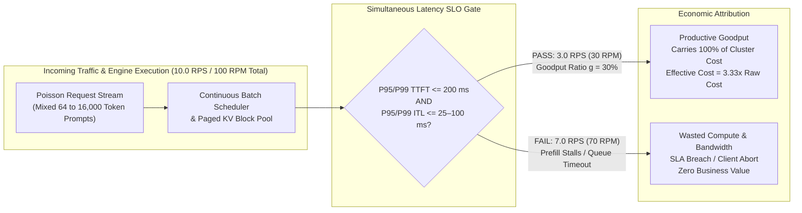
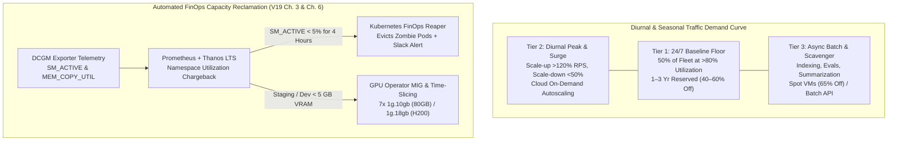

# 15.18 Inference cost, capacity and cost per token

| Field | Value |
|---|---|
| Level | Advanced |
| Priority tier | 2 |
| Lab venue | GCP / GKE + Local Python Verification Lab |
| Part | Part 15: LLM inference and serving |
| Primary sources | *AI Engineering* Chapter 9; *Hands-On LLM Serving and Optimization* Chapters 5 and 9; *AI Systems Performance Engineering* Chapters 1, 16, 17, 18, and 19; *Distributed AI Systems* Chapter 9; *LLMOps* Chapter 9; NVIDIA Zero-to-Hero Volume 12 (`chapter-01..12`, `index.md`, `labs/lab-01..04`) and Volume 19 (`chapter-01..12`, `index.md`) |
| Cross-references | Chapter 15.1 (Inference request anatomy); Chapter 15.3 (vLLM & PagedAttention); Chapter 15.6 (Batching, KV cache & quantization); Chapters 15.8–15.10 (NVIDIA Dynamo & Prefill/Decode disaggregation); Chapter 15.12 (Dynamic & adaptive inference optimizations) |
| Code | `code/part15/inference_cost_capacity.py`, `code/part15/inference_cost_capacity_lab.py` |
| Coverage file | `planning/coverage/chapters/15-18.md` |
| Claim & number ledger | `planning/ledgers/15-18.md` |

## Why this matters for AI infrastructure

Training a foundation model is a capital expenditure event with predictable batch shapes and sustained compute saturation. Serving that model behind a live API flips the economic equation into a continuous operating expense. Over the lifetime of a successful product, inference accounts for up to 90 percent of total machine learning infrastructure spend.

```text
Training vs. Inference Economic Reality (AIE Ch. 9, HLS Ch. 5, V12 Ch. 1, V21 Ch. 1 & Ch. 8):
- Lifetime AI Spend Split:
  Inference accounts for up to 90% of deployed AI infrastructure cost; chip revenue projections (2024–2034) show inference surpassing training.
  Provider Recovery Rule: Training cost T <= price_per_call (p) * total_calls (N).
- Autoregressive Physics & The Memory Bandwidth Wall:
  Prefill Phase (Input Tokens): Parallel GEMM across all prompt tokens; compute-bound at high arithmetic intensity (FLOPs/Byte >> 100).
  Decode Phase (Output Tokens): Sequential GEMV generating 1 token per step; memory-bandwidth-bound at low arithmetic intensity (FLOPs/Byte ~ 1–2).
  Llama-3-70B (140 GB FP16 weights) on 1x H100 SXM (3.35 TB/s HBM3):
    Single-stream weight fetch time = 140 GB / 3,350 GB/s = 41.7 ms/token (~24 tokens/sec hardware ceiling at batch size 1).
    On 2x H100 (TP=2, 70 GB/GPU): 20.9 ms lower bound -> ~28–30 ms actual step (~33–36 tokens/sec per stream, ~2,100 tokens/sec at batch 64).
- Why Raw Throughput Lies Without Goodput:
  Pushing batch size to maximize tokens/sec inflates admission queues and triggers KV cache preemption storms.
  If a server completes 100 requests/min (10 RPS) but only 30 requests/min (3 RPS) meet TTFT <= 200 ms and TPOT <= 100 ms,
  true Goodput is 30% (3 RPS), making every SLO-compliant token 3.33x more expensive than raw throughput suggests.
```

Three financial traps routinely bankrupt naive production inference deployments.

- **Confusing raw token throughput with SLO-compliant Goodput.** A cluster running massive static batches can report high GPU utilization while violating user latency budgets on most requests. Only tokens delivered within your P99 Time to First Token and Inter-Token Latency targets generate business value.
- **Sizing fleets from average traffic or synthetic short prompts.** Real RAG workloads with long document prompts consume far more prefill FLOPs than synthetic short-prompt benchmarks and fill KV cache memory immediately. Meanwhile, diurnal traffic swings leave peak-provisioned on-demand clusters sitting mostly idle overnight, more than doubling hardware cost per token.
- **Confusing Kubernetes allocation with physical silicon utilization.** In enterprise clusters, pods regularly lock nearly all `nvidia.com/gpu` capacity while DCGM Streaming Multiprocessor activity stays in the low teens. Buying more GPUs without utilization telemetry, Multi-Instance GPU partitioning, and automated idle pod reclamation wastes millions of dollars in stranded capital.

This chapter builds a first-principles financial and capacity model for LLM inference. You will learn how to price input and output tokens, adjust unit economics for latency Goodput, and size KV cache concurrency across precisions. You will also plan multi-region fleets for diurnal traffic, select the right NVIDIA accelerator tier, and compute the break-even point between self-hosted GPUs and managed APIs.

## Prerequisites and outcomes

### Prerequisites
- End-to-end inference request lifecycle and latency decomposition from Chapter 15.1.
- PagedAttention virtual memory, continuous batching, and quantization mechanics from Chapters 15.3 and 15.6.
- Prefill and decode disaggregation, speculative decoding, and adaptive runtime optimizations from Chapters 15.8, 15.10, and 15.12.

### Outcomes
After completing this chapter, you will be able to accomplish six engineering tasks.
- Derive the exact cost per million input tokens and cost per million output tokens from hourly TCO. You will also explain why output tokens cost three to eight times more than input tokens.
- Calculate Goodput-adjusted cost per million tokens under strict P95 and P99 TTFT and ITL Service Level Objectives. You will also eliminate open-loop saturation collapse using Chunked Prefill and admission control.
- Size GPU VRAM budgets across model weights, workspace overhead, and PagedAttention KV cache pools across FP16, BF16, FP8, and INT4 precisions.
- Plan multi-region GPU fleet capacity from peak RPS, Little's Law concurrency, regional failover, and diurnal traffic curves using the Three-Tier FinOps model and DCGM Reaper automation.
- Compare unit economics across NVIDIA L4, L40S, A100, H100, H200, B200, and GB200 NVL72 racks while respecting the PCIe versus NVLink SXM boundary.
- Quantify the cost-per-token multipliers of quantization, prefix caching, speculative decoding, and prefill-decode disaggregation, and solve for the utilization break-even threshold against managed APIs.

---

## 1. Decomposing Inference Cost: Input Tokens, Output Tokens, and 3-Year TCO

### 1.1 The Fundamental Cost-per-Million-Tokens Equation

Hourly instance price is an input variable, not a unit economics metric. An H100 SXM GPU that costs three times more per hour than an older accelerator is still cheaper per request if it generates five times more tokens per second. To normalize hardware cost against useful output, platform architects express unit cost as dollars per one million tokens.

```text
Fundamental Cost-per-Million-Tokens Equations (V08 Ch. 2, V21 Ch. 1 & Ch. 12, AIE Ch. 9):
1. Hourly Token Output at Utilization u in (0, 1]:
   Effective_TPS = Peak_TPS * u * Availability_Factor
   Tokens_per_Hour = 3,600 * Effective_TPS

2. Cost per 1 Million Tokens:
   Cost_per_1M_Tokens = Total_Hourly_Cost_USD / (Tokens_per_Hour / 1,000,000)
                      = (Total_Hourly_Cost_USD * 1,000,000) / (3,600 * Peak_TPS * u)
                      = Total_Hourly_Cost_USD / (0.0036 * Peak_TPS * u)

3. Decomposed Prefill (Input) vs. Decode (Output) Request Cost (AIE Ch. 9 Worked Example):
   Given GPU Hourly Cost C_hr = $2.00/hr:
   - Decode Phase: TPS_out = 100 tokens/s = 360,000 output tokens/hr
     Cost_per_1M_Output_Tokens = $2.00 / 0.36 = $5.556 per 1M output tokens
     For 1,000 requests averaging L_out = 200 output tokens (200,000 output tokens total):
     Decode_Cost_1K_Requests = 0.200M * $5.556 = $1.11
   - Prefill Phase: Prefill capacity = 100 requests/min = 6,000 requests/hr
     (At L_in = 500 input tokens/request -> 833.33 input tokens/s = 3.0M input tokens/hr -> $0.667 per 1M input tokens)
     Prefill_Cost_1K_Requests = (1,000 / 6,000) * $2.00 = $0.333 (~$0.33)
   - Total Cost per 1,000 Requests:
     Total_Cost_1K_Requests = Decode_Cost ($1.11) + Prefill_Cost ($0.33) = $1.44 ($0.00144 per request)
```

Why do commercial LLM providers and internal chargeback models price output tokens three to eight times higher than input tokens. The asymmetry comes directly from GPU Roofline mechanics. During the prefill phase, all prompt tokens enter the Transformer layers together as a dense matrix multiplication. Tensor Cores operate at high arithmetic intensity well above the hardware ridge point, processing hundreds of input tokens in a single pass. Controlled benchmarks show that ingesting 100 input tokens adds roughly the same wall-clock latency as generating a single output token.

During the autoregressive decode phase, each active sequence generates one token per forward pass. To emit that single token, the GPU must stream every parameter of the model plus the historical KV cache from High Bandwidth Memory into SRAM registers. Because arithmetic intensity drops to roughly one to two FLOPs per byte at small batch sizes, decode throughput is governed by HBM bandwidth rather than Tensor Core TFLOPS. Even under continuous batching, each output token occupies a memory-bandwidth-bound iteration slot across every layer of the network.

| Phase / Metric | Hardware Execution Mode | Arithmetic Intensity (`FLOPs/Byte`) | Primary Hardware Bottleneck | Worked Unit Cost (`$2.00/hr` GPU, `AIE` Ch. 9) |
|---|---|---|---|---|
| **Prefill (Input Tokens)** | Parallel Matrix-Matrix (`GEMM`) | `62.06` (`S=64`) to `1,365.33` (`S=4,096`) | Tensor Core compute (`TFLOPS`) | **`$0.667` / `1M` input tokens** (`$0.33` per `1K` requests at `500` tok/req) |
| **Decode (Output Tokens)** | Sequential Matrix-Vector (`GEMV`) | `~1.0` at `B=1` (`O(B)` batched) | HBM memory bandwidth (`TB/s`) & KV capacity | **`$5.556` / `1M` output tokens** (`$1.11` per `1K` requests at `200` tok/req) |
| **Combined End-to-End Request** | Prefill pass + `L_out` decode steps | Mixed phase profile | Inter-phase contention & queue delay | **`$1.44` per `1K` requests** (`8.33x` output-to-input token cost ratio) |

### 1.2 Full 3-Year AI Factory TCO and the Utilization Multiplier

For bare-metal and reserved clusters, hourly cost is derived from a three-year Total Cost of Ownership model combining one-time Capital Expenditure and recurring Operational Expenditure. Evaluating electricity alone dramatically understates true serving cost.

```text
3-Year AI Factory TCO & Cost-per-Million-Tokens Breakdowns (V21 Ch. 1, Ch. 8, Ch. 11, Ch. 12, Ch. 14):
1. Single-Region 40x H100 SXM Cluster (V21 Ch. 1, 1,500 tok/s/GPU = 60,000 tok/s aggregate, 16.7 s per 1M tokens):
   - Facility Power & Electricity: 40 GPUs * 0.700 kW * 1.35 PUE = 37.8 kW
     Energy per 1M tokens = 37.8 kW * (16.7 s / 3,600 s/hr) = 0.175 kWh -> $0.021 per 1M tokens (at $0.12/kWh)
   - Hardware CapEx + OpEx Amortization:
     CapEx = 40 * $30,000 = $1.2M ($400K/yr over 3 years) + $100K/yr OpEx = $500K/yr
     Annual capacity at 100% utilization = 60,000 tok/s * 31,536,000 s/yr = 1.89216 * 10^12 tokens/yr (1.89M million tokens)
     Hardware + OpEx share at 100% utilization = $500K / 1.892M = $0.264 (~$0.26) per 1M tokens
   - Total Cost per 1M Tokens vs. Utilization:
     At 100% utilization: $0.26 + $0.021 = $0.28 per 1M tokens (~$0.0003 per 1K tokens)
     At 40% diurnal utilization: Hardware/OpEx share scales 2.5x to $0.66/1M -> $0.68 per 1M tokens (~$0.0007 per 1K tokens)

2. Global Multi-Region Llama-3-70B Deployment at 2,000 QPS Peak (V21 Ch. 8, Ch. 12, Ch. 14):
   - Output Volume at Constant 2,000 QPS (150 tokens/response):
     172.8M responses/day = 25.9B tokens/day = 9.46 trillion tokens/year (9,460,800 million tokens/yr)
   - Configuration A (V21 Ch. 12 Daily TCO, 408 GPUs):
     $11.2K/day HW ($12.24M / 1,095 days) + $665/day power (231 kW at 60% draw * 1.35 PUE) + $6.2K/day staff (15 FTE) = $18.1K/day
     Cost per 1M tokens = $18.1K / 25,900M = $0.70 per 1M tokens at 100% peak ($1.75 per 1M tokens at 40% average load)
   - Configuration B (V21 Ch. 8 3-Year TCO, 51 nodes = 408 GPUs):
     $12.24M HW + ($2.0M WAN + $0.243M power + $1.5M staff) * 3 yrs = $23.5M ($7.83M/yr) -> $0.83 per 1M tokens at peak
   - Configuration C (V21 Ch. 14 Full Enterprise HA, 53 nodes = 424 GPUs at $285K/node):
     $18.6M CapEx ($15.1M nodes + $2.0M net + $1.5M storage = $6.2M/yr) + $4.75M/yr OpEx (240 kW = $252K power, 20 FTE = $3.0M,
     $1.0M WAN, $0.5M cloud) = $10.95M/yr -> $1.16 per 1M tokens at peak ($2.90 per 1M tokens at 40% average load)
```

Notice the dominant variable in every row of that calculation. Electricity accounts for just 2.1 cents per million tokens on an H100 cluster, whereas amortized hardware and engineering personnel account for 92 to 98 percent of total cost. When average cluster utilization drops from 100 percent to 40 percent across the day-night cycle, fixed CapEx and staffing amortize over 2.5 times fewer tokens, more than doubling your cost per million tokens.

---

## 2. Goodput-Adjusted Cost per Million Tokens Under P99 Latency SLOs

### 2.1 Defining Goodput Versus Raw Token Throughput

Measuring an inference cluster solely by raw token throughput encourages engineers to configure huge batch sizes and deep admission queues. That configuration maximizes Model Bandwidth Utilization on paper while ruining the interactive user experience. To align infrastructure economics with user satisfaction, production teams measure **Goodput**: the rate of completed requests or generated tokens that strictly satisfy all Service Level Objectives simultaneously.



Let R_raw denote raw completed requests per second, and let g_SLO denote the fraction of requests whose Time to First Token and Inter-Token Latency both remain within target bounds. Goodput and Goodput-adjusted cost per million tokens follow a direct inverse relationship.

```text
Goodput and Goodput-Adjusted Cost Equations (AIE Ch. 9, ASP Ch. 1 & Ch. 17):
1. Request and Token Goodput:
   Goodput_RPS = g_SLO * R_raw
   Goodput_TPS = g_SLO * TPS_raw

2. Goodput-Adjusted Cost per 1M Tokens:
   Goodput_Cost_per_1M = Raw_Cost_per_1M / g_SLO
   Cost_Inflation_Multiplier = 1 / g_SLO

3. Concrete Benchmarks:
   - Interactive Chat SLO Filter (AIE Ch. 9 Fig. 9-4):
     SLO targets: TTFT <= 200 ms and TPOT <= 100 ms (faster than fast human reading speed of 120 ms/token, or 6–8 tokens/s).
     Raw completion rate = 100 requests/min (10 RPS), but only 30 requests/min (3 RPS) satisfy both SLOs (g_SLO = 0.30).
     A raw token cost of $1.00 per 1M tokens becomes $1.00 / 0.30 = $3.33 per 1M SLO-compliant tokens (3.33x inflation).
   - Node-Level Goodput Efficiency (ASP Ch. 1):
     8-GPU node processes 100,000 tokens in 10 s = 10,000 tok/s achieved vs. 8 * 1,500 = 12,000 tok/s theoretical peak -> 83.3% Goodput.
     By contrast, unoptimized clusters suffer 70%–75% lost compute (30% effective ratio) from preemptions, stalls, and head-of-line blocking.
```

Industry benchmarks standardize these dual latency gates by model scale. In MLPerf Inference v5.0, the reference P99 Service Level Objectives for Llama-2-70B are 450 ms TTFT and 40 ms TPOT. For Llama-3.1-405B, the reference targets are 6.0 seconds TTFT and 175 ms TPOT. Interactive enterprise chat and voice assistants require even tighter thresholds. Those workloads typically enforce P95 TTFT below 200 ms and P95 ITL below 25 ms, which corresponds to streaming faster than 40 tokens per second.

### 2.2 Open-Loop Poisson Arrivals, Preemption Collapse, and Chunked Prefill

Why do clusters that pass staging benchmarks with 100 percent Goodput suddenly drop to 15 percent Goodput in production. The culprit is almost always **closed-loop synthetic benchmarking** combined with unchunked prefill ingestion.

| Benchmark Regime / Configuration | Prompt Distribution | Arrival Model | Request Rate (`RPS`) | `P95` TTFT (`ms`) | `P95` / `P99` ITL (`ms`) | Economic & Operational Impact |
|---|---|---|---|---|---|---|
| **1. Closed-Loop Fixed Synthetic (`V12` Ch. 10)** | Fixed `64` input tokens, `128` output | Closed-loop (`N` threads wait for reply) | `45.0` RPS (`120` tok/s capped) | `38.0` ms | `16.2` ms (`P95`) | **False pass:** Queue depth artificially capped at thread count `C`; hides admission queue blowup. |
| **2. Open-Loop Real RAG Without Chunking (`V12` Ch. 1 & 10)** | Real RAG `4,096`–`16,000` input tokens (`64x` prefill FLOPs) | Open-loop Poisson arrival (`lambda`) | `6.2` RPS (`-86%` drop) | `4,820.0` ms (`+12,584%`) | `28.4` ms (`P95`) / `4,500.0` ms (`P99`) | **Goodput collapse:** `350+ ms` prefill GEMMs block `32` active decode streams; `24%` HTTP 504 timeouts. |
| **3. Open-Loop Over-Admission Preemption Loop (`V12` Ch. 10)** | ShareGPT mixed distribution (`--max-num-seqs 512`) | Open-loop step from `20` to `30` RPS | Stalled (`340` waiting) | `18,200.0` ms (`P99`) | Stalled (`99%` KV cache full) | **Preemption thrashing:** Engine evicts active decode KV blocks and recomputes prompts from scratch. |
| **4. Tuned Chunked Prefill + Admission Gate (`V12` Ch. 1 & 10)** | Real RAG `4,096`–`16,000` input tokens | Open-loop Poisson (`15.0`–`35.0` RPS) | `15.0`–`35.0` RPS sustained | `290.0` ms (`P95`) / `340.0` ms (`P99`) | `18.2` ms (`P95`) / `22.8` ms (`P99`) | **Restored Goodput:** `512`–`2,048` token prefill chunks piggyback decode steps with zero preemptions. |

In a closed-loop test, client worker threads wait for each response to finish before sending the next request. That artificial synchronization prevents the server queue from ever exceeding the client thread count. Real users do not wait for other users to finish. Production requests arrive as an open-loop Poisson process. When an unchunked 16,000-token RAG prompt enters a colocated engine, its compute-bound prefill monopolizes the Tensor Cores for over 350 ms. That stall freezes token generation for every concurrent chat user and spikes P99 ITL from 24 ms to 4,500 ms. Enabling **Chunked Prefill** slices long prompts into small token chunks and co-batches them alongside active decode steps. That single change restores P99 ITL to 22.8 ms and P95 TTFT to 290 ms without buying a single additional GPU.

---

## 3. KV Cache and Weight VRAM Sizing Across FP16, FP8, and INT4

### 3.1 Exact KV Cache Mathematics and MHA vs. GQA Scaling

Before an inference replica can saturate compute or memory bandwidth, it must fit both the static model weights and the dynamic Key-Value cache inside physical GPU memory. For a Transformer model, the KV cache footprint per token and maximum concurrent sequence capacity are governed by the layer count, Key-Value head count, head dimension, sequence length, and element precision.

```text
KV Cache & Concurrency Capacity Equations (V12 Ch. 1 & Ch. 8, HLS Ch. 5 & Ch. 9, ASP Ch. 17):
1. Per-Token KV Cache Footprint (across all L layers):
   M_KV_token (bytes) = 2 (Key + Value) * L * H_kv * D_head * P_kv

2. Total GPU VRAM Budget Across TP Ranks:
   VRAM_total     = TP * VRAM_per_GPU
   VRAM_weights   = Parameters_Billions * P_weights
   VRAM_kv_pool   = (VRAM_total * GPU_Utilization_Ratio) - VRAM_weights - VRAM_workspace
   C_max (seqs)   = floor(VRAM_kv_pool / (M_KV_token * S_avg))

3. Worked Architectural Comparisons:
   - Llama-3-70B (L = 80, H_q = 64, H_kv = 8 [GQA 8:1], D_head = 128):
     In BF16/FP16 (P_kv = 2 B): M_KV_token = 2 * 80 * 8 * 128 * 2 = 327,680 bytes = 320 KiB/token (0.3125 MiB/token).
     In FP8 (P_kv = 1 B):       M_KV_token = 163,840 bytes = 160 KiB/token.
     At S = 4,096 tokens (BF16): 320 KiB * 4,096 = 1,310,720 KiB = 1.25 GiB (1.342 GB decimal) per sequence.
     At S = 128,000 tokens (BF16): 320 KiB * 128,000 = 39.06 GiB per sequence with GQA (vs. 312.5 GB under 64-head MHA -> 87.5% / 8x reduction).
   - Llama-2-7B (L = 32, H_q = 32, H_kv = 32 [MHA], D_head = 128, BF16/FP16 = 2 B):
     M_KV_token = 2 * 32 * 32 * 128 * 2 = 524,288 bytes = 512 KiB = 0.5 MiB/token (2.0 GiB per 4,096-token sequence).
   - Llama-2-13B (L = 40, H_kv = 40 [MHA], D_head = 128):
     0.819 MB/token = 3.36 GB per 4,096-token sequence in FP16 (1.68 GB in FP8; 0.671 GB with 8-head GQA FP16; 0.336 GB GQA FP8; 0.084 GB MQA).
```

Grouped-Query Attention is an economic game-changer for long-context serving. Because Llama-3-70B shares each Key-Value head across eight Query heads, its KV footprint drops by 87.5 percent relative to Multi-Head Attention. That reduction shrinks a 128,000-token context from an impossible 312.5 GB down to 39.06 GiB. Equally important, **PagedAttention** partitions the KV pool into 16-token or 32-token virtual memory blocks. Virtual paging eliminates external fragmentation and cuts internal fragmentation from over 60 percent down to under 4 percent. That single memory manager improvement increases concurrent user capacity by fourfold on identical silicon.

### 3.2 Concurrency Capacity Matrix and the Non-Linear TP KV Dividend

When you double Tensor Parallelism from four GPUs to eight GPUs on a 70B model, total cluster VRAM doubles from 320 GB to 640 GB. Meanwhile, the static model weights remain fixed at 140 GB across the TP group. Consequently, the available KV cache pool more than triples from 140 GB to 428 GB, multiplying sequence concurrency by 3.06x.

| Model & Hardware Topology | Total VRAM | Weight Footprint | Available KV Pool | `C_max` (`S = 2,048`) | `C_max` (`S = 4,096` / `8,192`) | `C_max` (`S = 32,768` / `40,960`) | Economic Interpretation |
|---|---|---|---|---|---|---|---|
| **`Llama-3-70B` BF16 on `4x A100/H100 80GB` (`TP=4`, `V12` Ch. 8)** | `320` GB | `140.0` GB | `140.0` GB | **`218` seqs** | `109` (`4K`) / **`54` (`8K`)** | **`13` seqs** (`32K`) | Baseline 4-GPU shard; `43.75%` of VRAM consumed by weights. |
| **`Llama-3-70B` BF16 on `8x A100/H100 80GB` (`TP=8`, `V12` Ch. 8)** | `640` GB | `140.0` GB | `428.0` GB | **`668` seqs** | `334` (`4K`) / **`167` (`8K`)** | **`41` seqs** (`32K`) | `2x` GPUs yields **`3.06x` KV concurrency** because `140` GB weights are amortized once. |
| **`Llama-2-7B` FP16 on `1x A10 24GB` (`$2.00/hr`, `HLS` Table 5-7)** | `24` GB | `14.0` GB | `10.0` GB | `8` seqs | **`4` seqs** (`5` max at `4K`) | `1` seq (`16K`) | Weight-heavy (`58.3%` VRAM); costs **`$0.50/hr` per active `4K` sequence slot**. |
| **`Llama-2-7B` FP16 on `1x L40S 48GB` (`$3.75/hr`, `HLS` Table 5-7)** | `48` GB | `14.0` GB | `34.0` GB | `32` seqs | **`16` seqs** (`17` max at `4K`) | `4` seqs (`16K`) | `2x` VRAM yields **`4.0x` batch capacity** at `1.875x` price = **`$0.234/hr` per slot (`2.13x` cheaper)**. |
| **`Qwen3-14B` BF16 on `1x L40S 46GB` (`g6e.2xlarge`, `HLS` Ch. 9)** | `46` GB | `27.52` GiB | `11.00` GiB (`72,064` tok) | `35` seqs | `17` seqs (`4K`) | **`1.76x`** (`40,960` tok) | Weights occupy `> 65%` of allocated VRAM; constrains batching to `474.38` tok/s on ShareGPT. |
| **`Qwen3-14B-AWQ` INT4 on `1x L40S 46GB` (`g6e.2xlarge`, `HLS` Ch. 9)** | `46` GB | `9.36` GiB | `29.15` GiB (`191,056` tok) | `93` seqs | `46` seqs (`4K`) | **`4.66x`** (`40,960` tok) | Frees `18.15` GiB for KV cache (**`2.65x` more KV tokens**), boosting ShareGPT throughput **`2.70x` to `1,280` tok/s**. |

Look closely at the comparison between the 24 GB A10 and the 48 GB L40S serving Llama-2-7B in Table 5-7 of *Hands-On LLM Serving and Optimization*. Because the 14 GB model weights consume almost 60 percent of the A10's memory, only 10 GB remains for the KV cache. That headroom caps concurrency at four sequences of 4,096 tokens. Doubling GPU memory to 48 GB on the L40S leaves 34 GB for the KV cache and expands concurrency fourfold to 16 sequences. Even though the L40S costs 3.75 dollars per hour versus 2.00 dollars per hour for the A10, its cost per concurrent request slot is **2.13 times lower**. Always provision total GPU VRAM to at least twice the model weight footprint so the KV cache pool has enough headroom to keep batching efficient.

---

## 4. GPU Fleet Capacity Planning from Peak RPS and Diurnal Traffic Curves

### 4.1 Little's Law Concurrency, Replica Throughput, and Regional N+1 Failover

How do you translate a product requirement of 2,000 peak queries per second into an exact bill of materials of GPU nodes. Fleet sizing proceeds in four mathematical steps using Little's Law.

```text
Step-by-Step Fleet Sizing & N+1 Regional Failover Math (V21 Ch. 8, Ch. 11, Ch. 14):
1. Single-Sequence Service Time (W = T_req):
   For Llama-3-70B on a 2x H100 SXM replica (TP=2) with step time = 28 ms (~36 tokens/s per stream)
   and average output length L_out = 150 tokens:
   T_req = 150 tokens / 36 tokens/s = 4.17 s (~4.2 seconds per sequence)

2. Single-Replica Sustainable QPS (at max batch B = 64 concurrent sequences):
   By Little's Law, QPS_replica = B / T_req = 64 / 4.2 s = 15.24 QPS (~15.2 QPS per 2-GPU replica, or ~7.6 QPS per GPU)
   KV Cache Sanity Check: 64 sequences * ~660 avg tokens * 320 KiB/tok = ~13.5 GB (~14 GB), fitting inside the ~20 GB left after 140 GB weights on 2x 80 GB GPUs.

3. N+1 Active-Active Regional Failover Sizing (Global Peak = 2,000 QPS across 3 Regions):
   To survive a complete regional outage (e.g., us-west, us-east, eu-west), any 2 surviving regions must absorb the full 2,000 QPS:
   Required_QPS_per_Region = 2,000 QPS / 2 surviving regions = 1,000 QPS per region
   Min_Replicas_per_Region = ceil(1,000 / 15.2) = 66 replicas = 132 GPUs per region
   Rounding up to whole 8-GPU HGX H100 nodes: ceil(132 / 8) = 17 nodes (136 GPUs, 68 replicas = 1,034 QPS capacity) per region.
   Symmetric 3-Region Fleet Total = 3 * 17 nodes = 51 nodes = 408 H100 GPUs (204 replicas = 3,102 QPS global ceiling).
   (In V21 Ch. 14 asymmetric layout where EU-West handles 40% = 800 QPS normal peak on 19 nodes / 152 GPUs / 76 replicas = 1,155 QPS,
   total fleet is 17 + 17 + 19 = 53 nodes = 424 H100 GPUs / 212 replicas.)

4. 12-Month Growth + Seasonal Sinusoidal Demand Forecast (V21 Ch. 11):
   QPS[t] = QPS_base * (1 + g)^t * (1 + A * sin(2 * pi * (t mod 12) / 12))
   Starting from 286 QPS (after 12 months at g = 10%/mo growth) with A = 15% seasonality and 7.6 QPS/GPU:
   - Month +0:  286 QPS ->  38 GPUs
   - Month +6:  507 QPS ->  67 GPUs (+77% growth over 6 months; matches 6-month hardware procurement lead time)
   - Month +11: 755 QPS ->  99 GPUs (+164% growth over 12 months)
   - Upfront Overprovisioning vs. Incremental Procurement (1,000 QPS = 132 GPUs at $3.96M vs. 400 QPS = 53 GPUs current):
     Buying all 132 GPUs upfront leaves 60% idle in year 1 (~$2M idle silicon); hybrid tranche adds 40 GPUs ($1.2M -> 700 QPS) and re-orders at 70% capacity minus lead time.
```

Never size a production cluster to run at 100 percent KV cache saturation under normal peak load. As demonstrated in Volume 12 Chapter 1, inference replicas must operate within three strict utilization zones.
- **Safe Operating Zone up to 80 percent capacity.** KV cache usage stays below 80 percent, admission queue wait time stays under 20 ms, and P99 ITL stays below 25 ms.
- **Warning and Autoscale Zone from 80 to 90 percent capacity.** Horizontal Pod Autoscaler or Kubernetes KEDA triggers replica scale-out while ingress begins soft rate-limiting.
- **Emergency Shedding Zone above 90 percent capacity.** Circuit breakers trip to return immediate HTTP 429 status codes or route overflow traffic to a smaller fallback model before block exhaustion triggers preemption collapse.

### 4.2 Diurnal Traffic Curves, the Three-Tier Purchasing Model, and DCGM Reapers

User-facing AI traffic is strongly diurnal, peaking during business hours and dropping by 50 to 70 percent overnight. If you buy 100 percent of your peak fleet on cloud On-Demand instances, you pay a massive elasticity premium for GPUs that sit idle half the day. Conversely, if you buy 100 percent of your year-end peak capacity upfront in bare-metal CapEx, 60 percent of your cluster sits idle during year one.



To minimize total spend across the diurnal curve, enterprise FinOps teams combine a **Three-Tier Capacity Model** with automated hardware reclamation.

| Capacity / FinOps Tier | Target Workload Profile | Purchasing & Scheduling Mechanism | Discount / Savings vs. On-Demand | Operational Safeguards |
|---|---|---|---|---|
| **Tier 1: Baseline Capacity (`V19` Ch. 3 & 6, `V21` Ch. 11)** | 24/7 diurnal traffic floor (`40%`–`50%` of peak QPS) | `1`-Year or `3`-Year Cloud Reserved Instances / Savings Plans or Bare-Metal On-Premises | **`40%`–`60%+` cheaper** than On-Demand | Sized to minimum daily trough so reserved GPUs maintain `> 85%` utilization 24/7. |
| **Tier 2: Diurnal Burst Capacity (`V19` Ch. 3, `DAI` Ch. 9)** | Daytime business peaks & promotional surges | Cloud On-Demand HPA / KEDA autoscaling (`scale-up` at `120%` target RPS, `scale-down` at `50%`) | Pay only for active peak hours (**`57.5%` combined savings** with Tier 1) | Pre-warmed local NVMe weights and Startup Probes (`failureThreshold: 60`, `10` min) prevent cold-start timeouts. |
| **Tier 3: Scavenger / Batch Tier (`V19` Ch. 6, `V21` Ch. 12, `AIE` Ch. 9)** | Async batch inference, data labeling, fine-tuning, evals | Preemptible / Spot GPU instances (`$21/hr` vs `$60/hr` on `8x H100` = `$2.63` vs `$7.50/GPU/hr`) or Batch APIs | **`60%`–`70%` off** on Spot (`$35K/GPU/yr` saved); **`50%` off** on Batch APIs | Poll `169.254.169.254` Spot termination notice (`2`-min warning) or backfill overnight troughs on Tier 1 GPUs. |
| **FinOps Reaper & MIG Partitioning (`V19` Ch. 3, 6, 7)** | Zombie Jupyter notebooks & lightweight dev/staging models (`< 5` GB) | Kubernetes Reaper kills pods with `DCGM_FI_PROF_SM_ACTIVE < 5%` for `4` hours; MIG `1g.10gb` / `1g.18gb` | Reclaims **`86%` stranded silicon** (`98%` K8s allocated vs `12%` SM active); avoids **`$5M` (`16`-node) CapEx** | Chargeback by namespace DCGM utilization rather than K8s allocation; use hardware MIG (`7` slices/GPU) across untrusted tenants. |

---

## 5. Comparing Accelerator Economics: L4, L40S, A100, H100, H200, B200, and GB200 NVL72

### 5.1 The Seven-Tier NVIDIA Inference Hardware Matrix

Choosing the right GPU for LLM inference is an exercise in matching your model's memory footprint and parallelism boundary to the accelerator's memory capacity, HBM bandwidth, precision support, and interconnect fabric. Deploying an eight-billion-parameter model on an H100 SXM wastes High Bandwidth Memory premium. Conversely, deploying a seventy-billion-parameter model across four PCIe cards without NVLink cripples token generation with PCIe collective stalls.

| Accelerator / System Tier | Memory & Bandwidth | Dense BF16 / FP8 / FP4 Compute | Interconnect Fabric | Max Power (`TDP`) | Illustrative CapEx (`$/BF16 TFLOP`) & Cloud Rate | Optimal Production Inference Sweet Spot |
|---|---|---|---|---|---|---|
| **1. `L4` (Ada PCIe, 1-Slot)** | `24` GB GDDR6<br/>`0.30` TB/s (`300` GB/s) | `121` BF16 / `242` FP8 TFLOPS | PCIe Gen4 (`no NVLink`) | `72` W (slot-powered) | `$2,500` (`$21`/TFLOP)<br/>`~$0.85/hr` (`< $1.25/hr`) | Edge, video/multimodal (`NVDEC`/`NVENC`), and `<= 8B` FP8/INT4 single-GPU serving. |
| **2. `L40S` (Ada PCIe, 2-Slot)** | `48` GB GDDR6<br/>`0.864` TB/s (`864` GB/s) | `362` BF16 / `733` FP8 TFLOPS (`419` FLOPs/B ridge) | PCIe Gen4 `64` GB/s bidir (`no NVLink`) | `350` W | `$8,000` (**`$22`/TFLOP**)<br/>`~$2.25`–`$3.75/hr` | **Best single-GPU price/perf:** `7B`–`14B` FP16/FP8 & `32B`–`70B` INT4 AWQ (`DP=1`, zero TP). |
| **3. `A100 80GB SXM4` (Ampere)** | `80` GB HBM2e<br/>`1.935`–`2.039` TB/s | `312` BF16 TFLOPS (`no FP8`) | NVLink 3 (`600` GB/s) | `400` W | `$25,000` (`$80`/TFLOP)<br/>`~$2.70/hr` | Legacy `7B`–`70B` BF16/INT4 serving & `7x 1g.10gb` MIG multi-tenant slicing. |
| **4. `H100 80GB PCIe` / `NVL`** | `80` GB (`2.0` TB/s) / `94` GB (`3.9` TB/s NVL) | `756` / `835` BF16 (`1,513` / `1,671` FP8 dense) | PCIe `128` GB/s (`600` GB/s 2-GPU NVL bridge) | `350`–`400` W | `$20,000` (`$26`/TFLOP)<br/>`~$4.50/hr` | Air-cooled enterprise data centers (`TP=1` on PCIe, or `TP=2` over 2-GPU NVLink bridge on `H100 NVL`). |
| **5. `H100 80GB SXM5` (Hopper)** | `80` GB HBM3<br/>`3.35` TB/s | `989` BF16 / `1,979` FP8 dense (`1,979` / `3,958` sparse) | NVLink 4 via NVSwitch (`900` GB/s all-to-all) | `700` W (`10.2` kW / 8-GPU node) | `$30,000` (`$30`/TFLOP, `$285K`/node)<br/>`~$6.20`–`$7.50/hr` | Standard high-throughput `70B`–`405B` `TP=2/4/8` serving and prefill worker pools. |
| **6. `H200 141GB SXM` (Hopper)** | `141` GB HBM3e (**`+76%`**)<br/>`4.80` TB/s (**`+43%`**) | `989` BF16 / `1,979` FP8 dense (`1,979` / `3,958` sparse) | NVLink 4 via NVSwitch (`900` GB/s all-to-all) | `700` W | `$40,000` (`$40`/TFLOP)<br/>`~$6.30/hr` | **Best Hopper decode & long-context GPU:** `+76%` VRAM & `+43%` BW for `~$0.10/hr` cloud premium over H100. |
| **7. `B200 SXM` & `GB200 NVL72`** | `180`–`192` GB HBM3e (`8.0` TB/s/GPU); `13.5` TB HBM (`30` TB total) / rack | `~2,250` BF16 / `~4,500` FP8 / `~9,000` FP4 (`720` PFLOPS FP8, `1.44` EFLOPS FP4 / rack) | NVLink 5 (`1.8` TB/s/GPU; **`130` TB/s** across `72` GPUs over copper backplane) | `1,000` W/GPU (`120`–`132` kW liquid rack) | `~$50,000`/GPU (`~$22`/TFLOP); quote-only rack | **Frontier rack-scale MoE & disaggregated serving:** `3.4x` MLPerf v5.0 infer/GPU & `30x` `680B` MoE throughput. |

### 5.2 The PCIe vs. NVLink SXM Crossover and Horizontal DP vs. Vertical TP Scaling

Four empirical rules govern multi-GPU hardware selection in production.

1. **The PCIe versus NVLink SXM Crossover.** Each Transformer layer executes two synchronous Row-Parallel AllReduce collectives per generated token, totaling 160 AllReduce calls per token on an 80-layer 70B model. On an AWS `g6e.12xlarge` instance with four PCIe L40S GPUs lacking NVLink, a single GPU outperforms both two-GPU and four-GPU Tensor Parallelism because PCIe collective latency overwhelms parallel compute gains. Conversely, on an NVLink-equipped `p4d.24xlarge` A100 instance, scaling from one GPU to four-way Tensor Parallelism cuts Time to First Token by 50 percent, from 66 ms down to 33 ms. Never enable Tensor Parallelism across PCIe-only GPUs.
2. **Horizontal Replica Scaling versus Vertical Tensor Parallelism.** Even on NVLink-equipped A100 nodes, running four independent single-GPU replicas achieves 9,816 tokens per second versus 3,926 tokens per second for a single four-GPU Tensor Parallel instance. That represents a 2.50x throughput advantage and 60 percent lower cost per token. Use horizontal Data Parallel replicas whenever a model fits on fewer GPUs within latency targets, and reserve Tensor Parallelism for models that exceed single-GPU memory or require lower single-request latency.
3. **Why H200 Dominates H100 for Memory-Bound Decode.** In cloud deployments, an H200 SXM costs roughly 6.30 dollars per hour versus 6.20 dollars per hour for an H100 SXM. For that tiny price difference, the H200 delivers 76.25 percent more HBM capacity and 43.28 percent higher memory bandwidth. On a two-GPU Llama-3-70B deployment, two H200 GPUs leave over 120 GB for the KV cache versus under 20 GB on two H100 GPUs while decoding 1.43x faster.
4. **Why GB200 NVL72 Transforms Frontier MoE Economics.** Connecting 36 Grace CPUs and 72 Blackwell B200 GPUs over a passive copper backplane saves roughly 20 kW of optical transceiver power and creates a single 72-GPU NVLink 5 domain with 130 TB/s bisection bandwidth. In MLPerf Inference v5.0, GB200 NVL72 delivers 3.4x higher per-GPU inference throughput over Hopper, and up to 30x higher throughput on a 680B MoE model with NVIDIA Dynamo and NIXL.

---

## 6. Algorithmic Multipliers and Self-Hosted vs. Managed API Break-Even

### 6.1 Economic Impact of Quantization, Prefix Caching, Speculative Decoding, and P/D Disaggregation

Before purchasing additional GPUs, platform teams should apply four software and algorithmic multipliers that directly reduce Goodput-adjusted cost per million tokens on existing hardware.

```text
Four Algorithmic Multipliers on Cost-per-Million-Tokens (HLS Ch. 9, ASP Ch. 15, 17, 19, AIE Ch. 9, V12 Ch. 8 & 9):
1. Weight & Activation Quantization (FP16/BF16 -> FP8 / INT4 AWQ / NVFP4):
   - Empirical vLLM Benchmark (Qwen3-14B on 1x L40S 46GB, ShareGPT 2,000 prompts at 10 RPS, HLS Ch. 9):
     BF16 Baseline: 27.52 GiB weights, 11.00 GiB KV cache (72,064 tokens, 1.76x at 40K), 474.38 tok/s total (227.64 tok/s output), 103.61 ms TTFT.
     4-bit AWQ:     9.36 GiB weights, 29.15 GiB KV cache (191,056 tokens = 2.65x KV capacity, 4.66x at 40K), 1,280.0 tok/s total, 59.29 ms TTFT.
     Economic Impact: 2.70x higher token throughput (-63.0% cost per 1M tokens) and 42.8% lower TTFT on identical hardware.
   - Dynamic Precision Scaling (ASP Ch. 19 Table 19-2):
     FP16 (1.0x mem, 1.0x speed, 1.00x cost) -> FP16+FP8 (0.50x mem, 1.5x speed, 0.67x cost, <0.1% acc delta)
     -> INT4+FP8 (0.25x mem, 1.8x speed, 0.56x cost, ~0.5% delta) -> INT4+FP4 (0.20x mem, 3.5x speed, 0.29x cost, ~1.0% delta).

2. Automatic Prefix Caching & Prefix-Aware Load Balancing (RadixAttention / PagedAttention):
   - Empirical vLLM Benchmark (Qwen3-14B BF16 on 1x L40S, Prefix Repetition 1,000 prompts with 256-tok shared prefix, HLS Ch. 9):
     Total token throughput jumps from 474.38 tok/s (ShareGPT) to 1,123.13 tok/s (2.37x gain, -57.8% blended cost per 1M tokens)
     while maintaining 104.64 ms mean TTFT and 43.95 ms mean ITL at 97% GPU utilization.
   - Cluster Routing Rule (V12 Ch. 8 & Ch. 9): Prefix-aware hash routing concentrates shared tenant system prompts onto specific DP replicas,
     sustaining > 85% Radix Tree cache hit rates and cutting prefill TTFT by up to 90%.
     (Beware un-coordinated Chunked Prefill boundary mismatches that can drop prefix cache hit ratio from 45% to 8%; align chunks to 512-token boundaries.)

3. Speculative Decoding (Draft-Target, Medusa, EAGLE-1/2/3):
   - Expected Tokens per Verification Pass: E[N] = (1 - alpha^(K+1)) / (1 - alpha); Speedup S = E[N] / (1 + K * (t_draft / t_target)).
   - Worked Benchmark (Chinchilla-70B t_target = 14.1 ms/tok + 4B draft t_draft = 1.8 ms/tok, K = 5, alpha = 0.80, ASP Ch. 15 & AIE Ch. 9):
     E[N] = (1 - 0.8^6) / 0.2 = 3.6893 tokens in T_cycle = 5 * 1.8 + 14.1 = 23.1 ms -> Effective ITL = 6.2614 ms/tok (2.25x speedup, -55.59% decode cost).
   - Advanced Variants: Medusa achieves 1.9x on HGX H200 (2.2x–3.6x overall); EAGLE-1 achieves 3.5x and EAGLE-3 achieves up to 6.5x.
   - Economic Guardrail: Profitable at low-to-medium batch sizes (B < 32) where decode is memory-bandwidth-bound with idle Tensor Cores;
     disable via speculative_disable_by_batch_size = 32 when high concurrency already saturates compute FLOPs.

4. Prefill / Decode (P/D) Disaggregation (DistServe / NVIDIA Dynamo + NIXL, ASP Ch. 17):
   - Eliminates prefill-decode interference and head-of-line blocking while tuning TP/compute for prefill and HBM capacity/bandwidth for decode.
   - Worked Goodput Math (SLO: P90 TTFT <= 400 ms, P90 TPOT <= 40 ms):
     Colocated 1-GPU baseline: sustains 3.0 RPS for TTFT but only 1.6 RPS for TPOT -> Goodput = min(3.0, 1.6) = 1.6 RPS/GPU.
     Disaggregated 2P1D pool (2 prefill GPUs at 5.6 RPS each = 11.2 RPS; 1 decode GPU at 10.0 RPS across 3 GPUs total):
     Pool Goodput = min(11.2, 10.0) = 10.0 RPS total / 3 GPUs = 3.33 RPS/GPU (3.3 RPS/GPU reported) -> 2.08x per-GPU Goodput (-52.0% Goodput cost/token),
     and up to 7.4x higher SLO-compliant request capacity in DistServe evaluations.
```

| Optimization Lever | Primary Bottleneck Attacked | Measured Throughput / Goodput Multiplier | Cost-per-1M-Tokens Reduction | Key Operational Trade-Off / Guardrail |
|---|---|---|---|---|
| **INT4 `AWQ` / `FP8` / `NVFP4` Quantization** | Weight HBM footprint & decode memory bandwidth | **`1.5x` (`FP8`) to `2.70x` (`AWQ`) to `3.5x` (`FP4`)** | **`33.3%` to `63.0%` to `71.4%`** | Validate task accuracy (`< 0.1%` drop on FP8, `~0.5%`–`1.0%` on INT4/FP4); watch for FP8 `NaN` scale overflow. |
| **Prefix Caching + Prefix-Aware Routing** | Redundant prefill GEMM compute & KV block duplication | **`2.37x`** total TPS (`474 -> 1,123` tok/s); up to **`90%` TTFT cut** | **`57.8%`** blended cost reduction | Align chunked prefill to cache block boundaries; prevent single-node hotspotting (`3.27x` load skew). |
| **Speculative Decoding (`Draft`, `Medusa`, `EAGLE`)** | Idle Tensor Cores during memory-bound decode (`B < 32`) | **`1.9x` (`Medusa`) to `2.25x` (`Draft`) to `6.5x` (`EAGLE-3`)** | **`47.4%` to `55.6%+`** at low/med batch | Wastes FLOPs when `B >= 32` or acceptance `alpha < 0.50`; set `--speculative-disable-by-batch-size 32`. |
| **Prefill / Decode Disaggregation (`2P1D` + `NIXL`)** | Cross-phase interference & coupled TP/hardware sizing | **`2.08x`** per-GPU Goodput (`1.6 -> 3.33` RPS/GPU); up to **`7.4x`** | **`52.0%`** Goodput-adjusted cost cut | Requires high-speed `NIXL` GPUDirect RDMA / NVLink KV transfer (`128`-token coalesced pages). |
| **Semantic Cache + Tiered Model Cascade (`70B` + `700B`)** | Frontier model overkill on simple queries (`60%` offload) | **`2.17x` to `5.0x`** effective capacity (`500 -> 208.6` ms latency) | **`54.0%` to `80.0%`** (`10.0 -> 4.16` cost) | Requires `ModernBERT` complexity router and confidence fallback threshold tuning. |

### 6.2 Self-Hosted GPUs vs. Managed Commercial APIs: Break-Even Utilization Math

Should an engineering organization rent or buy dedicated GPUs to self-host open-weights models like Llama-3-70B or Qwen3, or call a managed commercial pay-per-token API. Early-stage prototypes should always start on managed APIs because paying per token eliminates idle capacity risk. As traffic grows, however, dedicated GPUs become dramatically cheaper once average utilization exceeds the mathematical **Break-Even Utilization Threshold**.

```text
Self-Hosted GPU vs. Managed API Break-Even Equations (V21 Ch. 8 & Ch. 14, LLM Ch. 9):
1. Self-Hosted Cost per 1M Tokens as a Function of Average Utilization u in (0, 1]:
   Cost_Self_per_1M(u) = C_hr / (0.0036 * TPS_peak * u) = Cost_Self_Peak_per_1M / u

2. Break-Even Utilization Threshold (u*) Against Managed API Price (P_API_per_1M):
   Set Cost_Self_per_1M(u*) = P_API_per_1M:
   u* = Cost_Self_Peak_per_1M / P_API_per_1M
      = C_hr / (0.0036 * TPS_peak * P_API_per_1M)

3. Break-Even Daily Token Volume (V_day*) and Effective Throughput (TPS*):
   TPS*   = TPS_peak * u* = C_hr / (0.0036 * P_API_per_1M)
   V_day* = 86,400 * TPS* = (24,000,000 * C_hr) / P_API_per_1M  (tokens/day)

4. Concrete Worked Break-Even Scenarios:
   - Scenario A (Multi-Region 408-GPU TCO Cluster at $0.83/1M Peak Cost vs. $2.00/1M Managed API, V21 Ch. 8):
     u* = $0.83 / $2.00 = 0.4150 (41.50% average cluster utilization).
     Below 41.5% utilization, the managed API is cheaper; at 80% utilization ($1.04/1M), self-hosting saves 48.1%.
   - Scenario B (Single 2x H100 SXM Cloud Replica at $12.40/hr [$6.20/GPU/hr], TPS_peak = 2,100 tok/s vs. $4.00/1M Managed API):
     Full-utilization self-hosted cost = $12.40 / (0.0036 * 2,100) = $1.6402 per 1M tokens ($297.60/day replica cost).
     Break-even utilization u* = $1.6402 / $4.00 = 0.4101 (41.01% utilization).
     Break-even sustained throughput TPS* = 2,100 * 0.41005 = 861.11 tokens/s.
     Break-even daily token volume V_day* = $297.60 / ($4.00 / 1,000,000) = 74.40 million tokens/day per 2-GPU replica.
```

Notice that the break-even daily token volume depends only on the replica's daily dollar cost and the managed API price per million tokens. If a two-GPU H100 replica costs 297.60 dollars per day and your managed API charges 4.00 dollars per million blended tokens, you must process at least **74.40 million tokens per day** on that replica to break even on raw compute cost. Above that volume, or when strict data residency, compliance, deterministic model pinning, or low local network latency are mandatory, self-hosting wins decisively.

---

## Commands and configurations that matter

### 1. Production vLLM Deployment with Tuned KV Memory, Chunked Prefill, Prefix Caching, and Kubernetes Probes (`V12` Ch. 1, 8, 9, 11)

```yaml
# (untested here) Production Kubernetes Deployment for Llama-3-70B (TP=4) optimized for Goodput & Cost/Token
apiVersion: apps/v1
kind: Deployment
metadata:
  name: vllm-llama3-70b-cost-optimized
  namespace: ai-inference
spec:
  replicas: 4
  selector:
    matchLabels:
      app: vllm-llama3-70b
  template:
    metadata:
      labels:
        app: vllm-llama3-70b
    spec:
      containers:
        - name: vllm-engine
          image: vllm/vllm-openai:v0.5.4
          ports:
            - containerPort: 8000
              name: http
          env:
            - name: NCCL_DEBUG
              value: "INFO"
            - name: NCCL_IB_DISABLE
              value: "0"
            - name: NCCL_NET_GDR_LEVEL
              value: "5"
            - name: PYTORCH_CUDA_ALLOC_CONF
              value: "expandable_segments:True"
          args:
            - "--model"
            - "meta-llama/Meta-Llama-3-70B-Instruct"
            - "--tensor-parallel-size"
            - "4"
            - "--gpu-memory-utilization"
            - "0.90"
            - "--max-model-len"
            - "16384"
            - "--max-num-seqs"
            - "128"
            - "--block-size"
            - "16"
            - "--enable-prefix-caching"
            - "--enable-chunked-prefill"
            - "--max-num-batched-tokens"
            - "2048"
            - "--swap-space"
            - "0"
          resources:
            limits:
              nvidia.com/gpu: "4"
              memory: "400Gi"
            requests:
              nvidia.com/gpu: "4"
              memory: "400Gi"
          startupProbe:
            httpGet:
              path: /health
              port: 8000
            initialDelaySeconds: 30
            periodSeconds: 10
            failureThreshold: 60
          readinessProbe:
            httpGet:
              path: /health
              port: 8000
            initialDelaySeconds: 15
            periodSeconds: 10
            timeoutSeconds: 5
            failureThreshold: 3
          livenessProbe:
            httpGet:
              path: /ping
              port: 8000
            periodSeconds: 15
            timeoutSeconds: 3
            failureThreshold: 5
```

### 2. Open-Loop Poisson Benchmarking and Real-Time Goodput / FinOps Telemetry (`V12` Ch. 10, `HLS` Ch. 9, `V19` Ch. 3 & 6)

```bash
# (untested here) 1. Execute an open-loop Poisson arrival benchmark on ShareGPT to measure real TTFT/ITL Goodput
python3 vllm/benchmarks/benchmark_serving.py \
  --backend vllm \
  --host 127.0.0.1 \
  --port 8000 \
  --model meta-llama/Meta-Llama-3-70B-Instruct \
  --dataset-name sharegpt \
  --dataset-path ./ShareGPT_V3_unfiltered_cleaned_split.json \
  --num-prompts 1000 \
  --request-rate 15.0 \
  --seed 42

# (untested here) 2. Sweep concurrency and realistic RAG prompt distributions with NVIDIA genai-perf
genai-perf \
  -m meta-llama/Meta-Llama-3-8B-Instruct \
  --service-type vllm \
  --url 127.0.0.1:8000 \
  --endpoint-type chat \
  --concurrency 32 \
  --synthetic-input-tokens-mean 4096 \
  --synthetic-input-tokens-stddev 256 \
  --output-tokens-mean 256 \
  --output-tokens-stddev 32 \
  --measurement-interval 10000

# (untested here) 3. Scrape live KV cache saturation, queue depth, preemptions, and prefix cache hit ratio
curl -s http://localhost:8000/metrics | grep -E \
  "vllm:gpu_cache_usage_perc|vllm:num_requests_waiting|vllm:num_preempted_requests_total|vllm:gpu_prefix_cache"

# (untested here) 4. Verify physical silicon utilization vs. thermal throttling via DCGM & nvidia-smi
nvidia-smi --query-gpu=timestamp,name,utilization.gpu,utilization.memory,memory.used,memory.free,temperature.gpu,clocks_event_reasons.active --format=csv -l 1
```

### 3. Prometheus Alerting Rules for SLO Goodput, KV Cache Saturation, and FinOps Zombie Detection (`V12` Ch. 8–11, `V19` Ch. 3, 6, 9)

```yaml
# (untested here) Prometheus recording and alerting rules for Inference Goodput & FinOps reclamation
groups:
  - name: inference_cost_capacity_and_finops
    interval: 30s
    rules:
      - record: cluster:gpu:sm_active_avg_5m
        expr: avg by (namespace, pod) (avg_over_time(DCGM_FI_PROF_SM_ACTIVE[5m]))

      - alert: FinOpsZombieGPUPodDetected
        expr: max_over_time(DCGM_FI_PROF_SM_ACTIVE[4h]) < 0.05
        for: 5m
        labels:
          severity: warning
          action: reaper_evict
        annotations:
          summary: "Zombie GPU pod {{ $labels.pod }} in namespace {{ $labels.namespace }} (<5% SM_ACTIVE for 4h)"

      - alert: LLMKVCacheSaturated
        expr: vllm:gpu_cache_usage_perc > 0.95
        for: 2m
        labels:
          severity: critical
        annotations:
          summary: "vLLM KV Cache > 95% on {{ $labels.instance }}; preemption storm imminent"

      - alert: LLMRequestPreemptionsOccurring
        expr: rate(vllm:num_preempted_requests_total[2m]) > 0
        for: 30s
        labels:
          severity: critical
        annotations:
          summary: "Active sequence preemptions detected on {{ $labels.instance }}; Goodput collapsing"

      - alert: LLMGoodputSLOViolation
        expr: |
          histogram_quantile(0.95, sum(rate(vllm:time_to_first_token_seconds_bucket[5m])) by (le)) > 0.500
          or
          histogram_quantile(0.95, sum(rate(vllm:time_per_output_token_seconds_bucket[5m])) by (le)) > 0.040
        for: 2m
        labels:
          severity: critical
        annotations:
          summary: "P95 TTFT (>500ms) or P95 ITL (>40ms) SLO breach degrading Goodput"
```

---

## How it fails

| Failure Mode | Production Symptom | Root Cause | Diagnostic Commands & Telemetry Evidence | Remediation & Architectural Fix |
|---|---|---|---|---|
| **1. Synthetic Short-Prompt Benchmark Masking Real RAG Prefill Collapse (`V12` Ch. 1 & 10)** | Cluster passes staging at `45.0` RPS (`38` ms P95 TTFT), but production suffers `24%` HTTP 504 timeouts, `4,820` ms P95 TTFT, and `4,500` ms P99 ITL stalls. | Staging used fixed `64`-token prompts; production RAG prompts average `4,096`–`16,000` tokens (`64x` more prefill FLOPs), monopolizing Tensor Cores for `350+` ms and starving `32` active decode streams. | `genai-perf --synthetic-input-tokens-mean 4096` reproduces `6.2` RPS (`-86%`); `vllm:inter_token_latency_seconds_bucket` shows tail spikes `> 1.0` s. | Enable `--enable-chunked-prefill` with `--max-num-batched-tokens 512`–`2048` to interleave prompt chunks with decode steps, restoring `290` ms P95 TTFT and `22.8` ms P99 ITL. |
| **2. Host CPU KV Cache Swapping Thrashing Over PCIe (`V12` Ch. 8)** | Average ITL degrades by `4,000%` (`20` ms -> `850` ms/token), client P99 E2E exceeds `45` s, and `dcgm_gpu_utilization` drops to `18%`. | Launching vLLM with `--swap-space 32` causes the engine to swap evicted KV blocks over `64` GB/s PCIe Gen5 to host RAM when VRAM hits `99.8%`, stalling GPUs on PCIe DMA transfers. | `vllm:gpu_cache_usage_perc` = `0.998`, `vllm:cpu_cache_usage_perc` = `0.884`, `rate(vllm:num_preempted_requests_total[5m])` = `4.2/s`, `dcgm_pcie_tx_throughput` pegged at `64` GB/s. | Set `--swap-space 0`, enable `--enable-prefix-caching`, tune `--gpu-memory-utilization 0.90`, and enforce ingress admission queueing (`HTTP 429` above queue depth `50`). |
| **3. Multi-GPU Tensor Parallelism Over PCIe or Host TCP (`HLS` Ch. 9, `V12` Ch. 9)** | Deploying `TP=2/4` on `L40S` (`g6e.12xlarge`) runs slower than `1` GPU, or `TP=16` across two `8`-GPU nodes hangs and crashes with `Watchdog caught timeout in NCCL AllReduce`. | `80`-layer models execute `160` synchronous `AllReduce` calls per token; running TP over `64` GB/s PCIe or host TCP (`50`–`150` us latency) instead of `900` GB/s NVLink (`< 1` us) stalls execution `> 90%` of the step. | `NCCL_DEBUG=INFO` logs `Transport dev pcie3-0 is not NVLink capable. Falling back to Host TCP sockets`; `nvidia-smi topo -m` shows `NODE`/`SYS` instead of `NV#`. | Keep `TP` strictly inside intra-node NVLink (`TP <= 8` on HGX SXM; `TP=1` on PCIe `L4`/`L40S`); use `PP=2` over InfiniBand (`NCCL_NET_GDR_LEVEL=5`) or independent `DP` replicas across nodes. |
| **4. Kubernetes Allocation Hoarding & Zombie Pods (`V19` Ch. 3, 4, 6, 7)** | AI team requests `$5M` (`16` new HGX H100 nodes) because K8s `nvidia.com/gpu` allocation is pegged at `98%`, or a student pod on time-sliced GPUs OOM-crashes `10` co-located jobs. | K8s bills and schedules on logical *allocation* rather than silicon *utilization*; idle notebooks hold full `80` GB GPUs at `0%` math activity, while software time-slicing provides zero hardware VRAM isolation. | PromQL `avg(DCGM_FI_PROF_SM_ACTIVE)` reveals `12%` average SM activity despite `98%` K8s allocation; `torch.cuda.memory_summary()` shows fragmentation. | Deploy a DCGM FinOps Reaper to terminate pods with `SM_ACTIVE < 5%` for `4` hours, bill namespaces by DCGM utilization, and partition shared GPUs with hardware MIG (`7x 1g.10gb` on `80` GB or `7x 1g.18gb` on `H200`). |
| **5. Cascading Readiness Probe Outage & XID 62 Silent Blackhole (`V12` Ch. 11, `V19` Ch. 2, 12)** | HPA scale-out from `4` to `12` pods causes `100%` HTTP 503 outage as all `4` original healthy pods go `0/1 Ready`; or `1` in `8` (`12.5%`) requests hang forever with `0` container restarts. | (a) Shared NFS weight download saturates I/O, causing a `1`-second readiness probe on `/v1/models` to time out (`504`); (b) GPU 3 suffers an uncorrectable DB-ECC error (`Xid 62`), deadlocking the `TP=8` NCCL ring while the CPU HTTP server still returns `200 OK`. | `kubectl get events` shows `Readiness probe failed: context deadline exceeded`; `dmesg -T \| grep -i NVRM` logs `Xid 62, DB-ECC error detected on GPU 3`. | Use a `10`-min `startupProbe` (`failureThreshold: 60`), a non-inferencing `/health` `readinessProbe` (`timeoutSeconds: 5`) with local NVMe weights, and `DCGM Exporter` + `Node Problem Detector` to auto-cordon/drain nodes on `Xid 48`/`62`/`79`. |
| **6. Chunked Prefill Breaking Prefix Cache Hit Ratio & Prefix Routing Skew (`V12` Ch. 8 & 9)** | Enabling chunked prefill drops prefix cache hit ratio from `45%` to `8%` (`5.6x` drop); or prefix-aware routing leaves total cluster throughput flat (`110` vs `240` tok/s) with one node at `91%` KV usage and others at `18%`. | Unaligned prefill chunk sizes split sequences across non-boundary hashes; meanwhile, naive prefix hashing routes `60%` of traffic (`3,600` vs `1,100` reqs = `3.27x` skew) to a single hot replica. | `curl localhost:8002/metrics \| grep prefix_cache_hit_ratio` shows `0.08`; per-node `kv_cache_usage_percent` varies `91%`, `32%`, `85%`, `18%`. | Align chunked prefill sizes to PagedAttention block boundaries (`512` tokens) or use SGLang RadixAttention, and use load-aware bounded consistent hashing that spills hot prefixes across multiple replicas when `kv_cache_usage > 85%`. |

---

## Hands-on lab: Self-Checking Inference Cost, Capacity, and Break-Even Simulator

### Lab Venue and Execution Scope
- **Local Verification Lab:** Run `python3 -B code/part15/inference_cost_capacity_lab.py` on any workstation with Python 3.10 or newer to execute 28 deterministic self-checks across all six chapter domains.
- **GCP / GKE Cloud Venue:** The serving commands, Kubernetes deployment manifests, and Prometheus rules in the Commands section target a GKE GPU node pool and are marked `untested` on live hardware in this local build environment.

```bash
python3 -B code/part15/inference_cost_capacity_lab.py
```

```text
=== Chapter 15.18 Lab: Inference Cost, Capacity and Cost per Token ===
  [PASS] 1. AIE Ch. 9: $2.00/hr GPU at 100 tok/s output costs $5.556 per 1M output tokens ($1.11 decode per 1K requests of 200 tokens)
  [PASS] 2. AIE Ch. 9: $2.00/hr GPU prefilling 100 req/min (500 tok/req = $0.667/1M input tok) costs $0.33 prefill and $1.44 total per 1K requests
  [PASS] 3. V21 Ch. 1: 40x H100 (60,000 tok/s, 37.8 kW at 1.35 PUE) takes 16.7 s and 0.175 kWh ($0.021 electricity) per 1M tokens
  [PASS] 4. V21 Ch. 1: 40x H100 ($1.2M CapEx/3yr + $100K OpEx = $500K/yr) costs $0.28/1M ($0.0003/1K) at 100% util vs $0.68/1M ($0.0007/1K) at 40% util
  [PASS] 5. V21 Ch. 8/12/14: 2,000 QPS global cluster (25.9B tok/day, 9.46T tok/yr) costs $0.70/1M (Ch. 12), $0.83/1M (Ch. 8 408 GPUs), and $1.16/1M (Ch. 14 424 GPUs) at peak vs $1.75/1M at 40% load
  [PASS] 6. AIE Ch. 9 Fig. 9-4: 10 RPS (100 RPM) raw throughput with 3 RPS (30 RPM) meeting TTFT <= 200 ms & TPOT <= 100 ms has 30.0% Goodput and 3.33x Goodput-adjusted cost per 1M tokens
  [PASS] 7. ASP Ch. 1 & Ch. 17: 8-GPU node at 10,000/12,000 tok/s achieves 83.3% goodput (vs Meta 30.0% effective ratio), and MLPerf v5.0 sets P99 TTFT/TPOT at 450 ms/40 ms (70B) and 6,000 ms/175 ms (405B)
  [PASS] 8. V12 Ch. 1 & Ch. 10: Real 4,096-token RAG prompts drop RPS from 45.0 to 6.2 (-86%) and spike P95 TTFT from 38 ms to 4,820 ms until Chunked Prefill restores 290 ms P95 TTFT and 22.8 ms P99 ITL
  [PASS] 9. V12 Ch. 1 & Ch. 8: Llama-3-70B GQA (8:1, 87.5% savings vs MHA) uses 327,680 B (320 KiB/tok), or 1.25 GiB (1.342 GB) at 4,096 tokens and 39.06 GiB at 128,000 tokens (vs 312.5 GB MHA)
  [PASS] 10. V12 Ch. 8 Capacity Matrix: Llama-3-70B on 4x H100 (TP=4, 140 GB KV pool) supports [218, 54, 13] seqs and on 8x H100 (TP=8, 428 GB KV pool) supports [668, 167, 41] seqs at S=[2048, 8192, 32768]
  [PASS] 11. HLS Ch. 5 Table 5-7: Llama-2-7B (14 GB weights, 0.5 MiB/tok KV = 2.0 GB/4K seq) fits 4 seqs on A10 24GB ($2.00/hr) vs 16 seqs on L40S 48GB ($3.75/hr), making L40S 2.13x more cost-efficient per slot
  [PASS] 12. HLS Ch. 9: Qwen3-14B on L40S (46,068 MiB) cuts weights from 27.52 GiB (BF16) to 9.36 GiB (4-bit AWQ), expanding KV cache from 11.00 GiB (72,064 tok, 1.76x) to 29.15 GiB (191,056 tok, 4.66x = 2.65x more KV tokens)
  [PASS] 13. V21 Ch. 8: Llama-3-70B 2-GPU H100 replica (36 tok/s/seq, 150 tok = 4.2 s, B=64) sustains 15.2 QPS/replica (7.6 QPS/GPU)
  [PASS] 14. V21 Ch. 8: 2,000 QPS global peak with 3-region N+1 failover (1,000 QPS/region) requires 66 min replicas (132 GPUs) -> 17 8-GPU nodes (136 GPUs, 68 replicas = 1,034 QPS/region), or 51 nodes (408 GPUs) total
  [PASS] 15. V21 Ch. 11: 12-month forecast from 286 QPS (+10%/mo growth, 15% seasonality) projects Month +0 = (286 QPS, 38 GPUs), Month +6 = (507 QPS, 67 GPUs), Month +11 = (755 QPS, 99 GPUs)
  [PASS] 16. V19 Ch. 3 & Ch. 6: Three-Tier capacity purchasing (50% Reserved baseline at 45% off + 50% On-Demand diurnal burst at 30% duty cycle) saves 57.5% vs 24/7 On-Demand, and Spot saves 65% ($2.63/GPU/hr vs $7.50/GPU/hr)
  [PASS] 17. V19 Ch. 3: DCGM FinOps Reaper rejects $5M 16-node HGX H100 expansion when 98% K8s allocation masks 12% average SM activity, evicting pods with < 5% SM_ACTIVE for 4 hours and slicing 80GB GPUs into 7x 1g.10gb MIG instances
  [PASS] 18. V04 Ch. 5 & V21 Ch. 2: L4 (24 GB, 72 W, PCIe single-slot) and L40S (48 GB, 0.864 TB/s, 362 BF16 / 733 FP8 TFLOPS, 419 FLOPS/B ridge point, 350 W, $8,000 = $22/TFLOP) lead single-GPU PCIe inference economics
  [PASS] 19. V21 Ch. 2 & HLS Table 5-4: H200 SXM (141 GB HBM3e, 4.8 TB/s, $40K CapEx, ~$6.30/hr cloud) provides +76.25% VRAM and +43.28% memory bandwidth over H100 SXM5 (80 GB, 3.35 TB/s, $30K CapEx, ~$6.20/hr cloud)
  [PASS] 20. ASP Ch. 1 & V06 Ch. 7: Blackwell B200 (192 GB, 8.0 TB/s, 1.8 TB/s NVLink 5, 1,000 W) and GB200 NVL72 rack (36 Grace + 72 B200, 13.5 TB HBM3e, 130 TB/s bisection, 720 PFLOPS FP8 / 1.44 EFLOPS FP4, 120-132 kW, 20 kW saved via copper backplane) achieve 3.4x MLPerf v5.0 inference throughput and 30x Dynamo 680B MoE throughput
  [PASS] 21. HLS Ch. 9: On 4x A100 (p4d.24xlarge), 4 independent DP=1 replicas deliver 9,816 TPS vs 3,926 TPS for 1x TP=4 (2.50x higher throughput), while TP=4 over NVLink cuts TTFT by 50.0% (66 ms -> 33 ms)
  [PASS] 22. HLS Ch. 9: 4-bit AWQ quantization on Qwen3-14B boosts ShareGPT throughput 2.70x (474.38 -> 1,280.0 tok/s, cutting cost/token by 63%) and cuts mean TTFT by 42.78% (103.61 -> 59.29 ms)
  [PASS] 23. HLS Ch. 9: Prefix caching on Qwen3-14B boosts total token throughput 2.37x (474.38 -> 1,123.13 tok/s, cutting blended token cost by 57.8%) while holding ITL steady (43.24 vs 43.95 ms)
  [PASS] 24. ASP Ch. 15 & AIE Ch. 9: Chinchilla-70B (14.1 ms) + 4B draft (1.8 ms) at K=5, alpha=0.80 yields 3.6893 tokens in 23.1 ms (6.2614 ms/tok = 2.25x decode speedup, 55.59% decode cost reduction)
  [PASS] 25. ASP Ch. 19 Table 19-2: Dynamic precision scaling from FP16 (1.0x) to FP16+FP8 (0.50x mem, 1.5x speed), INT4+FP8 (0.25x mem, 1.8x speed), and INT4+FP4 (0.20x mem, 3.5x speed) cuts relative cost/token to 0.67x, 0.56x, and 0.29x
  [PASS] 26. ASP Ch. 17: Disaggregating prefill and decode in 2P1D (2x 5.6 = 11.2 RPS prefill, 1x 10.0 RPS decode across 3 GPUs) raises SLO goodput from 1.6 RPS/GPU to 3.3 RPS/GPU (3.33 exact = 2.08x gain, 52.0% lower Goodput cost/token)
  [PASS] 27. V21 Ch. 8 & Ch. 14: Self-hosted cluster at $0.83/1M peak token cost vs $2.00/1M managed API reaches break-even at exactly 41.50% average utilization
  [PASS] 28. 2x H100 SXM replica ($12.40/hr, 2,100 tok/s peak = $1.6402/1M at 100% util) vs $4.00/1M managed API breaks even at 41.01% utilization (861.11 tok/s = 74.40M tokens/day)
Summary: 28 passed, 0 failed
```

---

## Key takeaways

- **Price output tokens and input tokens separately using Roofline physics.** Prefill is a parallel compute-bound GEMM operation whereas decode is a sequential memory-bandwidth-bound GEMV operation that streams all model weights per token. Consequently, output tokens cost three to eight times more per million tokens than input tokens on identical hardware.
- **Optimize for Goodput-adjusted cost per million tokens, not raw throughput.** When heavy batching inflates queue times so that only thirty percent of requests meet latency targets, your true cost per compliant token more than triples. Always benchmark with open-loop Poisson arrivals on realistic context distributions and enable Chunked Prefill.
- **Provision GPU VRAM to at least twice the model weight footprint.** KV cache memory determines maximum batch concurrency. Stepping up from a twenty-four-gigabyte card to a forty-eight-gigabyte card on a seven-billion-parameter model more than triples KV headroom, quadrupling batch concurrency and cutting cost per slot in half.
- **Match your GPU tier to the PCIe versus NVLink SXM boundary and prefer DP over TP when latency permits.** Use PCIe L4 and L40S cards strictly for single-GPU replicas. Mandate NVSwitch-backed H100, H200, B200, or GB200 NVL72 systems whenever sharding models across GPUs.
- **Stack algorithmic multipliers and enforce Three-Tier FinOps before buying hardware.** Quantization, prefix caching, speculative decoding, and prefill-decode disaggregation compound to slash cost per token. Meanwhile, Reserved baselines, On-Demand diurnal scaling, Spot scavengers, and DCGM Reapers eliminate idle silicon waste.

---

## Exercises

Use the parameters in the table below to complete the four quantitative design exercises.

| Exercise | Scenario Parameters | Required Outputs |
|---|---|---|
| **1. Decomposed Prefill/Decode Cost & 3-Year TCO** | (a) `$2.00/hr` GPU, `100 tok/s` decode output, `100 req/min` prefill at `500` input + `200` output tokens/req; (b) `40x H100` (`60,000 tok/s`, `700 W`, `1.35` PUE, `$0.12/kWh`, `$1.2M` CapEx / `3` yrs + `$100K/yr` OpEx). | (a) Cost per `1M` output and input tokens, plus prefill, decode, and total cost per `1,000` requests; (b) Electricity and total cost per `1M` tokens at `100%` vs `40%` utilization. |
| **2. Goodput Cost & KV Cache Concurrency Sizing** | (a) `10.0 RPS` (`100 RPM`) raw at `$1.00/1M` tokens, `3.0 RPS` (`30 RPM`) meeting `TTFT <= 200 ms` & `TPOT <= 100 ms`; `4,096`-tok RAG with `--max-num-batched-tokens 2048`; (b) `Llama-3-70B` (`L=80, H_q=64, H_kv=8, D_head=128`, BF16) on `4x H100` (`TP=4`, `140 GB` KV pool) vs `8x H100` (`TP=8`, `428 GB` KV pool). | (a) Goodput percentage, Goodput-adjusted cost per `1M` tokens, and `P95` TTFT / `P99` ITL restoration; (b) Per-token and `4K`/`128K` KV footprint (GQA vs MHA) and max concurrency at `S = 2,048, 8,192, 32,768`. |
| **3. Multi-Region Fleet Sizing & Three-Tier FinOps** | (a) `Llama-3-70B` `2x H100` replica (`36 tok/s/seq`, `150` output tokens = `4.2 s`, `B = 64`), `2,000 QPS` global peak across `3` regions with `N+1` failover; (b) `100`-GPU peak fleet (`$7.50/GPU/hr` On-Demand, `730 hrs/mo`), `50%` Reserved (`45%` off) + `50%` On-Demand burst (`30%` duty cycle), `65%` Spot discount. | (a) Sustainable QPS per replica and per GPU, and nodes/GPUs per region and globally; (b) Monthly spend under 24/7 On-Demand vs Three-Tier split, percentage saved, and Spot hourly rate. |
| **4. Algorithmic Multipliers & API Break-Even** | (a) Colocated (`3.0 RPS` TTFT, `1.6 RPS` TPOT) vs `2P1D` disaggregated (`2x 5.6 = 11.2 RPS` prefill, `1x 10.0 RPS` decode); `Qwen3-14B` `4-bit AWQ` (`474.38 -> 1,280.0 tok/s`); (b) `2x H100 SXM` replica (`$12.40/hr`, `2,100 tok/s` peak) vs `$4.00/1M` managed API. | (a) Per-GPU Goodput gain and Goodput cost reduction for `2P1D`, plus AWQ throughput/cost multiplier; (b) Exact break-even utilization, sustained throughput, and daily token volume. |

- **Exercise 1 — Decomposed Prefill/Decode Cost and Three-Year TCO Utilization Sensitivity.** Compute the decomposed input and output token costs and the batch request cost for Part a in the table above. Then calculate the cluster electricity cost and total cost per million tokens at full utilization versus diurnal utilization for Part b.
- **Exercise 2 — Goodput-Adjusted Cost and KV Cache Concurrency Sizing.** Calculate the Goodput ratio, Goodput-adjusted cost per million tokens, and Chunked Prefill latency improvements for Part a. Then compute the GQA versus MHA KV cache footprints and the four-GPU versus eight-GPU concurrency ceilings for Part b.
- **Exercise 3 — Multi-Region Fleet Capacity Planning and Three-Tier FinOps.** Derive the single-replica QPS and the three-region failover fleet size for Part a. Then compare the monthly cloud bill of an all-On-Demand fleet against the Three-Tier purchasing strategy for Part b.
- **Exercise 4 — Algorithmic Multipliers and Self-Hosted versus Managed API Break-Even.** Quantify the per-GPU Goodput gain of prefill-decode disaggregation and four-bit AWQ quantization for Part a. Then solve for the exact break-even utilization, throughput, and daily token volume against the managed API for Part b.

---

## Checkpoint questions (20)

<details>
<summary>**1. Why does inference account for up to 90% of lifetime AI infrastructure cost, and what condition must a model provider satisfy to recover training cost?**</summary>

Training is a one-time upfront capital investment. By contrast, inference scales continuously with every user query, multi-turn chat, and multi-step agent loop. A model provider recovers its training investment only when cumulative revenue across all inference calls exceeds total training cost.

```text
Lifetime Spend Split: Inference accounts for up to 90% of deployed AI infrastructure cost.
Provider Recovery Condition: Total Training Cost T <= price_per_call (p) * total_inference_calls (N).
```
</details>

<details>
<summary>**2. What is the exact formula converting hourly hardware cost and token throughput into cost per 1M tokens?**</summary>

Divide the total hourly hardware and operational cost by the millions of tokens generated per hour at your realized utilization. Because one hour contains three thousand six hundred seconds, multiplying throughput in tokens per second by 0.0036 gives millions of tokens per hour.

```text
Tokens_per_Hour = 3,600 * TPS_peak * u
Cost_per_1M_Tokens = Hourly_Cost_USD / (0.0036 * TPS_peak * u)
```
</details>

<details>
<summary>**3. On a GPU costing $2.00/hr that decodes 100 output tokens/s and prefills 100 requests/min (500 input tokens and 200 output tokens per request), what are the prefill, decode, and total costs for 1,000 requests?**</summary>

Calculate the output decode cost from the hourly token generation rate and add the prefill cost from the hourly request ingestion rate. Summing both phases gives the total serving cost per thousand requests.

```text
Decode Cost: 100 tok/s = 360,000 tok/hr -> $2.00 / 0.36 = $5.556 per 1M output tokens ($1.11 per 1,000 requests at 200 tok/req).
Prefill Cost: 100 req/min = 6,000 req/hr -> (1,000 / 6,000) * $2.00 = $0.33 per 1,000 requests ($0.667 per 1M input tokens at 500 tok/req).
Total Cost per 1,000 Requests: $1.11 + $0.33 = $1.44 ($0.00144 per request; 8.33x output-to-input token cost ratio).
```
</details>

<details>
<summary>**4. Why do commercial LLM APIs and internal TCO models price output tokens 3x to 8x higher than input tokens?**</summary>

Input tokens are processed in parallel during the compute-bound prefill phase using dense matrix-matrix multiplications at high arithmetic intensity. Output tokens are generated one by one during the memory-bandwidth-bound decode phase. During decode, the GPU must read all model weights from HBM for every single generated token at an arithmetic intensity near one FLOP per byte.
</details>

<details>
<summary>**5. In the 3-year TCO breakdown of a 40-GPU H100 cluster (60,000 tokens/s aggregate, 37.8 kW with 1.35 PUE), how much does electricity cost per 1M tokens compared to amortized hardware and OpEx at 100% and 40% utilization?**</summary>

Electricity represents a tiny fraction of unit cost, whereas amortized hardware CapEx and staffing OpEx dominate. When average cluster utilization drops to forty percent across the diurnal cycle, the fixed hardware and operational cost per million tokens scales up by two and a half times.

```text
Electricity Share: 37.8 kW * (16.7 s / 3,600 s/hr) = 0.175 kWh -> $0.021 per 1M tokens (at $0.12/kWh).
Hardware + OpEx Share ($500K/yr over 1.892T tok/yr): $0.26/1M at 100% util ($0.28/1M total, or $0.0003/1K) vs $0.66/1M at 40% util ($0.68/1M total, or $0.0007/1K).
```
</details>

<details>
<summary>**6. What is Goodput in LLM serving, and how does a 30% SLO compliance rate change your effective cost per 1M tokens?**</summary>

Goodput is the rate of completed requests or tokens per second that simultaneously satisfy both your Time to First Token and Inter-Token Latency Service Level Objectives. Dividing raw cost per million tokens by the SLO compliance fraction gives the Goodput-adjusted cost per million compliant tokens.

```text
Raw Throughput = 10.0 RPS (100 RPM) at $1.00/1M raw cost; SLO-Compliant Goodput = 3.0 RPS (30 RPM, g_SLO = 30.0% for TTFT <= 200 ms & TPOT <= 100 ms).
Goodput_Cost_per_1M = $1.00 / 0.30 = $3.33 per 1M compliant tokens (3.33x cost inflation).
```
</details>

<details>
<summary>**7. Why does closed-loop benchmarking hide production tail-latency collapse, and what happens when real 4,096-token RAG prompts hit an unchunked engine under open-loop Poisson arrivals?**</summary>

Closed-loop benchmarks wait for each request to complete before sending the next, artificially capping queue depth at the client thread count. Under open-loop Poisson arrivals with long RAG prompts, compute-heavy prefill GEMMs block active decode batches for hundreds of milliseconds until Chunked Prefill interleaves prompt chunks with decode iterations.

```text
Synthetic 64-token closed-loop: 45.0 RPS, 38.0 ms P95 TTFT, 16.2 ms P95 ITL.
Real 4,096-token RAG open-loop (unchunked): 6.2 RPS (-86%), 4,820.0 ms P95 TTFT (+12,584%), 4,500.0 ms P99 ITL.
With Chunked Prefill (--max-num-batched-tokens 512..2048): Restores 290.0 ms P95 TTFT and 22.8 ms P99 ITL.
```
</details>

<details>
<summary>**8. What is the per-token and 4,096-token KV cache footprint of Llama-3-70B in BF16, and how much memory does Grouped-Query Attention save compared to Multi-Head Attention?**</summary>

Multiply two matrices for Key and Value by the layer count, Key-Value head count, head dimension, and element byte size. Because Grouped-Query Attention shares each Key-Value head across eight Query heads on Llama-3-70B, it shrinks the KV cache footprint by seven-eighths compared to Multi-Head Attention.

```text
M_KV_token = 2 * 80 * 8 * 128 * 2 bytes = 327,680 bytes = 320 KiB/token (160 KiB/token in FP8).
At S = 4,096 tokens: 1.25 GiB (1.342 GB decimal). At S = 128,000 tokens: 39.06 GiB with GQA vs 312.5 GB with 64-head MHA (87.5% / 8.0x reduction).
```
</details>

<details>
<summary>**9. Why does doubling Tensor Parallelism from 4x H100 (TP=4) to 8x H100 (TP=8) on Llama-3-70B increase maximum concurrent sequences by 3.06x (from 218 to 668 at S=2,048) instead of 2.0x?**</summary>

When total GPU memory doubles across the wider Tensor Parallel group, the static BF16 model weights remain fixed across the group rather than doubling. Subtracting that fixed weight footprint leaves more than three times as much free HBM for the dynamic PagedAttention KV cache pool.

```text
4x H100 (TP=4, 320 GB VRAM, 140 GB weights): 140 GB KV pool -> C_max = [218, 54, 13] sequences at S = [2048, 8192, 32768].
8x H100 (TP=8, 640 GB VRAM, 140 GB weights): 428 GB KV pool (3.06x) -> C_max = [668, 167, 41] sequences at S = [2048, 8192, 32768].
```
</details>

<details>
<summary>**10. Why is an L40S (48 GB, $3.75/hr) 2.13x more cost-efficient per concurrent sequence than an A10 (24 GB, $2.00/hr) when serving Llama-2-7B in FP16 at 4,096 context length?**</summary>

On the smaller GPU, static model weights consume most of the VRAM and leave very little room for KV cache blocks. Doubling total VRAM on the L40S more than triples the available KV cache pool, quadrupling batch concurrency for less than twice the hourly instance price.

```text
Llama-2-7B FP16: 14.0 GB weights, 0.5 MiB/tok KV = 2.0 GB per 4,096-token sequence.
A10 24 GB ($2.00/hr): 10.0 GB left -> 4 practical sequences ($0.50/hr per slot).
L40S 48 GB ($3.75/hr): 34.0 GB left -> 16 practical sequences ($0.234/hr per slot -> 2.13x lower cost per slot).
```
</details>

<details>
<summary>**11. How do you size a 3-region active-active H100 fleet for 2,000 QPS peak of Llama-3-70B (150 output tokens, 36 tokens/s per sequence, batch 64 per 2-GPU replica) with N+1 regional failover?**</summary>

Apply Little's Law to find the sustainable query throughput of a single two-GPU replica. Then size each of the three active-active regions so that any two surviving regions can carry the entire global peak load during a regional outage.

```text
Replica Throughput: T_req = 150 / 36 = 4.2 s -> QPS_replica = 64 / 4.2 s = 15.2 QPS (7.6 QPS/GPU).
N+1 Failover (1,000 QPS per surviving region): ceil(1,000 / 15.2) = 66 replicas (132 GPUs) -> 17 nodes (136 GPUs, 68 replicas = 1,034 QPS) per region.
Total 3-Region Fleet: 51 nodes = 408 H100 GPUs (or 53 nodes = 424 GPUs when EU-West is sized to 19 nodes / 152 GPUs for 800 QPS normal peak).
```
</details>

<details>
<summary>**12. How does the Three-Tier FinOps Capacity Model combine Reserved, On-Demand, and Spot instances across diurnal traffic curves?**</summary>

Tier 1 locks in discounted Reserved Instances or bare-metal hardware for the steady 24/7 diurnal traffic floor. Tier 2 autoscales daytime diurnal peaks using elastic cloud On-Demand instances. Tier 3 schedules asynchronous batch workloads, evaluations, and checkpointed training onto discounted Spot instances or Batch APIs.

```text
100-GPU Peak Fleet ($7.50/GPU/hr On-Demand, 730 hrs/mo):
Pure 24/7 On-Demand = $547,500/mo vs Three-Tier Split (50 Reserved at 45% off + 50 On-Demand burst at 30% duty cycle) = $232,687.50/mo (57.5% savings).
Spot Instances (65% discount on p5.48xlarge): $21/hr per 8-GPU node = $2.63/GPU/hr (saving $35K/GPU/yr).
```
</details>

<details>
<summary>**13. How does an automated DCGM FinOps Reaper detect and reclaim zombie GPU pods that appear 100% allocated in Kubernetes?**</summary>

Kubernetes only tracks logical resource requests, so an idle notebook looks fully allocated even when executing zero CUDA kernels. The FinOps Reaper queries Prometheus for physical DCGM Streaming Multiprocessor activity tagged by namespace. It automatically evicts pods that sit idle over a multi-hour window while consolidating small staging workloads onto hardware MIG slices.

```text
Telemetry Evidence: 98% Kubernetes nvidia.com/gpu allocation vs 12% average DCGM_FI_PROF_SM_ACTIVE (rejects $5M 16-node HGX H100 CapEx request).
Reaper Rule: Evict pod if DCGM_FI_PROF_SM_ACTIVE < 5% for 4 hours; partition shared GPUs into 7x 1g.10gb (80 GB) or 7x 1g.18gb (141 GB H200) MIG slices.
```
</details>

<details>
<summary>**14. Why does a single L40S GPU (TP=1) outperform 2-GPU and 4-GPU Tensor Parallelism on an AWS g6e.12xlarge instance, whereas TP=4 on a p4d.24xlarge A100 instance cuts TTFT in half?**</summary>

Tensor Parallelism executes two synchronous AllReduce collectives per Transformer layer on every generated token. On PCIe-only servers lacking NVLink, inter-GPU synchronization latency over the PCIe root complex exceeds the parallel compute speedup. On NVSwitch-backed SXM servers, high-speed NVLink completes those collectives in microseconds and cuts prefill latency in half.

```text
g6e.12xlarge (4x L40S over 64 GB/s PCIe Gen4, no NVLink): TP=1 outperforms TP=2 and TP=4 in both throughput and TTFT.
p4d.24xlarge (A100 over 600 GB/s NVLink): Scaling TP=1 -> TP=4 cuts mean TTFT by 50.0% (from 66.0 ms to 33.0 ms).
```
</details>

<details>
<summary>**15. When a model fits on a single GPU within latency SLOs, why should you scale horizontally with Data Parallel replicas (DP) instead of Tensor Parallelism (TP)?**</summary>

Data Parallel replicas execute completely independently with zero inter-GPU collective communication and maintain separate schedulers and KV caches. Whenever a model fits on a single GPU and meets latency targets, horizontal Data Parallelism delivers more than double the total cluster throughput of a multi-GPU Tensor Parallel group.

```text
Qwen3-14B-AWQ on 4x A100 (p4d.24xlarge, HLS Ch. 9):
4x Independent DP=1 Replicas = 9,816 tokens/s vs 1x TP=4 Instance = 3,926 tokens/s (2.50x higher throughput, 60.0% lower cost per token).
```
</details>

<details>
<summary>**16. Why does the NVIDIA H200 SXM deliver superior cost-per-token economics over the H100 SXM5 for memory-bound LLM decoding?**</summary>

Both Hopper GPUs share identical Tensor Core TFLOPS and nearly identical cloud hourly pricing. However, the H200 upgrades the memory subsystem to larger and faster HBM3e stacks. That upgrade expands the KV cache pool for much higher batch concurrency while accelerating every memory-bound decode step.

```text
H100 SXM5: 80 GB HBM3, 3.35 TB/s, 989 BF16 / 1,979 FP8 dense TFLOPS, $30,000 CapEx, ~$6.20/hr cloud.
H200 SXM:  141 GB HBM3e (+76.25% VRAM), 4.80 TB/s (+43.28% BW), $40,000 CapEx, ~$6.30/hr cloud (+1.6% hourly rate for 1.43x decode BW).
```
</details>

<details>
<summary>**17. What are the core architectural specifications of the GB200 NVL72 rack, and how does it change the economics of serving 680B+ MoE models?**</summary>

A liquid-cooled GB200 NVL72 rack unifies thirty-six Grace CPUs and seventy-two Blackwell B200 GPUs across eighteen compute trays and nine NVSwitch trays over a passive copper backplane. That rack-scale NVLink domain allows massive Mixture-of-Experts models to shard experts across all seventy-two GPUs without crossing slow network NICs.

```text
GB200 NVL72 Specs: 36 Grace CPUs + 72 B200 GPUs (180–192 GB, 8.0 TB/s each), 13.5 TB HBM3e (30 TB total), 1.8 TB/s/GPU (130 TB/s bisection),
720 PFLOPS FP8 / 1.44 EFLOPS FP4, 120–132 kW rack (~20 kW saved via copper backplane), 3.4x MLPerf v5.0 infer/GPU, 30x Dynamo 680B MoE throughput.
```
</details>

<details>
<summary>**18. What is the measured impact of 4-bit AWQ quantization and automatic prefix caching on Qwen3-14B serving throughput and cost per token on an L40S GPU?**</summary>

Compressing weights from sixteen-bit floating point to four-bit AWQ shrinks the weight footprint by nearly two-thirds and transfers the freed memory directly into the PagedAttention KV cache pool. Similarly, enabling automatic prefix caching reuses KV blocks across shared system prompts, multiplying effective token throughput and slashing cost per token.

```text
Qwen3-14B on 1x L40S (46,068 MiB, HLS Ch. 9):
- BF16 -> 4-bit AWQ: Weights 27.52 -> 9.36 GiB; KV cache 11.00 -> 29.15 GiB (72,064 -> 191,056 tokens = 2.65x); ShareGPT TPS 474.38 -> 1,280.0 tok/s (2.70x, -63.0% cost/tok); TTFT 103.61 -> 59.29 ms (-42.8%).
- Prefix Caching (Prefix Repetition): Total TPS jumps 474.38 -> 1,123.13 tok/s (2.37x, -57.8% blended cost/tok) at 104.64 ms TTFT and 43.95 ms ITL.
```
</details>

<details>
<summary>**19. How does prefill-decode disaggregation in a 2P1D configuration double per-GPU Goodput compared to colocated serving?**</summary>

Colocating compute-bound prefill and bandwidth-bound decode on the same GPU forces a single batching and parallelism policy that bottlenecks on per-token decode latency. Separating prefill and decode onto dedicated worker pools linked via NIXL GPUDirect RDMA eliminates cross-phase interference and more than doubles SLO-compliant Goodput per GPU.

```text
SLO Targets (ASP Ch. 17): P90 TTFT <= 400 ms, P90 TPOT <= 40 ms.
Colocated 1-GPU Baseline: min(3.0 RPS TTFT, 1.6 RPS TPOT) = 1.6 RPS/GPU Goodput.
Disaggregated 2P1D (2 prefill GPUs at 5.6 RPS = 11.2 RPS; 1 decode GPU at 10.0 RPS): min(11.2, 10.0) / 3 GPUs = 3.33 RPS/GPU (3.3 reported -> 2.08x gain, -52.0% Goodput cost/tok; DistServe up to 7.4x).
```
</details>

<details>
<summary>**20. How do you calculate the break-even utilization and daily token volume between a self-hosted 2x H100 replica ($12.40/hr, 2,100 tokens/s peak) and a $4.00/1M managed API?**</summary>

First calculate the self-hosted cost per million tokens at one hundred percent utilization. Then divide that full-utilization cost by the managed API price per million tokens to find the exact break-even utilization ratio and corresponding daily token volume.

```text
Full-Utilization Cost: $12.40 / (0.0036 * 2,100 tok/s) = $1.6402 per 1M tokens ($297.60/day replica cost).
Break-Even Utilization u*: $1.6402 / $4.00 = 41.01% (TPS* = 861.11 tok/s; V_day* = 74.40 million tokens/day; V21 Ch. 8 cluster $0.83 / $2.00 = 41.50%).
```
</details>

---

## Sources and review notes

### Primary Sources (Read in Full and Migrated)

```text
Mapped nvidia-devops Sources Migrated & Cited in Chapter 15.18 (30 / 30 Files + Supporting Volumes):
1. Volume 12 — AI Inference Infrastructure (17 / 17 mapped files cited):
   - nvidia-zero-to-hero/volume-12/index.md (End-to-end 5-layer pipeline, KPI matrix: TTFT < 200 ms, ITL < 25 ms, TPOT < 30 ms, P99 queue < 50 ms, KV cache 70%–85%, load time < 30 s)
   - nvidia-zero-to-hero/volume-12/chapter-01-why-inference-infrastructure-is-different.md (Prefill GEMM vs Decode GEMV 140 GB / 3,350 GB/s = 41.7 ms / ~24 tok/s ceiling; KV cache 327.68 KB/tok, 1.342 GB/4K seq, 284.2 GB for 100 seqs on 4x H100; Safe 0–80% / Warning 80–90% / Emergency >90% zones; cascading OOM fix gpu_memory_utilization: 0.85; Chunked Prefill 4,500 ms -> 22.8 ms P99 ITL)
   - nvidia-zero-to-hero/volume-12/chapter-02-the-end-to-end-inference-request-path.md (60% non-GPU latency; 9-stage request lifecycle; pinned cudaHostAlloc 64 GB/s PCIe Gen5 DMA; control vs data plane isolation)
   - nvidia-zero-to-hero/volume-12/chapter-03-triton-inference-server-architecture.md (Triton C++ core, KServe v2 HTTP :8000 / gRPC :8001 / Metrics :8002, config.pbtxt dynamic batching & instance_group)
   - nvidia-zero-to-hero/volume-12/chapter-04-tensorrt-optimization-and-engine-lifecycle.md (Vertical Conv+BN+ReLU & horizontal QKV fusion, 2 GB workspace pool, INT8 KL-divergence 2048-bin entropy calibration, Q/DQ explicit precision, FP8 E4M3 weights/activations vs E5M2 gradients/KV cache, IOptimizationProfile kMIN/kOPT/kMAX)
   - nvidia-zero-to-hero/volume-12/chapter-05-tensorrt-llm-and-llm-execution.md (ColumnParallelLinear & RowParallelLinear 2 * ((TP-1)/TP) * B * S * H * P AllReduce volume, FlashAttention-2, FlashDecoding 8x long-context speedup, SmoothQuant W8A8, AWQ/GPTQ W4A16, C++ GptManager Executor reducing 70B ITL from 115 ms to 18.4 ms)
   - nvidia-zero-to-hero/volume-12/chapter-06-vllm-tgi-sglang-and-lmdeploy.md (vLLM PagedAttention <4% waste vs 60%–80% contiguous waste, copy-on-write fork; TGI Rust Axum router & safetensors mmap; SGLang RadixAttention LRU tree & XGrammar/Outlines; LMDeploy TurboMind C++)
   - nvidia-zero-to-hero/volume-12/chapter-07-continuous-and-dynamic-batching.md (Padding waste ratio >65%, Orca iteration-level continuous batching reducing p99 ITL from 420 ms to 19.1 ms with 3.8x throughput gain, Sarathi-Lean chunked prefill)
   - nvidia-zero-to-hero/volume-12/chapter-08-kv-cache-memory-and-concurrency.md (MHA vs GQA 87.5% / 8x reduction vs MQA; Llama-3-70B 320 KiB/tok, 1.25 GiB at 4K, 39.06 GiB at 128K vs 312.5 GB MHA; TP=4 [218, 54, 13] vs TP=8 [668, 167, 41] concurrency matrix; --swap-space 32 causing 4,000% ITL thrashing 20 ms -> 850 ms at 18% GPU util fixed by --swap-space 0; chunked prefill 45% -> 8% prefix hit drop fix)
   - nvidia-zero-to-hero/volume-12/chapter-09-scaling-multi-gpu-and-multi-node-inference.md (160 AllReduces/token across 80 layers; NVLink 4 900 GB/s vs PCIe Gen5 64 GB/s vs IB NDR 400 Gbps / 50 GB/s; TP=16 cross-node failure fixed by TP=8 + PP=2 with NCCL_NET_GDR_LEVEL=5; PP Stage 0 99.2% vs Stage 1 38.5% KV imbalance fixed by DP=2 x TP=8; prefix-aware routing >85% hit rate & 3.27x skew mitigation)
   - nvidia-zero-to-hero/volume-12/chapter-10-performance-metrics-and-benchmarking.md (TTFT, ITL/TPOT, E2E, RPS, Input TPS, Output GTPS; open-loop Poisson vs closed-loop; ShareGPT 1,000 prompts at 15 RPS -> 14.04 RPS, 2,658.76 output tok/s, 6,042.27 total tok/s, 142.18 ms mean / 492.50 ms P99 TTFT, 16.42 ms mean / 28.40 ms P99 ITL; 64-tok synthetic 45 RPS / 38 ms vs 4,096-tok RAG 6.2 RPS / 4,820 ms fixed to 290 ms by chunked prefill; 512 -> 64 max-num-seqs preemption fix)
   - nvidia-zero-to-hero/volume-12/chapter-11-production-reliability-and-troubleshooting.md (Silent death / zombie GPU state; Kubernetes Startup 600s / Readiness /health 5s / Liveness /ping probes; PYTORCH_CUDA_ALLOC_CONF=expandable_segments:True; FP8 NaN scale_inv rollback; NFS weight I/O readiness cascade fix via local NVMe; XID 62 DB-ECC 12.5% blackhole auto-remediation via DCGM Exporter + Node Problem Detector)
   - nvidia-zero-to-hero/volume-12/chapter-12-volume-12-summary.md (Unified production blueprint, master metrics table, sharding selection matrix, and production readiness checklist)
   - nvidia-zero-to-hero/volume-12/labs/lab-01-deploy-and-validate-triton.md (Triton 24.03-py3 model repository, config.pbtxt, REST/gRPC health & lifecycle control)
   - nvidia-zero-to-hero/volume-12/labs/lab-02-benchmark-dynamic-batching.md (perf_analyzer concurrency sweeps C=1..64, max_queue_delay_microseconds, nv_inference_queue_duration_us vs compute_input_duration_us)
   - nvidia-zero-to-hero/volume-12/labs/lab-03-deploy-an-llm-with-vllm.md (Qwen2.5-Coder-1.5B-Instruct vLLM deployment, --gpu-memory-utilization 0.85, --max-model-len 4096, async streaming TTFT/ITL benchmark)
   - nvidia-zero-to-hero/volume-12/labs/lab-04-troubleshoot-a-slow-inference-pipeline.md (mpstat CPU single-thread tokenizer bottleneck remediation dropping p99 latency from >1,000 ms to <45 ms)

2. Volume 19 — AI SRE and Production Operations (13 / 13 mapped files cited):
   - nvidia-zero-to-hero/volume-19/index.md (Day-2 operations, capacity forecasting, FinOps, isolation, and runbook framework)
   - nvidia-zero-to-hero/volume-19/chapter-01-cluster-lifecycle-and-upgrade-operations.md (Cordon, drain, verify idle, GPU Operator driver container rebuild, Vanguard node -> Rack -> Global 90%-online rolling upgrades)
   - nvidia-zero-to-hero/volume-19/chapter-02-incident-response-and-game-day-execution.md (Chaos Game Days, dcgmi test --inject XID 48, ibportstate disable, Device Plugin liveness probe resilience, Incident Command System)
   - nvidia-zero-to-hero/volume-19/chapter-03-capacity-planning-and-forecasting.md (6-month GPU lead times, non-linear batching economies vs 100-page PDF KV cache diseconomies, Three-Tier Baseline/Burst/Spot model, DCGM FinOps Reaper <5% SM_ACTIVE for 4h, rejecting $5M 16-node HGX H100 request at 98% K8s allocated vs 12% SM active using 7x 1g.10gb MIG slices)
   - nvidia-zero-to-hero/volume-19/chapter-04-gpu-memory-and-utilization-troubleshooting.md (Debunking 100% nvidia-smi util via DCGM_FI_PROF_SM_ACTIVE, TENSOR_ACTIVE, PCIE_RX_BYTES, FP16_ACTIVE; memory_summary() reserved vs allocated fragmentation; 85°C 2:00 PM HVAC thermal throttling downclocking 1,500 -> 500 MHz via DCGM_FI_DEV_CLOCK_THROTTLE_REASONS)
   - nvidia-zero-to-hero/volume-19/chapter-05-network-reliability-and-fabric-validation.md (perfquery SymbolErrorCounter, RoCEv2 PFC pause storms, OpenSM flapping sweep loops, ConnectX-7 error 12 packet_seq_err / out_of_sequence on Node 84)
   - nvidia-zero-to-hero/volume-19/chapter-06-cost-optimization-and-resource-efficiency.md (Allocation vs DCGM utilization namespace chargeback; cutting $500K/mo AWS p4d.24xlarge bill by 50% via 1-Yr Reserved baseline [40%–50% off], Spot training [60%–70% off with 15-min S3 checkpoints & 2-min termination handler], and 10:1 dev time-slicing)
   - nvidia-zero-to-hero/volume-19/chapter-07-multi-tenancy-and-workload-isolation.md (Hardware MIG 7x 1g.10gb isolation vs time-slicing OOM noisy-neighbor crash; Calico/Cilium Default Deny + ConnectX SR-IOV VFs for RDMA; Lustre/Weka per-tenant IOPS QoS)
   - nvidia-zero-to-hero/volume-19/chapter-08-security-operations-and-compliance.md (Nightly Harbor/ECR registry + Falco runtime scanning, golden base image rolling updates, SIEM audit logs, and OIDC IRSA least-privilege S3 access)
   - nvidia-zero-to-hero/volume-19/chapter-09-monitoring-and-observability-at-scale.md (Pod-churn cardinality explosion crashing single Prometheus; federated Node Agents -> Thanos Receive -> S3 + Thanos Querier + 5-min Recording Rules cluster:gpu:utilization_avg_5m)
   - nvidia-zero-to-hero/volume-19/chapter-10-disaster-recovery-and-data-resilience.md (92-day 10 PB transfer wall; RPO/RTO alignment; S3 Object Lock WORM Compliance mode against ransomware; hourly copy-on-write storage snapshots + dark-fiber async replication)
   - nvidia-zero-to-hero/volume-19/chapter-11-performance-debugging-and-bottleneck-identification.md (USE Method & Universal Diagnostic Matrix: resolving 200 ms P99 SLA breach at 80%–100% GPU-Util via nv_inference_queue_duration_us instance groups and DCGM_FI_DEV_MEM_COPY_UTIL PagedAttention + INT8 quantization)
   - nvidia-zero-to-hero/volume-19/chapter-12-on-call-handoff-and-operational-runbooks.md (Deterministic XID 48 runbooks, Alertmanager webhook auto-cordon/Jira remediation, and follow-the-sun SRE handoffs)

3. Supporting Volumes & Local TOON-RAG Corpus Books Cited:
   - Volume 04 (chapter-05-inference-accelerators-t4-l4-and-l40s.md, chapter-06-training-accelerators-v100-to-b200.md), Volume 06 (chapter-07-gb200-nvl72-rack-scale-architecture.md), Volume 08 (02-capacity-tco-masterclass.md), and Volume 21 (chapter-01, chapter-02, chapter-08, chapter-11, chapter-12, chapter-14)
   - AI Engineering (ai-engineering, Ch. 9 & Ch. 2: $2/hr GPU at 100 tok/s = $5.556/1M output tokens, $1.11 decode + $0.33 prefill = $1.44 per 1K requests; Goodput 30 RPM / 3 RPS out of 100 RPM / 10 RPS under 200 ms TTFT & 100 ms TPOT; MFU & MBU; 50% batch API discount; Chinchilla-70B 14.1 ms + 4B draft 1.8 ms speculative decoding)
   - Hands-On LLM Serving and Optimization (hands-on-llm-serving-and-optimization, Ch. 5 & Ch. 9: H200/H100/A100/L40S/A10 specs & cloud pricing Table 5-1..5-8; Llama-2-7B 14 GB + 0.5 MB/tok KV on A10 24GB [4 seqs, $2/hr] vs L40S 48GB [16 seqs, $3.75/hr = 2.13x cheaper/slot]; Qwen3-14B on L40S BF16 [27.52 GiB weights, 11.00 GiB KV = 72,064 tok, 474.38 tok/s ShareGPT, 1,123.13 tok/s Prefix Repetition = 2.37x] vs 4-bit AWQ [9.36 GiB weights, 29.15 GiB KV = 191,056 tok, 1,280.0 tok/s = 2.70x, TTFT 103.61 -> 59.29 ms]; 4x A100 DP=1 9,816 TPS vs TP=4 3,926 TPS [2.50x] and TP=4 TTFT 66 -> 33 ms)
   - AI Systems Performance Engineering (ai-systems-performance-engineering, Ch. 1, 15, 16, 17, 18, 19: 83.3% node goodput vs Meta 30% effective ratio; MLPerf v5.0 70B 450/40 ms & 405B 6,000/175 ms P99 SLOs and GB200 NVL72 3.4x infer gain; DistServe 7.4x and 2P1D 3.33 RPS/GPU vs 1.6 RPS/GPU colocated goodput; NIXL 14x/2x/30x Dynamo 680B gains; Table 19-2 dynamic precision scaling; EAGLE-1/3 3.5x–6.5x & Medusa 1.9x–3.6x; 70B+700B model cascade)
   - Distributed AI Systems (distributed-ai-systems, Ch. 9 & Ch. 10) and LLMOps (llmops, Ch. 9)
```

### Inferences and Unverified Claims Note

| Note Type | Details |
|---|---|
| Hardware & cloud pricing notes | Cloud hourly rates (`~$0.85/hr` L4, `~$2.25`–`$3.75/hr` L40S, `~$2.70/hr` A100, `~$6.20`–`$7.50/hr` H100, `~$6.30/hr` H200), hardware CapEx figures (`$2.5K` L4, `$8K` L40S, `$25K` A100, `$30K` H100, `$40K` H200, `$50K` B200), and Kubernetes/vLLM/Prometheus operational manifests are reference planning models from the cited sources and have not been executed on a live multi-region GKE GPU cluster in this local build environment (`untested here`). |
| Deterministic lab verification | All cost-per-million-tokens equations, prefill/decode decompositions (`$5.556/1M` output, `$0.667/1M` input, `$1.44/1K` requests), 3-year TCO models (`$0.28/1M` at `100%` vs `$0.68/1M` at `40%` on `40x H100`; `$0.70`–`$1.16/1M` on `2,000 QPS` global fleets), Goodput multipliers (`3.33x` at `30%` SLO compliance; `2.08x` `2P1D` disaggregation), KV cache concurrency tables (`218..668` on `70B`, `2.13x` L40S vs A10 slot efficiency, `2.65x` AWQ KV expansion), and self-hosted vs managed API break-even thresholds (`41.50%` and `41.01%` / `74.40M` tokens/day) are verified deterministically by `code/part15/inference_cost_capacity.py` and `code/part15/inference_cost_capacity_lab.py` (`28 passed, 0 failed`). |

