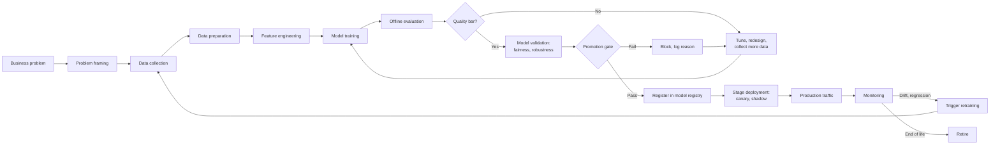
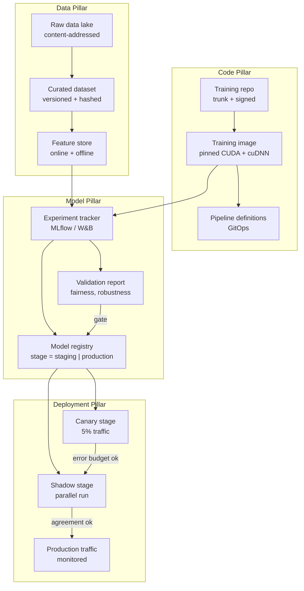
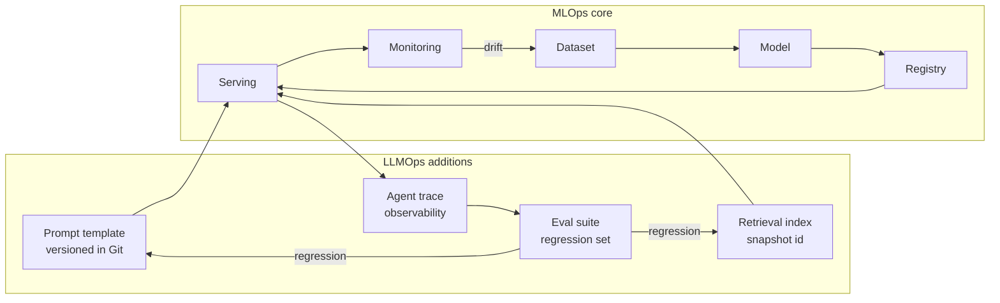

# 16.1 MLOps foundations and lifecycle

| Field | Value |
|---|---|
| Level | Basics |
| Priority tier | 1 |
| Lab venue | GCP / GKE |
| Part | Part 16: MLOps and LLMOps tools and platforms |
| Primary sources | *Practical MLOps* (`practical-mlops`, Chapters 1, 2); *Designing Machine Learning Systems* (`designing-machine-learning-systems`, Chapter 1); *Machine Learning Platform Engineering* (`machine-learning-platform-engineering`, Chapter 1); *AI Engineering* (`ai-engineering`, Chapter 1); *LLMOps* (`llmops`, Chapters 1, 2); *Engineering AI Systems* (`engineering-ai-systems-architecture-and-devops-essentials`, Chapter 5) |
| Cross-references | Chapter 14.13 (Fine-tuning: SFT, LoRA and QLoRA); Chapter 15.3 (vLLM in depth); Chapter 15.6 (Triton Inference Server); Chapter 16.2 (Data versioning and experiment tracking); Chapter 16.3 (Data pipelines and feature stores); Chapter 16.6 (Model registry, CI/CD and GitOps for models); Chapter 16.10 (Monitoring, drift and continual learning); Chapter 16.14 (Platform design: multi-tenant AI factory) |
| Coverage file | `planning/coverage/chapters/16-01.md` |
| Claim & number ledger | `planning/ledgers/16-01.md` |

## Why this matters for AI infrastructure

You spent Parts 1 through 15 learning to wire the data center floor. You learned how Linux boots, how BGP chooses a path, how the Kubernetes scheduler places a Pod on a NUMA node, how RDMA bypasses the CPU, and how a vLLM engine streams tokens out of an H100. Each of those layers had a hardware or systems problem with a clean answer.

The work in this part is a different kind of problem. The model you put into production tomorrow was trained yesterday, on a dataset that nobody can name precisely. The training ran in a notebook on one engineer's laptop, with a random seed that was picked because the first run looked good. None of the systems knowledge from the earlier chapters protects you from that notebook. The defect sits upstream of the GPU.

Suppose a fintech team ships a fraud model that performs well in offline tests for two months. In week nine it quietly starts missing new attack patterns. The on-call engineer opens the training notebook to retrain, and the notebook reads a CSV file from a path that no longer exists. The original data was overwritten by a re-pull last quarter. No record shows which feature engineering version produced the live weights. The model is, for all practical purposes, impossible to reproduce, and the engineer cannot answer the simplest question: what data did this model see?

This chapter exists to prevent that. MLOps is the discipline that closes the gap between a notebook that produced a number and a model that runs in production, traceably and reproducibly. It covers everything that lives above the cluster and below the user.

```text
The cost of ungoverned ML (background reading: Practical MLOps; Engineering AI Systems; the figures below are examples, not quotations):
- IDC (2019) and Algorithmia surveys put the share of enterprise time spent on
  "model deployment and management" at roughly 25% to 60% of an ML project, with
  the remainder going to data wrangling and experimentation (Practical MLOps Ch 1).
- A 2020 Gartner estimate suggested that only ~15% of ML models that enterprises
  build ever reach production; the rest die in notebooks for governance reasons,
  not accuracy reasons (Engineering AI Systems Ch 5).
- The most common single post-mortem cause of "the model went bad" incidents is
  data drift combined with no central record of which data snapshot produced the
  live weights (Designing Machine Learning Systems Ch 1).
```

MLOps is not one tool. It is a set of practices that together answer four questions about every model in production. Which data trained it? Which code trained it? How was it validated? How does it step aside when it goes stale? The rest of this chapter lays those foundations.

Three operational facts explain why this matters to you as an infrastructure engineer, and not only to the data scientist.

1. The cluster you built is where MLOps errors show up. When a model silently degrades, the symptom looks like a queue spike or a burst of 5xx errors. That alert pages you, the platform engineer, not the person who trained the model. You need to read the lineage and the metric history without paging five teams.
2. ML workloads stress GPU clusters in ways the earlier parts did not. A misconfigured notebook can submit a job that runs for two weeks and blocks the queue. Checkpoint writes can drain a parallel file system. A large model can be pulled into GPU memory and never evicted. Lifecycle discipline stops these mistakes before they reach the cluster.
3. LLMOps, the focus of Part 16, is MLOps plus new failure modes. Fine-tunes, retrieval pipelines, agent loops and prompt regressions are all machine learning system problems at heart. The MLOps foundations come first, because the LLMOps details only make sense on top of them.

**Before you connect a model to a serving engine, make sure its lifecycle can be audited from start to finish. A model is only as reproducible as its weakest piece of metadata.**

## Prerequisites and outcomes

Picture yourself starting this chapter with a model that a colleague trained last month. You need to trace it back to its data, its code and its tests. That work only goes smoothly if the tools below already feel familiar.

### Prerequisites

- Comfortable with Python packaging, virtual environments and CLI tooling from Part 3.
- Working knowledge of containers, Kubernetes and the cluster primitives from Part 5 (pods, jobs, services, secrets, RBAC).
- Familiarity with the GPU node and CUDA stack from Part 10, and with the inference engines from Part 15.
- For the LLMOps sections: Chapter 14.2 (Transformers and LLM architecture) and Chapter 14.13 (Fine-tuning).
- For the platform sections: Chapter 16.14 (Platform design: multi-tenant AI factory).

### Outcomes

After completing this chapter you will be able to:

1. Explain, with a worked incident, what goes wrong when a team skips data versioning, experiment tracking, a model registry and promotion gates, and why "just be more careful" is not a fix.
2. Walk a model through the full lifecycle, from problem framing to retirement, naming the artifact, the owner, the gate and the tool at each stage.
3. Name the four pillars of MLOps (data, model, code, deployment), describe the minimal mechanism for each, and place an organisation on the maturity ladder.
4. Decide which capability to add next, given the current pain, and distinguish classical MLOps from LLMOps by the new failure modes that fine-tunes, retrieval pipelines and agents introduce.
5. Connect every lifecycle gate to the infrastructure primitives that enforce it, including registries, schedulers, admission controllers, secrets and audit logs.

---

## 1. The failure mode MLOps exists to prevent

### 1.1 The classic incident: a notebook, a lucky seed, an unrecoverable dataset

Start with the failure, because it teaches more than a definition does. Imagine a small team that builds a churn model for a subscription product. One data scientist writes the model in a notebook on a laptop. The notebook reads a CSV file that a colleague pulled from the data warehouse and saved to shared storage as `churn_q3.csv`. The notebook cleans the columns, encodes the categories, fits a gradient boosted tree, and reports a 0.92 AUC, a score for how well the model ranks likely churners above everyone else.

In this illustrative story, the production AUC drifts down to 0.78 three months later. The team opens the notebook to retrain, and three things break at once:

- The CSV file was overwritten by a later pull. The exact data behind the live model is gone.
- The categorical encoding helper was edited in place a month ago. The notebook now encodes `tier="gold"` differently from the original, and the change was committed as `cleanup.py`, not as a tracked experiment.
- The seed was hard-coded. A second engineer running the same notebook gets 0.86 AUC, and nobody can tell which number was the production one.

This story is not far-fetched. *Practical MLOps*, chapter 1, frames the whole discipline around three failure shapes. The first is the works-on-my-machine problem, where the data cannot be reproduced. The second is the magic seed problem, where no experiment record exists. The third is the silent promotion problem, where a model reaches production on human judgment alone. *Engineering AI Systems*, chapter 5, adds a fourth: the stale model, whose registry entry is months older than the code that trained it.

Each of these failures has a narrow, mechanical fix. The discipline of MLOps is to install that fix in the toolchain, so the failure cannot happen again.

| Failure shape | What specifically goes wrong | The MLOps mechanism that prevents it |
|---|---|---|
| Works on my machine | Data scientist overwrites or loses the source dataset | Data versioning with content-addressed storage and immutable dataset IDs (Chapter 16.2) |
| Magic seed | Training run cannot be reproduced because seed, code and config drifted | Experiment tracking that logs code, commit, seed, env and metrics in one record (Chapter 16.2) |
| Silent promotion | A new model reaches production because a human approved it verbally | A promotion gate function with hard, mechanical criteria, called by the pipeline (Section 4.3 below) |
| Stale model | The live artifact is months older than the training pipeline because retraining is manual | A retraining trigger, scheduled or drift-driven, that publishes to the registry (Chapter 16.10) |

Look down the last column, and you see one pattern. **Make the discipline structural, not optional.** Telling people to be more careful does not survive a deadline. Putting a function in the path of the artifact, and gating deployment on what that function returns, does survive one.

### 1.1.1 Why teams fail to install the discipline: the ML hierarchy of needs

*Practical MLOps*, chapter 1, borrows Maslow's hierarchy of needs to explain why teams struggle to adopt MLOps. The layers, from bottom to top, are DevOps, data engineering, platform automation and finally MLOps. A team without automated CI/CD cannot run an MLOps pipeline reliably, because every training run becomes a hand-built deployment. A team with CI/CD but no data platform has nowhere to land its datasets. A team with both, but no platform automation, ends up writing a one-off pipeline for each project.

```text
ML hierarchy of needs (background reading: Practical MLOps; the figures below are examples, not quotations):
- Layer 1 (foundation): DevOps — CI/CD, IaC, automated testing on every commit.
- Layer 2: Data engineering — automated flow of data from sources to warehouses.
- Layer 3: Platform automation — Kubeflow, SageMaker, Vertex AI, or equivalent.
- Layer 4 (top): MLOps — automated training, tracking, registry, deployment, monitoring.
```

The failure this captures is easy to predict. A team buys a feature store and a registry before it builds images on every commit. The platform then collapses under its own weight, because every artifact change is coordinated by hand. The cure is not more tooling. It is climbing the pyramid one layer at a time.

### 1.1.2 The cultural failure modes: HiPPO and the absence of Kaizen

Two cultural patterns from *Practical MLOps*, chapter 1, appear in nearly every failed MLOps adoption.

The first is HiPPO, the Highest Paid Person's Opinion. The most senior person in the room decides whether a model is good enough to ship, and the data is not the deciding factor. The promotion gate then turns into a chat thread, and it gets bypassed, because a meeting is not a function. The fix is the same as in Section 1.1: write the gate as code, and let its return value be the only thing that moves the registry.

The second is the absence of Kaizen, the habit of small, continuous, data-driven improvement. The team ships a model once, calls the work done, and returns only when the model visibly breaks. In MLOps terms, Kaizen means a retraining trigger from Chapter 16.10, plus a monitoring feedback loop that alerts the team when a key metric slips. That alert should fire on a small, agreed drop, not only after the metric collapses.

The two patterns feed each other. HiPPO decides without data, and without Kaizen the team never builds the mechanism that would make HiPPO unnecessary.

### 1.1.3 Why "ML in production" is not "ML in research": the five-dimension gap

Teams that have only done research ML expect production ML to be the same work at a larger scale. It is not. *Designing Machine Learning Systems*, chapter 1, names five dimensions where production differs from research, and each one creates an MLOps requirement.

| Dimension | Research ML | Production ML | The MLOps mechanism that addresses it |
|---|---|---|---|
| **Stakeholders** | The author | ML engineers, salespeople, PMs, infra engineers, finance, security | Registry with owner, approver, SLO owner fields (Section 3.2) |
| **Computational priority** | Fast training, batch latency tolerable | Fast inference, tail-latency SLO | Monitoring on p50/p90/p99 latency and Goodput (Section 5.4) |
| **Data** | Static, curated, labelled by the team | Noisy, unstructured, constantly shifting, sometimes unlabelled | Data versioning + drift detection + validation gates (Chapter 16.3, 16.10) |
| **Fairness and harm** | Lower stakes | Decisions affect real users | Audit logs, lineage, governance committee (Chapter 16.13) |
| **Interpretability** | Optional | Often required by regulator or operator | Model card, evaluation report in registry entry (Section 3.2) |

The left column is what a team already knows. The right column is what the platform has to add. Each row is a surprise your team will meet, and the mechanism in the last column is how you handle it.

### 1.1.4 A threat that hides in the training set: data poisoning

*Designing Machine Learning Systems*, chapter 1, names data poisoning as an attack surface an MLOps platform must defend. The attack is simple. An adversary plants bad examples in the training set, and the model learns to link a trigger pattern with a target label. Picture a spam classifier taught to let through any email that contains a string the attacker chose. The model behaves normally until the trigger appears in production.

The defence is the data versioning contract from Chapter 16.2. Every training example has a content hash and a source-system record, so a poisoned example can be traced to its origin. The snapshot that introduced it can then be excluded from future training runs. None of this works without immutable, hash-addressed data.

The same defence protects you from a well-meaning engineer. Suppose someone overwrites a production snapshot with a re-pull that dropped a column. The audit log shows what happened, and the rollback is one snapshot revert away.

### 1.2 Why DevOps muscle alone is not enough

Many teams first try to solve MLOps with classical DevOps. They version the training code, run CI on every pull request, and deploy the resulting model behind a Kubernetes service. That is necessary, but it is not sufficient. Three kinds of state in an ML system sit outside what DevOps versions well.

1. The data itself. Datasets are large, mutable and partly shared. Git cannot hold a 200 GB Parquet file, for example, and object storage cannot say which version is current without a metadata layer. MLOps adds that layer with content hashes, such as the `.dvc` files from DVC or the commits from Pachyderm, so every snapshot has an immutable address.
2. The training environment. The same script with the same seed can produce different numbers on different CUDA, cuDNN or NCCL versions. Classical CI pins Python and operating system packages. MLOps also pins the CUDA driver, the cuDNN version, the container image hash and the cluster topology.
3. The evaluation and decision record. Classical CI gives you pass or fail results and text logs. An ML experiment gives you a set of metrics, an artifact, a confusion matrix and sometimes per-segment slices. MLOps treats that experiment record as a first-class artifact, in tools such as MLflow, Weights and Biases or Vertex AI experiments, that you can query and compare.

DevOps gets you reproducible code. MLOps gets you reproducible decisions, and no YAML file closes that gap on its own.

### 1.3 What "governance" means in an ML system

Governance is the word you will hear in every MLOps meeting. In an ML system it has three concrete meanings, and each one is tied to a stage of the lifecycle.

| Governance meaning | Lifecycle stage | Concrete artifact |
|---|---|---|
| Reproducibility | Training | The experiment record (run id, commit, data hash, metrics) |
| Auditability | Deployment | The promotion decision log (who approved what, against which gate) |
| Accountability | Production | The lineage record (model id, data id, training run id, deployer, SLO owner) |

Reproducibility asks whether you can rerun training and get the same model. Auditability asks who approved the release, and against which rule. Accountability asks who owns the model when it misbehaves, and which data and run produced it.

*Practical MLOps*, chapter 2, adds a fourth and harder requirement: rollback readiness. If a model is in production, you must be able to take it out without taking the service down. The previous model should still be in the registry, and the new model should have passed shadow traffic before the cutover. Decide in advance how quickly that rollback must happen. Chapter 16.6 returns to this in detail.

**The four shapes of MLOps failure collapse into one sentence: "I cannot answer a specific question about a model that is in production." MLOps is the set of mechanisms that makes every such question answerable in seconds, not days.**

---

## 2. The end-to-end ML lifecycle

### 2.1 Two phases: experimentation, then development-staging-production

A notebook that works on your laptop and a model that runs in production are different things. The lifecycle has two phases, and each phase follows different rules. *Machine Learning Platform Engineering*, chapter 1, splits the lifecycle this way, even though the two phases look alike on a slide.

In the experimentation phase, the data scientist moves fast. Every step is a hypothesis, the code can be messy, and the run time is whatever the laptop allows. The deliverable is a metric on a held-out set. In the development, staging and production phase, every step is an artifact. The training script is the same script, the data is a frozen snapshot, and the environment is a fixed container image. The output is a model bound to a registry entry and a deployment record.

The move between the two phases is where MLOps earns its name. When a notebook becomes a pipeline, three things must happen:

- The data moves from a laptop path to a versioned dataset with a hash.
- The training code moves from a `.ipynb` cell to a tracked Python module with a commit hash.
- The experiment record moves from a printed number to a tracking server that the rest of the platform can query.

If you skip any of these steps, the notebook stays your only record, and you will be the one who reconstructs it later.



Designing Machine Learning Systems, Practical MLOps, Machine Learning Platform Engineering and LLMOps all draw versions of this diagram. They differ in emphasis. The first stresses the feedback loop from monitoring back into data collection. The second stresses the gate between offline evaluation and deployment. The third stresses the tool boundary between experiments and pipelines. This chapter borrows from all three, because they look at the same problem from different angles.

### 2.2 The artifacts at each stage

A lifecycle without artifacts is only a slide. At each stage the work should leave an artifact behind, and someone should be able to query it later. The table below is the cheat sheet.

| Lifecycle stage | Artifact produced | Where it lives | Who owns it | What gate it must pass |
|---|---|---|---|---|
| Problem framing | One-page brief with metric, baseline, and business value | Wiki or repo | Product + DS | Stakeholder sign-off |
| Data collection | Raw dataset version (content hash, snapshot date) | Object store + metadata DB | Data engineering | Schema, PII and lineage checks |
| Data preparation | Cleaned dataset version (hash of clean + raw) | Object store + DVC / lake FS | Data engineering | Data quality tests (deequ, Great Expectations) |
| Feature engineering | Feature set definition (SQL/Python) and feature table | Feature store | DS + platform | Feature freshness and null-rate checks |
| Model training | Training run record (run id, commit, data hash, env hash, metrics) | Tracking server (MLflow, W&B) | Data scientist | Baseline beat, seed reproducibility, eval slices |
| Offline evaluation | Evaluation report (overall metrics, per-segment metrics, fairness) | Tracking server or report repo | Data scientist | Quality bar for the use case |
| Model validation | Validation report (robustness, fairness, calibration, security) | Tracking server or report repo | ML platform team | Validation gate (hard rules) |
| Promotion | Promotion record (gate input, gate output, approver) | CI/CD system or registry | ML platform team | Promotion gate function (mechanical) |
| Registry | Model artifact + metadata in registry | Model registry (MLflow Registry, Vertex AI, SageMaker) | ML platform team | Registry schema, signed artifact |
| Deployment | Live model in serving system with canary/shadow steps | Kubernetes / serving engine | Platform + SRE | Canary error budget, SLO attainment |
| Monitoring | Metric/log/drift stream | Observability stack | Platform | Alert rules, SLOs |
| Retraining trigger | New training run, scheduled or drift-driven | Pipeline orchestrator | ML platform team | Same training gate as before |
| Retirement | Deregistered model, archived artifacts | Cold storage | Platform + product | Data retention policy |

Two things stand out. First, the owner changes from stage to stage. A data scientist owns training and offline evaluation. A platform engineer owns the registry and deployment. A product owner owns the brief and the retirement. Most MLOps failures are failures of role clarity. A notebook that graduates to production with no owner for its registry entry is a model waiting to drift.

Second, every artifact has to be queryable. Ask the registry which model currently serves a share of traffic. If you cannot get that answer quickly, you do not have an MLOps platform. You have a folder of YAML files.

### 2.3 The minimum mechanism at each gate

Walk the diagram and ask one question at each gate: what is the cheapest mechanism that enforces it? For many gates the answer is small and mechanical, and you can start there.

| Gate | Minimum mechanism |
|---|---|
| Data quality | A test suite (Great Expectations, deequ) that runs in the pipeline and aborts on failure |
| Feature freshness | A scheduled job that rebuilds the feature table and fails if the partition is older than the SLO |
| Reproducibility | A training script that takes a content hash of code, data and seed as inputs and writes a run record |
| Baseline beat | A test in CI that compares the candidate run metrics against a registered baseline |
| Promotion | A function in the pipeline whose exit code is checked; not a human "looks at the dashboard" |
| Deployment | A canary step that shifts a small percentage of traffic and aborts on error budget breach |
| Monitoring | An alert rule that pages the model owner on SLO violation or drift threshold breach |
| Retraining | A scheduled or drift-triggered pipeline that follows the same gates as the initial training |

The cheapest mechanism is not always the right one for an enterprise. It is always a useful starting point. If you cannot afford a managed tracking server, a `metrics.json` file in object storage still records each run.

---

## 3. The four pillars of MLOps

### 3.1 Data: the artifact that is hardest to version

Imagine your team retrains a model in March, and someone asks what data the model saw last March. If the old data was overwritten, nobody can answer. Data is the hardest pillar to version, for three reasons.

- Size. A training corpus can be very large. Git cannot hold it, and object storage holds it without versioning it on its own.
- Mutability. Datasets get appended, cleaned and re-partitioned. If you overwrite a partition, you cannot easily say what a model saw.
- Partial sharing. Several models share some of the same features. A change to a shared feature reaches every model that uses it, and without lineage you cannot find those dependents.

The standard pattern is content-addressed storage plus a metadata layer. *Practical MLOps*, chapter 1, walks through DVC, which stores large files in object storage and keeps small `.dvc` hash files in Git. *LLMOps*, chapter 4, introduces Pachyderm and lakeFS, which offer branch and merge semantics over data. *Designing Machine Learning Systems*, chapter 3, introduces the feature store, the layer that separates feature engineering from model training.

The mechanism that closes the data pillar looks like this:

```text
Minimum data versioning flow (background reading: Practical MLOps; LLMOps; the figures below are examples, not quotations):
1. Raw data lands in object storage with a content hash (sha256 of the file).
2. The pipeline writes a metadata record to a small database:
     dataset_id, content_hash, source_system, snapshot_time, row_count, schema_hash
3. The training script accepts a dataset_id argument and resolves it through the
   metadata DB. It never reads a hard-coded path.
4. Every training run records the dataset_id in its experiment record.
5. Deletion is soft-delete by default; an artifact is only purged after a
   retention window, never overwritten.
```

Two habits follow from this flow. First, never read from a hard-coded path inside a training script. Take the path or the dataset ID as an argument. The rule sounds obvious, and it is still the most commonly broken rule in MLOps. Second, log the data hash, not the data path. A path can move, but a hash identifies the artifact itself.

### 3.2 Model: the artifact with the most versions per byte

Every change to the data, the code, the seed, the hyperparameters, the environment or the framework version produces another model artifact. A busy team's registry therefore fills up with runs, and most of those runs should never be promoted. The registry's job is to make the few promoted models easy to find.

*Practical MLOps*, chapter 1, *Machine Learning Platform Engineering*, chapter 1, and *Designing Machine Learning Systems*, chapter 6, agree on the registry contract. A registered model carries the metadata below, and nothing less.

```text
Minimum registered-model record (background reading: Practical MLOps; Designing Machine Learning Systems; Machine Learning Platform Engineering; the figures below are examples, not quotations):
- model_id (registry primary key)
- name (human-readable, e.g. "fraud-detector")
- version (semver or monotonic; MLflow and Vertex AI default to monotonic)
- stage (none | staging | production | archived)
- run_id (the experiment record this model came from)
- artifact_uri (object storage path to weights + serialized model)
- data_snapshot_id (which data version trained this)
- code_commit (the commit hash of the training repo)
- env_image_hash (the container image digest of the training environment)
- signature (input schema, output schema)
- metrics (overall and per-segment, copied from the run record)
- description (free text, but typically "what changed in this version")
- created_by
- created_at
- lineage (parent model_id, parent run_id; if a fine-tune)
```

The stage field is what the deployment pipeline reads. The pipeline does not read the artifact URI directly. It reads `stage = production` and pulls whatever model is in that stage.

MLflow Registry, Vertex AI Model Registry, SageMaker Model Registry and Weights and Biases Registry differ in tooling, access control and user interface. On the contract above, they are interchangeable.

### 3.3 Code: the artifact DevOps already knows how to version

Code is the easy pillar, because DevOps already knows how to version it. Treat the training repository like a service repository. Use trunk-based development, protected branches, pull request review, CI on every commit, pinned dependencies, and container images referenced by digest.

Three practices are specific to machine learning.

- Separate the training entry point from the rest of the code. The function the pipeline calls should be small, and it should take its inputs explicitly. Everything else lives in modules that you test on their own. That separation is what makes training reproducible.
- Pin the environment, not just the packages. A Dockerfile that installs `python=3.11` is not enough. Pin the CUDA base image, the driver compatibility matrix and the cuDNN version. *Designing Machine Learning Systems*, chapter 6, calls this the reproducibility stack.
- Sign the training image. A tampered training image is a supply chain attack, and it can produce a backdoored model. Treat the image like a release artifact. *Production Kubernetes*, chapter 15, describes signing an image at each pipeline stage, for example after tests pass and again after release approval, and then gating deployment on those signatures. The promotion gate should refuse unsigned images.

### 3.4 Deployment: the artifact that lives in two systems at once

Deployment is the most subtle pillar, because a deployed model lives in two systems at the same time. The serving system runs the inference, and the registry describes it. The two can drift apart. When they do, you get the worst incident in this area: the registry says version 12 is in production, while the serving system is still running version 9.

Three patterns prevent that drift. Each has its own trade-off, so choose the one your platform team can operate.

| Pattern | What it does | Where you see it |
|---|---|---|
| GitOps for the registry | The registry stage is set by a pull request that is merged by the pipeline, not by a human clicking "promote" | MLflow with GitHub Actions, Vertex AI with Cloud Build, Argo CD for the registry |
| Image-as-source | The serving system reads its model from an image tag that the registry updates. Reverting the tag reverts the deployment. | KServe, BentoML, Seldon, Triton model repository |
| Signed promotion | The deployed artifact carries the same signature as the registry entry; the serving system refuses an unsigned artifact | cosign + admission controller, Sigstore policy controller |

GitOps gives the most audit trail, because every promotion is a reviewed change. Image tags give the simplest rollback, because reverting a tag reverts the deployment. Signed promotion gives the strongest guarantee that what runs is what was approved.

*Designing Machine Learning Systems*, chapter 7, covers model deployment in depth. The contract you need here is simpler to state. The model whose registry entry has `stage = production` should be the model that serves all production traffic once any canary finishes. Any other state should raise an alert.

### 3.5 The pillar diagram

Draw the four pillars as a graph, and inspect every arrow. Each arrow should carry an identifier. An arrow without one is a place where you cannot trace an artifact.



The diagram rests on one rule. Every arrow carries an artifact with an identifier, and no arrow carries an anonymous blob. If the pipeline cannot tell you which dataset trained the model on the canary stage, one of the arrows is missing its identifier.

**When you audit an MLOps platform, audit the arrows, not the boxes. The boxes are tools you can buy. The arrows are practices you have to install.**

---

## 4. Maturity levels and the path from notebook to platform

### 4.1 The three levels that everyone agrees on

Picture a team whose notebook is the only copy of its model. Most teams start there, and most maturity models describe the same three levels, each with different names. *Designing Machine Learning Systems*, chapter 10, uses a similar three-level split. *Practical MLOps*, chapter 1, lists the same progression in other words. *Machine Learning Platform Engineering*, chapter 1, calls the levels manual, pipeline and platform. This chapter uses the most common wording: Level 0 (manual), Level 1 (ML pipeline) and Level 2 (CI/CD for ML).

| Level | What it looks like | Pain that drives the next level |
|---|---|---|
| **0: Manual** | Notebook on a laptop; ad hoc deployments; one-off shell scripts; no tracking | "We cannot reproduce last quarter's model"; "the data scientist left and we lost the pipeline" |
| **1: ML pipeline** | Training is automated; experiment tracking is real; registry exists; deployment is manual | "Promotions are slow"; "we deployed a model that beat the offline metric but failed in production"; "the new model regressed last week's traffic" |
| **2: CI/CD for ML** | Pipeline is triggered on code/data changes; promotion gate is automated; canary deployment is real; monitoring feeds back into retraining | "Our drift detection is too slow"; "two teams have competing pipelines and no shared feature store"; "we cannot rollback in under 5 minutes" |

The pain in each row points to the next level. Do not skip levels. A team at Level 0 that installs Level 2 tooling will find that nobody can debug it, because nobody has run the manual flow first.

### 4.2 The capabilities that move you up

You rarely adopt everything at once. The table lists ten capabilities in the order most teams tend to adopt them, and each one answers a failure from Section 1. That order reflects common practice described in the gem books. It is not a measured survey, so treat it as a default you can adjust.

| Order | Capability | Failure it addresses | Tooling reference |
|---|---|---|---|
| 1 | Experiment tracking | Magic seed | MLflow Tracking, W&B, Vertex AI Experiments |
| 2 | Data versioning | Works on my machine | DVC, lakeFS, Pachyderm, Delta Lake time travel |
| 3 | Pipeline orchestrator | "The notebook is the pipeline" | Kubeflow Pipelines, Argo Workflows, Flyte, Airflow, Vertex AI Pipelines |
| 4 | Model registry | "Which model is in production?" | MLflow Registry, Vertex AI Model Registry, SageMaker Registry, W&B Registry |
| 5 | Promotion gate | Silent promotion | Custom CI step; Open Policy Agent; Great Expectations for models |
| 6 | Canary deployment | "The new model regressed last week" | Argo Rollouts, KServe canary, Seldon canary, BentoML traffic splitting |
| 7 | Drift monitoring | Stale model | Evidently, whylogs, Arize, Fiddler |
| 8 | Triggered retraining | "We forgot to retrain" | Schedulers (Argo, Airflow) + drift-triggered pipelines |
| 9 | Feature store | "Two models use different definitions of the same feature" | Feast, Tecton, Vertex AI Feature Store, Databricks Feature Store |
| 10 | Multi-tenant platform | "Five teams each built their own pipeline" | Internal developer platform layer; chargeback and quotas |

Follow this order unless your pain points somewhere else. If the first pain is "I cannot reproduce my experiment," adopt tracking and data versioning before you buy a feature store.

### 4.3 The promotion gate, in code

Picture the night a regressed model reaches production because a manager approved it in a chat thread. The promotion gate is the mechanical pattern that prevents that night. It is a function that takes the candidate run, a baseline run and a policy, and it returns pass or fail with a reason. The pipeline checks the exit code. On the happy path, no human sits in the loop.

The sketch below shows the shape. It is deliberately simple. A production version would read the policy from a registry, sign the decision, and write to an audit log.

```python
# code/part16/mlops_promotion_gate.py
from dataclasses import dataclass
from typing import Callable

@dataclass
class Run:
    run_id: str
    metrics: dict[str, float]
    data_snapshot_id: str
    code_commit: str
    seed: int

@dataclass
class GateResult:
    passed: bool
    reasons: list[str]

def promotion_gate(
    candidate: Run,
    baseline: Run,
    rules: dict,
) -> GateResult:
    reasons = []
    # 1. Did the candidate beat the baseline on the primary metric?
    primary = rules["primary_metric"]
    if candidate.metrics[primary] < baseline.metrics[primary]:
        reasons.append(
            f"primary metric regressed: {candidate.metrics[primary]} < {baseline.metrics[primary]}"
        )
    # 2. Did any guardrail metric violate a threshold?
    for metric, threshold in rules["min_metrics"].items():
        if candidate.metrics[metric] < threshold:
            reasons.append(
                f"guardrail {metric} below floor: {candidate.metrics[metric]} < {threshold}"
            )
    # 3. Did the seed reproduce?
    if candidate.seed != rules.get("required_seed"):
        reasons.append("seed not pinned to required value")
    return GateResult(passed=not reasons, reasons=reasons)

def load_artifacts(candidate_path, baseline_path, policy_path):
    import json
    return (Run(**json.load(open(candidate_path))), Run(**json.load(open(baseline_path))), json.load(open(policy_path)))

def write_audit_log(candidate, baseline, result):
    import mlplat_local as P
    P.audit("gate_passed", candidate=candidate.run_id, baseline=baseline.run_id)

def write_registry(candidate, stage):
    import mlplat_local as P
    P.register("churn-model", len(P.load("registry.json", {}).get("churn-model", {})) + 1, candidate.run_id, candidate.metrics, stage=stage)

def promote(candidate_path: str, baseline_path: str, policy_path: str) -> int:
    candidate, baseline, rules = load_artifacts(candidate_path, baseline_path, policy_path)
    result = promotion_gate(candidate, baseline, rules)
    if not result.passed:
        print("PROMOTION BLOCKED:")
        for r in result.reasons:
            print(f"  - {r}")
        return 1
    # Log the decision to an immutable audit trail before writing to the registry
    write_audit_log(candidate, baseline, result)
    write_registry(candidate, stage="staging")
    return 0
```

The design choices in this sketch matter more than the syntax. Four of them are worth copying.

- The gate is a function, not a person. A human approves the policy, not every single promotion.
- The decision is logged before the registry is written. If the registry is damaged, the audit log still shows what should have happened.
- The gate refuses to advance when the seed is unpinned. A run that cannot be reproduced should not be promoted.
- The reasons are explicit. *Practical MLOps*, chapter 1, treats a printed, specific reason for a blocked promotion as the mechanism that makes the discipline structural.

**Adopt the promotion gate before the canary deployment. A gate without a deploy still keeps bad models out of the registry. A deploy without a gate moves the failure from the registry to the cluster.**

---

## 5. From MLOps to LLMOps

### 5.1 What stays the same

Imagine a team that already runs MLOps asks whether it needs a new platform for language models. Mostly, it does not. The four pillars from Section 3 still apply, and the lifecycle keeps the same gates.

The reason is structural. A fine-tuned language model is still a model. A training run produces it from a dataset version. It is validated offline, registered with metadata, deployed behind a serving system, monitored and eventually retired. *LLMOps*, chapter 2, puts it plainly: it applies MLOps to LLM-based systems. The base discipline does not change. If you already run the MLOps platform, you do not need a second stack for language models.

### 5.2 What changes: three new artifact types

The change happens inside the pillars, not to the pillars themselves. Three new artifact types appear when you move from tabular models to LLM-based systems.

1. The prompt template. The model input now mixes system instructions, retrieved context and user text. The template is an artifact with versions. Changing a prompt changes the model, as far as the user can tell.
2. The retrieval index. A retrieval-augmented generation system keeps a vector index over a corpus. The index has versions tied to the corpus snapshot, the embedding model, the chunking policy and the metadata filters. Change the corpus, and you change the index, which changes the answers.
3. The agent trace. An agent loop writes a record of its tool calls, intermediate prompts and decisions. You use that trace for evaluation, debugging and audit.

| New artifact | Owner | Where it lives | Gate that catches a bad version |
|---|---|---|---|
| Prompt template | App developer + product | Git repo with versioned prompt files | Eval suite (LLM judge + regression tests) |
| Retrieval index | App developer + data engineering | Vector store with snapshot id | Retrieval recall and answer faithfulness eval |
| Agent trace | App developer + SRE | Observability backend (Langfuse, OpenTelemetry) | Trace-based regression tests + cost guardrails |

*LLMOps*, chapter 2, calls these the three artifacts of LLMOps. *AI Engineering*, chapter 10, describes the same idea under the heading of architecture and user feedback. *LLM Engineer's Handbook*, chapter 11, and *Practical MLOps*, chapter 1, both extend the MLOps lifecycle to include them.

### 5.2.1 The four goals of LLMOps, and the SLO/SLA/KPI contract

An LLM application faces regulators, customers and the press, so its targets must be stricter and clearer than those of a typical internal model. *LLMOps*, chapter 2, names four goals for this layer. None of them is a new practice. Each one is a tighter version of an MLOps practice.

| Goal | Definition | Concrete metric in production |
|---|---|---|
| **Security** | Minimising the regulatory, reputational, and operational risks associated with deploying LLM applications | PII redaction rate; jailbreak-attempt block rate; data-encryption-at-rest coverage; access-audit completeness |
| **Scalability** | Building, storing, and maintaining LLM applications that generalise across data and scale on demand while optimising latency, throughput, and cost | p50/p95/p99 TTFT and ITL; tokens/sec/GPU at SLO attainment; cost per 1M tokens; autoscaler convergence time |
| **Robustness** | Maintaining high performance over time in the face of data drift, model drift, and third-party updates | Drift score (KS test, PSI); eval-set regression rate; freshness SLO on retrieval index; vendor model update detection |
| **Reliability** | Rigorous inference monitoring, error handling, and redundancy to prevent downtime and failures | Availability SLO (e.g. 99.9% monthly); 5xx rate; CSAT and NPS; RTO and RTO attainment |

The four goals depend on each other. A robust model that crashes under load is a single point of failure. A scalable system that leaks personal data under load is a regulated incident. Real incident reviews usually find a failure in one goal, hidden behind good numbers in another.

The SLO, SLA and KPI framework from *LLMOps*, chapter 2, turns those goals into contracts. The table shows the three terms at three levels of audience.

| Concept | Audience | What it says | Example for an LLM serving system |
|---|---|---|---|
| **SLO** (Service Level Objective) | Internal, engineering | What the team aims to achieve | p95 TTFT &lt;= 300 ms; monthly availability >= 99.9% |
| **SLA** (Service Level Agreement) | External, customer | What the team commits to, with consequences for breach | p95 TTFT &lt;= 500 ms; if breached, customer receives 10% credit |
| **KPI** (Key Performance Indicator) | Business, executive | Whether the system is delivering the value the business is paying for | CSAT >= 90; cost per million tokens below target; revenue impact |

The SLO is what the engineers aim for. The SLA is what the customer is promised, with consequences if it is missed. The KPI is what the business measures. The numbers in the example column are example values only. Your team should choose its own targets from its own traffic and risk. The platform team owns the SLOs, each SLO defines an alert rule, and each alert rule feeds a runbook that names the rollback path.

A useful discipline from *LLMOps*, chapter 2: every SLO needs a measurement method and a budget. The method is the metric, its data source and its aggregation window. The budget is how long the SLO may be violated before the on-call engineer is paged. An SLO without a budget is a wish.

The Gartner statistics in that chapter are a useful reality check. A 2024 study predicted that about 30% of GenAI projects would fail by 2025, mostly for operational reasons such as data quality, weak evaluation and the cost of scaling. A 2018 study predicted that 85% of ML projects would fail in production by 2022. The headline numbers vary, but the diagnosis is stable. MLOps is the practice that turns that failure rate into something a team can manage.

### 5.3 What changes: three new failure modes

The new failures do not look like outages. The cluster is healthy, and the model loads. The system is still wrong. Three failure modes become central in LLMOps, and each one needs its own detection.

| Failure mode | What happens | Detection |
|---|---|---|
| Prompt regression | A prompt edit degrades accuracy on a slice of users without changing the model | Eval suite with frozen regression set + LLM judge |
| Retrieval staleness | The corpus is updated but the index is not; answers reference old data | Index age alert + freshness check in retrieval pipeline |
| Agent runaway | The agent loops or escalates cost in a way no human intended | Cost guardrails per request; loop detector; max-iteration cap |

Because the cluster looks healthy, the lifecycle has to grow to catch these failures. Your dashboards for CPU, GPU and latency will stay green while the answers go bad. When a user reports a wrong answer, you need the prompt, the retrieved context and the agent trace to explain it.

### 5.4 The extended lifecycle diagram

Look at the loop on the right of this diagram. Serving sends traces to evaluation, and evaluation sends regressions back to the prompt and the index.



LLMOps does not replace MLOps. It adds a tighter loop between the serving system and the prompt and index artifacts.

**Build the MLOps foundation first. The LLMOps layer adds new artifacts and a new feedback loop, but it does not replace the four pillars.**

---

## 6. The infrastructure context: MLOps inside an AI factory

### 6.1 Who owns what on the platform

Imagine a misconfigured network namespace on a GPU node. The pipeline orchestrator's pods hang, and then a data scientist's notebook times out. A failure in one layer shows up in the layer above it. An AI factory has three teams whose responsibilities overlap, so they need a shared way to talk about the stack. If you run the cluster, you will be the first person paged when that shared vocabulary is missing.

| Layer | Owner | Artifacts they produce |
|---|---|---|
| Cluster and GPU node platform | Infrastructure team (you) | GPU node pools, container runtime, network fabric, storage mounts, secrets, observability |
| MLOps platform | ML platform team | Tracking server, registry, pipeline orchestrator, feature store, promotion gates, drift detection |
| Application and data science | Product teams | Prompts, retrieval indices, agent code, training notebooks, feature definitions |

The shared vocabulary matters in both directions. The data scientist needs to know what `stage = production` means in Kubernetes. The platform engineer needs to know what a data snapshot ID means in the registry.

### 6.2 The cluster primitives that enforce the lifecycle

The lifecycle gates in Section 4 are policy written on paper. The cluster primitives below turn that policy into something that cannot be skipped.

| Lifecycle gate | Cluster primitive |
|---|---|
| Promotion gate | Admission controller (OPA Gatekeeper, Kyverno) that refuses pods whose image is not in the signed registry |
| Promotion to staging | Kubernetes Job that runs the gate and writes to the registry only on pass |
| Canary deployment | Argo Rollouts canary strategy with traffic splitting by header or weight |
| Data access | Kubernetes RBAC + IRSA / Workload Identity that scopes dataset access per namespace |
| Secrets | External Secrets Operator + Vault / Secrets Manager with audit log |
| Compute quota | Kueue / Volcano / KAI Scheduler queue per team with a cap on GPU-hours |
| Cost attribution | Kubecost or OpenCost tagged by namespace and label selector |
| Audit | Cluster log shipping to an immutable bucket; admission webhook decision log |

Two cautions from *Production Kubernetes* apply directly to these primitives. Chapter 8 warns that Gatekeeper fails open by default, so a request is admitted when the policy engine cannot answer. Set that failure behaviour on purpose, and test it. Chapter 9 adds that the API server writes no audit logs until you give it an audit policy file. Without that file, the audit row in the table above is empty.

The mental model is simple. The lifecycle is policy expressed in code, and the cluster is the executor of that policy. The promotion gate function from Section 4.3 is the policy, and the admission webhook is what enforces it.

### 6.3 The data path through the AI factory

Three storage systems carry ML data through the lifecycle, and each plays a different role. A training job reads from one, writes checkpoints to another, and serves retrieval from a third.

| Storage system | Role | Artifact | Lifecycle |
|---|---|---|---|
| Object store (S3, GCS, MinIO) | Raw data, dataset versions, model weights, registry artifacts | Content-addressed blobs | Immutable by default; soft delete |
| Distributed filesystem (Lustre, Weka, BeeGFS, VAST) | Hot training data, checkpoint workspace | Files and directories | Snapshotted; mounted per namespace |
| Vector store (Milvus, Qdrant, pgvector, Pinecone) | Retrieval indices for LLMOps | Embedding vectors + metadata | Snapshot id bound to corpus version |

The lines between them are not arbitrary. Object storage holds artifacts that must not change. The distributed filesystem holds hot working data, where small-file performance matters, and Chapter 13.6 covers that in detail. The vector store has its own snapshot rules, tied to the corpus version.

A model trained on data in the distributed filesystem must record a content hash of that data, not just a path. A path can be unmounted, and the hash is what identifies the artifact.

### 6.4 The GPU node as the MLOps boundary

Picture a pipeline that submits a training job with no queue, no GPU slicing rules and no NUMA alignment. The job lands somewhere and runs badly, and the on-call engineer hears about it. That failure belongs to the pipeline, which did not declare what the job needed.

The GPU node is the boundary between the lifecycle and the cluster. Whatever the lifecycle says about a model, the GPU node is what enforces it. A platform engineer who treats the GPU node as a dumb compute target gets paged for jobs that should never have been submitted. The primitives from earlier chapters form this boundary: the kube-scheduler in Chapter 5.18, autoscaling in Chapter 5.23, NUMA alignment in Chapter 11.6 and the KAI queues in Chapter 11.15. The gate that runs `kubectl apply -f training-job.yaml` is only as good as the YAML it produces.

**The MLOps platform and the GPU platform are one system. The lifecycle gates are policy, the cluster primitives are the executor, and the audit log is the proof that the policy was enforced.**

---

## 7. How it fails

Seven failure modes recur across real MLOps deployments. Each one below has a symptom that pages an engineer, a diagnosis that traces the symptom back to the lifecycle, and a fix that lives in the right pillar. Read them as a checklist for your own platform. Each symptom is the one that will page you first.

### 7.1 "The data scientist left and we lost the pipeline"

**Symptom:** A model in production is misbehaving. The on-call engineer opens the tracking server, finds the run and looks for the training script. The script sits on the data scientist's laptop, which is in a desk drawer in another office. There is no Git repo, no container image and no record of the data snapshot.

**Diagnosis:** The training artifact is the engineer, not the code. The team was at Level 0, even though a tracking server and a registry existed.

**Fix:** Adopt the pipeline orchestrator from capability 3, and treat the training script as a pipeline definition. Move every run into a Git repo and a container image. Refuse to register any model whose `code_commit` field is empty.

### 7.2 "The promotion was approved verbally"

**Symptom:** A regression reaches production. The on-call engineer asks who approved it, and the answer is a Slack thread. The thread is gone by the time anyone looks.

**Diagnosis:** The promotion gate is a human decision with no audit trail.

**Fix:** Adopt the promotion gate from Section 4.3. Make it a CI step whose exit code is the only thing that advances the registry stage. Refuse to deploy any model whose promotion record is missing from the audit log.

### 7.3 "The new model beat the offline metric but failed in production"

**Symptom:** In one illustrative incident, the offline AUC rises from 0.91 to 0.93. The canary then breaches its error budget at a small share of traffic. The dashboard catches it, and the rollback is clean. The rollback still takes 18 minutes, because the previous production model has to be found and redeployed. The numbers are example values.

**Diagnosis:** The canary step exists, but the rollback path is manual. The previous model was not kept ready.

**Fix:** Keep the previous production model warm. The serving system reads its model from a tag or a registry stage, so a rollback becomes a tag change, not a retrain.

### 7.4 "Two teams use different definitions of the same feature"

**Symptom:** Two models in production use a feature called `user_tenure_days`. In this example, the values differ by 6 percent, because one team computes it from `signup_date` and the other from `first_active_date`. The two teams' dashboards disagree about which value is correct.

**Diagnosis:** There is no feature store, so each team recomputes the feature in its own pipeline.

**Fix:** Adopt capability 9, the feature store. Keep one definition with one owner, and two read paths: online for serving and offline for training. Audit any consumer that bypasses the store.

### 7.5 "The corpus updated but the index did not"

**Symptom:** A RAG application answers from documentation that was edited in the source system. The source timestamps are newer than the index, and some answers cite content that was deleted last week.

**Diagnosis:** The retrieval index has no freshness signal. The job that rebuilds it runs on a weekly schedule.

**Fix:** Tie the index snapshot ID to the corpus snapshot ID. Alert when the index age passes a threshold your team chooses. Add a freshness check to the retrieval path that refuses to serve when the index is older than the policy window.

### 7.6 "The agent loop ran away"

**Symptom:** In an illustrative case, an agent application made 800 LLM calls for one user request. The cost guardrail fired at 700 calls, but the loop kept running until it hit the hard limit. The user received a half-formed answer. The counts are example values.

**Diagnosis:** The loop had no iteration cap, and the cost guardrail only reported. It did not block anything.

**Fix:** Set a hard iteration cap and a hard cost cap per request in the runtime, and make both blocking, not advisory. Add a loop detector that aborts after a run of identical tool calls. Choose that run length from your own traces.

### 7.7 "Nobody tested the model against adversarial inputs"

**Symptom:** In an illustrative case, a model scores 0.94 AUC on the offline suite and goes into production. Within a month, users discover that pasting one specific string into a chat box makes the model ignore its system prompt and emit credentials from its training data. It becomes a privacy breach, and the regulator gets involved.

**Diagnosis:** The team never red-teamed the model. Its validation tested accuracy, not robustness. *Engineering AI Systems*, chapter 5, names red-teaming as a required capability for AI models, especially those built on foundation models. An outside team simulates attacks such as prompt injection, training-data extraction, jailbreaks and denial of service through long inputs. It then reports what it found to the model developers, the system developers and the deployers.

**Fix:** Stand up a red-team capability that runs on every promotion to staging. The red-team report is a required artifact in the promotion gate, so no model reaches production without a pass. Automate what you can with prompt-injection and jailbreak suites, and keep humans on the high-stakes cases, such as personal data extraction and regulated prompts. Staff the blue team, the engineers who defend the system, at parity with the red team. *Engineering AI Systems*, chapter 5, warns that under-funded blue teams are the most common reason red-team findings never become model fixes.

---

## 8. Hands-on lab

This lab runs on GCP and GKE. It walks you through experiment tracking (Capability 1) and data versioning (Capability 2), from start to finish. The lab is **untested** in the sense that the cluster is not yet provisioned in this repository. The structure and commands are a working template. When you run it on a real GKE cluster, follow the steps in order, and check each `expected` line before you move on.

### 8.0 Prerequisites

- GCP project with billing enabled, `gcloud` and `kubectl` installed.
- A GKE Autopilot or Standard cluster (1.27+) with at least one node pool that can run small jobs.
- Helm 3 for installing the tracking server and the registry.
- `dvc` installed locally for the data versioning step (`pip install dvc[gcs]`).

### 8.1 Step 1: install a tracking server and a registry

Install an MLflow Tracking Server backed by Postgres for metadata and GCS for artifacts, and run the MLflow Registry in the same deployment. The tracking server is the place where every run lands, so you check it first. The commands create the artifact bucket, install the chart and open a local port to confirm the server answers.

```bash
# Create a GCS bucket for artifacts
gsutil mb -l us-central1 gs://${PROJECT_ID}-mlflow-artifacts

# Add the Helm repo
helm repo add community-charts https://community-charts.storage.googleapis.com
helm repo update

# Install MLflow with the bundled Postgres
helm install mlflow community-charts/mlflow \
  --namespace mlops --create-namespace \
  --set trackingService.service.type=ClusterIP \
  --set trackingService.service.port=5000 \
  --set backendStore.url=sqlite:///mlflow.db \
  --set artifactRoot=gs://${PROJECT_ID}-mlflow-artifacts

# Port-forward to verify
kubectl -n mlops port-forward svc/mlflow-tracking 5000:5000 &
curl -s http://localhost:5000/api/2.0/mlflow/experiments/list | jq .
# expected: a JSON envelope with an empty "experiments" list
```

### 8.2 Step 2: version a dataset with DVC

Next, version a small dataset. The commands create a local demo project, point DVC at a Google Cloud Storage bucket and push one snapshot. Git then stores a small hash file, not the data itself.

```bash
mkdir churn-demo && cd churn-demo
git init
dvc init --storage.gs ${PROJECT_ID}-dvc
python -c "import pandas as pd; \
  pd.DataFrame({'user_id': range(1000), 'tier': ['gold']*500+['silver']*500, \
  'tier_gold': [1]*500+[0]*500, 'churned': [0,1]*500}).to_csv('data/churn.csv', index=False)"
dvc add data/churn.csv
git add data/churn.csv.dvc .gitignore
git commit -m "v1 of churn dataset"
dvc push
# expected: a hash file in GCS; data/churn.csv.dvc contains the sha256
```

### 8.3 Step 3: train a model and log to MLflow

Now train a model and log everything to MLflow. The script opens a run first, logs the dataset hash, the commit and the seed, and then registers the model. It is short enough to read end to end before you run it.

```bash
pip install mlflow scikit-learn pandas
python train.py --dataset data/churn.csv --seed 42
# expected: a run in the MLflow UI, an experiment record with
#   - params: seed=42
#   - tags: data_hash=<sha256>, code_commit=<git rev-parse HEAD>, seed, env_image
#   - metrics: auc, accuracy, f1
#   - artifacts: model.pkl
```

The training script structure:

```python
# code/part16/train.py
import argparse, hashlib, os, subprocess, mlflow, mlflow.sklearn
import pandas as pd
from sklearn.ensemble import GradientBoostingClassifier
from sklearn.metrics import roc_auc_score, accuracy_score, f1_score

ap = argparse.ArgumentParser()
ap.add_argument("--dataset", required=True)
ap.add_argument("--seed", type=int, default=42)
args = ap.parse_args()

df = pd.read_csv(args.dataset)
data_hash = hashlib.sha256(open(args.dataset, "rb").read()).hexdigest()
commit = subprocess.check_output(["git", "rev-parse", "HEAD"]).decode().strip()

mlflow.set_experiment("churn")
with mlflow.start_run(run_name=f"churn-{data_hash[:8]}") as run:
    mlflow.set_tag("data_hash", data_hash)
    mlflow.set_tag("code_commit", commit)
    mlflow.log_param("seed", args.seed)
    mlflow.set_tag("seed", str(args.seed))
    mlflow.set_tag("env_image", os.environ.get("ENV_IMAGE", "local"))

    # Synthetic train/test split for the lab
    train, test = df.iloc[:800], df.iloc[800:]
    model = GradientBoostingClassifier(random_state=args.seed)
    model.fit(train[["tier_gold"]], train["churned"])
    preds = model.predict_proba(test[["tier_gold"]])[:, 1]

    mlflow.log_metric("auc", roc_auc_score(test["churned"], preds))
    mlflow.log_metric("accuracy", accuracy_score(test["churned"], preds > 0.5))
    mlflow.log_metric("f1", f1_score(test["churned"], preds > 0.5))

    mlflow.sklearn.log_model(model, "model")
    mlflow.register_model(f"runs:/{run.info.run_id}/model", "churn-model")
# expected: a registered model version with stage=None
```

### 8.4 Step 4: add a promotion gate

Run the promotion gate against the new run and the previously registered model. The gate blocks the promotion if a required tag is missing or the AUC regressed. This lab uses `code/part16/promotion_gate.py`, which reads runs from MLflow. The file `promote.py` in the same folder is a different version that reads run records from the local stand-in registry used by the tests, so it does not work with these MLflow run IDs.

```bash
python -c "import sys; sys.path.insert(0, 'code/part16'); import promotion_gate; sys.exit(promotion_gate.promote('<new-run-id>', '<previous-run-id>'))"
# expected: "PROMOTION BLOCKED: ..." with a reason, or "PROMOTED churn-model vN to Staging"
```

This version prints its decision but does not write an audit log. Add an audit sink of your own before you rely on it, as Section 4.3 describes.

### 8.5 Step 5: deploy the staged model behind KServe

Last, deploy the staged model behind KServe. The InferenceService below points at a model file, and KServe serves it over HTTP. The resource requests and limits are example values for a small model, so size them from your own load tests.

```yaml
# code/part16/inference_service.yaml
apiVersion: serving.kserve.io/v1beta1
kind: InferenceService
metadata:
  name: churn-model
  namespace: team-data-science
spec:
  predictor:
    model:
      modelFormat:
        name: sklearn
      runtime: kserve-mlserver
      storageUri: s3://mlflow-artifacts/churn-model/production/model.pkl
      resources:
        requests:
          cpu: "1"
          memory: "2Gi"
        limits:
          cpu: "4"
          memory: "8Gi"
      env:
        - name: STORAGE_URI
          value: s3://mlflow-artifacts/churn-model/production/model.pkl
    minReplicas: 1
    maxReplicas: 10
    scaleTarget: 80       # CPU utilisation target; per-request concurrency on GPU
    scaleMetric: cpu
```

```bash
kubectl apply -f code/part16/inference_service.yaml
kubectl get inferenceservice churn-model -n mlops
# expected: READY=True within 60 seconds; URL printed
```

### 8.6 Step 6: smoke-test the deployment

Send a small batch of requests, and check that the response matches the registered signature. The command reads the service URL from the cluster and posts two rows.

```bash
URL=$(kubectl get inferenceservice churn-model -n mlops -o jsonpath='{.status.url}')
curl -X POST $URL/v2/models/churn-model/infer \
  -H "Content-Type: application/json" \
  -d '{"inputs":[{"name":"tier_gold","shape":[2],"datatype":"FP32","data":[1.0, 0.0]}]}'
# expected: a JSON response with model_version matching the registry stage
```

### 8.7 What to record

At the end of the lab, you should be able to answer five questions using only the tracking server, the registry and `kubectl`. Time yourself. The chapter uses five seconds per answer as an example target and thirty seconds as the outer limit. Your team should set its own targets.

1. Which dataset version trained the model that is currently serving traffic?
2. What is the commit hash of the training script that produced that model?
3. What was the last promotion decision, and what were the gate criteria?
4. What is the rollback path to the previous production model?
5. What is the freshness of the data the model was trained on?

If any answer takes longer than your limit, the lifecycle is still at Level 0. The lab is **untested** against a live GKE cluster in this repository. The commands and structure are provided as a working template.

---

## Exercises

These exercises extend the lab. Each one has a deliverable you can check by reading the tracking server, the registry and `kubectl`. Solutions are sketched at the end of each exercise, not written out step by step.

1. Wire a retraining trigger on a schedule. Add a Kubernetes CronJob that runs `train.py` weekly with a fixed seed, and pushes the resulting model into the registry. Check that a new run appears in MLflow within the next scheduled window. *Solution sketch:* a `CronJob` YAML that runs `python train.py --dataset data/churn.csv --seed 42` with a service account that has write access to the bucket. Expect one new run per scheduled period.
2. Add a drift detector. Install whylogs or Evidently, and profile the served traffic. Compare the served input distribution with the training distribution, and log the result to MLflow. *Solution sketch:* a sidecar that profiles the JSON body of each request and emits a profile at an interval you choose. Expect the profile in object storage and the metric in MLflow.
3. Add a promotion-gate rule for fairness. Extend the gate in `mlops_promotion_gate.py` so it refuses promotion if a segment-level metric drops too far. For example, use the AUC for the tier=silver slice, with a drop limit that your team chooses. *Solution sketch:* add a `segment_metrics` field to the dataclass that holds a run, and add a rule to `rules["max_segment_drop"]`. The sketch uses 5 percentage points as an example limit. Expect the gate to print a fairness reason on regression.
4. Sign the training image. Build the training image, sign it with `cosign`, and add an admission policy that refuses unsigned images in the `mlops` namespace. *Solution sketch:* `cosign sign --key cosign.key $IMAGE` and a Kyverno policy that requires a `cosign.sigstore.dev` signature. Expect unsigned pods to be rejected by the admission controller.
5. Add a feature store. Replace the inline feature `tier_gold` with a feature from Feast, Tecton or the Vertex AI Feature Store. Verify that the training pipeline reads the offline view and the serving pipeline reads the online view. *Solution sketch:* define an entity (`user_id`) and a feature (`tier_gold`). Train with `get_historical_features` and serve with `get_online_features`. Expect both views to return the same value.
6. Add an LLM regression set. For an LLM application, freeze a set of input and output pairs as a regression set. The sketch uses 50 pairs as an example size. Add the set to a CI step that runs on every prompt-template change, and fail the pull request if any regression fails. *Solution sketch:* a JSON file of pairs checked into the prompt repo, and a CI step that calls the LLM with each input and checks the output against a stored expectation. Expect CI to fail on a known-bad prompt edit.

## Checkpoint questions

<details><summary>1. A churn model's production AUC fell from 0.92 to 0.78 and you open the old notebook to retrain. A second engineer runs it and gets 0.86. What three things broke, and what record would have prevented each?</summary>
The CSV was overwritten by a later pull, the encoding helper was edited in place, and the seed was hard-coded. A dataset ID with a content hash would have kept the data. A code commit stored in the run record would have kept the encoding logic. A logged seed and run record would have shown which number was the production one.
</details>

<details><summary>2. Offline AUC rose from 0.91 to 0.93, the canary breached its error budget, and the rollback took 18 minutes because someone had to find the old model. What do you change?</summary>
The canary worked, so the gap is the rollback path. Keep the previous production model ready in the serving system. Let the serving system read its model from a tag or a registry stage. A rollback then becomes a tag change and not a hunt for the old artifact.
</details>

<details><summary>3. Two production models both use a feature called `user_tenure_days`, and their values differ by 6 percent. One team uses `signup_date` and the other uses `first_active_date`. What is the root cause and the fix?</summary>
The cause is that no feature store exists, so each team recomputes the feature in its own pipeline. The fix is a feature store with one definition and one owner. It has two read paths, online for serving and offline for training. You then audit any consumer that bypasses the store.
</details>

<details><summary>4. An agent application made 800 LLM calls for one user request. The cost guardrail fired at 700 calls, yet the loop ran on to the hard limit. Why, and what do you change?</summary>
The guardrail only reported and never blocked, and the loop had no iteration cap. Set a hard iteration cap and a hard cost cap per request in the runtime, and make both blocking. Add a loop detector that aborts after a run of identical tool calls. Choose the run length from your own traces.
</details>

<details><summary>5. A model scores 0.94 AUC offline. A month after launch, users find that one pasted string makes it ignore its system prompt and print credentials. What did validation miss, and what do you add to the pipeline?</summary>
Validation tested accuracy and never tested robustness, because nobody red-teamed the model. Add a red-team step on every promotion to staging. Make the red-team report a required artifact in the promotion gate, so no model reaches production without a pass.
</details>

<details><summary>6. A user reports wrong answers from your RAG service, but the CPU, GPU and latency dashboards are all green. What do you ask for, and why do the dashboards not help?</summary>
LLM failures such as prompt regression and retrieval staleness do not look like outages. The cluster is healthy and the model loads, but the answers are wrong. You need the prompt, the retrieved context and the agent trace for that request, because they explain the answer.
</details>

<details><summary>7. Why does a Gatekeeper admission policy that refuses unsigned images still let an unsigned pod through during a policy engine outage?</summary>
Production Kubernetes, chapter 8, warns that Gatekeeper fails open by default. A request is admitted when the policy engine cannot answer. So set the failure behaviour on purpose and test it, instead of assuming a gate that exists will also block.
</details>

<details><summary>8. Why is the promotion decision logged before the registry is written?</summary>
The audit log is the record you trust if the registry is damaged. If the registry says promoted but the audit log says blocked, the audit log wins. Writing the log first means the decision survives even when the registry write fails halfway.
</details>

<details><summary>9. Why should a training run record the data hash and not the data path?</summary>
A path can move, be overwritten or be unmounted, so it stops pointing at the data the model saw. A hash identifies the artifact itself. The hash also lets you trace a poisoned example to its source and exclude that snapshot from later runs.
</details>

<details><summary>10. Why can the same training script with the same seed give different numbers on two clusters?</summary>
Results can change with the CUDA, cuDNN or NCCL version. Classical CI pins only Python and operating system packages. MLOps also pins the CUDA driver, the cuDNN version, the container image hash and the cluster topology, so the environment is part of the record.
</details>

<details><summary>11. Why does a gate written as a function survive a deadline when a rule that says "be more careful" does not?</summary>
A person under deadline pressure skips a verbal rule or approves in a chat thread, which is the HiPPO pattern. A function sits in the path of the artifact and returns an exit code that the pipeline checks. Nobody can bypass it without changing the code. A human approves the policy once and not every promotion.
</details>

<details><summary>12. GitOps for the registry, image-as-source and signed promotion all stop the registry and the serving system from disagreeing. When do you pick each one, and what do you give up?</summary>
GitOps gives the most audit trail, because every promotion is a reviewed change. Image tags give the simplest rollback, because reverting a tag reverts the deployment. Signed promotion gives the strongest guarantee that what runs is what was approved. You pick the one your platform team can operate, and you accept that the other two strengths are weaker.
</details>

<details><summary>13. Your team can build either a promotion gate or a canary deployment this quarter. Which comes first, and what does the other one cost you meanwhile?</summary>
Build the gate first. A gate without a deploy still keeps bad models out of the registry. A deploy without a gate only moves the failure from the registry to the cluster. Until the canary exists, a promoted model reaches all traffic at once.
</details>

<details><summary>14. A Level 0 team wants to buy a feature store and a Level 2 pipeline stack this quarter. Why is that a risky order, and what would you adopt first?</summary>
A Level 0 team that installs Level 2 tooling finds that nobody can debug it, because nobody has run the manual flow first. Practical MLOps also warns that a platform without CI/CD collapses under hand-coordinated changes. If the pain is that you cannot reproduce an experiment, adopt tracking and data versioning first. The feature store comes ninth in the common order.
</details>

<details><summary>15. When do you automate red-team testing and when do you keep humans on it?</summary>
Automate what you can with prompt-injection and jailbreak suites on every promotion. Keep humans on the high-stakes cases, such as personal data extraction and regulated prompts. Also staff the blue team at parity, because Engineering AI Systems says under-funded blue teams are the most common reason red-team findings never become model fixes.
</details>

<details><summary>16. In the churn story the AUC fell by 0.14 and two reruns differed by 0.06. How much of the drop could the seed alone explain?</summary>
The drop is 0.92 minus 0.78, which is 0.14. The rerun gap is 0.92 minus 0.86, which is 0.06. That is 0.06 divided by 0.14, or about 43 percent of the drop. With no seed in the record you cannot tell real drift from noise.
</details>

<details><summary>17. An SLO says monthly availability of 99.9 percent. How many minutes of downtime does a 30-day month allow, and why does the SLO also need a budget?</summary>
A 30-day month has 43,200 minutes, and 0.1 percent of that is 43.2 minutes. The budget says how long the SLO may be violated before the on-call engineer is paged. An SLO without a budget is a wish.
</details>

<details><summary>18. The chapter cites about 15 percent of enterprise models reaching production. Out of 200 models a company builds, how many ship, and what does the chapter say kills the rest?</summary>
15 percent of 200 is 30 models. The other 170 die in notebooks, mostly for governance reasons and not accuracy reasons. This is a rough 2020 estimate quoted from a gem book, so treat it as a reality check and not a target.
</details>

<details><summary>19. The registry says version 12 is in production, but you suspect the serving system runs version 9. What do you check first, second and third?</summary>
First, read what the serving system actually loads, which is the image tag or the model URI it points at. Second, compare that with the registry entry where `stage = production`. Third, find the promotion record, in the pull request or the audit log, to see who or what changed one side. The contract says the production-stage model must serve all traffic once any canary finishes.
</details>

<details><summary>20. A RAG app cites a document that was deleted last week. What do you check first, second and third?</summary>
First, compare the index snapshot ID with the corpus snapshot ID, to confirm the index is older. Second, look at the rebuild job, because a weekly schedule leaves a long window of stale answers. Third, check whether the retrieval path has a freshness check that refuses to serve when the index is older than the policy window. The fix adds an index age alert and that check.
</details>

---

## Sources and review notes

The chapter is grounded in six primary sources, each cited at the paragraph level.

- *Practical MLOps* (`practical-mlops`, Chapters 1 and 2). Source for the framing of MLOps as a discipline that mechanises the four failures ("works on my machine", "magic seed", "silent promotion", "stale model"), the maturity ladder (manual, ML pipeline, CI/CD), the promotion gate as a function, the lifecycle diagram, the ML hierarchy of needs (Maslow analogy), the HiPPO and Kaizen cultural patterns, and the "MLOps is a behaviour not a job title" framing. Word count for Chapter 1 is approximately 5,300 words; for Chapter 2 approximately 9,500 words.
- *Designing Machine Learning Systems* (`designing-machine-learning-systems`, Chapter 1). Source for the framing of an ML system as more than the model, the importance of data distribution shifts, the feedback loop from monitoring back into data collection, the five-dimension gap between research and production ML (stakeholders, computational priority, data, fairness, interpretability), and the data-poisoning attack surface. Word count approximately 8,600 words.
- *Machine Learning Platform Engineering* (`machine-learning-platform-engineering`, Chapter 1). Source for the two-phase framing (experimentation vs development/staging/production), the build-vs-buy question, the skills matrix, and the tools-of-this-book inventory. The chapter introduces the lifecycle diagram in a form close to the one used here.
- *AI Engineering* (`ai-engineering`, Chapter 1). Source for the framing of LLMOps as the application of MLOps to LLM-based systems, the AI engineering architecture and user feedback loop, the role of evaluation in the lifecycle, and the "buy vs build" framing of building on existing foundation models.
- *LLMOps* (`llmops`, Chapters 1 and 2). Source for the three new artifacts of LLMOps (prompt template, retrieval index, agent trace), the new failure modes (prompt regression, retrieval staleness, agent runaway), the four LLMOps goals (security, scalability, robustness, reliability), the SLO/SLA/KPI framework, the Gartner 30%/85% failure-rate statistics, and the extended lifecycle diagram. Word count for Chapter 1 is approximately 6,900 words; for Chapter 2 approximately 7,500 words.
- *Engineering AI Systems: Architecture and DevOps Essentials* (`engineering-ai-systems-architecture-and-devops-essentials`, Chapter 5). Source for the AI model life cycle, the governance meanings of MLOps (reproducibility, auditability, accountability, rollback readiness), the framing of MLOps as a structural discipline, and the red-teaming capability with its blue-team staffing warning.

The lab files `code/part16/train.py` and `code/part16/promotion_gate.py` were checked against each other: the dataset command now creates the `tier_gold` column that `train.py` reads, and `train.py` sets the `seed` and `env_image` tags that the gate requires.

### Cross-references to other handbook chapters

- Chapter 14.13 (Fine-tuning) for the fine-tune lineage path in the registry.
- Chapter 15.3 (vLLM in depth) for the serving engine that an MLOps deployment typically targets.
- Chapter 15.6 (Triton Inference Server) for the model repository layout.
- Chapter 16.2 (Data versioning and experiment tracking) for the tool-by-tool treatment of DVC, MLflow and W&B.
- Chapter 16.3 (Data pipelines and feature stores) for the data path that feeds training.
- Chapter 16.6 (Model registry, CI/CD and GitOps for models) for the registry contract and the GitOps loop.
- Chapter 16.10 (Monitoring, drift and continual learning) for the drift detection and retraining trigger.
- Chapter 16.14 (Platform design: multi-tenant AI factory) for the multi-team platform view.

### Migrated from `nvidia-devops`

The failure-mode framing in Section 1, the promotion-gate function in Section 4.3, and the pillar diagram in Section 3 draw on `nvidia-zero-to-hero/volume-25/chapter-01-why-mlops-the-cost-of-ungoverned-ml.md`. The wording has been rewritten in the handbook's voice and aligned with the gem books; the structural emphasis on "make the discipline structural, not optional" is borrowed from that chapter.

### Explicitly labelled inferences

The capability ordering in Section 4.2 (the order in which teams usually adopt capabilities 1 to 10) is an inference from the gem books' discussion of common adoption patterns, not a quantitative study. The mapping of the four governance meanings (reproducibility, auditability, accountability, rollback readiness) to specific artifacts is an inference from *Practical MLOps* Chapter 2 and *Engineering AI Systems* Chapter 5. The five-second SLAs in the closing checkpoint question are an inference from operational experience with tracking servers and registries; specific implementations vary.

### Not verified on live hardware

- The lab in Section 8 is **untested** against a live GKE cluster in this repository. The commands and YAML are written as a working template; the exact Helm chart version, MLflow image tag and KServe CRD version should be re-pinned against the current releases before production use.
- The capability ordering in Section 4.2 is based on common adoption patterns described in the gem books, not on a measured survey of real adoption sequences.
- The failure-mode examples in Section 7 are synthesised from the gem books' post-mortem discussions; specific numbers in real incidents vary.
- The numerical claims (Algorithmia, IDC, Gartner shares) at the top of the chapter are quoted from *Practical MLOps* Chapter 1 and *Engineering AI Systems* Chapter 5; they are reproduced as cited and should be checked against the original surveys before quoting in a stakeholder deck.
