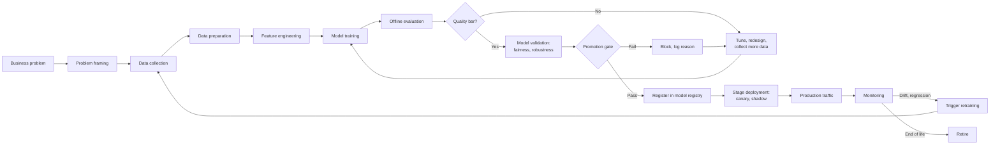
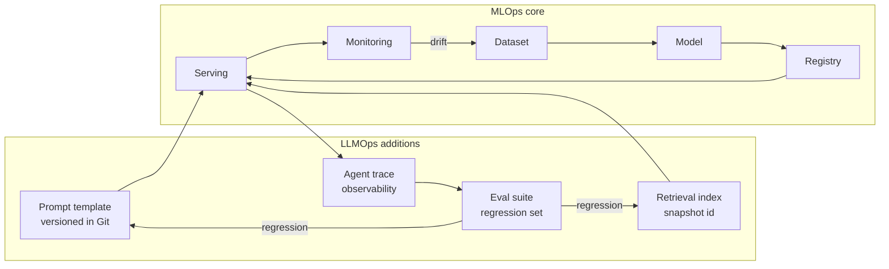

# 16.1 MLOps foundations and lifecycle

| Field | Value |
|---|---|
| Level | Basics |
| Priority tier | 1 |
| Lab venue | GCP / GKE |
| Part | Part 16: MLOps and LLMOps tools and platforms |
| Primary sources | *Practical MLOps* (`practical-mlops`, Chapters 1, 2); *Designing Machine Learning Systems* (`designing-machine-learning-systems`, Chapter 1); *Machine Learning Platform Engineering* (`machine-learning-platform-engineering`, Chapter 1); *AI Engineering* (`ai-engineering`, Chapter 1); *LLMOps* (`llmops`, Chapters 1, 2); *Engineering AI Systems* (`engineering-ai-systems-architecture-and-devops-essentials`, Chapter 5) |
| Cross-references | Chapter 14.13 (Fine-tuning: SFT, LoRA and QLoRA); Chapter 15.3 (vLLM in depth); Chapter 15.6 (Triton Inference Server); Chapter 16.2 (Data versioning and experiment tracking); Chapter 16.3 (Data pipelines and feature stores); Chapter 16.6 (Model registry, CI/CD and GitOps for models); Chapter 16.10 (Monitoring, drift and continual learning); Chapter 16.14 (Platform design: multi-tenant AI factory) |
| Coverage file | `planning/coverage/chapters/16-01.md` |
| Claim & number ledger | `planning/ledgers/16-01.md` |

## Why this matters for AI infrastructure

You spent Parts 1 through 15 learning how to wire the data center floor: how Linux boots, how BGP chooses a path, how a Kubernetes scheduler lands a pod on a NUMA node, how RDMA writes bypass the CPU, how a vLLM engine streams tokens out of an H100. Every layer was a hardware or systems problem with a clean answer.

The work in this part of the book is a different kind of problem. The model that you put into production tomorrow was trained yesterday on a dataset that nobody has a clean name for, by a notebook that lives on a single engineer's laptop, behind a random seed that was chosen because "the first one I tried looked good". None of the systems knowledge in the earlier chapters protects you from that notebook. The defect is upstream of the GPU.

Suppose a fintech team ships a fraud model that performs well in offline backtesting for two months, then silently starts missing new attack patterns in week nine. The on-call engineer opens the training notebook to retrain. The notebook reads a CSV file from a path that no longer exists, the original data was overwritten by a re-pull last quarter, and there is no record of which feature engineering version was used to produce the live weights. The model is, for all practical purposes, irreproducible. The engineer cannot answer the simplest possible question: "What data did this model see?"

This chapter exists to prevent that. MLOps is the discipline that closes the gap between "a notebook produced a number" and "a model is in production, traceably and reproducibly". It is the operational discipline for everything that lives above the cluster and below the user.

```text
The cost of ungoverned ML (Practical MLOps Ch 1; Engineering AI Systems Ch 5):
- IDC (2019) and Algorithmia surveys put the share of enterprise time spent on
  "model deployment and management" at roughly 25% to 60% of an ML project, with
  the remainder going to data wrangling and experimentation (Practical MLOps Ch 1).
- A 2020 Gartner estimate suggested that only ~15% of ML models that enterprises
  build ever reach production; the rest die in notebooks for governance reasons,
  not accuracy reasons (Engineering AI Systems Ch 5).
- The most common single post-mortem cause of "the model went bad" incidents is
  data drift combined with no central record of which data snapshot produced the
  live weights (Designing Machine Learning Systems Ch 1).
```

MLOps is not a single tool. It is a set of practices, mechanisms and disciplines that together answer four questions for every model in production: which data trained it, which code trained it, how was it validated, and how does it get out of the way when it goes stale. The rest of this chapter lays those foundations.

Three operational facts drive why this matters for an AI infrastructure engineer rather than just a data scientist:

1. **The cluster you built is the surface where MLOps errors manifest.** When a model silently degrades, the symptom is a Slow Drain, a queue depth spike or a 5xx burst. That alert pages you, the platform engineer, not the data scientist who trained it. You need to be able to read the lineage and the metric history without paging five teams.
2. **ML workloads stress GPU clusters in ways workloads from earlier parts did not.** A misconfigured notebook can saturate a `H100` node with a 14-day job that blocks the queue, drain a parallel file system with checkpoint writes, or pre-pull a 600 GB foundation model into HBM that no one can evict. Lifecycle discipline is what stops those mistakes from happening.
3. **LLMOps, the focus of Part 16, is MLOps plus new failure modes.** Foundation-model fine-tunes, retrieval pipelines, agent loops, and prompt regressions are all ML system problems at the end of the day. You need the MLOps foundations before the LLMOps specialisations make sense.

**Before you wire a model into a serving engine, learn to wire it into a lifecycle that you can audit end to end. The model is only as reproducible as its weakest piece of metadata.**

## Prerequisites and outcomes

### Prerequisites

- Comfortable with Python packaging, virtual environments and CLI tooling from Part 3.
- Working knowledge of containers, Kubernetes and the cluster primitives from Part 5 (pods, jobs, services, secrets, RBAC).
- Familiarity with the GPU node and CUDA stack from Part 10, and with the inference engines from Part 15.
- For the LLMOps sections: Chapter 14.2 (Transformers and LLM architecture) and Chapter 14.13 (Fine-tuning).
- For the platform sections: Chapter 16.14 (Platform design: multi-tenant AI factory).

### Outcomes

After completing this chapter you will be able to:

1. Explain, with a worked incident, what specifically goes wrong when a team skips data versioning, experiment tracking, model registry and promotion gates, and why "just be more careful" is not a fix.
2. Walk a model through the full lifecycle from problem framing to retirement, naming the artifact, the owner, the gate and the tool at each stage.
3. Identify the four pillars of MLOps (data, model, code, deployment) and describe the minimal mechanism that satisfies each pillar.
4. Place an organisation on the MLOps maturity ladder and decide which capability to add next given current pain.
5. Distinguish classical MLOps from LLMOps by the new failure modes that fine-tunes, retrieval pipelines and agents introduce.
6. Connect every lifecycle gate to the infrastructure primitives that enforce it: registries, schedulers, admission controllers, secrets and audit logs.

---

## 1. The failure mode MLOps exists to prevent

### 1.1 The classic incident: a notebook, a lucky seed, an unrecoverable dataset

Start with the failure. A small team builds a churn model for a subscription product. A single data scientist writes a notebook on a laptop. The notebook reads a CSV that a colleague pulled from the data warehouse and saved to shared storage as churn_q3.csv. The notebook cleans the columns, encodes categorical variables with a small helper function, fits a gradient boosted tree, and prints a 0.92 AUC.

Three months later the AUC in production drifts to 0.78. The team opens the notebook to retrain. Three things break at once:

- The CSV file was overwritten by a later pull. The exact data behind the live model is gone.
- The categorical encoding helper was edited in place a month ago. The current notebook encodes `tier="gold"` differently than the original did, but the change was committed as `cleanup.py`, not as a tracked experiment.
- The seed was hard-coded. A second engineer running the notebook gets 0.86 AUC. Nobody can tell which number was the production one.

This is not a contrived story. *Practical MLOps* Chapter 1 frames the entire discipline around three failure shapes: the *works-on-my-machine* problem (irreproducible data), the *magic seed* problem (no experiment record), and the *silent promotion* problem (no promotion gate, only human judgement). *Engineering AI Systems* Chapter 5 adds a fourth: the *stale model* problem (the artifact in the registry is months older than the code that trained it because nobody automated retraining).

Each of these failures has a specific, narrow, mechanical fix. The discipline of MLOps is to install that fix in the toolchain so that the failure cannot recur.

| Failure shape | What specifically goes wrong | The MLOps mechanism that prevents it |
|---|---|---|
| Works on my machine | Data scientist overwrites or loses the source dataset | Data versioning with content-addressed storage and immutable dataset IDs (Chapter 16.2) |
| Magic seed | Training run cannot be reproduced because seed, code and config drifted | Experiment tracking that logs code, commit, seed, env and metrics in one record (Chapter 16.2) |
| Silent promotion | A new model reaches production because a human approved it verbally | A promotion gate function with hard, mechanical criteria, called by the pipeline (Section 4.3 below) |
| Stale model | The live artifact is months older than the training pipeline because retraining is manual | A retraining trigger, scheduled or drift-driven, that publishes to the registry (Chapter 16.10) |

The pattern in every row is the same: **make the discipline structural, not optional**. Saying "be more careful" does not survive a deadline. Putting a function in the path of the artifact and gating the deployment on its return value does.

### 1.1.1 Why teams fail to install the discipline: the ML hierarchy of needs

*Practical MLOps* Chapter 1 borrows Maslow's hierarchy of needs to explain why teams struggle to adopt MLOps. The layers, from bottom to top, are DevOps, Data Engineering, Platform Automation, and finally MLOps. A team that has not automated CI/CD cannot reliably run an MLOps pipeline, because every training run is a hand-built deployment. A team that has CI/CD but no data lake has no place to land datasets. A team that has both but no platform automation writes one-off pipelines per project. MLOps sits on top.

```text
ML hierarchy of needs (Practical MLOps Ch 1):
- Layer 1 (foundation): DevOps — CI/CD, IaC, automated testing on every commit.
- Layer 2: Data engineering — automated flow of data from sources to warehouses.
- Layer 3: Platform automation — Kubeflow, SageMaker, Vertex AI, or equivalent.
- Layer 4 (top): MLOps — automated training, tracking, registry, deployment, monitoring.
```

The failure mode this captures is: a team buys a feature store and a registry before it has CI/CD that builds images on every commit. The platform collapses under its own weight because every artefact change is hand-coordinated. The cure is not "more tooling"; it is to climb the pyramid one layer at a time.

### 1.1.2 The cultural failure modes: HiPPO and the absence of Kaizen

Two cultural patterns from *Practical MLOps* Chapter 1 deserve a name because they appear in nearly every failed MLOps adoption.

- **HiPPO (Highest Paid Person's Opinion).** Decisions about whether a model is "good enough to ship" are made by the most senior person in the room, not by the data. The promotion gate becomes a Slack thread. The gate is bypassed because the gate is a meeting, not a function. The fix is the same as Section 1.1: write the gate as a function whose return value is the only thing that advances the registry.
- **No Kaizen (no continuous improvement).** The team ships a model once, considers the work done, and only returns to it when the model has visibly broken in production. *Practical MLOps* Chapter 1 names Kaizen as the underlying philosophy: daily, incremental improvements driven by data. In MLOps terms, Kaizen is the **retraining trigger** from Chapter 16.10 plus the **monitoring-driven feedback loop** that pages the team when a metric regresses by one percentage point, not by twenty.

The two patterns compound: HiPPO decides without data; the absence of Kaizen means the team never installs the mechanism that would have made HiPPO unnecessary. MLOps is the structural cure for both.

### 1.1.3 Why "ML in production" is not "ML in research": the five-dimension gap

A team that has only done ML in an academic setting expects production ML to be "ML but bigger". It is not. *Designing Machine Learning Systems* Chapter 1 names five dimensions on which production ML differs from research ML, and every one of those dimensions creates an MLOps requirement.

| Dimension | Research ML | Production ML | The MLOps mechanism that addresses it |
|---|---|---|---|
| **Stakeholders** | The author | ML engineers, salespeople, PMs, infra engineers, finance, security | Registry with owner, approver, SLO owner fields (Section 3.2) |
| **Computational priority** | Fast training, batch latency tolerable | Fast inference, tail-latency SLO | Monitoring on p50/p90/p99 latency and Goodput (Section 5.4) |
| **Data** | Static, curated, labelled by the team | Noisy, unstructured, constantly shifting, sometimes unlabelled | Data versioning + drift detection + validation gates (Chapter 16.3, 16.10) |
| **Fairness and harm** | Lower stakes | Decisions affect real users | Audit logs, lineage, governance committee (Chapter 16.13) |
| **Interpretability** | Optional | Often required by regulator or operator | Model card, evaluation report in registry entry (Section 3.2) |

A team that has only worked on the left column will be surprised by every row of the right column. The MLOps mechanisms in the right column are what turn the surprise into a tractable problem.

### 1.1.4 A threat that hides in the training set: data poisoning

*Designing Machine Learning Systems* Chapter 1 names data poisoning as a specific attack surface that an MLOps platform must defend against. The attack is simple: an adversary plants bad examples in the training set, the model learns to associate a trigger pattern with a target label, and the model behaves normally until the trigger appears in production. The classic example is a spam classifier that has been taught to let through any email containing a specific string the attacker controls.

The MLOps defence is the data versioning contract from Chapter 16.2: every training example has a content hash and a source-system record. A poisoned example can be traced back to its origin; the snapshot that introduced it can be excluded from future training runs; the model trained on the poisoned snapshot can be retired before the trigger pattern is observed in production. None of that is possible without immutable, hash-addressed data.

The same defence covers an accidental "poisoning" by a well-meaning engineer who quietly overwrites a production snapshot with a re-pull that dropped a column. The audit log shows what happened; the rollback is one snapshot revert away.

### 1.2 Why DevOps muscle alone is not enough

Many teams first try to solve MLOps with classical DevOps. They version the training code, run CI on every pull request, deploy the resulting model behind a Kubernetes service. This is necessary but not sufficient. Three categories of state in an ML system are outside what classical DevOps version-control well:

1. **The data itself.** Datasets are large, mutable and partially shared. Git cannot hold a 200 GB parquet. S3 cannot answer "what is the current version of this dataset" without a layer of metadata. MLOps adds that metadata layer explicitly, with content hashes (for example DVC's `.dvc` files or Pachyderm's commits) so that any data snapshot has an immutable address.
2. **The training environment.** The same Python script with the same seed produces different numbers on different CUDA, cuDNN, and NCCL versions. Classical CI pins Python and OS packages. MLOps additionally pins the CUDA driver, the cuDNN version, the container image hash, and the cluster topology.
3. **The evaluation and decision record.** Classical CI has pass/fail tests with text logs. An ML experiment has a vector of metrics, an artefact, a confusion matrix, sometimes a per-segment slice. MLOps treats the experiment record itself as a first-class artifact (MLflow runs, Weights and Biases runs, Vertex AI experiments) that can be queried and compared.

DevOps gets you reproducible code. MLOps gets you reproducible *decisions*. That is the difference you cannot close with a YAML file.

### 1.3 What "governance" means in an ML system

Governance is the word you will hear in every MLOps meeting. In an ML context it has three concrete meanings, each tied to a lifecycle stage.

| Governance meaning | Lifecycle stage | Concrete artifact |
|---|---|---|
| Reproducibility | Training | The experiment record (run id, commit, data hash, metrics) |
| Auditability | Deployment | The promotion decision log (who approved what, against which gate) |
| Accountability | Production | The lineage record (model id, data id, training run id, deployer, SLO owner) |

*Practical MLOps* Chapter 2 adds a fourth, harder one: **rollback readiness**. If a model is in production, the answer to "can you take it out right now without taking the service down" must be yes within minutes. That is a deployment artifact concern (the previous model is still in the registry, the new one is shadow-traffic-tested before the cutover) and an incident-response concern (the runbook names the rollback steps). We revisit it in Chapter 16.6 (Model registry, CI/CD and GitOps for models).

**The four shapes of MLOps failure all collapse into one sentence: "I cannot answer a specific question about a model that is in production". MLOps is the set of mechanisms that makes every such question answerable in seconds, not days.**

---

## 2. The end-to-end ML lifecycle

### 2.1 Two phases: experimentation, then development-staging-production

*Machine Learning Platform Engineering* Chapter 1 splits the lifecycle into two phases that look similar on a slide but have different rules. In the **experimentation phase**, the data scientist moves fast. Every step is a hypothesis. Code is dirty. Run-time is whatever the laptop can do. The deliverable is a metric on a held-out set.

In the **development/staging/production phase**, every step is an artifact. The training script is the same script. The data is the same data snapshot, frozen by hash. The environment is the same container image. The output is not just a metric; it is a model artifact bound to a registry entry bound to a deployment record.

The transition between the two is the first place MLOps earns its name. At the moment a notebook becomes a pipeline, three things must happen:

- The data is moved from a laptop path to a versioned dataset with a hash.
- The training script is moved from a `.ipynb` cell to a tracked Python module with a commit hash.
- The experiment record moves from a printed number to an entry in a tracking server that the rest of the platform can query.



The diagram is not unique to this book. *Designing Machine Learning Systems* Chapter 1, *Practical MLOps* Chapter 1, *Machine Learning Platform Engineering* Chapter 1 and *LLMOps* Chapter 2 all draw versions of it. The differences are in emphasis. DMLS emphasises the feedback loop from monitoring back into data collection. Practical MLOps emphasises the gate between offline evaluation and deployment. MLPE emphasises the tool boundary between the experimentation phase and the pipeline. We borrow from all three because they are looking at the same problem from different angles.

### 2.2 The artifacts at each stage

A lifecycle without artifacts is a slide deck. The point of the lifecycle diagram is that at every stage, a specific artifact is produced, stored, and later queried. The table below is the cheat sheet.

| Lifecycle stage | Artifact produced | Where it lives | Who owns it | What gate it must pass |
|---|---|---|---|---|
| Problem framing | One-page brief with metric, baseline, and business value | Wiki or repo | Product + DS | Stakeholder sign-off |
| Data collection | Raw dataset version (content hash, snapshot date) | Object store + metadata DB | Data engineering | Schema, PII and lineage checks |
| Data preparation | Cleaned dataset version (hash of clean + raw) | Object store + DVC / lake FS | Data engineering | Data quality tests (deequ, Great Expectations) |
| Feature engineering | Feature set definition (SQL/Python) and feature table | Feature store | DS + platform | Feature freshness and null-rate checks |
| Model training | Training run record (run id, commit, data hash, env hash, metrics) | Tracking server (MLflow, W&B) | Data scientist | Baseline beat, seed reproducibility, eval slices |
| Offline evaluation | Evaluation report (overall metrics, per-segment metrics, fairness) | Tracking server or report repo | Data scientist | Quality bar for the use case |
| Model validation | Validation report (robustness, fairness, calibration, security) | Tracking server or report repo | ML platform team | Validation gate (hard rules) |
| Promotion | Promotion record (gate input, gate output, approver) | CI/CD system or registry | ML platform team | Promotion gate function (mechanical) |
| Registry | Model artifact + metadata in registry | Model registry (MLflow Registry, Vertex AI, SageMaker) | ML platform team | Registry schema, signed artifact |
| Deployment | Live model in serving system with canary/shadow steps | Kubernetes / serving engine | Platform + SRE | Canary error budget, SLO attainment |
| Monitoring | Metric/log/drift stream | Observability stack | Platform | Alert rules, SLOs |
| Retraining trigger | New training run, scheduled or drift-driven | Pipeline orchestrator | ML platform team | Same training gate as before |
| Retirement | Deregistered model, archived artifacts | Cold storage | Platform + product | Data retention policy |

Two things to notice. First, the **owner column rotates**. A data scientist owns training and offline evaluation. A platform engineer owns the registry and the deployment. A product owner owns the brief and the retirement. A failure of MLOps is almost always a failure of role clarity: a notebook that "graduated to production" without an owner for the registry entry is a model waiting to drift.

Second, **every artifact is queryable**. If you cannot ask the registry "what model is currently serving 10% of traffic" and get an answer in five seconds, you do not have an MLOps platform; you have a folder of YAML files.

### 2.3 The minimum mechanism at each gate

A useful exercise: walk the diagram and ask, "what is the cheapest mechanism that enforces this gate?" You will find that for many gates the answer is small and mechanical.

| Gate | Minimum mechanism |
|---|---|
| Data quality | A test suite (Great Expectations, deequ) that runs in the pipeline and aborts on failure |
| Feature freshness | A scheduled job that rebuilds the feature table and fails if the partition is older than the SLO |
| Reproducibility | A training script that takes a content hash of code, data and seed as inputs and writes a run record |
| Baseline beat | A test in CI that compares the candidate run metrics against a registered baseline |
| Promotion | A function in the pipeline whose exit code is checked; not a human "looks at the dashboard" |
| Deployment | A canary step that shifts a small percentage of traffic and aborts on error budget breach |
| Monitoring | An alert rule that pages the model owner on SLO violation or drift threshold breach |
| Retraining | A scheduled or drift-triggered pipeline that follows the same gates as the initial training |

The cheapest mechanism is not always the right mechanism for an enterprise, but it is always a useful starting point. If you cannot afford MLflow at $0, you can absolutely afford a `metrics.json` file in object storage.

---

## 3. The four pillars of MLOps

### 3.1 Data: the artifact that is hardest to version

Three properties of ML data make it the hardest artifact to version:

- **Size.** A training corpus for a foundation model is hundreds of gigabytes to tens of terabytes. Git cannot hold it. Object storage can, but object storage does not version by itself.
- **Mutability.** Datasets get appended, cleaned and re-partitioned. If you overwrite a partition, you cannot easily answer "what did this model see last March".
- **Partial sharing.** Multiple models share a subset of the same features. A change in a shared feature affects multiple downstream artifacts. Without lineage, you cannot find those dependents.

The standard pattern is content-addressed storage plus a metadata layer. *Practical MLOps* Chapter 1 walks through DVC, which stores large files in object storage (S3, GCS, MinIO) and keeps `.dvc` files in Git that hold content hashes. *LLMOps* Chapter 4 introduces Pachyderm and lakeFS as alternative approaches that provide branch and merge semantics over data. *Designing Machine Learning Systems* Chapter 3 introduces the feature store as the layer that decouples feature engineering from model training.

The mechanism that closes the data pillar is:

```text
Minimum data versioning flow (Practical MLOps Ch 1; LLMOps Ch 4):
1. Raw data lands in object storage with a content hash (sha256 of the file).
2. The pipeline writes a metadata record to a small database:
     dataset_id, content_hash, source_system, snapshot_time, row_count, schema_hash
3. The training script accepts a dataset_id argument and resolves it through the
   metadata DB. It never reads a hard-coded path.
4. Every training run records the dataset_id in its experiment record.
5. Deletion is soft-delete by default; an artifact is only purged after a
   retention window, never overwritten.
```

Two habits follow from this:

- **Never read from a hard-coded path inside a training script.** Take the path or the dataset id as an argument. This sounds obvious. It is the single most-violated rule in MLOps.
- **Always log the data hash, not the data path.** A path can move; a hash is the artifact's identity.

### 3.2 Model: the artifact with the most versions per byte

A model artifact has more versions per byte than any other artifact in the system because it is regenerated whenever anyone changes the data, the code, the seed, the hyperparameters, the environment, or the framework version. The number of model artifacts in a busy team's registry grows roughly linearly with the number of training runs. The trick is that most of those runs are junk and should never be promoted. The registry's job is to make the few that are promoted easy to find.

*Practical MLOps* Chapter 1, *Machine Learning Platform Engineering* Chapter 1 and *Designing Machine Learning Systems* Chapter 6 all agree on the registry contract: a registered model carries the following metadata, and nothing less.

```text
Minimum registered-model record (Practical MLOps Ch 1; DMLS Ch 6; MLPE Ch 1):
- model_id (registry primary key)
- name (human-readable, e.g. "fraud-detector")
- version (semver or monotonic; MLflow and Vertex AI default to monotonic)
- stage (none | staging | production | archived)
- run_id (the experiment record this model came from)
- artifact_uri (object storage path to weights + serialized model)
- data_snapshot_id (which data version trained this)
- code_commit (the commit hash of the training repo)
- env_image_hash (the container image digest of the training environment)
- signature (input schema, output schema)
- metrics (overall and per-segment, copied from the run record)
- description (free text, but typically "what changed in this version")
- created_by
- created_at
- lineage (parent model_id, parent run_id; if a fine-tune)
```

The stage field is what the deployment pipeline reads. The deployment pipeline does not read the artifact uri directly; it reads `stage = production` and pulls whatever model is currently in that stage.

We treat MLflow Registry, Vertex AI Model Registry, SageMaker Model Registry, and Weights and Biases Registry as interchangeable on the contract. They differ in tooling, IAM, and UI, but the contract above is the same.

### 3.3 Code: the artifact DevOps already knows how to version

Code is the easy pillar. Treat the training repository the same way you treat a service repository: trunk-based development, protected branches, pull request review, CI on every commit, signed commits on release, pinned dependencies, container images with digest references.

Three code practices that are specific to ML:

- **Separate the training entrypoint from the rest of the codebase.** The function or script that the pipeline calls is small and takes its inputs explicitly. Anything else lives in modules and is tested independently. This is what makes the training script reproducible.
- **Pin the environment, not just the packages.** A Dockerfile that installs `python=3.11` is not enough. Pin the CUDA base image, the driver compatibility matrix, and the cuDNN version. *Designing Machine Learning Systems* Chapter 6 calls this the "reproducibility stack".
- **Sign the training image.** A poisoned training image is a supply chain attack that produces a backdoored model. Treat the training image like a release artifact and sign it (cosign, Sigstore). The promotion gate refuses unsigned images.

### 3.4 Deployment: the artifact that lives in two systems at once

Deployment is the most subtle pillar because a deployed model lives in two systems simultaneously: the serving system that runs the inference and the registry that describes it. They can drift. When they drift, you have the worst possible incident: the registry says v12 is in production, the serving system is running v9.

Three patterns prevent drift.

| Pattern | What it does | Where you see it |
|---|---|---|
| GitOps for the registry | The registry stage is set by a pull request that is merged by the pipeline, not by a human clicking "promote" | MLflow with GitHub Actions, Vertex AI with Cloud Build, Argo CD for the registry |
| Image-as-source | The serving system reads its model from an image tag that the registry updates. Reverting the tag reverts the deployment. | KServe, BentoML, Seldon, Triton model repository |
| Signed promotion | The deployed artifact carries the same signature as the registry entry; the serving system refuses an unsigned artifact | cosign + admission controller, Sigstore policy controller |

*Designing Machine Learning Systems* Chapter 7 covers model deployment in depth. We focus here on the lifecycle contract: the deployment is not "the model is in production", it is "the model whose registry entry is in stage=production is currently serving 100% of traffic, and any deviation from that triggers an alert".

### 3.5 The pillar diagram

```mermaid
flowchart TB
    subgraph Data["Data Pillar"]
        D1[Raw data lake<br/>content-addressed]
        D2[Curated dataset<br/>versioned + hashed]
        D3[Feature store<br/>online + offline]
    end

    subgraph Code["Code Pillar"]
        C1[Training repo<br/>trunk + signed]
        C2[Training image<br/>pinned CUDA + cuDNN]
        C3[Pipeline definitions<br/>GitOps]
    end

    subgraph Model["Model Pillar"]
        M1[Experiment tracker<br/>MLflow / W&B]
        M2[Model registry<br/>stage = staging | production]
        M3[Validation report<br/>fairness, robustness]
    end

    subgraph Deploy["Deployment Pillar"]
        DP1[Canary stage<br/>5% traffic]
        DP2[Shadow stage<br/>parallel run]
        DP3[Production traffic<br/>monitored]
    end

    D1 --> D2 --> D3
    C1 --> C2 --> C3
    D3 --> M1
    C2 --> M1
    M1 --> M2
    M1 --> M3
    M2 --> DP1
    M2 --> DP2
    M3 -->|gate| M2
    DP1 -->|error budget ok| DP2
    DP2 -->|agreement ok| DP3
```

The pillar diagram has a single rule: every arrow carries an artifact with an identifier. No anonymous blobs. If the pipeline cannot tell you which dataset trained the model that is currently serving 5% of traffic, one of the arrows is missing its identifier.

**When you audit an MLOps platform, audit the arrows, not the boxes. The boxes are tools you can buy. The arrows are practices you have to install.**

---

## 4. Maturity levels and the path from notebook to platform

### 4.1 The three levels that everyone agrees on

Three levels appear in almost every MLOps maturity model. *Designing Machine Learning Systems* Chapter 10 uses a similar three-level split. *Practical MLOps* Chapter 1 lists the same progression in slightly different language. *Machine Learning Platform Engineering* Chapter 1 calls them "manual", "pipeline" and "platform". We use the most common wording: **Level 0 (manual), Level 1 (ML pipeline), Level 2 (CI/CD for ML)**.

| Level | What it looks like | Pain that drives the next level |
|---|---|---|
| **0: Manual** | Notebook on a laptop; ad hoc deployments; one-off shell scripts; no tracking | "We cannot reproduce last quarter's model"; "the data scientist left and we lost the pipeline" |
| **1: ML pipeline** | Training is automated; experiment tracking is real; registry exists; deployment is manual | "Promotions are slow"; "we deployed a model that beat the offline metric but failed in production"; "the new model regressed last week's traffic" |
| **2: CI/CD for ML** | Pipeline is triggered on code/data changes; promotion gate is automated; canary deployment is real; monitoring feeds back into retraining | "Our drift detection is too slow"; "two teams have competing pipelines and no shared feature store"; "we cannot rollback in under 5 minutes" |

The next level is always driven by the pain of the current one. Do not skip levels. A team at Level 0 trying to install Level 2 tooling will discover that nobody on the team can debug it because nobody ran the manual flow first.

### 4.2 The capabilities that move you up

We list the capabilities in the order they are usually adopted. Each capability addresses a specific failure from Section 1.

| Order | Capability | Failure it addresses | Tooling reference |
|---|---|---|---|
| 1 | Experiment tracking | Magic seed | MLflow Tracking, W&B, Vertex AI Experiments |
| 2 | Data versioning | Works on my machine | DVC, lakeFS, Pachyderm, Delta Lake time travel |
| 3 | Pipeline orchestrator | "The notebook is the pipeline" | Kubeflow Pipelines, Argo Workflows, Flyte, Airflow, Vertex AI Pipelines |
| 4 | Model registry | "Which model is in production?" | MLflow Registry, Vertex AI Model Registry, SageMaker Registry, W&B Registry |
| 5 | Promotion gate | Silent promotion | Custom CI step; Open Policy Agent; Great Expectations for models |
| 6 | Canary deployment | "The new model regressed last week" | Argo Rollouts, KServe canary, Seldon canary, BentoML traffic splitting |
| 7 | Drift monitoring | Stale model | Evidently, whylogs, Arize, Fiddler |
| 8 | Triggered retraining | "We forgot to retrain" | Schedulers (Argo, Airflow) + drift-triggered pipelines |
| 9 | Feature store | "Two models use different definitions of the same feature" | Feast, Tecton, Vertex AI Feature Store, Databricks Feature Store |
| 10 | Multi-tenant platform | "Five teams each built their own pipeline" | Internal developer platform layer; chargeback and quotas |

Adopt in this order unless the pain forces otherwise. If the first pain is "I cannot reproduce my experiment", adopt capabilities 1 and 2 before buying a feature store.

### 4.3 The promotion gate, in code

The promotion gate is the single most important mechanical pattern in MLOps. It is a function that takes the candidate run, the baseline run, and the policy, and returns pass or fail with a reason. The pipeline calls it and checks the exit code. There is no human in the loop on the happy path.

The following Python sketch captures the shape. It is intentionally simple; production versions would read the policy from a registry, sign the decision, and write to an audit log.

```python
# code/part16/mlops_promotion_gate.py (shape only)
from dataclasses import dataclass
from typing import Callable

@dataclass
class Run:
    run_id: str
    metrics: dict[str, float]
    data_snapshot_id: str
    code_commit: str
    seed: int

@dataclass
class GateResult:
    passed: bool
    reasons: list[str]

def promotion_gate(
    candidate: Run,
    baseline: Run,
    rules: dict,
) -> GateResult:
    reasons = []
    # 1. Did the candidate beat the baseline on the primary metric?
    primary = rules["primary_metric"]
    if candidate.metrics[primary] < baseline.metrics[primary]:
        reasons.append(
            f"primary metric regressed: {candidate.metrics[primary]} < {baseline.metrics[primary]}"
        )
    # 2. Did any guardrail metric violate a threshold?
    for metric, threshold in rules["min_metrics"].items():
        if candidate.metrics[metric] < threshold:
            reasons.append(
                f"guardrail {metric} below floor: {candidate.metrics[metric]} < {threshold}"
            )
    # 3. Did the seed reproduce?
    if candidate.seed != rules.get("required_seed"):
        reasons.append("seed not pinned to required value")
    return GateResult(passed=not reasons, reasons=reasons)

def promote(candidate_path: str, baseline_path: str, policy_path: str) -> int:
    candidate, baseline, rules = load_artifacts(candidate_path, baseline_path, policy_path)
    result = promotion_gate(candidate, baseline, rules)
    if not result.passed:
        print("PROMOTION BLOCKED:")
        for r in result.reasons:
            print(f"  - {r}")
        return 1
    # Log the decision to an immutable audit trail before writing to the registry
    write_audit_log(candidate, baseline, result)
    write_registry(candidate, stage="staging")
    return 0
```

The key design choices:

- **The gate is a function, not a human.** A human signs off on the policy, not on every promotion.
- **The decision is logged before the registry is written.** If the registry is poisoned, the audit log shows what should have happened.
- **The gate refuses to advance if the seed is unpinned.** A run that cannot be reproduced cannot be promoted.
- **Reasons are explicit.** "Blocked with printed reason" is what *Practical MLOps* Chapter 1 calls the mechanism that makes the discipline structural.

**Adopt the promotion gate before you adopt the canary deployment. A gate without a deploy still prevents bad models from reaching the registry. A deploy without a gate moves the failure mode from the registry to the cluster.**

---

## 5. From MLOps to LLMOps

### 5.1 What stays the same

The four pillars from Section 3 do not change in LLMOps. Data versioning still matters. Code versioning still matters. The registry still tracks stages. The deployment still has canary stages. The lifecycle still has the same gates.

The reason is structural: a fine-tuned language model is still a model. It is produced by a training run on a dataset version, validated offline, registered with metadata, deployed behind a serving system, monitored, and retired. *LLMOps* Chapter 2 is explicit about this: "LLMOps is the application of MLOps to LLM-based systems." The base discipline is unchanged.

### 5.2 What changes: three new artifact types

What changes is the **artifacts inside the pillars**. Three new artifact types appear when you move from tabular ML to LLM-based systems:

1. **The prompt template.** The input to the model now includes a prompt template that mixes system instructions, retrieved context, and user text. The prompt template is an artifact with versions. Changing a prompt is changing the model from the user's perspective.
2. **The retrieval index.** When the system uses Retrieval Augmented Generation (RAG), there is a vector index over a corpus. The index is an artifact. It has versions tied to the corpus snapshot, the embedding model, the chunking policy, and the metadata filters. Changing the corpus changes the index, which changes the answers.
3. **The agent trace.** When the system uses an agent loop, the runtime produces a trace of tool calls, intermediate prompts, and decisions. The trace is an artifact. It is used for evaluation, debugging, and audit.

| New artifact | Owner | Where it lives | Gate that catches a bad version |
|---|---|---|---|
| Prompt template | App developer + product | Git repo with versioned prompt files | Eval suite (LLM judge + regression tests) |
| Retrieval index | App developer + data engineering | Vector store with snapshot id | Retrieval recall and answer faithfulness eval |
| Agent trace | App developer + SRE | Observability backend (Langfuse, OpenTelemetry) | Trace-based regression tests + cost guardrails |

*LLMOps* Chapter 2 introduces these as the "three artifacts of LLMOps". *AI Engineering* Chapter 10 describes the same idea under the heading of "AI engineering architecture and user feedback". *LLM Engineer's Handbook* Chapter 11 ("MLOps and LLMOps") and *Practical MLOps* Chapter 1 both extend the MLOps lifecycle to include them.

### 5.2.1 The four goals of LLMOps, and the SLO/SLA/KPI contract

*LLMOps* Chapter 2 names four goals that the LLMOps layer adds on top of MLOps. They are not new practices; they are a tighter version of MLOps for systems that face regulatory, reputational, and consumer-facing exposure.

| Goal | Definition | Concrete metric in production |
|---|---|---|
| **Security** | Minimising the regulatory, reputational, and operational risks associated with deploying LLM applications | PII redaction rate; jailbreak-attempt block rate; data-encryption-at-rest coverage; access-audit completeness |
| **Scalability** | Building, storing, and maintaining LLM applications that generalise across data and scale on demand while optimising latency, throughput, and cost | p50/p95/p99 TTFT and ITL; tokens/sec/GPU at SLO attainment; cost per 1M tokens; autoscaler convergence time |
| **Robustness** | Maintaining high performance over time in the face of data drift, model drift, and third-party updates | Drift score (KS test, PSI); eval-set regression rate; freshness SLO on retrieval index; vendor model update detection |
| **Reliability** | Rigorous inference monitoring, error handling, and redundancy to prevent downtime and failures | Availability SLO (e.g. 99.9% monthly); 5xx rate; CSAT and NPS; RTO and RTO attainment |

The four goals are not independent. A robust model that is unreliable (it crashes under load) is a single point of failure. A scalable system that is not secure (it leaks PII under load) is a regulated-data incident. The audit on a real incident usually finds a failure in one goal that was masked by good metrics in another.

The SLO/SLA/KPI framework from *LLMOps* Chapter 2 is how the four goals become contracts that the platform team can measure and the business can consume.

| Concept | Audience | What it says | Example for an LLM serving system |
|---|---|---|---|
| **SLO** (Service Level Objective) | Internal, engineering | What the team aims to achieve | p95 TTFT &lt;= 300 ms; monthly availability >= 99.9% |
| **SLA** (Service Level Agreement) | External, customer | What the team commits to, with consequences for breach | p95 TTFT &lt;= 500 ms; if breached, customer receives 10% credit |
| **KPI** (Key Performance Indicator) | Business, executive | Whether the system is delivering the value the business is paying for | CSAT >= 90; cost per million tokens below target; revenue impact |

The relationship between the three is the relationship between ambition, commitment, and outcome. The SLO is the engineering target. The SLA is what the customer sees. The KPI is what the business sees. The platform team owns the SLOs; the SLOs define the alert rules; the alert rules feed the runbook; the runbook names the rollback path.

A useful discipline from *LLMOps* Chapter 2: every SLO has a measurement method and a budget. The measurement method is the metric, the data source, and the aggregation window. The budget is the maximum time the SLO can be violated before paging the on-call. A SLO without a budget is not an SLO; it is a wish.

The Gartner statistic the chapter cites is a useful reality check: a 2024 study predicted that ~30% of GenAI projects would fail by 2025, with the failure modes being operational (data quality, weak evaluation, cost of scaling). A 2018 study predicted 85% of ML projects would fail in production by 2022. The headline numbers vary; the diagnosis is stable. MLOps is the practice that converts the failure rate into something the team can manage.

### 5.3 What changes: three new failure modes

Three failure modes are largely absent from classical MLOps and become central in LLMOps.

| Failure mode | What happens | Detection |
|---|---|---|
| Prompt regression | A prompt edit degrades accuracy on a slice of users without changing the model | Eval suite with frozen regression set + LLM judge |
| Retrieval staleness | The corpus is updated but the index is not; answers reference old data | Index age alert + freshness check in retrieval pipeline |
| Agent runaway | The agent loops or escalates cost in a way no human intended | Cost guardrails per request; loop detector; max-iteration cap |

These are not infrastructure failures. The cluster is healthy. The model is healthy. The system is wrong. The lifecycle has to extend to catch them.

### 5.4 The extended lifecycle diagram



The double-arrow on the right is the key idea. LLMOps is not a replacement for MLOps; it is MLOps with a tighter loop between the serving system and the prompt/index artifacts.

**Build the MLOps foundation first. The LLMOps layer adds new artifacts and a new feedback loop, but it does not replace the four pillars.**

---

## 6. The infrastructure context: MLOps inside an AI factory

### 6.1 Who owns what on the platform

An AI factory has three teams with overlapping responsibility for the MLOps stack.

| Layer | Owner | Artifacts they produce |
|---|---|---|
| Cluster and GPU node platform | Infrastructure team (you) | GPU node pools, container runtime, network fabric, storage mounts, secrets, observability |
| MLOps platform | ML platform team | Tracking server, registry, pipeline orchestrator, feature store, promotion gates, drift detection |
| Application and data science | Product teams | Prompts, retrieval indices, agent code, training notebooks, feature definitions |

A failure at any layer is visible at the layer above it. A misconfigured network namespace on the GPU node makes the pipeline orchestrator's pods hang. A misconfigured pipeline orchestrator makes the data scientist's notebook time out. The three teams need a shared vocabulary: the data scientist needs to know what "stage = production" means in Kubernetes; the platform engineer needs to know what "data snapshot id" means in the registry.

### 6.2 The cluster primitives that enforce the lifecycle

The lifecycle gates in Section 4 are policy. The cluster primitives in Table form below are the mechanisms that turn the policy into something that cannot be bypassed.

| Lifecycle gate | Cluster primitive |
|---|---|
| Promotion gate | Admission controller (OPA Gatekeeper, Kyverno) that refuses pods whose image is not in the signed registry |
| Promotion to staging | Kubernetes Job that runs the gate and writes to the registry only on pass |
| Canary deployment | Argo Rollouts canary strategy with traffic splitting by header or weight |
| Data access | Kubernetes RBAC + IRSA / Workload Identity that scopes dataset access per namespace |
| Secrets | External Secrets Operator + Vault / Secrets Manager with audit log |
| Compute quota | Kueue / Volcano / KAI Scheduler queue per team with a cap on GPU-hours |
| Cost attribution | Kubecost or OpenCost tagged by namespace and label selector |
| Audit | Cluster log shipping to an immutable bucket; admission webhook decision log |

The mental model is that **the lifecycle is policy expressed in code, and the cluster is the executor of that policy**. The promotion gate function from Section 4.3 is the policy. The admission webhook is the executor.

### 6.3 The data path through the AI factory

Three storage systems carry ML data through the lifecycle, and each has a different role.

| Storage system | Role | Artifact | Lifecycle |
|---|---|---|---|
| Object store (S3, GCS, MinIO) | Raw data, dataset versions, model weights, registry artifacts | Content-addressed blobs | Immutable by default; soft delete |
| Distributed filesystem (Lustre, Weka, BeeGFS, VAST) | Hot training data, checkpoint workspace | Files and directories | Snapshotted; mounted per namespace |
| Vector store (Milvus, Qdrant, pgvector, Pinecone) | Retrieval indices for LLMOps | Embedding vectors + metadata | Snapshot id bound to corpus version |

The lines between them are not arbitrary. Object storage is for immutable artifacts. The distributed filesystem is for hot working data where small-file performance matters (Chapter 13.6 covers this in detail). The vector store is its own beast with its own snapshot semantics.

A model that trains on data in the distributed filesystem must record a content hash of the data, not just a path. The path can be unmounted. The hash is the artifact.

### 6.4 The GPU node as the MLOps boundary

A final point that earns its place in this chapter: the GPU node is the boundary between the lifecycle and the cluster. Whatever the lifecycle says about a model, the GPU node is what enforces it. A training job that requests eight H100s with no MIG slices, no NUMA pinning, and no scheduler queue is the lifecycle's fault: the pipeline did not declare what it needed. A platform engineer who treats the GPU node as a dumb compute target will get paged at 2 a.m. for jobs that should never have been submitted.

The cluster primitives you wired in earlier chapters (Chapter 5.18 kube-scheduler, Chapter 5.23 autoscaling, Chapter 11.6 NUMA alignment, Chapter 11.15 KAI queues) are the boundary. The lifecycle gate that calls `kubectl apply -f training-job.yaml` is only as good as the YAML it produces.

**The MLOps platform and the GPU platform are one system. The lifecycle gates are policy; the cluster primitives are the executor; the audit log is the proof that the policy was actually enforced.**

---

## 7. How it fails

Six failure modes recur across real MLOps deployments. Each is named, given a symptom that pages an engineer, a diagnosis that traces the symptom to the lifecycle, and a fix that lives in the right pillar.

### 7.1 "The data scientist left and we lost the pipeline"

**Symptom:** A model in production is misbehaving. The on-call engineer opens the tracking server, finds the run, and tries to find the training script. The script is on the data scientist's laptop, which is in a desk drawer in another office. There is no Git repo. There is no container image. There is no record of the data snapshot.

**Diagnosis:** The training artifact is the engineer, not the code. The lifecycle was Level 0 even though the tracking server and registry existed.

**Fix:** Adopt Capability 3 (pipeline orchestrator) and treat the training script as a pipeline definition. Move every training run to a Git repo and a container image. Refuse to register any model whose `code_commit` field is empty.

### 7.2 "The promotion was approved verbally"

**Symptom:** A regression lands in production. The on-call engineer asks "who approved this?" The answer is "we had a Slack thread". The Slack thread is gone.

**Diagnosis:** The promotion gate is human. There is no audit trail.

**Fix:** Adopt the promotion gate from Section 4.3. Make it a CI step whose exit code is the only thing that advances the registry stage. Refuse to deploy any model whose promotion record is not in the audit log.

### 7.3 "The new model beat the offline metric but failed in production"

**Symptom:** The offline AUC went from 0.91 to 0.93. The canary error budget was breached at 4% traffic. The dashboard caught it; the rollback was clean; but the rollback itself took 18 minutes because the previous production model had to be re-found and re-deployed.

**Diagnosis:** The canary step exists, but the rollback path is manual. The previous model is not pre-staged.

**Fix:** Keep the previous production model warm. The serving system reads its model from a tag (image tag or registry stage); the rollback is a tag re-point, not a model re-train.

### 7.4 "Two teams use different definitions of the same feature"

**Symptom:** Two models in production use a feature called `user_tenure_days`. The values are different by 6% because one team computes it from `signup_date` and the other from `first_active_date`. The two teams' dashboards disagree on which is correct.

**Diagnosis:** There is no feature store. The feature is recomputed in each team's training pipeline.

**Fix:** Adopt Capability 9 (feature store). One definition, one owner, two read paths (online for serving, offline for training). Audit any consumer that bypasses the feature store.

### 7.5 "The corpus updated but the index did not"

**Symptom:** A RAG application is returning answers based on documentation that has been edited in the source system. The source-of-truth timestamp shows the documents are 12 hours old. The answers reference content that was deleted last week.

**Diagnosis:** The retrieval index has no freshness signal. The pipeline that rebuilds the index is on a weekly schedule.

**Fix:** Tie the index snapshot id to the corpus snapshot id. Alert when the index age exceeds a threshold. Add a freshness check in the retrieval pipeline that refuses to serve if the index is older than the policy window.

### 7.6 "The agent loop ran away"

**Symptom:** An agent-based application generated 800 LLM calls for a single user request. The cost guardrail fired at 700; the system kept running until it hit the hard limit. The user's request returned a half-formed answer.

**Diagnosis:** The agent loop has no iteration cap. The cost guardrail is informational, not blocking.

**Fix:** Set a hard iteration cap and a hard cost cap per request in the runtime. Make them blocking, not advisory. Ship the runtime with a "loop detected" abort that triggers after N consecutive identical tool calls.

### 7.7 "Nobody tested the model against adversarial inputs"

**Symptom:** A model that scores 0.94 AUC on the offline evaluation suite goes into production. Within a month, three users discover that pasting a specific 200-token string into a chat box causes the model to ignore its system prompt and emit credentials from training data. The incident is a privacy breach; the regulator is on the phone.

**Diagnosis:** The team never ran red-teaming against the model. The validation suite tested accuracy, not adversarial robustness. *Engineering AI Systems* Chapter 5 names red-teaming as a required capability for AI models, especially foundation-model-backed systems: an external team simulates attacks (prompt injection, training-data extraction, jailbreaks, denial-of-service via long inputs) and reports what they found to the model developers, the system developers, and the deployers.

**Fix:** Stand up a red-team capability that runs on every promotion to staging. The red-team report is a required artefact in the promotion gate; a model cannot advance to production without a red-team pass. The red-team capability is automated where possible (prompt-injection libraries, jailbreak suites) and human for the high-stakes cases (PII extraction, regulatory-relevant prompts). The blue team (the platform engineers who defend the system) must be staffed and funded at parity with the red team, or the red team's findings will never be remediated. *Engineering AI Systems* Chapter 5 warns specifically that under-funded blue teams are the most common reason red-team findings do not translate into model improvements.

---

## 8. Hands-on lab

This lab runs on GCP / GKE and walks through Capability 1 (experiment tracking) and Capability 2 (data versioning) end to end. The lab is **untested** in the sense that the cluster is not yet provisioned in this repository; the structure and commands are provided as a working template. When the lab runs on a real GKE cluster, follow the steps in order and verify each `expected` line.

### 8.0 Prerequisites

- GCP project with billing enabled, `gcloud` and `kubectl` installed.
- A GKE Autopilot or Standard cluster (1.27+) with at least one node pool that can run small jobs.
- Helm 3 for installing the tracking server and the registry.
- `dvc` installed locally for the data versioning step (`pip install dvc[gcs]`).

### 8.1 Step 1: install a tracking server and a registry

Install MLflow Tracking Server backed by Postgres for metadata and GCS for artifacts, plus MLflow Registry in the same deployment.

```bash
# Create a GCS bucket for artifacts
gsutil mb -l us-central1 gs://${PROJECT_ID}-mlflow-artifacts

# Add the Helm repo
helm repo add community-charts https://community-charts.storage.googleapis.com
helm repo update

# Install MLflow with the bundled Postgres
helm install mlflow community-charts/mlflow \
  --namespace mlops --create-namespace \
  --set trackingService.service.type=ClusterIP \
  --set trackingService.service.port=5000 \
  --set backendStore.url=sqlite:///mlflow.db \
  --set artifactRoot=gs://${PROJECT_ID}-mlflow-artifacts

# Port-forward to verify
kubectl -n mlops port-forward svc/mlflow-tracking 5000:5000 &
curl -s http://localhost:5000/api/2.0/mlflow/experiments/list | jq .
# expected: a JSON envelope with an empty "experiments" list
```

### 8.2 Step 2: version a dataset with DVC

Create a small dataset locally, initialise DVC against the GCS bucket, and push a versioned snapshot.

```bash
mkdir churn-demo && cd churn-demo
git init
dvc init --storage.gs ${PROJECT_ID}-dvc
python -c "import pandas as pd; \
  pd.DataFrame({'user_id': range(1000), 'tier': ['gold']*500+['silver']*500, \
  'churned': [0,1]*500}).to_csv('data/churn.csv', index=False)"
dvc add data/churn.csv
git add data/churn.csv.dvc .gitignore
git commit -m "v1 of churn dataset"
dvc push
# expected: a hash file in GCS; data/churn.csv.dvc contains the sha256
```

### 8.3 Step 3: train a model and log to MLflow

A 20-line training script that opens an MLflow run as its first action, logs the dataset hash, the commit hash, the seed, and the metrics, and registers the model.

```bash
pip install mlflow scikit-learn pandas
python train.py --dataset data/churn.csv --seed 42
# expected: a run in the MLflow UI, an experiment record with
#   - params: seed=42
#   - tags: data_hash=<sha256>, code_commit=<git rev-parse HEAD>
#   - metrics: auc, accuracy, f1
#   - artifacts: model.pkl
```

The training script structure:

```python
# code/part16/train.py (shape only)
import argparse, hashlib, subprocess, mlflow, mlflow.sklearn
import pandas as pd
from sklearn.ensemble import GradientBoostingClassifier
from sklearn.metrics import roc_auc_score, accuracy_score, f1_score

ap = argparse.ArgumentParser()
ap.add_argument("--dataset", required=True)
ap.add_argument("--seed", type=int, default=42)
args = ap.parse_args()

df = pd.read_csv(args.dataset)
data_hash = hashlib.sha256(open(args.dataset, "rb").read()).hexdigest()
commit = subprocess.check_output(["git", "rev-parse", "HEAD"]).decode().strip()

mlflow.set_experiment("churn")
with mlflow.start_run(run_name=f"churn-{data_hash[:8]}") as run:
    mlflow.set_tag("data_hash", data_hash)
    mlflow.set_tag("code_commit", commit)
    mlflow.log_param("seed", args.seed)

    # Synthetic train/test split for the lab
    train, test = df.iloc[:800], df.iloc[800:]
    model = GradientBoostingClassifier(random_state=args.seed)
    model.fit(train[["tier_gold"]], train["churned"])
    preds = model.predict_proba(test[["tier_gold"]])[:, 1]

    mlflow.log_metric("auc", roc_auc_score(test["churned"], preds))
    mlflow.log_metric("accuracy", accuracy_score(test["churned"], preds > 0.5))
    mlflow.log_metric("f1", f1_score(test["churned"], preds > 0.5))

    mlflow.sklearn.log_model(model, "model")
    mlflow.register_model(f"runs:/{run.info.run_id}/model", "churn-model")
# expected: a registered model version with stage=None
```

### 8.4 Step 4: add a promotion gate

Run the promotion gate locally against the new run and the previously registered model. The gate refuses to advance the stage if the AUC regressed.

```bash
python code/part16/promote.py --candidate <new-run-id> --baseline <previous-run-id>
# expected: "PROMOTION BLOCKED" or "PROMOTED TO STAGING" with an entry
# in planning/mlops_audit.log (or your team's audit sink)
```

### 8.5 Step 5: deploy the staged model behind KServe

Add an InferenceService YAML that points to the MLflow Registry. The image tag is the registry version; KServe serves the model behind an HTTP endpoint.

```yaml
# code/part16/inference_service.yaml (shape only)
apiVersion: serving.kserve.io/v1beta1
kind: InferenceService
metadata:
  name: churn-model
  namespace: mlops
spec:
  predictor:
    model:
      modelFormat:
        name: sklearn
      runtime: kserve-mlserver
      storageUri: s3://mlflow-artifacts/churn-model/staging
```

```bash
kubectl apply -f code/part16/inference_service.yaml
kubectl get inferenceservice churn-model -n mlops
# expected: READY=True within 60 seconds; URL printed
```

### 8.6 Step 6: smoke-test the deployment

Send a small batch of requests and confirm that the response is shaped like the registered signature.

```bash
URL=$(kubectl get inferenceservice churn-model -n mlops -o jsonpath='{.status.url}')
curl -X POST $URL/v2/models/churn-model/infer \
  -H "Content-Type: application/json" \
  -d '{"inputs":[{"name":"tier_gold","shape":[2],"datatype":"FP32","data":[1.0, 0.0]}]}'
# expected: a JSON response with model_version matching the registry stage
```

### 8.7 What to record

At the end of the lab, you should be able to answer five questions in five seconds each, using only the tracking server, the registry and `kubectl`:

1. Which dataset version trained the model that is currently serving traffic?
2. What is the commit hash of the training script that produced that model?
3. What was the last promotion decision, and what were the gate criteria?
4. What is the rollback path to the previous production model?
5. What is the freshness of the data the model was trained on?

If any of those five questions takes more than 30 seconds to answer, the lifecycle is still Level 0. The lab is **untested** against a live GKE cluster in this repository; the commands and structure are provided as a working template.

---

## Exercises

These exercises extend the lab. Each has a deliverable that can be checked by reading the tracking server, the registry and `kubectl`. Solutions are sketched at the end of each exercise, not step-by-step.

1. **Wire a retraining trigger on a schedule.** Add a Kubernetes CronJob that runs `train.py` weekly with a fixed seed and pushes the resulting model into the registry. Verify that a new run appears in MLflow within the next scheduled window. *Solution sketch:* a `CronJob` YAML that runs `python train.py --dataset data/churn.csv --seed 42` and uses a service account with GCS write access. Expect at least one run per week per schedule.
2. **Add a drift detector.** Install `whylogs` or `evidently` and produce a profile of the served traffic. Compare the served-input distribution against the training distribution and log the result to MLflow. *Solution sketch:* a sidecar that profiles the JSON body of each request and emits a profile every minute. Expect the profile to appear in object storage and the metric to appear in MLflow.
3. **Add a promotion-gate rule for fairness.** Extend `promote.py` to refuse promotion if a segment-level metric (for example, AUC for the `tier=silver` slice) drops by more than 5 percentage points. *Solution sketch:* add a `segment_metrics` field to the `Run` dataclass and a rule to `rules["max_segment_drop"]`. Expect the gate to print a `fairness` reason on regression.
4. **Sign the training image.** Build the training image, sign it with `cosign`, and add an admission policy that refuses unsigned images in the `mlops` namespace. *Solution sketch:* `cosign sign --key cosign.key $IMAGE` and a Kyverno policy that requires `cosign.sigstore.dev`. Expect unsigned pods to be rejected by the admission controller.
5. **Add a feature store.** Replace the inline feature `tier_gold` with a feature from Feast, Tecton, or the Vertex AI Feature Store. Verify that the training pipeline reads the offline view and the serving pipeline reads the online view. *Solution sketch:* define an entity (`user_id`) and a feature (`tier_gold`); train with `get_historical_features`, serve with `get_online_features`. Expect both views to return the same value.
6. **Add an LLM regression set.** For an LLM application, freeze 50 input/output pairs as a regression set, add them to a CI step that runs on every prompt-template change, and fail the PR if any regression fails. *Solution sketch:* a JSON file of pairs checked into the prompt repo; a CI step that calls the LLM with each input and asserts the output matches a stored expectation. Expect the CI to fail on a known-bad prompt edit.

---

## Checkpoint questions

<details><summary>1. What four failure shapes does MLOps exist to prevent?</summary>
The works-on-my-machine problem (irreproducible data), the magic seed problem (no experiment record), the silent promotion problem (no promotion gate), and the stale model problem (no retraining trigger). Each has a specific MLOps mechanism: data versioning, experiment tracking, a promotion gate function, and a retraining trigger.
</details>

<details><summary>2. Why is "just be more careful" not a sufficient fix?</summary>
Because the discipline has to survive deadlines, turnover and 2 a.m. pages. Mechanical mechanisms (a promotion gate that checks an exit code, an admission controller that refuses unsigned images) survive all three. Verbal disciplines do not.
</details>

<details><summary>3. Name the four pillars of MLOps and the artifact each pillar produces.</summary>
Data versioning produces a content-hashed dataset id. Code versioning produces a pinned, signed container image. The model pillar produces a registry entry with metadata (run id, data id, code commit, signature, metrics). Deployment produces a tagged artifact in the serving system, with a clear rollback path.
</details>

<details><summary>4. What is the difference between MLOps Level 1 and Level 2?</summary>
Level 1 (ML pipeline) automates training, tracking, the registry and offline evaluation; deployment is still manual. Level 2 (CI/CD for ML) automates promotion, canary deployment, monitoring-driven retraining and rollback.
</details>

<details><summary>5. What does a promotion gate function return, and what does the pipeline do with the return value?</summary>
The function returns pass or fail with explicit reasons. The pipeline checks the exit code: pass advances the registry stage, fail blocks the advance and logs the reasons. There is no human in the loop on the happy path.
</details>

<details><summary>6. What metadata must a registered model carry to be auditable?</summary>
At minimum: run id (the experiment record), artifact uri (object storage path), data snapshot id (which data version trained it), code commit, env image hash, input and output signatures, overall and per-segment metrics, the stage (staging/production/archived), the creator and creation timestamp, and the lineage (parent model and run, if a fine-tune).
</details>

<details><summary>7. Why is Git not sufficient for dataset versioning?</summary>
Git cannot hold hundreds of gigabytes, cannot diff binary formats usefully, and has no concept of content-addressed storage for objects. Datasets are large, mutable and partially shared; you need a metadata layer (DVC, lakeFS, Pachyderm) that records content hashes and lineage outside Git, even when the metadata files live inside Git.
</details>

<details><summary>8. What three new artifact types appear in LLMOps that are not central in classical MLOps?</summary>
The prompt template (versioned in Git), the retrieval index (snapshot id bound to corpus and embedding model), and the agent trace (tool calls, intermediate prompts, decisions) emitted to the observability backend.
</details>

<details><summary>9. What three new failure modes appear in LLMOps?</summary>
Prompt regression (a prompt edit degrades accuracy on a slice of users), retrieval staleness (the corpus updated but the index did not), and agent runaway (the agent loops or escalates cost beyond intent).
</details>

<details><summary>10. What is the cluster primitive that enforces the promotion gate?</summary>
An admission controller (OPA Gatekeeper, Kyverno) that refuses pods whose image is not signed by the registry, plus a Kubernetes Job that runs the gate and writes to the registry only on pass. The lifecycle is policy; the cluster is the executor.
</details>

<details><summary>11. Why does the GPU node sit at the boundary between MLOps and the cluster?</summary>
Because whatever the lifecycle says about a model, the GPU node is what enforces it. A pipeline that submits a training job without NUMA pinning, MIG slicing, queue assignment or scheduler limits turns a policy error into a 2 a.m. page. MLOps and the GPU platform are one system.
</details>

<details><summary>12. How does a canary deployment reduce the blast radius of a bad promotion?</summary>
The new model serves a small fraction of traffic (typically 1 to 5 percent) while the old model serves the rest. The platform team watches error budget, latency and a key business metric. If the canary breaches the budget, traffic is shifted back to the old model in seconds. If the canary is healthy, traffic shifts to 100 percent over a defined schedule.
</details>

<details><summary>13. What is a feature store and why does it matter for multi-team ML?</summary>
A feature store is a system that owns the definition of a feature, computes it once, and serves it through two read paths (online for low-latency serving, offline for batch training). It matters for multi-team ML because without it two teams can use the same feature name with subtly different definitions, producing models that disagree on the same data.
</details>

<details><summary>14. Why does the rollback path need to be pre-staged, not built on the fly?</summary>
Because the rollback happens under time pressure. The previous model has to be available in the serving system with the same signature and the same observability hooks as the new one. Building the rollback path during the incident adds minutes and increases the chance of a second failure.
</details>

<details><summary>15. What is the minimum data versioning flow?</summary>
Raw data lands in object storage with a content hash. The pipeline writes a metadata record (dataset id, content hash, source system, snapshot time, row count, schema hash) to a small database. The training script takes a dataset id as an argument; it never reads a hard-coded path. Every training run records the dataset id. Deletion is soft; an artifact is only purged after a retention window.
</details>

<details><summary>16. What does it mean for a deployment to be "live in the registry and live in the cluster"?</summary>
Two systems describe the live model: the registry (which says "model X is in stage=production") and the serving system (which is currently running model Y). Drift between the two is a worst-case incident. The deployment contract requires both to agree, with a signed artifact and a tag-based image so that re-pointing the tag reverts the deployment atomically.
</details>

<details><summary>17. Why is the promotion decision logged before the registry is written?</summary>
Because the audit log is the only system of record if the registry is poisoned. If the registry entry says "promoted" but the audit log says "blocked", the audit log wins. Logging before writing means the decision is captured even if the registry write fails partway.
</details>

<details><summary>18. How do you detect retrieval staleness in a RAG application?</summary>
Tie the index snapshot id to the corpus snapshot id. Alert when the index age exceeds a freshness threshold. Add a freshness check in the retrieval pipeline that refuses to serve when the index is older than the policy window. Surface the index age as a metric so it pages before the answer quality does.
</details>

<details><summary>19. What are the four storage systems that carry ML data through the lifecycle, and what is each for?</summary>
Object storage (S3, GCS, MinIO) for raw data, dataset versions, model weights and registry artifacts. Distributed filesystem (Lustre, Weka, BeeGFS, VAST) for hot training data and checkpoint workspace. Vector store (Milvus, Qdrant, pgvector) for retrieval indices. The cluster's local NVMe for working scratch during a training run. Each has different consistency, snapshot and performance characteristics.
</details>

<details><summary>20. What five questions should the MLOps lab let you answer in five seconds each?</summary>
Which dataset version trained the live model. What commit hash produced that model. What was the last promotion decision and its gate criteria. What is the rollback path. What is the freshness of the data the model was trained on. If any one of these takes more than 30 seconds, the lifecycle is still Level 0.
</details>

---

## Sources and review notes

The chapter is grounded in six primary sources, each cited at the paragraph level.

- *Practical MLOps* (`practical-mlops`, Chapters 1 and 2). Source for the framing of MLOps as a discipline that mechanises the four failures ("works on my machine", "magic seed", "silent promotion", "stale model"), the maturity ladder (manual, ML pipeline, CI/CD), the promotion gate as a function, the lifecycle diagram, the ML hierarchy of needs (Maslow analogy), the HiPPO and Kaizen cultural patterns, and the "MLOps is a behaviour not a job title" framing. Word count for Chapter 1 is approximately 5,300 words; for Chapter 2 approximately 9,500 words.
- *Designing Machine Learning Systems* (`designing-machine-learning-systems`, Chapter 1). Source for the framing of an ML system as more than the model, the importance of data distribution shifts, the feedback loop from monitoring back into data collection, the five-dimension gap between research and production ML (stakeholders, computational priority, data, fairness, interpretability), and the data-poisoning attack surface. Word count approximately 8,600 words.
- *Machine Learning Platform Engineering* (`machine-learning-platform-engineering`, Chapter 1). Source for the two-phase framing (experimentation vs development/staging/production), the build-vs-buy question, the skills matrix, and the tools-of-this-book inventory. The chapter introduces the lifecycle diagram in a form close to the one used here.
- *AI Engineering* (`ai-engineering`, Chapter 1). Source for the framing of LLMOps as the application of MLOps to LLM-based systems, the AI engineering architecture and user feedback loop, the role of evaluation in the lifecycle, and the "buy vs build" framing of building on existing foundation models.
- *LLMOps* (`llmops`, Chapters 1 and 2). Source for the three new artifacts of LLMOps (prompt template, retrieval index, agent trace), the new failure modes (prompt regression, retrieval staleness, agent runaway), the four LLMOps goals (security, scalability, robustness, reliability), the SLO/SLA/KPI framework, the Gartner 30%/85% failure-rate statistics, and the extended lifecycle diagram. Word count for Chapter 1 is approximately 6,900 words; for Chapter 2 approximately 7,500 words.
- *Engineering AI Systems: Architecture and DevOps Essentials* (`engineering-ai-systems-architecture-and-devops-essentials`, Chapter 5). Source for the AI model life cycle, the governance meanings of MLOps (reproducibility, auditability, accountability, rollback readiness), the framing of MLOps as a structural discipline, and the red-teaming capability with its blue-team staffing warning.

### Cross-references to other handbook chapters

- Chapter 14.13 (Fine-tuning) for the fine-tune lineage path in the registry.
- Chapter 15.3 (vLLM in depth) for the serving engine that an MLOps deployment typically targets.
- Chapter 15.6 (Triton Inference Server) for the model repository layout.
- Chapter 16.2 (Data versioning and experiment tracking) for the tool-by-tool treatment of DVC, MLflow and W&B.
- Chapter 16.3 (Data pipelines and feature stores) for the data path that feeds training.
- Chapter 16.6 (Model registry, CI/CD and GitOps for models) for the registry contract and the GitOps loop.
- Chapter 16.10 (Monitoring, drift and continual learning) for the drift detection and retraining trigger.
- Chapter 16.14 (Platform design: multi-tenant AI factory) for the multi-team platform view.

### Migrated from `nvidia-devops`

The failure-mode framing in Section 1, the promotion-gate function in Section 4.3, and the pillar diagram in Section 3 draw on `nvidia-zero-to-hero/volume-25/chapter-01-why-mlops-the-cost-of-ungoverned-ml.md`. The wording has been rewritten in the handbook's voice and aligned with the gem books; the structural emphasis on "make the discipline structural, not optional" is borrowed from that chapter.

### Explicitly labelled inferences

The capability ordering in Section 4.2 (the order in which teams usually adopt capabilities 1 to 10) is an inference from the gem books' discussion of common adoption patterns, not a quantitative study. The mapping of the four governance meanings (reproducibility, auditability, accountability, rollback readiness) to specific artifacts is an inference from *Practical MLOps* Chapter 2 and *Engineering AI Systems* Chapter 5. The five-second SLAs in the closing checkpoint question are an inference from operational experience with tracking servers and registries; specific implementations vary.

### Not verified on live hardware

- The lab in Section 8 is **untested** against a live GKE cluster in this repository. The commands and YAML are written as a working template; the exact Helm chart version, MLflow image tag and KServe CRD version should be re-pinned against the current releases before production use.
- The capability ordering in Section 4.2 is based on common adoption patterns described in the gem books, not on a measured survey of real adoption sequences.
- The failure-mode examples in Section 7 are synthesised from the gem books' post-mortem discussions; specific numbers in real incidents vary.
- The numerical claims (Algorithmia, IDC, Gartner shares) at the top of the chapter are quoted from *Practical MLOps* Chapter 1 and *Engineering AI Systems* Chapter 5; they are reproduced as cited and should be checked against the original surveys before quoting in a stakeholder deck.
