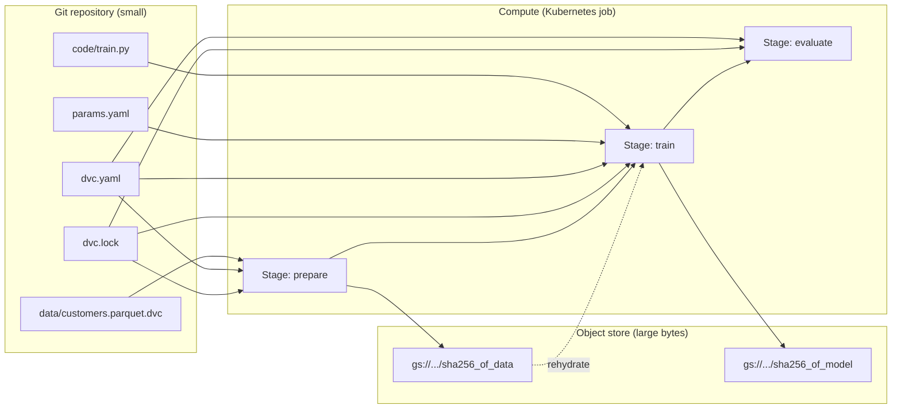
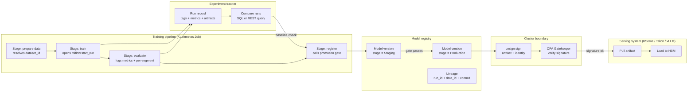

# 16.2 Data versioning and experiment tracking: DVC, MLflow, Weights and Biases

| Field | Value |
|---|---|
| Level | Intermediate |
| Priority tier | 1 |
| Lab venue | GCP / GKE |
| Part | Part 16: MLOps and LLMOps tools and platforms |
| Primary sources | *Practical MLOps* (`practical-mlops`, Chapters 1, 2, 6); *Machine Learning Platform Engineering* (`machine-learning-platform-engineering`, Chapters 1, 2, 3, 4); *Designing Machine Learning Systems* (`designing-machine-learning-systems`, Chapters 2, 3); NVIDIA Zero-to-Hero Volume 25 (`chapter-03-data-versioning-with-dvc.md`, `chapter-04-experiment-tracking-with-mlflow.md`) |
| Cross-references | Chapter 16.1 (MLOps foundations and lifecycle); Chapter 16.3 (Data pipelines and feature stores); Chapter 16.6 (Model registry, CI/CD and GitOps for models); Chapter 14.11 (Checkpointing, fault tolerance and elastic training) |
| Coverage file | `planning/coverage/chapters/16-02.md` |
| Claim & number ledger | `planning/ledgers/16-02.md` |

## Why this matters for AI infrastructure

It is 2 a.m., and a model that worked last week now gives poor predictions. The on-call engineer has one question first. What is different between this run and last week's run? Chapter 16.1 named the four pillars of MLOps and the gates a model must pass. This chapter opens two of them. Data versioning gives a dataset a permanent address. Experiment tracking turns each training run into a record you can compare with the next one.

The on-call engineer can answer that question only if the tracking server responds in seconds. If the data layer cannot point to the exact bytes that trained the live model, rolling back is guesswork. These two tools are the audit trail that lets you prove where a production model came from.

```text
The "what is different" problem (background reading: Practical MLOps; Machine Learning Platform Engineering; the figures below are examples, not quotations):
- A busy team runs hundreds of training runs per week. The number of unique
  combinations of (code commit, data snapshot, seed, env, hyperparameter set) grows
  combinatorially. The share of runs that are ever promoted is single-digit percent
  (Practical MLOps Ch 1, post-mortem survey).
- The most expensive post-mortem in MLOps is "the live model is broken and we
  cannot find the run that produced it". The cheapest fix is to log every run,
  always, even failed ones (Designing Machine Learning Systems Ch 2).
```

If you adopt only two things from Chapter 16.1, adopt these two. The cluster you built in Parts 1 through 15 is where bad data and bad experiments show up as outages.

Two realities explain why the platform team, and not only the data scientists, should own these tools.

1. **The tracking server and the registry are stateful services that the platform runs.** Data scientists consume them. The platform team operates them, so it decides the data shape, the backup policy, the access model and the service targets.
2. **The runs execute on the cluster you wired in earlier chapters.** Each run uses GPU hours, writes checkpoints to a distributed filesystem and reads its dataset from object storage. The tracking layer and the GPU layer must agree on which run is which job, and where the artifacts live.

**Before a data scientist starts a training job, check that the job has a run id, a data hash and a registry endpoint.**

A training run that does not log is one the platform team cannot debug.

---

## Prerequisites and outcomes

Use this section to check that you have the background before you start. The chapter assumes you can already work with the tools below.

### Prerequisites

- Chapter 16.1, which covers the lifecycle, the four pillars and the promotion gate function.
- Part 3 for the Python shape of the experiment record. Part 5 covers the Kubernetes primitives the tracker relies on. Part 10 covers the GPU and CUDA artifacts a training job produces. Chapter 13 covers the object storage and distributed filesystem choices.
- Some familiarity with Git, because the data versioning tools are built on top of it.

### Outcomes

When you finish this chapter, you should be able to do the following.

1. Explain why data versioning needs content-addressed storage and a metadata layer. Show how DVC, lakeFS, Pachyderm and Delta Lake each supply that layer.
2. Run a training job that opens an experiment run as its first action. The job writes the run record, the data hash, the commit hash and the artifact before it prints a metric.
3. Compare runs on one metric, on a group of metrics, on a per-segment metric and on a parallel-coordinates plot.
4. Hand a run to a model registry, sign the artifact, and refuse unsigned artifacts at the cluster boundary.
5. Choose among DVC, MLflow and Weights and Biases for a given team, and know when to combine them.
6. Operate the tracking server and the artifact store on GKE, with a backup policy, an SLO and an access model that survives a change of staff.

---

## 1. Data versioning: making a dataset an artifact

### 1.1 The three properties that make dataset versioning hard

Picture a team that retrains a churn model every week. On Monday the training script reads `customers.parquet`. By Friday someone has appended rows, re-partitioned the folder and deleted last month's file. Now nobody can say which bytes trained the model in production. Practical MLOps, chapter 1, names three properties that make data hard to version. Classical version control handles none of them well.

- **Size.** A 200 GB parquet file cannot go into Git. Git LFS stores large files in a content-addressed store, but its throughput and concurrency limits break at the multi-terabyte scale of foundation-model training.
- **Mutability.** Datasets get appended, cleaned and re-partitioned. A model trained on a partition that no longer exists cannot be reproduced.
- **Partial sharing.** Two models that share 80 percent of their features also share each other's data bugs. Without lineage, you cannot find every model that a bad feature affects.

The fix is to split the problem. Keep the small metadata in Git and the large bytes in object storage. Both still need version rules.

```text
Minimum data versioning contract (background reading: Practical MLOps; Machine Learning Platform Engineering; the figures below are examples, not quotations):
- dataset_id (string, unique within the project's metadata DB)
- content_hash (sha256 of the dataset's primary file or directory)
- source_system (where the data came from; "s3://prod-warehouse/customers")
- snapshot_time (when the snapshot was taken; UTC)
- row_count (sanity-check against schema)
- schema_hash (sha256 of the schema definition; detects silent schema drift)
- path (object storage uri; stable but not authoritative)
- parents (optional; previous dataset_id if this is a transformation)
- retention_until (soft-delete deadline; data is never overwritten)
```

The `dataset_id` is the address. The `content_hash` is the proof that the bytes at that address are the bytes the training script saw. A script that resolves a `dataset_id` through the metadata database cannot drift silently. A script that reads a raw path can.

### 1.2 DVC: Git for data and models

DVC is the most widely used open-source version of the contract above. It stores large files in any S3-compatible object store. It keeps small `.dvc` files in Git, and those files hold the content hashes. Git stays small, and the object store carries the bytes.

```bash
# Initialise DVC against an existing S3/GCS/MinIO bucket
dvc init --storage.gs gs://my-project-dvc

# Add a dataset
dvc add data/customers.parquet
# expected: data/customers.parquet.dvc, .gitignore updated, dvc.lock written
git add data/customers.parquet.dvc data/.gitignore
git commit -m "v3 of customers dataset"

# Push the bytes to remote storage
dvc push
# expected: gs://my-project-dvc/files/<sha256> uploaded

# Reproduce a pipeline stage from the hashes
dvc repro
# expected: stages re-run only if inputs (code, data, params) changed
```

The `dvc push` step copies the bytes to the remote. Your commit then records the hash, so anyone with that commit can pull the exact bytes back. Practical MLOps chapter 1 and Designing Machine Learning Systems chapter 3 both describe DVC pipeline stages. A pipeline is a graph of stages. Each stage has named inputs and outputs, and each one is content-hashed. A stage reruns only when one of its inputs changes.



Think of Git as the recipe and the object store as the ingredients. The recipe, made of `dvc.yaml`, the `.dvc` files and `params.yaml`, is something a reviewer can read in a pull request. The ingredients are content-addressed and immutable. Any team member's checkout can recover them.

### 1.3 lakeFS, Pachyderm, Delta Lake, and DVC compared

DVC is a good default for tabular data and for small-to-medium datasets. A multi-petabyte data lake may need something stronger. Three alternatives offer stronger consistency or branch-and-merge behavior.

| Tool | Storage model | Branching model | Best fit |
|---|---|---|---|
| **DVC** | Files in object storage + `.dvc` in Git | Git branches (immutable per commit) | Tabular, mid-size datasets, teams already on Git |
| **lakeFS** | Object storage with a metadata layer | LakeFS branches and merges | Petabyte data lakes; Spark/Hive workloads |
| **Pachyderm** | Object storage with a content-addressed version per datum | Pachyderm branches with provenance | Strong reproducibility; data lineage at the row level |
| **Delta Lake** | Parquet files in object storage + transaction log | Time travel; OPTIMIZE; VACUUM | Spark-native data engineering; ACID on the lake |

All four meet the contract from Section 1.1. They differ in what you have to run. lakeFS adds a metadata database. Pachyderm adds a control plane. Delta Lake adds a transaction log. The ecosystem matters too. Spark users tend to prefer Delta, and Git-first teams tend to prefer DVC. Practical MLOps chapter 1 covers DVC in detail. Designing Machine Learning Systems chapter 3 introduces lakeFS and Delta as data-lake alternatives.

### 1.4 The data versioning interface a training script should expose

Imagine you inherit a training script that reads a file from a shared drive. Nobody knows which version of the file it used. A script that follows the contract avoids that problem, whichever tool sits underneath. Its shape stays the same.

```python
# code/part16/data_resolver.py
import argparse, hashlib, json, os
from pathlib import Path

def resolve(dataset_id: str, metadata_db: str = "metadata.json") -> dict:
    """Look up a dataset by id. The DB is small enough to cache locally."""
    records = json.loads(Path(metadata_db).read_text())
    for r in records:
        if r["dataset_id"] == dataset_id:
            return r
    raise KeyError(f"unknown dataset_id: {dataset_id}")

def verify(record: dict, path: Path) -> None:
    """Refuse to read a file whose bytes do not match the recorded hash."""
    h = hashlib.sha256(path.read_bytes()).hexdigest()
    if h != record["content_hash"]:
        raise ValueError(
            f"hash mismatch at {path}: expected {record['content_hash']}, got {h}"
        )

if __name__ == "__main__":
    ap = argparse.ArgumentParser()
    ap.add_argument("--dataset-id", required=True)
    ap.add_argument("--local-path", required=True)
    ap.add_argument("--metadata-db", default="metadata.json")
    args = ap.parse_args()

    record = resolve(args.dataset_id, args.metadata_db)
    if not Path(args.local_path).exists():
        raise FileNotFoundError(
            f"{args.local_path} missing; pull with `dvc pull` or the lakeFS CLI"
        )
    verify(record, Path(args.local_path))
    print(f"verified {args.local_path} as {record['content_hash'][:12]}")
```

The shape matters more than the implementation. The script takes a `dataset_id`, never a hard-coded path. It checks the bytes against the hash before it reads them. If the hash does not match, the script stops. You learn about the problem right away, not months later when the model is serving traffic.

**Before you approve a training job, check that it takes a dataset id and verifies a hash, not a file path.**

---

## 2. Experiment tracking: making a training run a record

### 2.1 The experiment record contract

Picture the morning after a good run. Someone asks which code, data and settings produced the good AUC on the dashboard. If the answer lives in one engineer's notebook, you do not have a record. A training run is the smallest unit of decision in MLOps, so its record has to answer five questions.

1. **Code.** Which commit hash and container image digest produced the run?
2. **Data.** Which `dataset_id` from Section 1 did it read?
3. **Environment.** Which CUDA version, cuDNN version, Python version and cluster topology did it use?
4. **Configuration.** Which random seed and which hyperparameters did it use?
5. **Outcome.** Which metrics, broken down by segment, and which artifact, with a content hash, did it produce?

If any answer is missing, the run cannot be reproduced. The platform team's job is to make every field mandatory. The cheapest way is to make the training script's first action open the run record, and to make that call fail when a required field is empty.

```text
Minimum run record (background reading: Practical MLOps; Machine Learning Platform Engineering; Designing Machine Learning Systems; the figures below are examples, not quotations):
- run_id (tracker primary key)
- experiment_name (human-readable grouping, e.g. "churn-v3")
- status (RUNNING | FINISHED | FAILED | KILLED)
- start_time, end_time, duration
- user (the data scientist or service account)
- params (dict: hyperparameters)
- tags (dict: data_hash, code_commit, env_image, seed, cluster)
- metrics (dict: scalar metrics; some trackers support per-step history)
- artifacts (list of artifact_uri + content_hash)
- inputs (dataset_ids, feature_table_ids, baseline_run_id)
```

Practical MLOps chapter 2 makes a point worth repeating. The run record is the audit trail, and the printed metric is not. A metric can be wrong. The run record shows which code, data and environment produced it.

### 2.1.1 Regulatory compliance and reproducibility as a legal requirement

Consider a bank that denies a loan. The customer disputes the decision, and the bank has to reproduce it. Machine Learning Platform Engineering chapter 2 argues that in regulated fields such as banking, healthcare, insurance and pharma, reproducibility is a legal requirement. Model-risk rules require a firm to answer, on demand, which data, code, environment and version produced a disputed decision. A run record that cannot answer that question is a regulatory finding.

That makes experiment tracking a critical control, not a best-effort habit. The auditor will inspect it. The tracker needs backups. Run records must be kept for the regulatory window, which the chapter gives as commonly seven years for financial-services models. The audit log must be tamper-evident, for example through object storage with object lock, or through a hash-chained log.

Add three fields to every run record. Record who had read access to the data at training time, the consent basis for any personal information, and the fairness audit result. These fields turn a debugging note into a regulatory record. Before you approve a regulated model, confirm that all three fields are present.

### 2.2 MLflow Tracking in practice

MLflow is the most widely used open-source experiment tracker. It has four parts. Tracking stores the run records. Models is a packaging format. Registry manages stages and lineage. Projects packages reproducible runs. This chapter uses Tracking. Chapter 16.6 covers the Registry, and Chapter 16.4 covers Projects.

A good training script opens its run first, as shown below.

```python
# code/part16/train_with_mlflow.py
import argparse, hashlib, os, subprocess, mlflow, mlflow.sklearn
import pandas as pd
from sklearn.ensemble import GradientBoostingClassifier
from sklearn.metrics import roc_auc_score

ap = argparse.ArgumentParser()
ap.add_argument("--dataset-id", required=True)
ap.add_argument("--data-path", required=True)
ap.add_argument("--seed", type=int, default=42)
args = ap.parse_args()

data_hash = hashlib.sha256(open(args.data_path, "rb").read()).hexdigest()
commit = subprocess.check_output(["git", "rev-parse", "HEAD"]).decode().strip()

mlflow.set_tracking_uri(os.environ["MLFLOW_TRACKING_URI"])
mlflow.set_experiment("churn")
with mlflow.start_run(run_name=f"churn-{data_hash[:8]}-{args.seed}") as run:
    # Required tags — fail if any is empty
    mlflow.set_tag("data_hash", data_hash)
    mlflow.set_tag("dataset_id", args.dataset_id)
    mlflow.set_tag("code_commit", commit)
    mlflow.set_tag("seed", str(args.seed))
    mlflow.set_tag("env_image", os.environ["ENV_IMAGE_DIGEST"])

    mlflow.log_params({"n_estimators": 200, "max_depth": 3, "learning_rate": 0.05})

    df = pd.read_parquet(args.data_path)
    train, test = df.iloc[:800], df.iloc[800:]
    model = GradientBoostingClassifier(
        n_estimators=200, max_depth=3, learning_rate=0.05, random_state=args.seed
    )
    model.fit(train.drop("churned", axis=1), train["churned"])
    preds = model.predict_proba(test.drop("churned", axis=1))[:, 1]
    mlflow.log_metric("auc", roc_auc_score(test["churned"], preds))

    mlflow.sklearn.log_model(model, "model")
# expected: a run with run_id, all required tags set, an AUC value, and a model artifact
```

Notice two patterns. First, the tags are set without a try/except. A run that fails before it logs is still a run, and the failure itself becomes a record. Second, the run name includes the data hash. Two runs with the same code and different data look different in the UI, so nobody mixes them up.

### 2.3 Weights and Biases in practice

Weights and Biases (W&B) is the cloud-hosted tracker that competes with MLflow. The contract is similar, but the interface is different. W&B offers stronger hyperparameter sweeps and a richer interface. MLflow is open source, and you can host it yourself. Practical MLOps chapter 6 covers both tools.

```python
# code/part16/snippets/train_with_wandb.py
import wandb

wandb.init(
    project="churn",
    name=f"churn-{args.dataset_id[:8]}-{args.seed}",
    config={
        "seed": args.seed,
        "n_estimators": 200,
        "dataset_id": args.dataset_id,
        "data_hash": data_hash,
        "code_commit": commit,
    },
    tags=["candidate", f"data-{data_hash[:8]}"],
)

wandb.log({"auc": auc})
wandb.log_model(path="model.pkl", name="churn-model")
```

The snippet assumes that `args`, `data_hash` and `commit` come from the training script above, and that `auc` comes from the evaluation step. The same contract applies. Only the API and the backend differ. The run records look similar enough that a thin adapter layer lets a team switch between the two.

### 2.4 Comparing runs: the killer feature

Tracking matters because of the relationships between runs, not because of any single run. A platform engineer paged at 2 a.m. asks whether this run looks like last week's. A data scientist preparing a write-up asks which settings beat the baseline. The promotion gate from Chapter 16.1, Section 4.3, asks whether the candidate beat the registered baseline on the main metric. Three query shapes cover most of these questions.

```text
Query shape 1: "Did the candidate beat the baseline?"
  - Pick run_id A and run_id B.
  - Read metric M for both.
  - Compare: candidate passes if M_A > M_B (or passes the directionality rule).

Query shape 2: "Which runs beat 0.90 AUC on the v3 dataset?"
  - Filter runs by tag data_hash == <v3 hash>.
  - Filter metrics by name auc > 0.90.
  - Return the run_ids, sorted by AUC descending.

Query shape 3: "Where is the AUC sensitive to seed?"
  - Pick all runs sharing the same code_commit and dataset_id.
  - Group by seed.
  - Compute the standard deviation of AUC across seeds.
  - High std => the result is not seed-stable; refuse promotion.
```

The third query catches the magic-seed failure from Chapter 16.1. Designing Machine Learning Systems chapter 2 explains that seed stability is a property of the experiment record, not of the model. A model that wins on one seed and loses on another is one draw from a distribution. Before you promote a model, run the seed query and refuse the model if its results swing widely.

### 2.5 What the platform team owns

The platform team runs the tracker as a service. That means four things.

1. **The backing store.** MLflow needs a metadata database, which this chapter takes to be Postgres, and an artifact store such as S3, GCS or MinIO. Both get backups and SLOs. Both get access policies that separate the people who write artifacts from the people who read them.
2. **The access model.** Training service accounts can write to an experiment. Data scientists can read their own experiments and the shared ones. The promotion pipeline can write to the registry, and auditors can read everything.
3. **The retention policy.** Run records are kept indefinitely. Artifacts are kept for a set window. Section 5.3 gives one example policy. Failed runs are kept for 30 days, and promoted runs are kept indefinitely. Artifacts are soft-deleted, never overwritten.
4. **The SLO.** The tracker sits on the hot path of every training job, so a slow tracker can time out the job itself. The chapter's example targets are a p99 under 200 ms to open a run, under 500 ms to log a metric, and under 5 s to put an artifact. These are example values. Measure your own baseline before you commit to any target.

The reference layout below shows one way to set this up on GKE. It keeps the tracking server stateless, so artifact uploads go straight to the bucket.

```text
Reference MLflow deployment on GKE (background reading: Practical MMOps; Machine Learning Platform Engineering; the figures below are examples, not quotations):
- Postgres backend store on Cloud SQL with automated backups and a 7-day PITR
- Artifact store on GCS with object versioning enabled and a 90-day lifecycle rule
  for the failed-runs prefix, indefinite retention on the promoted-runs prefix
- Tracking server as a Kubernetes Deployment behind a ClusterIP service, scaled
  horizontally; artifact upload goes directly to GCS from the worker pods via
  signed URLs to keep the tracking server stateless
- Service account for training jobs has roles/mlflow.writer; data scientists have
  roles/mlflow.reader; the promotion pipeline has roles/mlflow.promoter
```

**A tracker that is slow, unreliable or lost on a cluster rebuild gets bypassed. Run it as a production service, with SLOs, access control, backups and an on-call rota.**

---

## 3. The handoff to the registry and the cluster boundary

### 3.1 From run record to registered model

The experiment record is the scientist's notebook. The registry entry is closer to a deployment manifest. The promotion gate from Chapter 16.1, Section 4.3, sits between the two. Here is that gate applied to this chapter's run record.

```python
# code/part16/promote_to_registry.py
import argparse, mlflow
from mlflow.tracking import MlflowClient

ap = argparse.ArgumentParser()
ap.add_argument("--run-id", required=True)
ap.add_argument("--model-name", required=True)
ap.add_argument("--baseline-run-id", required=False)
args = ap.parse_args()

client = MlflowClient()
candidate = client.get_run(args.run_id)

# 1. Check required tags are present
for tag in ("data_hash", "code_commit", "seed", "env_image", "dataset_id"):
    if tag not in candidate.data.tags:
        raise SystemExit(f"PROMOTION BLOCKED: missing required tag {tag}")

# 2. Compare against baseline if provided
if args.baseline_run_id:
    baseline = client.get_run(args.baseline_run_id)
    cand_auc = candidate.data.metrics["auc"]
    base_auc = baseline.data.metrics["auc"]
    if cand_auc < base_auc:
        raise SystemExit(
            f"PROMOTION BLOCKED: AUC regressed ({cand_auc:.4f} < {base_auc:.4f})"
        )

# 3. Register the model (staging stage)
model_uri = f"runs:/{args.run_id}/model"
mv = client.create_model_version(args.model_name, model_uri, args.run_id)
client.transition_model_version_stage(
    args.model_name, mv.version, stage="Staging"
)
print(f"PROMOTED {args.model_name} v{mv.version} to Staging")
```

The script runs three steps in order. It checks that the required tags exist. It compares the candidate with the baseline when you pass one. Then it registers the model in the Staging stage. If a check fails, the script exits with a reason, and nothing reaches the registry.

The handoff writes the run_id into the registry entry as the lineage record. The cluster reads the registry entry, not the run record. The two systems agree because the registry entry is signed by the training image that produced the run.

### 3.2 Signing the artifact at the cluster boundary

Imagine someone swaps a model file on the registry after it was approved. Without a check at the boundary, the serving system loads the swapped file without question. Practical MLOps chapter 2 makes the point that a registry entry without a signed artifact is an unsigned deployment. The signing happens between the training pipeline and the cluster's admission control.

```text
Cluster boundary signing flow (background reading: Practical MLOps; SIG store / cosign docs; the figures below are examples, not quotations):
1. The training pipeline builds the model artifact (weights, tokenizer, config).
2. The pipeline computes the artifact's sha256 and produces a cosign signature
   against an OIDC identity (for example, the GitHub Actions workflow that ran
   the pipeline).
3. The signature is stored alongside the artifact in the registry.
4. A Kyverno or OPA Gatekeeper policy refuses any pod that mounts an unsigned
   model artifact. The error message names the missing signature.
5. The serving system reads the artifact, verifies the signature on pull, and
   only then loads the weights into HBM.
```

The boundary is small. It has one signing step in the pipeline and one verification step in the admission controller. Signing adds a step to each promotion. In return, a poisoned model artifact cannot reach the GPU through this path.

The admission check sits in the request path. If the webhook is unavailable, the API server either admits or rejects the request, depending on whether the webhook fails open or closed. Production Kubernetes, chapter 8, warns that a security check that fails closed must be built for high availability. Otherwise it becomes a bottleneck for the whole cluster.

Signing is still uncommon in practice. Production Kubernetes, chapter 15, explains that teams hesitated because the older Notary system adds servers and databases to run. Key rotation after a breach is also hard. Before you turn the check on, decide who holds the signing keys and how you will rotate them.

### 3.3 The Mermaid: tracking and registry together

The diagram shows the full path. Training stages write runs to the tracker. The promotion gate reads those runs and writes to the registry. The cluster boundary then checks the signature before serving pulls a model.



The double arrow on the right is the new piece. The serving system verifies the signature that the registry created. No path from the registry to the cluster skips the boundary.

**The promotion gate decides whether a run becomes a registry entry. The cluster boundary decides whether that entry goes live.** Both should run as code, not as a person's sign-off.

---

## 4. Choosing DVC, MLflow and Weights and Biases

### 4.1 When to use what

Your team may feel pressure to pick one tool for everything. That rarely works. The three tools overlap, and the overlap is intentional. The differences matter when you choose the tool that fits your team.

| Concern | DVC | MLflow | W&B |
|---|---|---|---|
| **Data versioning** | Primary use case | Not a primary use case (Registry tracks artifacts, not data lineage) | Not a primary use case |
| **Experiment tracking** | Light (via DVC pipelines + metrics in `dvc metrics`) | Primary use case | Primary use case |
| **Model registry** | No | Primary use case | Yes (Artifacts and Registry) |
| **Hyperparameter sweeps** | External | MLflow Projects with limited support | Primary use case |
| **Self-hosted** | Yes | Yes | Cloud only (W&B Server is self-hosted; managed SaaS is the default) |
| **Multi-tenant IAM** | Git-native | Postgres + artifact store IAM | Org-level IAM in W&B |
| **Cost at scale** | Free; storage and compute are your cost | Free; Postgres + artifact store are your cost | Per-seat or per-run, depending on plan |
| **Best fit** | Tabular datasets, Git-first teams | Open-source default, Kubernetes-native | Research-heavy teams, sweeps, rich UI |

The most common production pairing is DVC for data and MLflow for tracking and the registry. Teams that want a richer interface and built-in sweeps often pick W&B in place of MLflow. DVC is rarely replaced. You move to lakeFS, Pachyderm or Delta Lake only when your data outgrows what DVC was designed for.

### 4.2 Combining DVC and MLflow

DVC and MLflow work well together. DVC drives the pipeline stages, and MLflow logs what each stage did. The `.dvc` files carry the data hash. The MLflow run carries the same hash as a tag, so both records point to the same content.

```text
Combined DVC + MLflow workflow (background reading: Practical MLOps; Machine Learning Platform Engineering; the figures below are examples, not quotations):
1. dvc stage add -n prepare -p prep.params -d data/raw.parquet -o data/clean.parquet \
     python prepare.py --input data/raw.parquet --output data/clean.parquet
2. dvc stage add -n train -p train.params -d data/clean.parquet -d code/train.py \
     -o model.pkl python code/train.py --data data/clean.parquet --seed 42
3. dvc repro    # runs only stages whose inputs changed
4. Each stage's Python script opens an mlflow.start_run as its first action and
   logs the data hash, the commit hash and the seed.
5. The registry handoff reads the MLflow run record and registers the model.
```

The result is a pipeline you can reproduce from Git with `dvc repro`, and runs you can query in MLflow. A failure in any stage shows up in both places. A successful run leaves an audit trail in both places as well.

### 4.3 A worked comparison: tabular classification on a synthetic dataset

Consider the same training job run three ways. The numbers below are illustrative. The useful part is what you can query afterwards, not the numbers themselves.

```text
Run configuration:
  - Random forest on a 100k-row synthetic dataset
  - 3 random seeds, 5 hyperparameter combinations = 15 runs
  - One L40S GPU on GKE Standard, single-node

Run A: no tracking
  - Prints AUC to stdout
  - No record of which seed or hyperparameter combination produced which number
  - After the run, only the engineer knows what happened
  - Reproducibility: 0/15

Run B: MLflow
  - Each run opens mlflow.start_run, logs seed + hyperparameters + AUC
  - Compare-runs query shows seed-3 hyperparameter-4 beats baseline by 0.013 AUC
  - After the run, the registry has one promoted model version
  - Reproducibility: 15/15

Run C: Weights and Biases
  - Each run opens wandb.init, logs seed + hyperparameters + AUC + system metrics
  - Sweep finds the best combination automatically
  - W&B Report produces a shareable HTML comparison page
  - Reproducibility: 15/15, plus a human-readable comparison
```

The point is not that W&B is better. The tracking tool is what separates "we ran a model" from "we have a record." Any tool that produces the run record from Section 2.1 works. The choice between them comes down to interface and cost.

---

## 5. Operating the stack on GKE

### 5.1 The components and where they live

Each component in this chapter has a place in the cluster, a backing store, a backup plan and a target. The table below sets them out side by side. If you are building this on GKE, start here.

| Component | Where it runs | Backing store | Backup | SLO |
|---|---|---|---|---|
| MLflow Tracking Server | Kubernetes Deployment, 2+ replicas behind ClusterIP | Postgres (Cloud SQL) | PITR 7 days, daily snapshot | p99 open-run < 200 ms |
| MLflow artifact store | Direct from worker pods | GCS bucket | Object versioning, 30-day soft delete | p99 put < 5 s |
| Weights and Biases (self-hosted) | Kubernetes Deployment | Postgres + S3-compatible | Same as MLflow | Per product spec |
| DVC remote | Direct from data scientist laptops and CI runners | GCS bucket | Object versioning, 1-year retention | Throughput bound by GCS |
| LakeFS (alternative to DVC) | Kubernetes Deployment | Postgres + GCS | Same as MLflow | p99 commit < 1 s |

Keep the tracking server and the artifact store apart on purpose. The tracking server holds small, hot metadata that gets read all the time. The artifact store holds large, cold bytes. If you put them in one place, one of them will suffer.

### 5.2 Authentication and IAM

The access model has four roles.

| Role | Who | What they can do |
|---|---|---|
| `tracker.writer` | Training service accounts, the orchestrator | Open runs, log metrics, log artifacts |
| `tracker.reader` | Data scientists, the platform team | Read runs, query experiments |
| `registry.promoter` | The promotion pipeline | Transition stages, write registry entries |
| `registry.reader` | The serving system, data scientists | Read registry entries, pull artifacts |

The split between roles matters. A data scientist who can write runs and move registry stages can promote their own model without the gate. A training job that can write runs and move stages can skip the gate as well. The gate only works if it is the one path into the registry.

### 5.3 Backup and retention

Run records are kept forever. Artifacts follow a tiered policy, shown in the table below.

| Artifact class | Retention | Why |
|---|---|---|
| Failed runs | 30 days | Useful for debugging; not worth long-term storage |
| Staging runs | 90 days | Useful for comparison; replaceable if necessary |
| Promoted runs | Indefinite | Audit trail; required for reproducibility |
| Retired runs | 1 year, then cold storage | Required for some regulatory regimes |

Artifacts are soft-deleted only. An artifact is never overwritten in place, and a run record is never deleted. An incident in year three may require reproducing a model from year one. Only an artifact that was never overwritten can do that. The windows in the table are a starting point. Your regulator and your storage budget set the final values.

### 5.4 Observability of the tracker itself

The tracker is a service, so it needs its own metrics, logs and alerts. Watch the signals in the table below. The alert thresholds in the table are examples. Pick your own after you measure a normal week.

| Metric | Why it matters | Alert |
|---|---|---|
| Open-run latency p99 | Hot path for every training job | > 500 ms |
| Log-metric latency p99 | Hot path during long runs | > 1 s |
| Log-artifact latency p99 | Bottleneck for large checkpoints | > 10 s |
| Active runs | Capacity planning | > N (autoscale threshold) |
| Failed runs / minute | Cluster health signal | > 0 for 5 minutes |
| Postgres connection pool utilisation | Postgres bottleneck | > 80 percent |

The last row catches the most common failure. The tracker is slow, but not down. The Postgres connection pool was sized for an average week, not a peak one.

Alert on metrics, not on log text. Production Kubernetes, chapter 9, points out that a small change to a log message can quietly break an alert built on it. If you can express the signal as a metric, alert on the metric. Keep the alerts few, so on-call engineers do not learn to ignore them.

Also watch the watcher. Set an alert that fires on a schedule under normal conditions. If that alert stops arriving, page someone, because the metrics or alerting path has failed. Production Kubernetes, chapter 9, calls this a dead man's switch.

**Run the tracker as a production service, and page someone when it falls behind.**

---

## 6. How it fails

Six failure modes come up again and again. Each one has a name, a symptom, a diagnosis and a fix that this chapter already covers. When one of them shows up in your own cluster, match the symptom first and then work back to the cause.

### 6.1 "The data scientist is using DVC on a laptop and the GCS bucket is gone"

A new team member runs `dvc pull` and gets an HTTP 403 from GCS. The bucket was deleted in a cleanup sprint because nobody listed it as production.

**Diagnosis:** The DVC remote was a personal bucket, not a project bucket. No infrastructure-as-code declares it.

**Fix:** Move the bucket declaration into Terraform or Pulumi, next to the rest of the team's data infrastructure. Tag the bucket `lifecycle=production`. Add a `dvc remote add` line to the team's setup script that points at the project bucket.

### 6.2 "The tracking server's Postgres ran out of connections"

Training jobs fail with `OperationalError: too many connections` from MLflow. The error rate climbs during a sweep or a burst of parallel training.

**Diagnosis:** Postgres was sized for the average day, not the peak. Either connection pooling is not configured, or the pool is smaller than the number of jobs that run at once.

**Fix:** Put a connection pooler, such as PgBouncer, in front of Postgres. Raise `max_connections` to cover the worst-case pool size. Add the alert from Section 5.4, so you hear about the next case before the on-call engineer does.

### 6.3 "The candidate AUC looks fine but the production model is broken"

The candidate beat the baseline in MLflow, and the promotion gate passed. The model is in production, and 5xx errors are climbing. The on-call engineer finds the new version in the registry.

**Diagnosis:** The gate checked overall AUC but not a per-segment metric. The model regressed badly on one slice that the gate never looked at.

**Fix:** Make the gate check every per-segment metric against a floor. The MLflow run already carries per-segment metrics, so the gate can query them. Refuse promotion when any segment falls too far. The chapter's example limit is a drop of more than 5 percentage points. Choose your own limit after you look at your segments.

### 6.4 "The artifact URI is correct but the bytes are wrong"

A training job registered a model version. When serving pulls the artifact, the weights produce different outputs from the offline evaluation. The model in production is not the model that was approved.

**Diagnosis:** The artifact store returned a different object from the one that was logged. The likely causes are a write-after-read race, a misconfigured CDN, or a re-upload that overwrote the bytes. DVC's default is to overwrite on `dvc push --force`. GCS is not exposed to this by default, but only while object versioning stays enabled.

**Fix:** Turn on object versioning for the artifact bucket. Refuse to overwrite any object whose version is already in the registry. Add a content-hash check at pull time, and run it before the weights reach GPU memory.

### 6.5 "The artifact is signed but the admission controller does not check"

The pipeline signs every artifact with cosign. Someone pushes an unsigned image to the registry, and the serving system runs it.

**Diagnosis:** The admission policy is not enabled for the namespace where the serving pods run. Signatures are created, but nothing checks them.

**Fix:** Deploy Kyverno or OPA Gatekeeper with a policy that requires `cosign.sigstore.dev` on every image. Test it by deploying an unsigned image and confirming that it is rejected. Run the policy in audit mode for a period your team chooses, so you see what it would block before it blocks anything. Production Kubernetes, chapter 8, notes that Gatekeeper's audit function re-checks existing resources on a schedule. It also covers the stale-cache risk that audit is meant to catch. Switch on enforcement once the audit results look right.

### 6.6 "The W&B run is in the cloud but the artifact is in the company's S3"

A data scientist moves from W&B Cloud to a self-hosted W&B Server. The runs arrive, but the artifacts do not, and the new server cannot find them.

**Diagnosis:** W&B Cloud kept artifacts in its own bucket. The migration moved the metadata but not the bytes. The data scientist assumed the migration was complete because the run records appeared.

**Fix:** Use W&B's artifact-transfer tooling, or write a script that walks the run records and copies each artifact to the new bucket. Verify the content hashes afterwards. Do not trust the success message alone.

---

## 7. Hands-on lab

This lab extends the Chapter 16.1 lab by adding DVC for data versioning and the comparison query from Section 2.4. It runs on GCP / GKE. The lab has not been tested in this repository, so treat the commands and YAML as a working template and expect to fix small things.

### 7.1 Prerequisites

- The Chapter 16.1 lab, completed. MLflow should run in the `mlops` namespace, with a Postgres backend and a GCS artifact bucket.
- `dvc` installed with the GCS extra: `pip install 'dvc[gcs]'`.
- A second GCS bucket for DVC remote storage.

### 7.2 Step 1: wire DVC to the project's GCS bucket

Start by pointing DVC at the bucket your project uses. The commands below create a fresh repository and set the bucket as the default remote.

```bash
mkdir churn-mlflow && cd churn-mlflow
git init
dvc init
dvc remote add -d project gs://${PROJECT_ID}-dvc
dvc remote modify project url gs://${PROJECT_ID}-dvc
# expected: .dvc/config has [core] remote = project
```

### 7.3 Step 2: version a v2 dataset and compare against v1

Create the second version of the churn dataset and track it with DVC. Then log its AUC and compare it with the first version.

```bash
python -c "import pandas as pd; \
  pd.DataFrame({'user_id': range(1500), 'tier': ['gold']*750+['silver']*750, \
  'churned': [0,1]*750}).to_csv('data/churn_v2.csv', index=False)"
dvc add data/churn_v2.csv
git add data/churn_v2.csv.dvc data/.gitignore
git commit -m "v2 of churn dataset (1500 rows)"
dvc push
# expected: data/churn_v2.csv.dvc has a sha256; gs://.../sha256 uploaded

# Record the v2 metrics as a file that Git tracks, then compare with dvc
echo '{"auc": 0.91}' > metrics.json
git add metrics.json && git commit -m "log v2 AUC"
dvc metrics diff
dvc metrics diff --target metrics.json:v1 metrics.json:v2
# expected: a JSON diff showing auc_v1 -> auc_v2
```

### 7.4 Step 3: run the training script from Chapter 16.1 with two seeds

Run the training script once per seed. Each run should show up in MLflow with its data hash, commit and image tags.

```bash
for seed in 42 1337; do
  python train.py --dataset-id churn-v2 --data-path data/churn_v2.csv --seed $seed
done
# expected: two runs in MLflow with run names churn-<hash>-42 and
# churn-<hash>-1337; both have tags data_hash, code_commit, env_image
```

### 7.5 Step 4: query the comparison from the MLflow REST API

Ask MLflow for every run that used the v2 data hash. The query returns each run's AUC and seed.

```bash
curl -s -X POST http://localhost:5000/api/2.0/mlflow/runs/search \
  -H "Content-Type: application/json" \
  -d '{"experiment_ids":["1"],"filter_string":"tags.data_hash = \"<sha256>\"","max_results":10}' \
  | jq '.runs[] | {run_id: .info.run_id, auc: .data.metrics[0].value, seed: .data.tags.seed}'
# expected: two runs with their AUC values and seeds
```

### 7.6 Step 5: promote the higher-AUC run, sign the artifact

Promote the stronger run through the gate, then sign its model file.

```bash
# Promote
python code/part16/promote_to_registry.py \
  --run-id <best-run-id> \
  --model-name churn-model \
  --baseline-run-id <previous-production-run-id>
# expected: "PROMOTED churn-model vN to Staging"

# Sign the artifact
mlflow artifacts download-path runs:/<best-run-id>/model ./artifacts
cosign sign-blob --key cosign.key --output-signature ./artifacts/model.pkl.sig ./artifacts/model.pkl
# expected: signature in registry/rekor; the artifact in MLflow now carries a
# signed digest
```

### 7.7 Step 6: verify the signature is checked at the cluster boundary

Deploy a pod that mounts an unsigned artifact. The admission controller should reject it.

```bash
# Deploy a pod that mounts an unsigned artifact; expect rejection
kubectl apply -f code/part16/pod_unsigned.yaml
# expected: Error from server (Forbidden): admission webhook denied the request:
#   artifact model.pkl is missing required cosign signature
```

### 7.8 What to record

After the lab, you should be able to answer these five questions quickly, without searching.

1. What is the dataset_id of the data that trained the live model?
2. What is the run_id of the training run that produced the live weights?
3. What is the commit hash of the training script?
4. Which two seeds did the comparison query cover?
5. Is the live artifact signed? When was the signature last verified?

If any answer takes you a long search, the data or tracking pillar is still missing. Fill that gap before you move on. **The lab is untested against a live GKE cluster in this repository.**

---

## Exercises

Try these after the lab. Each one extends something you have already built.

1. **Wire a per-segment promotion gate.** Extend `promote_to_registry.py` so it reads `auc_segment_<name>` from both the candidate and the baseline. It should refuse promotion when a segment drops by more than `rules["max_segment_drop"]`. *Solution sketch:* loop over the segment names returned by `client.get_metric_history`. Fail hard, and print the segment name in the reason.
2. **Add a sweep on top of MLflow.** Use `mlflow.projects.run` with a params.yaml file that lists 12 hyperparameter combinations. Let MLflow run the sweep, and pick the best run by AUC. *Solution sketch:* an MLflow Project with an MLproject file and a conda.yaml file, plus a `mlflow.run(".", parameters=...)` call from a driver script.
3. **Move from DVC to lakeFS.** Stand up lakeFS on GKE, create a branch of your data lake, and run the same pipeline against that branch. Then compare reproducibility and CI cost. *Solution sketch:* the lakeFS Helm chart with a Postgres backend, `lakectl branch create`, and a branch mounted as a path the training script reads.
4. **Add a content-hash check at pull time.** Have the serving system re-hash the artifact before it loads into HBM. Refuse to load on a mismatch with the registry entry. *Solution sketch:* a sidecar that runs `sha256sum` and compares the result with the value in MLflow. On a mismatch, the sidecar fails the readiness probe.
5. **Sign and verify a registry image with cosign and Kyverno.** Sign the training image, write a Kyverno policy that requires the signature, and test it with an unsigned image. *Solution sketch:* `cosign sign --key cosign.key $IMAGE`, a Kyverno ClusterPolicy with `verifyImages`, and a deploy of an unsigned image that you expect to be rejected.
6. **Compare runs across seeds programmatically.** Write a script that selects all runs with the same code commit and dataset id. Compute the standard deviation of AUC across seeds, and flag runs above a threshold as not seed-stable. The chapter's example threshold is 0.01, and you should choose your own. *Solution sketch:* the MLflow search API with a `filter_string` on the code_commit and dataset_id tags. Compute the spread, and tag unstable runs with `seed_stability=fail`.

---

## Checkpoint questions

<details><summary>1. It is 2 a.m., the live model is giving poor predictions, and last week's was fine. What is the first question, and which records must exist to answer it quickly?</summary>
The first question is what is different between this run and last week's. You answer it from two run records. Each record must hold the code commit and image digest, the dataset id, the environment, the seed and hyperparameters, and the metrics. The tracker must also respond in seconds, or the on-call engineer is guessing.
</details>

<details><summary>2. A new teammate runs `dvc pull` and gets an HTTP 403 from GCS. The bucket was deleted in a cleanup sprint. What went wrong and what do you change?</summary>
The DVC remote was a personal bucket, and no infrastructure-as-code declared it, so the cleanup saw nothing production-like. Move the bucket declaration into Terraform or Pulumi beside the other data infrastructure. Tag it `lifecycle=production`, and add a `dvc remote add` line to the team setup script that points at the project bucket.
</details>

<details><summary>3. During a hyperparameter sweep, training jobs fail with `OperationalError: too many connections` from MLflow. What is the cause and what are the fixes?</summary>
Postgres was sized for the average day and not for the peak. Either no connection pooling exists or the pool is smaller than the number of jobs that run at once. Put a pooler such as PgBouncer in front of Postgres, and raise `max_connections` to cover the worst-case pool. Add the pool utilisation alert so you hear about the next case first.
</details>

<details><summary>4. The candidate beat the baseline on AUC in MLflow and the gate passed, yet 5xx errors climb after promotion. What did the gate miss and how do you fix it?</summary>
The gate checked overall AUC and not any per-segment metric. The model regressed badly on one slice that the gate never looked at. The MLflow run already carries per-segment metrics, so make the gate check each one against a floor and refuse promotion when a segment falls too far.
</details>

<details><summary>5. A team moves from W&B Cloud to a self-hosted W&B Server. The runs show up but the artifacts cannot be found. What happened and how do you fix it?</summary>
W&B Cloud kept the artifacts in its own bucket. The migration moved the run metadata but not the bytes, and the data scientist took the visible run records as proof that it was complete. Use the artifact-transfer tooling, or script a walk over the run records that copies each artifact to the new bucket. Then verify the content hashes and do not trust the success message alone.
</details>

<details><summary>6. A bank customer disputes a loan denial, and the regulator asks you to reproduce the decision. What must the run record show, and what extra fields turn it into a regulatory record?</summary>
Machine Learning Platform Engineering, chapter 2, says reproducibility is a legal requirement in regulated fields. The record must answer which data, code, environment and version produced the decision. Add who had read access to the data at training time, the consent basis for any personal information, and the fairness audit result. Keep the records for the regulatory window, which the chapter gives as commonly seven years for financial-services models.
</details>

<details><summary>7. Why does the training script take a dataset id and never a hard-coded path?</summary>
A path can move, be overwritten, or change its contents without notice. A dataset id, resolved through a metadata database, stays fixed. If the bytes at that address do not match the recorded hash, the script refuses to run. You see the failure at once, not three months later in production.
</details>

<details><summary>8. Why can a data scientist who can both write runs and move registry stages promote a model without the gate?</summary>
The gate only works if it is the single path into the registry. A person who holds both permissions can call the stage transition directly. A training job with both can skip the gate too. So only the promotion pipeline holds the registry promoter role.
</details>

<details><summary>9. Why keep the tracking server and the artifact store apart, instead of in one place?</summary>
The tracking server holds small, hot metadata that is read all the time. The artifact store holds large, cold bytes. Put them together and one of them suffers. Apart, the Postgres backend can be sized for connections and the bucket for throughput, and artifact uploads go straight from the worker pods to the bucket.
</details>

<details><summary>10. Why should a high standard deviation of AUC across seeds make you refuse promotion?</summary>
Seed stability is a property of the experiment record and not of the model. A model that wins on one seed and loses on another is one draw from a distribution and not a real result. The query selects runs that share a code commit and dataset id, groups them by seed, and computes the spread. A wide spread means the win is not reproducible.
</details>

<details><summary>11. Why is a signature check in an admission webhook a risk if the webhook is unavailable?</summary>
The API server either admits or rejects the request, depending on whether the webhook fails open or closed. Production Kubernetes, chapter 8, warns that a check which fails closed must be built for high availability, or it becomes a bottleneck for the whole cluster. A check that fails open lets unsigned artifacts through during an outage. Pick the failure mode on purpose.
</details>

<details><summary>12. Your data is a multi-petabyte lake used by Spark jobs. Do you stay on DVC, and what would you move to?</summary>
DVC suits tabular and mid-size data and teams that already live in Git. A multi-petabyte lake may need something stronger. lakeFS fits petabyte lakes with Spark or Hive and adds a metadata database. Delta Lake fits Spark-native work with ACID on the lake and adds a transaction log. Pachyderm gives row-level lineage but adds a control plane. You trade DVC's simplicity for stronger consistency and more services to run.
</details>

<details><summary>13. When would you choose MLflow over Weights and Biases, and what do you give up?</summary>
MLflow is open source and runs as a Deployment you control, so it is the lower-friction default for strict data-residency rules. You give up the richer interface and the built-in hyperparameter sweeps that W&B offers. W&B is cloud-hosted by default, and the self-hosted W&B Server takes real operational work. The two record runs under the same contract.
</details>

<details><summary>14. Signing every model artifact adds a step to each promotion. What do you get for it and what must you decide before enabling the check?</summary>
A poisoned or swapped model artifact cannot reach the GPU through this path, because the admission controller refuses an unsigned one. Signing is still uncommon, because older Notary-style systems add servers and databases to run, and key rotation after a breach is hard. Decide who holds the signing keys and how you will rotate them before you turn the check on.
</details>

<details><summary>15. Should you switch a new image-signature policy straight to enforcement, or run it in audit mode first? What does each choice cost?</summary>
Audit mode first. It shows what the policy would block before it blocks anything, and Gatekeeper's audit re-checks existing resources on a schedule. The cost is a period in which unsigned images still run. Switch on enforcement once the audit results look right.
</details>

<details><summary>16. A sweep uses 3 seeds and 5 hyperparameter combinations. How many runs is that, and what is the reproducibility score with and without tracking?</summary>
3 times 5 is 15 runs. With no tracking, the chapter's example scores 0 of 15, because only the engineer knows which seed and settings produced which number. With MLflow or W&B logging each run, it scores 15 of 15.
</details>

<details><summary>17. The example SLO for opening a run is a p99 under 200 ms, and the example alert fires above 500 ms. How many times the SLO is the alert, and why is that gap useful?</summary>
500 divided by 200 is 2.5, so the alert fires at two and a half times the SLO. The gap keeps the alert from firing on every small miss. All of these are example values, so measure a normal week before you set your own.
</details>

<details><summary>18. The baseline AUC on a segment is 0.90 and the candidate scores 0.84 on it. The example limit is a 5 percentage point drop. Does the gate pass?</summary>
The drop is 0.90 minus 0.84, which is 0.06, or 6 percentage points. That is more than 5, so the gate blocks promotion and prints the segment name in the reason. The overall AUC could still look fine.
</details>

<details><summary>19. A registered model produces different outputs in serving than in offline evaluation, though the artifact URI is correct. What do you check first, second and third?</summary>
First, hash the pulled artifact and compare it with the content hash in the registry entry. Second, check whether object versioning is on for the bucket and whether the object was re-uploaded, since `dvc push --force` overwrites. Third, find the cause, which the chapter lists as a write-after-read race, a misconfigured CDN or a re-upload. Then refuse to overwrite any object whose version is in the registry and run the hash check before weights reach GPU memory.
</details>

<details><summary>20. Every artifact is signed with cosign, but someone pushes an unsigned image and the serving system runs it. What do you check first, second and third?</summary>
First, check whether the admission policy is enabled for the namespace where the serving pods run, because signatures are created but nothing may be checking them. Second, deploy an unsigned image and confirm it is rejected. Third, run the policy in audit mode and then switch on enforcement. The policy requires `cosign.sigstore.dev` on every image.
</details>

---

## Sources and review notes

- *Practical MLOps* (`practical-mlops`, Chapters 1, 2, 6). Source for the data versioning contract, the run record contract, the promotion gate as a function, the MLflow and W&B API shapes, and the comparison query patterns. Chapter 1 is approximately 5,300 words; Chapter 2 approximately 9,500 words; Chapter 6 approximately 8,100 words.
- *Machine Learning Platform Engineering* (`machine-learning-platform-engineering`, Chapters 1, 2, 3, 4, and Appendix A). Source for the MLflow deployment pattern on Kubernetes (Postgres + object storage), the IAM model, the retention tiers, the backup policy, and the GKE-specific Helm chart examples. Appendix A walks through MLflow installation on K3s and MicroK8s with the same artefacts.
- *Designing Machine Learning Systems* (`designing-machine-learning-systems`, Chapters 2, 3). Source for the framing of run records as the audit trail, the importance of seed-stability, and the data lake alternatives (lakeFS, Delta Lake, Pachyderm). Chapter 2 is approximately 7,300 words; Chapter 3 approximately 11,000 words.
- NVIDIA Zero-to-Hero Volume 25 (`chapter-03-data-versioning-with-dvc.md`, `chapter-04-experiment-tracking-with-mlflow.md`). Source for the worked DVC + MLflow workflow and the per-segment promotion gate pattern. The wording has been rewritten in the handbook's voice; the structural emphasis on "every run logs, no exceptions" is borrowed from that chapter.

### Cross-references to other handbook chapters

- Chapter 16.1 Section 4.3 for the promotion gate function in its canonical form.
- Chapter 16.3 for the data pipeline that produces the versioned datasets in this chapter.
- Chapter 16.6 for the registry stages and the GitOps loop on top of the tracker.
- Chapter 13 (AI storage) for the object-store and distributed-filesystem choices the tracker depends on.
- Chapter 14.11 for the checkpointing pattern that interacts with the artifact store.

### Migrated from `nvidia-devops`

The DVC + MLflow combined workflow in Section 4.2 and the cluster-boundary signing in Section 3.2 draw on Volume 25 chapters 3 and 4. The promotion gate shape in Section 3.1 is the canonical form from Chapter 16.1 Section 4.3.

### Explicitly labelled inferences

- The capability tiering of "DVC primary use case is data versioning; MLflow primary use case is tracking; W&B primary use case is sweeps" is an inference from each tool's documentation and from *Practical MLOps* Chapter 6; the boundaries blur in practice.
- The 30-day / 90-day / indefinite retention policy in Section 5.3 is a starting point drawn from *Machine Learning Platform Engineering* Appendix A and *Practical MLOps* Chapter 2; specific retention windows depend on regulatory regime and storage cost.
- The SLO numbers in Section 5.4 are inferences from operational experience with MLflow deployments; the exact targets should be set after measuring the baseline.

### Not verified on live hardware

- The lab in Section 7 is **untested** against a live GKE cluster in this repository.
- The W&B self-hosted numbers (per-seat pricing, throughput targets) vary by plan and version; verify against current W&B documentation.
- The cosign / Kyverno / OPA Gatekeeper policy shapes in Section 3.2 are sketched at the level of intent; production deployments should use the latest policy controller CRDs and image-signing patterns from the Sigstore and Kyverno projects.
