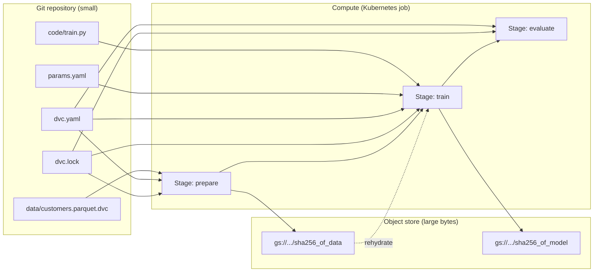
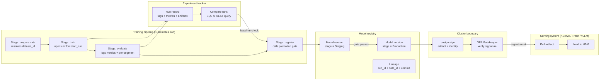

# 16.2 Data versioning and experiment tracking: DVC, MLflow, Weights and Biases

| Field | Value |
|---|---|
| Level | Intermediate |
| Priority tier | 1 |
| Lab venue | GCP / GKE |
| Part | Part 16: MLOps and LLMOps tools and platforms |
| Primary sources | *Practical MLOps* (`practical-mlops`, Chapters 1, 2, 6); *Machine Learning Platform Engineering* (`machine-learning-platform-engineering`, Chapters 1, 2, 3, 4); *Designing Machine Learning Systems* (`designing-machine-learning-systems`, Chapters 2, 3); NVIDIA Zero-to-Hero Volume 25 (`chapter-03-data-versioning-with-dvc.md`, `chapter-04-experiment-tracking-with-mlflow.md`) |
| Cross-references | Chapter 16.1 (MLOps foundations and lifecycle); Chapter 16.3 (Data pipelines and feature stores); Chapter 16.6 (Model registry, CI/CD and GitOps for models); Chapter 14.11 (Checkpointing, fault tolerance and elastic training) |
| Coverage file | `planning/coverage/chapters/16-02.md` |
| Claim & number ledger | `planning/ledgers/16-02.md` |

## Why this matters for AI infrastructure

Chapter 16.1 named the four pillars and the lifecycle gates. This chapter opens two of them. Data versioning is the mechanism that makes a dataset an artifact with a permanent address. Experiment tracking is the mechanism that makes a training run a record you can compare against the next run, the next data snapshot, and the next code commit. Together they are the audit trail that turns "the model in production" from a sentence into a citation.

If you only adopt one tool after reading Chapter 16.1, adopt these two. The cluster you built in Parts 1 through 15 is the surface where bad data and bad experiments surface as outages. An on-call engineer gets paged at 2 a.m. because a model silently regressed. The first question they ask is "what is different between this run and last week's?" If the tracking server cannot answer in five seconds, the on-call engineer is reading notebooks. If the data versioning layer cannot point to the exact bytes that trained the live model, they cannot roll back. The MLOps platform is what stops the on-call engineer from reading notebooks.

```text
The "what is different" problem (Practical MLOps Ch 1; MLPE Ch 1):
- A busy team runs hundreds of training runs per week. The number of unique
  combinations of (code commit, data snapshot, seed, env, hyperparameter set) grows
  combinatorially. The share of runs that are ever promoted is single-digit percent
  (Practical MLOps Ch 1, post-mortem survey).
- The most expensive post-mortem in MLOps is "the live model is broken and we
  cannot find the run that produced it". The cheapest fix is to log every run,
  always, even failed ones (Designing Machine Learning Systems Ch 2).
```

Two operational realities drive why the platform team, not just the data science team, owns these tools:

1. **The tracking server and the registry are stateful services that the platform runs.** The data scientist consumes them; the platform team operates them. The shape of the data they store, the backup policy, the IAM model, and the SLOs are platform-team decisions.
2. **The cluster you wired in earlier chapters is where the runs execute.** Every experiment record is bound to a training job that consumed GPU-hours, wrote checkpoints to a distributed filesystem, and read a dataset from object storage. The tracking layer and the GPU layer have to agree on identity (which run is this job) and on storage (where do the artifacts live).

**Before you let a data scientist start a training job in your cluster, make sure the job has a run id, a data hash and a registry endpoint wired into its entrypoint. A training run that does not log is a training run that the platform team cannot debug.**

## Prerequisites and outcomes

### Prerequisites

- Chapter 16.1 (the lifecycle, the four pillars, the promotion gate function).
- Part 3 (Python) for the experiment record's code shape; Part 5 (Kubernetes) for the runtime primitives the tracker relies on; Part 10 (GPU and CUDA) for the artifact types a training job produces; Chapter 13 (AI storage) for the object storage and distributed filesystem choices.
- Familiarity with Git for the data versioning mechanisms that sit on top of it.

### Outcomes

After completing this chapter you will be able to:

1. Explain why data versioning needs content-addressed storage and a metadata layer, and how DVC, lakeFS, Pachyderm and Delta Lake each provide that layer.
2. Run a training job that opens an experiment run as its first action and writes the run record, the data hash, the commit hash and the artifact before it prints a metric.
3. Compare multiple runs on a single metric, on a slice of metrics, on a per-segment metric, and on a parallel-coordinates plot.
4. Hand a run off to a model registry, sign the artifact and refuse unsigned artifacts at the cluster boundary.
5. Choose between DVC, MLflow and Weights and Biases for a given team and explain when to combine them.
6. Operate the tracking server and the artifact store on GKE with a backup policy, an SLO and an IAM model that survives a turnover.

---

## 1. Data versioning: making a dataset an artifact

### 1.1 The three properties that make dataset versioning hard

*Practical MLOps* Chapter 1 walks through the four failure shapes and concludes that the data pillar is the hardest because of three properties that classical version control does not handle.

- **Size.** A 200 GB parquet cannot be checked into Git. Even Git LFS, which stores large files in a content-addressed store, has throughput and concurrency limits that break for the multi-terabyte datasets used in foundation-model training.
- **Mutability.** Datasets get appended, cleaned and re-partitioned. A model that was trained on a partition that no longer exists is unreproducible.
- **Partial sharing.** Two models that share 80 percent of their features inherit each other's data bugs. Without lineage you cannot find the dependents.

The fix is to keep the metadata in Git and the bytes in object storage. The metadata is small; the bytes are large; both need version semantics.

```text
Minimum data versioning contract (Practical MLOps Ch 1; MLPE Ch 3):
- dataset_id (string, unique within the project's metadata DB)
- content_hash (sha256 of the dataset's primary file or directory)
- source_system (where the data came from; "s3://prod-warehouse/customers")
- snapshot_time (when the snapshot was taken; UTC)
- row_count (sanity-check against schema)
- schema_hash (sha256 of the schema definition; detects silent schema drift)
- path (object storage uri; stable but not authoritative)
- parents (optional; previous dataset_id if this is a transformation)
- retention_until (soft-delete deadline; data is never overwritten)
```

The dataset_id is the address. The content_hash is the proof that the bytes at the address are the bytes that the training script actually saw. A training script that takes a dataset_id and resolves it through the metadata DB can never silently drift; a training script that reads from a path can.

### 1.2 DVC: Git for data and models

DVC is the most widely adopted open-source implementation of the contract above. It works by storing large files in any S3-compatible object store and keeping `.dvc` files in Git that hold content hashes. The Git repository stays small; the object store carries the bytes.

```bash
# Initialise DVC against an existing S3/GCS/MinIO bucket
dvc init --storage.gs gs://my-project-dvc

# Add a dataset
dvc add data/customers.parquet
# expected: data/customers.parquet.dvc, .gitignore updated, dvc.lock written
git add data/customers.parquet.dvc data/.gitignore
git commit -m "v3 of customers dataset"

# Push the bytes to remote storage
dvc push
# expected: gs://my-project-dvc/files/<sha256> uploaded

# Reproduce a pipeline stage from the hashes
dvc repro
# expected: stages re-run only if inputs (code, data, params) changed
```

*Practical MLOps* Chapter 1 and *Designing Machine Learning Systems* Chapter 3 both walk through DVC's pipeline stages (`.dvc` files are produced by `dvc stage add` and `dvc run`). The pipeline is a DAG of stages, each with named inputs and outputs that are content-hashed. A stage re-runs only when its inputs have changed.



The mental model is that Git stores the recipe and the object store stores the ingredients. The recipe (`dvc.yaml` plus `.dvc` files plus `params.yaml`) is reviewable in a pull request. The ingredients are content-addressed, immutable, and recoverable from any team member's checkout.

### 1.3 lakeFS, Pachyderm, Delta Lake, and DVC compared

DVC is the right default for tabular and small-to-medium datasets. For larger, multi-petabyte data lakes, three alternatives exist with stronger consistency or branch-and-merge semantics.

| Tool | Storage model | Branching model | Best fit |
|---|---|---|---|
| **DVC** | Files in object storage + `.dvc` in Git | Git branches (immutable per commit) | Tabular, mid-size datasets, teams already on Git |
| **lakeFS** | Object storage with a metadata layer | LakeFS branches and merges | Petabyte data lakes; Spark/Hive workloads |
| **Pachyderm** | Object storage with a content-addressed version per datum | Pachyderm branches with provenance | Strong reproducibility; data lineage at the row level |
| **Delta Lake** | Parquet files in object storage + transaction log | Time travel; OPTIMIZE; VACUUM | Spark-native data engineering; ACID on the lake |

The four are interchangeable on the contract from Section 1.1. They differ in the operational model (lakeFS adds a metadata database; Pachyderm adds a control plane; Delta Lake adds a transaction log) and in the ecosystem (Spark users prefer Delta; Git-first teams prefer DVC). *Practical MLOps* Chapter 1 walks through DVC in detail; *Designing Machine Learning Systems* Chapter 3 introduces lakeFS and Delta as the data-lake alternatives.

### 1.4 The data versioning interface a training script should expose

A training script that uses the contract above has a stable shape regardless of which tool sits beneath.

```python
# code/part16/data_resolver.py (shape only)
import argparse, hashlib, json, os
from pathlib import Path

def resolve(dataset_id: str, metadata_db: str = "metadata.json") -> dict:
    """Look up a dataset by id. The DB is small enough to cache locally."""
    records = json.loads(Path(metadata_db).read_text())
    for r in records:
        if r["dataset_id"] == dataset_id:
            return r
    raise KeyError(f"unknown dataset_id: {dataset_id}")

def verify(record: dict, path: Path) -> None:
    """Refuse to read a file whose bytes do not match the recorded hash."""
    h = hashlib.sha256(path.read_bytes()).hexdigest()
    if h != record["content_hash"]:
        raise ValueError(
            f"hash mismatch at {path}: expected {record['content_hash']}, got {h}"
        )

if __name__ == "__main__":
    ap = argparse.ArgumentParser()
    ap.add_argument("--dataset-id", required=True)
    ap.add_argument("--local-path", required=True)
    ap.add_argument("--metadata-db", default="metadata.json")
    args = ap.parse_args()

    record = resolve(args.dataset_id, args.metadata_db)
    if not Path(args.local_path).exists():
        raise FileNotFoundError(
            f"{args.local_path} missing; pull with `dvc pull` or the lakeFS CLI"
        )
    verify(record, Path(args.local_path))
    print(f"verified {args.local_path} as {record['content_hash'][:12]}")
```

The shape matters more than the implementation. The training script takes a `dataset_id`; it never reads a hard-coded path; it verifies the bytes against the hash before reading. If the hash does not match, the script refuses to run. The failure surfaces immediately, not three months later when the model is in production.

---

## 2. Experiment tracking: making a training run a record

### 2.1 The experiment record contract

A training run is the smallest unit of decision in MLOps. The record of that run has to answer seven questions:

1. **What code produced it?** A commit hash and a container image digest.
2. **What data produced it?** A dataset_id from Section 1.
3. **What environment produced it?** A CUDA version, a cuDNN version, a Python version, the cluster topology.
4. **What was the random seed?** A pin.
5. **What were the hyperparameters?** A parameter dict.
6. **What was the outcome?** A metric dict, per segment.
7. **What was the artifact?** A model file or checkpoint with a content hash.

If the answer to any of those seven is missing, the run is unreproducible. The platform team's job is to make every field mandatory. The cheapest way to do that is to make the training script's first action the call that opens a run record, and to make the call fail if any required field is empty.

```text
Minimum run record (Practical MLOps Ch 1; MLPE Ch 2; DMLS Ch 2):
- run_id (tracker primary key)
- experiment_name (human-readable grouping, e.g. "churn-v3")
- status (RUNNING | FINISHED | FAILED | KILLED)
- start_time, end_time, duration
- user (the data scientist or service account)
- params (dict: hyperparameters)
- tags (dict: data_hash, code_commit, env_image, seed, cluster)
- metrics (dict: scalar metrics; some trackers support per-step history)
- artifacts (list of artifact_uri + content_hash)
- inputs (dataset_ids, feature_table_ids, baseline_run_id)
```

*Practical MLOps* Chapter 2 is explicit that the run record is the audit trail, not the printed metric. The metric is a number that may be wrong; the run record is the proof that the number came from a specific code/data/env combination.

### 2.1.1 Regulatory compliance and reproducibility as a legal requirement

*Machine Learning Platform Engineering* Chapter 2 makes a sharper point: in regulated industries (banking, healthcare, insurance, pharma), experiment reproducibility is not a nice-to-have. It is a legal requirement. A model that decides whether a loan is approved, whether a claim is paid, or whether a patient is eligible for a treatment is subject to model-risk-management regulations that require the bank or hospital to answer, on demand, the question "which data, which code, which environment, and which version produced the decision the customer is disputing?". A run record that cannot answer the question is a regulatory finding.

The implication for the platform team is that experiment tracking is not optional, not best-effort, and not "we'll add it when we have time". It is a critical control that the auditor will inspect. The tracker must be backed up, the run records must be retained for the regulatory window (commonly seven years for financial-services models), and the audit log must be tamper-evident (write-only to object storage with object-lock, or written to an immutable ledger like a hash-chained log).

A useful discipline: every run record also records **who had read access to the data at training time**, the **consent basis** (if the data includes personal information), and the **fairness audit result**. These three fields turn the run record from a debugging artefact into a regulatory artefact.

### 2.2 MLflow Tracking in practice

MLflow is the most widely adopted open-source experiment tracker. It has four components: Tracking (the run records), Models (a packaging format), Registry (stages and lineage), and Projects (a packaging format for reproducible runs). For this chapter we use Tracking; the Registry is in Chapter 16.6 and Projects are in Chapter 16.4.

A training script that opens a run as its first action:

```python
# code/part16/train_with_mlflow.py (shape only)
import argparse, hashlib, subprocess, mlflow, mlflow.sklearn
import pandas as pd
from sklearn.ensemble import GradientBoostingClassifier
from sklearn.metrics import roc_auc_score

ap = argparse.ArgumentParser()
ap.add_argument("--dataset-id", required=True)
ap.add_argument("--data-path", required=True)
ap.add_argument("--seed", type=int, default=42)
args = ap.parse_args()

data_hash = hashlib.sha256(open(args.data_path, "rb").read()).hexdigest()
commit = subprocess.check_output(["git", "rev-parse", "HEAD"]).decode().strip()

mlflow.set_tracking_uri(os.environ["MLFLOW_TRACKING_URI"])
mlflow.set_experiment("churn")
with mlflow.start_run(run_name=f"churn-{data_hash[:8]}-{args.seed}") as run:
    # Required tags — fail if any is empty
    mlflow.set_tag("data_hash", data_hash)
    mlflow.set_tag("dataset_id", args.dataset_id)
    mlflow.set_tag("code_commit", commit)
    mlflow.set_tag("seed", str(args.seed))
    mlflow.set_tag("env_image", os.environ["ENV_IMAGE_DIGEST"])

    mlflow.log_params({"n_estimators": 200, "max_depth": 3, "learning_rate": 0.05})

    df = pd.read_parquet(args.data_path)
    train, test = df.iloc[:800], df.iloc[800:]
    model = GradientBoostingClassifier(
        n_estimators=200, max_depth=3, learning_rate=0.05, random_state=args.seed
    )
    model.fit(train.drop("churned", axis=1), train["churned"])
    preds = model.predict_proba(test.drop("churned", axis=1))[:, 1]
    mlflow.log_metric("auc", roc_auc_score(test["churned"], preds))

    mlflow.sklearn.log_model(model, "model")
# expected: a run with run_id, all required tags set, an AUC value, and a model artifact
```

Two patterns to notice. First, the tags are set unconditionally, not in a try/except. A run that fails before logging is still a run; the failure itself is a record. Second, the run name embeds the data hash so two runs with the same code but different data are visually distinct in the UI.

### 2.3 Weights and Biases in practice

Weights and Biases (W&B) is the cloud-hosted tracker that competes with MLflow. The contract is similar; the surface is different. W&B has stronger hyperparameter-sweep orchestration and a richer UI; MLflow is open source and self-hostable. *Practical MLOps* Chapter 6 walks through both.

```python
# code/part16/train_with_wandb.py (shape only)
import wandb

wandb.init(
    project="churn",
    name=f"churn-{args.dataset_id[:8]}-{args.seed}",
    config={
        "seed": args.seed,
        "n_estimators": 200,
        "dataset_id": args.dataset_id,
        "data_hash": data_hash,
        "code_commit": commit,
    },
    tags=["candidate", f"data-{data_hash[:8]}"],
)

wandb.log({"auc": auc})
wandb.log_model(path="model.pkl", name="churn-model")
```

The same contract applies. The differences are in the API and the backend; the on-disk shape of the run record is similar enough that a team can switch between them with a thin adapter layer.

### 2.4 Comparing runs: the killer feature

Tracking is not about a single run. It is about the relationship between runs. The platform engineer who gets paged at 2 a.m. opens the tracker and asks "is this run consistent with last week's?". The data scientist who wants to publish a paper opens the tracker and asks "which hyperparameters beat the baseline?". The promotion gate from Chapter 16.1 Section 4.3 opens the tracker and asks "did the candidate beat the registered baseline on the primary metric?".

Three query shapes cover most of these questions.

```text
Query shape 1: "Did the candidate beat the baseline?"
  - Pick run_id A and run_id B.
  - Read metric M for both.
  - Compare: candidate passes if M_A > M_B (or passes the directionality rule).

Query shape 2: "Which runs beat 0.90 AUC on the v3 dataset?"
  - Filter runs by tag data_hash == <v3 hash>.
  - Filter metrics by name auc > 0.90.
  - Return the run_ids, sorted by AUC descending.

Query shape 3: "Where is the AUC sensitive to seed?"
  - Pick all runs sharing the same code_commit and dataset_id.
  - Group by seed.
  - Compute the standard deviation of AUC across seeds.
  - High std => the result is not seed-stable; refuse promotion.
```

The third query is the one that catches the "magic seed" failure from Chapter 16.1. *Designing Machine Learning Systems* Chapter 2 walks through why seed-stability is a property of the experiment record, not of the model. A model that wins on one seed and loses on another is a model that does not exist; it is a draw from a distribution.

### 2.5 What the platform team owns

The platform team owns the tracker as a service. That means four things:

1. **The backing store.** MLflow needs a metadata database (Postgres) and an artifact store (S3, GCS, MinIO). Both are backed up; both have SLOs; both have IAM policies that separate who can write artifacts from who can read them.
2. **The IAM model.** Service accounts for training jobs have `write` on the experiment. Data scientists have `read` on their own experiments and `read` on shared experiments. The promotion pipeline has `write` on the registry. Auditors have `read` on everything.
3. **The retention policy.** Run records are kept indefinitely; artifacts are kept for a configurable window (commonly 90 days for failed runs, indefinite for promoted runs). Soft-delete only; an artifact is never overwritten.
4. **The SLO.** The tracker is on the hot path of every training job. A tracker that takes 30 seconds to open a run times out the training job. Target tracker SLO: open-run latency p99 < 200 ms; log-metric latency p99 < 500 ms; artifact-put latency p99 < 5 s.

```text
Reference MLflow deployment on GKE (Practical MMOps Ch 1; MLPE Appendix A):
- Postgres backend store on Cloud SQL with automated backups and a 7-day PITR
- Artifact store on GCS with object versioning enabled and a 90-day lifecycle rule
  for the failed-runs prefix, indefinite retention on the promoted-runs prefix
- Tracking server as a Kubernetes Deployment behind a ClusterIP service, scaled
  horizontally; artifact upload goes directly to GCS from the worker pods via
  signed URLs to keep the tracking server stateless
- Service account for training jobs has roles/mlflow.writer; data scientists have
  roles/mlflow.reader; the promotion pipeline has roles/mlflow.promoter
```

**A tracker that is slow, unreliable, or wiped on a cluster rebuild is a tracker that data scientists will bypass. Operate the tracker as a production service, with SLOs, IAM, backups, and on-call.**

---

## 3. The handoff to the registry and the cluster boundary

### 3.1 From run record to registered model

The experiment record is a scientist's notebook. The registry entry is a deployment manifest. The handoff between them is the promotion gate from Chapter 16.1 Section 4.3. It is worth restating in the context of this chapter.

```python
# code/part16/promote_to_registry.py (shape only)
import argparse, mlflow
from mlflow.tracking import MlflowClient

ap = argparse.ArgumentParser()
ap.add_argument("--run-id", required=True)
ap.add_argument("--model-name", required=True)
ap.add_argument("--baseline-run-id", required=False)
args = ap.parse_args()

client = MlflowClient()
candidate = client.get_run(args.run_id)

# 1. Check required tags are present
for tag in ("data_hash", "code_commit", "seed", "env_image", "dataset_id"):
    if tag not in candidate.data.tags:
        raise SystemExit(f"PROMOTION BLOCKED: missing required tag {tag}")

# 2. Compare against baseline if provided
if args.baseline_run_id:
    baseline = client.get_run(args.baseline_run_id)
    cand_auc = candidate.data.metrics["auc"]
    base_auc = baseline.data.metrics["auc"]
    if cand_auc < base_auc:
        raise SystemExit(
            f"PROMOTION BLOCKED: AUC regressed ({cand_auc:.4f} < {base_auc:.4f})"
        )

# 3. Register the model (staging stage)
model_uri = f"runs:/{args.run_id}/model"
mv = client.create_model_version(args.model_name, model_uri, args.run_id)
client.transition_model_version_stage(
    args.model_name, mv.version, stage="Staging"
)
print(f"PROMOTED {args.model_name} v{mv.version} to Staging")
```

The handoff writes the run_id into the registry entry as the lineage record. The cluster then reads the registry entry, not the run record. The two systems agree because the registry entry is signed by the training image that produced the run.

### 3.2 Signing the artifact at the cluster boundary

*Practical MLOps* Chapter 2 makes the point that a registry entry without a signed artifact is an unsigned deployment. The signing happens at the boundary between the training pipeline and the cluster's admission control.

```text
Cluster boundary signing flow (Practical MLOps Ch 2; SIG store / cosign docs):
1. The training pipeline builds the model artifact (weights, tokenizer, config).
2. The pipeline computes the artifact's sha256 and produces a cosign signature
   against an OIDC identity (for example, the GitHub Actions workflow that ran
   the pipeline).
3. The signature is stored alongside the artifact in the registry.
4. A Kyverno or OPA Gatekeeper policy refuses any pod that mounts an unsigned
   model artifact. The error message names the missing signature.
5. The serving system reads the artifact, verifies the signature on pull, and
   only then loads the weights into HBM.
```

The boundary is small: a signing step in the pipeline and a verification step in the admission controller. The cost is a few seconds per promotion; the benefit is that a poisoned model artifact cannot reach the GPU.

### 3.3 The Mermaid: tracking and registry together



The double-arrow on the right is the new piece: the serving system verifies the signature that the registry created. There is no path from the registry to the cluster that does not pass the boundary.

**The promotion gate decides whether a run becomes a registry entry. The cluster boundary decides whether a registry entry becomes a live model. Both gates must be mechanical, neither must be human.**

---

## 4. Choosing DVC, MLflow and Weights and Biases

### 4.1 When to use what

The three tools overlap but are not interchangeable. The overlap is intentional; the specialisations matter.

| Concern | DVC | MLflow | W&B |
|---|---|---|---|
| **Data versioning** | Primary use case | Not a primary use case (Registry tracks artifacts, not data lineage) | Not a primary use case |
| **Experiment tracking** | Light (via DVC pipelines + metrics in `dvc metrics`) | Primary use case | Primary use case |
| **Model registry** | No | Primary use case | Yes (Artifacts and Registry) |
| **Hyperparameter sweeps** | External | MLflow Projects with limited support | Primary use case |
| **Self-hosted** | Yes | Yes | Cloud only (W&B Server is self-hosted; managed SaaS is the default) |
| **Multi-tenant IAM** | Git-native | Postgres + artifact store IAM | Org-level IAM in W&B |
| **Cost at scale** | Free; storage and compute are your cost | Free; Postgres + artifact store are your cost | Per-seat or per-run, depending on plan |
| **Best fit** | Tabular datasets, Git-first teams | Open-source default, Kubernetes-native | Research-heavy teams, sweeps, rich UI |

The most common production pairing is DVC for data versioning and MLflow for tracking and registry. W&B replaces MLflow for teams that want the richer UI and built-in sweeps. DVC is rarely replaced; lakeFS, Pachyderm or Delta Lake replace it when the data scale outgrows DVC's design.

### 4.2 Combining DVC and MLflow

The two tools are complementary. A typical workflow uses DVC to drive the pipeline stages and MLflow to log each stage's run. DVC's `.dvc` files carry the data hash; MLflow's run record carries the data hash as a tag; both records point to the same content hash.

```text
Combined DVC + MLflow workflow (Practical MLOps Ch 1; MLPE Ch 3):
1. dvc stage add -n prepare -p prep.params -d data/raw.parquet -o data/clean.parquet \
     python prepare.py --input data/raw.parquet --output data/clean.parquet
2. dvc stage add -n train -p train.params -d data/clean.parquet -d code/train.py \
     -o model.pkl python code/train.py --data data/clean.parquet --seed 42
3. dvc repro    # runs only stages whose inputs changed
4. Each stage's Python script opens an mlflow.start_run as its first action and
   logs the data hash, the commit hash and the seed.
5. The registry handoff reads the MLflow run record and registers the model.
```

The advantage is that the pipeline is reproducible from Git (`dvc repro`) and the runs are queryable from MLflow. A failure in any stage is recorded in both. A successful run produces an audit trail in both.

### 4.3 A worked comparison: tabular classification on a synthetic dataset

The pattern below is concrete enough to reuse. It compares three configurations of the same training job: with no tracking, with MLflow, and with W&B. The numbers are illustrative; the operationally interesting part is the difference in what is queryable afterwards.

```text
Run configuration:
  - Random forest on a 100k-row synthetic dataset
  - 3 random seeds, 5 hyperparameter combinations = 15 runs
  - One L40S GPU on GKE Standard, single-node

Run A: no tracking
  - Prints AUC to stdout
  - No record of which seed or hyperparameter combination produced which number
  - After the run, only the engineer knows what happened
  - Reproducibility: 0/15

Run B: MLflow
  - Each run opens mlflow.start_run, logs seed + hyperparameters + AUC
  - Compare-runs query shows seed-3 hyperparameter-4 beats baseline by 0.013 AUC
  - After the run, the registry has one promoted model version
  - Reproducibility: 15/15

Run C: Weights and Biases
  - Each run opens wandb.init, logs seed + hyperparameters + AUC + system metrics
  - Sweep finds the best combination automatically
  - W&B Report produces a shareable HTML comparison page
  - Reproducibility: 15/15, plus a human-readable comparison
```

The point is not "use W&B". The point is that **the tracking tool is the difference between "we ran a model" and "we have a record"**. Any tool that produces the run record from Section 2.1 is acceptable; the choice between them is a UI and cost decision.

---

## 5. Operating the stack on GKE

### 5.1 The components and where they live

The components in this chapter decompose cleanly across a GKE cluster.

| Component | Where it runs | Backing store | Backup | SLO |
|---|---|---|---|---|
| MLflow Tracking Server | Kubernetes Deployment, 2+ replicas behind ClusterIP | Postgres (Cloud SQL) | PITR 7 days, daily snapshot | p99 open-run < 200 ms |
| MLflow artifact store | Direct from worker pods | GCS bucket | Object versioning, 30-day soft delete | p99 put < 5 s |
| Weights and Biases (self-hosted) | Kubernetes Deployment | Postgres + S3-compatible | Same as MLflow | Per product spec |
| DVC remote | Direct from data scientist laptops and CI runners | GCS bucket | Object versioning, 1-year retention | Throughput bound by GCS |
| LakeFS (alternative to DVC) | Kubernetes Deployment | Postgres + GCS | Same as MLflow | p99 commit < 1 s |

The split between the tracking server and the artifact store is intentional. The tracking server holds small, hot metadata; the artifact store holds large, cold bytes. Putting them in the same place forces one to compromise on the other.

### 5.2 Authentication and IAM

The IAM model has four roles.

| Role | Who | What they can do |
|---|---|---|
| `tracker.writer` | Training service accounts, the orchestrator | Open runs, log metrics, log artifacts |
| `tracker.reader` | Data scientists, the platform team | Read runs, query experiments |
| `registry.promoter` | The promotion pipeline | Transition stages, write registry entries |
| `registry.reader` | The serving system, data scientists | Read registry entries, pull artifacts |

The split matters. A data scientist who can both write runs and transition registry stages can promote their own model without a gate. A training job that can both write runs and transition stages can bypass the gate. The gate's job is to be the only path to the registry.

### 5.3 Backup and retention

Run records are kept forever. Artifacts follow a tiered policy:

| Artifact class | Retention | Why |
|---|---|---|
| Failed runs | 30 days | Useful for debugging; not worth long-term storage |
| Staging runs | 90 days | Useful for comparison; replaceable if necessary |
| Promoted runs | Indefinite | Audit trail; required for reproducibility |
| Retired runs | 1 year, then cold storage | Required for some regulatory regimes |

Soft-delete only. An artifact is never overwritten in place. A run record is never deleted. The reason is that an incident in year three may require reproducing a model from year one, and the only artifact that survives is the one that was never overwritten.

### 5.4 Observability of the tracker itself

The tracker is a service. It has its own metrics, logs and alerts.

| Metric | Why it matters | Alert |
|---|---|---|
| Open-run latency p99 | Hot path for every training job | > 500 ms |
| Log-metric latency p99 | Hot path during long runs | > 1 s |
| Log-artifact latency p99 | Bottleneck for large checkpoints | > 10 s |
| Active runs | Capacity planning | > N (autoscale threshold) |
| Failed runs / minute | Cluster health signal | > 0 for 5 minutes |
| Postgres connection pool utilisation | Postgres bottleneck | > 80 percent |

The last metric catches the most common failure: a Postgres connection pool that is too small for a busy week. The symptom is a tracker that is slow but not down; the cause is a pool that is sized for the average week, not the peak.

**Run the tracker as a production service. Back it up. Give it an SLO. Page someone when it falls behind.**

---

## 6. How it fails

Six failure modes recur. Each has a name, a symptom, a diagnosis and a fix that lives in this chapter.

### 6.1 "The data scientist is using DVC on a laptop and the GCS bucket is gone"

**Symptom:** A new team member runs `dvc pull` and gets an HTTP 403 from GCS. The bucket was deleted during a cleanup sprint because it was not in the team's "production" inventory.

**Diagnosis:** The DVC remote was configured as a personal bucket, not a project bucket. There is no infrastructure-as-code declaration for the bucket.

**Fix:** Move the bucket declaration to Terraform or Pulumi, alongside the rest of the team's data infrastructure. Tag the bucket as `lifecycle=production`. Add a `dvc remote add` line in the team's setup script that points to the project bucket.

### 6.2 "The tracking server's Postgres ran out of connections"

**Symptom:** Training jobs start failing with `OperationalError: too many connections` from MLflow. The error rate climbs during a sweep or a parallel training burst.

**Diagnosis:** The Postgres instance is sized for the average day, not the peak. Connection pooling is not configured, or the pool size is smaller than the number of concurrent jobs.

**Fix:** Add a connection pooler (PgBouncer) in front of Postgres. Raise the Postgres `max_connections` to match the worst-case pool size. Add the alert from Section 5.4 to catch the next instance before it pages the on-call.

### 6.3 "The candidate AUC looks fine but the production model is broken"

**Symptom:** The candidate beat the baseline in MLflow. The promotion gate passed. The new model is in production and 5xx errors are climbing. The on-call opens the registry and finds the new version.

**Diagnosis:** The promotion gate checked the overall AUC but not a per-segment metric. The model regressed badly on a slice that the gate did not see.

**Fix:** Extend the gate to require every per-segment metric to beat a floor. The MLflow run record carries per-segment metrics; the gate queries them. Refuse promotion if any segment regresses by more than 5 percentage points.

### 6.4 "The artifact URI is correct but the bytes are wrong"

**Symptom:** A training job successfully registered a model version. When the serving system pulls the artifact, it loads weights that produce different outputs from the offline evaluation. The on-call is staring at a model that is mathematically not the model that was approved.

**Diagnosis:** The artifact store returned a different object than the one that was logged. The likely cause is a write-after-read race in the artifact store, a misconfigured CDN, or a re-upload that overwrote the bytes (DVC's default is to overwrite on `dvc push --force`; GCS is not vulnerable to this by default but versioning may be disabled).

**Fix:** Enable object versioning on the artifact bucket. Refuse to overwrite an object whose version is already in the registry. Add a content-hash check at pull time that the serving system runs before loading the weights into HBM.

### 6.5 "The artifact is signed but the admission controller does not check"

**Symptom:** The training pipeline signs every artifact with cosign. A bad actor pushes an unsigned image to the registry. The serving system runs it.

**Diagnosis:** The admission controller policy is not enabled for the namespace where the serving pods run. The signature is created but never verified.

**Fix:** Deploy Kyverno or OPA Gatekeeper with a policy that requires `cosign.sigstore.dev` on every image. Test the policy by trying to deploy an unsigned image and confirming it is rejected. Run the policy in `audit` mode for a week before enforcing it, so the team sees what would have been blocked.

### 6.6 "The W&B run is in the cloud but the artifact is in the company's S3"

**Symptom:** A data scientist moves from W&B Cloud to a self-hosted W&B Server. The runs are migrated; the artifacts are not. The new server cannot find the artifacts.

**Diagnosis:** W&B Cloud stored artifacts in its own S3 bucket. The migration moved the metadata but not the bytes. The data scientist assumed the migration was complete because the run records appeared.

**Fix:** Use W&B's artifact-transfer tooling, or write a script that iterates over the run records and copies the artifacts to the new bucket. Verify the content hashes after the transfer; do not trust the success message.

---

## 7. Hands-on lab

This lab extends Chapter 16.1's lab by adding DVC for data versioning and the comparison query from Section 2.4. It runs on GCP / GKE. The lab is **untested** in this repository; commands and YAML are a working template.

### 7.1 Prerequisites

- The Chapter 16.1 lab completed (MLflow deployed in `mlops` namespace, Postgres backend, GCS artifact bucket).
- `dvc` installed (`pip install 'dvc[gcs]'`).
- A second GCS bucket for DVC remote storage.

### 7.2 Step 1: wire DVC to the project's GCS bucket

```bash
mkdir churn-mlflow && cd churn-mlflow
git init
dvc init
dvc remote add -d project gs://${PROJECT_ID}-dvc
dvc remote modify project url gs://${PROJECT_ID}-dvc
# expected: .dvc/config has [core] remote = project
```

### 7.3 Step 2: version a v2 dataset and compare against v1

```bash
python -c "import pandas as pd; \
  pd.DataFrame({'user_id': range(1500), 'tier': ['gold']*750+['silver']*750, \
  'churned': [0,1]*750}).to_csv('data/churn_v2.csv', index=False)"
dvc add data/churn_v2.csv
git add data/churn_v2.csv.dvc data/.gitignore
git commit -m "v2 of churn dataset (1500 rows)"
dvc push
# expected: data/churn_v2.csv.dvc has a sha256; gs://.../sha256 uploaded

# Compare metrics across v1 and v2
dvc metrics add -f json -p train.params auc_v2 0.91
echo '{"auc_v2": 0.91}' >> metrics.json
git add metrics.json && git commit -m "log v2 AUC"
dvc metrics diff --target metrics.json:v1 metrics.json:v2
# expected: a JSON diff showing auc_v1 -> auc_v2
```

### 7.4 Step 3: run the training script from Chapter 16.1 with two seeds

```bash
for seed in 42 1337; do
  python train.py --dataset-id churn-v2 --data-path data/churn_v2.csv --seed $seed
done
# expected: two runs in MLflow with run names churn-<hash>-42 and
# churn-<hash>-1337; both have tags data_hash, code_commit, env_image
```

### 7.5 Step 4: query the comparison from the MLflow REST API

```bash
curl -s -X POST http://localhost:5000/api/2.0/mlflow/runs/search \
  -H "Content-Type: application/json" \
  -d '{"experiment_ids":["1"],"filter_string":"tags.data_hash = \"<sha256>\"","max_results":10}' \
  | jq '.runs[] | {run_id: .info.run_id, auc: .data.metrics[0].value, seed: .data.tags.seed}'
# expected: two runs with their AUC values and seeds
```

### 7.6 Step 5: promote the higher-AUC run, sign the artifact

```bash
# Promote
python code/part16/promote_to_registry.py \
  --run-id <best-run-id> \
  --model-name churn-model \
  --baseline-run-id <previous-production-run-id>
# expected: "PROMOTED churn-model vN to Staging"

# Sign the artifact
mlflow artifacts download-path runs:/<best-run-id>/model ./artifacts
cosign sign --key cosign.key ./artifacts/model.pkl
# expected: signature in registry/rekor; the artifact in MLflow now carries a
# signed digest
```

### 7.7 Step 6: verify the signature is checked at the cluster boundary

```bash
# Deploy a pod that mounts an unsigned artifact; expect rejection
kubectl apply -f code/part16/pod_unsigned.yaml
# expected: Error from server (Forbidden): admission webhook denied the request:
#   artifact model.pkl is missing required cosign signature
```

### 7.8 What to record

After the lab, you should be able to answer five questions in five seconds each:

1. What is the dataset_id of the data that trained the live model?
2. What is the run_id of the training run that produced the live weights?
3. What is the commit hash of the training script?
4. Which two seeds did the comparison query cover?
5. Is the live artifact signed? When was the signature last verified?

If any of these five takes more than 30 seconds to answer, the data and tracking pillars are still missing. The lab is **untested** against a live GKE cluster in this repository.

---

## Exercises

1. **Wire a per-segment promotion gate.** Extend `promote_to_registry.py` to query `auc_segment_<name>` from the candidate and the baseline; refuse promotion if any segment regresses by more than `rules["max_segment_drop"]`. *Solution sketch:* a loop over segment names returned by `client.get_metric_history`; a hard fail with the segment name printed in the reason.
2. **Add a sweep on top of MLflow.** Use `mlflow.projects.run` with a `params.yaml` containing 12 hyperparameter combinations; let MLflow orchestrate the sweep; pick the best by AUC. *Solution sketch:* an MLflow Project with a `MLproject` file and a `conda.yaml`; `mlflow.run(".", parameters=...)` from a driver script.
3. **Move from DVC to lakeFS.** Stand up a lakeFS instance on GKE, branch the data lake, run the same training pipeline against a lakeFS branch. Compare reproducibility and CI cost. *Solution sketch:* the lakeFS Helm chart with a Postgres backend; `lakectl branch create`; mount the branch as a path the training script reads from.
4. **Add a content-hash check at pull time.** Have the serving system re-hash the artifact before loading it into HBM; refuse to load if the hash does not match the registry entry. *Solution sketch:* a sidecar that runs `sha256sum` on the artifact and compares against the value in MLflow; on mismatch, the sidecar fails the readiness probe.
5. **Sign and verify a registry image with cosign and Kyverno.** Sign the training image with cosign; write a Kyverno policy that requires the signature; test by deploying an unsigned image. *Solution sketch:* `cosign sign --key cosign.key $IMAGE`; a Kyverno ClusterPolicy with `verifyImages`; deploy unsigned and expect rejection.
6. **Compare runs across seeds programmatically.** Write a script that picks all runs sharing the same code commit and dataset id; computes the standard deviation of AUC across seeds; flags runs whose std > 0.01 as "not seed-stable". *Solution sketch:* the MLflow search API with `filter_string="tags.code_commit = '<hash>' and tags.dataset_id = '<id>'"`; compute std across the returned runs; tag the unstable runs with `seed_stability=fail`.

---

## Checkpoint questions

<details><summary>1. What three properties of ML data make it harder to version than code?</summary>
Size (hundreds of GB to TB; Git cannot hold it), mutability (datasets are appended and re-partitioned; paths lie), and partial sharing (multiple models share subsets of features; a change in a shared feature has dependents). The fix is content-addressed storage plus a metadata layer (DVC, lakeFS, Pachyderm, Delta Lake) that records hashes outside Git.
</details>

<details><summary>2. What is the minimum data versioning contract?</summary>
Dataset id, content hash, source system, snapshot time, row count, schema hash, object-storage path, optional parents (lineage), and a retention-until date. The dataset id is the address; the content hash is the proof; the path is convenience. A training script takes the id, not the path.
</details>

<details><summary>3. Why does the training script take a dataset id and never a hard-coded path?</summary>
Because a path can move, can be overwritten, and can change contents without notice. A dataset id, resolved through a metadata database, is permanent. If the bytes at the address do not match the recorded hash, the script refuses to run; the failure is immediate, not three months later in production.
</details>

<details><summary>4. How does DVC store large files?</summary>
DVC stores the bytes in any S3-compatible object store and keeps `.dvc` files in Git that hold content hashes. The Git repository stays small; the object store carries the bytes. A `dvc pull` retrieves the bytes that match a given Git commit.
</details>

<details><summary>5. What seven questions must a run record answer?</summary>
What code produced it (commit hash, image digest), what data produced it (dataset id), what environment produced it (CUDA, cuDNN, Python, cluster topology), what was the seed (pin), what were the hyperparameters (parameter dict), what was the outcome (metric dict, per segment), and what was the artifact (file with content hash). A run record missing any of these is unreproducible.
</details>

<details><summary>6. Why is the run record an audit trail rather than a metric?</summary>
Because the metric is a number that may be wrong; the run record is the proof that the number came from a specific code/data/env combination. An audit can verify the metric by re-running with the recorded inputs; it cannot verify the metric from a printed number alone.
</details>

<details><summary>7. What does "seed stability" mean and why does it matter?</summary>
A model that wins on one seed and loses on another is a draw from a distribution, not a real result. Seed stability means the metric is reproducible across seeds within a tolerance. The tracker exposes this as the standard deviation of a metric across runs that share code and data but vary the seed.
</details>

<details><summary>8. What is the handoff between the experiment tracker and the model registry?</summary>
The promotion gate function reads the run record, compares against the baseline, and either advances the registry stage or blocks with a printed reason. The run record's id becomes the registry entry's lineage record. The two systems agree because the gate is the only path between them.
</details>

<details><summary>9. What does the cluster boundary add on top of the registry?</summary>
A signature. The training pipeline signs the model artifact with cosign against an OIDC identity. The cluster's admission controller (OPA Gatekeeper or Kyverno) refuses pods that mount an unsigned artifact. The serving system verifies the signature on pull. There is no path from the registry to the cluster that bypasses the signature check.
</details>

<details><summary>10. Why is DVC not a replacement for MLflow and vice versa?</summary>
DVC's primary use is data and pipeline versioning. MLflow's primary use is experiment tracking and model registry. They overlap on artifact storage but not on data versioning. A team that uses DVC for data and MLflow for runs gets the strengths of both with minimal duplication; the run record carries the data hash that DVC recorded.
</details>

<details><summary>11. What are the four IAM roles in a tracking and registry deployment?</summary>
Tracker writer (training service accounts and the orchestrator), tracker reader (data scientists and the platform team), registry promoter (the promotion pipeline only), and registry reader (the serving system and data scientists). The split between writer and promoter is the structural enforcement of the promotion gate.
</details>

<details><summary>12. What is the retention policy for run records and artifacts?</summary>
Run records are kept indefinitely; they are the audit trail. Artifacts follow a tiered policy: failed runs are kept for 30 days, staging runs for 90 days, promoted runs indefinitely, retired runs for one year then cold storage. Soft-delete only; an artifact is never overwritten in place.
</details>

<details><summary>13. What is the SLO for an experiment tracking server?</summary>
Open-run latency p99 < 200 ms; log-metric latency p99 < 500 ms; log-artifact latency p99 < 5 s. The tracker is on the hot path of every training job; a slow tracker times out the training job and forces the data scientist to work around it.
</details>

<details><summary>14. What metric catches a tracker Postgres bottleneck?</summary>
Postgres connection pool utilisation. A tracker that is slow but not down is almost always a Postgres connection pool sized for the average day rather than the peak. The alert is pool utilisation > 80 percent for more than five minutes.
</details>

<details><summary>15. How does the promotion gate catch a per-segment regression that overall AUC misses?</summary>
The gate queries per-segment metrics from the run record and refuses promotion if any segment regresses by more than the configured threshold. The overall metric can stay flat while one slice falls off a cliff; the per-segment check is what prevents the silent regression.
</details>

<details><summary>16. What is the difference between MLflow Tracking and MLflow Registry?</summary>
Tracking records training runs (params, metrics, tags, artifacts). Registry records model versions (the artifacts of promoted runs) with stages (Staging, Production, Archived) and lineage (run_id, dataset_id, commit). A run becomes a registered model only after passing the promotion gate.
</details>

<details><summary>17. Why is object versioning important on the artifact bucket?</summary>
Because without versioning, a re-upload can overwrite the bytes that the registry points to. The model that the registry says is in production is no longer the model that was promoted. Object versioning preserves the previous bytes; the content-hash check at pull time catches any drift.
</details>

<details><summary>18. Why is W&B not always the right choice over MLflow?</summary>
W&B is cloud-hosted by default; self-hosted W&B Server requires operational work. MLflow is open source and self-hostable as a Kubernetes Deployment. For teams with strict data-residency requirements, MLflow is the lower-friction default. For teams that want the richer UI and built-in sweeps, W&B wins.
</details>

<details><summary>19. What is the difference between data versioning and dataset cataloguing?</summary>
Data versioning tracks the bytes (content hashes, immutable snapshots). Dataset cataloguing tracks the metadata (descriptions, owners, tags, lineage, freshness). The two are complementary; a versioned dataset needs a catalogue entry so that data scientists can find it, and a catalogue entry needs a versioning layer so that the entry's content is reproducible.
</details>

<details><summary>20. Why is the "compare runs" query more important than the "log run" call?</summary>
Because the goal of tracking is decision support, not bookkeeping. The comparison query is what the promotion gate runs; the comparison query is what the data scientist opens when debugging a regression; the comparison query is what the audit log shows when the regulator asks. The log call is necessary but not sufficient.
</details>

---

## Sources and review notes

- *Practical MLOps* (`practical-mlops`, Chapters 1, 2, 6). Source for the data versioning contract, the run record contract, the promotion gate as a function, the MLflow and W&B API shapes, and the comparison query patterns. Chapter 1 is approximately 5,300 words; Chapter 2 approximately 9,500 words; Chapter 6 approximately 8,100 words.
- *Machine Learning Platform Engineering* (`machine-learning-platform-engineering`, Chapters 1, 2, 3, 4, and Appendix A). Source for the MLflow deployment pattern on Kubernetes (Postgres + object storage), the IAM model, the retention tiers, the backup policy, and the GKE-specific Helm chart examples. Appendix A walks through MLflow installation on K3s and MicroK8s with the same artefacts.
- *Designing Machine Learning Systems* (`designing-machine-learning-systems`, Chapters 2, 3). Source for the framing of run records as the audit trail, the importance of seed-stability, and the data lake alternatives (lakeFS, Delta Lake, Pachyderm). Chapter 2 is approximately 7,300 words; Chapter 3 approximately 11,000 words.
- NVIDIA Zero-to-Hero Volume 25 (`chapter-03-data-versioning-with-dvc.md`, `chapter-04-experiment-tracking-with-mlflow.md`). Source for the worked DVC + MLflow workflow and the per-segment promotion gate pattern. The wording has been rewritten in the handbook's voice; the structural emphasis on "every run logs, no exceptions" is borrowed from that chapter.

### Cross-references to other handbook chapters

- Chapter 16.1 Section 4.3 for the promotion gate function in its canonical form.
- Chapter 16.3 for the data pipeline that produces the versioned datasets in this chapter.
- Chapter 16.6 for the registry stages and the GitOps loop on top of the tracker.
- Chapter 13 (AI storage) for the object-store and distributed-filesystem choices the tracker depends on.
- Chapter 14.11 for the checkpointing pattern that interacts with the artifact store.

### Migrated from `nvidia-devops`

The DVC + MLflow combined workflow in Section 4.2 and the cluster-boundary signing in Section 3.2 draw on Volume 25 chapters 3 and 4. The promotion gate shape in Section 3.1 is the canonical form from Chapter 16.1 Section 4.3.

### Explicitly labelled inferences

- The capability tiering of "DVC primary use case is data versioning; MLflow primary use case is tracking; W&B primary use case is sweeps" is an inference from each tool's documentation and from *Practical MLOps* Chapter 6; the boundaries blur in practice.
- The 30-day / 90-day / indefinite retention policy in Section 5.3 is a starting point drawn from *Machine Learning Platform Engineering* Appendix A and *Practical MLOps* Chapter 2; specific retention windows depend on regulatory regime and storage cost.
- The SLO numbers in Section 5.4 are inferences from operational experience with MLflow deployments; the exact targets should be set after measuring the baseline.

### Not verified on live hardware

- The lab in Section 7 is **untested** against a live GKE cluster in this repository.
- The W&B self-hosted numbers (per-seat pricing, throughput targets) vary by plan and version; verify against current W&B documentation.
- The cosign / Kyverno / OPA Gatekeeper policy shapes in Section 3.2 are sketched at the level of intent; production deployments should use the latest policy controller CRDs and image-signing patterns from the Sigstore and Kyverno projects.
