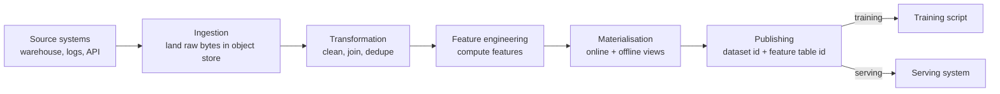
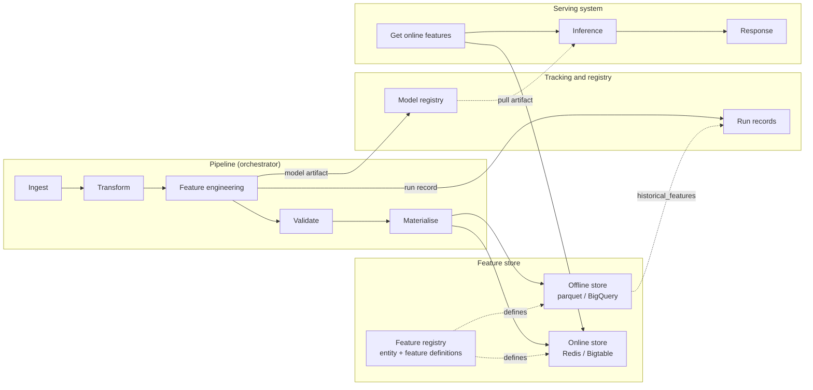

# 16.3 Data pipelines and feature stores

| Field | Value |
|---|---|
| Level | Intermediate |
| Priority tier | 1 |
| Lab venue | GCP / GKE |
| Part | Part 16: MLOps and LLMOps tools and platforms |
| Primary sources | *Designing Machine Learning Systems* (`designing-machine-learning-systems`, Chapters 3, 4, 5); *Machine Learning Platform Engineering* (`machine-learning-platform-engineering`, Chapters 2, 5); *Generative AI on Kubernetes* (`generative-ai-on-kubernetes`, Chapter 2); *Practical MLOps* (`practical-mlops`, Chapters 2, 5) |
| Cross-references | Chapter 16.1 (MLOps foundations); Chapter 16.2 (Data versioning and experiment tracking); Chapter 16.4 (Pipeline orchestration); Chapter 13 (AI storage) |
| Coverage file | `planning/coverage/chapters/16-03.md` |
| Claim & number ledger | `planning/ledgers/16-03.md` |

## Why this matters for AI infrastructure

The previous chapter turned the training script and the dataset into artifacts with permanent addresses. This chapter builds the thing that actually produces those artifacts: the data pipeline. A training script that opens a run record is only as reproducible as the pipeline that fed it the bytes. A feature store is the layer that lets two teams use the same feature definition without rewriting it from scratch.

If you operate a GPU cluster for AI, you operate a data pipeline. The pipeline is what reads the warehouse, joins the tables, computes the features, materialises them online, builds the training matrix, validates the join keys, refreshes the index, and writes the dataset to the bucket the training script will pull. When the pipeline is wrong, the symptom is a model that trains successfully but fails silently in production. When the pipeline is right, the symptom is invisible and the system just works.

```text
Why the pipeline is the bottleneck (DMLS Ch 3; MLPE Ch 2):
- IDC, Algorithmia and Kaggle surveys consistently put data preparation at 60% to 80%
  of an ML project's time and compute, with modelling at 10% to 20% and deployment
  at the remainder. The pipeline is the largest single source of cost.
- A 2020 Anaconda survey of 2,800 data scientists put data cleaning at the task they
  enjoyed least and the task they spent the most time on. The pipeline is also the
  least enjoyable part of the project.
- When a model regresses in production, the most common post-mortem finding is
  "the upstream pipeline changed and the team did not know". Lineage from the live
  model back to the live features is the only fix.
```

Three operational realities make this chapter a platform-team concern rather than a data-science-only concern:

1. **The pipeline runs on the cluster.** It consumes GPU-hours for embeddings, it writes to the distributed filesystem, it reads from the warehouse. The cluster primitives from Parts 1 through 15 are what the pipeline executes on.
2. **The feature store is a service.** Two read paths (online and offline), a metadata layer, an SLA on freshness, and an IAM model that separates who can read features from who can write them. The platform team operates it.
3. **The pipeline is the audit trail.** When the regulator asks "where did this feature come from?", the answer is the pipeline definition in Git, the run record in the orchestrator, and the lineage record in the feature store. None of those answers are produced by a notebook.

**Before a model reaches your cluster, the data pipeline that feeds it has to be a pipeline, not a notebook. A notebook is a one-shot; a pipeline is a versioned DAG with a run record, a feature store contract, and an SLO.**

## Prerequisites and outcomes

### Prerequisites

- Chapter 16.1 (the lifecycle, the four pillars, the promotion gate).
- Chapter 16.2 (data versioning with DVC, run records with MLflow).
- Chapter 13 (AI storage) for the storage primitives the pipeline depends on.
- Familiarity with SQL and basic ETL concepts.

### Outcomes

After completing this chapter you will be able to:

1. Decompose an ML data pipeline into ingestion, transformation, feature materialisation, validation and publishing stages, and place each stage on the right runtime.
2. Build a feature store contract that separates the offline view (for training) from the online view (for serving) while keeping the two views bit-identical for any given timestamp.
3. Wire a pipeline into the orchestrator (Chapter 16.4) with run records that feed the experiment tracker (Chapter 16.2) and a feature store that feeds the serving system (Chapter 15).
4. Validate data at every stage with a small test suite that catches schema drift, null-rate spikes, distribution shift and join-key cardinality changes.
5. Operate a feature store on GKE with online and offline backends, IAM, backup, and freshness SLOs.
6. Extend the pipeline to LLM data: corpus snapshots, chunking policies, embedding indices, and the freshness contract that ties an answer to a corpus version.

---

## 1. The ML data pipeline

### 1.1 Five stages, each with an artifact

A useful pipeline has five stages. Each stage produces an artifact that the next stage consumes. Each artifact has a content hash; each stage has a run record.



The arrows are the pipeline. The artifact that crosses each arrow has a hash; the stage that consumes it verifies the hash before reading. This is the same pattern as DVC's pipeline stages in Chapter 16.2 Section 1.2, applied to data engineering rather than training.

| Stage | Artifact | Hash | Gate |
|---|---|---|---|
| Ingestion | Raw snapshot (parquet, JSON, image shards) in object storage | sha256 of the file or directory | Schema check; row count check; source-system watermark |
| Transformation | Cleaned snapshot, joined on canonical keys | sha256 of the directory | Null-rate check; key cardinality check; freshness check |
| Feature engineering | Feature table (parquet) | sha256 of the table + schema hash | Distribution check; feature-freshness check; leakage check |
| Materialisation | Online store rows + offline parquet | Online store has feature id, value, timestamp | Latency SLO; offline-online parity check |
| Publishing | Dataset id and feature table id | Recorded in metadata DB | End-to-end lineage record; ready for downstream consumers |

The pattern is the same at every stage: an artifact, a hash, a gate. The gate is mechanical; the hash is the proof; the artifact is the address.

### 1.2 Choosing the right runtime for each stage

The five stages have different runtime characteristics. Picking the wrong runtime for a stage is a common pipeline anti-pattern.

| Stage | Typical runtime | Why |
|---|---|---|
| Ingestion | Spark, Dataflow, Flink, dbt | Bulk IO; needs to scale horizontally across many cores |
| Transformation | Spark, Dataflow, DuckDB on a single big node | Joins and aggregates benefit from columnar execution |
| Feature engineering | Same as transformation plus a Python UDF step | Some features need a library call (tokenizer, embedding model) |
| Materialisation | Spark or a custom batch job that writes to online store + offline parquet | Online store is the hot path; offline store is the cold path |
| Publishing | A small Python or Go service that writes to the metadata DB | This is a metadata write, not a data transform |

*Designing Machine Learning Systems* Chapter 3 makes the point that the wrong runtime choice is the most expensive mistake in ML data engineering. Running a feature engineering job that touches an embedding model on a CPU-only Dataflow cluster turns a 20-minute job into a 4-hour job. Running a small metadata write through Spark adds 90 seconds of cluster startup time.

### 1.3 The runtime shortcut: do the simple thing first

The most common mistake when building an ML data pipeline is to over-engineer it. *Practical MLOps* Chapter 2 and *Designing Machine Learning Systems* Chapter 3 both make this point. A pipeline that starts as a single Python script and evolves into a DAG only when it needs to is healthier than a DAG from day one.

```python
# code/part16/min_pipeline.py (shape only)
import hashlib, json, datetime
from pathlib import Path

def ingest(source: str, dest: Path) -> dict:
    """Pull raw data from source, land it in dest, return a snapshot record."""
    raw = Path(source).read_bytes()
    dest.write_bytes(raw)
    return {
        "snapshot_id": hashlib.sha256(raw).hexdigest(),
        "snapshot_time": datetime.datetime.utcnow().isoformat(),
        "source": source,
        "row_count": len(raw.splitlines()),
    }

def transform(snapshot_id: str, raw_path: Path, clean_path: Path) -> dict:
    """Run a deterministic transform; record the new content hash."""
    cleaned = raw_path.read_text().lower().strip()
    clean_path.write_text(cleaned)
    return {
        "dataset_id": f"clean-{snapshot_id[:8]}",
        "content_hash": hashlib.sha256(cleaned.encode()).hexdigest(),
        "parent": snapshot_id,
    }

if __name__ == "__main__":
    snap = ingest("s3://warehouse/customers.parquet", Path("data/raw.parquet"))
    out = transform(snap["snapshot_id"], Path("data/raw.parquet"), Path("data/clean.parquet"))
    print(json.dumps(out, indent=2))
```

This script is the seed of a pipeline. It grows into a DAG when the stages become slow, parallel, or shared across teams. *Designing Machine Learning Systems* Chapter 3 walks through that progression.

### 1.4 Choosing the storage format: row-major vs column-major, text vs binary

The five stages produce artifacts in three storage formats. Picking the wrong format is a quiet but expensive mistake. *Designing Machine Learning Systems* Chapter 3 walks through the trade-off in detail.

| Format | Layout | Strength | Weakness | When to use |
|---|---|---|---|---|
| **CSV** | Row-major, text | Human-readable; ubiquitous; trivially writable | Slow column reads; precision loss on floats; no schema | Small ad-hoc inspection; one-off exports |
| **JSON / JSONL** | Row-major, text | Flexible schema; nested structures supported | Verbose; slow parsing; no column pruning | API payloads; event logs; semi-structured source data |
| **Parquet** | Column-major, binary | Column-pruned reads (only the columns you need); ~2x faster to load and ~6x less storage than CSV for the same data; built-in schema | Not human-readable; slower point writes than CSV | Training data; feature tables; any columnar analytics workload |

The rule of thumb is simple. **Use Parquet for anything the training script or the feature table will read.** CSV and JSON are for ingestion, for inspection, and for the formats your upstream system hands you. The storage savings and the column-pruned reads pay for the migration cost within the first few runs.

A worked example from *Designing Machine Learning Systems* Chapter 3: an `interviews.csv` file of 17,654 rows and 10 columns, 14 MB on disk, becomes a 6 MB Parquet file with the same data. The file loads faster, scans faster on a column-only query, and carries its schema in the metadata. The only operations that get slower are point writes (a single new row), which Parquet does poorly because each write rewrites the column file.

For data the model trains on, Parquet is almost always the right answer. The trade-off becomes interesting again at petabyte scale; Delta Lake, Iceberg and Hudi add a transaction log on top of Parquet that makes point writes and time-travel efficient.

### 1.5 The data model: relational vs NoSQL, and why pipelines matter more than the model

*Designing Machine Learning Systems* Chapter 3 also walks through the data model choice. ML data has historically lived in two worlds: the relational world (warehouse tables, joins, normalisation) and the NoSQL world (documents, graphs, key-value stores). The two are converging — modern warehouses offer JSON support, modern document stores offer secondary indexes — but the operational consequences are still different.

| Property | Relational (warehouse) | NoSQL (document store) | Implication for the ML pipeline |
|---|---|---|---|
| Schema | Enforced by the database | Optional or document-level | Schema check lives in the pipeline, not the store |
| Joins | Native and efficient | Expensive or impossible | Denormalise upstream; the pipeline does the joins |
| Flexibility | Rigid; migrations are heavy | Flexible; documents evolve independently | The pipeline's job is to enforce shape on what the model sees |
| ACID | Strong by default | Often eventual consistency | The pipeline needs idempotent retries and content hashes |

The rule of thumb is that **the data model is less important than the pipeline**. A well-built pipeline can feed either a warehouse or a document store; a poorly-built pipeline will lose data in either. The pipeline's job is to land immutable, hashed snapshots that the next stage can verify regardless of the underlying storage model.

---

## 2. The feature store contract

### 2.1 The two views: online and offline

A feature store solves a specific problem: two systems need the same feature value at the same logical timestamp, but they read it through different APIs.

- The **offline view** is the batch read path. The training script reads a feature table as a parquet file or a BigQuery table. It needs the full history of every entity, joined on entity id and timestamp. It tolerates seconds-to-minutes latency.
- The **online view** is the low-latency read path. The serving system reads a single feature value (or a small set) for one entity, by entity id, and needs the value within milliseconds.

The contract is that the two views return bit-identical values for the same entity id and the same point-in-time timestamp. The implementation is harder than the contract: the offline store is a columnar file, the online store is a key-value store, and the materialisation job that writes to both has to keep them in sync.

```text
Feature store contract (Designing Machine Learning Systems Ch 5; MLPE Ch 5):
- entity (the join key, e.g. user_id)
- feature (the value, e.g. tier_gold)
- timestamp (when the feature was computed; point-in-time correct)
- offline view: SELECT feature FROM feature_table WHERE entity_id = ? AND
  timestamp <= event_time ORDER BY timestamp DESC LIMIT 1
- online view: GET /features?entity_id=user_id&feature=tier_gold -> 0 or 1
- parity: for any (entity_id, event_time) pair, offline_view == online_view
  evaluated at the corresponding online store timestamp
```

*Designing Machine Learning Systems* Chapter 5 walks through the parity problem in detail. The failure mode is two teams using the same feature name with different values because the offline and online paths compute the feature differently. The fix is a single materialisation job that writes both views from the same upstream pipeline.

### 2.2 Point-in-time correctness

The most subtle property of a feature store is point-in-time correctness. When the training script reads a feature for an event that happened in March, it must read the feature value that was true in March, not the value that is true today.

The offline store achieves this by storing the full history of every entity's feature values. The query is "as of timestamp T, what was the value of feature F for entity E?". The online store, by contrast, typically stores only the latest value; serving reads do not need history.

| View | Stores history | Query pattern | Use case |
|---|---|---|---|
| Offline | Yes (or at least N days/weeks/months) | `as_of(event_time)` | Training, backtesting, evaluation |
| Online | Latest value only (or short rolling window) | `current_value` | Low-latency serving |

The materialisation job writes both views from the same upstream pipeline. The job's identity (its run record, its content hash, its commit hash) is the link between the two views.

### 2.3 Feast, Tecton, Vertex AI Feature Store and Databricks Feature Store

Four implementations of the feature store contract are in production use today. They are interchangeable on the contract from Section 2.1; they differ on the operational model.

| Tool | Open source | Online store | Offline store | Best fit |
|---|---|---|---|---|
| **Feast** | Yes | Redis, DynamoDB, Bigtable | BigQuery, Snowflake, Redshift, parquet | Cloud-native teams; OSS-first; low ops cost |
| **Tecton** | No (managed) | DynamoDB, Bigtable | Snowflake, BigQuery | Enterprise teams; managed SLA; time-travel |
| **Vertex AI Feature Store** | No (GCP) | Online store backed by Bigtable | BigQuery | Teams already on GCP |
| **Databricks Feature Store** | No (Databricks) | Online store in Databricks | Delta Lake | Teams already on Databricks |

*Designing Machine Learning Systems* Chapter 5 introduces Feast as the open-source default. *Machine Learning Platform Engineering* Chapter 5 adds a comparison of Tecton and Vertex AI Feature Store. The chapter uses Feast as the worked example because it is open source, self-hostable on GKE, and exercises the full online-offline parity contract.

### 2.4 A Feast entity and feature view, in code

The two resources below define a feature, wire it to a data source, and declare the online store that the serving system will read.

```python
# code/part16/feature_repo/entities.py (shape only)
from feast import Entity

user = Entity(
    name="user_id",
    description="Customer id",
    value_type=STRING,
)

# code/part16/feature_repo/feature_view.py (shape only)
from feast import FeatureView, Field, FileSource, BigQuerySource
from feast.types import Float32, Int64, STRING
from datetime import timedelta

user_features_source = BigQuerySource(
    table="project.churn.user_features_v3",
    timestamp_field="event_timestamp",
)

user_features = FeatureView(
    name="user_features",
    entities=[user],
    ttl=timedelta(days=90),
    schema=[
        Field(name="tier_gold", dtype=Float32),
        Field(name="tenure_days", dtype=Int64),
        Field(name="avg_session_minutes_30d", dtype=Float32),
    ],
    source=user_features_source,
    online=True,
)
```

The training script reads the offline view with `get_historical_features`; the serving system reads the online view with `get_online_features`. Both views are produced by the same upstream pipeline; both are derived from the same content hash.

### 2.5 The feature freshness SLO

A feature has a freshness SLO. The SLO is the maximum age of a feature value in the online store, measured from when the value was computed in the pipeline to when the serving system reads it. The SLO is what tells the on-call engineer when the feature store is broken.

| Feature class | Typical freshness SLO | Why |
|---|---|---|
| Identity features (tier, signup_date) | 1 hour to 1 day | Change rarely |
| Behavioural features (sessions, clicks) | 5 to 60 minutes | Drive recommendation and churn models |
| Real-time features (current_session_active) | Seconds to 1 minute | Power real-time personalisation |

The materialisation job has an SLO too: the time from "the upstream pipeline produced new feature values" to "the online store has the new values". A freshness SLO of 5 minutes requires a materialisation job that runs at least every 5 minutes, with retries, and a freshness check that pages on violation.

**A feature store without a freshness SLO is a feature cache. A feature cache without a freshness SLO is a guess.**

### 2.6 The feature engineering taxonomy

*Designing Machine Learning Systems* Chapter 5 walks through the feature engineering functions that a feature store pipeline typically applies. The taxonomy is useful because each function has a different cost, a different failure mode, and a different requirement for change-proofness.

| Function | What it does | Example | Concern |
|---|---|---|---|
| **Numerical transformations** | Scaling, normalisation, log transform to adjust distribution | `log(amount)` to compress the long tail; standard scaler for Gaussian features | Sensitive to outliers; re-fit scaler on every retraining to avoid drift |
| **Category encoding** | Convert categorical variables to numeric | One-hot, ordinal, label, target encoding | High-cardinality features blow up under one-hot; target encoding leaks if done wrong |
| **Clustering** | Group similar data points; new categorical features | K-means cluster id as a feature | Cluster boundaries drift; refit periodically |
| **Aggregations** | Sum, mean, median, quantiles over windows | 30-day rolling average session minutes | Window length must match the model's downstream usage |
| **PCA / dimensionality reduction** | Project to a lower-dimensional space | PCA on a high-cardinality embedding | Loses interpretability; components must be saved and versioned |
| **Feature construction** | Interaction terms, polynomial terms, ratios | `tier_x_tenure`, `clicks / impressions` | Combinatorial explosion; require feature selection downstream |
| **Embedding lookups** | Pre-trained embedding for a categorical | User embedding, product embedding | Embedding model version must be in the feature metadata |

Three concerns from *Designing Machine Learning Systems* Chapter 5 apply to every function in the table.

- **Change-proof features.** A feature that uses a definition tied to the current business model will silently drift when the business model changes. Example: an economic indicator that stops being published. The fix is to version the definition and refuse to register a feature that has no version history.
- **Edge case representation.** The training distribution is rarely the production distribution. A feature that has never seen a value of zero or a value of `INT_MAX` will produce surprising outputs when the production traffic hits those values. The fix is a test suite that includes edge cases.
- **Feature complexity tradeoff.** More features improve robustness up to a point, then plateau. The marginal feature often adds complexity without improving accuracy. The fix is a feature importance audit on every promotion; unused features are removed.

The taxonomy matters because the feature store's job is to make each function's output reproducible across the offline and online views. If the offline store computes `log(amount)` with one library and the online store computes it with another, the parity check fails and the model degrades silently. The fix is a single helper function that both views call; the helper is versioned and signed.

---

## 3. Validation: catching the silent bugs

### 3.1 The four checks every stage runs

Data validation is the cheap insurance that catches the bugs that produce silent regressions. *Designing Machine Learning Systems* Chapter 3 introduces four checks that every stage of the pipeline runs.

| Check | What it does | Where it runs | Cost |
|---|---|---|---|
| **Schema check** | Validates column names and types against an expected schema | Every stage that reads or writes a dataframe | Cheap; runs in milliseconds |
| **Null-rate check** | Detects spikes in null values for any column | Every stage that produces a dataframe | Cheap; runs in seconds |
| **Distribution check** | Detects shifts in mean, std, quantiles, or category frequency | Every stage that produces a dataframe | Moderate; runs in seconds to minutes |
| **Join-key check** | Validates cardinality and referential integrity of join keys | Every stage that joins two dataframes | Cheap to moderate |

The tools that implement these checks are Great Expectations, deequ (AWS), TensorFlow Data Validation (TFDV), and Soda Core. *Designing Machine Learning Systems* Chapter 3 walks through Great Expectations as the open-source default; *Machine Learning Platform Engineering* Chapter 2 introduces Soda Core as a YAML-first alternative.

### 3.2 A Great Expectations suite, in code

A small expectation suite catches the four most common bugs. It runs in the pipeline after the transformation stage; it fails the run if any expectation fails.

```python
# code/part16/gx_suite.py (shape only)
import great_expectations as gx

context = gx.get_context(mode="file", project_root_dir="./gx")
suite = context.suites.add(gx.ExpectationSuite(name="churn_clean_suite"))

suite.add_expectation(gx.expectations.ExpectColumnsToMatchSet(
    column_set=["user_id", "tier", "tenure_days", "churned"],
    exact_match=True,
))
suite.add_expectation(gx.expectations.ExpectColumnValuesToNotBeNull(
    column="user_id", mostly=1.0,
))
suite.add_expectation(gx.expectations.ExpectColumnValueLengthsToBeBetween(
    column="tier", min_value=1, max_value=16,
))
suite.add_expectation(gx.expectations.ExpectTableRowCountToBeBetween(
    min_value=10_000, max_value=10_000_000,
))

batch = context.get_batch_list(batch_kwargs={"data_asset_name": "churn_clean"})[0]
results = context.run_validation_operator(
    "action_list_operator", assets_to_validate=[batch], suite=suite
)
if not results["success"]:
    raise SystemExit("DATA VALIDATION FAILED")
```

The pattern is the same as the promotion gate in Chapter 16.1: a function whose return value determines whether the pipeline advances. A data validation gate is a promotion gate for data.

### 3.3 Leakage checks: the silent killer

The most expensive silent failure is data leakage: a feature that contains information from the future of the prediction target. A model that trains on a leaked feature produces great offline metrics and fails in production.

*Designing Machine Learning Systems* Chapter 4 walks through leakage detection. The shape of the check is: for each feature, verify that no row in the feature table has a timestamp after the event it is supposed to predict.

```text
Leakage check (DMLS Ch 4; MLPE Ch 2):
For each (entity_id, event_time) pair in the training set:
  - Read feature F from the offline store as_of(event_time).
  - Verify that the feature's source timestamp <= event_time.
  - Refuse to include F in the training set if any row violates the check.
```

The check is mechanical. It is the difference between a model that wins offline and a model that wins in production.

### 3.4 Labels: hand, natural, weak, and the sampling patterns that feed them

A feature store delivers inputs; a labelled dataset delivers the target. *Designing Machine Learning Systems* Chapter 4 walks through the four label sources that a production pipeline draws from, plus the sampling patterns that turn streaming data into a finite training set.

| Label source | How labels are produced | Examples | Cost |
|---|---|---|---|
| **Hand labels** | Human annotators label the data | Spam classification with 20 crowd annotators; medical imaging with board-certified radiologists | Slow (months for serious domains); expensive for expert labels; a privacy risk when shipped to third parties |
| **Natural labels** | The system observes the outcome directly | Recommender click / no-click; stock price prediction after 2 minutes; fraud dispute after the dispute window closes | Cheap; arrives only after the feedback loop |
| **Weak supervision** | Heuristic labelling functions written by domain experts | Keyword match for spam; rule-based triage for support tickets; model outputs as labels | No ground truth required; labels are noisy; conflicts between LFs need reconciliation |
| **Transfer learning** | A pretrained model supplies labels for your task | Embedding model labels text by similarity; foundation-model zero-shot labelling | Quality depends on the source model; licensing and bias transfer with the labels |

The four sources are not exclusive. A serious production pipeline uses hand labels for the high-stakes cases, natural labels for the bulk of the data, weak supervision to fill gaps, and transfer learning for the long tail. The pipeline's job is to combine them into one labelled dataset whose lineage is recorded so each example can be traced back to its source.

### 3.5 Feedback loop length: a design variable

The time between "the model serves a prediction" and "the system knows whether the prediction was right" is the **feedback loop length**. *Designing Machine Learning Systems* Chapter 4 names this as a design variable that affects everything from monitoring to retraining.

| Feedback loop length | Examples | Pipeline consequence |
|---|---|---|
| Seconds to minutes | Ad click-through; product recommendation click; chatbot thumbs-up/down | Drift detected within an hour; retraining trigger can be drift-based |
| Hours | Blog post recommendation; YouTube video view-through | Drift detected within a day; retraining trigger is daily |
| Weeks | Stitch Fix clothing recommendation; subscription churn prediction | Drift detection only on aggregate metrics; retraining trigger is weekly |
| Months | Fraud dispute (1-3 month window); loan default prediction | Drift detection is slow; retraining is quarterly; new model value is back-tested, not A/B-tested |

The shorter the feedback loop, the closer the pipeline can run to real-time. A feedback loop of seconds supports drift-triggered retraining. A feedback loop of months forces the pipeline to run on a fixed schedule and accept that drift will be detected late.

A useful discipline: when the feedback loop is short, invest in real-time drift detection and a fast retraining trigger. When the feedback loop is long, invest in A/B testing the new model against the baseline before promotion, because the post-mortem will be 90 days late.

### 3.6 Sampling from a stream: reservoir and importance sampling

When the data is a stream — tweets, transactions, log lines — the pipeline cannot keep all of it. Two patterns from *Designing Machine Learning Systems* Chapter 4 are worth knowing.

- **Reservoir sampling.** You want a sample of size `k` from a stream whose total length you do not know in advance. The algorithm: put the first `k` elements in the reservoir; for each subsequent element `n`, pick a random integer `i` in `[1, n]`; if `i <= k`, replace reservoir element `i` with element `n`. Every element ends up in the reservoir with probability `k/n`, and the algorithm can be stopped at any time without biasing the sample. The pattern is the standard answer for streaming logs and event collections.
- **Importance sampling.** You want to sample from a distribution `P(x)` that is expensive to sample from, but you have an easier-to-sample distribution `Q(x)`. Sample from `Q(x)` and weight each sample by `P(x)/Q(x)`. The weighted average over `Q` converges to the expected value over `P`. The pattern is the answer for "we need to estimate how the model would behave under a rare condition we cannot sample from directly".

Both patterns assume the pipeline records the sampling weight alongside each example. The weight becomes a feature in the training set; the model can learn to ignore it, or the training loop can re-weight by it.

### 3.7 Data lineage: where the data came from

*Designing Machine Learning Systems* Chapter 4 and *Engineering AI Systems* Chapter 5 both name data lineage as a first-class pipeline artefact. Lineage is the record of where each example came from, how it was transformed, and where it went. Without lineage, the pipeline cannot answer the post-mortem question "which upstream source produced the bad data?".

| Lineage metadata | What it tells you | Where it lives |
|---|---|---|
| Source system | Which warehouse / API / log produced the row | Ingestion metadata DB |
| Snapshot id | Which pull of the source produced the row | DVC / lakeFS / Pachyderm |
| Transform id | Which version of the cleaning code transformed the row | Pipeline run record |
| Annotator id | Who labelled the row (if hand-labelled) | Labelling database |
| Downstream consumers | Which models / features / dashboards read the row | Feature store metadata |

The tools that implement lineage are Apache Atlas, Collibra, DataHub, and Marquez. *Engineering AI Systems* Chapter 5 names Atlas and Collibra as the established enterprise options; DataHub and Marquez are the newer open-source options popular with platform teams that prefer to self-host. The lineage database feeds both the model registry (each model version records which dataset version it trained on) and the audit log (the regulator's "show me every model that ever saw this PII" query is answered from the lineage graph).

The pattern is the same as every other pillar in this chapter: the artefact has an id, the id points to lineage, and the lineage points to the source. The id is the address; the lineage is the proof.

### 4.1 The pipeline as a DAG

Once the stages become shared or long-running, they move into an orchestrator. The orchestrator is the system that runs the DAG, retries failed stages, surfaces run records, and feeds the tracker. We treat it in detail in Chapter 16.4; the integration points in this chapter are three.

| Integration | What crosses it | What it carries |
|---|---|---|
| Pipeline → Tracker | Each stage's run record | Stage name, params, metrics, tags (data hash, commit, env) |
| Pipeline → Registry | A model artifact | The artifact uri + the lineage record |
| Pipeline → Feature store | A materialised feature table | Entity, feature, timestamp, value |

*Practical MLOps* Chapter 5 (AutoML and KaizenML) and *Designing Machine Learning Systems* Chapter 10 walk through the integration patterns. The pattern that survives is the same one as Chapter 16.2: every artifact has an id, every stage has a gate, every gate is mechanical.

### 4.2 The serving system reads from the feature store

The serving system does not read the warehouse. The serving system reads the feature store's online view. The contract is that the online view is always at least as fresh as the freshness SLO, and that the value returned for a given entity id is the same value the offline view would have returned at the timestamp of the latest materialisation.

```python
# code/part16/serve_with_feast.py (shape only)
from feast import FeatureStore

store = FeatureStore(repo_path="feature_repo")

def serve(user_id: str) -> dict:
    features = store.get_online_features(
        features=[
            "user_features:tier_gold",
            "user_features:tenure_days",
            "user_features:avg_session_minutes_30d",
        ],
        entity_rows=[{"user_id": user_id}],
    ).to_dict()
    return features
```

The serving system calls `get_online_features` on every request. The feature store answers from a key-value lookup; the serving system passes the values to the model. The training pipeline reads from the offline view with `get_historical_features`; the two reads return bit-identical values for the same entity id at the same point-in-time.

### 4.3 The Mermaid: pipeline, feature store, and serving



The double-arrows are the contracts. The pipeline writes both views of the feature store from one upstream job; the serving system reads the online view while training reads the offline view; both reads return bit-identical values.

**The feature store is the contract between training and serving. Break the contract and the two views drift; the model that wins offline loses in production.**

---

## 5. LLM data pipelines: corpus, chunking, embeddings, index

### 5.1 Four artifacts unique to LLM data

LLMOps adds four artifacts to the pipeline that classical MLOps does not have.

1. **The corpus snapshot.** The raw text or documents the application reads. Versioned by content hash; immutable; soft-delete.
2. **The chunked corpus.** The corpus split into chunks (typically 200 to 2000 tokens) with metadata (source id, position, document section). The chunking policy is itself an artifact with a version.
3. **The embedding model.** A model that produces embeddings for chunks and queries. The model is a registry entry (Chapter 16.1, 16.6).
4. **The vector index.** The data structure that maps chunk id to embedding vector. The index has a snapshot id; the snapshot id is bound to the corpus snapshot id, the chunking policy version, and the embedding model id.

```text
LLM data pipeline stages (Generative AI on Kubernetes Ch 2; LLMOps Ch 4):
1. Ingest corpus -> corpus snapshot (content hash, source system, snapshot time)
2. Chunk corpus -> chunked corpus (chunk size, overlap, metadata fields)
3. Embed chunks -> embedding table (chunk id, vector, model id, hash of model)
4. Build index -> index snapshot (vector store, corpus snapshot id, model id)
5. Validate -> checks: chunk count, embedding dimensionality, recall on a query set
```

### 5.2 The index snapshot is the new dataset id

For a RAG application, the answer to a query depends on three things: the prompt template, the embedding model, and the index snapshot. The index snapshot is the equivalent of the dataset id for a classical ML model.

*LLMOps* Chapter 4 makes the point that an index without a snapshot id is unreproducible in the same way that a dataset without a hash is unreproducible. The fix is to bind the index snapshot id to the corpus snapshot id, the embedding model id, and the chunking policy version.

```python
# code/part16/index_metadata.py (shape only)
import hashlib, json

def index_snapshot_id(corpus_hash: str, embedding_model_id: str,
                      chunking_policy_version: str) -> str:
    """Compute the index snapshot id as a content hash of its three inputs."""
    payload = json.dumps({
        "corpus_hash": corpus_hash,
        "embedding_model_id": embedding_model_id,
        "chunking_policy_version": chunking_policy_version,
    }, sort_keys=True).encode()
    return hashlib.sha256(payload).hexdigest()
```

The serving system reads the index snapshot id; the audit trail shows the corpus snapshot id and the embedding model id that produced it. A regression in answer quality points to one of three places: the corpus changed, the embedding model changed, or the chunking policy changed.

### 5.3 Freshness for retrieval indices

The freshness SLO for a vector index is different from the freshness SLO for a feature. A feature value is true until the next computation; a vector index is stale when the corpus changes.

| Index class | Freshness SLO | Trigger |
|---|---|---|
| Static knowledge base (documentation) | 1 day to 1 week | Scheduled rebuild |
| Frequently updated corpus (news, products) | 1 hour to 1 day | Event-driven rebuild on corpus write |
| Streaming corpus (chat, logs) | Seconds to minutes | Streaming index update |

*Generative AI on Kubernetes* Chapter 2 walks through the trade-off between index freshness and rebuild cost. A daily rebuild is the cheapest default. A streaming rebuild is the most expensive and the most correct. The middle ground is event-driven: rebuild the index for the changed partition when a write happens.

### 5.4 Validation for LLM data

The four checks from Section 3 still apply, but two new ones matter for LLM data.

| Check | What it does |
|---|---|
| **Recall check** | A held-out set of query/chunk pairs; the index should return the chunk in the top-K for K percent of the queries |
| **Faithfulness check** | A held-out set of query/context/answer triples; the LLM answer should be supported by the retrieved context (LLM-as-judge or a smaller fine-tuned model) |

The recall check catches index corruption; the faithfulness check catches retrieval staleness. Both are necessary; neither is sufficient.

---

## 6. Operating the pipeline and the feature store on GKE

### 6.1 The components

The pipeline and feature store decompose cleanly across a GKE cluster.

| Component | Where it runs | Backing store | SLO |
|---|---|---|---|
| Orchestrator (Argo, Airflow, KFP, Flyte) | Kubernetes Deployment | Postgres | Stage-run latency p99 < 1 minute |
| Spark/Dataflow (transformation) | GKE Autopilot or a Spark on K8s operator | Object storage, distributed FS | Stage completion before SLA |
| Materialisation job | Kubernetes CronJob or Argo sensor | Object storage, Redis/Bigtable | Feature freshness SLO (5 to 60 minutes) |
| Feature store (Feast) | Kubernetes Deployment | Redis/Bigtable + BigQuery/parquet | p99 read latency < 10 ms online; p99 read latency < 30 s offline |
| Validation suite | Part of the orchestrator DAG | None (logs to tracker) | Stage failure on violation |
| Great Expectations data docs | S3/GCS bucket | Static site | Daily publish |

### 6.2 IAM and secrets

The IAM model has four roles.

| Role | Who | What they can do |
|---|---|---|
| `pipeline.writer` | Pipeline service accounts | Read source systems; write to object storage; write to feature store |
| `pipeline.reader` | Data scientists, dashboards | Read feature store offline; read pipeline run records |
| `serving.reader` | Serving system service accounts | Read feature store online |
| `pipeline.admin` | Platform team | Define entities, feature views, sources |

The split between writer and reader mirrors the registry split from Chapter 16.2. A data scientist who can both write to the pipeline and read from the feature store can produce a dataset that disagrees with what the serving system reads.

Secrets are read from Vault or Secret Manager via External Secrets Operator; rotation is automatic; the secrets are mounted as environment variables, never baked into images.

### 6.3 Observability of the pipeline

The pipeline is a service. It has metrics, logs and alerts.

| Metric | Why it matters | Alert |
|---|---|---|
| Stage duration p99 | Catch slow stages before they miss SLA | > 2x baseline for 3 runs |
| Stage failure rate | Catch a single bad upstream change | > 0 for 5 minutes |
| Feature freshness (online) | Catch stale features before they degrade the model | > freshness SLO for 10 minutes |
| Offline-online parity | Catch drift between the two views | > 0 differences in the parity check |
| Materialisation lag | Catch a backlog in the materialisation job | > 30 minutes |

The parity check is the most important. It runs hourly; it picks a random sample of (entity_id, timestamp) pairs; it reads the offline view and the online view; it asserts the values are bit-identical. Any drift is a five-alarm fire.

**Run the pipeline as a production service. Give the stages SLOs. Page on violations. The pipeline is the audit trail; if it is broken, nothing else works.**

---

## 7. How it fails

Six failure modes recur. Each has a name, a symptom, a diagnosis and a fix.

### 7.1 "The feature store says the user is gold, the warehouse says silver"

**Symptom:** Two dashboards disagree on the customer's tier. The serving system returns one value; the offline report returns another. The model that trained on the offline report loses accuracy in production.

**Diagnosis:** The online store and the offline store were populated by different jobs. The offline store was rebuilt last night; the online store was rebuilt a week ago. The two views have drifted.

**Fix:** Single materialisation job that writes both views. Hourly parity check that compares the two views for a sample of entities. Alert on any drift; treat drift as a P1.

### 7.2 "The training run used a 30-day-old feature snapshot"

**Symptom:** The model trains successfully. The offline metrics look great. The first day in production, accuracy is 10 points below baseline. The on-call opens the run record and finds the offline feature table is dated 30 days before the training date.

**Diagnosis:** The feature pipeline ran on a 30-day cycle. The training script picked the most recent snapshot, which happened to be the start of the cycle. The features in the snapshot are not the features the model will see in production today.

**Fix:** Daily feature pipeline with a freshness SLO. The training script refuses to read a feature snapshot older than the freshness SLO. The freshness check is a mechanical gate in the pipeline.

### 7.3 "The chunking policy silently changed"

**Symptom:** The RAG application returns good answers for two weeks, then starts returning truncated passages. The corpus has not changed; the embedding model has not changed.

**Diagnosis:** A data scientist updated the chunking policy from 512-token chunks with 64-token overlap to 1024-token chunks with no overlap. The change was committed to the chunking repo, but the index was not rebuilt. The serving system is reading the old index; the policy says new chunks.

**Fix:** Bind the index snapshot id to the chunking policy version. Refuse to serve if the policy version in the index metadata does not match the policy version in the chunking repo. A policy change forces an index rebuild.

### 7.4 "The pipeline crashes on a missing column"

**Symptom:** The pipeline ran fine for six months. This morning the ingestion stage failed. The error: `KeyError: 'expected_column'`. The upstream system removed the column without notice.

**Diagnosis:** The schema check was not enabled. The pipeline silently consumed the bad data; the next stage crashed.

**Fix:** Enable schema validation at every stage. Treat any schema change as a breaking change that requires a pull request to the pipeline definition. Use schema evolution (Avro, Protobuf) where the upstream system supports it.

### 7.5 "The feature store is hot-spotting on a single key"

**Symptom:** Online feature reads are fast for most entities, but a single entity id (a power user, a corporate account) is taking 30 seconds per read. The Redis cluster is fine; latency is isolated to that entity.

**Diagnosis:** The feature definition for that entity produces a list with millions of values; the online store is fetching the whole list for every read. The data shape is wrong for the online store.

**Fix:** Aggregate at materialisation time. Store the aggregated value, not the list. Add a row-size check at materialisation that refuses features whose online value exceeds a threshold.

### 7.6 "Two teams are using two feature stores"

**Symptom:** Two teams each built their own feature store with their own feature definitions for the same concept. The two stores disagree on which customers are "active"; the two teams' models disagree on which customers to target.

**Diagnosis:** There is no shared feature catalogue. Each team's pipeline writes to its own store; nobody owns the canonical definition.

**Fix:** Adopt a shared feature catalogue as a platform service. A feature cannot be registered in a team's private store without being declared in the catalogue first. The catalogue owns the canonical definition; the team's store reads from the catalogue's materialisation job.

---

## 8. Hands-on lab

This lab extends Chapter 16.2 by adding a Feast feature store and a materialisation job. It runs on GCP / GKE. The lab is **untested** in this repository; commands and YAML are a working template.

### 8.1 Prerequisites

- Chapter 16.2 lab completed (MLflow + DVC + signed registry).
- A Feast installation on GKE (Helm chart available).
- A Redis cluster for the online store (Memorystore for Redis is the GCP managed option).
- A BigQuery dataset for the offline store (or a parquet bucket in GCS).

### 8.2 Step 1: define an entity and a feature view

```bash
feast init feature_repo
cd feature_repo
# Add entity and feature view from Section 2.4
feast apply
# expected: entities and feature views registered with Feast
```

### 8.3 Step 2: load historical features for a training run

```python
# code/part16/load_training_features.py (shape only)
from feast import FeatureStore

store = FeatureStore(repo_path="feature_repo")
training_df = store.get_historical_features(
    entity_df="SELECT user_id, event_timestamp FROM churn.events WHERE event_date >= '2024-01-01'",
    features=[
        "user_features:tier_gold",
        "user_features:tenure_days",
        "user_features:avg_session_minutes_30d",
    ],
).to_df()
print(training_df.shape)
# expected: ~10,000 rows with three feature columns and the entity/timestamp columns
```

### 8.4 Step 3: materialise features to the online store

```bash
CURRENT_TIME=$(date -u +"%Y-%m-%dT%H:%M:%S")
feast materialize-incremental $CURRENT_TIME
# expected: a materialisation run that writes to Redis; logs show row counts
```

### 8.5 Step 4: read online features from the serving system

```python
# code/part16/read_online.py (shape only)
from feast import FeatureStore

store = FeatureStore(repo_path="feature_repo")
features = store.get_online_features(
    features=[
        "user_features:tier_gold",
        "user_features:tenure_days",
        "user_features:avg_session_minutes_30d",
    ],
    entity_rows=[{"user_id": "user-12345"}],
).to_dict()
print(features)
# expected: a dict with three keys (the features) and one value (1)
```

### 8.6 Step 5: wire the pipeline DAG into Argo Workflows

```yaml
# code/part16/feature_pipeline.yaml (shape only)
apiVersion: argoproj.io/v1alpha1
kind: Workflow
metadata:
  generateName: feature-pipeline-
spec:
  entrypoint: pipeline
  templates:
    - name: pipeline
      dag:
        tasks:
          - name: ingest
            template: ingest
          - name: transform
            template: transform
            dependencies: [ingest]
          - name: validate
            template: validate
            dependencies: [transform]
          - name: materialise
            template: materialise
            dependencies: [validate]
```

```bash
argo submit -n mlops feature_pipeline.yaml
argo list -n mlops
# expected: a workflow run with four stages; "materialise" is the last stage
```

### 8.7 Step 6: add an LLM data stage

```bash
# Ingest a small corpus, chunk it, embed it, build an index
python code/part16/build_index.py --corpus gs://my-corpus/snap1 --output gs://my-index/snap1
# expected: an index snapshot id printed; an entry in the index metadata table
```

### 8.8 What to record

After the lab, you should be able to answer five questions in five seconds each:

1. What is the feature view name for `user_features`?
2. What is the entity id and what is its type?
3. What is the freshness SLO and when was the last materialisation?
4. What is the offline-online parity check result for the last hour?
5. What is the index snapshot id for the RAG corpus, and what corpus hash is it bound to?

If any of these takes more than 30 seconds to answer, the pipeline or the feature store is still at notebook level. The lab is **untested** against a live GKE cluster.

---

## Exercises

1. **Add a freshness check as a CI gate.** Write a script that reads the most recent feature snapshot's timestamp from the metadata DB and fails if it is older than the freshness SLO. Wire the script into the training pipeline as a precondition. *Solution sketch:* `datetime.utcnow() - snapshot_time > timedelta(minutes=freshness_slo)`; raise `SystemExit` on violation; the orchestrator marks the stage as failed.
2. **Run a parity check between the offline and online views.** Pick a sample of 1000 (entity_id, timestamp) pairs; for each, read the offline view as_of(timestamp) and the online view at the corresponding online store timestamp; assert the values are equal. *Solution sketch:* a Spark job that joins the offline parquet with a Redis read; the diff is reported as a metric.
3. **Add a leakage check.** For each feature in the training set, verify that no row's source timestamp exceeds its event timestamp. Refuse to include any feature that violates the check. *Solution sketch:* a Great Expectations expectation that compares `source_timestamp <= event_timestamp`; fail the suite on violation.
4. **Bind the index snapshot to the chunking policy version.** Compute `index_snapshot_id = sha256(corpus_hash + embedding_model_id + chunking_policy_version)`. Refuse to serve if the policy version in the index metadata does not match the policy version in the chunking repo. *Solution sketch:* the function from Section 5.2; a CI check that compares the index metadata to the current policy.
5. **Wire a Great Expectations suite into the orchestrator.** Run the expectations after the transformation stage; fail the stage on any violation; publish the data docs as a side effect. *Solution sketch:* a step in the Argo DAG that runs the script from Section 3.2; the orchestrator marks the step as failed; the docs are uploaded to GCS.
6. **Add a "feature registry" UI.** Stand up a small web page that lists all entities and feature views, with their freshness SLO, last materialisation time, and lineage. *Solution sketch:* a Flask or FastAPI service that queries the Feast metadata; a static page that calls the API.

---

## Checkpoint questions

<details><summary>1. What five stages are in an ML data pipeline?</summary>
Ingestion (raw bytes into object storage), transformation (clean, join, dedupe), feature engineering (compute features), materialisation (online + offline views), and publishing (dataset id + feature table id). Each stage produces an artifact with a content hash; each stage has a gate.
</details>

<details><summary>2. Why is a pipeline better than a notebook?</summary>
A pipeline is a versioned DAG with a run record, a feature store contract, and an SLO. A notebook is a one-shot. The pipeline answers "where did this data come from?" in seconds; the notebook answers it only as long as the engineer who wrote it remembers.
</details>

<details><summary>3. What is the difference between the online and offline views of a feature store?</summary>
The offline view is a columnar file or table that stores the full history of every entity's feature values; the training script reads it as_of(event_time). The online view is a key-value store that returns the latest value for one entity id; the serving system reads it on every request. The two views must return bit-identical values for the same entity at the same point-in-time.
</details>

<details><summary>4. What is point-in-time correctness?</summary>
For any (entity_id, event_time) pair, the offline view returns the feature value that was true at event_time, not the value that is true today. The online view typically returns only the latest value; serving reads do not need history. Point-in-time correctness is what prevents label leakage in training.
</details>

<details><summary>5. What four checks should every stage of the pipeline run?</summary>
Schema check (column names and types), null-rate check (spikes in null values), distribution check (shifts in mean, std, quantiles or category frequency), and join-key check (cardinality and referential integrity). The cheapest insurance against silent regressions; the same checks that catch the silent bugs that ruin production models.
</details>

<details><summary>6. What is data leakage and why is it the silent killer?</summary>
Leakage is a feature that contains information from the future of the prediction target. A model trained on a leaked feature wins offline and loses in production. The fix is a mechanical check that compares feature source timestamp to event timestamp for every training row.
</details>

<details><summary>7. What is the index snapshot id?</summary>
For a RAG application, the index snapshot id is the content hash of (corpus_hash, embedding_model_id, chunking_policy_version). It is the equivalent of the dataset id for a classical ML model. An index without a snapshot id is unreproducible; an answer that cites an index without a snapshot id is unauditable.
</details>

<details><summary>8. Why is the freshness SLO for a vector index different from the freshness SLO for a feature?</summary>
A feature value is true until the next computation; a vector index is stale when the corpus changes. The freshness SLO for an index is the maximum age of the index relative to the corpus, not relative to the last computation. Streaming indices need seconds-to-minutes freshness; static knowledge bases need days.
</details>

<details><summary>9. What is offline-online parity and why is it the most important alert?</summary>
Parity means the offline and online views return the same value for the same (entity_id, timestamp) pair. The parity check is a sample-based hourly job that compares the two views. Drift is a five-alarm fire because every model that trained on the offline view is now wrong about the world.
</details>

<details><summary>10. What is the cheapest valid pipeline?</summary>
A single Python script that reads, transforms, validates and writes a dataset with a content hash. It evolves into a DAG when stages become slow, parallel, or shared. The most expensive mistake in ML data engineering is over-engineering the pipeline on day one.
</details>

<details><summary>11. What runtime should you use for each pipeline stage?</summary>
Ingestion and transformation on Spark, Dataflow or DuckDB; feature engineering on the same plus Python UDFs; materialisation on a batch job that writes both online and offline; publishing as a small Python or Go service that writes to the metadata DB. The wrong runtime choice is the most expensive mistake.
</details>

<details><summary>12. What IAM model protects the feature store from drift?</summary>
The writer (pipeline service accounts) can read sources and write features; the reader (data scientists, dashboards) can read features but cannot write. The serving system has a separate online-reader role. A writer who can also read can produce a dataset that disagrees with what the serving system sees.
</details>

<details><summary>13. What is the difference between the online and offline backends?</summary>
The online backend is a low-latency key-value store (Redis, Bigtable, DynamoDB) that serves one entity id at a time. The offline backend is a columnar file or table (BigQuery, Snowflake, parquet) that serves batches. The materialisation job writes both from one upstream pipeline.
</details>

<details><summary>14. Why bind the chunking policy version into the index snapshot id?</summary>
Because the chunking policy is an artifact; changing the policy without rebuilding the index leaves the serving system answering questions with chunks from a different policy than the one declared in the repo. The fix is a CI check that refuses to serve if the policy version in the index does not match the repo.
</details>

<details><summary>15. What is the cost of the four checks in Section 3?</summary>
Schema checks are cheap (milliseconds). Null-rate checks are cheap (seconds). Distribution checks are moderate (seconds to minutes). Join-key checks are cheap to moderate. The total cost of running all four checks at every stage is small compared to the cost of a silent regression in production.
</details>

<details><summary>16. What does "Great Expectations" do and where does it run?</summary>
Great Expectations runs a suite of expectations against a dataframe and reports pass/fail per expectation. It runs as a step in the orchestrator DAG after the transformation stage. The suite is a Python file checked into Git; the data docs are published as a static site.
</details>

<details><summary>17. What is a recall check for a vector index?</summary>
A held-out set of (query, chunk) pairs; the index should return the chunk in the top-K for K percent of the queries. The check runs after every index rebuild; a regression in recall points to a broken embedding model or a corrupted corpus.
</details>

<details><summary>18. Why is freshness a metadata field rather than a computation?</summary>
Because the freshness SLO is what tells the on-call engineer when the feature store is broken. A freshness SLO that is not a metric cannot page. A freshness SLO that is not a contract cannot be enforced.
</details>

<details><summary>19. What is the difference between data versioning and pipeline versioning?</summary>
Data versioning tracks the bytes (content hashes, immutable snapshots). Pipeline versioning tracks the DAG definition (the orchestration code in Git). The two are complementary; the pipeline definition plus the data hashes is what reproduces a training run.
</details>

<details><summary>20. What is the difference between a feature store and a data warehouse?</summary>
A data warehouse stores raw and curated data; a feature store stores features (curated values ready for ML) with point-in-time correctness and online-offline parity. The feature store is purpose-built for ML serving and training; the warehouse is general-purpose. The pipeline that feeds the feature store reads from the warehouse.
</details>

---

## Sources and review notes

- *Designing Machine Learning Systems* (`designing-machine-learning-systems`, Chapters 3, 4, 5, 10). Source for the five-stage pipeline, the row-major vs column-major storage trade-off (CSV vs Parquet), the relational vs NoSQL data model comparison, the four validation checks, the four label sources (hand, natural, weak supervision, transfer learning), the feedback loop length as a design variable, the reservoir and importance sampling patterns, the data lineage requirement, the feature store contract, the offline-online parity requirement, the point-in-time correctness property, the feature engineering taxonomy, and the data leakage detection. Chapter 3 is approximately 11,000 words; Chapter 4 approximately 13,500 words; Chapter 5 approximately 9,300 words; Chapter 10 approximately 13,500 words.
- *Machine Learning Platform Engineering* (`machine-learning-platform-engineering`, Chapters 2, 5). Source for the Spark/Dataflow/Flink runtime choices, the Feast deployment patterns, the IAM model, and the Argo Workflows integration. Chapter 2 is approximately 7,000 words; Chapter 5 is approximately 9,000 words.
- *Generative AI on Kubernetes* (`generative-ai-on-kubernetes`, Chapter 2). Source for the LLM data pipeline stages (corpus snapshot, chunking, embedding, index), the freshness SLOs for vector indices, and the integration with vector databases. Chapter 2 is approximately 12,700 words.
- *Practical MLOps* (`practical-mlops`, Chapters 2, 5). Source for the minimum viable pipeline, the integration patterns with the orchestrator and the registry, and the AutoML and KaizenML chapter's discussion of feature pipelines as ML pipelines. Chapter 2 is approximately 9,500 words; Chapter 5 approximately 8,800 words.
- *Engineering AI Systems: Architecture and DevOps Essentials* (`engineering-ai-systems-architecture-and-devops-essentials`, Chapter 5). Source for the data lineage tools (Apache Atlas, Collibra) and the data lake / data warehouse / data lakehouse distinction that informs the storage-format choice.

### Cross-references to other handbook chapters

- Chapter 16.1 Section 4.3 for the promotion gate function that the validation gate mirrors.
- Chapter 16.2 Section 1 for the data versioning contract that the pipeline inherits.
- Chapter 16.4 for the orchestrator that runs the DAG.
- Chapter 13 (AI storage) for the object-store and distributed-filesystem choices.
- Chapter 15.6 (Triton Inference Server) for the serving system that reads the online view.

### Migrated from `nvidia-devops`

The five-stage pipeline diagram and the LLM data pipeline stages draw on the patterns in Volume 25 chapters 3 and 5. The wording has been rewritten in the handbook's voice.

### Explicitly labelled inferences

- The runtime assignment table in Section 1.2 is an inference from each tool's documentation and from *Designing Machine Learning Systems* Chapter 3; specific workloads may favour different runtimes.
- The 5-to-60-minute freshness SLO for behavioural features in Section 2.5 is a starting point drawn from *Designing Machine Learning Systems* Chapter 5; specific SLAs depend on the use case.
- The recall and faithfulness check thresholds in Section 5.4 are inferences from *LLMOps* Chapter 4 and *Generative AI on Kubernetes* Chapter 2; specific thresholds depend on the application.

### Not verified on live hardware

- The lab in Section 8 is **untested** against a live GKE cluster in this repository.
- The Memorystore for Redis and BigQuery quotas and pricing in Section 6.1 are quoted from current GCP documentation and may have changed; verify before deploying.
- The Feast version and Helm chart version assumed in the lab should be pinned against the current Feast release before production use.
