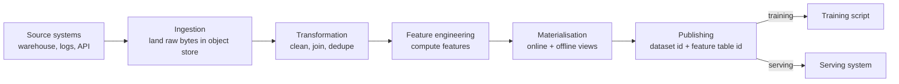
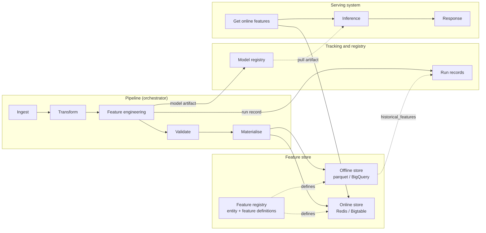

# 16.3 Data pipelines and feature stores

| Field | Value |
|---|---|
| Level | Intermediate |
| Priority tier | 1 |
| Lab venue | GCP / GKE |
| Part | Part 16: MLOps and LLMOps tools and platforms |
| Primary sources | *Designing Machine Learning Systems* (`designing-machine-learning-systems`, Chapters 3, 4, 5); *Machine Learning Platform Engineering* (`machine-learning-platform-engineering`, Chapters 2, 5); *Generative AI on Kubernetes* (`generative-ai-on-kubernetes`, Chapter 2); *Practical MLOps* (`practical-mlops`, Chapters 2, 5) |
| Cross-references | Chapter 16.1 (MLOps foundations); Chapter 16.2 (Data versioning and experiment tracking); Chapter 16.4 (Pipeline orchestration); Chapter 13 (AI storage) |
| Coverage file | `planning/coverage/chapters/16-03.md` |
| Claim & number ledger | `planning/ledgers/16-03.md` |

## Why this matters for AI infrastructure

Picture a training run that finishes without errors while the model it produces gets slightly worse each week. Nobody changed the training code, and every dashboard is green. Someone upstream renamed a column, the features drifted, and nobody noticed for a month. This chapter is about the pipeline that stops that kind of silent failure, and about the records that let you find it quickly when it happens anyway.

The previous chapter gave the training script and its dataset permanent addresses. This chapter builds the pipeline that produces those artifacts. A run record is only as reproducible as the pipeline that fed it the bytes, so the pipeline is where most reproducibility is won or lost. A feature store, which is a shared layer for computed features, lets two teams share one feature definition instead of rewriting it from scratch.

Picture a GPU cluster that runs AI jobs all day. It also runs a data pipeline, though nobody calls it that. The pipeline reads the warehouse, joins the tables, computes features, and writes the training dataset to the bucket the job will read. When the pipeline is wrong, the model still trains, but it fails in production. When the pipeline is right, you never have to think about it, and that quiet is the goal.

The quiet is also the reason the work is easy to neglect. A pipeline that always works earns no praise, and a pipeline that fails once makes the whole team look at it. Plan for the bad day now, while the pipeline still runs without trouble, because that is the cheapest time to add the checks.

```text
Why the pipeline is the bottleneck (background reading: Designing Machine Learning Systems; Machine Learning Platform Engineering; the figures below are examples, not quotations):
- IDC, Algorithmia and Kaggle surveys consistently put data preparation at 60% to 80%
  of an ML project's time and compute, with modelling at 10% to 20% and deployment
  at the remainder. The pipeline is the largest single source of cost.
- A 2020 Anaconda survey of 2,800 data scientists put data cleaning at the task they
  enjoyed least and the task they spent the most time on. The pipeline is also the
  least enjoyable part of the project.
- When a model regresses in production, the most common post-mortem finding is
  "the upstream pipeline changed and the team did not know". Lineage from the live
  model back to the live features is the only fix.
```

Three things make this a platform problem, not only a data science problem. Each one means that the people who run the cluster will feel the consequences first.

1. The pipeline runs on your cluster. It spends GPU hours on embeddings, writes to the shared filesystem, and reads from the warehouse. The cluster primitives from Parts 1 through 15 are what the pipeline runs on, so a slow disk or a full node shows up as a slow pipeline.
2. The feature store is a service. It has an online read path, an offline read path, a metadata layer, a freshness target, and access rules that your platform team operates. Someone has to be on call for each of those parts.
3. The pipeline is your audit trail. When someone asks where a feature came from, the answer lives in Git, the orchestrator's run record, and the feature store's lineage, not in a notebook. A notebook cannot answer that question on a bad day, and a pipeline can.

**Before a model reaches your cluster, its data pipeline has to be a real pipeline, not a notebook.** A notebook runs once and leaves no trustworthy record behind. A pipeline is a versioned graph with run records, a feature store contract, and a freshness target. Before you promote any model, check that you can name the pipeline run that produced its training data.

## Prerequisites and outcomes

### Prerequisites

- Chapter 16.1, which covers the lifecycle, the four pillars, and the promotion gate.
- Chapter 16.2, which covers data versioning with DVC and run records with MLflow.
- Chapter 13, which covers the AI storage primitives this pipeline depends on.
- Familiarity with SQL and basic ETL concepts. ETL means extract, transform and load, the classic pattern for moving data between systems.

### Outcomes

The chapter follows a clear order. It shows you how to split an ML data pipeline into ingestion, transformation, materialisation, validation, and publishing stages, and you learn which runtime fits each stage. You write a feature store contract that keeps the offline and online views bit-identical for any given timestamp, which means the two views return the same bytes for the same entity at the same moment.

Next, the chapter wires the pipeline into the orchestrator from Chapter 16.4, so run records reach the experiment tracker and features reach the serving system from Chapter 15. It adds validation at every stage to catch schema drift, null spikes, distribution shifts, and join-key changes. It then covers how to operate a feature store on GKE, including its backends, IAM, backup, and freshness targets. Finally, it extends the pipeline to LLM data, where a corpus snapshot, a chunking policy, and an index tie each answer to a version of the corpus.

---

## 1. The ML data pipeline

### 1.1 Five stages, each with an artifact

Picture a churn model that retrains every night. One morning its accuracy drops, and the team asks which data it trained on. If every stage left a hashed artifact behind, the answer takes a few minutes to find. If not, the team spends days rebuilding it from memory, and the rebuilt story is only a guess.

A useful pipeline has five stages. Each stage writes an artifact that the next stage reads, and each artifact carries a content hash and a run record. Read the diagram below from left to right, and notice that the source systems on the left are the only part you do not control.



The arrows are the pipeline. Picture the stage that receives an artifact: before it reads a single row, it checks the hash. If the hash does not match what the previous stage recorded, the stage stops. This is the same pattern as the DVC pipeline stages in Chapter 16.2, Section 1.2, applied to data engineering instead of training.

Think about what a hash check costs compared with a failed training job. The check reads the file once and compares two short strings, which is cheap. A failed job, or a model trained on a silently changed file, costs a day of compute and a week of trust. The check is the better deal every time, even on a small team.

| Stage | Artifact | Hash | Gate |
|---|---|---|---|
| Ingestion | Raw snapshot (parquet, JSON, image shards) in object storage | sha256 of the file or directory | Schema check; row count check; source-system watermark |
| Transformation | Cleaned snapshot, joined on canonical keys | sha256 of the directory | Null-rate check; key cardinality check; freshness check |
| Feature engineering | Feature table (parquet) | sha256 of the table + schema hash | Distribution check; feature-freshness check; leakage check |
| Materialisation | Online store rows + offline parquet | Online store has feature id, value, timestamp | Latency SLO; offline-online parity check |
| Publishing | Dataset id and feature table id | Recorded in metadata DB | End-to-end lineage record; ready for downstream consumers |

Every stage follows one pattern: an artifact, a hash, and a gate. The gate is a check that runs without a person deciding anything. The hash proves what the artifact contains, and the next stage uses the artifact's address to find it. Each row in the table is that pattern written out for one stage.

### 1.2 Choosing the right runtime for each stage

Picture a feature job that calls an embedding model on a fleet of CPU-only machines. Not every stage needs the same engine. A cluster engine adds startup time to a small metadata write. A small engine, meanwhile, struggles with a large join. Matching the engine to the stage saves both time and money, and the table shows a typical choice for each stage.

| Stage | Typical runtime | Why |
|---|---|---|
| Ingestion | Spark, Dataflow, Flink, dbt | Bulk IO; needs to scale horizontally across many cores |
| Transformation | Spark, Dataflow, DuckDB on a single big node | Joins and aggregates benefit from columnar execution |
| Feature engineering | Same as transformation plus a Python UDF step | Some features need a library call (tokenizer, embedding model) |
| Materialisation | Spark or a custom batch job that writes to online store + offline parquet | Online store is the hot path; offline store is the cold path |
| Publishing | A small Python or Go service that writes to the metadata DB | This is a metadata write, not a data transform |

Designing Machine Learning Systems Chapter 3 calls the wrong runtime choice "the most expensive mistake in ML data engineering." A feature job that calls an embedding model on CPU-only machines can run far longer than the same job on GPUs. A small metadata write through Spark pays for cluster startup it does not need. The exact cost depends on your data, so measure both options before you commit to one.

Notice that the pipeline keeps the expensive work and the cheap checks in separate places. Hashing and schema checks run at every stage, because they are cheap. Heavy distribution checks run less often, because they cost more. Keeping that balance is how the pipeline stays fast without giving up its gates.

### 1.3 The runtime shortcut: do the simple thing first

Picture a team building its first model pipeline. It reaches for an orchestrator, a DAG and three services on day one, and the setup takes longer than the first model. A DAG, or directed acyclic graph, is a set of tasks with arrows between them that never loop back. That is usually more than the first version needs. *Practical MLOps*, chapter 2, and *Designing Machine Learning Systems*, chapter 3, both argue for starting with something smaller.

```python
# code/part16/min_pipeline.py
import hashlib, json, datetime
from pathlib import Path

def ingest(source: str, dest: Path) -> dict:
    """Pull raw data from source, land it in dest, return a snapshot record."""
    raw = Path(source).read_bytes()
    dest.write_bytes(raw)
    return {
        "snapshot_id": hashlib.sha256(raw).hexdigest(),
        "snapshot_time": datetime.datetime.utcnow().isoformat(),
        "source": source,
        "row_count": len(raw.splitlines()),
    }

def transform(snapshot_id: str, raw_path: Path, clean_path: Path) -> dict:
    """Run a deterministic transform; record the new content hash."""
    cleaned = raw_path.read_text().lower().strip()
    clean_path.write_text(cleaned)
    return {
        "dataset_id": f"clean-{snapshot_id[:8]}",
        "content_hash": hashlib.sha256(cleaned.encode()).hexdigest(),
        "parent": snapshot_id,
    }

if __name__ == "__main__":
    snap = ingest("s3://warehouse/customers.parquet", Path("data/raw.parquet"))
    out = transform(snap["snapshot_id"], Path("data/raw.parquet"), Path("data/clean.parquet"))
    print(json.dumps(out, indent=2))
```

This script is the seed of a pipeline. Picture it running every night for a year, with one script that writes a hash for each output. It becomes a DAG when its stages get slow, run in parallel, or get shared across teams. *Designing Machine Learning Systems*, chapter 3, walks through that progression step by step. Start with one script that writes a hash for each output, and split it apart only when a real problem forces you to.

### 1.4 Choosing the storage format: row-major vs column-major, text vs binary

Picture a training job that scans the same table every night. Each stage writes a file, and the file format decides how fast the next stage can read it. The choice matters most for data that a training job scans again and again. Picking the wrong format is a quiet mistake that costs time on every run.

*Designing Machine Learning Systems*, chapter 3, walks through the trade-off in detail.

| Format | Layout | Strength | Weakness | When to use |
|---|---|---|---|---|
| **CSV** | Row-major, text | Human-readable; ubiquitous; trivially writable | Slow column reads; precision loss on floats; no schema | Small ad-hoc inspection; one-off exports |
| **JSON / JSONL** | Row-major, text | Flexible schema; nested structures supported | Verbose; slow parsing; no column pruning | API payloads; event logs; semi-structured source data |
| **Parquet** | Column-major, binary | Column-pruned reads (only the columns you need); often much smaller and faster to read than CSV, with the saving depending on the data; built-in schema | Not human-readable; slower point writes than CSV | Training data; feature tables; any columnar analytics workload |

**Use Parquet for anything the training script or the feature table will read.** CSV and JSON still fit ingestion, quick inspection, and the formats an upstream system hands you. Parquet stores data by column, so a job can read only the columns it needs. The schema also travels inside the file, so a reader does not have to guess the types.

*Designing Machine Learning Systems*, chapter 3, gives a clear example. An `interviews.csv` file with 17,654 rows and 10 columns takes 14 MB as CSV. The same data as Parquet takes 6 MB, which is about 2.3 times smaller. AWS describes Parquet as up to 2 times faster to unload and up to 6 times smaller in Amazon S3 than text formats. Treat 6 times as a best case, not a typical result. Parquet also scans faster for a query that reads only some of the columns. Point writes get slower, because each new row rewrites a column file.

Picture a team that starts with CSV because it is easy to inspect, then discovers that its training job reads the same files every night. The format has become part of the cost of every run. Switching the training input to Parquet, while keeping CSV for quick looks, is the simplest way to stop paying that cost.

Picture a data lake that grows past what a single bucket of files can handle, and where two teams need transactions on the same tables. The trade-off changes at petabyte scale. Delta Lake, Iceberg, and Hudi add a transaction log on top of Parquet, which makes point writes and time travel practical.

### 1.5 The data model: relational vs NoSQL, and why pipelines matter more than the model

Picture a warehouse full of joined tables on one side, and a document store full of nested records on the other. Your source data may sit in either. Either way, the pipeline must turn it into the shape the model needs. The store changes how much work the pipeline does, but it does not remove that work.

| Property | Relational (warehouse) | NoSQL (document store) | Implication for the ML pipeline |
|---|---|---|---|
| Schema | Enforced by the database | Optional or document-level | Schema check lives in the pipeline, not the store |
| Joins | Native and efficient | Expensive or impossible | Denormalise upstream; the pipeline does the joins |
| Flexibility | Rigid; migrations are heavy | Flexible; documents evolve independently | The pipeline's job is to enforce shape on what the model sees |
| ACID | Strong by default | Often eventual consistency | The pipeline needs idempotent retries and content hashes |

*Designing Machine Learning Systems*, chapter 3, makes a stronger claim: the data model matters less than the pipeline. A good pipeline can feed either a warehouse or a document store. A weak one loses data in both. The pipeline should land immutable, hashed snapshots that the next stage can verify, whatever storage the source uses.

The lesson is about where the data lives, not only about its format. A document store that is easy to write to can make the pipeline harder, because the pipeline must rebuild the joins and the schema. A warehouse that is strict about schema can make the pipeline simpler, because the store already refuses bad shapes. Pick the store that matches the work you actually do, then keep the schema check in the pipeline either way.

Picture a new upstream team that starts sending a data feed next quarter. When you add a new data feed, decide who enforces its schema before the first run. In this design, that is the pipeline, not the store, and the decision should be written down before the first file arrives.

---

## 2. The feature store contract

### 2.1 The two views: online and offline

Picture a churn model that runs in two places. Training reads a long history of users in a batch job. Serving reads the features for one user in a few milliseconds, while a customer waits on a page. Both need the same feature value at the same logical time, but they read it through different interfaces. A feature store is the layer that makes that work, so the two places never drift apart.

The offline view is the batch path. The training script reads a feature table, such as a parquet file or a BigQuery table. It needs the full history for every entity, joined on entity ID and timestamp, and it can tolerate delays of seconds or minutes. Batch reads are allowed to be slow, because a training job runs once and then finishes.

The online view is the low-latency path. The serving system reads one entity's feature values by ID, and it needs the answer within milliseconds. A request that waits for a full table scan will time out long before the model runs, so the online view is built for a single key lookup.

The contract says the two views return the same value, bit for bit, for the same entity and the same point in time. The implementation is harder. The offline store is a columnar file, the online store is a key-value store, and one materialisation job must keep them in step. Materialisation is the step that copies computed values into the online store so serving can read them.

The two views also differ in time. The offline view answers questions about the past, and the online view answers questions about now. Keeping that difference in mind stops a common mistake, which is to assume the online value was always the value. It was only the value at the last materialisation.

```text
Feature store contract (background reading: Designing Machine Learning Systems; Machine Learning Platform Engineering; the figures below are examples, not quotations):
- entity (the join key, e.g. user_id)
- feature (the value, e.g. tier_gold)
- timestamp (when the feature was computed; point-in-time correct)
- offline view: SELECT feature FROM feature_table WHERE entity_id = ? AND
  timestamp <= event_time ORDER BY timestamp DESC LIMIT 1
- online view: GET /features?entity_id=user_id&feature=tier_gold -> 0 or 1
- parity: for any (entity_id, event_time) pair, offline_view == online_view
  evaluated at the corresponding online store timestamp
```

*Designing Machine Learning Systems*, chapter 5, covers this parity problem in detail. The usual failure looks like this: two teams use the same feature name, but the offline and online paths compute it differently. Picture a training notebook that normalises a value one way and a serving function that normalises it another way. The fix is a single materialisation job that writes both views from the same upstream pipeline.

### 2.2 Point-in-time correctness

Suppose a customer churned in March, and your training data uses that customer's feature values from today. The model then learns from information it would not have had in March. Point-in-time correctness prevents this mistake. For each event, the feature value must be the one that was true at that moment. Think of it as reading the world through a window dated to the event, not through today's window.

The offline store makes this possible by keeping the history of every feature value. It can answer one question precisely: as of this timestamp, what was the value? The online store usually keeps only the latest value, because serving needs only the current one. That difference is deliberate, and it is why the two views are not interchangeable for training.

| View | Stores history | Query pattern | Use case |
|---|---|---|---|
| Offline | Yes (or at least N days/weeks/months) | `as_of(event_time)` | Training, backtesting, evaluation |
| Online | Latest value only (or short rolling window) | `current_value` | Low-latency serving |

The materialisation job writes both views from one upstream pipeline. Its run record, content hash, and commit hash link the two views together, so an auditor can trace a served value back to the same job that produced the training value. Decide how much history the offline view keeps before your first training run needs it, because history cannot be recovered after it has been dropped.

When the materialisation job fails, the two views stop agreeing, and the first symptom is usually a small difference that nobody notices. Put the job's run record next to the parity check, so the on-call engineer can see both in one place. A failed job without a visible parity result is a silent drift waiting to happen.

### 2.3 Feast, Tecton, Vertex AI Feature Store and Databricks Feature Store

Picture a team choosing a feature store from four products on a vendor shortlist. You will meet all four in production, and each one follows the same contract. They differ in how you run them and what they connect to. Learn the contract first, and the product choice becomes a question about operations and cloud fit.

| Tool | Open source | Online store | Offline store | Best fit |
|---|---|---|---|---|
| **Feast** | Yes | Redis, DynamoDB, Bigtable | BigQuery, Snowflake, Redshift, parquet | Cloud-native teams; OSS-first; low ops cost |
| **Tecton** | No (managed) | DynamoDB, Bigtable | Snowflake, BigQuery | Enterprise teams; managed SLA; time-travel |
| **Vertex AI Feature Store** | No (GCP) | Online store backed by Bigtable | BigQuery | Teams already on GCP |
| **Databricks Feature Store** | No (Databricks) | Online store in Databricks | Delta Lake | Teams already on Databricks |

*Designing Machine Learning Systems*, chapter 5, presents Feast as the open-source default. *Machine Learning Platform Engineering*, chapter 5, compares Tecton with Vertex AI Feature Store. This chapter uses Feast for the worked example, because it is open source, runs on GKE, and exercises the full parity contract. A worked example is a single thread you can follow end to end, which is easier than comparing four products in the abstract.

Choose the product that matches your cloud and your operations budget. Then hold it to the same parity test you would apply to any other store. A product that is cheap to run but cannot pass the parity test is the wrong product, no matter how good its dashboard looks.

### 2.4 A Feast entity and feature view, in code

Picture a feature team that wants one definition of a user's tier, used by every model that needs it. An entity names the thing you look up, such as a user. A feature view names the values you want for that entity and says where they come from. The two resources below define a feature, connect it to its source, and declare the online store that serving will read.

```python
# code/part16/feature_repo/entities.py
from feast import Entity
from feast.value_type import ValueType

user = Entity(
    name="user_id",
    description="Customer id",
    value_type=ValueType.STRING,
)

# code/part16/feature_repo/feature_view.py (shape only)
from feast import FeatureView, Field, FileSource, BigQuerySource
from feast.types import Float32, Int64, STRING
from datetime import timedelta

user_features_source = BigQuerySource(
    table="project.churn.user_features_v3",
    timestamp_field="event_timestamp",
)

user_features = FeatureView(
    name="user_features",
    entities=[user],
    ttl=timedelta(days=90),
    schema=[
        Field(name="tier_gold", dtype=Float32),
        Field(name="tenure_days", dtype=Int64),
        Field(name="avg_session_minutes_30d", dtype=Float32),
    ],
    source=user_features_source,
    online=True,
)
```

```python
# code/part16/feature_repo/feature_view.py
# Feast feature view. Feast is not installed in the test environment: this file is syntax- and structure-checked only.
from datetime import timedelta
from feast import FeatureView, Field, BigQuerySource
from feast.types import Float32, Int64
from entities import user

user_features_source = BigQuerySource(table="project.churn.user_features_v3", timestamp_field="event_timestamp")

user_features = FeatureView(
    name="user_features",
    entities=[user],
    ttl=timedelta(days=90),
    schema=[
        Field(name="tier_gold", dtype=Float32),
        Field(name="tenure_days", dtype=Int64),
        Field(name="avg_session_minutes_30d", dtype=Float32),
    ],
    source=user_features_source,
    online=True,
)
```

The training script reads the offline view with `get_historical_features`. The serving system reads the online view with `get_online_features`. Both views come from the same upstream pipeline and the same content hash. If the two calls ever disagree for the same entity and time, treat that as a broken pipeline, not as a model problem.

Look at the table as a list of decisions, not as a list of products. Each row answers one question: how much history do you keep, and how fast must a value be read. Answer those two questions first, and the table tells you which products can meet your needs.

Keep entities and feature views in Git, and review changes to them the way you review code. A change to a feature view changes every model that reads it, so a reviewer who understands the consumers is worth the time.

### 2.5 The feature freshness SLO

Picture a recommendation model that reads click counts from yesterday. Nothing crashes, but its suggestions slowly fall behind what users want now. A freshness target guards against that. It sets how old a feature value may be when serving reads it, and it turns a silent slide into a measurable miss.

Freshness is the time from when the pipeline computes a value to when serving reads it. The target is called a service-level objective, or SLO. It tells the on-call engineer when the feature store has broken, and it gives the team one number to argue about instead of a mood.

The ranges below are example values, not standards. Choose your own targets from how quickly each feature changes and how much the model suffers when a value is stale. A slow-moving feature with a tight target wastes money, and a fast-moving feature with a loose target misleads the model.

| Feature class | Typical freshness SLO | Why |
|---|---|---|
| Identity features (tier, signup_date) | 1 hour to 1 day | Change rarely |
| Behavioural features (sessions, clicks) | 5 to 60 minutes | Drive recommendation and churn models |
| Real-time features (current_session_active) | Seconds to 1 minute | Power real-time personalisation |

The materialisation job has a target of its own: the time from new upstream values to new online values. A target of five minutes, for example, needs a job that runs at least that often, retries on failure, and pages someone when the check fails. Without that job target, the freshness SLO has no mechanism behind it.

**A feature store without a freshness target is only a cache. A cache without a target is only a guess.**

### 2.6 The feature engineering taxonomy

Picture a feature that began life as a notebook cell and ended up in a production job. Feature code often starts this way, and that is fine as long as it grows up. Each kind of transformation fails in its own way, so it helps to know which kind you are writing. The table lists the common kinds and the concern that goes with each one.

| Function | What it does | Example | Concern |
|---|---|---|---|
| **Numerical transformations** | Scaling, normalisation, log transform to adjust distribution | `log(amount)` to compress the long tail; standard scaler for Gaussian features | Sensitive to outliers; re-fit scaler on every retraining to avoid drift |
| **Category encoding** | Convert categorical variables to numeric | One-hot, ordinal, label, target encoding | High-cardinality features blow up under one-hot; target encoding leaks if done wrong |
| **Clustering** | Group similar data points; new categorical features | K-means cluster id as a feature | Cluster boundaries drift; refit periodically |
| **Aggregations** | Sum, mean, median, quantiles over windows | 30-day rolling average session minutes | Window length must match the model's downstream usage |
| **PCA / dimensionality reduction** | Project to a lower-dimensional space | PCA on a high-cardinality embedding | Loses interpretability; components must be saved and versioned |
| **Feature construction** | Interaction terms, polynomial terms, ratios | `tier_x_tenure`, `clicks / impressions` | Combinatorial explosion; require feature selection downstream |
| **Embedding lookups** | Pre-trained embedding for a categorical | User embedding, product embedding | Embedding model version must be in the feature metadata |

Three concerns from *Designing Machine Learning Systems*, chapter 5, apply to every function in that table. Each concern is a question you can ask about any feature before it ships.

Change-proof features come first. A feature built on a definition tied to today's business model drifts silently when that model changes. An economic indicator that stops being published is one example, and the model keeps running on a value that no longer means what it did. Version each definition, and refuse to register any feature that has no version history.

Edge cases come next. Training data rarely matches production traffic. A feature that has never seen a zero, or the largest value an integer can hold (`INT_MAX`), can give strange outputs when those values arrive on a real request. Picture the first live request with an empty field, and ask what the feature returns. Test each feature with edge cases before it ships.

Complexity is the third concern. More features help a model up to a point, and then the gains flatten while the cost keeps climbing. Each extra feature is one more thing to compute, store, monitor and explain. Audit feature importance at each promotion, and remove the features the model does not use.

The taxonomy matters because the feature store must make each function reproducible in both views. If the offline and online paths compute `log(amount)` with different libraries, parity breaks, and the model degrades without an error. The fix is one helper function that both views call, and that helper is versioned and signed. A helper called from both sides is the simplest way to keep the two views from disagreeing about arithmetic.

Think of the helper as a small contract between the two views. The offline job calls it when it builds training rows, and the online job calls it when it builds serving rows. Because both sides run the same code, the arithmetic cannot drift apart, even when the libraries around it are upgraded.

---

## 3. Validation: catching the silent bugs

### 3.1 The four checks every stage runs

Picture a join that quietly drops half the rows, while the model still trains and its loss looks normal. Most pipelines fail quietly that way. For example, a column changes type, a join drops half the rows, and the model still trains without complaint. Cheap checks at every stage catch these bugs before they reach the model. *Designing Machine Learning Systems*, chapter 3, introduces four checks that every stage should run.

A check that runs on every stage is much cheaper than a model that fails in production. The schema check catches a renamed column. The null-rate check catches a source that started sending empty values. The distribution check catches a change in meaning, such as a currency switched from one unit to another. Each check is small, and together they catch most of the quiet failures.

| Check | What it does | Where it runs | Cost |
|---|---|---|---|
| **Schema check** | Validates column names and types against an expected schema | Every stage that reads or writes a dataframe | Cheap; runs in milliseconds |
| **Null-rate check** | Detects spikes in null values for any column | Every stage that produces a dataframe | Cheap; runs in seconds |
| **Distribution check** | Detects shifts in mean, std, quantiles, or category frequency | Every stage that produces a dataframe | Moderate; runs in seconds to minutes |
| **Join-key check** | Validates cardinality and referential integrity of join keys | Every stage that joins two dataframes | Cheap to moderate |

Great Expectations, deequ, TensorFlow Data Validation, and Soda Core all implement these checks. *Designing Machine Learning Systems*, chapter 3, uses Great Expectations as the open-source default. *Machine Learning Platform Engineering*, chapter 2, introduces Soda Core as a YAML-first alternative, which means the checks are written as configuration files rather than code.

### 3.2 A Great Expectations suite, in code

Picture a short suite that catches the most common bugs. Run it after the transformation stage, and fail the run if any expectation fails. An expectation is a plain statement about the data, such as no nulls in a key column, and the suite is the list of those statements.

```python
# code/part16/gx_suite.py
"""Great Expectations 1.x: validate a cleaned churn DataFrame. Tested with great_expectations 1.24."""
import great_expectations as gx
import pandas as pd

def validate(df: pd.DataFrame, project_dir: str = "./gx") -> bool:
    context = gx.get_context(mode="file", project_root_dir=project_dir)
    suite = context.suites.add_or_update(gx.ExpectationSuite(name="churn_clean_suite"))
    suite.add_expectation(gx.expectations.ExpectColumnValuesToNotBeNull(column="user_id", mostly=1.0))
    suite.add_expectation(gx.expectations.ExpectColumnValueLengthsToBeBetween(column="tier", min_value=1, max_value=16))
    suite.add_expectation(gx.expectations.ExpectTableRowCountToBeBetween(min_value=2, max_value=10_000_000))
    suite.save()

    source = context.data_sources.add_or_update_pandas(name="churn")
    asset = source.add_dataframe_asset(name="churn_clean")
    batch_def = asset.add_batch_definition_whole_dataframe("whole")
    batch = batch_def.get_batch(batch_parameters={"dataframe": df})
    return bool(batch.validate(suite).success)

if __name__ == "__main__":
    df = pd.read_parquet("churn_clean.parquet")
    if not validate(df):
        raise SystemExit("DATA VALIDATION FAILED")
```

This is the same pattern as the promotion gate in Chapter 16.1: a function whose result decides whether the pipeline moves on. A data validation gate is a promotion gate for data. Write the suite before your first model run, not after your first incident, because the first incident is the moment you will wish you had.

### 3.3 Leakage checks: the silent killer

Picture a fraud model that scores well in testing and then fails in production. Leakage is often the cause, and it is the most expensive silent failure. A feature quietly contains information from after the event you want to predict. The model then scores well in testing and fails in production.

*Designing Machine Learning Systems*, chapter 4, describes how to detect it. For each feature, confirm that the source timestamp is no later than the event time. A feature whose source was written after the event is looking into the future, and no real system can do that at serving time.

A useful test for a leakage check is to pick one row and trace each of its features back to the time of its source. If any source was written after the event, the check should fail on that row, and the fix is in the feature definition. Run the check on a sample first, then on the full training set once the sample passes.

```text
Leakage check (background reading: Designing Machine Learning Systems; Machine Learning Platform Engineering; the figures below are examples, not quotations):
For each (entity_id, event_time) pair in the training set:
  - Read feature F from the offline store as_of(event_time).
  - Verify that the feature's source timestamp <= event_time.
  - Refuse to include F in the training set if any row violates the check.
```

The check is mechanical. It is the difference between a model that wins offline and one that wins in production. Run it on every feature, every time, and treat any violation as a stop, not a warning.

### 3.4 Labels: hand, natural, weak, and the sampling patterns that feed them

Picture a labelling team that is asked to produce answers for a new model in one week. A feature store supplies the inputs, but something else must supply the answers. Where the answers come from shapes the cost, the speed, and the risk of your pipeline. *Designing Machine Learning Systems*, chapter 4, describes four label sources that production pipelines draw from.

| Label source | How labels are produced | Examples | Cost |
|---|---|---|---|
| **Hand labels** | Human annotators label the data | Spam classification with 20 crowd annotators; medical imaging with board-certified radiologists | Slow (months for serious domains); expensive for expert labels; a privacy risk when shipped to third parties |
| **Natural labels** | The system observes the outcome directly | Recommender click / no-click; stock price prediction after 2 minutes; fraud dispute after the dispute window closes | Cheap; arrives only after the feedback loop |
| **Weak supervision** | Heuristic labelling functions written by domain experts | Keyword match for spam; rule-based triage for support tickets; model outputs as labels | No ground truth required; labels are noisy; conflicts between LFs need reconciliation |
| **Transfer learning** | A pretrained model supplies labels for your task | Embedding model labels text by similarity; foundation-model zero-shot labelling | Quality depends on the source model; licensing and bias transfer with the labels |

Real pipelines combine these sources instead of picking one. Use hand labels for the high-stakes cases, natural labels for most of the data, weak supervision for gaps, and transfer learning for the long tail. The pipeline's job is to merge them into one labelled dataset. Record the source of each label, so you can trace any example back to where it came from.

### 3.5 Feedback loop length: a design variable

Picture a recommendation click. The system learns within seconds whether its suggestion worked. A fraud dispute, by contrast, can take months to arrive. The gap between a prediction and its answer is the feedback loop length, and it shapes how you monitor and retrain.

| Feedback loop length | Examples | Pipeline consequence |
|---|---|---|
| Seconds to minutes | Ad click-through; product recommendation click; chatbot thumbs-up/down | Drift detected within an hour; retraining trigger can be drift-based |
| Hours | Blog post recommendation; YouTube video view-through | Drift detected within a day; retraining trigger is daily |
| Weeks | Stitch Fix clothing recommendation; subscription churn prediction | Drift detection only on aggregate metrics; retraining trigger is weekly |
| Months | Fraud dispute (1-3 month window); loan default prediction | Drift detection is slow; retraining is quarterly; new model value is back-tested, not A/B-tested |

The shorter the loop, the closer the pipeline can run to real time. A short loop supports retraining that drift triggers. A long loop forces a fixed schedule, and drift shows up late. Think of the loop length as the delay between a mistake and the evidence of it.

That leads to a practical rule. With a short loop, invest in real-time drift detection and a fast retraining trigger. With a long loop, A/B test a new model against the baseline before you promote it, because your mistakes will show up months later. An A/B test sends some real traffic to the new model and the rest to the old one, so you can compare them directly.

### 3.6 Sampling from a stream: reservoir and importance sampling

Picture a payment stream that never ends, with more transactions than any disk could keep. A stream of transactions or log lines never ends, and you cannot keep all of it. You need a smaller sample that still represents the stream. *Designing Machine Learning Systems*, chapter 4, describes two sampling patterns worth knowing.

Reservoir sampling draws a sample of size k from a stream whose total length you do not know in advance. Keep the first k items. For each later item n, pick a random number i from 1 to n. If i is at most k, replace reservoir item i with the new item. Every item ends up in the sample with probability k divided by n, and you can stop at any time without biasing the result. This is the standard answer for streaming logs and event collections.

The sampling weight is what keeps a sample honest. Without it, the sample is a biased picture of the stream, and the model learns the bias. With it, the sample can stand in for the whole stream, as long as each weight is stored with the example it belongs to.

Importance sampling estimates how a model behaves under a rare condition. You sample from an easier distribution Q, and weight each sample by P divided by Q, where P is the distribution you care about. The weighted average over Q converges to the expected value over P. Use it when you cannot sample the rare condition directly, because the rare cases would be too few to measure on their own.

Both methods need the pipeline to store the sampling weight with each example. The weight becomes a column in the training set. The model can learn to ignore it, or the training loop can re-weight by it.

### 3.7 Data lineage: where the data came from

A regulator asks which upstream source produced a bad batch of data. Without lineage, the team searches logs for days. With lineage, the answer is one query away. *Designing Machine Learning Systems*, chapter 4, and *Engineering AI Systems*, chapter 5, both treat lineage as a first-class pipeline artifact.

Lineage records where each example came from, how it was transformed, and where it went. Think of it as the family tree of every row, with each parent and child named.

In practice, lineage answers two kinds of question. The first is backward, such as which source produced this row. The second is forward, such as which models read this row. A good lineage store can answer both, and a store that can answer only one leaves a blind spot.

| Lineage metadata | What it tells you | Where it lives |
|---|---|---|
| Source system | Which warehouse / API / log produced the row | Ingestion metadata DB |
| Snapshot id | Which pull of the source produced the row | DVC / lakeFS / Pachyderm |
| Transform id | Which version of the cleaning code transformed the row | Pipeline run record |
| Annotator id | Who labelled the row (if hand-labelled) | Labelling database |
| Downstream consumers | Which models / features / dashboards read the row | Feature store metadata |

Apache Atlas, Collibra, DataHub, and Marquez implement lineage. *Engineering AI Systems*, chapter 5, names Atlas and Collibra as the established enterprise options. DataHub and Marquez are newer open-source options that platform teams often self-host. The lineage database feeds the model registry, where each model version records its training dataset. It also feeds the audit log, which answers questions such as "which models ever saw this personal data?"

Every artifact needs an ID, and that ID must point to its lineage. The ID is the address. The lineage is the proof. Without both, the address leads to a file and nothing tells you whether the file is the right one.

### 4.1 The pipeline as a DAG

Picture a pipeline that started as one script and is now run by several teams, each with its own schedule. Once stages are shared or long-running, they move into an orchestrator. The orchestrator runs the graph, retries failed stages, and keeps the run records. Chapter 16.4 covers orchestrators in depth. This chapter names three points where the pipeline connects to one.

| Integration | What crosses it | What it carries |
|---|---|---|
| Pipeline → Tracker | Each stage's run record | Stage name, params, metrics, tags (data hash, commit, env) |
| Pipeline → Registry | A model artifact | The artifact uri + the lineage record |
| Pipeline → Feature store | A materialised feature table | Entity, feature, timestamp, value |

*Practical MLOps*, chapter 5, covers AutoML and KaizenML. *Designing Machine Learning Systems*, chapter 10, walks through the integration patterns. The pattern that holds is the one from Chapter 16.2: every artifact has an ID, every stage has a gate, and every gate is mechanical. Check all three before you connect an orchestrator, because an orchestrator that runs unchecked stages only runs them faster.

### 4.2 The serving system reads from the feature store

Picture a live request that arrives at a model server and needs a user's features right now. The serving system does not query the warehouse. It reads the feature store's online view, because a live request has no time to scan tables. The online view must stay within the freshness target. For each entity ID, it must return the value the offline view would have returned at the latest materialisation.

```python
# code/part16/serve_with_feast.py
from feast import FeatureStore

store = FeatureStore(repo_path="feature_repo")

def serve(user_id: str) -> dict:
    features = store.get_online_features(
        features=[
            "user_features:tier_gold",
            "user_features:tenure_days",
            "user_features:avg_session_minutes_30d",
        ],
        entity_rows=[{"user_id": user_id}],
    ).to_dict()
    return features
```

The serving system calls `get_online_features` on every request. The store answers with a key-value lookup, and the model receives the values. Training reads the offline view with `get_historical_features`. Both reads return the same values for the same entity at the same point in time. Measure the online read latency on your serving path, not in a notebook, because a notebook has none of the network hops your users will feel.

Picture the first request that goes wrong after a deploy, with a user who sees the wrong tier. The fastest way to find the cause is to compare the two reads for that one user. If they match, the problem is in the model. If they differ, the problem is in the pipeline, and the parity check should have caught it earlier.

### 4.3 The Mermaid: pipeline, feature store, and serving

Picture the on-call engineer trying to draw the whole system on one page. This diagram shows how the pieces meet. The pipeline writes both views of the feature store from one upstream job. Serving reads the online view, and training reads the offline view. If the drawing is hard to make, the system is probably harder to operate.



The dotted arrows show feature definitions and historical reads. Each consumer reads through the same definitions, so the values agree. Follow the dotted arrow from the feature registry to each store, and you will see why a change to one definition reaches both views at once.

**The feature store is the contract between training and serving. Break that contract, and the two views drift apart.**

Before you add a model, check that its training and serving reads use the same feature definitions. A model that reads one definition for training and another for serving has a bug that no metric will show you.

---

## 5. LLM data pipelines: corpus, chunking, embeddings, index

### 5.1 Four artifacts unique to LLM data

A retrieval app answers from a pile of documents, and that pile keeps changing. Picture a support bot that quotes a policy page, and the page was edited this morning. Classical pipelines do not manage a text corpus this way. LLM pipelines add four artifacts to handle it, and each one needs its own version.

In a retrieval setup, the corpus is the source of truth and the index is only a derived copy. Keep that order in your head when something goes wrong. Fix the corpus first, and then rebuild the index from it, rather than patching the index by hand.

1. The corpus snapshot is the raw text or documents the app reads. Version it by content hash, never change it in place, and mark removals as soft deletes, so a removed page can still be found in an audit.
2. The chunked corpus splits the documents into pieces, with metadata for source, position, and section. A chunk is a passage small enough to fit in a prompt. Chunk size is a choice you make, and the policy that sets it is an artifact with its own version.
3. The embedding model turns chunks and queries into vectors. It is a registry entry, covered in Chapters 16.1 and 16.6. An embedding is a list of numbers that places a piece of text near other pieces with similar meaning.
4. The vector index maps each chunk ID to its vector. Its snapshot ID binds together the corpus snapshot, the chunking policy version, and the embedding model ID. That single ID is what you need when someone asks why an answer said what it said.

```text
LLM data pipeline stages (background reading: Generative AI on Kubernetes; LLMOps; the figures below are examples, not quotations):
1. Ingest corpus -> corpus snapshot (content hash, source system, snapshot time)
2. Chunk corpus -> chunked corpus (chunk size, overlap, metadata fields)
3. Embed chunks -> embedding table (chunk id, vector, model id, hash of model)
4. Build index -> index snapshot (vector store, corpus snapshot id, model id)
5. Validate -> checks: chunk count, embedding dimensionality, recall on a query set
```

Store the chunking policy in Git with a version, the same way you store training code. A chunking policy is code in the sense that it changes behavior, so it deserves the same review.

### 5.2 The index snapshot is the new dataset ID

Picture two engineers asking the same question of the same app and getting different answers on the same afternoon. The corpus, the embedding model, or the chunking may have changed without anyone noticing. For a RAG application, an answer depends on three inputs: the prompt template, the embedding model, and the index snapshot. The index snapshot plays the role that a dataset ID plays for a classical model, so it is the first thing to write down.

A practical habit makes this easy. Record the three IDs in the same run record, so one lookup gives you all of them. When an answer looks wrong, you can then ask the same three questions of the same record every time, rather than searching three systems for the answer.

*LLMOps*, chapter 4, makes the point that an index without a snapshot ID cannot be reproduced. The same is true of a dataset without a hash. Bind the snapshot ID to the corpus hash, the embedding model ID, and the chunking policy version. Then any answer can be traced to exactly one index, and that index can be rebuilt from its inputs.

```python
# code/part16/index_metadata.py
import hashlib, json

def index_snapshot_id(corpus_hash: str, embedding_model_id: str,
                      chunking_policy_version: str) -> str:
    """Compute the index snapshot id as a content hash of its three inputs."""
    payload = json.dumps({
        "corpus_hash": corpus_hash,
        "embedding_model_id": embedding_model_id,
        "chunking_policy_version": chunking_policy_version,
    }, sort_keys=True).encode()
    return hashlib.sha256(payload).hexdigest()
```

The serving system reads the index snapshot ID, and the audit trail records the corpus snapshot and embedding model behind it. When answer quality drops, check three things first. Did the corpus change? Did the embedding model change? Did the chunking policy change? Those three questions cover most of the cases you will see in the first months of a RAG service.

### 5.3 Freshness for retrieval indices

Picture a corpus that changes at noon while the index still holds the pages from the morning. A feature value stays true until its next computation. A vector index goes stale the moment its corpus changes. So the freshness target for an index follows different rules, and the rebuild schedule has to match how fast the corpus moves.

| Index class | Freshness SLO | Trigger |
|---|---|---|
| Static knowledge base (documentation) | 1 day to 1 week | Scheduled rebuild |
| Frequently updated corpus (news, products) | 1 hour to 1 day | Event-driven rebuild on corpus write |
| Streaming corpus (chat, logs) | Seconds to minutes | Streaming index update |

The ranges in this table are example targets. Choose yours from how often the corpus changes and how much a stale answer costs you. A policy document that changes twice a year does not need the same target as a news feed.

*Generative AI on Kubernetes*, chapter 2, discusses the trade-off between index freshness and rebuild cost. A daily rebuild is the cheapest default. A streaming rebuild is the most expensive, and it is the most current. The middle ground is event-driven: rebuild only the changed partition when a write lands. Each option buys freshness with a different amount of compute and operations work.

Put the rebuild schedule in the runbook, next to the freshness target it protects. A schedule that nobody can explain will be changed the first time it causes a cost complaint. A schedule with a written reason is much harder to change by accident.

Pick the cheapest rebuild that still meets the freshness target you chose. Anything more expensive is paying for freshness nobody asked for.

### 5.4 Validation for LLM data

The four checks from Section 3 still apply. LLM data needs two more, because retrieval can fail even when the pipeline finishes with no errors. Picture a job that exits with code zero while the index quietly returns the wrong passages. The two extra checks exist to catch exactly that case.

| Check | What it does |
|---|---|
| **Recall check** | A held-out set of query/chunk pairs. The index should return the chunk in the top-K for K percent of the queries |
| **Faithfulness check** | A held-out set of query/context/answer triples. The LLM answer should be supported by the retrieved context (LLM-as-judge or a smaller fine-tuned model) |

The recall check catches a corrupted index. The faithfulness check catches stale retrieval. You need both, and neither one is enough by itself. A recall check can pass while the answer is still unsupported, and a faithfulness check can pass on an index that never returns the right chunk for most questions.

---

## 6. Operating the pipeline and the feature store on GKE

### 6.1 The components

Picture the pipeline running as a set of services on GKE, each one doing a different job at a different speed. Each service has its own storage and its own target. When one of them slows down, you need to know which one, so give each its own alert. A single pipeline-wide alert tells you that something is wrong, but not which part to open first.

| Component | Where it runs | Backing store | SLO |
|---|---|---|---|
| Orchestrator (Argo, Airflow, KFP, Flyte) | Kubernetes Deployment | Postgres | Stage-run latency p99 < 1 minute |
| Spark/Dataflow (transformation) | GKE Autopilot or a Spark on K8s operator | Object storage, distributed FS | Stage completion before SLA |
| Materialisation job | Kubernetes CronJob or Argo sensor | Object storage, Redis/Bigtable | Feature freshness SLO (5 to 60 minutes) |
| Feature store (Feast) | Kubernetes Deployment | Redis/Bigtable + BigQuery/parquet | p99 read latency < 10 ms online; p99 read latency < 30 s offline |
| Validation suite | Part of the orchestrator DAG | None (logs to tracker) | Stage failure on violation |
| Great Expectations data docs | S3/GCS bucket | Static site | Daily publish |

The latency targets in this table are example values. Set your own from measured baselines. Then put each component on your dashboard with its own target, because a single pipeline-wide number hides the stage that is slow. The table is a starting point for that dashboard, not the dashboard itself.

### 6.2 IAM and secrets

Picture a data scientist with write access to the pipeline and read access to the feature store on the same day. Who can write features matters as much as what the features contain. A data scientist who can both write to the pipeline and read the feature store can produce a dataset that disagrees with what serving reads. Separate those powers before the disagreement happens.

| Role | Who | What they can do |
|---|---|---|
| `pipeline.writer` | Pipeline service accounts | Read source systems; write to object storage; write to feature store |
| `pipeline.reader` | Data scientists, dashboards | Read feature store offline; read pipeline run records |
| `serving.reader` | Serving system service accounts | Read feature store online |
| `pipeline.admin` | Platform team | Define entities, feature views, sources |

The split between writer and reader mirrors the registry split from Chapter 16.2. Keep write access with the pipeline's service accounts, and give people read access only. People who need to change a definition should go through the admin role and a review, not a shortcut.

Secrets come from Vault or Secret Manager through the External Secrets Operator, and they must never be baked into images. An image is copied to many places, so a secret inside one leaks to all of them. *Production Kubernetes*, chapter 7, warns that a secret passed as an environment variable does not update until its Pod is recreated. A secret mounted as a volume updates in place, and the kubelet keeps it in memory. If you need rotation to reach a running container, mount the secret as a volume.

Keep secrets out of the pipeline's code and its images, and keep the rotation plan written down. A pipeline that holds a source-system password in a config file will leak that password into every backup of the repository. Mounting the secret from the managed store keeps the password in one place.

### 6.3 Observability of the pipeline

A pipeline nobody watches fails silently. Picture a Monday morning where the feature table is stale and nobody has noticed. Treat it like any other production service, and give it metrics, logs, and alerts.

| Metric | Why it matters | Alert |
|---|---|---|
| Stage duration p99 | Catch slow stages before they miss SLA | > 2x baseline for 3 runs |
| Stage failure rate | Catch a single bad upstream change | > 0 for 5 minutes |
| Feature freshness (online) | Catch stale features before they degrade the model | > freshness SLO for 10 minutes |
| Offline-online parity | Catch drift between the two views | > 0 differences in the parity check |
| Materialisation lag | Catch a backlog in the materialisation job | > 30 minutes |

*Production Kubernetes*, chapter 9, makes a point worth following here. Alert on metrics rather than on the text of log lines. A small change to a log message can silently break an alert that matches on that text, and nobody will know until the alert is needed.

The parity check matters most. It runs hourly, samples random pairs of entity ID and timestamp, reads both views, and checks that the values match bit for bit. Any drift is urgent, because every model trained on the offline view depends on it. Think of the parity check as the smoke alarm for the whole feature store.

A parity failure is a stop-the-line event. The model trained on the offline view may still be fine, but the serving path is now reading something different. Pause the affected rollout, find the stage that drifted, and fix it before the next materialisation runs.

**Run the pipeline as a production service. Give each stage a target, and page someone when it misses. The pipeline is the audit trail, and if it breaks, the rest of the system cannot be trusted.**

---

## 7. How it fails

Picture your first month running the pipeline. Pages arrive at odd hours, and each one names a different symptom. Six failure modes recur, and you will likely recognise at least one of them. Each one has a name, a symptom, a diagnosis, and a fix. Use the symptom to find the failure, then work back to the cause.

### 7.1 "The feature store says the user is gold, the warehouse says silver"

**Symptom:** Two dashboards disagree about a customer's tier. Serving returns one value, and the offline report returns another. The model trained on the offline report loses accuracy in production, and the product team wants to know which dashboard to trust.

**Diagnosis:** Different jobs filled the two stores. The offline store was rebuilt last night, but the online store was last rebuilt a week ago, so the two views drifted apart.

**Fix:** Use one materialisation job that writes both views. Run a parity check on a sample of entities every hour, and treat any drift as a high-priority incident. A shared job is what keeps the two views from being rebuilt on different days.

### 7.2 "The training run used a 30-day-old feature snapshot"

**Symptom:** The model trains without errors, and the offline metrics look strong. On the first day in production, accuracy falls far below the baseline. The on-call engineer opens the run record and finds that the training feature table is 30 days older than the training date. You can catch this earlier by comparing the snapshot date with the training date.

The symptom is the cheapest clue you have. Two numbers that look plausible together can still be wrong, and a training run that looks strong can hide a stale snapshot. Compare the snapshot date with the training date as a routine step, and the failure becomes a one-minute check instead of a week-long investigation.

**Diagnosis:** The feature pipeline ran on a 30-day cycle. The training script picked the most recent snapshot, which came from the start of that cycle. Those features are not the ones the model sees in production today, so the model learned from a world that had already moved on.

**Fix:** Run the feature pipeline daily, with a freshness target. Make the training script refuse any snapshot older than that target. The freshness check is a mechanical gate in the pipeline, so nobody has to remember to look at the dates.

### 7.3 "The chunking policy silently changed"

**Symptom:** The RAG application gives good answers for two weeks, then starts returning truncated passages. The corpus has not changed, and neither has the embedding model. Users notice first, and the logs show nothing unusual.

**Diagnosis:** A data scientist changed the chunking policy. For example, the chunks went from 512-token chunks with 64-token overlap to 1024-token chunks with no overlap. The change was committed to the chunking repo, but the index was never rebuilt. Serving still reads the old index, while the policy now says new chunks, so the two disagree without any error.

The chunking policy is a small file, and it is easy to change by accident. A policy edit that looks cosmetic can change the chunk boundaries for every document. Treat a policy change as a release, with a version bump, a review and a rebuild plan, so that the index and the policy move together.

**Fix:** Bind the index snapshot ID to the chunking policy version. Refuse to serve when the policy version in the index metadata does not match the repo. A policy change forces an index rebuild, and the mismatch becomes an error instead of a quiet fault.

### 7.4 "The pipeline crashes on a missing column"

**Symptom:** The pipeline ran for six months. This morning the ingestion stage failed with `KeyError: 'expected_column'`. The upstream system had removed the column without telling anyone, and the failure looks like a bug in the pipeline code.

**Diagnosis:** No schema check ran at ingestion. The pipeline consumed the bad data silently, and the next stage crashed on it, which made the crash look like the cause.

**Fix:** If you see this error, check the upstream schema first. Enable schema validation at every stage. Treat any schema change as a breaking change that needs a pull request to the pipeline definition. Where the upstream system supports it, use a schema format such as Avro or Protobuf that lets the schema evolve in a controlled way.

### 7.5 "The feature store is hot-spotting on a single key"

**Symptom:** Online reads are fast for most entities. One entity, such as a power user or a corporate account, makes every read slow, while the Redis cluster itself looks healthy. The on-call engineer checks the cluster first, and the cluster has nothing to say.

Look at the per-entity read time before you look at the cluster. A single entity with a large value shows up as a slow read only for that entity. The fix is in the data shape, and tuning the cluster will not change the outcome.

**Diagnosis:** That entity's feature is a very long list. The online store fetches the whole list on every read, so the data shape does not suit a key-value store. The slowness is in the value, not in the store.

**Fix:** Aggregate during materialisation, and store the summary value instead of the list. Add a size check that rejects any feature whose online value grows past a limit you choose.

### 7.6 "Two teams are using two feature stores"

**Symptom:** Two teams built their own feature stores, each with its own definition of the same concept. They disagree about which customers are active, so their models target different people. Each team's dashboard looks correct to the team that owns it.

**Diagnosis:** No shared feature catalogue exists. Each team's pipeline writes to its own store, and nobody owns the canonical definition.

**Fix:** Make a shared feature catalogue a platform service, and let each of your team's stores read from it. A feature cannot be registered in a team's private store until the catalogue declares it. The catalogue owns the definition, and each team's store reads from the catalogue's materialisation job.

---

## 8. Hands-on lab

This lab extends Chapter 16.2 with a Feast feature store and a materialisation job. It runs on GCP and GKE. These steps were not run on a live cluster in this repository, so treat the commands and YAML as a working template.

### 8.1 Prerequisites

- You need the Chapter 16.2 lab completed, with MLflow, DVC, and the signed registry.
- You need a Feast installation on GKE, using the Helm chart.
- You need a Redis cluster for the online store. Memorystore for Redis is the managed GCP option.
- You need a BigQuery dataset for the offline store, or a parquet bucket in Cloud Storage.

### 8.2 Step 1: define an entity and a feature view

Start by creating a feature repository, which is the folder where Feast keeps its definitions. Then register the entity and feature view from Section 2.4. Once the apply step succeeds, the definitions are in the registry and the rest of the lab can refer to them by name.

Once the definitions apply, you will see them in the registry view. That view is the easiest place to check that a new feature has an owner, a freshness target and a source. If any of those three is missing, the apply step should not be a surprise.

```bash
feast init feature_repo
cd feature_repo
# Add entity and feature view from Section 2.4
feast apply
# expected: entities and feature views registered with Feast
```

### 8.3 Step 2: load historical features for a training run

Your entity query picks the rows and timestamps for training. Feast then joins the feature values that were true at each timestamp. The result is one table that has the right values for each event, which is exactly the point-in-time property explained earlier in this chapter.

```python
# code/part16/load_training_features.py
from feast import FeatureStore

store = FeatureStore(repo_path="feature_repo")
training_df = store.get_historical_features(
    entity_df="SELECT user_id, event_timestamp FROM churn.events WHERE event_date >= '2024-01-01'",
    features=[
        "user_features:tier_gold",
        "user_features:tenure_days",
        "user_features:avg_session_minutes_30d",
    ],
).to_df()
print(training_df.shape)
# expected: ~10,000 rows with three feature columns and the entity/timestamp columns
```

### 8.4 Step 3: materialise features to the online store

Push the latest values to the online store. The command sets the end time to now, and the logs show how many rows were written. If the row count is zero, check the time window before you blame the store.

```bash
CURRENT_TIME=$(date -u +"%Y-%m-%dT%H:%M:%S")
feast materialize-incremental $CURRENT_TIME
# expected: a materialisation run that writes to Redis; logs show row counts
```

### 8.5 Step 4: read online features from the serving system

Read features the way your serving system will. The lookup takes one entity ID and returns the latest values. Compare the result with the offline view for the same entity, because that comparison is the parity check in miniature.

```python
# code/part16/read_online.py
from feast import FeatureStore

store = FeatureStore(repo_path="feature_repo")
features = store.get_online_features(
    features=[
        "user_features:tier_gold",
        "user_features:tenure_days",
        "user_features:avg_session_minutes_30d",
    ],
    entity_rows=[{"user_id": "user-12345"}],
).to_dict()
print(features)
# expected: a dict with three keys (the features) and one value (1)
```

### 8.6 Step 5: wire the pipeline DAG into Argo Workflows

Define the four stages as an Argo Workflow. Each task waits for the one before it, so materialise runs last. Picture the pipeline you built by hand in the earlier steps, now running on a schedule without anyone clicking a button.

```yaml
# code/part16/feature_pipeline.yaml
apiVersion: argoproj.io/v1alpha1
kind: Workflow
metadata:
  generateName: feature-pipeline-
spec:
  entrypoint: pipeline
  templates:
    - name: pipeline
      dag:
        tasks:
          - name: ingest
            template: ingest
          - name: transform
            template: transform
            dependencies: [ingest]
          - name: validate
            template: validate
            dependencies: [transform]
          - name: materialise
            template: materialise
            dependencies: [validate]
```

```bash
argo submit -n mlops feature_pipeline.yaml
argo list -n mlops
# expected: a workflow run with four stages; "materialise" is the last stage
```

### 8.7 Step 6: add an LLM data stage

Add a stage that builds a vector index from a small corpus. The command prints the index snapshot ID, and you should find that same ID in the index metadata table. If the IDs do not match, the stage did not record what it built.

```bash
# Ingest a small corpus, chunk it, embed it, build an index
python code/part16/build_index.py --corpus gs://my-corpus/snap1 --output gs://my-index/snap1
# expected: an index snapshot id printed; an entry in the index metadata table
```

### 8.8 What to record

After the lab, try to answer these five questions without digging through logs. A quick answer means the records exist and you know where they live. A slow answer means one of the pillars is still missing.

Writing down the answers beforehand makes the lab easier to grade. The answers should come from the feature registry, the run records and the index metadata, not from a notebook you wrote last week.

1. What is the feature view name for `user_features`?
2. What is the entity ID, and what type is it?
3. What is the freshness target, and when was the last materialisation?
4. What was the offline-online parity check result for the last hour?
5. What is the index snapshot ID for the RAG corpus, and which corpus hash is it bound to?

If these take you a long time to answer, the pipeline is still at notebook level. Write down the record that was hard to find, and add it to the pipeline before you move on.

---

## Exercises

Try each exercise yourself before you read the solution sketch. The first attempt teaches more than the sketch does, because the sketch is only a starting point. Work through them in order, because later exercises reuse the checks you built earlier. If your first run fails, read the run record before you change the code.

A good way to use these exercises is to pick one of them and finish it fully before you start the next. Each finished exercise leaves a check in the pipeline, and the next exercise often depends on that check. Stopping halfway leaves the pipeline with a gap that looks like a bug later.

1. Add a freshness check as a CI gate. Write a script that reads the newest feature snapshot's timestamp from the metadata database. It should fail when that timestamp is older than the freshness target, and the training pipeline should run it as a precondition. *Solution sketch:* compare `datetime.utcnow() - snapshot_time` with a `timedelta` of the target, then raise `SystemExit` on violation so the orchestrator marks the stage as failed.
2. Run a parity check between the offline and online views. Sample 1000 pairs of entity ID and timestamp. For each pair, read the offline view as of that timestamp and the online value at the matching time, then assert that they are equal. *Solution sketch:* a Spark job that joins the offline parquet with a Redis read, and reports the difference as a metric.
3. Add a leakage check. For each training feature, confirm that no row's source timestamp is later than its event timestamp. Refuse any feature that fails. *Solution sketch:* a Great Expectations expectation that compares `source_timestamp <= event_timestamp`, which fails the suite on violation.
4. Bind the index snapshot to the chunking policy version. Compute `index_snapshot_id = sha256(corpus_hash + embedding_model_id + chunking_policy_version)`. Refuse to serve if the policy version in the index metadata differs from the chunking repo. *Solution sketch:* reuse the function from Section 5.2, plus a CI check that compares the index metadata with the current policy.
5. Wire a Great Expectations suite into the orchestrator. Run the expectations after the transformation stage, fail the stage on any violation, and publish the data docs as a side effect. *Solution sketch:* a step in the Argo DAG that runs the script from Section 3.2. The orchestrator marks the step as failed, and the docs upload to Cloud Storage.
6. Add a feature registry page. Build a small web page that lists every entity and feature view, with its freshness target, last materialisation time, and lineage. *Solution sketch:* a Flask or FastAPI service that queries the Feast metadata, and a static page that calls that API.

---

## Checkpoint questions

<details><summary>1. A model trains cleanly and the offline metrics look strong, but accuracy collapses on day one in production. The run record shows the training feature table is 30 days older than the training date. What happened and what is the fix?</summary>
The feature pipeline ran on a 30-day cycle, and the training script picked the most recent snapshot, which came from the start of that cycle. Those features are not what the model sees in production today. Run the feature pipeline daily with a freshness target. Make the training script refuse any snapshot older than that target, as a mechanical gate.
</details>

<details><summary>2. A RAG app gave good answers for two weeks, then started returning truncated passages. The corpus and embedding model did not change. What do you suspect and what is the fix?</summary>
Someone changed the chunking policy, for example from 512-token chunks with 64-token overlap to 1024-token chunks with no overlap. The change was committed but the index was never rebuilt, so serving still reads the old index. Bind the index snapshot ID to the chunking policy version. Refuse to serve when the policy version in the index metadata does not match the repo.
</details>

<details><summary>3. The ingestion stage fails with `KeyError: 'expected_column'` after six months of clean runs. What do you check first, and what stops the next one?</summary>
Check the upstream schema first, because the upstream system removed the column without telling anyone. No schema check ran at ingestion, so the bad data moved on and the next stage crashed on it. Enable schema validation at every stage. Treat any schema change as a breaking change that needs a pull request to the pipeline definition.
</details>

<details><summary>4. Online reads are fast for most users, but every read for one corporate account is slow, and the Redis cluster looks healthy. What is going on?</summary>
That entity's feature is a very long list, and the online store fetches the whole list on every read. The data shape does not suit a key-value store. Aggregate during materialisation and store the summary value. Add a size check that rejects any feature whose online value grows past a limit you choose.
</details>

<details><summary>5. Two teams built separate feature stores, and they disagree about which customers are active. How do you fix it?</summary>
No shared feature catalogue exists, so nobody owns the canonical definition. Make a shared catalogue a platform service. A feature cannot be registered in a team's private store until the catalogue declares it. The catalogue owns the definition, and each team's store reads from the catalogue's materialisation job.
</details>

<details><summary>6. Serving returns tier gold for a customer, and the offline report says silver. The model trained on the offline report loses accuracy in production. What is the cause?</summary>
Different jobs filled the two stores. The offline store was rebuilt last night, but the online store was last rebuilt a week ago, so the views drifted apart. Use one materialisation job that writes both views. Run an hourly parity check on a sample of entities, and treat any drift as a high-priority incident.
</details>

<details><summary>7. Why must a training row use the feature value from when the event happened and not today's value?</summary>
If a customer churned in March and the row uses today's value, the model learns from information it would not have had in March. That is the mistake point-in-time correctness prevents. The offline store keeps the history of every feature value, so it can answer what the value was as of a timestamp. The online store keeps only the latest value, because serving needs only that.
</details>

<details><summary>8. Why does the model degrade with no error when offline and online paths compute `log(amount)` with different libraries?</summary>
Parity breaks. Training sees one value for an entity and serving sees another, but nothing crashes, so the model quietly gets worse. The fix is one helper function that both views call, and that helper is versioned and signed. The materialisation job then writes both views from the same upstream pipeline.
</details>

<details><summary>9. Why can a model with a leaked feature win offline and still fail in production?</summary>
A leaked feature quietly contains information from after the event you want to predict. The offline test has that information, but production does not have it at prediction time. The check reads each feature as of the event time and verifies the source timestamp is no later than that time. Any feature with a violating row is refused.
</details>

<details><summary>10. Why does a fraud model with a 1 to 3 month feedback loop need different handling from a click model?</summary>
A short loop shows drift within an hour, so retraining can be drift-triggered. A fraud dispute window of 1 to 3 months means drift detection is slow and retraining runs on a fixed schedule. Mistakes show up months later, so you back-test a new model or A/B test it against the baseline before you promote it.
</details>

<details><summary>11. Why does an LLM data pipeline need both a recall check and a faithfulness check?</summary>
The recall check catches a corrupted index, because the held-out query and chunk pairs should come back in the top K. The faithfulness check catches stale retrieval, because the answer should be supported by the retrieved context. A pipeline can finish with no errors while either one fails, and neither check covers the other.
</details>

<details><summary>12. A small metadata write and a large join are both in your pipeline. Why not run both on Spark, and what does the wrong choice cost?</summary>
A small metadata write through Spark pays for cluster startup it does not need, so publishing should be a small Python or Go service. A large join does better on Spark, Dataflow or DuckDB on one big node, because columnar execution helps. An embedding feature job on CPU-only machines can run far longer than on GPUs. The exact cost depends on your data, so measure both options.
</details>

<details><summary>13. Your team's first pipeline can be a single script or a full orchestrator with a DAG. Which do you start with and when do you change?</summary>
Start with one script that writes a hash for each output. It is the seed of the pipeline. Split it into a DAG only when a real problem forces you to, such as stages getting slow, running in parallel or being shared across teams. You give up retries and run records from the orchestrator until then.
</details>

<details><summary>14. A static documentation index, a news index and a chat-log index need freshness. What rebuild approach fits each and what does it cost?</summary>
A static knowledge base fits a scheduled rebuild with a target of 1 day to 1 week. A frequently updated corpus fits an event-driven rebuild of the changed partition, with a target of 1 hour to 1 day. A streaming corpus needs a streaming index update with a target of seconds to minutes. Streaming is the most current and the most expensive, and a daily rebuild is the cheapest default. Pick the cheapest rebuild that meets your target.
</details>

<details><summary>15. You must pick a feature store product. How do you choose between Feast, Tecton, Vertex AI Feature Store and Databricks Feature Store?</summary>
All four follow the same contract. Feast is open source, runs on GKE and has low operating cost. Tecton is managed, with an SLA and time travel, but it is not open source. Vertex AI Feature Store suits teams already on GCP, and Databricks Feature Store suits teams already on Databricks. Choose by your cloud and operations budget, then apply the same parity test to whichever you pick.
</details>

<details><summary>16. A CSV file with 17,654 rows and 10 columns takes 14 MB, and the same data as Parquet takes 6 MB. How much smaller is Parquet, and what is the downside?</summary>
14 divided by 6 is about 2.3 times smaller. The saving is 8 MB, which is about 57 percent of the CSV size. The downside is that point writes get slower, because each new row rewrites a column file. Note that the chapter's table says roughly 6 times less storage, which this example does not show.
</details>

<details><summary>17. You keep a reservoir of k = 100 items from a stream. After n = 10,000 items have passed, what is the chance that any one item is in the sample?</summary>
Every item is in the sample with probability k divided by n. That is 100 divided by 10,000, which is 1 percent. This holds at any stopping point, so you can stop at any time without biasing the sample.
</details>

<details><summary>18. The materialisation job target is 5 minutes, and the materialisation lag alert fires above 30 minutes. How many missed cycles is that, and what else must the job do?</summary>
30 divided by 5 is 6, so the alert fires after about six missed cycles. A 5-minute target needs a job that runs at least that often. It must also retry on failure and page someone when the check fails. These are example values, so set your own from measured baselines.
</details>

<details><summary>19. RAG answer quality drops and you do not know why. What do you check first, second and third?</summary>
An answer depends on the prompt template, the embedding model and the index snapshot, and the index snapshot binds the corpus hash, embedding model ID and chunking policy version. First ask whether the corpus changed. Second ask whether the embedding model changed. Third ask whether the chunking policy changed. Comparing the snapshot ID inputs answers each one.
</details>

<details><summary>20. A model gets slightly worse every week, the training code is unchanged, and you suspect an upstream rename. Which pipeline checks do you run, in what order, and why?</summary>
Start with the cheapest. The schema check runs in milliseconds and catches a renamed column or a changed type. Then the null-rate check, which runs in seconds, then the distribution check, which takes seconds to minutes, and then the join-key check. Lineage from the live model back to its features tells you which stage to run them on.
</details>

---

## Sources and review notes

- *Designing Machine Learning Systems* (`designing-machine-learning-systems`, Chapters 3, 4, 5, 10). Source for the five-stage pipeline, the row-major vs column-major storage trade-off (CSV vs Parquet), the relational vs NoSQL data model comparison, the four validation checks, the four label sources (hand, natural, weak supervision, transfer learning), the feedback loop length as a design variable, the reservoir and importance sampling patterns, the data lineage requirement, the feature store contract, the offline-online parity requirement, the point-in-time correctness property, the feature engineering taxonomy, and the data leakage detection. Chapter 3 is approximately 11,000 words; Chapter 4 approximately 13,500 words; Chapter 5 approximately 9,300 words; Chapter 10 approximately 13,500 words.
- Correction: the "up to 2x faster, up to 6x less storage" Parquet figure is an AWS claim quoted in *Designing Machine Learning Systems*, Chapter 3. The book's own example, 14 MB to 6 MB, is about 2.3 times.
- *Machine Learning Platform Engineering* (`machine-learning-platform-engineering`, Chapters 2, 5). Source for the Spark/Dataflow/Flink runtime choices, the Feast deployment patterns, the IAM model, and the Argo Workflows integration. Chapter 2 is approximately 7,000 words; Chapter 5 is approximately 9,000 words.
- *Generative AI on Kubernetes* (`generative-ai-on-kubernetes`, Chapter 2). Source for the LLM data pipeline stages (corpus snapshot, chunking, embedding, index), the freshness SLOs for vector indices, and the integration with vector databases. Chapter 2 is approximately 12,700 words.
- *Practical MLOps* (`practical-mlops`, Chapters 2, 5). Source for the minimum viable pipeline, the integration patterns with the orchestrator and the registry, and the AutoML and KaizenML chapter's discussion of feature pipelines as ML pipelines. Chapter 2 is approximately 9,500 words; Chapter 5 approximately 8,800 words.
- *Engineering AI Systems: Architecture and DevOps Essentials* (`engineering-ai-systems-architecture-and-devops-essentials`, Chapter 5). Source for the data lineage tools (Apache Atlas, Collibra) and the data lake / data warehouse / data lakehouse distinction that informs the storage-format choice.

### Cross-references to other handbook chapters

- Chapter 16.1 Section 4.3 for the promotion gate function that the validation gate mirrors.
- Chapter 16.2 Section 1 for the data versioning contract that the pipeline inherits.
- Chapter 16.4 for the orchestrator that runs the DAG.
- Chapter 13 (AI storage) for the object-store and distributed-filesystem choices.
- Chapter 15.6 (Triton Inference Server) for the serving system that reads the online view.

### Migrated from `nvidia-devops`

The five-stage pipeline diagram and the LLM data pipeline stages draw on the patterns in Volume 25 chapters 3 and 5. The wording has been rewritten in the handbook's voice.

### Explicitly labelled inferences

- The runtime assignment table in Section 1.2 is an inference from each tool's documentation and from *Designing Machine Learning Systems* Chapter 3; specific workloads may favour different runtimes.
- The 5-to-60-minute freshness SLO for behavioural features in Section 2.5 is a starting point drawn from *Designing Machine Learning Systems* Chapter 5; specific SLAs depend on the use case.
- The recall and faithfulness check thresholds in Section 5.4 are inferences from *LLMOps* Chapter 4 and *Generative AI on Kubernetes* Chapter 2; specific thresholds depend on the application.

### Not verified on live hardware

- The lab in Section 8 is **untested** against a live GKE cluster in this repository.
- The Memorystore for Redis and BigQuery quotas and pricing in Section 6.1 are quoted from current GCP documentation and may have changed; verify before deploying.
- The Feast version and Helm chart version assumed in the lab should be pinned against the current Feast release before production use.
