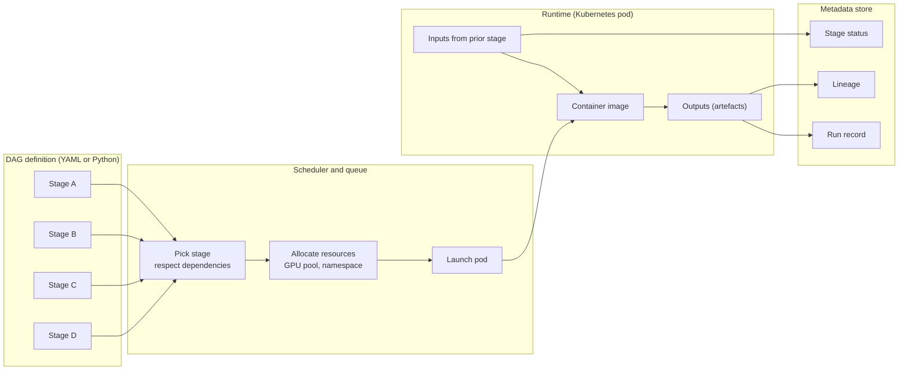
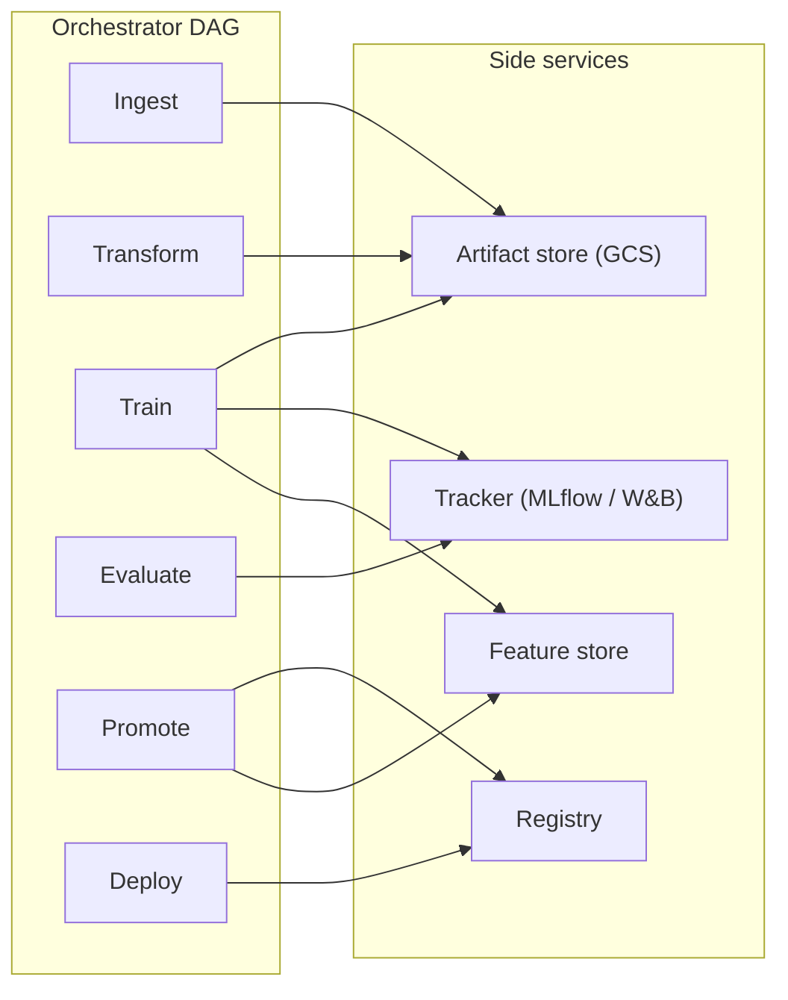

# 16.4 Pipeline orchestration: Kubeflow Pipelines, Argo, Flyte, Airflow

| Field | Value |
|---|---|
| Level | Advanced |
| Priority tier | 1 |
| Lab venue | GCP / GKE |
| Part | Part 16: MLOps and LLMOps tools and platforms |
| Primary sources | *Designing Machine Learning Systems* (`designing-machine-learning-systems`, Chapter 10); *Machine Learning Platform Engineering* (`machine-learning-platform-engineering`, Chapters 1, 5, 6); *Practical MLOps* (`practical-mlops`, Chapter 5); Argo, Kubeflow, Flyte and Airflow official documentation |
| Cross-references | Chapter 16.1 (MLOps foundations); Chapter 16.2 (Experiment tracking); Chapter 16.3 (Data pipelines and feature stores); Chapter 11.16 (KAI gang scheduling) |
| Coverage file | `planning/coverage/chapters/16-04.md` |
| Claim & number ledger | `planning/ledgers/16-04.md` |

## Why this matters for AI infrastructure

Imagine a churn model that retrains every night. One Monday the feature build stops halfway through, and the training job quietly reads last week's table instead. Nobody notices until the scores start to drift and someone asks why the model behaves differently. The run never reported an error, so the problem stayed hidden until a business metric moved. An orchestrator exists to stop this kind of silent failure. It runs the stages in order, retries the ones that fail, skips the ones whose inputs have not changed, and records every run so that you can answer questions about it later.

If you operate a GPU cluster for AI, you also operate an orchestrator, whether or not anyone calls it that. It schedules the training jobs, the feature builds, the evaluation runs, the promotion gate, and the rollback. When it is slow or down, every one of those workflows waits with it, and the GPUs sit idle while the queue is stuck. That is why the orchestrator belongs to the platform team, even when a data scientist writes the steps that run inside it.

```text
Why the orchestrator is on the critical path (background reading: Designing Machine Learning Systems; Machine Learning Platform Engineering; the figures below are examples, not quotations):
- A typical mature MLOps platform runs dozens to hundreds of DAGs per day across
  teams (training, retraining, feature materialisation, evaluation, deployment).
- Each DAG has between 5 and 50 stages; each stage has its own resource request,
  retry policy, and SLA. The orchestrator's job is to keep all of them on schedule.
- The orchestrator's metadata database (Postgres) is the audit trail for every
  pipeline run. A metadata database that is slow or wiped is the same failure as
  losing the audit log.
```

Three realities make this a platform-team concern rather than a data-science concern. Each one changes who owns a decision when something goes wrong, so it helps to see them one at a time.

1. The orchestrator controls the GPU queue. Each training job it schedules becomes a Kubernetes pod that asks for GPUs. The platform team owns that queue and its quota, so the platform team decides who waits and who runs. When two teams submit jobs at the same moment, the orchestrator and the scheduler behind it settle the contest.
2. The orchestrator is a stateful service. Its Postgres backend, artifact store, identity model, and service levels are platform decisions. Its metadata is the audit trail for every run, so losing it is close to losing your Git history. A run you cannot trace is a run you cannot defend in a review.
3. The orchestrator makes the retry and backfill decisions. When a stage fails, it chooses to retry, stop, or fall back. When a feature store is rebuilt, it chooses which downstream stages to run again. The platform team sets that policy, so the policy should be written down and reviewed rather than left to whoever ran the job last.

**Run the orchestrator as a production service, with a service level objective, before any training job depends on it.** A best-effort orchestrator is the one that pages you at 2 a.m.

## Prerequisites and outcomes

Check the earlier chapters before you build anything here. The sections that follow assume a tracker, a registry, and a feature store already exist, so a missing piece will show up as a confusing error several steps later.

### Prerequisites

- Chapter 16.1 (the lifecycle and the four pillars).
- Chapter 16.2 (experiment tracking and registry).
- Chapter 16.3 (data pipelines and feature stores).
- Chapter 5 (Kubernetes) for the cluster primitives the orchestrator depends on.
- Familiarity with YAML, container images, and basic CI/CD concepts.

### Outcomes

Picture the first time your team has to explain a pipeline that ran overnight and produced a model nobody can trace. This chapter walks through how to choose among Argo Workflows, Kubeflow Pipelines, Flyte and Airflow, and how to build a DAG (a directed acyclic graph, which is a set of steps with arrows that show what must finish first) that trains, evaluates, validates, promotes and materializes data. It then covers how to send a stage to the right GPU pool with gang scheduling, which holds a group of pods until all of them can start together. It shows how to pass artefacts by reference, how to set retries and caches, and how to run the orchestrator itself on GKE with Postgres, object storage, IAM, secrets and monitoring.

---

## 1. The four orchestrators and how they differ

Your team has a notebook that trains a model. The model now has to retrain on a schedule, and every run needs a record that someone can read later. Four orchestrators are common answers to that need. They look different on the surface, but they share one conceptual model, so once you understand that model the differences become easier to judge.

### 1.0 The orchestrator as the surface where Kaizen happens

Think about a team that changes its churn model every few weeks and keeps asking whether each change helped. That habit of small, measured improvement has a name. *Practical MLOps* Chapter 5 introduces AutoML and KaizenML as continuous improvement. The orchestrator is where that idea becomes a working habit. Each pipeline run is a hypothesis. The orchestrator records the hypothesis, runs the experiment, and feeds the result into the next iteration.

The Kaizen discipline asks three things of an orchestrator:

1. Every step is recorded. The metadata store is the audit log of every change the team has made.
2. Every step is reproducible. The artefact store is the source of truth for every artefact the team has produced.
3. Every step is reversible. The deployment layer, such as Argo Rollouts or a KServe canary, gives you a rollback path for a bad change.

An orchestrator that meets all three conditions turns "be more disciplined" into a property of the system. One that fails any of them is a notebook with extra steps. When you evaluate a tool, ask which of the three it helps you keep, and what you would have to build yourself to keep the rest.

### 1.1 A unified mental model

Look closely at any of the four orchestrators and you see the same parts. The names and file formats differ, but the parts line up. Once you can point to each part in a tool's documentation, you can learn a new tool in an afternoon. The diagram below shows how a DAG flows through the scheduler, the runtime, and the metadata store.



Read the diagram from left to right. The DAG names the stages and their dependencies. The scheduler waits until a stage's inputs are ready, reserves the resources it needs, and launches a pod. The pod runs the container, reads the outputs of earlier stages, and writes its own outputs. The metadata store records what happened at each step. Every orchestrator needs a way to define the DAG, a scheduler that respects dependencies and resources, a runtime that runs each stage as a container, and a metadata store that records what happened. The tools differ in four places. They differ in the definition language (YAML or Python), the scheduler (Kubernetes-native or custom), the runtime (container or task), and the metadata store (Postgres or a separate service).

### 1.2 Argo Workflows

Suppose your team already runs Kubernetes and wants pipelines without learning a new framework. Argo Workflows is built for that case. You write each DAG in YAML, and each stage runs as a Kubernetes pod. Argo has no Python layer and no hidden services, which keeps the stack small. When something breaks, you read the same YAML and the same pod logs that you already read for every other workload.

The example below declares four stages. The train stage waits for prepare, and evaluate waits for train. Each stage is a template, and the dependencies line is what turns a list of tasks into a graph.

```yaml
# code/part16/argo_dag.yaml
apiVersion: argoproj.io/v1alpha1
kind: Workflow
metadata:
  generateName: training-pipeline-
spec:
  entrypoint: pipeline
  arguments:
    parameters:
      - {name: dataset-id, value: "churn-v3"}
      - {name: seed, value: "42"}
  templates:
    - name: pipeline
      dag:
        tasks:
          - name: prepare
            template: prepare
            arguments:
              parameters: [{name: dataset-id, value: "{{workflow.parameters.dataset-id}}"}]
          - name: train
            template: train
            dependencies: [prepare]
            arguments:
              parameters: [{name: dataset-id, value: "{{workflow.parameters.dataset-id}}"},
                           {name: seed, value: "{{workflow.parameters.seed}}"}]
          - name: evaluate
            template: evaluate
            dependencies: [train]
          - name: register
            template: register
            dependencies: [evaluate]
```

Notice that the parameters flow from the top of the file into each stage. You change the dataset id or the seed in one place, and every stage that reads it picks up the new value. That single point of change is the reason many teams start with Argo before they add anything else.

*Designing Machine Learning Systems* Chapter 10 makes Argo the default for Kubernetes-native MLOps. *Machine Learning Platform Engineering* Chapter 5 introduces Argo Workflows as the orchestrator that runs the DAG declared in `dvc.yaml`.

### 1.3 Kubeflow Pipelines

A data scientist wants to write a training step in Python and let the platform run it without hand-written YAML. Kubeflow Pipelines was built for that situation. You define components and pipelines with the KFP SDK, and KFP compiles them to Argo Workflows and submits them to the cluster. The data scientist works in Python, and the platform still sees ordinary Kubernetes pods underneath.

KFP also adds a run UI, a metadata store for artefacts, and typed inputs and outputs. The typed inputs and outputs catch a class of bugs when you compile the pipeline. A YAML DAG catches the same class of bugs only at run time, after a pod has already started and possibly used GPU hours. Catching the mistake at compile time is cheaper, and it is the main reason to choose KFP over plain Argo for a team that writes a lot of Python.

```python
# code/part16/kfp_pipeline.py
import kfp
from kfp import dsl

@dsl.component(
    base_image="python:3.11",
    packages_to_install=["pandas", "scikit-learn"],
)
def prepare_op(dataset_id: str, output_path: dsl.OutputPath()):
    import pandas as pd
    df = pd.read_parquet(f"data/{dataset_id}.parquet")
    df.to_parquet(output_path)

@dsl.component(
    base_image="nvidia/cuda:12.2.0-runtime-ubuntu22.04",
    packages_to_install=["pandas", "scikit-learn", "mlflow"],
)
def train_op(input_path: dsl.InputPath(), seed: int) -> str:
    import mlflow, pandas as pd
    from sklearn.ensemble import GradientBoostingClassifier
    df = pd.read_parquet(input_path)
    mlflow.set_experiment("churn")
    with mlflow.start_run() as run:
        mlflow.log_param("seed", seed)
        model = GradientBoostingClassifier(random_state=seed)
        model.fit(df.drop("churned", axis=1), df["churned"])
    return run.info.run_id

@dsl.pipeline(name="Churn Training Pipeline")
def training_pipeline(dataset_id: str = "churn-v3", seed: int = 42):
    p = prepare_op(dataset_id=dataset_id)
    t = train_op(input_path=p.output, seed=seed)

if __name__ == "__main__":
    kfp.compiler.Compiler().compile(training_pipeline, "pipeline.yaml")
    kfp.Client().create_run_from_pipeline_package("pipeline.yaml")
```

Read the two components as two separate containers. Each one declares its own base image and its own packages, so the CPU preparation step does not carry the CUDA image, and only the training step asks for the GPU image. The training pipeline function at the bottom wires the output of the prepare step into the train step without any file paths written by hand.

*Machine Learning Platform Engineering* Chapter 6 walks through KFP as the orchestrator that ships with a metadata-aware UI.

### 1.4 Flyte

Your pipeline passes large data tables from one step to the next. A type mismatch can fail an hour into a run, after the expensive part has already started. Flyte is built to catch that kind of mismatch early. It started at Lyft, and it treats each stage as a typed task, which means each task declares what it accepts and what it returns.

You declare inputs and outputs with type annotations, and the runtime checks those types against the dependency graph. In this chapter's comparison, Flyte has the strongest type system of the four. It also has the most support for conditional and dynamic workflows, where the shape of the graph depends on values that only become known during the run.

```python
# code/part16/snippets/flyte_pipeline.py
from flytekit import Resources, task, workflow

@task(requests=Resources(cpu="2", mem="4Gi"))
def prepare(dataset_id: str) -> str:
    import pandas as pd
    df = pd.read_parquet(f"data/{dataset_id}.parquet")
    df.to_parquet("/tmp/clean.parquet")
    return "/tmp/clean.parquet"

@task(requests=Resources(cpu="4", mem="16Gi", gpu="1"))
def train(clean_path: str, seed: int) -> str:
    import mlflow, pandas as pd
    from sklearn.ensemble import GradientBoostingClassifier
    df = pd.read_parquet(clean_path)
    mlflow.set_experiment("churn")
    with mlflow.start_run() as run:
        mlflow.log_param("seed", seed)
        model = GradientBoostingClassifier(random_state=seed)
        model.fit(df.drop("churned", axis=1), df["churned"])
    return run.info.run_id

@workflow
def training_pipeline(dataset_id: str = "churn-v3", seed: int = 42) -> str:
    p = prepare(dataset_id=dataset_id)
    t = train(clean_path=p, seed=seed)
    return t
```

The requests argument on each task is the part to watch. The prepare task asks for CPU and memory only, while train also asks for one GPU. The scheduler reads those requests before it places the pod, so a task that asks for the wrong amount will sit in the queue or land on a node that cannot run it.

Flyte's type system and its first-class support for `pandas.DataFrame`, `numpy.ndarray`, and structured types make it a strong fit for data-heavy ML. *Practical MLOps* Chapter 5 describes Flyte's origin at Lyft and its growth into an open-source project under the Linux Foundation.

### 1.5 Airflow

Many data teams already run Airflow for nightly ETL jobs. Adding an ML training DAG to the same instance can be the cheapest path, because the team already knows how to operate it. Airflow is the oldest of the four, and it is the most widely adopted outside Kubernetes-native teams. The people who wake up when the nightly jobs fail are already familiar with its screens.

In Airflow, DAGs are Python files. Each task can be a Kubernetes pod, a Spark job, a database query, or an HTTP call. The metadata store is Postgres or MySQL. Airflow's strength is its operator ecosystem and its community. Its weakness is that Kubernetes support sits on top of a scheduler that was not built around Kubernetes, so the pod-level behavior you want is one layer removed.

```python
# code/part16/airflow_dag.py
from airflow import DAG
from airflow.providers.cncf.kubernetes.operators.kubernetes_pod import KubernetesPodOperator
from datetime import datetime, timedelta

with DAG(
    dag_id="churn_training",
    start_date=datetime(2024, 1, 1),
    schedule_interval="@weekly",
    catchup=False,
    default_args={"retries": 2, "retry_delay": timedelta(minutes=5)},
) as dag:
    prepare = KubernetesPodOperator(
        name="prepare",
        image="python:3.11",
        cmds=["python", "prepare.py"],
        arguments=["--dataset-id", "churn-v3"],
    )
    train = KubernetesPodOperator(
        name="train",
        image="nvidia/cuda:12.2.0-runtime-ubuntu22.04",
        cmds=["python", "train.py"],
        arguments=["--dataset-id", "churn-v3", "--seed", "42"],
    )
    prepare >> train
```

Each task here is a KubernetesPodOperator, which means Airflow starts a pod for each step and waits for it to finish. The arrow-shaped line at the bottom is how Airflow writes "prepare must finish before train starts." The retry settings sit in the default arguments block, so every task in the DAG inherits them unless a task overrides them.

*Designing Machine Learning Systems* Chapter 10 describes Airflow as the common choice for data engineering teams that already run it for non-ML work. The cost is that Airflow does not speak Kubernetes natively. The benefit is that the same operator pattern runs Spark, BigQuery, Snowflake, and HTTP tasks next to the Kubernetes pod.

### 1.6 Comparison

The table below is for lookup. Use it after you know your constraints, when you need to check one row against your team's answer. Reading it top to bottom without a question in mind will mostly show you that the four tools overlap a lot.

| Dimension | Argo Workflows | Kubeflow Pipelines | Flyte | Airflow |
|---|---|---|---|---|
| Definition language | YAML | Python SDK | Python SDK (typed) | Python SDK |
| Runtime | Kubernetes pod | Kubernetes pod (under Argo) | Kubernetes pod | Kubernetes pod via operator |
| Metadata store | Postgres | MLMD (Protobuf + MySQL/Postgres) | Postgres | Postgres/MySQL |
| Caching | Pod-level cache | Step-level cache | Task-level cache (content-hash) | None (built-in) |
| Retry | Pod retries | Step retries | Task retries | Task retries |
| Conditional execution | Yes (when, if) | Yes (conditions) | Yes (dynamic workflows) | Yes (branch, short-circuit) |
| GPU support | Native (resource requests) | Native (resource requests, GPU pool operand) | Native (Resources(gpu=1)) | Via KubernetesPodOperator |
| UI | Argo UI | KFP UI (rich) | Flyte UI (FlyteConsole) | Airflow UI |
| IAM | Kubernetes RBAC + service accounts | Kubernetes RBAC + service accounts | Kubernetes RBAC + service accounts | Kubernetes RBAC + service accounts |
| Best fit | Kubernetes-native teams; DAGs with simple dependencies | Teams already on Kubeflow; need typed artefacts and a rich UI | Data-engineering-heavy ML; strong type system; dynamic workflows | Teams already on Airflow for non-ML workloads; large ecosystem |

Choosing among these four is rarely about features. Most of them can do what you need, so the real question is operational. Ask which team will run the tool, which ecosystem already lives in your cluster, and how much Python abstraction your team can absorb. A tool your team can debug in the middle of the night beats a better tool that only one person understands.

---

## 2. Building a DAG that actually runs

A DAG that draws neatly on a whiteboard can still fail on its first night in production. The usual reason is a step nobody checked, such as a column that quietly changed type upstream. This section turns the whiteboard into a pipeline with checks, resource requests, artefacts, caches and retries, so that each of those failures has a place to be caught.

### 2.1 The shape of a production pipeline

A model that trains well in a notebook can still fail in production at a step nobody checked. Production pipelines add an explicit gate at each step, so a bad input stops the run early instead of producing a model that looks fine and is wrong. The table lists eight stages that many teams use. Each stage has an artefact, a gate, and a resource request, and the gate is what stops the run when the input is bad.

| Stage | Artifact | Gate | Resource request |
|---|---|---|---|
| Ingest | Raw snapshot | Schema check; row count | Small CPU node |
| Transform | Cleaned snapshot | Null-rate check; join-key check | Small to medium CPU node |
| Feature engineering | Feature table | Distribution check; leakage check | Medium CPU or small GPU (for embeddings) |
| Validate data | Validation report | All expectations pass | Small CPU node |
| Train | Run record + model artifact | Run record has all required tags | GPU pool (gang scheduled for multi-GPU) |
| Evaluate | Evaluation report | Baseline beat; segment metrics | GPU pool (inference, not training) |
| Promote | Registry entry | Promotion gate passes | Small CPU node |
| Deploy | Live model in serving | Canary error budget OK | Small CPU node (deploys via KServe/Argo Rollouts) |

Each gate is a check you can automate. Put the check in the pipeline, not in someone's memory, because memory is the first thing to go when a team changes. Keep the DAG in Git so reviewers can read it, and let each run create its own Workflow object in the cluster. That way the code that ran is always the code that was reviewed, and each run has its own record to inspect.

### 2.2 The resource request is the contract

A training stage that asks for eight GPUs makes a promise to the scheduler. It needs all eight at the same time, in the same NUMA domain, with NVLink between them. NUMA (non-uniform memory access) describes how memory and CPUs are grouped inside one machine, and NVLink is the fast link between GPUs. The default Kubernetes scheduler cannot keep that promise on its own. Gang scheduling, covered in Chapter 11.16, is the tool for it.

Think of the resource request as the contract that the scheduler reads before it places anything. A request that is too small will starve the job at run time. A request that is too large will leave the job waiting in a queue for capacity that never comes. The YAML below shows a request for a full eight-GPU node.

```yaml
# code/part16/gpu_resource_request.yaml
apiVersion: argoproj.io/v1alpha1
kind: Workflow
metadata:
  generateName: multi-gpu-train-
spec:
  entrypoint: train
  templates:
    - name: train
      container:
        image: my-training-image:v1
        command: [python, train.py]
        args: ["--num-gpus", "8"]
        resources:
          requests:
            cpu: "32"
            memory: "256Gi"
            nvidia.com/gpu: "8"
          limits:
            nvidia.com/gpu: "8"
      schedulerName: kai-scheduler  # or volcano, kueue
      podSpecPatch: |
        - op: add
          path: /spec/schedulingGates
          value:
            - name: gang-scheduling
```

The scheduler name line is the handoff. It tells Kubernetes to give this pod to a gang scheduler rather than the default one. The scheduling gates patch holds the pod back until the gate is released, which gives the gang plugin time to see every member of the job before any of them starts.

The same pattern works in KFP, Flyte, and Airflow's `KubernetesPodOperator`. You declare the resource request and the scheduler name. The gang plugin, whether KAI, Volcano, or Kueue, then holds the GPUs until all eight are free. Check the request against your cluster before a long run starts, so the job does not wait in silence. A quick look at the free capacity before submission saves a night of waiting.

### 2.3 Artefact passing without the file system

Picture a stage that writes a multi-gigabyte checkpoint to a shared disk. The next stage reads it back from the same disk. Every byte crosses the storage system twice, once on the write and once on the read, so the pipeline slows down as the data grows. That design ties the pipeline's speed to storage rather than to compute, and it makes a busy shared disk a hidden bottleneck for every team on the cluster.

All four orchestrators have an artefact store, so use it. The store is an object bucket plus a record of what was written, and the stages exchange small pointers instead of large files. The list below names the mechanism each tool uses.

```text
Artefact passing patterns (background reading: Designing Machine Learning Systems; Machine Learning Platform Engineering; the figures below are examples, not quotations):
- Argo: Argo Artifacts (S3-backed) or a sidecar that uploads to object storage
- KFP: dsl.Artifact with an underlying KFP metadata store
- Flyte: typed outputs that are automatically uploaded to the configured blob store
- Airflow: XCom for small values (kilobytes), object storage for large values
```

The rule is the same for every orchestrator, so you can apply it everywhere. A stage writes its output to the artefact store and passes a pointer to the next stage. The next stage resolves the pointer to a content hash, which is a fingerprint computed from the bytes themselves. It verifies the hash, so it knows it has the exact file that was written, and it downloads the bytes only when it needs them. If the fingerprint does not match, the stage stops, and nobody trains on a corrupted copy.

### 2.4 Caching is the cheapest optimisation

Retraining every stage every night wastes GPU hours on steps whose inputs have not changed. A cache lets the orchestrator skip those steps and reuse an earlier output. The idea is simple, but the orchestrators disagree about what counts as "the same input," so the table below is worth reading carefully before you turn caching on.

| Orchestrator | Cache key | Cache scope |
|---|---|---|
| Argo | Pod-level cache by container image + command + args | Same workflow definition |
| KFP | Step-level cache by component + params + inputs | Same pipeline version |
| Flyte | Task-level cache by input content hash | Same task definition |
| Airflow | None by default; operators can implement their own | Per operator |

Flyte's content-hash cache is the most exact of the four. A task is skipped only when its inputs match exactly, and the cached output is reused. The cost is some storage for cached outputs. The cache also works only if its key is deterministic, which means the same inputs always produce the same key. A key that includes a timestamp or a random seed that changes on every run will never hit, and the cache becomes dead weight.

In practice, cache feature engineering aggressively, because its inputs are versioned and never change. Rarely cache training, because the inputs, seeds, and code usually change between runs, so a cache hit is unlikely. Cache evaluation when the training output is unchanged. Ask of each stage whether its inputs can change, and cache only the stages where the answer is no. When in doubt, leave the cache off, because a wrong cache hit is harder to notice than a slow run.

### 2.5 Retries and backoff

A nightly job fails at one in the morning with an image pull error. Run it again a few minutes later and it succeeds. The failure was real, but it was not the job's fault, and nothing in the code needed to change. A retry policy decides which failures deserve another try, and which ones should wake someone up. Getting that split right is what keeps the on-call engineer from being paged for a problem that fixes itself.

The chapter sorts failures into three groups. Each group calls for a different response, so the first question to ask about any failure is which group it belongs to.

- Transient errors, such as network blips, image pull rate limits, and scheduler races, deserve a few retries with backoff. Backoff means each wait is longer than the one before, which gives the failing system time to recover.
- Logic errors, such as a schema mismatch or a code bug, fail the same way every time. Do not retry them. Page the on-call engineer instead, because a retry only burns time and GPU hours.
- Resource errors, such as out-of-memory or a GPU NCCL timeout, deserve one retry after the pressure clears. NCCL is the library that GPUs use to talk to each other, and a timeout there often means another job was using the same resources.

The YAML below shows one example policy. It allows three retries, starting at one minute and doubling up to ten minutes. Those values are examples. Choose yours from how long a stage takes and what a failed retry costs, because a stage that takes an hour should not retry as quickly as one that takes a minute.

```yaml
# Argo retry example
- name: train
  template: train
  retries:
    limit: 3
    backoff:
      duration: "1m"
      factor: 2
      maxDuration: "10m"
  retryStrategy: "OnError"
```

The other orchestrators follow the same discipline with different syntax. Before you set a retry limit, decide which of the three error types each stage can produce. A stage that only ever hits transient errors can take several retries, while a stage that can hit a logic error should retry very little, because the retries cannot help it.

---

## 3. GPU pool integration and gang scheduling

### 3.1 Why default Kubernetes scheduling is not enough

Your job needs eight GPUs. The scheduler places two of its pods and finds no room for the other six. The two running pods hold their GPUs and wait. The cluster looks busy, but the job makes no progress, and the team that owns the GPUs starts asking why their capacity is idle while their jobs are stuck.

The default Kubernetes scheduler places pods one at a time. It does not know that eight pods form a single job. That produces the classic failure, in which two pods get GPUs, six stay pending, and the cluster is wedged. The fix is a gang scheduler, and three are in common use. Each one can hold a group of pods until the whole group fits, and each one has a different strength.

| Scheduler | Strength | Ecosystem |
|---|---|---|
| **Volcano** | Mature; supports gang, queue, fairshare, priority | Strong in Asia-Pacific; integrated with Kueue |
| **Kueue** | Queue-based; works with Volcano or scheduler plugins | Strong on GKE; native to Kubernetes |
| **KAI Scheduler** | NVIDIA-native; gang, topology, GPU fractions, MIG | NVIDIA GPU platforms; see Chapter 11.16 |

*Designing Machine Learning Systems* Chapter 10 argues that any of the three is a sound choice, and the decision comes down to ecosystem and operations. *Machine Learning Platform Engineering* Chapter 5 adds that the scheduler must understand the pool's topology, such as NVLink domains and rack affinity, for multi-node training. Rack affinity means keeping the pods of one job on machines that sit close together, so that their traffic does not cross a slow path.

### 3.2 A Volcano PodGroup example

A PodGroup tells the scheduler that a set of pods is one unit. Without it, each pod looks like a separate job to the scheduler, and the partial-start problem returns. The example below asks for eight pods and eight GPUs before any pod starts, so the group either fits as a whole or waits.

```yaml
# code/part16/podgroup.yaml
apiVersion: scheduling.volcano.sh/v1beta1
kind: PodGroup
metadata:
  name: train-gang
spec:
  minMember: 8
  minResources:
    cpu: "32"
    memory: "256Gi"
    nvidia.com/gpu: "8"
  queue: gpu-pool
  priorityClassName: high
```

The scheduler holds all eight pods until the group fits. The pods then start together. If one pod fails, the group fails with it. Set `minMember` to the number of pods the job cannot run without. If you set it lower than the real need, a partial group will start and sit wedged, which is the same failure you were trying to prevent.

### 3.3 The KAI Scheduler alternative

KAI Scheduler, covered in Chapter 11.16, is NVIDIA's alternative to Volcano. It understands GPU topology, MIG slices, and GPU fractions. MIG (Multi-Instance GPU) is a way to split one physical GPU into smaller isolated slices, and a GPU fraction is a share of one GPU given to a pod. KAI can gang-schedule a job that mixes resource types. For example, a job might need one H100 SXM5 split into four MIG slices, plus a CPU-bound data loader that runs alongside it.

The configuration looks much like the Volcano example. The fields are close enough that moving between the two is mostly a question of changing the API group and checking which features your job actually uses.

```yaml
# code/part16/kai_podgroup.yaml
apiVersion: scheduling.run.ai/v2alpha2
kind: PodGroup
metadata:
  name: train-gang
spec:
  minMember: 8
  queue: gpu-pool
  priorityClassName: high
```

Choose between Volcano and KAI on operations. If your jobs mix GPU slices with CPU work, check whether you need KAI before you adopt it, because the extra features only pay off when you use them. You will also want to ask the platform team which one it can run, since a scheduler nobody on the team can operate will fail at the worst possible time. Volcano is mature and widely adopted. KAI fits NVIDIA stacks that have detailed GPU topology requirements.

---

## 4. Integration with the tracker, registry, and feature store

### 4.1 The orchestrator as the glue

A pipeline run should leave a trail. The trail shows which data it read, which model it trained, and where the artefact went. Without that trail, a model in production is a mystery, and nobody can say with confidence what produced it. The orchestrator makes those calls to the other systems at the right moment, so each stage hands its result to the next system in line. The integration looks the same whichever orchestrator you choose.



Each arrow is an integration point, and each arrow is a stage in the DAG. The arrow carries an artefact with an id, so the next system knows exactly what it received. The orchestrator does not store the data itself. It decides the order in which the systems are called, and it passes the ids between them. If the tracker is down during the train stage, the orchestrator is the component that notices and decides whether the stage should wait or fail.

### 4.2 Run records from the orchestrator

Six months from now, someone will ask which pipeline run produced a given model. The answer should be one click away in both systems. Every orchestrator produces a run record, and that record feeds the tracker in Chapter 16.2. The record is the bridge that lets an operator start at a model in the registry and walk back to the exact run, or start at a run and see every model it produced.

The practical habit is to open a tracker run at the start of the DAG and close it at the end. Store the orchestrator's execution id as a tracker tag, so the tracker can point back to the pipeline. The example below shows the Flyte version of that tag. The ellipsis line stands for the real training code.

```python
# Flyte example: tag the run record with the Flyte execution id
@task
def train(clean_path: str, seed: int, flyte_execution_id: str) -> str:
    import mlflow
    mlflow.set_experiment("churn")
    with mlflow.start_run() as run:
        mlflow.set_tag("flyte_execution_id", flyte_execution_id)
        # ... train ...
    return run.info.run_id
```

Tag each system with the other's id. That double tagging is what lets an operator move from the tracker to the orchestrator run, and back again. A tracker tag without an orchestrator tag leaves a dead end, and an orchestrator record without a tracker tag leaves the same dead end on the other side.

### 4.3 Secrets and IAM

A training pod needs credentials to read a bucket and push an image. If you paste those keys into the DAG file, they end up in Git, and from there in every clone and every log that prints the file. Store them somewhere else and let the pod fetch them at run time. The pattern is the same whichever orchestrator you use. Each pod runs as a service account, which is an identity the cluster gives to a workload, and it mounts only the secrets it needs.

The example below mounts a key file into the training container. The environment variable tells the Google client libraries where to find that key, so the code never contains the key itself.

```yaml
# Argo pod-level secrets
- name: train
  template: train
  container:
    image: my-training-image:v1
    env:
      - name: GCS_BUCKET
        value: gs://my-bucket
      - name: GOOGLE_APPLICATION_CREDENTIALS
        value: /var/secrets/google/key.json
    volumeMounts:
      - name: gcp-key
        mountPath: /var/secrets/google
        readOnly: true
  volumes:
    - name: gcp-key
      secret:
        secretName: gcp-key
```

In this setup, secrets live in Vault or Secret Manager and reach the cluster through External Secrets Operator. The chapter's setup assumes rotation happens automatically, so a leaked key expires on its own schedule. Confirm the rotation schedule in your own configuration, because an assumption that nobody checked is the one that fails during an audit. The platform team owns the service account bindings, so ask it before you widen a pipeline's access.

---

## 5. Operating the orchestrator on GKE

### 5.1 The components

When the orchestrator slows down, every team's pipeline slows with it. That makes the orchestrator's own parts a shared risk, and you should know which component owns which store before an incident starts. The table lists the components, their backing stores, and their service-level targets. The targets are example values, not measurements. Set your own from the latency you actually observe, since a target copied from someone else's cluster tells you little about yours.

| Component | Where it runs | Backing store | SLO |
|---|---|---|---|
| Argo Workflows controller | Kubernetes Deployment | Postgres for workflow metadata | Workflow submit p99 < 5 s |
| KFP backend | Kubernetes Deployment | MLMD on MySQL/Postgres | Pipeline submit p99 < 10 s |
| Flyte propeller | Kubernetes Deployment | Postgres + blob store | Task scheduling p99 < 2 s |
| Airflow scheduler | Kubernetes Deployment | Postgres | DAG parse p99 < 30 s |
| Object store (artefacts) | Direct from worker pods | GCS bucket | p99 put < 5 s |
| Secrets | External Secrets Operator | Vault or Secret Manager | p99 secret fetch < 500 ms |
| IAM | Kubernetes RBAC + GCP IAM | n/a | n/a |

The orchestrator writes to a database, and that database needs the same care as the orchestrator itself. Back it up, and test that you can restore it. A backup you have never restored is a hope, not a plan. Restoring it into a scratch namespace once a quarter is a cheap way to find out whether the plan works.

### 5.2 IAM and multi-tenancy

Two teams share one cluster, and one team's runaway job takes every GPU. Nobody meant to starve the other team, but the cluster had no walls between them. Isolation is what prevents that. The default pattern is one namespace per team, one service account per pipeline, and one Workflow or KFP pipeline per DAG. A namespace is a boundary inside the cluster, and the quotas and permissions attached to it are what keep one team's jobs from spilling into another's.

*Production Kubernetes*, chapter 16, describes a standard onboarding bundle for each namespace. The bundle covers role-based access control, network policies, resource quotas, limit ranges, and pod security defaults. Not every team needs all five, but together they let a new team start without manual steps. When a team asks for a new namespace, the bundle is the checklist the platform team works through.

```yaml
# Argo multi-tenancy
apiVersion: argoproj.io/v1alpha1
kind: Workflow
metadata:
  name: churn-training
  namespace: team-data-science
spec:
  serviceAccountName: pipeline-runner-data-science
  entrypoint: pipeline
  templates:
    - name: pipeline
      dag:
        tasks:
          - name: train
            template: train
```

The service account's IAM bindings decide what the DAG can read and write. The namespace's quotas decide how much GPU the DAG can request. The platform team owns both, so check with it before you change either. A pipeline that suddenly needs more GPUs usually needs a quota change, and that change deserves a review rather than a quiet edit.

### 5.3 Observability of the orchestrator

A DAG that sits in the running state with no stage progress wastes time without raising an error. Nothing crashes, so no alarm fires, and the only sign of trouble is a model that never arrives. The orchestrator is a production service, so it needs metrics, logs, and alerts, just like the model server it feeds. The table lists the metrics a platform team usually watches. The alert thresholds in it are examples. Set them from your own baseline, because a threshold that fires every hour teaches people to ignore it.

| Metric | Why it matters | Alert |
|---|---|---|
| Workflow submit latency p99 | Hot path for every pipeline | > 10 s |
| Stage duration p99 | Catch slow stages before they miss SLA | > 2x baseline for 3 runs |
| Stage failure rate | Catch a single bad upstream change | > 0 for 5 minutes |
| Postgres connection pool utilisation | Catch a sizing bottleneck | > 80 percent |
| Stuck workflows | Catch a DAG that is not progressing | > 0 for 30 minutes |
| Backlog (workflows pending) | Catch a queue that is too long | > 100 pending |

The stuck-workflow metric matters most. A DAG that has been running with no stage progress has probably lost a pod or is waiting on a quota. An alert on elapsed time catches that case, while an alert on stage count can miss it, because the count simply stops changing and nothing else looks wrong.

**Run the orchestrator as a production service, give its stages service levels, and page someone when workflows get stuck.** The orchestrator is the audit trail, so if it breaks, the trail breaks with it.

---

## 6. How it fails

Six failures come up again and again. Each one has a name, a symptom, a diagnosis, and a fix. The name is the sentence an engineer would type into a chat channel, so it is written the way the failure is heard. Start with the symptom, since that is what you or the on-call engineer sees first, and move to the cause only after you have confirmed the symptom matches.

### 6.1 "Two pods got GPUs, six are pending"

Symptom: A multi-GPU training job is stuck. `kubectl describe pod` shows two pods scheduled and six pending. The cluster has free GPUs, but they sit on different nodes, so no single placement fits all eight.

Diagnosis: The default Kubernetes scheduler placed the first two pods greedily. It does not know the job needs all eight at once, so each pod looked like a small, separate request that happened to fit.

Fix: Adopt a gang scheduler, such as Volcano, KAI, or Kueue with a gang-scheduling plugin. Wrap the pods in a PodGroup with `minMember` set to eight. The scheduler then holds every pod until the group fits.

### 6.2 "The DAG ran but the data is from yesterday"

Symptom: The pipeline finished successfully. The training stage produced a model trained on yesterday's data, while serving reads today's data. Offline metrics no longer match production, and the gap is hard to explain because every stage reported success.

Diagnosis: The freshness check from Chapter 16.3 is missing or switched off. The DAG accepted a stale snapshot, because nothing in the DAG asked how old the snapshot was.

Fix: Add a freshness check as the first stage of the DAG. The stage reads the metadata database, confirms the snapshot is newer than your freshness target, and fails the DAG if it is not. Connect the check to an alert so the on-call engineer sees the violation before the model ships.

### 6.3 "The orchestrator's Postgres is full"

Symptom: Workflows start failing with a database error. The Postgres disk is at 100 percent, and `kubectl` commands feel slow, because the same disk serves the API that the commands depend on.

Diagnosis: The metadata database has not been vacuumed. Old workflow records are bloating its tables, so the database keeps the space it used for finished runs even though those rows are no longer live. Vacuum is the Postgres cleanup process that marks that space as reusable.

Fix: Turn on autovacuum for the orchestrator's tables. Add a retention policy that archives completed workflows to object storage once they are old enough. The chapter's example archives after 90 days and alerts at 70 percent disk use. Those are example values, so pick your own.

### 6.4 "The artefact upload times out"

Symptom: A stage that writes a large artefact, such as a model checkpoint, times out on upload. The DAG fails, and the retry fails for the same reason.

Diagnosis: The artefact travels through the orchestrator's pod-to-pod channel. The pod's network bandwidth therefore limits the upload, and a large file simply takes longer than the timeout allows.

Fix: Upload to the artefact store directly. Argo Artifacts, KFP Artifacts, Flyte's blob store, and Airflow's object-store hooks all skip the pod-to-pod channel. For very large artefacts, a presigned URL lets the worker pod upload straight to the bucket. A presigned URL is a short-lived link that grants one upload without sharing a permanent key. The size at which to switch is a decision for your team.

### 6.5 "The pipeline is running on the wrong GPU pool"

Symptom: A multi-node training job lands on nodes without NVLink. NCCL initialisation fails, and the job retries until it times out, which wastes the retry budget and the time on the clock.

Diagnosis: The orchestrator's scheduler is the default Kubernetes scheduler, which does not understand GPU topology. It placed the pods on whatever nodes had room, not on the nodes that share an NVLink domain.

Fix: Adopt a topology-aware scheduler, such as KAI Scheduler or Volcano with its topology plugin. Declare the NVLink domain in the pod spec, and the scheduler lands all pods in the same domain.

### 6.6 "The DAG fails on a missing IAM role"

Symptom: The training stage fails with `Permission denied` on a GCS bucket. The error names a missing role, so the fix looks obvious until you find out the role was granted to someone else.

Diagnosis: The service account's IAM bindings are out of date. The bucket was created after the service account, and nobody added the new bucket to the account's permissions.

Fix: Manage the buckets and their IAM bindings as code, with Terraform or Pulumi, owned by the platform team. Review the plan before each apply, since that is where a bucket without a binding should show up. A review step turns a surprise in the middle of the night into a comment on a pull request.

---

## 7. Hands-on lab

Imagine your team must show that a training run leaves a trail from the orchestrator to the tracker. This lab builds that trail on GKE and checks each link. The lab is untested in this repository, so treat each "expected" line as something to confirm on your cluster. Each step below changes one thing and then checks it, so when a check fails you know which step to look at.

### 7.1 Prerequisites

- Chapters 16.1, 16.2 and 16.3 labs completed (MLflow + DVC + Feast on GKE).
- An Argo Workflows installation on GKE (Helm chart available).
- A Volcano or KAI Scheduler installation (or a stub that accepts the PodGroup).

### 7.2 Step 1: install Argo Workflows

Install the controller first. The controller is the component that watches your Workflow objects and starts their pods. The expected line at the end tells you what a healthy install looks like.

```bash
helm repo add argo https://argoproj.github.io/argo-helm
helm install argo-workflows argo/argo-workflows \
  --namespace argo --create-namespace \
  --set controller.serviceType=ClusterIP
# expected: argo-workflows controller and workflow-controller pods in Running state
```

### 7.3 Step 2: install Volcano (or use an existing gang scheduler)

Install a gang scheduler next, so the PodGroup in later steps has something to talk to. If your cluster already has a gang scheduler, skip this step and keep the one you have.

```bash
helm repo add volcano-sh https://volcano-sh.github.io/helm-charts
helm install volcano volcano-sh/volcano \
  --namespace volcano-system --create-namespace
# expected: volcano-scheduler pods in Running state
```

### 7.4 Step 3: submit a multi-stage DAG

Submit the training DAG and watch it move through its stages. The list command shows every run in the namespace, and the get command shows the stages of the most recent one.

```bash
argo submit -n mlops code/part16/training_dag.yaml \
  --entrypoint pipeline \
  --parameter dataset-id=churn-v3 \
  --parameter seed=42
# expected: a workflow run with stages prepare -> train -> evaluate -> promote
argo list -n mlops
argo get -n mlops @latest
```

### 7.5 Step 4: verify the gang scheduling

Submit the multi-GPU DAG and check that its PodGroup holds all eight pods. If the PodGroup shows fewer pods running than it asks for, the gang is not working, and you should stop before the run uses real GPU time.

```bash
argo submit -n mlops code/part16/multi_gpu_dag.yaml
kubectl describe podgroup train-gang -n mlops
# expected: minMember=8, phase=Running, all 8 pods scheduled on the same NVLink domain
```

### 7.6 Step 5: verify the integration with the tracker and registry

Query MLflow for runs that carry the Argo workflow tag. A run with that tag proves the orchestrator wrote its id into the tracker, which is the first half of the double tag described in the run records part of this section.

```bash
# Open MLflow and confirm the run record has tags flyte_execution_id or argo_workflow_name
curl -s http://localhost:5000/api/2.0/mlflow/runs/search \
  -H "Content-Type: application/json" \
  -d '{"experiment_ids":["1"],"filter_string":"tags.argo_workflow_name != \"\""}' \
  | jq '.runs[].info.run_id'
# expected: at least one run with the argo_workflow_name tag
```

### 7.7 Step 6: observe the orchestrator's metrics

Port-forward the metrics service, then read the workflow duration histogram. The histogram is the metric you will later alert on, so this step checks that it exists before anyone writes a rule against it.

```bash
kubectl -n argo port-forward svc/argo-workflows-metrics 9090:9090 &
curl -s http://localhost:9090/metrics | grep argo_workflow_duration
# expected: histogram metrics for workflow duration; alert thresholds from Section 5.3
```

### 7.8 What to record

After the lab, try to answer these five questions without digging through the cluster. Write the answers down in your team's runbook, since the next on-call engineer will need them.

1. What orchestrator is the cluster running?
2. What is the namespace and service account for the team's pipelines?
3. What is the freshness check that the DAG runs first?
4. Where do the DAG's artefacts land (object store URI, lifecycle policy)?
5. What is the gang scheduler that the multi-GPU DAG uses?

If you cannot answer one of these from the cluster itself, the orchestrator is not yet ready to run production pipelines. The lab is untested against a live GKE cluster, so the answers you record are the real test of the setup.

---

## Exercises

Picture a platform team that has just finished the lab and wants to harden it. Each exercise changes one part of the pipeline and checks the result. Try them in order, since later exercises build on the cluster you set up in the lab.

1. Add a freshness check as the first stage. Write an Argo template that reads the latest snapshot timestamp from the metadata DB and fails the workflow if the snapshot is older than the freshness target. *Solution sketch:* an Argo `http` template that calls the metadata DB, and an exit code that fails the stage.
2. Add a per-team resource quota. Declare a `ResourceQuota` and a `LimitRange` in the team's namespace, then check that the scheduler respects them. *Solution sketch:* `kubectl apply -f resource_quota.yaml`, then submit a DAG that exceeds the quota and expect it to be queued, not scheduled.
3. Add content-hash caching to a stage. Use Argo's pod-level cache or Flyte's task-level cache to skip a stage whose inputs have not changed. *Solution sketch:* Argo's `memoize` block, with a cache key derived from the inputs' content hashes.
4. Wire a sweep on top of Argo. Use Argo's `withParam`, or a Python driver that submits one workflow per hyperparameter combination. *Solution sketch:* a Python script that loops over `params.yaml` and calls `argo submit` once per combination, then a comparison query in MLflow.
5. Move from the default scheduler to KAI Scheduler. Adopt KAI, declare a `PodGroup` that the orchestrator creates, and check that the multi-GPU DAG is gang-scheduled. *Solution sketch:* install KAI, declare a `PodGroup` in the DAG, and observe the gang allocation.
6. Add Prometheus alerts for stuck workflows. Configure the orchestrator to emit a metric for workflows that have not progressed in 30 minutes, then alert on that metric. *Solution sketch:* Argo emits `argo_workflow_duration_seconds`, and a Prometheus rule alerts on `time() - workflow_last_progress > 30m`. The metric name in this sketch is illustrative. Confirm which progress metric your controller actually exposes before you write the rule.

## Checkpoint questions

<details><summary>1. A multi-GPU training job is stuck. `kubectl describe pod` shows two pods scheduled and six pending, and the cluster has free GPUs on other nodes. What happened and what is the fix?</summary>
The default Kubernetes scheduler places pods one at a time and does not know the eight pods form a single job. It placed two greedily, and those two hold their GPUs while they wait. Adopt a gang scheduler such as Volcano, KAI or Kueue. Wrap the pods in a PodGroup with `minMember` set to eight, so the scheduler holds every pod until the group fits.
</details>

<details><summary>2. Workflows start failing with a database error, the Postgres disk is at 100 percent and `kubectl` feels slow. What do you do now and what do you change afterwards?</summary>
The metadata database was never vacuumed, and old workflow records are bloating its tables. Turn on autovacuum for the orchestrator's tables. Add a retention policy that archives completed workflows to object storage once they are old enough. The chapter's example archives after 90 days and alerts at 70 percent disk use, and you should pick your own values.
</details>

<details><summary>3. A stage that writes a large model checkpoint times out on upload and the DAG fails. Where is the bottleneck and how do you remove it?</summary>
The artefact travels through the orchestrator's pod-to-pod channel, so the pod's network bandwidth limits the upload. Upload to the artefact store directly. Argo Artifacts, KFP Artifacts, Flyte's blob store and Airflow's object-store hooks all skip that channel. For very large artefacts, a presigned URL lets the worker pod write straight to the bucket.
</details>

<details><summary>4. The training stage fails with `Permission denied` on a GCS bucket, and the error names a missing role. What is the cause and the lasting fix?</summary>
The service account's IAM bindings are out of date, because the bucket was created after the service account. Manage the buckets and their IAM bindings as code with Terraform or Pulumi, owned by the platform team. Review the plan before each apply, since that is where a bucket without a binding should show up.
</details>

<details><summary>5. A DAG has been in the running state for an hour with no stage progress and no error. What is the likely cause, and why does an alert on stage count miss it?</summary>
The DAG has probably lost a pod or is waiting on a quota. An alert on elapsed time catches that case, because the stuck-workflow metric fires when it exceeds 0 for 30 minutes. An alert on stage count can miss it, since nothing fails and the count simply stops changing.
</details>

<details><summary>6. A nightly job fails at 1 a.m. with an image pull error and succeeds when rerun a few minutes later. How should the retry policy treat this, and how would it treat a schema mismatch?</summary>
An image pull rate limit is a transient error, so it deserves a few retries with backoff. A schema mismatch is a logic error that fails the same way every time. Do not retry it, and page the on-call engineer instead. An out-of-memory or NCCL timeout is a resource error and gets one retry after the pressure clears.
</details>

<details><summary>7. Why do you set `minMember` to the number of pods the job cannot run without, and what happens when one pod fails?</summary>
The scheduler holds all pods until the group fits, then starts them together. If one pod fails, the whole group fails with it. A value that is too low would let a partial group start, and a job that needs all eight would then run wedged.
</details>

<details><summary>8. Why does a stage pass a pointer to the next stage and not write the bytes to a shared file system?</summary>
Writing a multi-gigabyte checkpoint to a shared disk means every byte crosses the storage system, so the pipeline speed ties to storage and slows as the data grows. With a pointer, the stage writes its output to the artefact store. The next stage resolves the pointer to a content hash, verifies it, and downloads the bytes only when it needs them.
</details>

<details><summary>9. Why tag the tracker run with the orchestrator execution id and tag the orchestrator run with the tracker id?</summary>
Six months later someone asks which pipeline run produced a model. The double tag lets an operator move from the tracker to the orchestrator run and back again. Each system points at the other, so neither is a dead end.
</details>

<details><summary>10. Why must a gang scheduler understand topology and not only count GPUs?</summary>
An eight-GPU stage needs all eight at once, in the same NUMA domain, with NVLink between them. Machine Learning Platform Engineering chapter 5 says the scheduler must understand the pool's topology for multi-node training, such as NVLink domains and rack affinity. Without that, the pods can land on nodes without NVLink and NCCL initialisation fails.
</details>

<details><summary>11. Why does the chapter say to cache feature engineering aggressively and training rarely, and what must be true for a cache to work?</summary>
Feature engineering inputs are versioned and never change, so a rerun gives the same output. Training inputs, seeds and code usually change between runs, so a cache hit would be rare. A cache also works only if its key is deterministic. Ask of each stage whether its inputs can change, and cache only the stages where the answer is no.
</details>

<details><summary>12. A team that runs Kubernetes wants pipelines. When do you choose Argo, Kubeflow Pipelines or Flyte, and what do you give up?</summary>
Argo suits Kubernetes-native teams with simple dependencies, and it keeps the stack small with YAML and no Python layer. Kubeflow Pipelines suits teams on Kubeflow that want typed artefacts and a rich UI, and it compiles to Argo. Flyte suits data-heavy ML with the strongest type system and dynamic workflows, and it adds a Python abstraction your team must absorb. The choice is rarely about features and mostly about who will run the tool.
</details>

<details><summary>13. How do you choose between Volcano, Kueue and KAI Scheduler?</summary>
Designing Machine Learning Systems says any of the three is a sound choice, and the decision comes down to ecosystem and operations. Volcano is mature and supports gang, queue, fairshare and priority. Kueue is queue-based and strong on GKE. KAI is NVIDIA-native and handles topology, GPU fractions and MIG, so check whether your jobs mixing GPU slices with CPU work need it. Ask which one the platform team can run.
</details>

<details><summary>14. Your data team already runs Airflow for nightly ETL. Do you add the ML training DAG there, and what is the cost?</summary>
It can be the cheapest path, since the operator pattern runs Spark, BigQuery, Snowflake and HTTP tasks next to the Kubernetes pod. The cost is that Airflow's Kubernetes support sits on top of a scheduler that was not built around Kubernetes. It also has no built-in caching. GPU work goes through `KubernetesPodOperator`.
</details>

<details><summary>15. A data scientist wants to write the training step in Python with no hand-written YAML. What does Kubeflow Pipelines give over a raw YAML DAG?</summary>
You define components with the KFP SDK, and KFP compiles them to Argo Workflows and submits them. KFP adds a run UI, a metadata store for artefacts and typed inputs and outputs. The types catch a class of bugs at compile time, while a YAML DAG catches the same class only at run time. You give up the small stack that plain Argo offers.
</details>

<details><summary>16. An Argo retry policy has a limit of 3, a first delay of 1 minute, a factor of 2 and a max duration of 10 minutes. How long does the stage wait in total before giving up?</summary>
The delays are 1, 2 and 4 minutes, which is 7 minutes of backoff, and none reaches the 10-minute cap. The stage makes four attempts in all, the first run plus three retries. These values are examples, so choose yours from how long a stage takes and what a failed retry costs.
</details>

<details><summary>17. A job needs 8 GPUs and the default scheduler placed 2 pods. How many GPUs are held idle and what fraction of the job is that?</summary>
Two pods hold their GPUs and make no progress, because the other six are pending. That is 2 of 8, or 25 percent of the job. The cluster looks busy but the job makes no progress.
</details>

<details><summary>18. A stage normally takes 12 minutes. At what duration does the example alert fire, and how many runs must it happen on?</summary>
The alert fires above 2 times the baseline, which is 24 minutes, and it must persist for 3 runs. That catches slow stages before they miss their SLA without paging on one slow run. The thresholds are examples, so set yours from your own baseline.
</details>

<details><summary>19. A multi-node training job lands on nodes without NVLink, NCCL initialisation fails, and the job retries until it times out. What do you check first, second and third?</summary>
First, check which nodes the pods landed on and whether they share an NVLink domain. Second, check which scheduler placed them, because the default Kubernetes scheduler does not understand GPU topology. Third, move to a topology-aware scheduler such as KAI or Volcano with its topology plugin, and declare the NVLink domain in the pod spec.
</details>

<details><summary>20. The pipeline finished successfully, but the model trained on yesterday's data while serving reads today's. What do you check first, second and third?</summary>
First, read the metadata database and compare the snapshot timestamp with your freshness target. Second, check whether the freshness check from Chapter 16.3 exists in the DAG or was switched off. Third, add it as the first stage so the DAG fails when the snapshot is too old, and connect it to an alert.
</details>

---

## Sources and review notes

- *Designing Machine Learning Systems* (`designing-machine-learning-systems`, Chapter 10). Source for the orchestration-as-a-service framing, the comparison of Argo / KFP / Flyte / Airflow, the resource-request contract with the scheduler, and the integration with the tracker and registry. Chapter 10 is approximately 13,500 words.
- *Machine Learning Platform Engineering* (`machine-learning-platform-engineering`, Chapters 1, 5, 6). Source for the Argo Workflows and KFP deployment patterns on Kubernetes, the IAM model, the multi-tenancy patterns, and the integration with the tracker. Chapter 5 is approximately 9,000 words; Chapter 6 is approximately 9,500 words.
- *Practical MLOps* (`practical-mLOps`, Chapter 5). Source for the AutoML and KaizenML discussion of feature pipelines and sweeps as orchestrator DAGs, and the Flyte origin story at Lyft. Chapter 5 is approximately 8,800 words.
- Argo Workflows, Kubeflow Pipelines, Flyte, and Airflow official documentation. Source for the API shapes, the YAML and Python SDK syntax, the cache semantics, and the retry policies.

### Cross-references to other handbook chapters

- Chapter 16.1 Section 4.3 for the promotion gate function that the orchestrator invokes.
- Chapter 16.2 for the tracker that the orchestrator tags.
- Chapter 16.3 for the pipeline stages that the orchestrator runs.
- Chapter 11.16 for the KAI gang scheduler.
- Chapter 5 (Kubernetes) for the cluster primitives the orchestrator depends on.

### Migrated from `nvidia-devops`

The Volcano PodGroup shape and the resource-request contract in Section 3 draw on Volume 25 chapter 8 (scaling to multi-node distributed training). The wording has been rewritten in the handbook's voice.

### Explicitly labelled inferences

- The cache comparison in Section 2.4 is an inference from each orchestrator's documentation; specific behaviour depends on the version and the configuration.
- The retry policy (three retries with exponential backoff) is a starting point drawn from common practice; specific workloads may need different policies.
- The freshness check in the failure modes is an inference from the operational pattern in Chapter 16.3; specific thresholds depend on the use case.

### Not verified on live hardware

- The lab in Section 7 is **untested** against a live GKE cluster in this repository.
- The Volcano, KAI Scheduler and Kueue versions assumed in the lab should be pinned against the current releases before production use.
- The Prometheus alert thresholds (workflow stuck at 30 minutes, quota at 80 percent) are starting points; specific thresholds depend on the team's DAG patterns.
