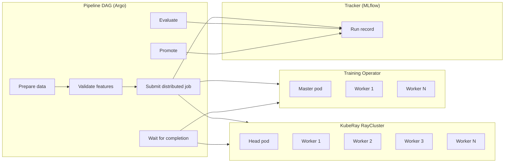

# 16.5 Distributed compute for ML: Ray, KubeRay, Training Operator and Katib

| Field | Value |
|---|---|
| Level | Advanced |
| Priority tier | 1 |
| Lab venue | GCP / GKE |
| Part | Part 16: MLOps and LLMOps tools and platforms |
| Cross-references | Chapter 14.4 (DDP); Chapter 14.5 (FSDP); Chapter 14.6 (DeepSpeed and ZeRO); Chapter 14.7 (Tensor, pipeline and expert parallelism); Chapter 11.16 (KAI gang scheduling); Chapter 12.15 (NCCL collectives) |
| Coverage file | `planning/coverage/chapters/16-05.md` |
| Claim & number ledger | `planning/ledgers/16-05.md` |

## Why this matters for AI infrastructure

Imagine a fine-tune of a large language model that must run for days. One machine cannot hold the job, so it spreads across several nodes and dozens of GPUs. The run has to keep going when a single node fails, and somebody has to decide how the workers find each other when the job starts. Other AI work looks similar. A hyperparameter sweep launches hundreds of trials, and a reinforcement learning run adds and removes workers as it goes. The cluster primitives from Parts 1 through 15 can run these jobs. The frameworks in this chapter are what let your team write them as code, instead of wiring every pod by hand.

If you run a GPU cluster for AI, you also run a distributed compute layer, whether you name it or not. That layer schedules a PyTorch job across 64 GPUs with NCCL all-reduce, for example. It can also run a Ray Tune sweep across 200 trials and gather their metrics. Its most important job is elasticity. When one node fails, the job should continue on the surviving nodes instead of starting over. Kubernetes and the GPU operator are necessary, but the data scientist writes against this layer, not against them. The layer is the API the team actually touches, so its behavior under failure is what the team experiences.

```text
Why distributed compute is the API of modern ML (Ray docs; Kubeflow Training
Operator docs; MLPE Ch 5):
- A typical foundation-model fine-tune on a 70B parameter model requires 4 to 32
  GPUs in a single multi-GPU job, with FSDP or DeepSpeed ZeRO-3 across the group.
- A hyperparameter sweep on a serious ML problem runs 50 to 500 trials in parallel;
  each trial is a Kubernetes pod; the sweep is a DAG of trials with early stopping.
- A reinforcement learning run uses Ray to spin up hundreds of actors and a single
  learner; the actors generate rollouts; the learner updates the policy; the
  cluster scales elastically as the actor pool grows.
```

Three operational realities make this chapter a platform team's concern, not only a data scientist's. Each one changes who owns a decision when a job misbehaves, so the platform team needs to know where its own responsibilities start.

1. The GPU quota belongs to the layer. Every Ray actor and every Training Operator job is a Kubernetes pod that asks for GPUs. The scheduler must start multi-GPU jobs as a group, as Chapter 11.16 explains, and queue the rest against each team's quota. When two teams submit at once, this layer decides who waits.
2. The layer is also the fault boundary. When a pod dies, the layer decides whether to restart it on a new node, fail the whole job, or fall back to a checkpoint. The platform team owns that policy, and it should be written down before the first long run starts.
3. The layer is the audit trail. Every Ray task and every Training Operator job leaves a run record with the data hash, the commit hash and the seed. The platform team owns the link from those records to the tracker and the registry, so a model can be traced back to the exact code and data that produced it.

**Before a multi-node job runs on your cluster, treat its scheduling framework as a production service with a service-level objective. A framework that is best-effort can lose a 14-day training run when one node dies.**

## Prerequisites and outcomes

### Prerequisites

Work through these first. If one of them is new to you, pause and read it before you continue, because the later sections assume you already know it. The gang scheduler in particular comes back in almost every section, so the Chapter 11.16 material is worth a careful read.

- Chapter 14 covers the parallelism patterns this chapter depends on: DDP, FSDP, DeepSpeed and Megatron.
- Chapter 12.15 explains the NCCL collectives that the layer relies on over the network.
- Chapter 11 covers the device plugin, the GPU Operator and the gang scheduler.
- Chapter 16.4 covers the pipeline DAG that runs these distributed jobs.

### Outcomes

Picture the first multi-node job your team has to launch on a Friday afternoon, with a deadline on Monday. This chapter walks through the four tools that make such jobs possible, Ray, KubeRay, the Kubeflow Training Operator and Katib, and explains which one fits which workload. It then shows how to build a Ray cluster that runs training, sweeps or reinforcement learning, how to deploy a fixed-topology job with the right gang scheduler and GPU pool, and how to run a Katib sweep with early stopping. The chapter closes with how to connect the layer to the orchestrator and the tracker, and how to operate it on GKE with autoscaling, fault tolerance and a clear policy for what happens when a node dies mid-job.

---

## 1. The four tools and the workloads they fit

### 1.1 Ray: general-purpose distributed Python

Suppose your feature code runs fine on a laptop, but the dataset no longer fits there. You want the same Python to run on many machines without a rewrite. That is the problem Ray is built for. Ray gives you a small set of primitives: tasks, actors and objects. A task is a function that runs somewhere in the cluster, an actor is a long-lived worker that keeps its state between calls, and an object is a value that Ray stores and passes between them. Libraries sit on top of those primitives, and each one targets a specific ML job.

Ray Train, Ray Tune, Ray Serve and Ray Data are those libraries. The table shows what each one is for. You can read it as a menu, where you pick the row that matches the job in front of you.

| Ray library | What it does | Typical use case |
|---|---|---|
| Ray Core | Tasks, actors, objects | Custom distributed Python |
| Ray Train | Distributed training (PyTorch, TensorFlow, HuggingFace) | Multi-node fine-tunes, FSDP, DeepSpeed |
| Ray Tune | Hyperparameter search | Sweeps with early stopping |
| Ray Serve | Model serving (online inference) | Online inference with autoscaling |
| Ray Data | Distributed data loading | Streaming dataset pipelines |
| Ray RLlib | Reinforcement learning | Actor-learner setups, multi-agent RL |

Ray's strength is that one script can run on a single machine or on a cluster of thousands of nodes. The same code, with a different address, is the whole change. The cost is that Ray brings its own scheduler, object store and placement group logic. A placement group is Ray's way of reserving a set of resources together. On Kubernetes, Ray therefore runs as a set of pods: one head pod that coordinates the cluster and a group of workers that do the work.

### 1.2 KubeRay: the Kubernetes operator for Ray

A Ray cluster on Kubernetes needs something to create and maintain its pods. KubeRay does that job. It is the Kubernetes operator that manages Ray clusters, which means a controller watches a custom resource and keeps the real pods matching it. You describe a cluster with a `RayCluster` resource, and the operator creates a head pod and the worker pods that go with it. If a worker pod dies, the operator notices the gap between the description and the real state, and it creates a replacement.

KubeRay adds autoscaling, which adds workers on demand. It also supports gang scheduling through Volcano or KAI, and it works with the GPU device plugin, so each pod that asks for a GPU gets one. The example below shows a head with one GPU and a worker group that can scale between four and sixteen workers.

```yaml
# code/part16/raycluster.yaml
apiVersion: ray.io/v1
kind: RayCluster
metadata:
  name: churn-train
spec:
  rayVersion: "2.9.0"
  headGroupSpec:
    serviceType: ClusterIP
    template:
      spec:
        containers:
          - name: ray-head
            image: rayproject/ray-ml:2.9.0-gpu
            ports:
              - {name: gcs, containerPort: 6379}
              - {name: client, containerPort: 10001}
              - {name: dashboard, containerPort: 8265}
            resources:
              limits:
                cpu: "4"
                memory: "16Gi"
                nvidia.com/gpu: "1"
  workerGroupSpecs:
    - groupName: gpu-workers
      replicas: 7
      minReplicas: 4
      maxReplicas: 16
      template:
        spec:
          containers:
            - name: ray-worker
              image: rayproject/ray-ml:2.9.0-gpu
              resources:
                limits:
                  cpu: "16"
                  memory: "64Gi"
                  nvidia.com/gpu: "1"
```

Read the resource as a contract with the cluster. The head pod asks for one GPU and runs Ray's control services, including the GCS on port 6379 and the dashboard on port 8265. Each worker pod also asks for one GPU and runs Ray tasks. When the work queue grows past the autoscaler's threshold, the autoscaler adds worker pods, and it removes them again when the load drops. The minimum and maximum replica lines are the limits that keep that growth inside what the cluster can afford.

### 1.3 Kubeflow Training Operator: TFJob, PyTorchJob, MPIJob, XGBoostJob

Some jobs have a fixed shape. A fine-tune with one master and seven workers keeps that shape for its whole run. The Kubeflow Training Operator is built for jobs like this. Each framework gets its own custom resource, and the operator creates one pod per replica, with the environment variables and startup script that framework expects. The framework then finds its peers without you writing the discovery code yourself.

The table below lists the resource types that the operator supports. Use it as a lookup when you know the framework your team uses.

| CRD | Framework | Topology |
|---|---|---|
| `TFJob` | TensorFlow | Parameter server or MirroredStrategy |
| `PyTorchJob` | PyTorch | `torch.distributed` with `torchrun` |
| `MPIJob` | OpenMPI, IntelMPI, MPICH | MPI launcher with ssh between pods |
| `XGBoostJob` | XGBoost | Distributed XGBoost with Rabit |
| `PaddleJob` | PaddlePaddle | PaddlePaddle Fleet |
| ` JaxJob` | JAX | JAX distributed |

The Training Operator fits jobs with a fixed topology and a known run time. You declare the topology at submit time, so the operator does not autoscale mid-job. It gang-schedules through Volcano or KAI, and it retries through the standard pod retry policy. That fixed shape is the reason it suits a long fine-tune better than an open-ended RL run.

```yaml
# code/part16/pytorchjob.yaml
apiVersion: kubeflow.org/v1
kind: PyTorchJob
metadata:
  name: churn-distributed
spec:
  runPolicy:
    cleanPodPolicy: None
    ttlSecondsAfterFinished: 600
  pytorchReplicaSpecs:
    Master:
      replicas: 1
      restartPolicy: OnFailure
      template:
        spec:
          containers:
            - name: pytorch
              image: my-training-image:v1
              command: [python, train.py]
              args: ["--dataset-id", "churn-v3", "--backend", "nccl"]
              resources:
                limits:
                  cpu: "16"
                  memory: "64Gi"
                  nvidia.com/gpu: "8"
    Worker:
      replicas: 7
      restartPolicy: OnFailure
      template:
        spec:
          containers:
            - name: pytorch
              image: my-training-image:v1
              command: [python, train.py]
              args: ["--dataset-id", "churn-v3", "--backend", "nccl"]
              resources:
                limits:
                  cpu: "16"
                  memory: "64Gi"
                  nvidia.com/gpu: "8"
```

The same shape applies to `TFJob` and `MPIJob`. Each resource records the topology, which means the master and the workers. It also records the resources each replica requests and the restart policy. The operator then handles the environment variables and the startup coordination. When you read the file, look first at the replica counts and the GPU limits, because those two numbers decide how much of the cluster the job will hold.

### 1.4 Kubeflow Katib: hyperparameter tuning and NAS

A sweep is a loop. You pick settings, train, score the result, and pick again. Neural architecture search, or NAS, is the same loop applied to the shape of the network itself. Katib runs that loop on Kubernetes. You declare an `Experiment`, and Katib starts trials as pods. Each trial reports a metric, and the search algorithm uses those metrics to choose the next settings.

```yaml
# code/part16/katib_experiment.yaml
apiVersion: kubeflow.org/v1beta1
kind: Experiment
metadata:
  name: churn-sweep
spec:
  algorithm:
    name: bayesian-optimization
  objective:
    type: maximize
    goal: 0.95
    objectiveMetricName: auc
  parameters:
    - name: learning_rate
      parameterType: double
      feasibleSpace:
        min: "0.0001"
        max: "0.1"
    - name: n_estimators
      parameterType: int
      feasibleSpace:
        min: "50"
        max: "500"
  trialTemplate:
    primaryContainerName: training-container
    spec:
      containers:
        - name: training-container
          image: my-training-image:v1
          command: [python, train.py]
          args: ["--dataset-id", "churn-v3"]
          resources:
            limits:
              cpu: "4"
              memory: "16Gi"
              nvidia.com/gpu: "1"
```

Read the objective block first, since it says what "better" means. The parameters block lists the settings that Katib is allowed to change, and the trial template is the pod that each trial runs. Katib fits sweeps where one trial is one pod. It supports Bayesian optimisation, hyperband, early stopping and a small set of neural architecture search algorithms. It does not run multi-GPU trials on its own. For a multi-GPU sweep, the trial template can declare a `PyTorchJob`, and Katib starts one `PyTorchJob` per trial.

### 1.5 Comparison

The three tools answer different questions. Ray asks how you write distributed Python. The Training Operator asks how you run a fixed multi-GPU job. Katib asks which settings give the best result. When a team is unsure which one to reach for, this is the question to ask first, and the table below is for checking the details once you know the answer.

| Dimension | Ray / KubeRay | Training Operator | Katib |
|---|---|---|---|
| Topology | Dynamic (workers added on demand) | Static (declared at submit) | Static (one trial = one pod/job) |
| API | Python (`@ray.remote`) | YAML CRD | YAML CRD with search algorithm |
| Autoscaling | Yes (Ray autoscaler + KubeRay) | No (fixed replicas) | Yes (early stopping) |
| GPU support | Native (resource requests) | Native (resource requests) | Native (per-trial requests) |
| Fault tolerance | Ray actor restart; line of work lost on worker death | Pod restart; job continues if Master is alive | Trial restart; sweep continues |
| Best fit | Custom distributed Python; RL; elastic workloads | Fixed-topology multi-GPU training | Hyperparameter sweeps with search |

The tools complement each other rather than compete. A team that runs multi-node fine-tunes uses the Training Operator for the training job, Katib for the sweep, and Ray for data loading and serving. A team that runs reinforcement learning uses Ray from end to end, with KubeRay running the cluster. Most teams end up with two of the three, and only rarely with all of them at once. A practical way to decide is to write down the shape of the job first: how many pods it needs, whether that number changes during the run, and how long it runs. A fixed shape with a known run time points to the Training Operator. A changing shape points to Ray. A search over settings points to Katib.

---

## 2. Gang scheduling and GPU pool integration

### 2.1 The contract is the resource request

Picture a `PyTorchJob` with one master and seven workers. The job needs all eight pods running at the same moment, and each pod holds its own GPUs. The default scheduler places pods one at a time, so it can place the master and six workers while the seventh worker waits. The job is now wedged. It holds the GPUs of seven pods and cannot start, and the GPUs it holds are not free for anyone else either.

A gang scheduler solves this by treating the whole job as one unit. The Training Operator, KubeRay and Katib each integrate with one. The table shows what each layer asks the gang scheduler to hold together, and the minimum member count is the number of pods that must start before any of them may run.

| Layer | Gang scheduler integration |
|---|---|
| KubeRay | Volcano PodGroup with `minMember: workers + 1`; KAI Scheduler with a PodGroup |
| Training Operator | Volcano PodGroup with `minMember: master + workers`; KAI Scheduler PodGroup |
| Katib | Volcano PodGroup per trial or per sweep |

In production, the pattern looks like this. The annotations are the handoff. They tell the scheduler which group each pod belongs to, so the scheduler can count the members as one job.

```yaml
# code/part16/pytorchjob_with_volcano.yaml
apiVersion: kubeflow.org/v1
kind: PyTorchJob
metadata:
  name: churn-distributed
  annotations:
    scheduling.volcano.sh/group-name: "churn-distributed"
    scheduling.volcano.sh/group-min-member: "8"
spec:
  pytorchReplicaSpecs:
    Master:
      replicas: 1
      template:
        metadata:
          annotations:
            scheduling.volcano.sh/group-name: "churn-distributed"
        spec:
          containers:
            - name: pytorch
              image: registry.example.com/ml/churn-train:PINNED_TAG
              command: ["torchrun", "train.py"]
              resources:
                limits:
                  nvidia.com/gpu: 1
    Worker:
      replicas: 7
      template:
        metadata:
          annotations:
            scheduling.volcano.sh/group-name: "churn-distributed"
        spec:
          containers:
            - name: pytorch
              image: registry.example.com/ml/churn-train:PINNED_TAG
              command: ["torchrun", "train.py"]
              resources:
                limits:
                  nvidia.com/gpu: 1
```

The annotations tell Volcano to treat all eight pods as one gang. The scheduler holds every pod until the group can be satisfied, and then starts them together. The pods also fail together when any one of them fails, which is the behavior you want, since a half-running gang cannot make progress anyway. Notice that the image tag is pinned rather than set to latest, so the same job runs the same code on every retry. When you review a gang definition, count the members and compare that number with the pods the file really creates. A mismatch is one of the most common mistakes in files like this, and the scheduler will not warn you about it. It simply waits for a group it can never complete.

### 2.2 KAI Scheduler integration

KAI Scheduler, covered in Chapter 11.16, is NVIDIA's native alternative. The integration looks much the same. The difference is that the operator creates a `PodGroup` resource when the job is submitted, rather than relying only on annotations on each pod. Either way, the scheduler sees the group as one unit.

```yaml
# code/part16/kai_podgroup.yaml
apiVersion: scheduling.run.ai/v2alpha2
kind: PodGroup
metadata:
  name: train-gang
spec:
  minMember: 8
  queue: gpu-pool
  priorityClassName: high
```

Choosing between Volcano and KAI is an operational decision, and both are valid. This chapter's view is that KAI offers richer GPU topology and MIG support, while Volcano is more mature and widely adopted. If your team already runs one of them, the simplest answer is usually to stay with it.

### 2.3 Topology binding

Some jobs need fast links between their GPUs. If one job spans two NVLink domains, its high-bandwidth collectives may not finish inside the NCCL timeout. An NVLink domain is a group of GPUs that share the fast link, and crossing between domains is much slower. Topology binding prevents that. A node affinity rule pins all the pods to one NVLink domain, so the scheduler will only place them on nodes in that domain.

```yaml
# Node affinity for NVLink domain (shape only)
spec:
  affinity:
    nodeAffinity:
      requiredDuringSchedulingIgnoredDuringExecution:
        nodeSelectorTerms:
          - matchExpressions:
              - key: nvidia.com/nvlink.domain
                operator: In
                values: ["nvlink-domain-7"]
```

Both Volcano and KAI support this pattern. Once the rule is in place, the scheduler handles the placement for you. The word "required" in the field name matters. A preferred rule would let the scheduler fall back to another domain when the first one is full, and that fallback is exactly the slow path you were trying to avoid.

---

## 3. Fault tolerance and elastic training

### 3.1 What happens when a node dies

Suppose a 14-day run on 64 GPUs loses a few nodes over its life. The causes include disk failures, ECC errors, network blips and scheduled maintenance. ECC errors are memory errors that the hardware detects. The naive response is to restart the job. The cost of that restart is the full 14-day run, lost, and the team starts the clock again from the beginning.

The mature response is elastic training. When a node dies, the surviving nodes keep working, and a replacement joins when it comes back. Three patterns make this possible, and each one trades simplicity against efficiency. The table lists them with the tools that support each one, so you can see which pattern your framework already offers.

| Pattern | What it does | Where it is supported |
|---|---|---|
| **Checkpoint-restart** | Periodically save a checkpoint. On failure, restart from the latest checkpoint | PyTorch (`torch.distributed.elastic`), DeepSpeed, Megatron |
| **Elastic membership** | The job's worker set changes mid-run. The framework rebalances it | Ray Train with elastic worker set; PyTorch Elastic |
| **Reactive failover** | The orchestrator restarts the failed pod. The framework then rejoins it | Kubeflow Training Operator with `restartPolicy: OnFailure` |

*Designing Machine Learning Systems*, Chapter 10, walks through this trade-off. Checkpoint-restart is the most widely supported pattern. Reactive failover is the simplest to set up. Elastic membership is the most efficient, if your framework supports it. For most teams, the right first step is the one with the widest support, and the other two can come later once the basics hold.

### 3.2 A checkpoint-restart pattern with PyTorch Elastic

A checkpoint is your safety net. The job saves its model and optimiser state every so often, so a crash costs only the steps since the last save. The script below saves every 100 steps. It writes to a temporary file and then renames it, so a crash during a write never leaves a broken checkpoint behind. The rename either happens or it does not, which is what the comment in the code means by atomic.

```python
# code/part16/snippets/train_elastic.py
# Run with:  torchrun --nnodes=1:4 --nproc-per-node=8 --max-restarts=3 --rdzv-backend=c10d --rdzv-endpoint=$HEAD:29400 train_elastic.py
# torchrun is the elastic launcher; the training script itself only initialises the process group and resumes from a checkpoint.
# (Do not call torch.distributed.elastic.agent.run(...). That is not how a training script is launched.)
import os, torch, torch.distributed as dist

MAX_STEPS = 10_000

def build_model(): return torch.nn.Linear(16, 1)
def build_optimiser(m): return torch.optim.SGD(m.parameters(), lr=0.01)

def load_latest_checkpoint(path="ckpt.pt"):
    return torch.load(path, map_location="cpu") if os.path.exists(path) else None

def save_checkpoint(state, path="ckpt.pt"):
    if dist.get_rank() == 0:
        torch.save(state, path + ".tmp"); os.replace(path + ".tmp", path)   # atomic: a crash never leaves a half file
    dist.barrier()

def train():
    dist.init_process_group(backend="nccl" if torch.cuda.is_available() else "gloo")
    model, opt = build_model(), build_optimiser(build_model())
    opt = build_optimiser(model)
    state = load_latest_checkpoint()
    start = 0
    if state:
        model.load_state_dict(state["model"]); opt.load_state_dict(state["optimiser"]); start = state["step"] + 1
    for step in range(start, MAX_STEPS):
        loss = model(torch.randn(8, 16)).pow(2).mean(); opt.zero_grad(); loss.backward(); opt.step()
        if step % 100 == 0:
            save_checkpoint({"model": model.state_dict(), "optimiser": opt.state_dict(), "step": step})

if __name__ == "__main__":
    train()
```

Walk through the file in the order it runs. First the process group is set up, which is the step where the workers agree they belong to one job. Then the script looks for a checkpoint. If it finds one, it loads the model and optimiser state and starts from the step after the saved one. Otherwise it starts from step zero. The save function lets only rank 0 write the file, and the barrier makes every other rank wait until the write is finished. Rank is the number that identifies one process among the workers, and rank 0 is the one that usually handles shared output.

Launch the script with `torchrun`, the elastic launcher, rather than running it directly. The launcher is what makes the job elastic. When a worker dies, the agent rejoins the world on a new node. When a new node arrives, the agent adds it to the world. The training code does not have to know about either event, which is the point of putting that work in the launcher.

Elastic training has a cost. Each step carries a small overhead, and the framework's collective calls must tolerate a world size that changes. Measure that overhead on your own job before you rely on it. A job that spends more time coordinating than computing has gained nothing from being elastic.

### 3.3 A checkpoint-restart pattern with DeepSpeed

DeepSpeed follows the same idea for very large models. The shape of the loop is nearly the same, but the framework takes over the sharding of the model and the optimiser, so the checkpoint call saves pieces that belong to each process.

```python
# code/part16/snippets/train_deepspeed.py
import deepspeed

model, optimizer, _, _ = deepspeed.initialize(
    args=args, model=model, model_parameters=model.parameters()
)
for step in range(MAX_STEPS):
    loss = train_step(model)
    model.backward(loss)
    model.step()
    if step % 100 == 0:
        model.save_checkpoint(save_dir, tag=f"step-{step}")
```

DeepSpeed's ZeRO-3 with checkpoint-restart is the standard pattern for multi-billion-parameter fine-tunes. Each checkpoint holds the sharded optimiser state, the sharded model state and the step number. On restart, the framework reads the checkpoint and resumes from that step. Because each process writes only its own shards, the save is spread across the cluster instead of funnelled through one machine.

### 3.4 Kueue for quota and preemption

When several teams share one GPU cluster, one team's job can take every GPU. Nobody has to be careless for that to happen. A long job that starts first simply keeps what it has. Kueue is the Kubernetes-native queue manager that stops this by enforcing quotas across teams. It decides which jobs may start, and it holds the rest in a queue until there is room.

```yaml
# code/part16/local_queue.yaml
apiVersion: kueue.x-k8s.io/v1beta2
kind: LocalQueue
metadata:
  name: team-data-science
  namespace: team-data-science
spec:
  clusterQueue: cluster-queue-data-science
```

A `LocalQueue` binds a team's namespace to a cluster queue. The cluster queue carries the quota, for example 32 H100s and 64 A100s. A job waits while the quota is full, and it starts once the quota has room. The team sees its own queue, while the platform team sees the whole cluster and sets the limits.

Preemption works like this. When a higher-priority job needs GPUs, Kueue stops the lowest-priority running job. It deletes that job's pods, the job's checkpoint survives, and the job resumes when quota frees up. Preemption is powerful, but it only costs little when the preempted job can resume from a checkpoint. Before you enable preemption, check that every preemptible job saves checkpoints. A useful test runs on a quiet afternoon rather than during a deadline. Start a low-priority job, let it save a checkpoint, then submit a high-priority job and watch what happens to the first one. The restarted job should resume from its last checkpoint rather than from the first step. If it starts over, the checkpoint path is broken, and you have found that out before it cost anyone a week.

---

## 4. Integration with the orchestrator, tracker, and registry

### 4.1 The DAG that runs a distributed training job

A pipeline from Chapter 16.4 eventually has to train a model. Its training stage submits a distributed job, waits for it to finish, and records the result. The diagram shows where each part runs. The orchestrator submits and waits, the framework does the training, and the tracker keeps the run record. The same stage can submit either a KubeRay cluster or a Training Operator job, depending on the workload.



Keep the two sides separate. The orchestrator submits the job, waits for it, and feeds the tracker. The distributed framework does the training. The only contract between them is the custom resource submission. If the orchestrator knows nothing about how the ranks talk to each other, you can change the framework later without rewriting the pipeline. When the framework fails, the orchestrator sees only the failed job object, so the job's own pod logs remain the place to find the real error.

### 4.2 The tracker integration

A single record for a whole multi-node job hides what each rank did. If one rank ran slower or saw different data, the summary will not show it. The better pattern gives every rank its own run. Set `MLFLOW_TRACKING_URI` on every pod in the job, so each rank knows where the tracker lives. The first thing each rank does is open an MLflow run with its rank number in the name.

```python
# code/part16/train_with_mlflow_rank.py
import os, mlflow
rank = int(os.environ["RANK"])
world_size = int(os.environ["WORLD_SIZE"])
mlflow.set_tracking_uri(os.environ["MLFLOW_TRACKING_URI"])
mlflow.set_experiment("churn")
with mlflow.start_run(run_name=f"churn-rank-{rank}-of-{world_size}") as run:
    mlflow.set_tag("rank", str(rank))
    mlflow.set_tag("world_size", str(world_size))
    mlflow.set_tag("data_hash", os.environ["DATA_HASH"])
    mlflow.set_tag("code_commit", os.environ["CODE_COMMIT"])
    # ... train ...
```

The pattern produces one run record per rank. The comparison query from Chapter 16.2 joins those records on `tags.code_commit` and `tags.data_hash`. That lets you compare the ranks side by side. Because every rank carries the same data hash and commit, a mismatch between ranks points at a real difference in the run, not at a guess.

### 4.3 The registry integration

A finished run is not yet a model you can ship. The orchestrator submits a register stage, which reads the run, checks the promotion gate and writes a version to the registry. The promotion gate is the list of conditions a run must meet before it is allowed to become a model version. The script below checks four tags and an accuracy floor, then registers the run.

```python
# code/part16/register_from_operator.py
import os, mlflow
from mlflow.tracking import MlflowClient

run_id = os.environ["MLFLOW_PARENT_RUN_ID"]
client = MlflowClient()
run = client.get_run(run_id)

# Promotion gate from Chapter 16.1
for tag in ("data_hash", "code_commit", "seed", "env_image"):
    if tag not in run.data.tags:
        raise SystemExit(f"PROMOTION BLOCKED: missing {tag}")
if run.data.metrics.get("auc", 0) < 0.90:
    raise SystemExit("PROMOTION BLOCKED: AUC below floor")

# Register
model_uri = f"runs:/{run_id}/model"
mv = client.create_model_version("churn-model", model_uri, run_id)
client.transition_model_version_stage("churn-model", mv.version, stage="Staging")
print(f"PROMOTED churn-model v{mv.version}")
```

Read the gate before the registration. A run with a missing tag stops at the first loop, so it never reaches the registry, and the error message names the tag that was missing. The register stage works the same way whether the run came from KubeRay, the Training Operator or a single GPU. The tracker and the registry are the abstractions here. The distributed framework is only the runtime, so a model that passes the gate looks the same no matter how it was trained.

---

## 5. Operating the layer on GKE

### 5.1 The components

Each component below runs as a Kubernetes deployment with its own backing store. The SLO column lists latency targets. This chapter does not source or measure those figures, so treat them as example values and set your own from your own measurements. A target that nobody measures is a guess, and a guess does not tell an on-call engineer when to act.

| Component | Where it runs | Backing store | SLO |
|---|---|---|---|
| KubeRay operator | Kubernetes Deployment | Custom Resource Definitions | RayCluster ready p99 < 30 s |
| Training Operator | Kubernetes Deployment | Custom Resource Definitions | Job ready p99 < 30 s |
| Katib controller | Kubernetes Deployment | Postgres | Trial ready p99 < 30 s |
| Volcano scheduler | Kubernetes Deployment | etcd | PodGroup ready p99 < 5 s |
| KAI Scheduler | Kubernetes Deployment | etcd | PodGroup ready p99 < 5 s |
| Kueue controller | Kubernetes Deployment | Postgres | Queue admission p99 < 1 s |

A controller without a measured target is not yet a production service. Start by measuring how long each one takes from submit to ready. Those timings give you a baseline, and the baseline is what the SLO should be built from.

### 5.2 IAM and multi-tenancy

Chapter 16.4 uses one namespace per team and one service account per pipeline, and the distributed layer follows the same pattern. The Training Operator and Katib jobs run under the team's service account. The IAM bindings on that account decide what a job can read and write, so a job that cannot reach its data bucket usually traces back to this account rather than to the job itself.

```yaml
# code/part16/service_account.yaml
apiVersion: v1
kind: ServiceAccount
metadata:
  name: pipeline-runner-data-science
  namespace: team-data-science
```

Keep the account narrow. A job that runs under a broad account can touch every bucket in the project, and a bug in one training script then has a much larger blast radius. Ask the platform team for the smallest set of permissions that the job needs, and revisit it when the job's data sources change.

### 5.3 Observability

The distributed compute layer is a production service, so it needs metrics, logs and alerts. The table lists the signals. Its alert column holds example thresholds to start from, not values this chapter sources. Tune each threshold against your own workloads before you page anyone on it, because a threshold that fires every night will be ignored within a week.

| Metric | Why it matters | Alert |
|---|---|---|
| Job submit latency p99 | Hot path for every training job | > 30 s |
| Pod restart rate | Catch a node or framework bug | > 1 in 5 minutes |
| GPU utilisation (DCGM) | Catch a wasted allocation | < 30 percent for 30 minutes |
| NCCL timeout rate | Catch a network or topology bug | > 0 for 10 minutes |
| Stuck job duration | Catch a job that is not progressing | > 2x expected duration |
| Checkpoint save rate | Catch a missing checkpoint loop | 0 in last hour |

GPU utilisation matters most. Put the utilisation panel on the same dashboard as the stuck-job alert, so the on-call engineer sees both in one place. When a job holds GPUs at low utilisation for a long time, the stuck-job alert is often the first signal, and the utilisation panel shows whether the job is progressing at all. A job that reserves 64 GPUs but uses 20 percent of them is I/O bound, misconfigured or stalled. I/O bound means the job spends its time waiting for data rather than computing. Under the example alert in the table, that job pages the on-call engineer to investigate. The reason to watch utilisation as well as failures is that a wasted job raises no error, so failure alerts never fire for it.

**A job that holds GPUs without using them is wasting the cluster, so watch utilisation as closely as you watch failures.**

---

## 6. How it fails

Six failure patterns come up often enough to learn by name. Each one below gives you a symptom you can spot, a likely cause, and a fix. Start from the symptom, because it is the only thing the on-call engineer can see at first, and only move to the diagnosis once the symptom matches what you are looking at.

### 6.1 "The job is stuck waiting for a worker"

**Symptom:** A `PyTorchJob` is in `Running` state. The Master pod is scheduled and running. Seven Worker pods are pending. The job has been in this state for an hour, and nothing has failed, so no alert has fired.

**Diagnosis:** The default Kubernetes scheduler placed the Master first. The workers then could not find nodes with free GPUs, and the Master sat there holding its own GPU while it waited for them.

**Fix:** Adopt a gang scheduler, such as Volcano or KAI, and add the PodGroup annotation to the job. The scheduler then holds every pod until the group can be satisfied, so the Master never starts alone.

### 6.2 "The job failed because of an NCCL timeout"

**Symptom:** A `PyTorchJob` failed in the first 30 seconds with `RuntimeError: NCCL timeout`. The error log names the rank and the collective op, which is the operation the GPUs were trying to finish together.

**Diagnosis:** The job's pods landed on different NVLink domains. Collectives that need high bandwidth cannot finish inside the timeout when the traffic has to cross the slower path between domains.

**Fix:** Add node affinity so all pods land in the same NVLink domain. Raise the NCCL timeout only if the topology is right and the network is simply slow, since a longer timeout only hides a placement problem. Run `nccl-tests` (Chapter 12.17) before you submit the job, so you know what the network can do on its own.

### 6.3 "The job lost a worker and restarted from scratch"

**Symptom:** A 6-day training run failed at hour 36 when one pod died. The job restarted from the beginning. The cluster lost 36 node-hours of GPU time, and the team had to explain the delay to the people waiting for the model.

**Diagnosis:** The job either did not save checkpoints often enough, or its framework could not restart from one. The restart began again at step 0, so every earlier step was thrown away.

**Fix:** Add a checkpoint loop with a save interval you choose. Every 100 to 1000 steps is a starting point, not a rule. Use a framework that supports checkpoint-restart, such as PyTorch Elastic, DeepSpeed or Megatron. Then test the checkpoint load path with a unit test, because a checkpoint you have never loaded is not yet a safety net.

### 6.4 "The sweep submitted 500 trials and the cluster ran out of GPUs"

**Symptom:** A Katib sweep submitted 500 trials. The cluster queue admitted 32. The rest are queued. The team expected parallelism, not queuing, and the other teams on the cluster notice the queue at once.

**Diagnosis:** The sweep did not set a parallel limit, so Katib submitted all 500 trials at once. The queue then held the surplus, and the cluster's capacity was split across the sweep and everyone else.

**Fix:** Set `maxTrialCount` and `parallelTrialCount` on the Katib experiment. The sweep then submits `parallelTrialCount` trials at a time, and the rest wait. Also set `maxFailedTrialCount`, so a misconfigured trial fails the sweep early instead of burning the whole budget.

### 6.5 "The Ray cluster autoscaler added 100 worker pods"

**Symptom:** A Ray job requested more workers than the cluster had. The autoscaler added 100 worker pods. The cluster's other workloads could not find free GPUs, and their jobs stopped making progress.

**Diagnosis:** The Ray cluster's `maxReplicas` was set too high. The autoscaler did what it was told, and the cluster's quota was overwhelmed. Autoscaling also adds complexity, and you will need to revisit its settings as load changes. If demand is predictable, a fixed size can be the simpler choice. Production Kubernetes, chapter 13, makes this point.

**Fix:** Set `maxReplicas` to a value your team's quota can support. Add a `ClusterQueue` with a quota the autoscaler cannot exceed. Watch the autoscaler's decisions with Prometheus alerts, so a sudden jump shows up before it fills the cluster.

### 6.6 "The Training Operator job did not respect the resource quota"

**Symptom:** A team submitted a `PyTorchJob` that requested 64 GPUs. The team had a 32-GPU quota. The job was admitted, and the cluster was oversubscribed.

**Diagnosis:** The Training Operator does not check Kueue or any other queue manager. Admission depends on Kubernetes alone. A plain ResourceQuota is set per namespace and blocks any object that would exceed it, so a quota that spans several namespaces needs extra automation. Production Kubernetes, chapter 12, covers this.

**Fix:** Adopt Kueue, and bind the team's namespace to a `LocalQueue`. Kueue holds a job that would exceed the quota in a queue, rather than admitting it.

Start with the symptom, then decide which of these six patterns it matches. If none of them fits, write down what you see before you change anything, since the next person will need the same evidence.

---

## 7. Hands-on lab

This lab installs KubeRay, the Kubeflow Training Operator and Katib on GKE. It then runs a distributed training job and a hyperparameter sweep. The lab is **untested** in this repository, so treat the commands and YAML as a working template, and do not assume any step has been run against a real cluster. You run each step in order, and each step names the output you should expect, so a surprise shows up at the step where it happens.

### 7.1 Prerequisites

- Chapter 16.4 lab completed (Argo Workflows on GKE).
- Volcano or KAI Scheduler installed.
- A GPU node pool with at least 8 H100 or A100 GPUs.

### 7.2 Step 1: install the operators

Install the three operators with Helm. Each one runs in its own namespace, so a problem in one does not clutter the others. The last line tells you what a healthy install looks like.

```bash
# Kubeflow Training Operator
helm install training-operator kubeflow/training-operator \
  --namespace kubeflow --create-namespace

# KubeRay
helm install kuberay-operator kuberay/kuberay-operator \
  --namespace ray-system --create-namespace

# Kubeflow Katib (includes Katib controller and the suggestion services)
helm install katib kubeflow/katib \
  --namespace kubeflow
# expected: three operators running in their respective namespaces
```

### 7.3 Step 2: submit a distributed training job

Apply the PyTorchJob and watch its status until the job reports ready. The watch flag keeps the command open, so you see the change as it happens.

```bash
kubectl apply -f code/part16/pytorchjob.yaml
kubectl get pytorchjob churn-distributed -n mlops -w
# expected: status.conditions.Ready = True within 5 minutes
```

### 7.4 Step 3: submit a Ray cluster and a Ray job

Create the RayCluster first, then send the training script to it as a Ray job. The job command names the head service address, so the job goes to the cluster you just created.

```bash
kubectl apply -f code/part16/raycluster.yaml
kubectl get raycluster churn-train -n mlops -w
# expected: status.state = "ready" within 2 minutes

# Submit a Ray job
ray job submit --address http://churn-train-head-svc:8265 \
  -- python train_ray.py --dataset-id churn-v3 --num-workers 7
```

### 7.5 Step 4: run a Katib sweep

Apply the Experiment and watch it until the sweep succeeds. A small sweep should finish within the time the expected line names, and a sweep that runs past it deserves a look at the trial statuses.

```bash
kubectl apply -f code/part16/katib_experiment.yaml
kubectl get experiment churn-sweep -n mlops -w
# expected: status.conditions.Succeeded = True within 30 minutes for a small sweep
```

### 7.6 Step 5: verify gang scheduling

Describe the PodGroup and check that it holds all the pods of the job. If the group shows fewer members than the job asks for, stop and fix the scheduler before running the job again.

```bash
kubectl describe podgroup churn-distributed -n mlops
# expected: minMember=8, phase=Running, all 8 pods scheduled on the same NVLink domain
```

### 7.7 Step 6: observe the distributed compute layer

Port-forward the KubeRay operator and read its metrics. The metrics show the cluster state and the autoscaler decisions, which are the two things you will alert on later.

```bash
kubectl -n ray-system port-forward svc/kuberay-operator 8080:8080 &
curl -s http://localhost:8080/metrics | grep kuberay_cluster
# expected: metrics for cluster state, autoscaler decisions, and resource utilisation
```

### 7.8 What to record

After the lab, answer these five questions without looking anything up. Write the answers in the team runbook, since the person on call next will need them at a bad hour.

1. Which operator is the cluster running (KubeRay, Training Operator, Katib)?
2. What is the namespace and service account for the team's jobs?
3. What is the gang scheduler that the multi-GPU jobs use?
4. What is the Kueue queue and what is the team's quota?
5. What is the GPU utilisation metric and what is its alert threshold?

If any answer takes you more than a moment, the distributed compute layer is not yet ready to run as a production service. The lab is **untested** against a live GKE cluster, so your recorded answers are the real check on the setup.

---

## Exercises

Each exercise changes one part of the setup and checks what happens. Picture the team that has just finished the lab and wants to see the failure paths for itself. Work through these in order, since each one builds on the cluster you already have.

1. Add a checkpoint-restart loop to a PyTorch Elastic job. You save a checkpoint every 100 steps, then force-kill one pod. Check that the job resumes from the latest checkpoint. *Solution sketch:* the script from Section 3.2 calls `save_checkpoint` every 100 steps. A sidecar kills one pod. The operator restarts it, and the agent resumes from the checkpoint.
2. Add a Katib sweep with early stopping. Set `earlyStopping` to `medianstop` in the Experiment. Then check that the weakest trials stop early. *Solution sketch:* write the Katib resource with the early stopping spec, then watch the trial statuses in the Katib UI.
3. Add a Kueue quota for a team. Declare a ClusterQueue with a 32-GPU quota, and bind the team's namespace to a LocalQueue. Check that a job over the quota waits rather than starts. *Solution sketch:* use the Kueue CRDs from Section 3.4. Submit a 64-GPU job and observe that it stays queued.
4. Add a Ray cluster autoscaler. Configure the RayCluster with `minReplicas: 4` and `maxReplicas: 16`. Then submit a Ray job that requests 12 workers, and check that the autoscaler scales up to 12. *Solution sketch:* use the RayCluster from Section 1.2. Watch the worker count in the Ray dashboard.
5. Wire a Training Operator job into an Argo DAG. Add a stage to the DAG from Chapter 16.4 that submits a PyTorchJob. The stage waits for the job to finish, then sends the run record to MLflow. *Solution sketch:* an Argo Resource template submits the PyTorchJob. An Argo Suspend template waits for completion. The next stage reads the run record.
6. Add a topology-binding node affinity. Configure a PyTorchJob to land on one NVLink domain. Then check that every pod is in that domain. *Solution sketch:* use the node affinity from Section 2.3. Run `kubectl get pods -o wide` to verify placement.

---

## Checkpoint questions

<details><summary>1. A `PyTorchJob` has been in `Running` for an hour. The Master is scheduled and seven Worker pods are pending. What happened and what is the fix?</summary>
The default Kubernetes scheduler placed the Master first, and the workers could not find nodes with free GPUs. The Master holds its GPU and waits. Adopt a gang scheduler such as Volcano or KAI and add the PodGroup annotation to the job. The scheduler then holds every pod until the group can be satisfied.
</details>

<details><summary>2. A Katib sweep submitted 500 trials, the cluster queue admitted 32, and the team expected parallelism and not queuing. What went wrong?</summary>
The experiment set no parallel limit, so Katib submitted all 500 trials at once. Set `maxTrialCount` and `parallelTrialCount`, and the sweep then submits that many trials at a time while the rest wait. Also set `maxFailedTrialCount`, so a misconfigured trial fails the sweep early.
</details>

<details><summary>3. A Ray job asked for more workers than the cluster had, the autoscaler added 100 worker pods, and other workloads could not find GPUs. Why, and what do you change?</summary>
The `maxReplicas` setting was too high, and the autoscaler did what it was told. The quota was overwhelmed. Set `maxReplicas` to a value your team's quota can support. Add a `ClusterQueue` with a quota the autoscaler cannot exceed, and watch the autoscaler's decisions with Prometheus alerts.
</details>

<details><summary>4. A team with a 32-GPU quota submits a `PyTorchJob` that asks for 64 GPUs, and it is admitted. Why did the quota not stop it, and what do you adopt?</summary>
The Training Operator does not check Kueue or any other queue manager, so admission depends on Kubernetes alone. A plain ResourceQuota is set per namespace, and a quota that spans several namespaces needs extra automation. Adopt Kueue and bind the team's namespace to a `LocalQueue`. Kueue then holds a job that would exceed the quota in a queue and does not admit it.
</details>

<details><summary>5. A high-priority job arrives and Kueue stops a low-priority training job. What must be true for that team to lose little work?</summary>
Kueue deletes the low-priority job's pods, and the job resumes when quota frees up. The job's checkpoint survives, so the job loses only the steps since its last save. That works only if every preemptible job saves checkpoints. Check that before you enable preemption.
</details>

<details><summary>6. A job reserves 64 GPUs and DCGM shows about 20 percent utilisation for half an hour. What does the alert tell you, and what are the likely causes?</summary>
The example alert fires below 30 percent for 30 minutes and pages the on-call engineer. A job that holds GPUs without using them is I/O bound, misconfigured or stalled. It wastes the cluster, so watch utilisation as closely as you watch failures.
</details>

<details><summary>7. Why does a multi-node job open one MLflow run per rank, and how do you compare the ranks?</summary>
A single record for the whole job hides what each rank did. Each rank opens a run named with its rank and world size, and sets tags for rank, world size, data hash and code commit. The comparison query joins the records on `tags.code_commit` and `tags.data_hash`, so you can compare the ranks side by side.
</details>

<details><summary>8. Why does the checkpoint code write to a temporary file and then rename it?</summary>
The rename is atomic, so a crash during a write never leaves a half-written checkpoint behind. Only rank 0 writes, and all ranks wait at a barrier afterwards. On restart the job loads the last complete checkpoint and resumes from the next step. A broken file would make the resume path fail.
</details>

<details><summary>9. Why does a job that spans two NVLink domains fail with an NCCL timeout?</summary>
Collectives that need high bandwidth cannot finish inside the NCCL timeout when the pods sit on different NVLink domains. Topology binding fixes it. A node affinity rule on `nvidia.com/nvlink.domain` pins all the pods to one domain. Raise the timeout only if the topology is right and the network is simply slow.
</details>

<details><summary>10. Why keep the orchestrator and the distributed framework separate, and what is the only contract between them?</summary>
The orchestrator submits the job, waits for it and feeds the tracker. The framework does the training. The contract is the custom resource submission. The register stage then works the same whether the run came from KubeRay, the Training Operator or a single GPU, because the tracker and the registry are the abstractions and the framework is only the runtime.
</details>

<details><summary>11. Katib does not run multi-GPU trials on its own. How do you run a sweep where each trial needs several GPUs?</summary>
Declare a `PyTorchJob` in the trial template. Katib then starts one `PyTorchJob` per trial. Each trial reports a metric, and the search algorithm uses those metrics to choose the next settings. A plain trial is one pod.
</details>

<details><summary>12. Your team runs multi-node fine-tunes, sweeps and an RL experiment. Which of Ray, the Training Operator and Katib do you use for each, and what do you give up?</summary>
Use the Training Operator for the fixed-topology fine-tune, Katib for the sweep, and Ray from end to end for RL with KubeRay running the cluster. The Training Operator declares its topology at submit time, so it does not autoscale mid-job. Ray is dynamic but brings its own scheduler, object store and placement group logic.
</details>

<details><summary>13. A 14-day run will lose nodes along the way. How do you choose between checkpoint-restart, elastic membership and reactive failover?</summary>
Checkpoint-restart is the most widely supported pattern. Reactive failover is the simplest to set up and uses `restartPolicy: OnFailure` in the Training Operator. Elastic membership is the most efficient if your framework supports it, but each step carries a small overhead and the collective calls must tolerate a changing world size. Measure that overhead on your own job.
</details>

<details><summary>14. Should a Ray cluster autoscale or run at a fixed size?</summary>
Autoscaling adds workers on demand but adds complexity, and you must revisit its settings as load changes. If demand is predictable, a fixed size can be the simpler choice, which Production Kubernetes chapter 13 points out. If you do autoscale, cap `maxReplicas` to what the quota supports.
</details>

<details><summary>15. When would you pick KAI Scheduler over Volcano, and what do you give up?</summary>
This chapter's view is that KAI offers richer GPU topology and MIG support, so it fits NVIDIA stacks with detailed topology requirements. Volcano is more mature and widely adopted. Both are valid, so the choice is operational. Ask which one the platform team can run.
</details>

<details><summary>16. A 6-day training run failed at hour 36 and restarted from step 0. What share of the run was lost?</summary>
Six days is 144 hours, and 36 divided by 144 is 0.25. So 25 percent of the run was redone. A checkpoint loop would have cut the loss to the steps since the last save, for example every 100 to 1000 steps.
</details>

<details><summary>17. The `RayCluster` example has a 1-GPU head and 1-GPU workers, with `replicas: 7`, `minReplicas: 4` and `maxReplicas: 16`. How many GPUs does it use at the default, minimum and maximum size?</summary>
At 7 workers it uses 7 plus the head, which is 8 GPUs, matching the gang `minMember` of workers plus 1. At the minimum of 4 workers it uses 5 GPUs. At the maximum of 16 workers it uses 17 GPUs.
</details>

<details><summary>18. The `PyTorchJob` example has 1 Master and 7 Workers, each asking for 8 GPUs. How many GPUs is that, and how far over a 32-GPU quota?</summary>
That is 8 pods times 8 GPUs, which is 64 GPUs. Against a 32-GPU quota it is 32 over, or twice the quota. Without Kueue the job is admitted anyway and the cluster is oversubscribed.
</details>

<details><summary>19. A `PyTorchJob` fails in the first 30 seconds with `RuntimeError: NCCL timeout`. What do you check first, second and third?</summary>
First, check which nodes the pods landed on and whether they share one NVLink domain. Second, add node affinity so all pods land in the same domain. Third, raise the NCCL timeout only if the topology is right and the network is simply slow. Run `nccl-tests` before you submit the job.
</details>

<details><summary>20. A 6-day run died at hour 36 and restarted at step 0. What do you check first, second and third?</summary>
First, check the checkpoint save rate metric, which alerts when it is 0 in the last hour. Second, check whether the framework supports checkpoint-restart, such as PyTorch Elastic, DeepSpeed or Megatron, and that the job was launched with the elastic launcher. Third, test the checkpoint load path with a unit test. Then choose a save interval, where every 100 to 1000 steps is a starting point.
</details>

---

## Sources and review notes

- Ray official documentation (`ray.io`). Source for the Ray Core primitives, Ray Train, Ray Tune, Ray Serve, and Ray RLlib APIs. Current Ray version is 2.x; specific APIs may vary by version.
- KubeRay official documentation (`ray.io/kuberay`). Source for the `RayCluster` CRD, the autoscaler configuration, and the GPU resource request shape.
- Kubeflow Training Operator official documentation (`kubeflow.org/docs/components/training`). Source for the `PyTorchJob`, `TFJob`, `MPIJob` and `XGBoostJob` CRDs, the replica topology, and the restart policies.
- Kubeflow Katib official documentation (`kubeflow.org/docs/components/katib`). Source for the `Experiment` CRD, the search algorithms, and the early-stopping configurations.
- Volcano official documentation (`volcano.sh`). Source for the `PodGroup` CRD, the gang scheduling annotations, and the fair-share scheduling.
- KAI Scheduler official documentation (`github.com/NVIDIA/kai-scheduler`). Source for the NVIDIA-native gang scheduling, topology binding, and GPU fractions.
- Kueue official documentation (`kueue.sigs.k8s.io`). Source for the `ClusterQueue` and `LocalQueue` CRDs and the quota admission.
- *Machine Learning Platform Engineering* (`machine-learning-platform-engineering`, Chapters 5, 6). Source for the operator deployment patterns on Kubernetes, the IAM model, and the multi-tenancy patterns.
- *Practical MLOps* (`practical-mlops`, Chapter 5). Source for the AutoML and KaizenML discussion of sweeps as orchestrator DAGs.
- *Generative AI on Kubernetes* (`generative-ai-on-kubernetes`, Chapter 7). Source for the job scheduling patterns for AI workloads, including the integration with Volcano and Kueue.
- NVIDIA Zero-to-Hero Volume 25 (`chapter-08-scaling-to-multi-node-distributed-training.md`). Source for the multi-node distributed training patterns, the checkpoint-restart loop, and the gang scheduling annotations.

### Cross-references to other handbook chapters

- Chapter 14 (Distributed training) for the parallelism patterns the distributed compute layer runs.
- Chapter 12.15 (NCCL collectives) for the network behaviour the layer depends on.
- Chapter 11.16 (KAI gang scheduling) for the NVIDIA-native scheduler.
- Chapter 16.4 (Pipeline orchestration) for the DAG that submits the distributed jobs.

### Migrated from `nvidia-devops`

The multi-node distributed training patterns, the checkpoint-restart loop, and the gang scheduling annotations draw on Volume 25 chapter 8. The wording has been rewritten in the handbook's voice.

### Explicitly labelled inferences

- The four tools' relative strengths are drawn from each tool's documentation and from common practice; specific workloads may favour different combinations.
- The checkpoint interval (100 to 1000 steps) is a starting point; specific workloads may need different intervals based on step time and acceptable loss.
- The GPU utilisation alert (< 30 percent for 30 minutes) is a starting point; specific thresholds depend on the team's workload mix.

### Not verified on live hardware

- The lab in Section 7 is **untested** against a live GKE cluster in this repository.
- The Ray, KubeRay, Training Operator, and Katib versions assumed in the lab should be pinned against the current releases before production use.
- The Volcano, KAI Scheduler and Kueue integration patterns assumed in the lab may change as the projects evolve; verify against the current documentation.
- Manifest checked against upstream CRDs on 2026-11-11 (versions: Kueue v0.20.5, API kueue.x-k8s.io/v1beta2; Training Operator v1.9.4 PyTorchJob).
