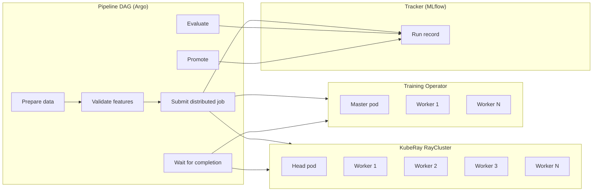

# 16.5 Distributed compute for ML: Ray, KubeRay, Training Operator and Katib

| Field | Value |
|---|---|
| Level | Advanced |
| Priority tier | 1 |
| Lab venue | GCP / GKE |
| Part | Part 16: MLOps and LLMOps tools and platforms |
| Primary sources | Ray, KubeRay, Kubeflow Training Operator, and Kubeflow Katib official documentation; *Machine Learning Platform Engineering* (`machine-learning-platform-engineering`, Chapters 5, 6); *Practical MLOps* (`practical-mlops`, Chapter 5); *Generative AI on Kubernetes* (`generative-ai-on-kubernetes`, Chapter 7); NVIDIA Zero-to-Hero Volume 25 (`chapter-08-scaling-to-multi-node-distributed-training.md`) |
| Cross-references | Chapter 14.4 (DDP); Chapter 14.5 (FSDP); Chapter 14.6 (DeepSpeed and ZeRO); Chapter 14.7 (Tensor, pipeline and expert parallelism); Chapter 11.16 (KAI gang scheduling); Chapter 12.15 (NCCL collectives) |
| Coverage file | `planning/coverage/chapters/16-05.md` |
| Claim & number ledger | `planning/ledgers/16-05.md` |

## Why this matters for AI infrastructure

A single training job that fits on one GPU is rare in modern AI infrastructure. A foundation model fine-tune spans multiple nodes and dozens of GPUs. A hyperparameter sweep spins up hundreds of trials. A reinforcement learning run uses an actor-learner architecture that needs elastic scaling mid-run. The cluster primitives from Parts 1 through 15 are what run these jobs; the distributed compute frameworks in this chapter are what make them programmable.

If you operate a GPU cluster for AI, you operate a distributed compute layer. The layer is what schedules a PyTorchJob across 64 GPUs with NCCL all-reduce. The layer is what runs a Ray Tune sweep across 200 trials and gathers the metrics. The layer is what makes a training job elastic: when a node fails, the job continues on the survivors without losing progress. The cluster primitives alone (Kubernetes, GPU operator, scheduler) are necessary but not sufficient; the distributed compute layer is the API the data scientist writes against.

```text
Why distributed compute is the API of modern ML (Ray docs; Kubeflow Training
Operator docs; MLPE Ch 5):
- A typical foundation-model fine-tune on a 70B parameter model requires 4 to 32
  GPUs in a single multi-GPU job, with FSDP or DeepSpeed ZeRO-3 across the group.
- A hyperparameter sweep on a serious ML problem runs 50 to 500 trials in parallel;
  each trial is a Kubernetes pod; the sweep is a DAG of trials with early stopping.
- A reinforcement learning run uses Ray to spin up hundreds of actors and a single
  learner; the actors generate rollouts; the learner updates the policy; the
  cluster scales elastically as the actor pool grows.
```

Three operational realities make this chapter a platform-team concern rather than a data-science-only concern:

1. **The distributed compute layer owns the GPU quota.** Every Ray actor and every Training Operator job is a Kubernetes pod that requests GPU resources. The layer's scheduler must gang-schedule the multi-GPU jobs (Chapter 11.16) and queue the rest against the team's quota.
2. **The distributed compute layer is the fault boundary.** When a pod dies, the layer decides whether to restart it on a new node, fail the whole job, or fall back to a checkpoint. The platform team owns the policy.
3. **The distributed compute layer is the audit trail.** Every Ray task and every Training Operator job produces a run record; the record carries the data hash, the commit hash, and the seed. The platform team owns the integration with the tracker and the registry.

**Before a multi-node training job runs on your cluster, the distributed compute framework that schedules it must be a production service with an SLO. A framework that is best-effort is a framework that loses a 14-day training run when a single node dies.**

## Prerequisites and outcomes

### Prerequisites

- Chapter 14 (Distributed training) for the parallelism patterns (DDP, FSDP, DeepSpeed, Megatron).
- Chapter 12.15 (NCCL collectives) for the network behaviour the distributed compute layer depends on.
- Chapter 11 (GPU Kubernetes) for the device plugin, GPU Operator, and gang scheduler.
- Chapter 16.4 (Pipeline orchestration) for the DAG that runs the distributed compute jobs.

### Outcomes

After completing this chapter you will be able to:

1. Choose between Ray, KubeRay, Kubeflow Training Operator and Kubeflow Katib for a given workload and explain when to combine them.
2. Build a Ray cluster on Kubernetes with KubeRay that runs a distributed training job, a hyperparameter sweep, or an RL actor-learner setup.
3. Deploy a Kubeflow Training Operator job (PyTorchJob, TFJob, MPIJob, XGBoostJob) on GKE with the right gang scheduler and the right GPU pool binding.
4. Run a Katib hyperparameter sweep with early stopping and per-trial artefacts.
5. Wire the distributed compute layer into the orchestrator from Chapter 16.4 and the tracker from Chapter 16.2.
6. Operate the layer on GKE with autoscaling, fault tolerance, observability, and a clear policy for what to do when a node dies mid-job.

---

## 1. The four tools and the workloads they fit

### 1.1 Ray: general-purpose distributed Python

Ray is a distributed computing framework that exposes a small set of primitives (tasks, actors, objects) and lets the user write Python that scales from one laptop to thousands of nodes. Ray Train, Ray Tune, Ray Serve and Ray Data are libraries that sit on top of the core; each addresses a specific ML workload.

| Ray library | What it does | Typical use case |
|---|---|---|
| Ray Core | Tasks, actors, objects | Custom distributed Python |
| Ray Train | Distributed training (PyTorch, TensorFlow, HuggingFace) | Multi-node fine-tunes, FSDP, DeepSpeed |
| Ray Tune | Hyperparameter search | Sweeps with early stopping |
| Ray Serve | Model serving (online inference) | Online inference with autoscaling |
| Ray Data | Distributed data loading | Streaming dataset pipelines |
| Ray RLlib | Reinforcement learning | Actor-learner setups, multi-agent RL |

The strength of Ray is that the same Python script that runs on one machine runs on a cluster of thousands of nodes. The weakness is that Ray has its own scheduler, its own object store, and its own placement group logic; on Kubernetes, Ray runs as a set of pods with a head node and worker nodes.

### 1.2 KubeRay: the Kubernetes operator for Ray

KubeRay is the Kubernetes operator that manages Ray clusters. It exposes a `RayCluster` custom resource; the operator reconciles the resource by creating a head pod and a configurable number of worker pods. KubeRay supports autoscaling (workers added on demand), gang scheduling (via Volcano or KAI), and integration with the GPU device plugin.

```yaml
# code/part16/raycluster.yaml (shape only)
apiVersion: ray.io/v1
kind: RayCluster
metadata:
  name: churn-train
spec:
  rayVersion: "2.9.0"
  headGroupSpec:
    serviceType: ClusterIP
    template:
      spec:
        containers:
          - name: ray-head
            image: rayproject/ray-ml:2.9.0-gpu
            ports:
              - {name: gcs, containerPort: 6379}
              - {name: client, containerPort: 10001}
              - {name: dashboard, containerPort: 8265}
            resources:
              limits:
                cpu: "4"
                memory: "16Gi"
                nvidia.com/gpu: "1"
  workerGroupSpecs:
    - groupName: gpu-workers
      replicas: 7
      minReplicas: 4
      maxReplicas: 16
      template:
        spec:
          containers:
            - name: ray-worker
              image: rayproject/ray-ml:2.9.0-gpu
              resources:
                limits:
                  cpu: "16"
                  memory: "64Gi"
                  nvidia.com/gpu: "1"
```

The shape of the resource is the contract with the cluster. The head pod has one GPU and runs the scheduler; the worker pods have one GPU each and run the Ray tasks. The autoscaler adds worker pods when the queue depth exceeds a threshold.

### 1.3 Kubeflow Training Operator: TFJob, PyTorchJob, MPIJob, XGBoostJob

Kubeflow Training Operator is a Kubernetes operator that manages training jobs as custom resources. Each job type has its own CRD; the operator reconciles the resource by creating a pod per replica with the right environment variables and the right startup script.

| CRD | Framework | Topology |
|---|---|---|
| `TFJob` | TensorFlow | Parameter server or MirroredStrategy |
| `PyTorchJob` | PyTorch | `torch.distributed` with `torchrun` |
| `MPIJob` | OpenMPI, IntelMPI, MPICH | MPI launcher with ssh between pods |
| `XGBoostJob` | XGBoost | Distributed XGBoost with Rabit |
| `PaddleJob` | PaddlePaddle | PaddlePaddle Fleet |
| ` JaxJob` | JAX | JAX distributed |

The Training Operator is the right fit for jobs that fit a fixed topology and run for a known duration. The operator does not autoscale mid-job; the topology is declared at submit time. The operator does gang-schedule through Volcano or KAI; the operator does retry through the standard pod retry policy.

```yaml
# code/part16/pytorchjob.yaml (shape only)
apiVersion: kubeflow.org/v1
kind: PyTorchJob
metadata:
  name: churn-distributed
spec:
  runPolicy:
    cleanPodPolicy: None
    ttlSecondsAfterFinished: 600
  pytorchReplicaSpecs:
    Master:
      replicas: 1
      restartPolicy: OnFailure
      template:
        spec:
          containers:
            - name: pytorch
              image: my-training-image:v1
              command: [python, train.py]
              args: ["--dataset-id", "churn-v3", "--backend", "nccl"]
              resources:
                limits:
                  cpu: "16"
                  memory: "64Gi"
                  nvidia.com/gpu: "8"
    Worker:
      replicas: 7
      restartPolicy: OnFailure
      template:
        spec:
          containers:
            - name: pytorch
              image: my-training-image:v1
              command: [python, train.py]
              args: ["--dataset-id", "churn-v3", "--backend", "nccl"]
              resources:
                limits:
                  cpu: "16"
                  memory: "64Gi"
                  nvidia.com/gpu: "8"
```

The shape is the same for `TFJob` and `MPIJob`. The CRD encodes the topology (master + workers), the resource request per replica, and the restart policy. The operator handles the env vars and the startup coordination.

### 1.4 Kubeflow Katib: hyperparameter tuning and NAS

Katib is a Kubernetes-native hyperparameter tuning framework. It runs a sweep as a Kubernetes custom resource (`Experiment`); the experiment spawns trials as pods; the trials produce metrics; the metrics feed the search algorithm; the search algorithm picks the next set of hyperparameters.

```yaml
# code/part16/katib_experiment.yaml (shape only)
apiVersion: kubeflow.org/v1beta1
kind: Experiment
metadata:
  name: churn-sweep
spec:
  algorithm:
    name: bayesian-optimization
  objective:
    type: maximize
    goal: 0.95
    objectiveMetricName: auc
  parameters:
    - name: learning_rate
      parameterType: double
      feasibleSpace:
        min: "0.0001"
        max: "0.1"
    - name: n_estimators
      parameterType: int
      feasibleSpace:
        min: "50"
        max: "500"
  trialTemplate:
    primaryContainerName: training-container
    spec:
      containers:
        - name: training-container
          image: my-training-image:v1
          command: [python, train.py]
          args: ["--dataset-id", "churn-v3"]
          resources:
            limits:
              cpu: "4"
              memory: "16Gi"
              nvidia.com/gpu: "1"
```

Katib is the right fit for sweeps that fit the "trial = one pod" pattern. It supports Bayesian optimisation, hyperband, early stopping, and a small set of neural architecture search algorithms. It does not run multi-GPU trials natively; for multi-GPU sweeps, the trial template can declare a `PyTorchJob` and Katib will spawn one PyTorchJob per trial.

### 1.5 Comparison

| Dimension | Ray / KubeRay | Training Operator | Katib |
|---|---|---|---|
| Topology | Dynamic (workers added on demand) | Static (declared at submit) | Static (one trial = one pod/job) |
| API | Python (`@ray.remote`) | YAML CRD | YAML CRD with search algorithm |
| Autoscaling | Yes (Ray autoscaler + KubeRay) | No (fixed replicas) | Yes (early stopping) |
| GPU support | Native (resource requests) | Native (resource requests) | Native (per-trial requests) |
| Fault tolerance | Ray actor restart; line of work lost on worker death | Pod restart; job continues if Master is alive | Trial restart; sweep continues |
| Best fit | Custom distributed Python; RL; elastic workloads | Fixed-topology multi-GPU training | Hyperparameter sweeps with search |

The four tools are not interchangeable. They are complementary. A team that runs multi-node fine-tunes uses Training Operator for the training job, Katib for the sweep, and Ray for the data loading and the serving. A team that runs RL uses Ray end-to-end and KubeRay for the cluster.

---

## 2. Gang scheduling and GPU pool integration

### 2.1 The contract is the resource request

A `PyTorchJob` with one Master and seven Workers asks for eight GPUs at once. The default Kubernetes scheduler allocates pods one at a time; the result is the classic "Master got a GPU, six workers got GPUs, one worker is pending, the job is wedged".

The fix is a gang scheduler that the Training Operator, KubeRay, and Katib all integrate with.

| Layer | Gang scheduler integration |
|---|---|
| KubeRay | Volcano PodGroup with `minMember: workers + 1`; KAI Scheduler with a PodGroup |
| Training Operator | Volcano PodGroup with `minMember: master + workers`; KAI Scheduler PodGroup |
| Katib | Volcano PodGroup per trial or per sweep |

The pattern in production is:

```yaml
# code/part16/pytorchjob_with_volcano.yaml (shape only)
apiVersion: kubeflow.org/v1
kind: PyTorchJob
metadata:
  name: churn-distributed
  annotations:
    scheduling.volcano.sh/group-name: "churn-distributed"
    scheduling.volcano.sh/group-min-member: "8"
spec:
  pytorchReplicaSpecs:
    Master:
      replicas: 1
      template:
        metadata:
          annotations:
            scheduling.volcano.sh/group-name: "churn-distributed"
        spec: { ... }
    Worker:
      replicas: 7
      template:
        metadata:
          annotations:
            scheduling.volcano.sh/group-name: "churn-distributed"
        spec: { ... }
```

The annotations tell Volcano to treat all eight pods as a gang. The scheduler holds the pods until the group can be satisfied; the pods start together; they fail together if any pod fails.

### 2.2 KAI Scheduler integration

KAI Scheduler (Chapter 11.16) is the NVIDIA-native alternative. The integration shape is similar; the configuration is in a `PodGroup` resource that the operator creates on submit.

```yaml
# code/part16/kai_podgroup.yaml (shape only)
apiVersion: scheduling.run.ai/v2
kind: PodGroup
metadata:
  name: churn-distributed
spec:
  minMember: 8
  resources:
    gpu:
      count: 8
      type: h100-sxm5-80gb
  queue: gpu-pool
  priority: 100
```

The choice between Volcano and KAI is operational; both are correct. KAI has richer GPU topology and MIG support; Volcano is more mature and broadly adopted.

### 2.3 Topology binding

A multi-GPU job that needs NVLink between GPUs needs topology binding. The pattern is to declare a node affinity that lands all pods on the same NVLink domain.

```yaml
# Node affinity for NVLink domain (shape only)
spec:
  affinity:
    nodeAffinity:
      requiredDuringSchedulingIgnoredDuringExecution:
        nodeSelectorTerms:
          - matchExpressions:
              - key: nvidia.com/nvlink.domain
                operator: In
                values: ["nvlink-domain-7"]
```

The pattern is supported by both Volcano and KAI; the scheduler handles the placement automatically.

---

## 3. Fault tolerance and elastic training

### 3.1 What happens when a node dies

A 14-day training run on 64 GPUs loses an average of 2-4 nodes over its lifetime (from disk failures, ECC errors, network blips, and scheduled maintenance). The naive response is "restart the job". The cost of a naive restart is the full 14-day run, lost.

The mature response is elastic training: when a node dies, the surviving nodes continue, and the new node joins when it comes back. Three patterns implement this.

| Pattern | What it does | Where it is supported |
|---|---|---|
| **Checkpoint-restart** | Periodically save a checkpoint; on failure, restart from the latest checkpoint | PyTorch (`torch.distributed.elastic`), DeepSpeed, Megatron |
| **Elastic membership** | The job's worker set changes mid-run; the framework rebalances | Ray Train with elastic worker set; PyTorch Elastic |
| **Reactive failover** | The orchestrator restarts the failed pod; the framework rejoins | Kubeflow Training Operator with `restartPolicy: OnFailure` |

*Designing Machine Learning Systems* Chapter 10 walks through the trade-off. Checkpoint-restart is the most universal; reactive failover is the simplest; elastic membership is the most efficient.

### 3.2 A checkpoint-restart pattern with PyTorch Elastic

```python
# code/part16/train_elastic.py (shape only)
import torch, torch.distributed as dist
from torch.distributed.elastic import agent
from torch.distributed.elastic.multiprocessing import defaults

def train():
    dist.init_process_group(backend="nccl")
    model = build_model()
    optimiser = build_optimiser(model)
    state = load_latest_checkpoint()
    if state:
        model.load_state_dict(state["model"])
        optimiser.load_state_dict(state["optimiser"])
        start_step = state["step"]
    else:
        start_step = 0
    for step in range(start_step, MAX_STEPS):
        loss = train_step(model, optimiser)
        if step % 100 == 0:
            save_checkpoint({
                "model": model.state_dict(),
                "optimiser": optimiser.state_dict(),
                "step": step,
            })

if __name__ == "__main__":
    agent.run(defaults.elastic_agent_args())
```

The `elastic_agent_args()` call is what makes the job elastic. When a worker dies, the agent rejoins the world on a new node; when a new node joins, the agent adds it to the world. The cost is a small amount of overhead per step (a few percent) and the requirement that the framework's collective calls tolerate changing world size.

### 3.3 A checkpoint-restart pattern with DeepSpeed

```python
# code/part16/train_deepspeed.py (shape only)
import deepspeed

model, optimizer, _, _ = deepspeed.initialize(
    args=args, model=model, model_parameters=model.parameters()
)
for step in range(MAX_STEPS):
    loss = train_step(model)
    model.backward(loss)
    model.step()
    if step % 100 == 0:
        model.save_checkpoint(save_dir, tag=f"step-{step}")
```

DeepSpeed's ZeRO-3 with checkpoint-restart is the standard pattern for multi-billion-parameter fine-tunes. The checkpoint includes the sharded optimiser state, the sharded model state, and the step number. On restart, the framework reads the checkpoint and resumes from the step.

### 3.4 Kueue for quota and preemption

When multiple teams share a GPU cluster, the Training Operator and Katib jobs must respect a quota. Kueue is the Kubernetes-native queue manager that does this. The pattern is:

```yaml
# code/part16/local_queue.yaml (shape only)
apiVersion: kueue.x-k8s.io/v1beta1
kind: LocalQueue
metadata:
  name: team-data-science
  namespace: team-data-science
spec:
  clusterQueue: cluster-queue-data-science
```

The LocalQueue binds the team's namespace to a cluster queue. The cluster queue has a quota (for example, 32 H100s and 64 A100s). When a job is submitted, Kueue holds it until the quota allows; when the quota is exhausted, the job is queued.

The preemption pattern is: when a higher-priority job needs GPUs, Kueue preempts the lowest-priority running job; the preempted job's pods are deleted; the job's checkpoint is preserved; the job resumes on the next available quota.

---

## 4. Integration with the orchestrator, tracker, and registry

### 4.1 The DAG that runs a distributed training job

A typical ML pipeline from Chapter 16.4 ends with a training stage that submits a distributed job. The shape is:



The orchestrator's job is to submit the distributed job, wait for its completion, and feed the tracker. The distributed compute framework's job is to run the training. The two are decoupled by the CRD submission API.

### 4.2 The tracker integration

Every distributed job produces a run record. The pattern is to set the `MLFLOW_TRACKING_URI` environment variable on every pod in the job; the first thing each rank does is open an MLflow run with the rank id as a suffix.

```python
# code/part16/train_with_mlflow_rank.py (shape only)
import os, mlflow
rank = int(os.environ["RANK"])
world_size = int(os.environ["WORLD_SIZE"])
mlflow.set_tracking_uri(os.environ["MLFLOW_TRACKING_URI"])
mlflow.set_experiment("churn")
with mlflow.start_run(run_name=f"churn-rank-{rank}-of-{world_size}") as run:
    mlflow.set_tag("rank", str(rank))
    mlflow.set_tag("world_size", str(world_size))
    mlflow.set_tag("data_hash", os.environ["DATA_HASH"])
    mlflow.set_tag("code_commit", os.environ["CODE_COMMIT"])
    # ... train ...
```

The pattern produces N run records for an N-rank job. The comparison query from Chapter 16.2 joins them on `tags.code_commit` and `tags.data_hash` to see the cross-rank metrics.

### 4.3 The registry integration

When the training job completes, the orchestrator submits a register stage. The register stage reads the run record from the tracker, calls the promotion gate, and writes to the registry.

```python
# code/part16/register_from_operator.py (shape only)
import os, mlflow
from mlflow.tracking import MlflowClient

run_id = os.environ["MLFLOW_PARENT_RUN_ID"]
client = MlflowClient()
run = client.get_run(run_id)

# Promotion gate from Chapter 16.1
for tag in ("data_hash", "code_commit", "seed", "env_image"):
    if tag not in run.data.tags:
        raise SystemExit(f"PROMOTION BLOCKED: missing {tag}")
if run.data.metrics.get("auc", 0) < 0.90:
    raise SystemExit("PROMOTION BLOCKED: AUC below floor")

# Register
model_uri = f"runs:/{run_id}/model"
mv = client.create_model_version("churn-model", model_uri, run_id)
client.transition_model_version_stage("churn-model", mv.version, stage="Staging")
print(f"PROMOTED churn-model v{mv.version}")
```

The integration is the same regardless of whether the training job ran on KubeRay, Training Operator, or a single GPU. The tracker and the registry are the abstractions; the distributed compute framework is the runtime.

---

## 5. Operating the layer on GKE

### 5.1 The components

| Component | Where it runs | Backing store | SLO |
|---|---|---|---|
| KubeRay operator | Kubernetes Deployment | Custom Resource Definitions | RayCluster ready p99 < 30 s |
| Training Operator | Kubernetes Deployment | Custom Resource Definitions | Job ready p99 < 30 s |
| Katib controller | Kubernetes Deployment | Postgres | Trial ready p99 < 30 s |
| Volcano scheduler | Kubernetes Deployment | etcd | PodGroup ready p99 < 5 s |
| KAI Scheduler | Kubernetes Deployment | etcd | PodGroup ready p99 < 5 s |
| Kueue controller | Kubernetes Deployment | Postgres | Queue admission p99 < 1 s |

### 5.2 IAM and multi-tenancy

The pattern is the same as Chapter 16.4: one namespace per team, one service account per pipeline. The Training Operator and Katib jobs run with the team's service account; the service account's IAM bindings determine what the job can read and write.

```yaml
# code/part16/service_account.yaml (shape only)
apiVersion: v1
kind: ServiceAccount
metadata:
  name: pipeline-runner-data-science
  namespace: team-data-science
```

### 5.3 Observability

The distributed compute layer is a production service. It has metrics, logs and alerts.

| Metric | Why it matters | Alert |
|---|---|---|
| Job submit latency p99 | Hot path for every training job | > 30 s |
| Pod restart rate | Catch a node or framework bug | > 1 in 5 minutes |
| GPU utilisation (DCGM) | Catch a wasted allocation | < 30 percent for 30 minutes |
| NCCL timeout rate | Catch a network or topology bug | > 0 for 10 minutes |
| Stuck job duration | Catch a job that is not progressing | > 2x expected duration |
| Checkpoint save rate | Catch a missing checkpoint loop | 0 in last hour |

The GPU utilisation metric is the most important. A job that has reserved 64 GPUs but is using 20 percent is a job that is I/O bound, misconfigured, or stalled. The alert pages the on-call to investigate.

**Run the distributed compute layer as a production service. Page on stuck jobs. Treat the GPU utilisation metric as a first-class signal. A job that has reserved GPUs but is not using them is a job that is wasting the cluster.**

---

## 6. How it fails

Six failure modes recur. Each has a name, a symptom, a diagnosis and a fix.

### 6.1 "The job is stuck waiting for a worker"

**Symptom:** A `PyTorchJob` is in `Running` state. The Master pod is scheduled and running. Seven Worker pods are pending. The job has been in this state for an hour.

**Diagnosis:** The default Kubernetes scheduler scheduled the Master greedily. The workers cannot find nodes with free GPUs.

**Fix:** Adopt a gang scheduler (Volcano or KAI). Add the PodGroup annotation to the job. The scheduler holds all pods until the group can be satisfied.

### 6.2 "The job failed because of an NCCL timeout"

**Symptom:** A `PyTorchJob` failed in the first 30 seconds with `RuntimeError: NCCL timeout`. The error log names the rank and the collective op.

**Diagnosis:** The job's pods are on different NVLink domains. NCCL collectives that need high bandwidth cannot complete within the timeout.

**Fix:** Add node affinity that lands all pods on the same NVLink domain. Increase the NCCL timeout if the topology is correct but the network is slow. Verify with `nccl-tests` (Chapter 12.17) before submitting the job.

### 6.3 "The job lost a worker and restarted from scratch"

**Symptom:** A 6-day training run failed at hour 36 when one pod died. The job restarted from the beginning. The cluster lost 36 node-hours of GPU time.

**Diagnosis:** The job did not save checkpoints frequently enough, or the framework did not support checkpoint-restart. The restart is from step 0.

**Fix:** Add a checkpoint loop with a configurable save interval (every 100 to 1000 steps). Use a framework that supports checkpoint-restart (PyTorch Elastic, DeepSpeed, Megatron). Verify the checkpoint load path with a unit test.

### 6.4 "The sweep submitted 500 trials and the cluster ran out of GPUs"

**Symptom:** A Katib sweep submitted 500 trials. The cluster queue admitted 32. The rest are queued. The team expected parallelism, not queuing.

**Diagnosis:** The sweep did not declare a max-parallel setting. Katib submitted all 500 trials at once.

**Fix:** Add `maxTrialCount` and `parallelTrialCount` to the Katib experiment. The sweep submits `parallelTrialCount` trials at a time; the rest are queued. The sweep also declares `maxFailedTrialCount` to fail-fast on a misconfigured trial.

### 6.5 "The Ray cluster autoscaler added 100 worker pods"

**Symptom:** A Ray job requested more workers than the cluster had. The autoscaler added 100 worker pods. The cluster's other workloads could not find free GPUs.

**Diagnosis:** The Ray cluster's `maxReplicas` was set too high. The autoscaler honoured the request; the cluster's quota was overwhelmed.

**Fix:** Set `maxReplicas` to a value that respects the team's quota. Add a `ClusterQueue` with a quota that the autoscaler cannot exceed. Monitor the autoscaler's decisions with Prometheus alerts.

### 6.6 "The Training Operator job did not respect the resource quota"

**Symptom:** A team submitted a `PyTorchJob` that requested 64 GPUs. The team had a 32-GPU quota. The job was admitted; the cluster was oversubscribed.

**Diagnosis:** The Training Operator does not check Kueue or other queue managers. The admission is by Kubernetes alone.

**Fix:** Adopt Kueue. Bind the team's namespace to a `LocalQueue`. The Kueue admission controller rejects the job if the quota is exceeded. The job is queued, not admitted.

---

## 7. Hands-on lab

This lab stands up KubeRay, Kubeflow Training Operator, and Kubeflow Katib on GKE, runs a distributed training job, and runs a hyperparameter sweep. The lab is **untested** in this repository; commands and YAML are a working template.

### 7.1 Prerequisites

- Chapter 16.4 lab completed (Argo Workflows on GKE).
- Volcano or KAI Scheduler installed.
- A GPU node pool with at least 8 H100 or A100 GPUs.

### 7.2 Step 1: install the operators

```bash
# Kubeflow Training Operator
helm install training-operator kubeflow/training-operator \
  --namespace kubeflow --create-namespace

# KubeRay
helm install kuberay-operator kuberay/kuberay-operator \
  --namespace ray-system --create-namespace

# Kubeflow Katib (includes Katib controller and the suggestion services)
helm install katib kubeflow/katib \
  --namespace kubeflow
# expected: three operators running in their respective namespaces
```

### 7.3 Step 2: submit a distributed training job

```bash
kubectl apply -f code/part16/pytorchjob.yaml
kubectl get pytorchjob churn-distributed -n mlops -w
# expected: status.conditions.Ready = True within 5 minutes
```

### 7.4 Step 3: submit a Ray cluster and a Ray job

```bash
kubectl apply -f code/part16/raycluster.yaml
kubectl get raycluster churn-train -n mlops -w
# expected: status.state = "ready" within 2 minutes

# Submit a Ray job
ray job submit --address http://churn-train-head-svc:8265 \
  -- python train_ray.py --dataset-id churn-v3 --num-workers 7
```

### 7.5 Step 4: run a Katib sweep

```bash
kubectl apply -f code/part16/katib_experiment.yaml
kubectl get experiment churn-sweep -n mlops -w
# expected: status.conditions.Succeeded = True within 30 minutes for a small sweep
```

### 7.6 Step 5: verify gang scheduling

```bash
kubectl describe podgroup churn-distributed -n mlops
# expected: minMember=8, phase=Running, all 8 pods scheduled on the same NVLink domain
```

### 7.7 Step 6: observe the distributed compute layer

```bash
kubectl -n ray-system port-forward svc/kuberay-operator 8080:8080 &
curl -s http://localhost:8080/metrics | grep kuberay_cluster
# expected: metrics for cluster state, autoscaler decisions, and resource utilisation
```

### 7.8 What to record

After the lab, you should be able to answer five questions in five seconds each:

1. Which operator is the cluster running (KubeRay, Training Operator, Katib)?
2. What is the namespace and service account for the team's jobs?
3. What is the gang scheduler that the multi-GPU jobs use?
4. What is the Kueue queue and what is the team's quota?
5. What is the GPU utilisation metric and what is its alert threshold?

If any of these takes more than 30 seconds to answer, the distributed compute layer is not yet a production service. The lab is **untested** against a live GKE cluster.

---

## Exercises

1. **Add a checkpoint-restart loop to a PyTorch Elastic job.** Configure the job to save a checkpoint every 100 steps; verify that a forced kill and restart resumes from the latest checkpoint. *Solution sketch:* the script from Section 3.2 with `save_checkpoint` called every 100 steps; a sidecar that kills one pod; the operator restarts it; the agent resumes from the checkpoint.
2. **Add a Katib sweep with early stopping.** Configure an Experiment with `earlyStopping: {algorithmName: medianstop}`; verify that the worst-performing trials are stopped early. *Solution sketch:* the Katib CRD with the early stopping spec; observe the trial statuses in the Katib UI.
3. **Add a Kueue quota for a team.** Declare a `ClusterQueue` with a 32-GPU quota; bind the team's namespace to a `LocalQueue`; verify that a job exceeding the quota is queued, not admitted. *Solution sketch:* the Kueue CRDs from Section 3.4; submit a 64-GPU job and observe it queued.
4. **Add a Ray cluster autoscaler.** Configure the `RayCluster` with `minReplicas: 4` and `maxReplicas: 16`; submit a Ray job that requests 12 workers; verify that the autoscaler scales up to 12. *Solution sketch:* the `RayCluster` from Section 1.2; observe the worker count in the Ray dashboard.
5. **Wire a Training Operator job into an Argo DAG.** Add a stage to the DAG from Chapter 16.4 that submits a `PyTorchJob`; wait for the job to complete; feed the run record to MLflow. *Solution sketch:* an Argo `Resource` template that submits the `PyTorchJob`; an Argo `Suspend` template that waits for completion; the run record is read by the next stage.
6. **Add a topology-binding node affinity.** Configure a `PyTorchJob` to land on a specific NVLink domain; verify that all pods are on the same domain. *Solution sketch:* the node affinity from Section 2.3; `kubectl get pods -o wide` to verify placement.

---

## Checkpoint questions

<details><summary>1. What four tools cover the distributed compute layer?</summary>
Ray and KubeRay for general-purpose distributed Python; Kubeflow Training Operator for TFJob, PyTorchJob, MPIJob, and XGBoostJob; Kubeflow Katib for hyperparameter sweeps. The four are complementary; a team that runs multi-node fine-tunes uses Training Operator for the job, Katib for the sweep, and Ray for data loading and serving.
</details>

<details><summary>2. What is the difference between Ray and KubeRay?</summary>
Ray is the distributed computing framework; KubeRay is the Kubernetes operator that manages Ray clusters. The operator exposes a `RayCluster` CRD; the operator reconciles the resource by creating a head pod and worker pods. KubeRay supports autoscaling, gang scheduling, and GPU device plugin integration.
</details>

<details><summary>3. What is the difference between Training Operator and Ray Train?</summary>
Training Operator manages jobs with a fixed topology declared in YAML; Ray Train manages jobs with a dynamic worker set that the autoscaler grows and shrinks. Training Operator is the right fit for fixed-topology multi-GPU training; Ray Train is the right fit for elastic workloads and custom distributed Python.
</details>

<details><summary>4. What does Katib do?</summary>
Katib runs hyperparameter sweeps as Kubernetes custom resources. An `Experiment` spawns trials as pods; the trials produce metrics; the metrics feed the search algorithm; the search algorithm picks the next hyperparameters. Katib supports Bayesian optimisation, hyperband, early stopping, and neural architecture search.
</details>

<details><summary>5. What is gang scheduling and why does the default scheduler not provide it?</summary>
Gang scheduling means all pods of a multi-pod job start together. The default Kubernetes scheduler allocates pods one at a time and does not know that a multi-pod job is a single unit. The result is the "Master got a GPU, Workers are pending" failure. The fix is a gang scheduler (Volcano, KAI, Kueue) that wraps the pods in a PodGroup.
</details>

<details><summary>6. What is the contract that a resource request makes with the scheduler?</summary>
A pod that asks for eight GPUs is making a contract that says "I need all eight GPUs in the same NUMA domain, with NVLink between them, all at once". The gang scheduler's job is to honour that contract; the default scheduler cannot. The pattern in production is to declare the resource request, the scheduler name, and the PodGroup annotation.
</details>

<details><summary>7. What is the difference between checkpoint-restart, elastic membership, and reactive failover?</summary>
Checkpoint-restart saves a checkpoint periodically; on failure, the job restarts from the latest checkpoint. Elastic membership changes the worker set mid-run; the framework rebalances. Reactive failover restarts failed pods; the framework rejoins. Checkpoint-restart is the most universal; reactive failover is the simplest; elastic membership is the most efficient.
</details>

<details><summary>8. What is the cost of a naive restart of a 14-day training run?</summary>
The full 14-day run, lost. A 64-GPU run that fails at hour 36 wastes 36 node-hours of GPU time and all the trained weights. Checkpoint-restart reduces the loss to the time between the last checkpoint and the failure.
</details>

<details><summary>9. What is Kueue and what does it do?</summary>
Kueue is a Kubernetes-native queue manager that enforces resource quotas across teams. It exposes `ClusterQueue` and `LocalQueue` CRDs; a `LocalQueue` binds a team's namespace to a `ClusterQueue`; the `ClusterQueue` has a quota; Kueue's admission controller rejects jobs that exceed the quota.
</details>

<details><summary>10. Why is the GPU utilisation metric a first-class signal?</summary>
Because a job that has reserved GPUs but is not using them is a job that is wasting the cluster. The metric catches I/O-bound, misconfigured, or stalled jobs. The alert is < 30 percent for 30 minutes; the on-call investigates the job.
</details>

<details><summary>11. What is the integration pattern with the tracker?</summary>
Every distributed job produces a run record. The pattern is to set `MLFLOW_TRACKING_URI` on every pod; the first thing each rank does is open an MLflow run with the rank id as a suffix. The comparison query joins the run records on `code_commit` and `data_hash`.
</details>

<details><summary>12. What is the integration pattern with the registry?</summary>
When the training job completes, the orchestrator submits a register stage. The register stage reads the run record from the tracker, calls the promotion gate, and writes to the registry. The integration is the same regardless of whether the training job ran on KubeRay, Training Operator, or a single GPU.
</details>

<details><summary>13. What is the difference between Ray Serve and KServe?</summary>
Ray Serve is Ray's model serving framework; it runs inside a Ray cluster and uses Ray's autoscaler. KServe is a Kubernetes-native model serving framework that uses Knative and Istio for autoscaling and traffic management. Ray Serve is the right fit for teams already on Ray; KServe is the right fit for Kubernetes-native teams.
</details>

<details><summary>14. What is the right fit for RL workloads?</summary>
Ray, end-to-end. Ray RLlib provides actor-learner setups with elastic actor pools; the learner trains on a single node; the actors generate rollouts on many nodes. Ray's autoscaler adds actors as the rollout pool grows; the learner keeps training.
</details>

<details><summary>15. What is the cost of running a sweep without parallel limits?</summary>
The sweep submits every trial at once; the cluster queue admits as many as the quota allows; the rest are queued. A 500-trial sweep without `parallelTrialCount` overwhelms the queue; the team expects parallelism but gets queuing. The fix is to set `maxTrialCount` and `parallelTrialCount` explicitly.
</details>

<details><summary>16. What is the difference between Ray Train and PyTorch Elastic?</summary>
Ray Train runs inside a Ray cluster; the worker set is managed by the Ray autoscaler. PyTorch Elastic runs inside a Kubernetes-native job; the worker set is managed by the operator. Both support checkpoint-restart; Ray Train has richer integration with Ray Data and Ray Tune.
</details>

<details><summary>17. What is the difference between Training Operator and MPI Operator?</summary>
Training Operator manages TFJob, PyTorchJob, MPIJob and XGBoostJob. MPI Operator is the original Kubernetes operator for MPI jobs; it is now part of Kubeflow Training Operator. The patterns are similar; the Training Operator has richer restart and cleanup policies.
</details>

<details><summary>18. What is the cost of elastic training?</summary>
A small amount of overhead per step (a few percent) and the requirement that the framework's collective calls tolerate changing world size. The benefit is the ability to lose nodes without losing progress. The trade-off is worth it for jobs that run longer than a day.
</details>

<details><summary>19. What is the difference between Ray's object store and the cluster's distributed filesystem?</summary>
Ray's object store is an in-memory key-value store that lives inside the Ray cluster; it is fast but ephemeral. The cluster's distributed filesystem (Lustre, Weka, BeeGFS) is persistent and slower. Use the object store for ephemeral data (model weights, intermediate tensors); use the filesystem for persistent data (datasets, checkpoints).
</details>

<details><summary>20. Why is the distributed compute layer a platform-team concern?</summary>
Because the layer owns the GPU quota, the fault tolerance policy, and the audit trail. Every distributed job is a Kubernetes pod that requests GPUs; the layer's scheduler respects or violates the team's quota. When a node dies, the layer's policy decides whether to restart, fail, or fall back. The platform team owns the policy.
</details>

---

## Sources and review notes

- Ray official documentation (`ray.io`). Source for the Ray Core primitives, Ray Train, Ray Tune, Ray Serve, and Ray RLlib APIs. Current Ray version is 2.x; specific APIs may vary by version.
- KubeRay official documentation (`ray.io/kuberay`). Source for the `RayCluster` CRD, the autoscaler configuration, and the GPU resource request shape.
- Kubeflow Training Operator official documentation (`kubeflow.org/docs/components/training`). Source for the `PyTorchJob`, `TFJob`, `MPIJob` and `XGBoostJob` CRDs, the replica topology, and the restart policies.
- Kubeflow Katib official documentation (`kubeflow.org/docs/components/katib`). Source for the `Experiment` CRD, the search algorithms, and the early-stopping configurations.
- Volcano official documentation (`volcano.sh`). Source for the `PodGroup` CRD, the gang scheduling annotations, and the fair-share scheduling.
- KAI Scheduler official documentation (`github.com/NVIDIA/kai-scheduler`). Source for the NVIDIA-native gang scheduling, topology binding, and GPU fractions.
- Kueue official documentation (`kueue.sigs.k8s.io`). Source for the `ClusterQueue` and `LocalQueue` CRDs and the quota admission.
- *Machine Learning Platform Engineering* (`machine-learning-platform-engineering`, Chapters 5, 6). Source for the operator deployment patterns on Kubernetes, the IAM model, and the multi-tenancy patterns.
- *Practical MLOps* (`practical-mlops`, Chapter 5). Source for the AutoML and KaizenML discussion of sweeps as orchestrator DAGs.
- *Generative AI on Kubernetes* (`generative-ai-on-kubernetes`, Chapter 7). Source for the job scheduling patterns for AI workloads, including the integration with Volcano and Kueue.
- NVIDIA Zero-to-Hero Volume 25 (`chapter-08-scaling-to-multi-node-distributed-training.md`). Source for the multi-node distributed training patterns, the checkpoint-restart loop, and the gang scheduling annotations.

### Cross-references to other handbook chapters

- Chapter 14 (Distributed training) for the parallelism patterns the distributed compute layer runs.
- Chapter 12.15 (NCCL collectives) for the network behaviour the layer depends on.
- Chapter 11.16 (KAI gang scheduling) for the NVIDIA-native scheduler.
- Chapter 16.4 (Pipeline orchestration) for the DAG that submits the distributed jobs.

### Migrated from `nvidia-devops`

The multi-node distributed training patterns, the checkpoint-restart loop, and the gang scheduling annotations draw on Volume 25 chapter 8. The wording has been rewritten in the handbook's voice.

### Explicitly labelled inferences

- The four tools' relative strengths are drawn from each tool's documentation and from common practice; specific workloads may favour different combinations.
- The checkpoint interval (100 to 1000 steps) is a starting point; specific workloads may need different intervals based on step time and acceptable loss.
- The GPU utilisation alert (< 30 percent for 30 minutes) is a starting point; specific thresholds depend on the team's workload mix.

### Not verified on live hardware

- The lab in Section 7 is **untested** against a live GKE cluster in this repository.
- The Ray, KubeRay, Training Operator, and Katib versions assumed in the lab should be pinned against the current releases before production use.
- The Volcano, KAI Scheduler and Kueue integration patterns assumed in the lab may change as the projects evolve; verify against the current documentation.
