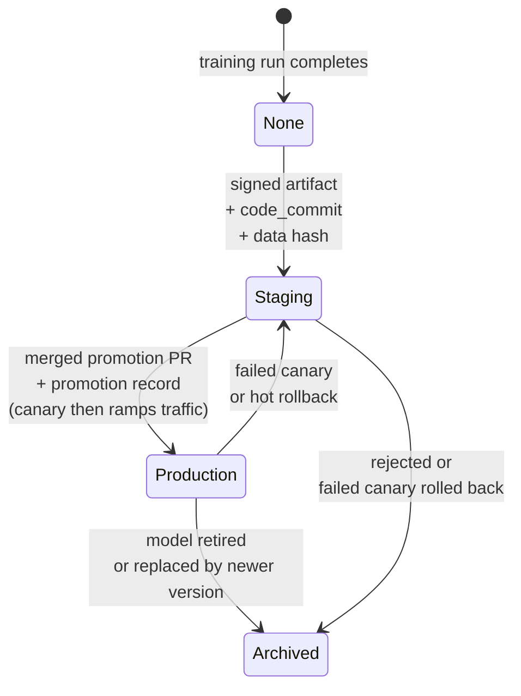
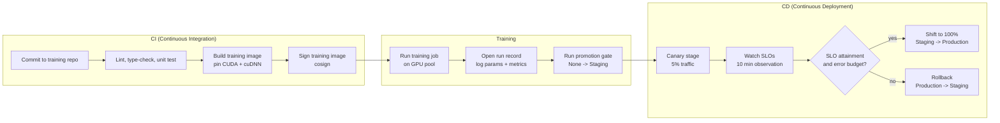
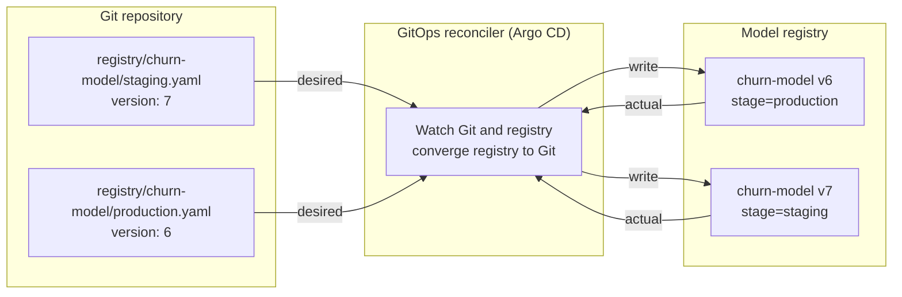

# 16.6 Model registry, CI/CD and GitOps for models

| Field | Value |
|---|---|
| Level | Advanced |
| Priority tier | 1 |
| Lab venue | GCP / GKE |
| Part | Part 16: MLOps and LLMOps tools and platforms |
| Cross-references | Chapter 16.1 (MLOps foundations); Chapter 16.2 (Experiment tracking); Chapter 16.3 (Data pipelines); Chapter 16.4 (Pipeline orchestration); Chapter 15.6 (Triton Inference Server); Chapter 5.29 (Extending Kubernetes with CRDs and operators) |
| Coverage file | `planning/coverage/chapters/16-06.md` |
| Claim & number ledger | `planning/ledgers/16-06.md` |

## Why this matters for AI infrastructure

What model is running in production right now? If the on-call engineer needs an hour to answer that, the platform has already failed. The question sounds simple, but the answer depends on several systems agreeing with each other, and in most incidents they do not. Someone has to be able to answer it in a minute, from a single place, without asking the data science team to dig through old notebooks.

The earlier chapters gave training runs and datasets permanent addresses. This chapter turns those artifacts into deployments you can roll back. A production model passes through a chain. A training run produces a registry entry, the entry gets a stage, the stage drives a deployment, and the deployment starts serving replicas. Each link can break, and the platform team owns the contract at every one. When the chain breaks at one link, the symptom usually appears at the far end, in the serving cluster, which is why the chain is worth understanding as a whole.

The cluster you built in Parts 1 through 15 is where a registry fails. A registry that loses its stage transitions cannot say which model is live. A registry whose image tag cannot be re-pointed cannot roll back. A registry that lets any user write any stage does not enforce the promotion gate from Chapter 16.1. Each of these failures ends with someone paged at 2 a.m., and each one is much easier to prevent than to explain afterwards.

```text
Why the registry is on the critical path (background reading: Practical MLOps; Designing Machine Learning Systems; Machine Learning Platform Engineering; the figures below are examples, not quotations):
- A typical mature MLOps platform runs dozens to hundreds of model deployments per
  week. The registry is the single source of truth for "what is running where".
- A model in production that is not in the registry is a model that cannot be
  audited, cannot be rolled back, and cannot be retrained against. The first
  incident where the team cannot reproduce the live model starts here.
- The promotion gate from Chapter 16.1 writes to the registry. The cluster reads
  from the registry. The two systems agree because the registry is the only path
  between them.
```

Three realities make this a platform concern, not only a data science concern. Each one changes who owns a decision when something goes wrong, so it helps to see them one at a time.

1. The registry sits between two teams. Data scientists write to it, and the cluster reads from it. The platform team owns the bridge itself: the API, the access model, the storage backend, and the audit log. When the bridge is slow, the data scientists blame the cluster, and the cluster team blames the data scientists, so the platform team has to be the one that keeps the bridge working.

2. A model pipeline is not a service pipeline. A service pipeline ships code. A model pipeline ships an artifact that needs a content hash, a signature, and a rollback path that works in seconds, not minutes. The artifact is the thing you cannot easily inspect by reading, which is why the metadata around it matters so much.

3. With GitOps, a pull request sets the registry stage, and nobody clicks a promote button. The platform team owns that loop, the branch protection, the rules for which pull requests are allowed, and the log of what was promoted and when. A rule that is enforced by a reviewer and a merge is much harder to bypass than a rule that lives in a wiki page.

**The promotion gate decides what enters the registry, and the cluster boundary decides what leaves it.**

Before you connect a serving cluster to a registry, decide who is allowed to change the stage field. That one decision shapes the rest of the design, because every other control depends on knowing who can move a model into production.

## Prerequisites and outcomes

### Prerequisites

Work through these first. Each one supplies a piece this chapter assumes, and a gap in any of them will show up later as a question you cannot answer.

- Chapter 16.1 covers the lifecycle and the promotion gate.
- Chapter 16.2 covers the experiment tracker and the run record.
- Chapter 16.3 covers the data pipeline that produces versioned datasets.
- Chapter 16.4 covers the orchestrator that runs the training DAG.
- Chapter 5 gives the Kubernetes primitives you will use, Deployments, Services, Jobs, and RBAC, and Chapter 5.26 explains how Kubernetes uses the Linux kernel.

### Outcomes

Picture a Thursday afternoon when a new model version is ready, a deadline is close, and somebody asks whether the team can roll back in seconds if it goes wrong. This chapter walks through that case from start to finish. It begins with the registry contract, which names the metadata each model carries, the stages it passes through, and the audit trail that shows who moved it and when. It then builds a CI/CD pipeline for a model artifact, where training produces the artifact, the pipeline signs it, and the cluster verifies the signature before it loads the model. It shows how GitOps lets a pull request set the stage, so the merge is the promotion. It covers canary deployments that send a fraction of traffic to the new model, and a rollback path that finishes in seconds because the previous model is already staged. The last part runs the registry on GKE with Postgres, object storage, IAM, secrets and observability matched to the serving system's targets.

---

## 1. The registry contract

### 1.1 What a registered model is

Suppose an auditor asks, a year from now, which data and code produced the model version that made a bad decision. If the registry cannot answer, the team has a model with no history, and no way to explain its behavior. *Designing Machine Learning Systems* Chapter 9 and *Practical MLOps* Chapter 4 agree on what the registry must store. A registered model is a model version plus the metadata that makes it reproducible, auditable, and ready to roll back. The contract stays the same across MLflow Registry, Vertex AI Model Registry, SageMaker Model Registry, and Weights and Biases Registry, even though each product names the fields a little differently.

```text
Minimum registered-model record (background reading: Practical MLOps; Designing Machine Learning Systems; Machine Learning Platform Engineering; the figures below are examples, not quotations):
- model_id (registry primary key; human-readable, e.g. "fraud-detector")
- version (semver or monotonic; MLflow and Vertex AI default to monotonic)
- stage (none | staging | production | archived)
- run_id (the experiment record this model came from)
- artifact_uri (object storage path to weights + serialized model)
- data_snapshot_id (which data version trained this)
- code_commit (the commit hash of the training repo)
- env_image_hash (the container image digest of the training environment)
- signature (input schema, output schema)
- metrics (overall and per-segment, copied from the run record)
- description (free text; typically "what changed in this version")
- created_by (the data scientist or service account that registered it)
- created_at (UTC timestamp)
- lineage (parent model_id, parent run_id; if a fine-tune or distillation)
- signature_id (signature algorithm and public key for the artifact)
- lineage_uri (pointer to the lineage graph; Atlas, Collibra, DataHub)
```

Read the record as a list of questions, each one answered by a field. Which model is this? The model id and version. Where are its bytes? The artifact URI. What data and code made it? The snapshot, the commit and the image digest. Can we trust it? The signature and the signature id. Who approved it? The created-by field and the stage history. Keeping those answers in one record is what makes an incident short instead of long.

The stage field is the one the deployment pipeline reads. The pipeline does not read the artifact path directly. It asks for whatever model sits in the production stage, and it checks that model's signature. An unsigned artifact never loads. That single rule means a copy of a file in a bucket is not enough to put it in front of users, because the stage and the signature have to agree first.

### 1.2 The stages and what each gate looks like

A model does not jump from training to production in one step. It moves through stages, and each move has its own gate. The gate lists what must be true before the model may advance. The diagram shows the states, and the table after it shows who runs each move.



| Stage transition | Gate | Who runs it |
|---|---|---|
| None → Staging | Run record has all required tags; artifact is signed; baseline beat | The CI pipeline (Chapter 16.4 orchestrator) |
| Staging → Production | Promotion pull request merged; promotion record written. The canary then ramps traffic, and the new version keeps its place only while the canary error budget and SLO attainment hold | The CI pipeline + the canary system (Argo Rollouts, KServe canary) |
| Production → Archived | Newer version promoted; or model retired by owner | The owner + the CI pipeline |
| Production → Staging (rollback) | Canary failed or hot rollback triggered; previous model re-promoted | The on-call engineer + the registry CLI |
| Staging → Archived | Version rejected, or a failed canary has been rolled back and the rollback committed | The CI pipeline |

Notice that the "None to Staging" move and the "Staging to Production" move have different owners. The first is an automated check that a pipeline can run on its own. The second needs a human to approve a pull request, because it changes what users see. Keeping those two gates separate is what lets the pipeline move fast on experiments while production stays careful.

During a canary, the same artifact sits in both staging and production. Production holds a pointer, such as an image tag or a stage value, to the artifact in the object store. The canary system moves that pointer by traffic weight. The rollback system drops the new version's weight to zero and re-promotes the previous one. Nothing gets copied, which is why the rollback is fast.

Before you add a stage, write its gate in one sentence. A stage with no gate is only a label, and a label nobody enforces will drift from what is actually running.

### 1.3 Lineage: the difference between a model and a registered model

A model file alone does not tell you how it was made. Lineage adds that history, and it answers four questions. Each question maps to one field in the record, so you can check the answers by reading the registry rather than asking around the team.

- Which dataset snapshot trained this model version? (`data_snapshot_id`)
- Which code trained it? (`code_commit`)
- Which environment produced it? (`env_image_hash`)
- Which earlier model version is this one descended from? (`parent_model_id`, `parent_run_id`)

*Designing Machine Learning Systems* Chapter 9 treats lineage as the thing that turns a model into a registered model. The lineage graph is the audit trail. Each node is a registered model version, and each edge is a parent-child link. Three consumers read the graph:

1. The promotion gate checks that a candidate descends from the baseline.
2. The compliance auditor checks that every production model has a complete lineage record.
3. The retraining trigger decides whether drift in upstream data needs a new run, or whether a fine-tune of the existing model is enough.

The lineage database is usually a separate service, such as Atlas, Collibra, DataHub, or Marquez. The registry stores only a `lineage_uri` that points to it. The registry writes to the lineage database when it writes the model version, so the two records should agree. If they disagree, trust neither until someone has checked both against the run record.

Before you promote any version, check that all four lineage answers are filled in. A blank answer is not a neutral result. It means the next person to investigate has nothing to start from.

---

## 2. CI/CD for model artifacts

### 2.1 The pipeline shape

A service pipeline has a familiar shape. A commit triggers a build, the build triggers tests, and the tests trigger a deploy. Most engineers can draw that picture from memory. *Practical MLOps* Chapter 4 keeps that shape for models but changes three things, and each change matters when something breaks. The diagram shows the full path, from a commit to a canary decision, so you can see where each change sits.



The first difference is that the build produces a model, not a binary. In a web service the build step compiles code into a program. In a model pipeline the build step trains the model, and the artifact is the weights plus a serialized form such as PyTorch JIT, TensorFlow SavedModel, ONNX, or MLflow pyfunc. Each serialized form has its own loader, so the serving system has to know which one it is reading.

The second difference is that the test step is an offline evaluation plus the promotion gate. A unit test suite alone cannot tell you whether a model is good enough, because a model can pass every unit test and still be worse than the one it replaces. The gate decides whether the artifact moves forward, and it compares the new model with a baseline.

The third difference is that the deploy step is a canary with a promotion gate of its own. The canary is the deployment gate. It takes a small amount of live traffic, watches the same measures the gate used, and decides whether the rest of the traffic should follow. Offline checks say the model is good on yesterday's data, and the canary says whether it is good on today's.

### 2.2 The training image is a release artefact

Treat the training image as the supply chain boundary. Its CUDA version, cuDNN version, and Python packages shape every model trained from it. If you cannot prove what went into the image, you cannot prove what went into the model. A supply chain here means the full path from source code to running artifact, and every step on that path is a place where something can change without anyone noticing. *Practical MLOps* Chapter 4 asks for a simple discipline. Build the image once, sign it once, and store it where the cluster can verify it. The promotion pipeline should refuse to start a training job from an unsigned image.

```text
Training image supply chain (background reading: Practical MLOps; SIGstore / cosign docs; the figures below are examples, not quotations):
1. The training repo declares the training environment as a Dockerfile.
   The Dockerfile pins the CUDA base image, the cuDNN version, the Python
   version, and the system packages.
2. CI builds the image on every commit to the main branch.
3. CI signs the image with cosign against an OIDC identity (the GitHub Actions
   workflow, the GitLab CI job, or a dedicated service account).
4. The signed image is pushed to a registry that the cluster can verify
   (Artifact Registry, ECR, ACR, or a private Harbor).
5. The training pod declares the image digest, not the tag. Tags can move;
   digests cannot.
```

Read the list as a chain of custody. The Dockerfile says what should be inside. The build turns it into an image. The signature says which identity vouched for that image, and the registry holds it where the cluster can check. The pod then names the exact digest, so the chain ends at the same bytes that were signed. If any link is missing, the chain breaks, and the audit answer becomes a guess.

*Production Kubernetes* Chapter 15 adds a caution. Image signing has been slow to reach production. Older Notary tooling ties each signature to one registry name, so a copy in another registry cannot carry it. The same chapter notes that admission webhooks can check signatures and refuse unsigned images before a pod runs. An admission webhook is a checkpoint inside the cluster that sees each pod before it is created, which is where the refusal has to happen.

The same pattern applies to the model artefact. The training job computes a content hash, signs the artefact, and stores it in the object store. The serving system pulls by digest, checks the signature, and refuses to load anything unsigned. A content hash is a fingerprint of the file's bytes, so a changed file gets a different fingerprint even if its name is the same.

Before you adopt this pattern, decide which identity signs the image and where the verification key lives. A signing key stored next to the code it signs gives you a signature that proves very little, because anyone with repository access can sign too.

### 2.3 The promotion gate as a CI step

The promotion gate from Chapter 16.1, Section 4.3, runs inside the CI pipeline. The pipeline calls the gate, and the gate returns pass or fail with reasons. The pipeline advances the registry stage only on a pass. A fail should stop the workflow with a message that says which check failed, so the person reading the log does not have to rerun anything to find out. The workflow below shows the shape.

```yaml
# code/part16/ci_promote.yaml
name: train_and_promote
on:
  push:
    branches: [main]
jobs:
  train:
    runs-on: [self-hosted, gpu]
    steps:
      - uses: actions/checkout@v4
      - name: Build and sign training image
        run: |
          docker build -t ${REGISTRY}/train:${GITHUB_SHA} .
          cosign sign --key cosign.key ${REGISTRY}/train:${GITHUB_SHA}
      - name: Train
        run: python train.py --dataset-id churn-v3 --seed 42
      - name: Promote
        env:
          MLFLOW_TRACKING_URI: ${{ secrets.MLFLOW_TRACKING_URI }}
        run: |
          python code/part16/promote_to_registry.py \
            --run-id ${{ steps.train.outputs.run_id }} \
            --model-name churn-model \
            --baseline-run-id ${{ steps.train.outputs.baseline_run_id }}
      - name: Trigger canary
        if: success()
        run: |
          python code/part16/trigger_canary.py \
            --model-name churn-model \
            --version ${{ steps.train.outputs.version }}
```

Walk the file from top to bottom. The workflow runs on a push to the main branch, and it asks for a runner that has a GPU. It builds and signs the image first, so the training step only ever runs an image that carries a signature. Then it trains, promotes the run through the gate and triggers the canary. Each step only runs if the one before it succeeded, which is why a failed gate stops the canary from starting.

The promotion gate is the only path from training to the registry. The canary is the only path from the registry to serving. Both gates are mechanical, and both write to an immutable audit log, so a person cannot quietly skip either one.

Before you wire a gate into CI, run it once on a model that should fail. Confirm that the pipeline stops. A gate that has never rejected anything has not been tested, and a gate you have never seen fail is one you cannot trust during an incident.

---

## 3. GitOps for the registry

### 3.1 The shape

Suppose someone changes the production version of a model in Git and nothing else happens. Would the registry notice? In a GitOps setup, the registry follows Git, so it would. GitOps means that the desired state of the system lives in a version-controlled repository, and a controller keeps the live system matching it. *Production Kubernetes* Chapter 11 and the GitOps pattern that Argo CD and Flux implement set out the model. The pattern has three rules, and each one has a clear owner.

The desired state lives in Git. A YAML file in the registry repository declares the stage the registry should have. Anyone who wants to change the stage has to change that file, through a pull request.

The actual state lives in the registry. The registry has a stage field, and the serving system reads that field. This is the state that users are actually served from, and it is the state you check during an incident.

A reconciler keeps the two in sync. It is a small program, such as a Kubernetes controller, an Argo Application, or a Flux Kustomization. It watches both sides and converges the actual state to the desired state. If someone changes the registry directly, the reconciler sees the difference and moves the registry back to what Git says.



The diagram shows the situation. Git asks for v7 in staging and v6 in production. The reconciler reads both sides and writes the registry to match. A pull request that moves `version: 7` into `production.yaml` is the only way to promote v7. Nothing else in the picture is allowed to change the stage, which is the whole point of the design.

### 3.2 The pull request is the promotion event

The promotion gate from Chapter 16.1, Section 4.3, and the GitOps loop from Section 3.1 combine into one flow. The pull request becomes the promotion event, and the merge is the moment the registry changes. If you read the flow below, you will see that nothing reaches the registry without the merge. The steps are numbered, so you can match each one to a point where a person or a check looks at the change.

```text
Promotion flow with GitOps (background reading: Practical MLOps; Production Kubernetes; the figures below are examples, not quotations):
1. The training pipeline finishes. The promotion gate returns "pass, candidate v7".
2. The pipeline opens a pull request against the registry repo. The PR body is
   the promotion decision: "candidate v7 beat baseline v6 by 0.013 AUC, passed
   all segment gates, signed by the training workflow OIDC identity".
3. The PR requires a human reviewer. The reviewer is the data scientist whose
   name is on the run record, plus a platform engineer whose team owns the
   registry.
4. When the PR merges, the reconciler writes v7 to the registry's production
   stage and the canary starts at a small share of traffic.
5. The canary completes. If pass, v7 takes all traffic and the PR that moved v7 to production stays
   merged. If fail, a new PR reverts production.yaml to the previous version.
```

Step 3 is where most teams go wrong. A reviewer who understands both the metrics and the business risk catches things the gate cannot. A reviewer who only checks that the pipeline is green adds delay and no safety. Step 5 closes the loop in both directions. A pass keeps the change, and a fail is undone by another pull request rather than by a button, so the history of both outcomes stays in Git.

The pull request is also the audit record. It shows who approved the promotion, which gate criteria applied, and what the canary found. The registry should never accept a promotion that is not in a merged pull request. If someone ever asks why a model was live on a given day, the answer is the merged pull request for that day, and the body of that pull request should answer the question without anyone opening another tool.

Before you turn on this loop, decide who reviews promotion pull requests. A reviewer who approves everything gives you the same risk as having no review at all, and a review that takes a minute is usually a review that did not happen.

### 3.3 The reconciler is the cluster primitive

*Production Kubernetes* Chapter 11 names Argo CD and Flux as the two reconcilers in production. Both implement the same pattern: declarative desired state in Git, observed actual state in the cluster, and continuous reconciliation. For the model registry, the reconciler is a small wrapper around the registry API. It watches the Git repository for changes to `production.yaml` and calls the API to move the stage. The reconciler is deployed through GitOps too, so the only human action left is the pull request.

The same book's chapter on building platform services sets rules for any reconciler. It should never assume what triggered it, and it should read the existing state before it acts. That rule protects against a reconciler that repeats an action it already finished, or that overwrites a change made by someone else in the meantime. When a reconcile fails for a reason outside its control, it should retry with growing delays, up to a cap the book gives as 5 minutes.

The reconciler's identity is what enforces the promotion gate. Only the reconciler can move a stage. The training pipeline can write a model version, and the reconciler can move it to staging or production, and no other identity can do either. This is the same split between writer and promoter that Chapter 16.2, Section 5.2 describes. If the reconciler's credentials leak, the attacker gets the power to change production, so those credentials deserve the same care as an administrator's.

Give the reconciler its own service account, and review its permissions the way you would review a human administrator. A reconciler with broad permissions is a single point of failure for both safety and speed.

---

## 4. Deployment: canary, blue/green, and the rollback path

### 4.1 The three deployment patterns

Every deployment decides how much damage a bad model can do before anyone notices. Consider a model that approves loans. A cutover that sends every applicant to the new model at once spreads any error to all of them, and the error may not show up until the decisions are already made. *Practical MLOps* Chapter 4 and *Designing Machine Learning Systems* Chapter 9 walk through the common patterns. The right one depends on the cost of a bad prediction and on how fast you can roll back. The table compares the four patterns on the question that matters most during an incident.

| Pattern | What it does | When to use | Rollback speed |
|---|---|---|---|
| **Recreate** | Kill the old replicas; start the new ones | Cheap models; non-prod environments | Slow (cold start) |
| **Rolling** | Replace replicas one at a time | Stateful services; loss of in-flight state is costly | Medium |
| **Canary** | New model serves 1-5% of traffic; old serves the rest | Any model whose bad predictions have cost | Fast (traffic shift) |
| **Blue/green** | New model runs in parallel; cutover when validated | Models that need full validation before cutover | Fast (DNS or load balancer swap) |

The platform team's default is a canary for any model whose predictions affect revenue, safety, or user trust. A small slice of traffic sees the new model while the team watches the SLO. If the SLO breaks, traffic shifts back to the old model in seconds. The reason this works is simple. The number of users exposed to a bad model is limited to the slice, so the damage has a ceiling you chose in advance.

Recreate is not wrong, just limited. It is cheap and simple, and it works for a model that nobody depends on. The cost appears at rollback, because the old replicas must cold-start again. Rolling sits in the middle, and it makes sense when losing an in-flight request is expensive, since replacing one replica at a time keeps the rest serving. Blue/green is the choice when you want to validate the whole new stack before any user sees it, and you are willing to pay for two environments during the switch.

### 4.2 The canary stages

A canary needs explicit stages, or nobody knows when to stop. Argo Rollouts writes those stages into one resource, shown below. The example is a common shape for a model rollout, and each step is a weight followed by a pause. The pauses give the analysis time to see the effect of the new weight before the next one.

```yaml
# code/part16/canary.yaml
apiVersion: argoproj.io/v1alpha1
kind: Rollout
metadata:
  name: churn-model
spec:
  replicas: 10
  strategy:
    canary:
      steps:
        - setWeight: 5
        - pause: {duration: 10m}
        - setWeight: 25
        - pause: {duration: 10m}
        - setWeight: 50
        - pause: {duration: 10m}
        - setWeight: 100
      canaryService: churn-model-canary
      stableService: churn-model-stable
      analysis:
        templates:
          - templateName: churn-model-slo
        startingStep: 1
        args:
          - name: error-rate-threshold
            value: "0.01"
```

Read the steps from the top. The first weight sends 5 percent of traffic to the new version, and the rollout then waits. The analysis reads the metrics during that wait. If the numbers look right, the weight rises, and the process repeats until the new version takes everything. The canary and stable service names tell the rollout which Kubernetes services to split traffic between, so you can point a tool at the canary alone and see its numbers separately.

This example runs for 30 minutes in total: 10 minutes at 5 percent, 10 minutes at 25 percent, and 10 minutes at 50 percent. At each pause, the analysis template queries Prometheus for the error rate and latency SLOs. If a threshold is breached, the rollout aborts and traffic returns to the stable service. The error-rate threshold of 0.01 is an example value. Set your own from your service's SLO.

Treat the weights and pauses as a starting point. Your traffic volume and the cost of an error should set the real values. A low-traffic model needs longer pauses to collect enough requests to judge anything, and a high-traffic model may reach a verdict in minutes.

### 4.3 The rollback path is pre-staged

The rollback path that pages the on-call engineer least is the one that is already warm. A rollback that has to rebuild or re-download the previous model is slow exactly when speed matters most. The mechanism is simple. The previous production model stays in the registry, and its artifact stays in the object store. The serving system reads the model through a tag that the registry updates, so re-pointing the tag switches the model without moving any bytes.

```text
Rollback path (background reading: Practical MLOps; KServe / Argo Rollouts docs; the figures below are examples, not quotations):
1. The previous model version remains in the registry as stage=archived.
   Its artifact is still in the object store. Its container image is still in
   the registry.
2. The serving system reads the model from a tag (image tag, KServe
   InferenceService model URI) that the registry updates.
3. The rollback is a one-line command: re-point the tag to the archived
   version. The serving system pulls the new tag on the next request.
4. The cluster boundary (admission controller, signature verification) checks
   that the archived version is still signed; on pass, the serving system
   loads it.
```

Each step in the list removes one source of delay. Step 1 keeps the bytes in place, so nothing needs to be fetched. Step 2 gives the serving system one name to read, so the change is a single move. Step 3 is the actual rollback, and step 4 is the check that stops a rollback from loading an artifact that has since lost its signature. The check matters because a rollback target is also a model that will run in production, and it deserves the same gate as a forward promotion.

Pre-staging has a cost. Each version keeps one more model file in object storage. The benefit is that rollback becomes a tag change, not a fresh model download. The previous model waits warm until the new one proves itself, and the storage cost is small next to the cost of a slow rollback during an incident.

Before each release, confirm that the previous version still has a signed artifact and a pullable image. A rollback target you have not checked is not a rollback path, and the first time you find out it is broken should not be during an outage.

### 4.4 What about the registry for LLMs?

Large language models follow the same registry, canary, and rollback patterns as classical models. The idea of a stage, a gate, a signature and a pointer does not change. Two things change in practice. The artifact is much larger, so a rollback takes longer. The model is also often served across several nodes instead of one pod, so the serving side has more moving parts to coordinate. The promotion gate changes too, because the evaluation suite from Chapter 16.9 and a prompt regression test join the checks. A prompt regression test runs a fixed set of prompts and compares the new answers with the old ones.

*Practical MLOps* Chapter 4 and *Designing Machine Learning Systems* Chapter 9 predate the LLM era, so their patterns need this adjustment. Chapter 16.7 covers the serving side for LLMs. The artifact store must handle multi-GB files, and S3, GCS, and MinIO all do. The image registry must handle multi-GB container images, and the same registries do. The main risk is not the storage itself. It is the time a cold start takes when a large model has to load into GPU memory before it can answer anything.

Before you promote an LLM, check that its rollback target still loads within the time your SLO allows. A rollback that works but takes too long to load is still a failed rollback during an incident.

---

## 5. Operating the registry on GKE

### 5.1 The components

Each component has one job, a backing store, and an SLO the team must measure. The SLO figures in the table below are example values, not targets from a source. Pick your own numbers from your traffic and your risk. A component's SLO should reflect the cost of it being slow. A slow stage transition may be a minor annoyance, while a slow signature lookup can block every pod that tries to start.

| Component | Where it runs | Backing store | SLO |
|---|---|---|---|
| MLflow Registry server | Kubernetes Deployment, 2+ replicas | Postgres for metadata | Stage-transition p99 < 500 ms |
| Artifact store | Direct from writer pods | GCS bucket | Artifact put p99 < 30 s for 50 GB |
| Signature store (Rekor) | Managed or self-hosted | Postgres + blob storage | Signature lookup p99 < 1 s |
| Reconciler (Argo CD) | Kubernetes Deployment | Git repo + cluster API | Reconcile p99 < 30 s |
| Canary system (Argo Rollouts) | Kubernetes Deployment | Cluster API + Prometheus | Canary step p99 < 5 s |
| Audit log | Direct from every writer | GCS bucket with object-lock | Write p99 < 200 ms |

The registry server and the artifact store are separate on purpose. The server holds small, hot metadata, such as the model id, version, stage, and signature id. The artifact store holds large, cold bytes, such as model weights and the serialized model. Keeping them together forces one of them to compromise, either by making the metadata slow to fetch or by making the bytes slow to store. Separating them lets each one be tuned for its own kind of access.

*Production Kubernetes* Chapter 15 makes a related point about the image registry. Deployments depend on it, so it sits on the critical path for development as well as production. It needs the same monitoring and maintenance as any other critical component. A broken image registry stops both new training and new serving, which is a larger blast radius than most people expect.

### 5.2 IAM and the four roles

The IAM model has four roles. It mirrors Chapter 16.2, Section 5.2, and Chapter 16.5, Section 2. Each role is a bundle of permissions, and each one maps to a single party. The table is for lookup, so use it when you need to check who can do what.

| Role | Who | What they can do |
|---|---|---|
| `registry.writer` | Training service accounts | Register new model versions, upload artifacts |
| `registry.reader` | Data scientists, dashboards, serving system | Read model versions, list stages, pull artifacts |
| `registry.promoter` | The reconciler (Argo CD) | Transition stages, only after the corresponding Git PR is merged |
| `registry.admin` | Platform team | Define schemas, manage secrets, manage the reconciler |

The split between writer and promoter is what enforces the promotion gate. A training service account can register a version but cannot move it to staging or production. The reconciler is the only identity that can move stages, and it is meant to act only on a merged pull request, not on a request. Even the platform team's admin role does not replace the reconciler for everyday promotions, because the point is that a stage change always leaves a Git record.

Keep the admin role small. An admin who can also promote a model has the power to skip the review, and a skipped review is exactly the verbal-approval failure described in the failure modes below. Give admin rights to the few people who need them for schemas and secrets, and let the reconciler do the rest.

### 5.3 Backup and retention

Retention decides what you can still explain later. Keep failed runs for debugging, staging runs for comparison, and production runs for the audit trail. Each class serves a different question. Failed runs answer what went wrong. Staging runs answer how a candidate compared with others. Production runs answer what was live and why. The windows in the table are common starting points. Specific windows depend on your regulatory regime.

| Artifact class | Retention | Why |
|---|---|---|
| Failed training runs | 30 days | Useful for debugging |
| Staging runs | 90 days | Useful for comparison |
| Production runs | Indefinite | Audit trail |
| Archived production runs | 1 year, then cold storage | Required for some regulatory regimes |
| Signed images | Indefinite (Rekor) | Signature must be verifiable for as long as the artifact is in use |

Object lock is the simplest way to make the log tamper-evident. A bucket with a retention policy blocks deletion or overwrite for the length of the policy. An auditor can then check that no run record disappeared after the audit log was written. The lock protects against a careless deletion as well as a deliberate one, which is why it is cheap insurance for a log nobody thinks about until a regulator asks.

Before you set retention windows, ask your compliance team which window applies to each class of run. A retention window chosen by engineers alone is a guess about a legal question, and it is cheaper to ask once than to explain later.

### 5.4 Observability of the registry

The registry is a service, so it needs metrics, logs, and alerts like any other service. The table lists what to watch and when to page. The thresholds are example values. Set them from your own baseline, since a threshold copied from someone else's system will fire at the wrong times for yours.

| Metric | Why it matters | Alert |
|---|---|---|
| Stage-transition latency p99 | Hot path for every promotion | > 1 s |
| Artifact put latency p99 | Bottleneck for large weights | > 60 s |
| Artifact pull latency p99 | Hot path for serving system cold start | > 30 s |
| Signature verification failure rate | Catches a poisoning attempt | > 0 for 5 minutes |
| Reconciler drift | Catches a Git-to-registry divergence | drift > 0 for 1 minute |
| Canary rollback rate | Catches a model that should not have been promoted | > 0 for 10 minutes |
| Promotion PR creation rate | Tracks pipeline activity | Per-team baseline |

The signature verification failure rate matters most. A non-zero rate means something is trying to load an unsigned or wrongly signed artefact. The alert should page the platform on-call. The runbook then walks through which signature failed, which pod tried to load it, and where the artefact came from. A failure here can be an honest mistake, such as a re-signed image with the wrong key, or it can be an attack, and the runbook has to handle both without assuming which one it is.

**The registry is a production service. It has SLOs. It has an on-call. It is not a notebook.**

---

## 6. How it fails

Six failures come up again and again in registry work. For each one, you will see the symptom, the likely diagnosis, and the fix. The symptom is what somebody notices first, usually a dashboard that disagrees with reality, a rollback that is too slow or a log that is missing a record. Start there, since the symptom tells you which part of the chain to check first.

### 6.1 "The registry says v9 is in production but the cluster is running v6"

Symptom: A new model was promoted to production, and the dashboard confirms the stage change. The serving replicas, however, still run v6. The dashboard says v9, and the cluster says v6. Users are getting the old predictions even though everyone believes the new model is live.

Diagnosis: The registry and the serving system have drifted apart. Either the serving system reads from a tag that never moved, or the reconciler did not converge. The first case means the serving side is pointed at a stale name, and the second means the bridge between Git and the registry is stuck.

Fix: Make the serving system read the registry directly, and refuse to mount a model from any other path. Add a sync check that alerts when the registry stage and the serving tag disagree.

### 6.2 "The promotion PR was approved verbally"

Symptom: A regression reaches production, and the audit log has no pull request for the change. The data scientist says the approval happened in a chat thread, and the thread is gone. Nobody can say who decided, or on what evidence.

Diagnosis: The GitOps loop was not enforced. Someone moved the stage through a manual API call and bypassed the reconciler, so the registry changed without a Git record.

Fix: Allow stage transitions only through the reconciler. Its identity should be the only one with that permission, and policy should forbid manual transitions. When a stage looks wrong, check the audit log first, because it shows what you can trust. A verbal approval cannot be audited, so it does not count as an approval.

### 6.3 "The canary passed offline but failed in production"

Symptom: The promotion gate passed, and the canary started at a small share of traffic. Suppose that after ten minutes the error rate is four times the baseline. The canary rolls back, and the team argues about whether to retrain or to accept the model as broken. Both sides have a point, and neither can say from the offline numbers alone which one is right.

Diagnosis: The offline evaluation suite does not represent production traffic. The canary caught the problem and the rollback worked, so the team now has a feedback loop for improving the suite. The gap is between the test data and the live data, which is common when the live inputs drift away from the historical snapshot.

Fix: Use the monitoring from Chapter 16.10 as the source of production-like metrics. Add a shadow stage before the canary. In the shadow, the new model sees live traffic but returns no responses, and its metrics are compared with the live model. The example in the exercises runs the shadow for 24 hours, but the length is your choice. A shadow catches the gap before any user does.

### 6.4 "The rollback took 18 minutes"

Symptom: A bad promotion is detected, and the on-call triggers a rollback. It should finish in seconds. Instead it takes many minutes, because the previous artifact must be pulled again from object storage, the container image must be pulled again, and the serving replicas must cold-start. During those minutes the bad model keeps serving.

Diagnosis: The previous model was not kept warm. The registry marked it archived, the cluster evicted its container, and the next pull was a cold one. The rollback did the same work as a fresh deployment, which is exactly the work a pre-staged path avoids.

Fix: Keep the previous model under a warm tag, with its artifact and image pre-pulled on the serving nodes. Then a rollback becomes a tag change, not a model download.

### 6.5 "The canary aborted because Prometheus was down"

Symptom: A promotion runs, and the canary queries Prometheus for the error rate. Prometheus returns an error, and the canary aborts. Later the team finds that Prometheus was down for the whole canary window. The model was never judged, and the abort looks like a verdict on the model when it was really a verdict on the monitoring.

Diagnosis: The canary depends on the observability stack. When that stack is down, the canary is blind, and its default behavior is to abort. That default turns a monitoring outage into a rollback, which is a surprising result for a team that did not design it that way.

Fix: Treat "I cannot see the SLO" as a reason to hold, not to abort. The canary pauses, the alert pages the on-call, and the on-call either restores observability or approves the canary after reading the source. Some teams prefer to abort and page instead, especially for safety-critical systems. Decide which one you want before the outage, and write it into the rollout.

### 6.6 "The audit log was deleted"

Symptom: A regulator asks for the audit trail of a model that was in production a long time ago. The audit log bucket is empty, the run records are gone from the registry, and the registry's Postgres backup is gone too. The team cannot show what was live, when, or who approved it.

Diagnosis: The audit log and the registry metadata were not on a retention-protected bucket. A deletion, careless or malicious, removed the records the regulator needs. The backups were kept in the same place as the data they were supposed to protect, so they went with it.

Fix: Use object lock on the audit log bucket, and point-in-time recovery on Postgres. Write a runbook that says to page the platform on-call at once if the audit log is missing, before anyone investigates. The audit log proves that every other artefact is what it claims to be, so losing it is the most serious incident.

Pick the failure on this list your team is most likely to hit, and write its runbook this week. A runbook written after the incident is a record of what went wrong, while one written before it is what keeps the incident short.

---

## 7. Hands-on lab

This lab adds the registry, the GitOps loop, and the canary to the Chapter 16.5 lab. It runs on GCP / GKE. The lab is **untested** in this repository, so treat each expected output as what to look for, not a guarantee. None of these steps has been run against a live cluster, so the first run will also be the first real check of your setup. Each step below changes one thing and then checks it, so when a check fails you know which step to look at.

### 7.1 Prerequisites

- Chapters 16.1 through 16.5 labs completed.
- A GKE Autopilot or Standard cluster (1.27+).
- Argo CD and Argo Rollouts installed via Helm.
- A signed-image registry (Artifact Registry with Binary Authorization).

### 7.2 Step 1: deploy Argo CD and Argo Rollouts

Install the two controllers first. Argo CD keeps the registry in sync with Git, and Argo Rollouts runs the canary. Before you move on, check that you see both controllers running in their namespaces, since every later step depends on them.

```bash
helm repo add argo https://argoproj.github.io/argo-helm
helm install argocd argo/argo-cd \
  --namespace argocd --create-namespace
helm install argo-rollouts argo/argo-rollouts \
  --namespace argo-rollouts --create-namespace
# expected: Argo CD and Argo Rollouts controllers running
```

### 7.3 Step 2: declare the registry state in Git

Next, put the desired stage in Git. The reconciler watches this file, so the file is the place a promotion starts. Read the version and the stage fields first, since they tell you what the cluster is being asked to run.

```yaml
# code/part16/registry_repo/models/churn-model/production.yaml
apiVersion: mlops.example.com/v1
kind: ModelStage
metadata:
  name: churn-model
  namespace: mlops
spec:
  model_name: churn-model
  stage: production
  version: 6
  artifact_uri: gs://mlflow-artifacts/churn-model/v6/model.pkl
  signature_id: sha256:abc123...
```

A pull request that changes `version: 6` to `version: 7` starts the canary. Nothing else in this lab changes the stage, so the pull request is the only thing you need to watch.

### 7.4 Step 3: submit a new training run

Submit a training run. It registers version 7 in the None stage, which means you have not promoted it yet. Promotion is a separate step that comes later. If you see version 7 in any other stage at this point, stop and check the pipeline before you go further.

```bash
python code/part16/train.py --dataset-id churn-v3 --seed 42
# expected: a new run in MLflow; the registered model version 7 is in stage=None
```

### 7.5 Step 4: the promotion PR is opened by the pipeline

The pipeline opens the promotion pull request. Its body carries the audit record, so read the body before you approve anything. The script takes the model name, the new version, the baseline version and the run id, which are the four facts a reviewer needs.

```bash
# The pipeline opens a PR with the body
python code/part16/open_promotion_pr.py \
  --model-name churn-model \
  --version 7 \
  --baseline-version 6 \
  --run-id <new-run-id>
# expected: a PR in the registry repo with the audit body
```

### 7.6 Step 5: merge the PR; the reconciler moves the registry; the canary starts

Merge the pull request. This lab simulates the merge with a local one, so the Git history looks the same as a real merge. Then watch the reconciler move the registry, and watch the canary shift traffic in steps. The reconciler step is where the registry changes, so check it before the canary.

```bash
# Merge the PR (simulated)
git checkout main && git merge --no-ff promotion-7
git push

# Observe the reconciler
argocd app get churn-model
# expected: the registry shows v7 in production; the canary has started

# Observe the canary
kubectl argo rollouts get rollout churn-model -n mlops
# expected: traffic shifts from 5% to 25% to 50% to 100% over 30 minutes
```

### 7.7 Step 6: trigger a rollback

Abort the rollout to test the rollback path. Traffic should return to the stable service, and version 6 should stay in production. This is the check that tells you whether the pre-staged rollback from section 4.3 works in practice, not only on paper.

```bash
kubectl argo rollouts abort churn-model -n mlops
# expected: traffic returns to the stable service; v7 is rolled back; v6 stays in production
```

### 7.8 Step 7: query the audit log

The audit log is a JSON file in object storage, organized by day. Query the last few entries to confirm that the promotion and the rollback were both recorded. A missing record here is a finding in its own right.

```bash
# The audit log is a JSON file in object storage
gsutil cat gs://audit-log/$(date -u +%Y/%m/%d)/promotions.json | jq '.[-3:]'
# expected: the three most recent promotion records with timestamps, requester, gate criteria
```

### 7.9 What to record

After the lab, try to answer five questions in five seconds each. Try each one from memory, then check your answer against the registry. The exercise is about speed, because speed is what an incident needs.

1. What model version is currently in production?
2. What is the previous model version, and where is its artifact?
3. What is the canary error budget, and what is the rollback path?
4. What is the reconciler, and what is its IAM role?
5. Where is the audit log, and what is its retention policy?

Treat the five seconds as a team goal, not a standard. If any answer takes more than 30 seconds to find, the registry is not yet a production service. The lab is **untested** against a live GKE cluster, so the first time you run these answers is the real test.

---

## Exercises

Each exercise adds one safeguard to the registry and then checks that it works. Picture a platform team that has finished the lab and now wants to close the gaps it found during the first incident. Work through them in order, because the shadow stage in exercise 1 is the one most likely to pay off first. The rest can wait until your team knows which failure it is most likely to hit.

1. Add a production shadow stage. Extend the canary with a 24-hour shadow mode, where the new model serves 100% of traffic but returns no response. You will see the value of this stage the first time it catches a regression the offline suite missed. Compare its metrics with the live model's before the canary starts. *Solution sketch:* use an Argo Rollouts analysis step to run the shadow. As an example threshold, abort the canary if the shadow's error rate is more than 1.5 times the live model's.
2. Add a signature policy. Configure OPA Gatekeeper or Kyverno to refuse any pod whose image is not signed by the training workflow's OIDC identity. Test it by deploying an unsigned image and confirming the rejection. *Solution sketch:* a Kyverno policy with `verifyImages` that requires a signature from `cosign.sigstore.dev`. Deploy an unsigned image, and expect rejection.
3. Add a reconciler drift alert. Configure Prometheus to alert when the registry stage and the serving tag disagree for more than 1 minute. The 1 minute is an example window. *Solution sketch:* a Prometheus rule that compares the stage the registry reports with the model version the serving system reports, and alerts on any disagreement.
4. Add a promotion rate limit. Configure the registry to refuse more than one promotion per model per hour. The one-per-hour rate is an example. *Solution sketch:* a CI step that checks the registry API for recent transitions, and refuses the pull request if the rate is exceeded.
5. Send the audit log to BigQuery. Stream the audit log to BigQuery so that you and your analysts can query it. *Solution sketch:* a Pub/Sub topic receives the audit events, and a Dataflow pipeline reads them from Pub/Sub and writes them to BigQuery.
6. Require a model card. Extend the registry so that promotion needs a model card covering the architecture, a training data summary, a fairness audit, and the intended use. *Solution sketch:* a CI step that checks the card's required fields, and refuses the pull request if any field is missing.

Start with exercise 1, because the shadow stage closes a gap that the canary alone leaves open. Once you have built it, you can decide which of the other exercises your team needs first.

---

## Checkpoint questions

<details><summary>1. A regression reaches production and the audit log has no pull request for it. The data scientist says it was approved in a chat thread that is now gone. What failed and what do you change?</summary>
The GitOps loop was not enforced. Someone moved the stage through a manual API call and bypassed the reconciler. Allow stage transitions only through the reconciler, make its identity the only one with that permission, and let policy forbid manual transitions. When a stage looks wrong, check the audit log first, because it shows what you can trust.
</details>

<details><summary>2. The promotion gate passed, but ten minutes into the canary the error rate is four times the baseline and the rollout rolls back. The team argues about retraining. What does this tell you and what do you add?</summary>
The offline evaluation suite does not represent production traffic. The canary caught the problem and the rollback worked, so the team now has a feedback loop for improving the suite. Use the monitoring from Chapter 16.10 as the source of production-like metrics. Add a shadow stage before the canary, where the new model sees live traffic but returns no responses.
</details>

<details><summary>3. A bad promotion is detected and the rollback takes 18 minutes instead of seconds. Why, and what do you change?</summary>
The previous model was not kept warm. The registry marked it archived, the cluster evicted its container, and the next pull was cold. The artifact and the image both had to be pulled again, and the replicas had to cold-start. Keep the previous model under a warm tag with its artifact and image pre-pulled on the serving nodes. A rollback then becomes a tag change.
</details>

<details><summary>4. You are about to promote an LLM. What changes about the rollback check compared with a small classical model?</summary>
The artifact is much larger, so a rollback takes longer. The model is also often served across several nodes and not one pod. Before you promote, check that the rollback target still loads within the time your SLO allows. The artifact store and the image registry must both handle multi-GB files.
</details>

<details><summary>5. The signature verification failure rate alert fires and stays above 0 for 5 minutes. What does it mean, who gets paged, and what does the runbook cover?</summary>
A non-zero rate means something is trying to load an unsigned or wrongly signed artefact. The alert pages the platform on-call. The runbook walks through which signature failed, which pod tried to load it, and where the artefact came from. The alert is meant to catch a poisoning attempt.
</details>

<details><summary>6. A reviewer on promotion pull requests approves everything within a minute. What risk does that create?</summary>
A reviewer who approves everything gives you the same risk as having no review. The chapter's flow requires the data scientist named on the run record and a platform engineer whose team owns the registry. Decide who reviews before you turn the loop on, and make the pull request body carry the promotion decision.
</details>

<details><summary>7. Why does splitting the writer role from the promoter role enforce the promotion gate?</summary>
A training service account can register a version but cannot move it to staging or production. The reconciler is the only identity that can move stages, and it acts only on a merged pull request. So a stage change needs a merged PR that passed the gate. No other identity can do either job.
</details>

<details><summary>8. Why does a training pod declare an image digest and not a tag?</summary>
Tags can move, but digests cannot. If the image behind a tag changes, you can no longer prove what went into the model. The same pattern applies to the model artefact, where the serving system pulls by digest, checks the signature and refuses to load anything unsigned.
</details>

<details><summary>9. Why is the pull request itself the audit record in the GitOps flow?</summary>
It shows who approved the promotion, which gate criteria applied and what the canary found. The registry should never accept a promotion that is not in a merged pull request. So the Git history and the registry stage agree, and the reconciler converges the registry to Git.
</details>

<details><summary>10. Why does object lock make the audit log tamper-evident?</summary>
A bucket with a retention policy blocks deletion or overwrite for the length of the policy. An auditor can then check that no run record disappeared after the audit log was written. Without it, a careless or malicious deletion removes the records a regulator needs.
</details>

<details><summary>11. Why does the registry store only a `lineage_uri`, and who reads the lineage graph?</summary>
The lineage database is usually a separate service such as Atlas, Collibra, DataHub or Marquez, so the registry stores only a pointer. Three consumers read the graph. The promotion gate checks that a candidate descends from the baseline. The compliance auditor checks that every production model has a complete record. The retraining trigger decides whether new data needs a new run or a fine-tune is enough.
</details>

<details><summary>12. Which deployment pattern do you pick for a loan-approval model, and for a cheap model in a non-production environment?</summary>
Use a canary for the loan model, where a small slice of 1 to 5 percent sees the new model while you watch the SLO, and traffic shifts back in seconds. Blue/green fits models that need full validation before cutover, with a fast load balancer swap. Rolling suits stateful services. Recreate fits cheap or non-production models, but its rollback is slow because of the cold start.
</details>

<details><summary>13. Pre-staging the previous model costs storage. Why is it worth it?</summary>
Each version keeps one more model file in object storage. The benefit is that rollback becomes a tag change and not a fresh model download. The previous model waits warm until the new one proves itself. A rollback target you have not checked is not a rollback path, so confirm before each release that it still has a signed artifact and a pullable image.
</details>

<details><summary>14. The canary queries Prometheus, Prometheus is down, and the canary aborts. Should it hold or abort, and what is the trade-off?</summary>
The chapter's default recommendation is to hold, since failing to see the SLO is not evidence that the model is bad. The canary pauses and the alert pages the on-call. The on-call restores observability or approves the canary after reading the source. Some teams prefer to abort and page, especially for safety-critical systems, at the cost of aborting a healthy rollout.
</details>

<details><summary>15. When do you add a shadow stage before the canary?</summary>
Add it when the offline suite may not represent production traffic. In shadow, the new model sees live traffic but returns no responses, and its metrics are compared with the live model's. It can catch a regression the offline suite missed before any user sees the new model. The example runs the shadow for 24 hours, but the length is your choice.
</details>

<details><summary>16. The example Argo Rollouts canary uses weights 5, 25, 50, 100 with a 10-minute pause between them. How long is the canary before it reaches 100 percent?</summary>
There are three pauses of 10 minutes each, so it is 30 minutes. The analysis template queries Prometheus at each pause. If a threshold breaks, the rollout aborts and traffic returns to the stable service. The weights and pauses are a starting point, so set yours from traffic and the cost of an error.
</details>

<details><summary>17. The canary error-rate threshold is 0.01. If the baseline error rate is 0.5 percent and the canary shows four times that, what happens?</summary>
Four times 0.5 percent is 2 percent, which is 0.02. That is above the 0.01 threshold, so the analysis breaches and the rollout aborts. Traffic returns to the stable service. The 0.01 is an example, so set yours from your service's SLO.
</details>

<details><summary>18. The shadow example aborts the canary if the shadow's error rate is more than 1.5 times the live model's. The live error rate is 0.8 percent. What shadow rate triggers the abort?</summary>
1.5 times 0.8 percent is 1.2 percent. A shadow error rate above 1.2 percent aborts the canary. The 1.5 factor is an example threshold, so choose your own after you look at your traffic.
</details>

<details><summary>19. The dashboard says v9 is in production but the cluster runs v6. What do you check first, second and third?</summary>
First, check whether the serving system reads from a tag that never moved. Second, check whether the reconciler converged, using the reconciler drift metric, which alerts when drift stays above 0 for a minute. Third, make the serving system read the registry directly, refuse to mount a model from any other path, and add a sync alert for when the stage and the tag disagree.
</details>

<details><summary>20. A regulator asks for an old audit trail and the audit bucket, the run records and the Postgres backup are all gone. What do you do first, second and third?</summary>
First, page the platform on-call at once, before anyone investigates, because losing the audit log is the most serious incident. Second, look for what can still be recovered, which depends on whether point-in-time recovery was enabled on Postgres. Third, put object lock on the audit log bucket so a deletion cannot happen again. Write the runbook that says to page first.
</details>

---

## Sources and review notes

- *Practical MLOps* (`practical-mlops`, Chapters 3, 4). Source for the CI/CD pipeline shape for model artifacts (commit triggers build, build triggers training, training triggers promotion, promotion triggers canary), the training image as a release artefact with cosign signing, the GitOps loop with a pull request as the promotion event, the reconciler as the only path that can transition stages, and the rollback path that is pre-staged. Chapter 3 is approximately 8,100 words; Chapter 4 is approximately 7,400 words.
- *Designing Machine Learning Systems* (`designing-machine-learning-systems`, Chapter 9). Source for the lineage-as-auditable-record framing, the model card requirement, the deployment patterns (recreate, rolling, canary, blue/green), and the registry-as-bridge metaphor between tracker and serving. Chapter 9 is approximately 11,300 words.
- *Machine Learning Platform Engineering* (`machine-learning-platform-engineering`, Chapters 5, 6). Source for the operational pattern of the registry on Kubernetes (Postgres backend, object store for artefacts, IAM model, retention tiers, observability SLOs). Chapter 5 is approximately 9,000 words; Chapter 6 is approximately 9,500 words.
- *Production Kubernetes* (`production-kubernetes`, Chapters 11, 16). Source for the GitOps loop pattern, Argo CD and Flux as the two reconcilers, and the platform-abstraction framing for registry + serving. Chapter 11 is approximately 11,800 words; Chapter 16 is approximately 5,900 words.
- NVIDIA Zero-to-Hero Volume 25 (`chapter-09-the-model-promotion-gate-governance-before-the-registry.md`). Source for the promotion gate as the structural enforcement of MLOps discipline, the per-segment regression check, and the seed-stability requirement that must be verified before a model can be registered.

### Cross-references to other handbook chapters

- Chapter 16.1 Section 4.3 for the canonical promotion gate function.
- Chapter 16.2 for the experiment tracker that the registry inherits its run id from.
- Chapter 16.3 for the data pipeline that produces the data_snapshot_id.
- Chapter 16.4 for the orchestrator that runs the CI pipeline.
- Chapter 5.29 (Extending Kubernetes with CRDs and operators) for the reconciler pattern.

### Migrated from `nvidia-devops`

The promotion gate shape (Chapter 16.1 Section 4.3) and the per-segment regression check draw on Volume 25 chapter 9. The wording has been rewritten in the handbook's voice.

### Explicitly labelled inferences

- The retention tiers in Section 5.3 (30/90 days for staging and failed runs, indefinite for production, 1 year then cold for retired) are a starting point drawn from common practice; specific windows depend on the regulatory regime.
- The canary stages (5% → 25% → 50% → 100% with 10-minute pauses) in Section 4.2 are a starting point drawn from common practice; specific weights and pauses depend on traffic volume and SLO criticality.
- The "hold, not abort" default for observability failure in Section 6.5 is an inference from operational experience; some teams prefer "abort, page on-call", especially for safety-critical systems.

### Not verified on live hardware

- The lab in Section 7 is **untested** against a live GKE cluster in this repository.
- The Argo CD and Argo Rollouts versions assumed in the lab should be pinned against the current releases before production use.
- The OPA Gatekeeper / Kyverno policies in the exercises assume current policy controller CRDs; verify against the latest documentation.
