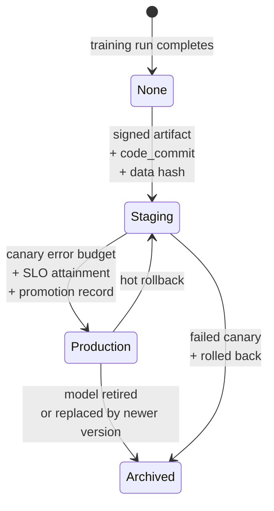
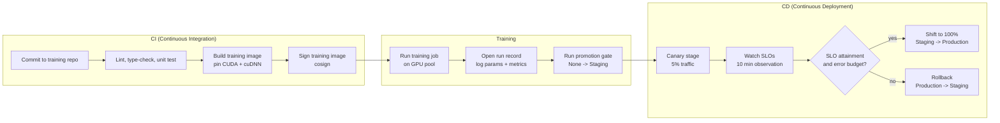
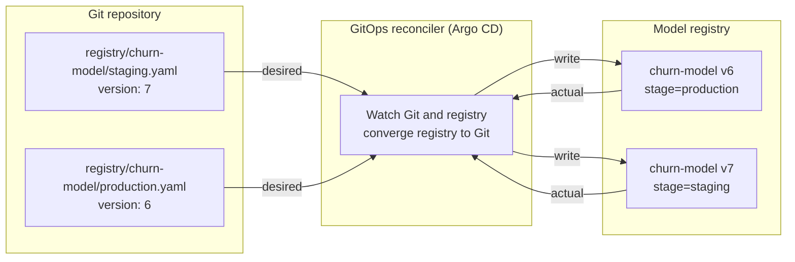

# 16.6 Model registry, CI/CD and GitOps for models

| Field | Value |
|---|---|
| Level | Advanced |
| Priority tier | 1 |
| Lab venue | GCP / GKE |
| Part | Part 16: MLOps and LLMOps tools and platforms |
| Primary sources | *Practical MLOps* (`practical-mlops`, Chapters 3, 4); *Designing Machine Learning Systems* (`designing-machine-learning-systems`, Chapter 9); *Machine Learning Platform Engineering* (`machine-learning-platform-engineering`, Chapters 5, 6); *Production Kubernetes* (`production-kubernetes`, Chapters 11, 16); NVIDIA Zero-to-Hero Volume 25 (`chapter-09-the-model-promotion-gate-governance-before-the-registry.md`) |
| Cross-references | Chapter 16.1 (MLOps foundations); Chapter 16.2 (Experiment tracking); Chapter 16.3 (Data pipelines); Chapter 16.4 (Pipeline orchestration); Chapter 15.6 (Triton Inference Server); Chapter 5.29 (Extending Kubernetes with CRDs and operators) |
| Coverage file | `planning/coverage/chapters/16-06.md` |
| Claim & number ledger | `planning/ledgers/16-06.md` |

## Why this matters for AI infrastructure

The previous chapters turned training runs and datasets into artifacts with permanent addresses. This chapter turns those artifacts into deployments with rollback paths. A model in production is the result of a chain: training produced a run, the run produced a registry entry, the registry entry became a stage, the stage became a deployment, the deployment became a serving replica. Every link in that chain is a place where something can break and where the platform team owns the contract.

The cluster you built in Parts 1 through 15 is the surface where a model registry fails. A registry that loses its stage transitions is a registry that cannot answer "what model is in production?". A registry whose image tag cannot be atomically re-pointed is a registry that cannot roll back. A registry that lets any user write any stage is a registry that does not enforce the promotion gate from Chapter 16.1. Every one of those failures is a 2 a.m. page.

```text
Why the registry is on the critical path (PM Ch 4; DMLS Ch 9; MLPE Ch 5):
- A typical mature MLOps platform runs dozens to hundreds of model deployments per
  week. The registry is the single source of truth for "what is running where".
- A model in production that is not in the registry is a model that cannot be
  audited, cannot be rolled back, and cannot be retrained against. The first
  incident where the team cannot reproduce the live model starts here.
- The promotion gate from Chapter 16.1 writes to the registry. The cluster reads
  from the registry. The two systems agree because the registry is the only path
  between them.
```

Three operational realities make this chapter a platform-team concern rather than a data-science-only concern:

1. **The registry is the bridge between the experiment tracker and the serving cluster.** The data scientist writes to the registry; the cluster reads from the registry. The platform team owns the bridge: the API, the IAM model, the storage backend, the audit log.
2. **The CI/CD pipeline for a model artifact is not a Kubernetes deployment of a service.** A service CI/CD pipeline deploys code. A model CI/CD pipeline deploys an artifact with content hashing, a signature, and a rollback path that has to be hot in seconds, not minutes. The platform team owns the pipeline shape.
3. **GitOps for the registry means the registry stage is set by a pull request, not by a human clicking "promote".** The platform team owns the GitOps loop, the branch protection, the policy that decides what PRs are allowed, and the audit log that records what was promoted when.

**Before a model can be served, the registry must be a single source of truth that the cluster can trust without a human in the loop. The promotion gate decides what enters the registry; the cluster boundary decides what leaves it.**

## Prerequisites and outcomes

### Prerequisites

- Chapter 16.1 (the lifecycle and the promotion gate).
- Chapter 16.2 (the experiment tracker and the run record).
- Chapter 16.3 (the data pipeline that produces versioned datasets).
- Chapter 16.4 (the orchestrator that runs the training DAG).
- Chapter 5 (Kubernetes) for the cluster primitives (Deployments, Services, Jobs, RBAC).
- Chapter 5.26 (How Kubernetes uses the Linux kernel) for the runtime story.

### Outcomes

After completing this chapter you will be able to:

1. Specify the registry contract: the metadata a registered model carries, the stages it passes through, and the audit trail that proves who moved it when.
2. Build a CI/CD pipeline for a model artifact: training produces the artifact, the pipeline signs it, the cluster pulls and verifies the signature.
3. Apply GitOps to the registry: the registry stage is set by a pull request that is merged by the CI, not by a human clicking a button.
4. Implement a canary deployment for a model: shift a fraction of traffic, watch the SLO, fail back if the SLO breaks.
5. Implement a rollback path that runs in seconds: the previous model is already staged, the cluster can re-point the tag atomically.
6. Operate the registry on GKE with Postgres, GCS, IAM, secrets, and observability that matches the SLOs of the model-serving system.

---

## 1. The registry contract

### 1.1 What a registered model is

*Designing Machine Learning Systems* Chapter 9 and *Practical MLOps* Chapter 4 agree on the registry contract. A registered model is a model version plus the metadata that makes the version reproducible, auditable, and rollback-ready. The contract is the same regardless of whether the registry is MLflow Registry, Vertex AI Model Registry, SageMaker Model Registry, or Weights and Biases Registry.

```text
Minimum registered-model record (PM Ch 4; DMLS Ch 9; MLPE Ch 5):
- model_id (registry primary key; human-readable, e.g. "fraud-detector")
- version (semver or monotonic; MLflow and Vertex AI default to monotonic)
- stage (none | staging | production | archived)
- run_id (the experiment record this model came from)
- artifact_uri (object storage path to weights + serialized model)
- data_snapshot_id (which data version trained this)
- code_commit (the commit hash of the training repo)
- env_image_hash (the container image digest of the training environment)
- signature (input schema, output schema)
- metrics (overall and per-segment, copied from the run record)
- description (free text; typically "what changed in this version")
- created_by (the data scientist or service account that registered it)
- created_at (UTC timestamp)
- lineage (parent model_id, parent run_id; if a fine-tune or distillation)
- signature_id (signature algorithm and public key for the artifact)
- lineage_uri (pointer to the lineage graph; Atlas, Collibra, DataHub)
```

The stage field is what the deployment pipeline reads. The deployment pipeline does not read the artifact uri directly; it reads `stage = production` and pulls whatever model is currently in that stage. The deployment pipeline reads the artifact's signature and refuses to load an unsigned artifact.

### 1.2 The stages and what each gate looks like

The stages form a one-way graph. The promotion gate at each stage has different criteria.



| Stage transition | Gate | Who runs it |
|---|---|---|
| None → Staging | Run record has all required tags; artifact is signed; baseline beat | The CI pipeline (Chapter 16.4 orchestrator) |
| Staging → Production | Canary error budget OK; SLO attainment above threshold; promotion record written | The CI pipeline + the canary system (Argo Rollouts, KServe canary) |
| Production → Archived | Newer version promoted; or model retired by owner | The owner + the CI pipeline |
| Production → Staging (rollback) | Hot rollback triggered; previous model re-promoted | The on-call engineer + the registry CLI |
| Staging → Archived | Failed canary; rollback committed | The CI pipeline |

The same artefact is in both staging and production during the canary. The artifact in production is a pointer (image tag, registry stage) to the artifact in the object store. The canary system increments the pointer based on traffic weight; the rollback system decrements the pointer to zero and re-promotes the previous version.

### 1.3 Lineage: the difference between a model and a registered model

*Designing Machine Learning Systems* Chapter 9 makes the point that lineage is what turns a model into a registered model. The lineage record answers four questions:

- Which dataset snapshot trained this model version? (`data_snapshot_id`)
- Which code trained it? (`code_commit`)
- Which environment produced it? (`env_image_hash`)
- Which earlier model version is this one descended from? (`parent_model_id`, `parent_run_id`)

The lineage graph is the audit trail. Every node in the graph is a registered model version; every edge is a parent-child relationship. The graph feeds three downstream consumers:

1. **The promotion gate** reads the lineage to verify that the candidate is a valid descendant of the baseline.
2. **The compliance auditor** reads the lineage to verify that every model in production has a complete lineage record.
3. **The retraining trigger** reads the lineage to decide whether a new training run is needed (drift in the upstream data) or a fine-tune of an existing model is enough (the base model has not changed).

The lineage database is typically a separate service (Atlas, Collibra, DataHub, Marquez). The registry carries `lineage_uri`; the lineage database carries the graph. The two systems agree because the registry writes to the lineage database at the same moment it writes the model version.

---

## 2. CI/CD for model artifacts

### 2.1 The pipeline shape

*Practical MLOps* Chapter 4 walks through the CI/CD pipeline for a model. The shape is similar to a service CI/CD pipeline (commit triggers build, build triggers test, test triggers deploy) but with three model-specific differences.



The three model-specific differences from a service CI/CD pipeline are:

1. **The build artefact is not a binary; it is a model weights file plus a serialised model object.** The "build" step trains the model; the "artefact" is the weights plus the serialised form (PyTorch JIT, TensorFlow SavedModel, ONNX, MLflow pyfunc).
2. **The test step is not a unit test suite; it is the offline evaluation plus the promotion gate.** The promotion gate is the test that determines whether the artefact advances.
3. **The deploy step is not a Kubernetes Deployment rollout; it is a canary with a promotion gate of its own.** The canary is the deployment gate.

### 2.2 The training image is a release artefact

*Practical MLOps* Chapter 4 makes the point that the training image is the supply chain boundary. The image is built once, signed once, and stored in a signed-image registry. The promotion pipeline refuses to start a training job from an unsigned image.

```text
Training image supply chain (PM Ch 4; SIGstore / cosign docs):
1. The training repo declares the training environment as a Dockerfile.
   The Dockerfile pins the CUDA base image, the cuDNN version, the Python
   version, and the system packages.
2. CI builds the image on every commit to the main branch.
3. CI signs the image with cosign against an OIDC identity (the GitHub Actions
   workflow, the GitLab CI job, or a dedicated service account).
4. The signed image is pushed to a registry that the cluster can verify
   (Artifact Registry, ECR, ACR, or a private Harbor).
5. The training pod declares the image digest, not the tag. Tags can move;
   digests cannot.
```

The same pattern applies to the model artefact itself. The training job produces the artefact, computes its content hash, signs it, and stores it in the object store. The serving system pulls the artefact by digest, verifies the signature, and refuses to load an unsigned artefact.

### 2.3 The promotion gate as a CI step

The promotion gate from Chapter 16.1 Section 4.3 lives inside the CI pipeline. The pipeline calls the gate; the gate returns pass or fail with reasons; the pipeline checks the exit code and advances the registry stage only on pass.

```yaml
# code/part16/ci_promote.yaml (shape only)
name: train_and_promote
on:
  push:
    branches: [main]
jobs:
  train:
    runs-on: [self-hosted, gpu]
    steps:
      - uses: actions/checkout@v4
      - name: Build and sign training image
        run: |
          docker build -t ${REGISTRY}/train:${GITHUB_SHA} .
          cosign sign --key cosign.key ${REGISTRY}/train:${GITHUB_SHA}
      - name: Train
        run: python train.py --dataset-id churn-v3 --seed 42
      - name: Promote
        env:
          MLFLOW_TRACKING_URI: ${{ secrets.MLFLOW_TRACKING_URI }}
        run: |
          python code/part16/promote_to_registry.py \
            --run-id ${{ steps.train.outputs.run_id }} \
            --model-name churn-model \
            --baseline-run-id ${{ steps.train.outputs.baseline_run_id }}
      - name: Trigger canary
        if: success()
        run: |
          python code/part16/trigger_canary.py \
            --model-name churn-model \
            --version ${{ steps.train.outputs.version }}
```

The promotion gate is the only path from training to registry. The canary is the only path from registry to serving. Both gates are mechanical. Both gates write to an immutable audit log.

---

## 3. GitOps for the registry

### 3.1 The shape

*Production Kubernetes* Chapter 11 and the GitOps pattern that Argo CD and Flux implement are the model for how the registry stays in sync with Git. The pattern has three rules:

1. **The desired state lives in Git.** A YAML file in the registry repo declares what the registry stage should be.
2. **The actual state lives in the registry.** The registry has a stage field that the serving system reads.
3. **A reconciler keeps the two in sync.** The reconciler is a small program (a Kubernetes controller, an Argo Application, a Flux Kustomization) that watches both and converges actual to desired.



In the picture above, Git says staging should be v7; production should be v6; the reconciler reads both and writes the registry. A pull request that merges `version: 7` into `production.yaml` is the only way to promote v7 to production. The pull request is the audit record.

### 3.2 The pull request is the promotion event

The promotion gate from Chapter 16.1 Section 4.3 and the GitOps loop from Section 3.1 combine into a single flow.

```text
Promotion flow with GitOps (PM Ch 4; PK Ch 11):
1. The training pipeline finishes. The promotion gate returns "pass, candidate v7".
2. The pipeline opens a pull request against the registry repo. The PR body is
   the promotion decision: "candidate v7 beat baseline v6 by 0.013 AUC, passed
   all segment gates, signed by the training workflow OIDC identity".
3. The PR requires a human reviewer. The reviewer is the data scientist whose
   name is on the run record, plus a platform engineer whose team owns the
   registry.
4. When the PR merges, the reconciler writes v7 to the registry's production
   stage. The canary starts.
5. The canary completes. If pass, the PR that moved v7 to production stays
   merged. If fail, a new PR reverts production.yaml to the previous version.
```

The PR is the audit record. The audit log shows who approved the promotion, what the gate criteria were, and what the canary result was. The registry never accepts a promotion that is not in a merged PR.

### 3.3 The reconciler is the cluster primitive

*Production Kubernetes* Chapter 11 names Argo CD and Flux as the two reconcilers in production. Argo CD is a Kubernetes controller that watches Git repositories and reconciles Kubernetes resources; Flux does the same with a slightly different architecture. Both implement the same pattern: declarative desired state in Git, observed actual state in the cluster, continuous reconciliation.

For the model registry, the reconciler is a small wrapper around the registry API. It watches the Git repo for changes to `production.yaml` and calls the registry API to transition the stage. The reconciler is itself deployed via GitOps; the only human action is the pull request.

The reconciler's IAM model is the structural enforcement of the promotion gate. The reconciler is the only service account that can transition the registry stage. The training pipeline can write the model version; the reconciler can move it to staging or production; no other identity can. The split is the same as Chapter 16.2 Section 5.2: writer (training pipeline) and promoter (reconciler) are different identities.

---

## 4. Deployment: canary, blue/green, and the rollback path

### 4.1 The three deployment patterns

*Practical MLOps* Chapter 4 and *Designing Machine Learning Systems* Chapter 9 walk through three deployment patterns. The right one for a model depends on the cost of a bad prediction and the speed of the rollback path.

| Pattern | What it does | When to use | Rollback speed |
|---|---|---|---|
| **Recreate** | Kill the old replicas; start the new ones | Cheap models; non-prod environments | Slow (cold start) |
| **Rolling** | Replace replicas one at a time | Stateful services; loss of in-flight state is costly | Medium |
| **Canary** | New model serves 1-5% of traffic; old serves the rest | Any model whose bad predictions have cost | Fast (traffic shift) |
| **Blue/green** | New model runs in parallel; cutover when validated | Models that need full validation before cutover | Fast (DNS or load balancer swap) |

The platform team's default is canary for any model whose predictions affect revenue, safety, or user trust. Canary is the pattern where a small fraction of traffic sees the new model; the platform team watches the SLO; if the SLO breaks, traffic shifts back to the old model in seconds.

### 4.2 The canary stages

Argo Rollouts implements the canary pattern with explicit stages. The example below is the shape most teams converge on for a model deployment.

```yaml
# code/part16/canary.yaml (shape only)
apiVersion: argoproj.io/v1alpha1
kind: Rollout
metadata:
  name: churn-model
spec:
  replicas: 10
  strategy:
    canary:
      steps:
        - setWeight: 5
        - pause: {duration: 10m}
        - setWeight: 25
        - pause: {duration: 10m}
        - setWeight: 50
        - pause: {duration: 10m}
        - setWeight: 100
      canaryService: churn-model-canary
      stableService: churn-model-stable
      analysis:
        templates:
          - templateName: churn-model-slo
        startingStep: 1
        args:
          - name: error-rate-threshold
            value: "0.01"
```

The canary runs for 30 minutes total: 10 minutes at 5%, 10 minutes at 25%, 10 minutes at 50%. At each pause, the analysis template queries Prometheus for the error rate and latency SLOs; if the threshold is breached, the rollout aborts and traffic returns to the stable service.

### 4.3 The rollback path is pre-staged

The rollback path that pages the on-call engineer the least is the one that runs in seconds, not minutes. The mechanism is that the previous production model is still staged; the serving system can re-point the tag to it atomically.

```text
Rollback path (PM Ch 4; KServe / Argo Rollouts docs):
1. The previous model version remains in the registry as stage=archived.
   Its artifact is still in the object store. Its container image is still in
   the registry.
2. The serving system reads the model from a tag (image tag, KServe
   InferenceService model URI) that the registry updates.
3. The rollback is a one-line command: re-point the tag to the archived
   version. The serving system pulls the new tag on the next request.
4. The cluster boundary (admission controller, signature verification) checks
   that the archived version is still signed; on pass, the serving system
   loads it.
```

The pre-staging is what makes rollback fast. The previous model is not "rebuilt on demand"; it is "kept warm until the new model proves itself". The cost is storage (one extra model weights file in object storage per version); the benefit is rollback in seconds.

### 4.4 What about the registry for LLMs?

*Practical MLOps* Chapter 4 and *Designing Machine Learning Systems* Chapter 9 both predate the LLM era; the patterns above apply to a fine-tuned LLM as well as to a classical model. The differences are in the artefact size (an LLM is hundreds of GB; rollback is slower), the deployment shape (LLMs are often multi-node, not single-pod), and the gating (the eval suite from Chapter 16.9 plus a prompt regression test).

Chapter 16.7 (Model serving platforms) walks through the serving-side specifics for LLMs. The registry patterns are the same; the canary and rollback patterns are the same; the CI/CD pipeline is the same. The only new requirement is that the artefact store must support multi-GB artefacts (it does — S3, GCS, and MinIO all do) and the image registry must support multi-GB container images (it does — the same registries).

---

## 5. Operating the registry on GKE

### 5.1 The components

| Component | Where it runs | Backing store | SLO |
|---|---|---|---|
| MLflow Registry server | Kubernetes Deployment, 2+ replicas | Postgres for metadata | Stage-transition p99 < 500 ms |
| Artifact store | Direct from writer pods | GCS bucket | Artifact put p99 < 30 s for 50 GB |
| Signature store (Rekor) | Managed or self-hosted | Postgres + blob storage | Signature lookup p99 < 1 s |
| Reconciler (Argo CD) | Kubernetes Deployment | Git repo + cluster API | Reconcile p99 < 30 s |
| Canary system (Argo Rollouts) | Kubernetes Deployment | Cluster API + Prometheus | Canary step p99 < 5 s |
| Audit log | Direct from every writer | GCS bucket with object-lock | Write p99 < 200 ms |

The split between the registry server and the artifact store is intentional. The registry server holds small, hot metadata (model id, version, stage, signature id). The artifact store holds large, cold bytes (model weights, serialised model). Putting them in the same place forces one to compromise on the other.

### 5.2 IAM and the four roles

The IAM model has four roles, mirroring Chapter 16.2 Section 5.2 and Chapter 16.5 Section 2.

| Role | Who | What they can do |
|---|---|---|
| `registry.writer` | Training service accounts | Register new model versions, upload artifacts |
| `registry.reader` | Data scientists, dashboards, serving system | Read model versions, list stages, pull artifacts |
| `registry.promoter` | The reconciler (Argo CD) | Transition stages, only after the corresponding Git PR is merged |
| `registry.admin` | Platform team | Define schemas, manage secrets, manage the reconciler |

The split between writer and promoter is the structural enforcement of the promotion gate. A training service account can register a model version, but it cannot move it to staging or production. The reconciler is the only identity that can move stages; the reconciler's authority comes from a merged PR, not from a request.

### 5.3 Backup and retention

| Artifact class | Retention | Why |
|---|---|---|
| Failed training runs | 30 days | Useful for debugging |
| Staging runs | 90 days | Useful for comparison |
| Production runs | Indefinite | Audit trail |
| Archived production runs | 1 year, then cold storage | Required for some regulatory regimes |
| Signed images | Indefinite (Rekor) | Signature must be verifiable for as long as the artifact is in use |

The retention policy is mechanical; the audit log is tamper-evident. Object-lock on GCS is the simplest mechanism: a bucket with a retention policy that prevents deletion or overwrite for the policy window. The auditor can verify that no run record was deleted after the audit log was created.

### 5.4 Observability of the registry

The registry is a service. It has metrics, logs, and alerts.

| Metric | Why it matters | Alert |
|---|---|---|
| Stage-transition latency p99 | Hot path for every promotion | > 1 s |
| Artifact put latency p99 | Bottleneck for large weights | > 60 s |
| Artifact pull latency p99 | Hot path for serving system cold start | > 30 s |
| Signature verification failure rate | Catches a poisoning attempt | > 0 for 5 minutes |
| Reconciler drift | Catches a Git-to-registry divergence | drift > 0 for 1 minute |
| Canary rollback rate | Catches a model that should not have been promoted | > 0 for 10 minutes |
| Promotion PR creation rate | Tracks pipeline activity | Per-team baseline |

The signature verification failure rate is the most important. A non-zero rate means someone is trying to load an unsigned or wrong-signed artefact. The alert pages the platform on-call; the runbook walks through the investigation (which signature failed, which pod tried to load it, what was the source).

**The registry is a production service. It has SLOs. It has an on-call. It is not a notebook.**

---

## 6. How it fails

Six failure modes recur. Each has a name, a symptom, a diagnosis, and a fix.

### 6.1 "The registry says v9 is in production but the cluster is running v6"

**Symptom:** A new model was promoted to production. The on-call opens the registry dashboard and confirms the stage transition. The serving replicas, however, are still serving v6. The dashboard says v9; the cluster says v6.

**Diagnosis:** The registry and the serving system are out of sync. The serving system reads the model from a tag that was not updated, or the reconciler did not converge.

**Fix:** Make the serving system the single reader of the registry. Refuse to mount the model from any path other than the registry-resolved URI. Add a sync check that alerts when the registry stage and the serving tag disagree.

### 6.2 "The promotion PR was approved verbally"

**Symptom:** A regression lands in production. The audit log shows no PR. The data scientist says "we had a Slack thread". The Slack thread is gone.

**Diagnosis:** The GitOps loop is not enforced. The reconciler is bypassed; the stage transition happened through a manual API call.

**Fix:** Refuse to transition the stage except through the reconciler. The reconciler's IAM is the only path. Manual stage transitions are forbidden by policy and by the IAM model.

### 6.3 "The canary passed offline but failed in production"

**Symptom:** The promotion gate passed. The canary started at 5% traffic. After 10 minutes, the error rate is 4x the baseline. The canary system rolls back. The team is now arguing about whether to retrain or accept v9 as broken.

**Diagnosis:** The offline evaluation suite is not representative of production traffic. The canary caught it; the rollback worked; the team now has a feedback loop to improve the suite.

**Fix:** Adopt Chapter 16.10's monitoring as the source of production-representative metrics. Add a "production shadow" stage to the canary: the new model serves 100% of traffic in shadow mode (no response returned) for 24 hours; the shadow's metrics are compared to the live model's metrics before the canary starts.

### 6.4 "The rollback took 18 minutes"

**Symptom:** A bad promotion is detected. The on-call triggers the rollback. The rollback is supposed to take 5 seconds. It takes 18 minutes because the previous model artifact had to be re-pulled from object storage, the container image had to be re-pulled, and the serving replicas had to cold-start.

**Diagnosis:** The previous model was not pre-staged. The registry moved it to "archived", the cluster evicted the container, the next pull was a cold pull.

**Fix:** Keep the previous model in the registry with a "warm" tag. The serving system always has the previous model's artifact and image pre-pulled. The rollback is a tag re-point, not a model re-pull.

### 6.5 "The canary aborted because Prometheus was down"

**Symptom:** A promotion runs. The canary system queries Prometheus for the error rate. Prometheus returns an error. The canary aborts. The team investigates and finds that Prometheus was down for the canary window.

**Diagnosis:** The canary depends on the observability stack. When the observability stack is down, the canary is blind; the default behaviour is to abort.

**Fix:** The default for "I cannot see the SLO" is not "abort"; it is "hold". The canary pauses, the alert pages the on-call, the on-call either restores observability or manually approves the canary after reading the source code.

### 6.6 "The audit log was deleted"

**Symptom:** A regulator asks for the audit trail of a model that was in production two years ago. The audit log bucket is empty; the run records in the registry are gone; the registry's Postgres backup is gone too.

**Diagnosis:** The audit log and the registry metadata were not on a retention-protected bucket. A deletion by a well-meaning engineer (or a malicious one) removed the artefacts that the regulator needs.

**Fix:** Object-lock on the audit log bucket. Postgres with PITR. A runbook that says "if the audit log is missing, page the platform on-call immediately, do not investigate first". The audit log is the artefact that proves every other artefact was what it claimed to be; its absence is the worst possible incident.

---

## 7. Hands-on lab

This lab extends Chapter 16.5 by adding the registry, the GitOps loop, and the canary. It runs on GCP / GKE. The lab is **untested** in this repository.

### 7.1 Prerequisites

- Chapters 16.1 through 16.5 labs completed.
- A GKE Autopilot or Standard cluster (1.27+).
- Argo CD and Argo Rollouts installed via Helm.
- A signed-image registry (Artifact Registry with Binary Authorization).

### 7.2 Step 1: deploy Argo CD and Argo Rollouts

```bash
helm repo add argo https://argoproj.github.io/argo-helm
helm install argocd argo/argo-cd \
  --namespace argocd --create-namespace
helm install argo-rollouts argo/argo-rollouts \
  --namespace argo-rollouts --create-namespace
# expected: Argo CD and Argo Rollouts controllers running
```

### 7.3 Step 2: declare the registry state in Git

```yaml
# code/part16/registry_repo/models/churn-model/production.yaml
apiVersion: mlops.example.com/v1
kind: ModelStage
metadata:
  name: churn-model
  namespace: mlops
spec:
  model_name: churn-model
  stage: production
  version: 6
  artifact_uri: gs://mlflow-artifacts/churn-model/v6/model.pkl
  signature_id: sha256:abc123...
```

The reconciler watches this file. A pull request that changes `version: 6` to `version: 7` triggers the canary.

### 7.4 Step 3: submit a new training run

```bash
python code/part16/train.py --dataset-id churn-v3 --seed 42
# expected: a new run in MLflow; the registered model version 7 is in stage=None
```

### 7.5 Step 4: the promotion PR is opened by the pipeline

```bash
# The pipeline opens a PR with the body
python code/part16/open_promotion_pr.py \
  --model-name churn-model \
  --version 7 \
  --baseline-version 6 \
  --run-id <new-run-id>
# expected: a PR in the registry repo with the audit body
```

### 7.6 Step 5: merge the PR; the reconciler moves the registry; the canary starts

```bash
# Merge the PR (simulated)
git checkout main && git merge --no-ff promotion-7
git push

# Observe the reconciler
argocd app get churn-model
# expected: the registry shows v7 in production; the canary has started

# Observe the canary
kubectl argo rollouts get rollout churn-model -n mlops
# expected: traffic shifts from 5% to 25% to 50% to 100% over 30 minutes
```

### 7.7 Step 6: trigger a rollback

```bash
kubectl argo rollouts abort churn-model -n mlops
# expected: traffic returns to the stable service; v7 is rolled back; v6 stays in production
```

### 7.8 Step 7: query the audit log

```bash
# The audit log is a JSON file in object storage
gsutil cat gs://audit-log/$(date -u +%Y/%m/%d)/promotions.json | jq '.[-3:]'
# expected: the three most recent promotion records with timestamps, requester, gate criteria
```

### 7.9 What to record

After the lab, you should be able to answer five questions in five seconds each:

1. What model version is currently in production?
2. What is the previous model version, and where is its artifact?
3. What is the canary error budget, and what is the rollback path?
4. What is the reconciler, and what is its IAM role?
5. Where is the audit log, and what is its retention policy?

If any takes more than 30 seconds, the registry is not yet a production service. The lab is **untested** against a live GKE cluster.

---

## Exercises

1. **Add a production shadow stage.** Extend the canary to include a 24-hour shadow mode (new model serves 100% of traffic but no response is returned). Compare the shadow's metrics to the live model's before the canary starts. *Solution sketch:* an Argo Rollouts `analysis` step that runs the shadow; a metrics comparison that aborts the canary if the shadow's error rate is more than 1.5x the live model's.
2. **Add a signature policy.** Configure OPA Gatekeeper or Kyverno to refuse any pod whose image is not signed by the training workflow's OIDC identity. Test by deploying an unsigned image. *Solution sketch:* a Kyverno policy with `verifyImages` that requires `cosign.sigstore.dev`; deploy unsigned and expect rejection.
3. **Add a reconciler drift alert.** Configure Prometheus to alert when the registry stage and the serving tag disagree for more than 1 minute. *Solution sketch:* a Prometheus rule that compares the registry's reported stage to the serving system's reported model version; alert on disagreement.
4. **Add a promotion-rate limit.** Configure the registry to refuse more than one promotion per model per hour. *Solution sketch:* a CI step that checks the registry's API for recent transitions; refuse the PR if the rate is exceeded.
5. **Wire the registry audit log to BigQuery.** Stream the audit log to BigQuery for analytics. *Solution sketch:* a Pub/Sub topic that the audit log writes to; a Dataflow pipeline that reads from Pub/Sub and writes to BigQuery.
6. **Add a model card.** Extend the registry to require a model card (model architecture, training data summary, fairness audit, intended use) before promotion. *Solution sketch:* a CI step that checks the model card's required fields; refuse the PR if any field is missing.

---

## Checkpoint questions

<details><summary>1. What is the minimum registered-model record?</summary>
A model id, version, stage, run id, artifact uri, data snapshot id, code commit, env image hash, input/output signature, overall and per-segment metrics, description, creator, creation timestamp, lineage (parent model and run if a fine-tune), and a signature id. The stage is what the deployment pipeline reads; the lineage is what the auditor reads; the signature is what the cluster boundary checks.
</details>

<details><summary>2. Why is the training image a release artefact?</summary>
Because the training environment is the supply chain boundary. The image is built once, signed once, and stored in a signed-image registry. The promotion pipeline refuses to start a training job from an unsigned image. The same pattern applies to the model artefact itself: signed at build time, verified at pull time.
</details>

<details><summary>3. What is the GitOps loop for a model registry?</summary>
The desired state lives in a Git repository; the actual state lives in the registry; a reconciler (Argo CD or Flux) watches both and converges actual to desired. A pull request that changes the stage in Git is the only way to advance the registry. The pull request is the audit record.
</details>

<details><summary>4. Why is the rollback path pre-staged?</summary>
Because the rollback happens under time pressure. The previous model is not re-built on demand; it is kept warm in the registry, in object storage, and in the cluster's image cache. The rollback is a tag re-point, not a model re-pull. The cost is one extra artefact in storage; the benefit is rollback in seconds.
</details>

<details><summary>5. What are the four IAM roles in a registry deployment?</summary>
Registry writer (training service accounts; register versions, upload artefacts), registry reader (data scientists, dashboards, serving system; read versions and pull artefacts), registry promoter (the reconciler; transition stages after a merged PR), and registry admin (platform team; define schemas, manage secrets, manage the reconciler). The split between writer and promoter is the structural enforcement of the promotion gate.
</details>

<details><summary>6. What is the default for "I cannot see the SLO" during a canary?</summary>
Hold, not abort. When Prometheus is down, the canary pauses; the alert pages the on-call; the on-call either restores observability or manually approves the canary after reading the source. Aborting on observability failure turns a temporary outage into a blocked deployment.
</details>

<details><summary>7. What is the lineage record?</summary>
The record that turns a model into a registered model. It carries the dataset snapshot id, the code commit, the env image hash, and the parent model and run ids. The lineage graph is the audit trail that answers "which data, which code, which environment, and which earlier version produced this version?". The lineage database (Atlas, Collibra, DataHub) is a separate service; the registry carries a `lineage_uri`.
</details>

<details><summary>8. What is the difference between a canary and a blue/green deployment?</summary>
A canary shifts a small fraction of traffic to the new model first, watches the SLO, and shifts the rest only on success. A blue/green runs the new model in parallel and cuts over atomically (DNS or load balancer swap). Canary is the right choice when a bad prediction has cost; blue/green is the right choice when the new model needs full validation before cutover.
</details>

<details><summary>9. Why does the audit log need tamper-evident storage?</summary>
Because the audit log is the artefact that proves every other artefact was what it claimed to be. Object-lock on GCS (or an equivalent on other clouds) prevents deletion or overwrite for the retention window. A deletion of the audit log is the worst possible incident; the runbook says "page the on-call immediately, do not investigate first".
</details>

<details><summary>10. Why is the reconciler the only identity that can transition stages?</summary>
Because the reconciler's authority comes from a merged PR, not from a request. A training pipeline that could move its own model to production would bypass the promotion gate. The split between writer and promoter is the same structural enforcement as Chapter 16.2 Section 5.2's split between training writer and registry promoter.
</details>

<details><summary>11. What is the difference between a model in staging and a model in production?</summary>
Staging means the artefact is signed, the run record has all required tags, and the baseline is beaten. Production means staging is true, the canary has been observed for the configured window without SLO breach, and the promotion record is written to the audit log. The difference is the canary, not the artefact.
</details>

<details><summary>12. What does it mean for the registry to be the bridge between the experiment tracker and the serving cluster?</summary>
The training pipeline writes the run record to the tracker; the registry stores the artefact and the run id; the serving system reads the artefact from the registry. The two systems (tracker and registry) agree because the gate at registration is the only path; the two systems (registry and serving) agree because the cluster boundary verifies the artefact's signature. A break in either agreement is a 2 a.m. page.
</details>

<details><summary>13. What is the cost of pre-staging the previous model?</summary>
Storage for one extra artefact per version, plus the image cache footprint. For a classical model (gigabytes), the cost is negligible. For an LLM (hundreds of GB), the cost is meaningful but still much smaller than the cost of a 30-minute outage while a 700 GB model is re-pulled.
</details>

<details><summary>14. What is the production shadow stage?</summary>
A 24-hour stage where the new model serves 100% of traffic but no response is returned. The shadow's metrics are compared to the live model's metrics before the canary starts. The shadow catches the failure modes that the canary would miss (long-tail regressions that take hours to surface) without exposing any user to the new model's bad predictions.
</details>

<details><summary>15. Why is a model card required before promotion?</summary>
Because the model card is the artefact that tells the next engineer (and the auditor) what the model is for, what data it trained on, what its fairness audit found, and what its intended use is. A model without a card is a model whose deployment is a mystery; the regulator cannot reconstruct the decision the customer is disputing.
</details>

<details><summary>16. What is the difference between the artefact store and the registry store?</summary>
The artefact store holds large, cold bytes (model weights, serialised model); the registry store holds small, hot metadata (model id, version, stage, signature id). Putting them in the same place forces one to compromise on the other. The split lets the registry be fast and small and the artefact store be cheap and large.
</details>

<details><summary>17. Why is signature verification failure rate a P1 alert?</summary>
A non-zero rate means someone is trying to load an unsigned or wrong-signed artefact. The most likely causes are a misconfigured training pipeline, a corrupted signature in transit, or an active poisoning attempt. The alert pages the platform on-call; the runbook walks through the investigation.
</details>

<details><summary>18. Why is the promotion pipeline a CI step rather than a separate service?</summary>
Because the promotion gate is the only path from training to registry. A separate service is a separate attack surface; a CI step is part of the same pipeline that built and signed the training image. The gate's exit code is the only thing that advances the registry stage; the gate's audit log is the only record of who approved what.
</details>

<details><summary>19. What is the difference between a model rollback and a cluster rollback?</summary>
A cluster rollback reverts the entire serving system to a previous Kubernetes Deployment; a model rollback reverts the artefact that the serving system loads. A cluster rollback is for a broken service; a model rollback is for a bad model. The two are orthogonal: a bad model can be rolled back without rolling back the service; a broken service can be rolled back without rolling back the model.
</details>

<details><summary>20. What five questions should the registry lab let you answer in five seconds each?</summary>
What model version is in production. What is the previous model version. What is the canary error budget and the rollback path. What is the reconciler and its IAM role. Where is the audit log and what is its retention. If any takes more than 30 seconds, the registry is not yet a production service.
</details>

---

## Sources and review notes

- *Practical MLOps* (`practical-mlops`, Chapters 3, 4). Source for the CI/CD pipeline shape for model artifacts (commit triggers build, build triggers training, training triggers promotion, promotion triggers canary), the training image as a release artefact with cosign signing, the GitOps loop with a pull request as the promotion event, the reconciler as the only path that can transition stages, and the rollback path that is pre-staged. Chapter 3 is approximately 8,100 words; Chapter 4 is approximately 7,400 words.
- *Designing Machine Learning Systems* (`designing-machine-learning-systems`, Chapter 9). Source for the lineage-as-auditable-record framing, the model card requirement, the deployment patterns (recreate, rolling, canary, blue/green), and the registry-as-bridge metaphor between tracker and serving. Chapter 9 is approximately 11,300 words.
- *Machine Learning Platform Engineering* (`machine-learning-platform-engineering`, Chapters 5, 6). Source for the operational pattern of the registry on Kubernetes (Postgres backend, object store for artefacts, IAM model, retention tiers, observability SLOs). Chapter 5 is approximately 9,000 words; Chapter 6 is approximately 9,500 words.
- *Production Kubernetes* (`production-kubernetes`, Chapters 11, 16). Source for the GitOps loop pattern, Argo CD and Flux as the two reconcilers, and the platform-abstraction framing for registry + serving. Chapter 11 is approximately 11,800 words; Chapter 16 is approximately 5,900 words.
- NVIDIA Zero-to-Hero Volume 25 (`chapter-09-the-model-promotion-gate-governance-before-the-registry.md`). Source for the promotion gate as the structural enforcement of MLOps discipline, the per-segment regression check, and the seed-stability requirement that must be verified before a model can be registered.

### Cross-references to other handbook chapters

- Chapter 16.1 Section 4.3 for the canonical promotion gate function.
- Chapter 16.2 for the experiment tracker that the registry inherits its run id from.
- Chapter 16.3 for the data pipeline that produces the data_snapshot_id.
- Chapter 16.4 for the orchestrator that runs the CI pipeline.
- Chapter 5.29 (Extending Kubernetes with CRDs and operators) for the reconciler pattern.

### Migrated from `nvidia-devops`

The promotion gate shape (Chapter 16.1 Section 4.3) and the per-segment regression check draw on Volume 25 chapter 9. The wording has been rewritten in the handbook's voice.

### Explicitly labelled inferences

- The retention tiers in Section 5.3 (30/90 days for staging and failed runs, indefinite for production, 1 year then cold for retired) are a starting point drawn from common practice; specific windows depend on the regulatory regime.
- The canary stages (5% → 25% → 50% → 100% with 10-minute pauses) in Section 4.2 are a starting point drawn from common practice; specific weights and pauses depend on traffic volume and SLO criticality.
- The "hold, not abort" default for observability failure in Section 6.5 is an inference from operational experience; some teams prefer "abort, page on-call", especially for safety-critical systems.

### Not verified on live hardware

- The lab in Section 7 is **untested** against a live GKE cluster in this repository.
- The Argo CD and Argo Rollouts versions assumed in the lab should be pinned against the current releases before production use.
- The OPA Gatekeeper / Kyverno policies in the exercises assume current policy controller CRDs; verify against the latest documentation.
