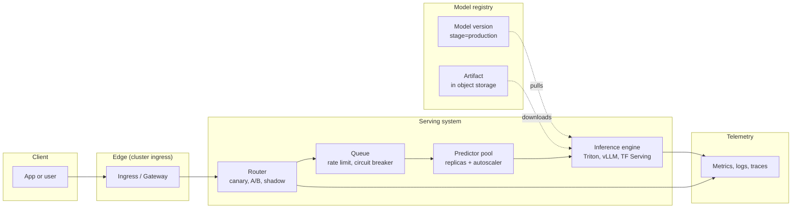

# 16.7 Model serving platforms: KServe, Seldon and BentoML

| Field | Value |
|---|---|
| Level | Advanced |
| Priority tier | 1 |
| Lab venue | GCP / GKE |
| Part | Part 16: MLOps and LLMOps tools and platforms |
| Primary sources | *Generative AI on Kubernetes* (`generative-ai-on-kubernetes`, Chapter 1); *Designing Machine Learning Systems* (`designing-machine-learning-systems`, Chapter 7); *Practical MLOps* (`practical-mlops`, Chapter 10); *Machine Learning Platform Engineering* (`machine-learning-platform-engineering`, Chapters 5, 10); KServe, Seldon Core and BentoML official documentation |
| Cross-references | Chapter 15.6 (Triton Inference Server); Chapter 15.16 (Production serving stack); Chapter 16.6 (Model registry and GitOps); Chapter 16.8 (LLMOps); Chapter 5.22 (Multitenancy and platform services) |
| Coverage file | `planning/coverage/chapters/16-07.md` |
| Claim & number ledger | `planning/ledgers/16-07.md` |

## Why this matters for AI infrastructure

Chapter 15 showed what happens inside one inference engine. This chapter covers the system that sits in front of those engines on Kubernetes. The serving platform gives a model a URL, a canary, an autoscaler, an SLO, and a place in the cluster's IAM model. Without one, each team writes its own Flask service and runs it in a pod. With one, a team declares an InferenceService and the platform handles the rest. If you are the one paged when it breaks, you feel every gap. Read the rest of this chapter with that pager in mind.

The serving platform is where MLOps meets Kubernetes. Think of the InferenceService as a single description of the whole serving path. You can read that path in one place. It records the registry's stage, the canary's traffic split, the autoscaler's GPU trigger, the predictor's runtime, the transformer, and the explainer. Each of those fields depends on cluster basics from Parts 1 through 5, such as namespaces, access rules, pod security, network policies, ingress, secrets, and observability.

```text
Why the serving platform is on the critical path (background reading: Generative AI on Kubernetes; Practical MLOps; Designing Machine Learning Systems; the figures below are examples, not quotations):
- A typical mature AI platform runs dozens to hundreds of InferenceService resources.
  The platform team owns the CRDs, the controllers, the autoscalers, and the
  ingress that fronts them.
- A serving platform that is not multi-tenant is a serving platform that becomes
  one by accident: teams share a namespace, their models share a registry, their
  traffic collides on the same ingress.
- The InferenceService is the unit that ties the registry's model version to the
  cluster's serving replicas. The reconciliation is what makes "what is running"
  answerable from a single source of truth.
```

Three operational realities make this a platform-team concern, not only a data-science concern.

The first is latency. A model that is fast on a benchmark can still be slow at the 99th percentile under heavy concurrent load. The autoscaler, the queue, the cache, and the rate limit are all platform decisions, and the customer feels them directly.

The second is the GPU pool. The autoscaler starts GPU pods, the scheduler queues them when there is no room, and the cluster quota caps how many can run. The platform team must balance cold-start latency, which favours spare capacity, against cost, which favours less idle hardware.

The third is the blast radius. A crash in the serving layer hits every user of that model at once. The platform team owns the canary, the rate limit, the circuit breaker, and the rollback path from Chapter 16.6.

Before a model serves real traffic, the platform around it needs SLOs, access control, observability, and a rollback path. **A Flask pod is a pilot. An InferenceService is a platform.**

## Prerequisites and outcomes

### Prerequisites

- Chapter 15 (LLM inference and serving) for the inference engines (Triton, vLLM, TensorRT-LLM, NIM).
- Chapter 16.6 (Model registry and GitOps) for the artefact and stage contract.
- Chapter 5 (Kubernetes) for the cluster primitives (Ingress, Services, HPA, RBAC).
- Chapter 5.22 (Multitenancy and platform services) for the multi-tenant model.

If you are missing one of these, read that chapter first.

### Outcomes

By the end of this chapter, you should be able to:

1. Write the InferenceService contract. Name the fields the platform exposes, the fields the model team fills in, and the fields the platform team owns.
2. Compare KServe, Seldon Core, and BentoML on data plane architecture, autoscaling, traffic management, and ecosystem fit.
3. Build a multi-model serving stack. It has one InferenceService for N models, an inference graph that combines them, and a transform pipeline for pre- and post-processing.
4. Set up autoscaling for bursty traffic, scale-to-zero for low-traffic models, and GPU-aware scaling for expensive models.
5. Route traffic for canary releases, A/B tests, shadow mode, and per-request routing by header or cohort.
6. Operate the platform on GKE with multi-tenancy, IAM, GPU pools, observability, and rollback paths that match Chapter 16.6.

---

## 1. The InferenceService contract

### 1.1 What every serving platform must expose

*Designing Machine Learning Systems* Chapter 7 describes the shape of a model serving system. That shape does not change from one platform to the next. A client sends a request to a URL. A load balancer forwards it to a pool of replicas. Each replica runs an inference engine that loaded its model from the registry. As you read the contract, ask which fields your team fills in and which ones the platform owns.



The platform gives the model team the same contract, whichever product you choose. The contract has six fields, and the table below says who owns each one.

| Field | What it says | Who owns it |
|---|---|---|
| **model URI** | Where the registry-staged artefact lives (`storageUri: gs://.../model.pkl`) | Model team, declared in InferenceService |
| **runtime** | Which inference engine runs the model (`sklearn`, `pytorch`, `tensorflow`, `triton`, `vllm`) | Model team + platform team |
| **scaling** | min replicas, max replicas, concurrency target, GPU request | Platform team, declared in InferenceService |
| **canary** | Traffic split between previous and new version, observation window | Platform team, declared via the canary system |
| **explainer** | Optional metadata for fairness, drift, or SHAP-based explanation | Model team + platform team |
| **transformer** | Pre/post-processing pipeline (tokenisation, normalisation, response shaping) | Model team, declared as a sidecar |

### 1.2 The InferenceService as a Kubernetes CRD

KServe's `InferenceService` is the clearest example of this contract. One custom resource describes the whole serving stack, so you can read one file to learn how a model is served.

```yaml
# code/part16/inference_service.yaml
apiVersion: serving.kserve.io/v1beta1
kind: InferenceService
metadata:
  name: churn-model
  namespace: team-data-science
spec:
  predictor:
    model:
      modelFormat:
        name: sklearn
      runtime: kserve-mlserver
      storageUri: s3://mlflow-artifacts/churn-model/production/model.pkl
      resources:
        requests:
          cpu: "1"
          memory: "2Gi"
        limits:
          cpu: "4"
          memory: "8Gi"
      env:
        - name: STORAGE_URI
          value: s3://mlflow-artifacts/churn-model/production/model.pkl
    minReplicas: 1
    maxReplicas: 10
    scaleTarget: 80       # CPU utilisation target; per-request concurrency on GPU
    scaleMetric: cpu
```

The platform team owns the CRD definition. The model team fills in the model URI, the runtime, and the resource requests. The platform team also owns the controller. That controller turns the CRD into Kubernetes Deployments, Services, HPA, PodMonitor, and Istio VirtualService resources.

### 1.3 The transformer and the explainer

Some requests need work before and after the model runs. *Practical MLOps* Chapter 10 describes the transformer pattern for that work. The transformer is a sidecar. It runs before the predictor for input transformation, and after it for output transformation.

```yaml
# code/part16/inference_service_with_transformer.yaml
apiVersion: serving.kserve.io/v1beta1
kind: InferenceService
metadata:
  name: churn-model
spec:
  transformer:
    containers:
      - name: transformer
        image: my-transformer:v1
        command: [python, transform.py]
        args: ["--mode", "preprocess"]
  predictor:
    model:
      modelFormat: {name: sklearn}
      storageUri: s3://...
  explainer:
    containers:
      - name: explainer
        image: my-explainer:v1
    minReplicas: 1
```

Put work in the transformer when the inference engine should not do it, and check that choice when you design a new service. Examples include BPE tokenisation for LLMs, normalisation for tabular models, JSON reshaping, and schema validation. The explainer produces a per-prediction explanation for models that need one. Typical methods are SHAP, LIME, and attention maps.

Seldon Core runs its transformer and explainer as containers beside the predictor. BentoML defines the same pre- and post-processing as Python functions in the `bentoml.Service`.

---

## 2. The three platforms: KServe, Seldon Core, BentoML

Suppose your team must pick a serving platform for a churn model by next quarter. Three names come up in almost every search: KServe, Seldon Core, and BentoML. Each one meets the same contract from Section 1.1, but each takes a different route to get there.

### 2.1 KServe

KServe started as KFServing in the Kubeflow project, and it is now the Kubernetes-native option. It defines the `InferenceService` CRD, and its controller turns that CRD into Deployments, Services, and Istio VirtualService resources. The data plane is pluggable. KServe ships runtimes for sklearn, PyTorch, Triton, and vLLM, and you can bring your own images.

| Strength | Detail |
|---|---|
| **Kubernetes-native** | The CRD is a first-class Kubernetes resource; everything else (RBAC, namespaces, ingress) works the way you expect. |
| **Pluggable runtimes** | The same CRD can serve sklearn, PyTorch, TensorFlow, Triton, vLLM, ONNX, and custom images. |
| **Autoscaling** | Built-in support for Knative's request-concurrency-based autoscaling; GPU-aware scaling via custom metrics. |
| **Canary** | Built-in support for traffic splitting on the `canary` field; integrates with Argo Rollouts for advanced patterns. |
| **Ecosystem** | First-class integration with Kubeflow, KServe transformers, ModelMesh for multi-model serving. |

The KServe controller runs as an ordinary Deployment. Its runtimes are container images, and KServe publishes them under `gcr.io/kserve/`. The InferenceService lives in the cluster next to your other Deployments and Services.

### 2.2 Seldon Core

Seldon Core predates KServe. It defines its own CRD, `SeldonDeployment`, and it uses Istio for traffic routing. Its main strength is the `graph` field, which chains models, ensembles, and routers. That matters for a RAG pipeline, where a retriever and a generator must work as one unit.

| Strength | Detail |
|---|---|
| **Inference graphs** | First-class support for chaining models, ensembles, and routers; useful for RAG pipelines that combine a retriever and a generator. |
| **Explainers** | Built-in SHAP, anchor, and counterfactual explainers; integrated into the SeldonDeployment CRD. |
| **Payload logging** | First-class support for request/response logging to object storage; useful for audit and dataset flywheel. |
| **Maturity** | Older codebase than KServe; wider adoption in some enterprise deployments. |

The Seldon Core operator runs as a Kubernetes Deployment, and the SeldonDeployment CRD lives in the cluster. Seldon wraps your model in prebuilt Python components, the `seldon-core-microservice` image.

### 2.3 BentoML

BentoML takes the opposite route. You write a Python `bentoml.Service` that holds the pre-processing, the inference call, and the post-processing. BentoML packages that into a Bento, a bundle of model, dependencies, and serving code, and then into a Docker image that runs on Kubernetes or anywhere else.

| Strength | Detail |
|---|---|
| **Python-first** | The entire serving stack is Python; no YAML CRD to learn. |
| **Multi-model** | First-class support for serving multiple models in one image; useful for foundation-model catalogues. |
| **Bento format** | The `Bento` is a packaging format that bundles the model, the dependencies, and the serving code. |
| **Yatai** | The Yatai deployment plane schedules Bentos on Kubernetes and handles autoscaling and traffic routing. |

BentoML fits teams that would rather write Python than YAML. It also fits teams that need to serve many small models from one image. The platform team runs Yatai, BentoML's Kubernetes operator, as a multi-tenant service.

### 2.4 Comparison

All three expose the contract from Section 1.1, so the choice comes down to operations. The table sets the options side by side.

| Dimension | KServe | Seldon Core | BentoML |
|---|---|---|---|
| Definition | Kubernetes CRD | Kubernetes CRD | Python `bentoml.Service` |
| Data plane | Pluggable runtime images | `seldon-core-microservice` image | Custom Docker image per Bento |
| Autoscaling | Knative request-concurrency + custom GPU metrics | Kubernetes HPA + custom metrics | Yatai with custom metrics |
| Canary | Built-in field + Argo Rollouts integration | Istio traffic splitting | Yatai canary |
| Inference graphs | Limited (multiple predictors per service) | First-class (`graph` field) | Multi-model in one Bento |
| Explainers | Alibi, AIF360 integration | First-class SHAP, anchor, counterfactual | Custom |
| Best fit | Kubeflow teams; Kubernetes-native; need pluggable runtimes | Inference graphs; rich explainer ecosystem | Python-first teams; many small models |

KServe is a sound default for Kubernetes-native teams. Seldon Core fits teams that need inference graphs and a rich explainer set from the start. BentoML fits teams that prefer Python.

---

## 3. Autoscaling and traffic routing

### 3.1 The three autoscaling modes

Traffic rarely arrives at a steady rate. A chat assistant may sit quiet overnight and fill up during the working day. The serving platform has to add and remove replicas to match, and the signal it watches decides how well it does that. *Generative AI on Kubernetes* Chapter 1 describes three autoscaling modes a serving platform must support.

| Mode | Trigger | When to use |
|---|---|---|
| **Concurrency-based** | Knative request concurrency target | CPU-light models; latency-stable; cheap replicas |
| **CPU-based** | Standard Kubernetes HPA on CPU utilisation | CPU-bound models; GPU-light |
| **Custom-metric (GPU)** | Queue depth, KV cache utilisation, or per-pod token throughput | GPU-bound LLMs; queue depth is the natural signal |

GPU autoscaling is the hard case. The default Kubernetes HPA does not know about GPU queue depth. KServe's custom metric adapter can supply that signal instead. Chapter 11.25 (time-slicing and MPS) and Chapter 11.17 (KAI GPU sharing) cover the tools platform teams use to make GPU scaling practical.

Be careful with CPU as a trigger. *Production Kubernetes*, chapter 13, warns that a CPU spike at startup can make the HPA scale out even when traffic has not risen. In that case, a custom metric such as request count is a better signal.

```yaml
# code/part16/kserve_gpu_autoscaling.yaml
apiVersion: serving.kserve.io/v1beta1
kind: InferenceService
metadata:
  name: llm-serving
spec:
  predictor:
    model:
      modelFormat: {name: vllm}
      runtime: kserve-vllm
      storageUri: s3://...
      resources:
        limits:
          nvidia.com/gpu: "1"
    minReplicas: 0      # scale to zero when idle
    maxReplicas: 8
    scaleTarget: 4       # 4 concurrent requests per replica
    scaleMetric: concurrency
```

Here, `scaleTarget: 4` means each replica takes up to four concurrent requests before the platform adds another. The `scaleMetric: concurrency` setting tells the autoscaler to watch in-flight requests rather than CPU. Knative's request-concurrency metric does the measuring, and the autoscaler adjusts the replica count to match. If you tune this setting, watch the replica count under real traffic before you trust it.

### 3.2 Scale-to-zero for low-traffic models

Consider a model that gets only a handful of requests a day. Keeping a GPU reserved for it all day wastes most of that hardware. *Generative AI on Kubernetes* Chapter 1 makes the case for scale-to-zero, and KServe supports it with `minReplicas: 0`.

The price is the cold start. The first request after the replicas go away waits seconds, not milliseconds. *Production Kubernetes*, chapter 13, adds a warning here. Workloads with container images over 1 GB and startup scripts that run for minutes respond slowly to scaling events, so they are poor candidates for autoscaling.

Use scale-to-zero for low-traffic internal tools, periodic batch predictors, and documentation assistants that see one request a minute, for example. Keep reserved capacity for customer-facing services with steady, heavy traffic, such as a recommendation engine under load.

### 3.3 Canary and traffic routing

Routing traffic is the platform's job. The model team points the service at a new version. The platform sends a slice of traffic to it, watches the SLO, and then either finishes the rollout or rolls back. *Designing Machine Learning Systems* Chapter 7 and *Generative AI on Kubernetes* Chapter 1 both describe this pattern.

In KServe, the canary is a field on the same InferenceService, not a separate resource. You edit the spec to point at the new model and set `canaryTrafficPercent`. KServe keeps the last rolled-out revision serving the remaining traffic. Setting the percentage to 100, or removing the field, promotes the new revision. To roll back, set the percentage to 0 or restore the old spec.

```yaml
# code/part16/canary_inference_service.yaml
apiVersion: serving.kserve.io/v1beta1
kind: InferenceService
metadata:
  name: churn-model
spec:
  predictor:
    canaryTrafficPercent: 10   # 10% to this spec, 90% to the last rolled-out revision
    model:
      modelFormat: {name: sklearn}
      storageUri: s3://mlflow-artifacts/churn-model/canary/model.pkl   # the NEW model
```

KServe does not judge the canary itself. Your pipeline, or a tool such as Argo Rollouts, watches the SLO and then raises the percentage or sets it to 0. Earlier drafts of this section had the canary field layout wrong. The layout above was checked against the upstream KServe repository.

Seldon Core splits traffic through Istio, and BentoML uses Yatai. The mechanisms differ, but the contract stays the same.

### 3.4 A/B testing and shadow mode

A canary tests whether a new version is safe. Two other patterns test whether it is better.

A/B testing sends each request a header or cookie that names its variant, and the router splits on that value. Use it to compare two models on one user group or a marketing experiment.

Shadow mode sends the new model all of the traffic, but its responses are discarded and the live model answers the user. Use it to collect ground truth before you promote anything.

KServe and Seldon both support A/B through custom routing rules. Shadow mode works by sending 100% of traffic to the canary and disabling its response path. The platform's logs keep the canary's answers for offline review.

---

## 4. Multi-model serving and inference graphs

### 4.1 ModelMesh and multi-model endpoints

Some teams need hundreds or thousands of small models, one per tenant, product, or user cohort. Giving each model its own replicas would waste most of the cluster. *Generative AI on Kubernetes* Chapter 1 introduces ModelMesh, a KServe-adjacent project that serves many models through one endpoint.

ModelMesh keeps the models in a shared memory pool. Each request carries a model ID, and the controller routes it to the right model without starting a new pod. The trade-off is that every model shares one runtime. The platform must therefore support every model format in the catalogue. If you add a new format, you may need to add it to the shared runtime first.

### 4.2 Inference graphs

One model is often not enough. A RAG question may need a retriever to find documents, then a generator to write the answer. Seldon Core's `graph` field describes that chain as a directed acyclic graph of models, routers, and combiners.

```yaml
# code/part16/seldon_graph.yaml
apiVersion: machinelearning.seldon.io/v1
kind: SeldonDeployment
metadata:
  name: rag-pipeline
spec:
  predictors:
    - name: retriever
      graph:
        children:
          - name: query-encoder
            type: MODEL
            modelUri: s3://models/encoder
          - name: vector-store
            type: MODEL
            modelUri: s3://models/vectorstore
        modelUri: s3://models/retriever
    - name: generator
      graph:
        children:
          - name: retrieved-context
            type: OUTPUT_TRANSFORMER
        modelUri: s3://models/generator
```

This graph is a RAG pipeline. The retriever encodes the query and looks up the vector store. It then hands the retrieved context to the generator. The two predictors can run on different runtimes, and the orchestrator routes requests between them.

### 4.3 BentoML multi-model

BentoML takes a different approach. One Bento holds several models, and a routing function picks the right one for each request. The code below shows the pattern.

```python
# code/part16/multi_model_service.py
import bentoml

@bentoml.service(
    resources={"cpu": "2", "memory": "4Gi"},
)
class MultiModelService:
    model_a = bentoml.models.BentoModel("model_a:latest")
    model_b = bentoml.models.BentoModel("model_b:latest")

    def predict(self, input_data: dict, model_name: str) -> dict:
        if model_name == "model_a":
            return self.model_a.predict(input_data)
        elif model_name == "model_b":
            return self.model_b.predict(input_data)
        raise ValueError(f"unknown model: {model_name}")
```

The router runs first, reading the model name from the request body. If you see the unknown-model error, check the name in your request first. The whole Bento becomes one Docker image, and the platform runs it as one Kubernetes Deployment.

---

## 5. Operating the serving platform on GKE

### 5.1 The components

Serving depends on several controllers and stores, and each one adds latency. The table lists them. The SLO column holds example targets, not measured values or vendor limits. Choose your own targets from your own traffic.

| Component | Where it runs | Backing store | SLO |
|---|---|---|---|
| KServe controller | Kubernetes Deployment | etcd | InferenceService reconcile p99 < 5 s |
| Knative serving | Kubernetes Deployment | etcd | Request-concurrency metric p99 < 1 s |
| Istio control plane | Kubernetes Deployment | etcd | Config push p99 < 30 s |
| Custom metric adapter | Kubernetes Deployment | Prometheus | GPU metric scrape p99 < 10 s |
| Object store (artefacts) | Direct from pods | GCS bucket | p99 pull < 30 s |
| Prometheus | Managed or self-hosted | TSDB | Scrape p99 < 5 s |

### 5.2 Multi-tenancy

*Generative AI on Kubernetes* Chapter 1 names multi-tenancy as the first operational concern. The pattern is one namespace per team, one InferenceService per model, one service account per team, and one set of network policies per namespace.

```yaml
# code/part16/network_policy.yaml
apiVersion: networking.k8s.io/v1
kind: NetworkPolicy
metadata:
  name: team-data-science-isolation
  namespace: team-data-science
spec:
  podSelector: {}
  policyTypes: [Ingress, Egress]
  ingress:
    - from:
        - namespaceSelector:
            matchLabels:
              name: ingress
  egress:
    - to:
        - namespaceSelector:
            matchLabels:
              name: kube-system
```

This policy lets traffic into the team's pods come only from the cluster's ingress namespace. Outbound traffic is allowed only to the `kube-system` namespace. Teams cannot reach one another's pods across namespaces, and their pods cannot reach the public internet. The platform team owns this policy.

### 5.3 IAM and secrets

The serving system reads models from the registry's object store, so it needs credentials. Store those in a Kubernetes Secret and mount the Secret as an environment variable. The platform team rotates the Secret through External Secrets Operator.

The serving system also reads feature-store credentials, covered in Chapter 16.3. Scope those credentials per namespace. The platform team owns the IAM bindings on the feature store.

### 5.4 Observability of the serving platform

Good metrics tell you the platform is unhealthy before users do. The table lists what to watch and an example alert threshold for each. Set the thresholds from your own SLOs, because the values here are examples.

| Metric | Why it matters | Alert |
|---|---|---|
| InferenceService reconcile latency p99 | Hot path for every CRD change | > 10 s |
| Request latency p50 / p95 / p99 | Customer-facing SLO | > SLO threshold |
| Error rate (5xx, 4xx) | Customer-facing SLO | > 0.1% |
| Cold-start time | Affects scale-to-zero latency | > 10 s |
| GPU utilisation | Affects cost | < 30% for 30 min |
| Queue depth | Affects latency; drives autoscaling | > scaleTarget * replicas |
| Cold-pull artefact size | Drives cold-start latency | > 50 GB |

Cold-start time matters most for scale-to-zero workloads. The first request after the replicas go to zero waits for three steps. The artefact is pulled from object storage, loaded into HBM, and then the runtime warms up. A 50 GB artefact on a 10 Gbps link takes about 40 seconds at full line rate, because 50 GB is 400 gigabits. A 500 GB LLM on the same link takes about 7 minutes. The platform team owns this cold-start budget, so measure the real pull and load time before you enable scale-to-zero for a large model.

---

## 6. How it fails

Six failures show up again and again in production. Each one below follows the same pattern: the symptom the on-call engineer sees, the likely cause, and the fix.

### 6.1 "The serving system is OOM at p99"

Symptom: Average latency looks fine, but p99 latency has reached 30 seconds. The on-call opens Grafana and sees GPU memory at 100%. The replicas are working as fast as they can and still falling behind.

Diagnosis: The concurrency target is too high for the GPU's memory. In the example, the model weights use most of the GPU's memory and each request's KV cache takes a share of what is left, which leaves room for about 4 concurrent requests, not 8. The autoscaler added replicas because the queue grew, but each new replica was overloaded too.

Fix: Lower `scaleTarget` to a number the GPU can actually serve. The chapter's starting points are 2 to 4 concurrent requests per replica for a 70B model on an H100, and 8 to 16 for a 7B model on an L40S. Measure your own numbers before you rely on these.

### 6.2 "The canary passed offline but failed in production"

Symptom: The canary ran for 10 minutes at 10% of traffic. The SLO held, so the team promoted it to 100%. Within 30 minutes, production breached the SLO, and the on-call rolled back.

Diagnosis: The canary window was too short. Some regressions take longer than 10 minutes to appear. Examples include a cold code path that most requests never reach, a downstream service with its own queue, and a failure that depends on state.

Fix: Add the shadow stage from Chapter 16.6, Section 7.3, before the canary. Shadow traffic catches the long-tail failures that a short canary misses. The chapter's example schedule runs 24 hours in shadow, then 10 minutes at 10%, then 30 minutes at 50%, then 100%. Treat those durations as an example, and set your own from how long your real failures take to show up.

### 6.3 "The model artefact cannot be pulled"

Symptom: A new model version is promoted to production. The serving replicas crash-loop, and the events show "failed to pull artefact: 403 Forbidden". The on-call opens the registry and confirms the artefact exists.

Diagnosis: The serving service account's IAM bindings have expired, or were never set. The artefact is in the bucket, but the cluster cannot read it.

Fix: Apply the IAM model from Section 5.3. Give the serving service account one role, read access to the registry's bucket. The platform team manages that binding in Terraform, and CI checks it before each promotion.

### 6.4 "Scale-to-zero caused a 30-second first-request latency"

Symptom: A model was scaled to zero. The first request after idle took 30 seconds, and the user complained. The on-call restored `minReplicas: 1`.

Diagnosis: The cold-start budget is too high for the user-facing SLO. The first request waits for the artefact pull, the HBM load, and the runtime warm-up.

Fix: Either shrink the cold start, with a smaller artefact, faster storage, or a runtime with warm caches, or keep `minReplicas: 1`. Keeping one replica costs one idle replica per model. In return, the cold-start penalty goes away.

### 6.5 "Inference graph deadlock"

Symptom: A RAG pipeline serves traffic. The retriever returns context, but the generator times out. The error rate climbs, and the on-call investigates.

Diagnosis: The retriever is slow under load. The generator's timeout is too short. The retriever's queue has no bound. The generator's request waits in its own queue for the retriever, and the retriever's queue keeps growing.

Fix: Set explicit timeouts on every edge of the inference graph. Set explicit queue sizes on every component. The retriever should drop requests before its queue grows, and the runbook should name the timeout and queue size for every model.

### 6.6 "The autoscaler scaled to zero during a traffic spike"

Symptom: A model sat idle, and the autoscaler scaled it to zero. A traffic spike arrived. The autoscaler tried to scale up, the new replicas were not ready in time, and the requests returned 503.

Diagnosis: The scale-from-zero delay is longer than the spike. In the example, the SLO is p99 latency under 200 ms, while scale-from-zero takes 30 seconds. Both numbers are examples, so use your own.

Fix: Knative's `panic-mode` setting can help. When the autoscaler sees a sudden spike, it allocates extra capacity above the steady-state target. The panic window is the time the autoscaler takes to provision a new replica.

---

## 7. Hands-on lab

Work through this lab to see the contract from Section 1 running on a real cluster. It installs KServe on GKE, serves a model, shifts traffic to a canary, and checks the autoscaler. This repository has not run the lab against a live GKE cluster, so treat the expected outputs as targets to confirm.

### 7.1 Prerequisites

- A GKE Autopilot or Standard cluster (1.27+).
- KServe installed via Helm (`helm install kserve kserve/kserve`).
- Knative serving and Istio installed.
- A model artefact in GCS (the artefact from the Chapter 16.6 lab).

### 7.2 Step 1: install KServe

Start by installing KServe with Helm. The controller pod should be running once the install finishes.

```bash
helm repo add kserve https://kserve.github.io/helm-charts
helm install kserve kserve/kserve \
  --namespace kserve --create-namespace \
  --set kserve.controller.deploymentMode=Deployment
# expected: the kserve-controller pod is running
```

### 7.3 Step 2: deploy an InferenceService

Apply the InferenceService from Section 1.2, then watch its status until it reports ready.

```bash
kubectl apply -f code/part16/inference_service.yaml
kubectl get inferenceservice churn-model -n team-data-science -w
# expected: READY=True within 60 seconds
```

### 7.4 Step 3: send a request

Look up the service URL, then send one inference request. The path follows the v2 format, and the payload is a single tensor.

```bash
URL=$(kubectl get inferenceservice churn-model -n team-data-science -o jsonpath='{.status.url}')
curl -X POST $URL/v2/models/churn-model/infer \
  -H "Content-Type: application/json" \
  -d '{"inputs":[{"name":"tier_gold","shape":[2],"datatype":"FP32","data":[1.0, 0.0]}]}'
# expected: a JSON response with predictions
```

### 7.5 Step 4: deploy a canary

Apply the canary spec from Section 3.3, then check the traffic split in the status.

```bash
kubectl apply -f code/part16/canary_inference_service.yaml
# expected: traffic shifts 10% to the canary over the configured window
kubectl get inferenceservice churn-model -n team-data-science -o jsonpath='{.status.canary}' | jq .
```

### 7.6 Step 5: verify autoscaling

Generate load with `hey`, then watch the autoscaler react to it. The load runs for 60 seconds at 100 concurrent connections.

```bash
# Generate load
hey -z 60s -c 100 -m POST -T "application/json" -d '{"inputs":[{"name":"tier_gold","shape":[1],"datatype":"FP32","data":[1.0]}]}' $URL/v2/models/churn-model/infer

# Watch the autoscaler
kubectl get hpa -n team-data-science -w
# expected: replicas grow from 1 to 5+ as load increases
```

### 7.7 Step 6: test scale-to-zero

Stop the load and wait through the idle window. Then check that the replicas drop to zero.

```bash
# Stop generating load
sleep 120

# Watch the replicas
kubectl get inferenceservice churn-model -n team-data-science -w
# expected: replicas scale to 0 after the idle window
```

### 7.8 What to record

After the lab, you should be able to answer five questions in five seconds each:

1. What InferenceServices are running in the team's namespace?
2. What is the autoscaler config (min/max replicas, scale target)?
3. What is the cold-start time for a scale-from-zero?
4. What is the canary traffic split?
5. What is the GPU utilisation and the queue depth?

If any answer takes longer than 30 seconds, the serving platform is not yet a production service. The 30-second bar is an example, so set your own. The lab still needs a run against a live GKE cluster before you rely on it.

---

## Exercises

Try these after the lab. If you get stuck, the solution sketch shows the shape of the answer. Work through them in order, and keep notes on anything that surprises you.

1. **Add a transformer.** Add a pre-processing transformer that normalises the input before inference. Then confirm the predictor receives the transformer's output unchanged. *Solution sketch:* an InferenceService with a transformer section. The transformer image runs `python transform.py --mode preprocess` and forwards the JSON.
2. **Add a custom GPU metric.** Expose the GPU's KV cache utilisation as a Prometheus gauge, then point the autoscaler at that metric. *Solution sketch:* a sidecar that polls `nvidia-smi` and publishes the metric, plus an HPA that reads it.
3. **Add A/B routing by header.** Send 50% of requests that carry the header `X-Experiment: model-b` to a canary, and check that the routing works. *Solution sketch:* a VirtualService with a match block on the header. Matching requests go to the canary.
4. **Add an explainer.** Attach an Alibi explainer to the InferenceService, then confirm it returns SHAP values for a sample input. *Solution sketch:* the explainer section of the InferenceService. A request to `/explain` returns the SHAP values.
5. **Add a BentoML multi-model service.** Define a BentoML service that serves two models, then deploy it on Kubernetes through Yatai. *Solution sketch:* start from the `MultiModelService` in Section 4.3. Run `bentoml build` to produce the Bento, and let Yatai deploy it.
6. **Add inference-graph deadlock detection.** Set explicit timeouts on every edge of a RAG inference graph, then confirm the timeouts fire. *Solution sketch:* Seldon's `timeout` field on each component, plus a load test that triggers the timeout.

---

## Checkpoint questions

<details><summary>1. A canary ran 10 minutes at 10 percent of traffic and the SLO held. The team promoted it to 100 percent and production breached the SLO within 30 minutes. What went wrong and what do you change?</summary>
The canary window was too short. Some regressions take longer than 10 minutes to show, such as a cold code path most requests never reach or a downstream service with its own queue. Add a shadow stage before the canary. The chapter's example schedule is 24 hours in shadow, 10 minutes at 10 percent, 30 minutes at 50 percent, then 100 percent, and you should set your own durations from how long your real failures take to appear.
</details>

<details><summary>2. A model was scaled to zero. The first request after idle took 30 seconds and a user complained. The on-call set `minReplicas: 1`. What did that cost, and what else could you have done?</summary>
Keeping one replica means paying for one idle replica per model. In return the cold-start penalty goes away. The other option is to shrink the cold start itself with a smaller artefact, faster storage, or a runtime with warm caches. The first request waits for the artefact pull, the HBM load, and the runtime warm-up, so each of those is a place to save time.
</details>

<details><summary>3. An alert fires because a served model has had GPU utilisation under 30 percent for 30 minutes. What does the alert tell you and what would you consider doing?</summary>
It tells you the model is costing money without doing much work. If the model only gets a handful of requests a day, scale-to-zero with `minReplicas: 0` stops a GPU from sitting reserved all day. First check that the cold start fits the user-facing SLO. The 30 percent and 30 minute values are example thresholds, so set yours from your own SLOs.
</details>

<details><summary>4. A newly promoted model version crash-loops. The events show "failed to pull artefact: 403 Forbidden" and the artefact is present in the registry. What is the cause and the fix?</summary>
The artefact exists, but the serving service account cannot read it. Its IAM bindings have expired or were never set. The fix is to give that service account one role, read access to the registry's bucket. The platform team manages this binding in Terraform, and CI checks it before each promotion.
</details>

<details><summary>5. A model sat idle and the autoscaler scaled it to zero. A traffic spike arrived and requests returned 503. What happened and what setting can help?</summary>
The scale-from-zero delay was longer than the spike. In the chapter's example the SLO is p99 under 200 ms and scale-from-zero takes 30 seconds, so the new replicas were not ready in time. Knative's `panic-mode` can help. When the autoscaler sees a sudden spike, it allocates extra capacity above the steady-state target.
</details>

<details><summary>6. A model team says their pod in `team-data-science` cannot call a public API on the internet. Nothing is wrong with the pod. What is the likely reason?</summary>
The namespace's network policy blocks it. The example policy allows inbound traffic only from the ingress namespace and outbound traffic only to `kube-system`. So pods cannot reach other teams' pods and cannot reach the public internet. The platform team owns this policy, so the team must ask for a change there.
</details>

<details><summary>7. Why can a CPU-based trigger make the autoscaler scale out when traffic has not risen?</summary>
A CPU spike at startup counts as load to the HPA. It then adds replicas even though no more requests arrived. *Production Kubernetes*, chapter 13, gives this warning. A custom metric such as request count follows the real traffic more closely.
</details>

<details><summary>8. Why does the default Kubernetes HPA not work well for a GPU-bound LLM, and what supplies the missing signal?</summary>
The default HPA does not know about GPU queue depth. For GPU-bound LLMs queue depth, KV cache use, or per-pod token throughput is the natural signal. KServe's custom metric adapter can supply that signal. The autoscaler then scales on it instead of on CPU.
</details>

<details><summary>9. Why does ModelMesh let you serve hundreds of small models without hundreds of pods, and why does that force every model onto one runtime?</summary>
ModelMesh keeps the models in a shared memory pool. Each request carries a model ID, and the controller routes it to the right model without starting a new pod. Because the models share that one pool and runtime, the runtime must support every model format in the catalogue. Adding a new format may mean adding it to the shared runtime first.
</details>

<details><summary>10. Why can KServe roll a canary back by editing one field, and who decides when to do it?</summary>
The canary is a field on the same InferenceService, `canaryTrafficPercent`, not a separate resource. KServe keeps the last rolled-out revision serving the remaining traffic. Setting the percentage to 0 or restoring the old spec rolls back. KServe does not judge the canary itself, so your pipeline or a tool such as Argo Rollouts watches the SLO and makes the change.
</details>

<details><summary>11. Why does shadow mode catch failures that a short canary misses, and why is it safe for users?</summary>
Shadow mode sends the new model all of the traffic, so rare paths and long-tail cases get exercised. The new model's responses are discarded and the live model answers the user. The platform's logs keep the canary's answers for offline review. A 10 percent canary for 10 minutes sees far fewer cases than 24 hours of full shadow traffic.
</details>

<details><summary>12. When would you choose scale-to-zero over reserved capacity, and what do you give up?</summary>
Choose scale-to-zero for low-traffic internal tools, periodic batch predictors, or a documentation assistant that sees one request a minute. You save the cost of an idle GPU. You give up fast first requests, because the cold start takes seconds, not milliseconds. Keep reserved capacity for customer-facing services with steady, heavy traffic. Images over 1 GB with long startup scripts are poor candidates for autoscaling.
</details>

<details><summary>13. Your team has a retriever and a generator that must work as one RAG unit. Another team has many small models and prefers Python over YAML. Which platform would you pick for each and why?</summary>
For the RAG unit, pick Seldon Core, because its `graph` field chains models, ensembles, and routers as a first-class feature. For the Python-first team with many small models, pick BentoML, because one Bento can hold several models. KServe is a sound default for Kubernetes-native teams that want pluggable runtimes, but its inference graph support is limited. All three expose the same contract, so the choice comes down to operations.
</details>

<details><summary>14. You want to know whether a new model is better than the old one, not only safe. Which rollout pattern do you use, and how does it differ from a canary?</summary>
Use A/B testing. The router splits requests on a header or cookie that names the variant, so you can compare the two models on one user group. A canary only tests whether the new version is safe under the SLO. Shadow mode is a third option when you want evidence without users seeing the new answers.
</details>

<details><summary>15. When would you use ModelMesh instead of one InferenceService per model, and what do you give up?</summary>
Use ModelMesh when you have hundreds or thousands of small models, such as one per tenant or user cohort. Separate replicas for each would waste most of the cluster. You give up runtime freedom, because every model shares one runtime and the platform must support every format in the catalogue.
</details>

<details><summary>16. A 50 GB model artefact is pulled over a 10 Gbps link at full line rate. How long does the pull take?</summary>
About 40 seconds. 50 GB is 400 gigabits, and 400 divided by 10 Gbps is 40 seconds. Loading into HBM and warming the runtime come on top of that.
</details>

<details><summary>17. The same link pulls a 500 GB LLM. How long is the pull, and what does that mean for scale-to-zero?</summary>
About 7 minutes. 500 GB is 4,000 gigabits, and 4,000 divided by 10 Gbps is 400 seconds, which is just under 7 minutes. A first request that waits that long breaks almost any user-facing SLO. Measure real pull and load time before you enable scale-to-zero for a large model.
</details>

<details><summary>18. A model has `scaleTarget: 4` and `maxReplicas: 8`. A load test holds 100 concurrent connections. How many requests can the service hold in flight, and how many replicas would it want?</summary>
At the limit it holds 32 in flight, since 8 replicas times 4 requests is 32. For 100 concurrent requests at 4 per replica it would want 25 replicas, because 100 divided by 4 is 25. The cap of 8 stops it well short. So the extra requests queue and latency rises, unless you raise `maxReplicas` or lower the load.
</details>

<details><summary>19. p99 latency is 30 seconds while the average looks fine. What do you check first, second, and third?</summary>
First, check GPU memory in Grafana, where 100 percent in the chapter's example shows the replicas are saturated. Second, compare `scaleTarget` with how many concurrent requests the memory left after the weights can hold, since each request's KV cache takes a share. Third, check whether the autoscaler's new replicas are overloaded in the same way. The fix is a lower `scaleTarget`, and you should measure your own numbers.
</details>

<details><summary>20. A RAG pipeline serves traffic but the generator times out and errors climb. In what order do you look?</summary>
First, check whether the retriever is slow under load, since the generator waits on it. Second, check the generator's timeout on that edge and whether it is too short. Third, check the retriever's queue, which in the example has no bound and keeps growing. The fix is explicit timeouts on every edge and explicit queue sizes on every component, and the runbook should name them.
</details>

---

## Sources and review notes

- *Generative AI on Kubernetes* (`generative-ai-on-kubernetes`, Chapter 1). Source for the three autoscaling modes (concurrency, CPU, custom GPU), the scale-to-zero trade-off, the multi-tenancy pattern with one namespace per team, the canary mechanism, and the InferenceService as the unit of serving. Chapter 1 is approximately 7,100 words.
- *Designing Machine Learning Systems* (`designing-machine-learning-systems`, Chapter 7). Source for the deployment patterns (recreate, rolling, canary, blue/green), the InferenceService contract, the autoscaler mechanics, the inference graph pattern, and the operational SLOs (cold-start, queue depth, GPU utilisation). Chapter 7 is approximately 10,300 words.
- *Practical MLOps* (`practical-mlops`, Chapter 10). Source for the transformer pattern, the ML interoperability concerns (ONNX, PMML, portable inference engines), and the platform abstractions for serving. Chapter 10 is approximately 7,500 words.
- *Machine Learning Platform Engineering* (`machine-learning-platform-engineering`, Chapters 5, 10). Source for the operational pattern (Postgres backend, object store for artefacts, IAM model, observability SLOs) and the multi-tenant platform view. Chapter 5 is approximately 9,000 words; Chapter 10 is approximately 9,000 words.
- KServe, Seldon Core, and BentoML official documentation. Source for the InferenceService CRD shape, the canary mechanism, the inference graph syntax, and the multi-model patterns.

### Cross-references to other handbook chapters

- Chapter 15.6 (Triton Inference Server) for the inference engine details.
- Chapter 15.16 (Production serving stack) for the broader serving architecture.
- Chapter 16.6 for the model registry that the InferenceService reads from.
- Chapter 16.8 for the LLMOps-specific serving patterns (RAG, agents).
- Chapter 5.22 (Multitenancy and platform services) for the multi-tenant primitives.

### Migrated from `nvidia-devops`

The transformer and explainer pattern draws on Volume 25 chapter 9. The wording has been rewritten in the handbook's voice.

### Explicitly labelled inferences

- The concurrency targets in Section 6.1 are starting points drawn from common production experience; specific targets depend on the model's KV cache capacity and the GPU's HBM size.
- The Knative panic-mode thresholds in Section 3.3 are inferences from the Knative documentation; specific thresholds depend on the traffic pattern and the SLO.
- The cold-start penalty numbers in Section 5.4 are inferences from typical storage and HBM bandwidths; specific numbers depend on the artefact size and the storage bandwidth.

### Not verified on live hardware

- The lab in Section 7 is **untested** against a live GKE cluster in this repository.
- The KServe, Knative, and Istio versions assumed in the lab should be pinned against the current releases before production use.
- The custom GPU metric adapter assumes a Prometheus-based observability stack; verify against the current KServe documentation.
