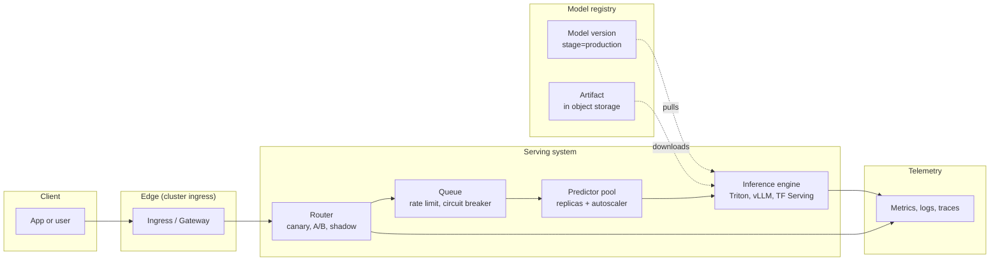

# 16.7 Model serving platforms: KServe, Seldon and BentoML

| Field | Value |
|---|---|
| Level | Advanced |
| Priority tier | 1 |
| Lab venue | GCP / GKE |
| Part | Part 16: MLOps and LLMOps tools and platforms |
| Primary sources | *Generative AI on Kubernetes* (`generative-ai-on-kubernetes`, Chapter 1); *Designing Machine Learning Systems* (`designing-machine-learning-systems`, Chapter 7); *Practical MLOps* (`practical-mlops`, Chapter 10); *Machine Learning Platform Engineering* (`machine-learning-platform-engineering`, Chapters 5, 10); KServe, Seldon Core and BentoML official documentation |
| Cross-references | Chapter 15.6 (Triton Inference Server); Chapter 15.16 (Production serving stack); Chapter 16.6 (Model registry and GitOps); Chapter 16.8 (LLMOps); Chapter 5.22 (Multitenancy and platform services) |
| Coverage file | `planning/coverage/chapters/16-07.md` |
| Claim & number ledger | `planning/ledgers/16-07.md` |

## Why this matters for AI infrastructure

It is the middle of the night, and your phone shows an alert for the churn model. Customers are waiting on predictions, and the dashboard says the service is slow but not down. The person on call needs to answer two questions first: what is running right now, and who owns each piece of it? Chapter 15 showed what happens inside one inference engine. This chapter covers the system that sits in front of those engines on Kubernetes. That system is called a serving platform. It gives a model a URL, a canary (a small test release that gets a slice of traffic first), an autoscaler, an SLO (service level objective, the target a service must meet), and a place in the cluster's IAM model (identity and access management, which decides who may do what). Without a platform, each team writes its own Flask service (a small Python web server) and runs it in a pod. With one, a team declares an InferenceService and the platform handles the rest. If you are the one paged when the service breaks, you feel every gap. Read the rest of this chapter with that pager in mind.

The serving platform is where MLOps meets Kubernetes. It helps to picture the InferenceService as one description of the whole serving path. You can read that path in one place. The file records the registry's stage, the canary's traffic split, the autoscaler's GPU trigger, the predictor's runtime (the engine that actually runs the model), the transformer, and the explainer. Each of those fields depends on cluster basics from Parts 1 through 5, such as namespaces, access rules, pod security, network policies, ingress, secrets, and observability. If one of those basics is missing, the serving field that depends on it will fail, and the error may not mention the basic at all.

A mature AI platform can run dozens or hundreds of InferenceService resources. The platform team owns the CRDs, the controllers, the autoscalers, and the ingress in front of them. If the platform is not built for many teams from the start, it becomes shared by accident. Teams end up in one namespace, one registry, and one ingress, and their traffic collides. Nobody planned that sharing, and nobody can easily undo it later.

The InferenceService ties a registry model version to the serving replicas in the cluster. That link is what lets you answer "what is running right now" from one source of truth. Without the link, the answer lives in several places, the registry, the cluster, and someone's memory, and those often disagree.

Three operational realities make this a platform-team concern, not only a data-science concern.

The first is latency. A model that is fast on a benchmark can still be slow at the 99th percentile under heavy concurrent load. The 99th percentile is the response time that nearly every request beats, with only the slowest few percent of requests above it. The autoscaler, the queue, the cache, and the rate limit are all platform decisions, and the customer feels them directly.

The second is the GPU pool. The autoscaler starts GPU pods, the scheduler queues them when there is no room, and the cluster quota caps how many can run. The platform team must balance cold-start latency, which favours spare capacity, against cost, which favours less idle hardware. Spare capacity makes the first request fast but costs money while it sits idle. Idle hardware saves money but makes the first request wait.

The third is the blast radius. A crash in the serving layer hits every user of that model at once. The platform team owns the canary, the rate limit, the circuit breaker (a switch that stops sending traffic to a failing service), and the rollback path from Chapter 16.6. When something breaks, the rollback path is the fastest way back to a working service.

Before a model serves real traffic, the platform around it needs SLOs, access control, observability, and a rollback path. **A Flask pod is a pilot. An InferenceService is a platform.**

## Prerequisites and outcomes

### Prerequisites

- Chapter 15 (LLM inference and serving) for the inference engines (Triton, vLLM, TensorRT-LLM, NIM).
- Chapter 16.6 (Model registry and GitOps) for the artefact and stage contract.
- Chapter 5 (Kubernetes) for the cluster primitives (Ingress, Services, HPA, RBAC).
- Chapter 5.22 (Multitenancy and platform services) for the multi-tenant model.

If you are missing one of these, read that chapter first. The rest of this chapter assumes you know what each of them means.

### Outcomes

This chapter follows one serving path from the contract that every platform must offer, through the three products that offer it, to the autoscaling, routing, and multi-model patterns that sit on top. It then covers the GKE operations that keep the platform healthy, the failures that show up most often, and a lab that puts the pieces together on a real cluster. Read the sections in order the first time, and come back to the failure section whenever a page wakes you up.

---

## 1. The InferenceService contract

### 1.1 What every serving platform must expose

Imagine your team has just finished a churn model in a notebook. The data scientist asks you to put it behind a URL so the retention app can call it. Before you pick any tool, you need to agree on what a serving platform must give that model. *Designing Machine Learning Systems* Chapter 7 describes the shape of a model serving system. That shape does not change from one platform to the next. A client sends a request to a URL. A load balancer forwards it to a pool of replicas. A replica is one running copy of the model server. Each replica runs an inference engine that loaded its model from the registry. As you read the contract, ask which fields your team fills in and which ones the platform owns.



The platform gives the model team the same contract, whichever product you choose. The contract has six fields, and the table below says who owns each one.

| Field | What it says | Who owns it |
|---|---|---|
| **model URI** | Where the registry-staged artefact lives (`storageUri: gs://.../model.pkl`) | Model team, declared in InferenceService |
| **runtime** | Which inference engine runs the model (`sklearn`, `pytorch`, `tensorflow`, `triton`, `vllm`) | Model team + platform team |
| **scaling** | min replicas, max replicas, concurrency target, GPU request | Model team writes the values in the InferenceService, and the platform team sets the limits and the autoscaler behind them |
| **canary** | Traffic split between previous and new version, observation window | Platform team, declared via the canary system |
| **explainer** | Optional metadata for fairness, drift, or SHAP-based explanation | Model team + platform team |
| **transformer** | Pre/post-processing pipeline (tokenisation, normalisation, response shaping) | Model team, declared as its own component with its own pods |

Read the table as a split of responsibilities. The model team says what to serve and how large it should be. The platform team says how traffic reaches it, how it grows and shrinks, and how it is watched. When a field is missing or owned by nobody, that is usually where the first outage starts.

### 1.2 The InferenceService as a Kubernetes CRD

Your teammate sends you a file and asks, "Where is this model served from, and how many copies run?" With a good contract, the answer is in one place. KServe's `InferenceService` is the clearest example of this contract. A CRD, or custom resource definition, is a way to add a new object type to Kubernetes so the cluster stores and reads it like a built-in. One custom resource describes the whole serving stack, so you can read one file to learn how a model is served.

```yaml
# code/part16/inference_service.yaml
apiVersion: serving.kserve.io/v1beta1
kind: InferenceService
metadata:
  name: churn-model
  namespace: team-data-science
spec:
  predictor:
    model:
      modelFormat:
        name: sklearn
      runtime: kserve-mlserver
      storageUri: s3://mlflow-artifacts/churn-model/production/model.pkl
      resources:
        requests:
          cpu: "1"
          memory: "2Gi"
        limits:
          cpu: "4"
          memory: "8Gi"
      env:
        - name: STORAGE_URI
          value: s3://mlflow-artifacts/churn-model/production/model.pkl
    minReplicas: 1
    maxReplicas: 10
    scaleTarget: 80       # CPU utilisation target; per-request concurrency on GPU
    scaleMetric: cpu
```

Notice how the file splits the work. The platform team owns the CRD definition, which is the schema that says which fields exist. The model team fills in the model URI, the runtime, and the resource requests. The platform team also owns the controller. A controller is a loop that watches these objects and changes the cluster until it matches them. The KServe controller turns this CRD into Kubernetes Deployments, Services, HPA, PodMonitor, and Istio VirtualService resources. Each of those is a normal Kubernetes object, so the usual tools for reading them still work.

### 1.3 The transformer and the explainer

Picture a churn request that arrives with raw customer fields, such as a country name and a signup date. The model was trained on numbers, so something must convert those fields before the model can read them. Where that conversion happens is a real design choice. Some requests need work before and after the model runs. *Practical MLOps* Chapter 10 describes the transformer pattern for that work. The transformer is not a sidecar. KServe runs it as a separate component, in its own Deployment, next to the predictor's Deployment. It receives the client's request, prepares the input, calls the predictor over the network, and shapes the response on the way back.

Because the two are separate Deployments, you can place them on different nodes. The transformer can run on cheap CPU nodes while the predictor holds the GPU, and you can scale the two independently. If the two are tightly coupled and you want to canary them together or save the network hop, KServe lets you collocate them as containers in one predictor pod. Collocating means the containers share one pod, so the network hop between them goes away. The containers must then listen on different ports, because they share one network address inside the pod.

```yaml
# code/part16/inference_service_with_transformer.yaml
apiVersion: serving.kserve.io/v1beta1
kind: InferenceService
metadata:
  name: churn-model
spec:
  transformer:
    containers:
      - name: transformer
        image: my-transformer:v1
        command: [python, transform.py]
        args: ["--mode", "preprocess"]
  predictor:
    model:
      modelFormat: {name: sklearn}
      storageUri: s3://...
  explainer:
    containers:
      - name: explainer
        image: my-explainer:v1
    minReplicas: 1
```

Put work in the transformer when the inference engine should not do it, and check that choice when you design a new service. Examples include BPE tokenisation for LLMs, normalisation for tabular models, JSON reshaping, and schema validation. BPE, or byte-pair encoding, is the method that splits text into the tokens an LLM reads. The explainer produces a per-prediction explanation for models that need one. A per-prediction explanation says why the model gave this one answer. Typical methods are SHAP, LIME, and attention maps. SHAP and LIME score each input field, and attention maps show where a language model looked.

Seldon Core v1 describes a transformer as a node in the inference graph, so it is a graph step and not a hidden helper. BentoML defines the same pre- and post-processing as Python functions in the `bentoml.Service`. Each product puts the same work in a different place, and you should know where it lives before you debug a request.

---

## 2. The three platforms: KServe, Seldon Core, BentoML

Suppose your team must choose a serving platform for a churn model by next quarter. Three names come up in almost every search: KServe, Seldon Core, and BentoML. Each one meets the same contract from Section 1.1, but each takes a different route to get there. The sections below look at each route first, then compare them side by side.

### 2.1 KServe

Your platform team already runs Kubeflow, and every other service in the cluster is a Kubernetes object. You want the model server to follow the same rules as everything else, so that the same people, tools, and habits apply. KServe started as KFServing in the Kubeflow project, and it is now the Kubernetes-native option. It defines the `InferenceService` CRD, and its controller turns that CRD into Deployments, Services, and Istio VirtualService resources. The data plane is pluggable. The data plane is the part that handles live requests, as opposed to the control plane that manages them. KServe ships runtimes for sklearn, PyTorch, Triton, and vLLM, and you can bring your own images. A runtime is the server code that loads a model and answers requests.

| Strength | Detail |
|---|---|
| **Kubernetes-native** | The CRD is a first-class Kubernetes resource; everything else (RBAC, namespaces, ingress) works the way you expect. |
| **Pluggable runtimes** | The same CRD can serve sklearn, PyTorch, TensorFlow, Triton, vLLM, ONNX, and custom images. |
| **Autoscaling** | Built-in support for Knative's request-concurrency-based autoscaling; GPU-aware scaling via custom metrics. |
| **Canary** | Built-in support for traffic splitting on the `canary` field; integrates with Argo Rollouts for advanced patterns. |
| **Ecosystem** | First-class integration with Kubeflow, KServe transformers, ModelMesh for multi-model serving. |

The KServe controller runs as an ordinary Deployment. Its runtimes are container images, and KServe publishes them under the kserve organisation on Docker Hub, for example `kserve/storage-initializer`. Registry locations change between releases, so check the release you install. The InferenceService lives in the cluster next to your other Deployments and Services. That means when something goes wrong, you can use the same commands you already know to look at it.

### 2.2 Seldon Core

Your team runs a RAG app. A retriever finds the right documents, and a generator writes the answer from them. Both are separate models, and they have to be deployed and rolled back together. Seldon Core predates KServe. Its first generation defines its own CRD, `SeldonDeployment`, and it uses Istio for traffic routing. The examples here use that API. Section 2.5 explains what happened to it. Its main strength is the `graph` field, which chains models, ensembles, and routers. A router sends each request to one branch, and an ensemble combines the answers of several models. That matters for a RAG pipeline, where a retriever and a generator must work as one unit.

| Strength | Detail |
|---|---|
| **Inference graphs** | First-class support for chaining models, ensembles, and routers; useful for RAG pipelines that combine a retriever and a generator. |
| **Explainers** | Built-in SHAP, anchor, and counterfactual explainers; integrated into the SeldonDeployment CRD. |
| **Payload logging** | First-class support for request/response logging to object storage; useful for audit and dataset flywheel. |
| **Maturity** | Older codebase than KServe; wider adoption in some enterprise deployments. |

The Seldon Core operator runs as a Kubernetes Deployment, and the SeldonDeployment CRD lives in the cluster. Think of the operator as the component that reads a SeldonDeployment and builds the pods behind it. Seldon wraps your model in prebuilt Python components, the `seldon-core-microservice` image, so your code only has to supply the model logic.

### 2.3 BentoML

A data scientist on your team writes every line of the serving code in Python. She has no wish to learn a YAML format just to put her model online. BentoML takes the opposite route. You write a Python `bentoml.Service` that holds the pre-processing, the inference call, and the post-processing. BentoML packages that into a Bento, a bundle of model, dependencies, and serving code. The Bento then becomes a Docker image that runs on Kubernetes or anywhere else.

| Strength | Detail |
|---|---|
| **Python-first** | The entire serving stack is Python; no YAML CRD to learn. |
| **Multi-model** | First-class support for serving multiple models in one image; useful for foundation-model catalogues. |
| **Bento format** | The `Bento` is a packaging format that bundles the model, the dependencies, and the serving code. |
| **Yatai** | A Kubernetes operator that deployed Bentos. Its repository is now archived, see Section 2.5. |

BentoML fits teams that would rather write Python than YAML. It also fits teams that need to serve many small models from one image. On Kubernetes, you package the Bento as an image and deploy it with the same tools as any other service. The packaging step is the part to watch. If the dependencies drift between the notebook and the image, the service may behave differently from the model you tested.

### 2.4 Comparison

Your manager asks for one slide that compares the three options. The slide has to answer two questions for each option: where the setup lives, and who gets paged when it breaks. All three expose the contract from Section 1.1, so the choice comes down to operations. The table sets the options side by side.

| Dimension | KServe | Seldon Core | BentoML |
|---|---|---|---|
| Definition | Kubernetes CRD | Kubernetes CRD | Python `bentoml.Service` |
| Data plane | Pluggable runtime images | `seldon-core-microservice` image | Custom Docker image per Bento |
| Autoscaling | Knative request-concurrency, or HPA and KEDA in Standard mode | Kubernetes HPA + custom metrics | Whatever runs the image, for example HPA |
| Canary | Built-in field in Knative mode, plus Argo Rollouts integration | Istio traffic splitting | Your rollout tool |
| Inference graphs | `InferenceGraph` resource with Sequence, Switch, Ensemble and Splitter nodes | First-class (`graph` field) | Multi-model in one Bento |
| Explainers | Alibi, AIF360 integration | First-class SHAP, anchor, counterfactual | Custom |
| Best fit | Kubeflow teams; Kubernetes-native; need pluggable runtimes | Inference graphs; rich explainer ecosystem | Python-first teams; many small models |

KServe is a sound default for Kubernetes-native teams, because it keeps the serving layer inside the Kubernetes tools your team already uses. BentoML fits teams that prefer Python. Seldon Core needs a closer look before you start a new project, as the next section explains.

### 2.5 Project status in November 2026

Imagine you chose a project last year because it was active and its examples looked current. Today a new hire asks why one of its repositories has gone quiet. Projects change, and the choice you made in one year can look wrong the next. Check the state of each project before you commit to it. The facts below come from the project repositories on 2026-11-12.

| Project | State |
|---|---|
| KServe | Active. The latest release is v0.21.0, published 2026-09-25. |
| Seldon Core | Two lines exist. Core 1 (the `SeldonDeployment` CRD in this chapter) had its last release, v1.19.0, on 2026-01-23. Core 2 is the line the README and documentation point new users to, with v2.10.2 released 2025-12-19 and a different model: Model, Server and Pipeline resources with Kafka between pipeline steps. Both lines are licensed under the Business Source License, not Apache 2.0, so read the licence before you adopt either for a commercial product. |
| BentoML | Active, Apache 2.0. The latest release is v1.4.40, published 2026-10-23. |
| Yatai | The repository is archived. Its last release, v1.1.13, is dated 2023-10-09, and its README says Yatai for BentoML 1.2 is under construction. Do not plan a new platform around it. |

If you want Bentos on Kubernetes today, build the Bento into a container image and run it as an ordinary Deployment, or as a KServe custom runtime, through your normal GitOps flow. That route avoids depending on an archived operator, and it keeps the deploy path the same as the rest of your services.

---

## 3. Autoscaling and traffic routing

### 3.1 The three autoscaling modes

Traffic rarely arrives at a steady rate. A chat assistant may sit quiet overnight and fill up during the working day. The serving platform has to add and remove replicas to match that pattern, and the signal it watches decides how well it does that job. A signal is the number the autoscaler reads, such as CPU use or the count of requests in flight. *Generative AI on Kubernetes* Chapter 1 describes three autoscaling modes a serving platform must support.

| Mode | Trigger | When to use |
|---|---|---|
| **Concurrency-based** | Knative request concurrency target | CPU-light models; latency-stable; cheap replicas |
| **CPU-based** | Standard Kubernetes HPA on CPU utilisation | CPU-bound models; GPU-light |
| **Custom-metric (GPU)** | Queue depth, KV cache utilisation, or per-pod token throughput | GPU-bound LLMs; queue depth is the natural signal |

GPU autoscaling is the hard case. The default Kubernetes HPA does not know about GPU queue depth, and a GPU-bound LLM can be fully busy while its CPU looks idle. KServe's custom metric adapter can supply the right signal instead. Chapter 11.25 (time-slicing and MPS) and Chapter 11.17 (KAI GPU sharing) cover the tools platform teams use to make GPU scaling practical.

Be careful with CPU as a trigger. *Production Kubernetes*, chapter 13, warns that a CPU spike at startup can make the HPA scale out even when traffic has not risen. A startup spike is the burst of CPU work a new pod does when it boots, such as loading libraries and the model. The HPA sees the high CPU and adds more pods, even though no extra users have arrived. In that case, a custom metric such as request count is a better signal.

```yaml
# code/part16/kserve_gpu_autoscaling.yaml
apiVersion: serving.kserve.io/v1beta1
kind: InferenceService
metadata:
  name: llm-serving
spec:
  predictor:
    model:
      modelFormat: {name: vllm}
      runtime: kserve-vllm
      storageUri: s3://...
      resources:
        limits:
          nvidia.com/gpu: "1"
    minReplicas: 0      # scale to zero when idle
    maxReplicas: 8
    scaleTarget: 4       # 4 concurrent requests per replica
    scaleMetric: concurrency
```

This manifest assumes Serverless mode, because scale to zero and the concurrency metric come from Knative. In Standard mode you scale with HPA or KEDA instead. Here, `scaleTarget: 4` means each replica takes up to four concurrent requests before the platform adds another. The `scaleMetric: concurrency` setting tells the autoscaler to watch in-flight requests rather than CPU. Knative's request-concurrency metric does the measuring, and the autoscaler adjusts the replica count to match. If you tune this setting, watch the replica count under real traffic before you trust it. A setting that looks right on paper can still react too slowly or too quickly once real users arrive.

### 3.2 Scale-to-zero for low-traffic models

Picture an internal tool that answers questions from one team a few times a day. The GPU behind it sits reserved all night and all day, and almost none of that time does any work. Keeping a GPU reserved for a model like that wastes most of the hardware. *Generative AI on Kubernetes* Chapter 1 makes the case for scale-to-zero, and KServe supports it with `minReplicas: 0`. Scale-to-zero means the platform removes every replica when no requests arrive, so the idle cost drops to nothing.

The price is the cold start. The first request after the replicas go away waits seconds, not milliseconds. The cold start is the time to bring a replica back, which includes starting the container, loading the weights, and warming the runtime. *Production Kubernetes*, chapter 13, adds a warning here. Workloads with container images over 1 GB and startup scripts that run for minutes respond slowly to scaling events, so they are poor candidates for autoscaling.

Here is what a quiet afternoon looks like with scale-to-zero turned on. The last request finishes, and the platform waits through the idle window. Then it removes the replicas, and the GPU goes back to the pool for other work. The next request arrives, and it finds no replica waiting. The platform must start a new one, pull the artefact, load it into GPU memory, and warm the runtime before it can answer. The user sees a pause, and the cluster saw a cost saving. Whether that trade is worth it depends on who is waiting.

Use scale-to-zero for low-traffic internal tools, periodic batch predictors, and documentation assistants that see one request a minute, for example. Keep reserved capacity for customer-facing services with steady, heavy traffic, such as a recommendation engine under load. The question to ask is simple: can the first user after a quiet period wait for the cold start without noticing?

### 3.3 Canary and traffic routing

Your team has a new churn model that passed its offline tests. Before it takes over, you want a few real users on it and a way to go back in one step. Routing traffic is the platform's job. The model team points the service at a new version. The platform sends a slice of traffic to it, watches the SLO, and then either finishes the rollout or rolls back. *Designing Machine Learning Systems* Chapter 7 and *Generative AI on Kubernetes* Chapter 1 both describe this pattern.

In KServe, the canary is a field on the same InferenceService, not a separate resource. It works only in the Knative based serverless mode, so it is not available in Standard mode. You edit the spec to point at the new model and set `canaryTrafficPercent`. KServe keeps the last rolled-out revision serving the remaining traffic. A revision is one saved version of the serving setup. Setting the percentage to 100, or removing the field, promotes the new revision. To roll back, set the percentage to 0 or restore the old spec.

```yaml
# code/part16/canary_inference_service.yaml
apiVersion: serving.kserve.io/v1beta1
kind: InferenceService
metadata:
  name: churn-model
spec:
  predictor:
    canaryTrafficPercent: 10   # 10% to this spec, 90% to the last rolled-out revision
    model:
      modelFormat: {name: sklearn}
      storageUri: s3://mlflow-artifacts/churn-model/canary/model.pkl   # the NEW model
```

KServe does not judge the canary itself. Your pipeline, or a tool such as Argo Rollouts, watches the SLO and then raises the percentage or sets it to 0. That split is deliberate. The platform moves the traffic, and a separate check decides whether the move was safe. The layout above follows the upstream KServe repository.

Seldon Core splits traffic through Istio. For BentoML, you use the rollout tool of your cluster. The mechanisms differ, but the contract stays the same. Whichever tool you use, the rule is the same: the platform changes the split, and the SLO decides whether the split should move again.

### 3.4 A/B testing and shadow mode

A canary tests whether a new version is safe. A product manager may ask a different question: does the new model actually help more customers? Two other patterns answer questions like that.

A/B testing sends each request a header or cookie that names its variant, and the router splits on that value. Use it to compare two models on one user group or a marketing experiment. Because each user always lands on the same variant, you can compare the results fairly.

Shadow mode sends the new model a copy of the traffic, but its responses are discarded and the live model answers the user. Use it to collect ground truth before you promote anything. Ground truth is the real outcome that the model's answer can be checked against, such as whether a customer really did leave.

KServe and Seldon both support A/B through custom routing rules.

Shadow mode is not a canary at 100 percent. In KServe, `canaryTrafficPercent: 100` promotes the new revision, so users start receiving its answers. A shadow needs a copy of each request, and a copy comes from request mirroring in the mesh or gateway. Istio calls it traffic mirroring or shadowing: it sends a copy of live traffic to the mirrored service, and the responses of the copy are dropped. Run the new model as a second InferenceService and mirror the live traffic to it. The shadow's logs keep its answers for offline review. Remember that the shadow does real work, so it needs the same GPU capacity as the live model, and its side effects, such as writes to a database, must be switched off.

---

## 4. Multi-model serving, inference graphs and LLMs

### 4.1 ModelMesh and multi-model endpoints

A software company has one small model for each of its customers. Each model is tiny, but giving every one of them its own replicas would cost a fortune and fill the cluster with idle pods. *Generative AI on Kubernetes* Chapter 1 introduces ModelMesh, a KServe-adjacent project that serves many models through one endpoint. An endpoint is the URL that clients call. One endpoint for many models means the clients do not need to know which pod holds which model.

ModelMesh keeps the models in a shared memory pool. Each request carries a model ID, and the controller routes it to the right model without starting a new pod. The trade-off is that every model shares one runtime. The platform must therefore support every model format in the catalogue. If you add a new format, you may need to add it to the shared runtime first. That is the price of sharing: the more models you pack together, the more the runtime has to understand.

### 4.2 Inference graphs

A user asks a question about your refund policy. The system must first find the right policy text, and then write an answer from that text. One model is often not enough for a job like this. A RAG question may need a retriever to find documents, then a generator to write the answer. Seldon Core's `graph` field describes that chain as a directed acyclic graph of models, routers, and combiners. A directed acyclic graph is a set of steps with arrows that never loop back. KServe has a similar `InferenceGraph` resource with Sequence, Switch, Ensemble and Splitter nodes.

```yaml
# code/part16/seldon_graph.yaml
apiVersion: machinelearning.seldon.io/v1
kind: SeldonDeployment
metadata:
  name: rag-pipeline
spec:
  predictors:
    - name: default
      replicas: 1
      componentSpecs:
        - spec:
            containers:
              - name: retriever
                image: registry.example.com/rag/retriever:1.0
              - name: generator
                image: registry.example.com/rag/generator:1.0
      graph:
        name: retriever
        type: MODEL
        children:
          - name: generator
            type: MODEL
            children: []
```

This graph is a RAG pipeline. The graph has one predictor, and the generator is a child node of the retriever. Seldon passes the retriever's output to its child, so the generator receives the retrieved context. Several entries under `predictors` would not make a chain. They are alternative versions of the same deployment, such as a main predictor and a canary, and traffic is split between them. The image names are placeholders for your own containers. This manifest has not been applied to a live cluster.

### 4.3 BentoML multi-model

A data team has two small models. Their app sends a request that names the model it wants, and the service must pick the right one. BentoML takes a different approach. One Bento holds several models, and a routing function picks the right one for each request. The code below shows the pattern.

```python
# code/part16/multi_model_service.py
import bentoml
import joblib
from bentoml.models import BentoModel


@bentoml.service(
    resources={"cpu": "2", "memory": "4Gi"},
)
class MultiModelService:
    # Declared at class scope so the Bento packages both models.
    ref_a = BentoModel("model_a:latest")
    ref_b = BentoModel("model_b:latest")

    def __init__(self):
        # BentoModel gives a model reference, not a model. Load the real
        # object from the stored files yourself.
        self.models = {
            "model_a": joblib.load(self.ref_a.path_of("model.pkl")),
            "model_b": joblib.load(self.ref_b.path_of("model.pkl")),
        }

    @bentoml.api
    def predict(self, rows: list[list[float]], model_name: str) -> list:
        if model_name not in self.models:
            raise ValueError(f"unknown model: {model_name}")
        return self.models[model_name].predict(rows).tolist()
```

`BentoModel` only gives a reference to a stored model. The service must load the real model object from the stored files, here with joblib, inside `__init__`. The constructor method in Python runs once when the service starts, so loading the models there means the cost is paid at startup and not on every request. The two references sit at class scope so that the Bento packages both models. The `predict` method carries the `@bentoml.api` decorator, which makes it an HTTP endpoint, and it picks the model by the name in the request. If you see the unknown-model error, check the name in your request first. The whole Bento becomes one Docker image, and the platform runs it as one Kubernetes Deployment. That means a bug in one model can take down the other, so keep that in mind when you decide what goes into one Bento.

### 4.4 LLM serving on KServe today

Your team is asked to host a chat model next month. The first thing you notice is the size of the weights, which are the files that hold the model's learned numbers. A churn model loads in seconds and fits on a CPU. A language model is different in three ways that change how you run the platform. Its weights are tens or hundreds of gigabytes, so loading them is the slow part of every start. It needs one or more GPUs, so a wasted replica is expensive. And its requests last seconds and stream tokens, so a plain round-robin load balancer spreads work badly. Round-robin means each new request goes to the next replica in turn, even when that replica is already busy. The KServe documentation for version 0.21 answers each of these.

Deployment mode comes first. KServe has two modes. Serverless mode uses Knative and gives scale to zero and the canary field. Standard mode, also called RawDeployment, uses plain Deployments, Services and the Horizontal Pod Autoscaler, with optional KEDA. The documentation recommends Standard mode for generative inference, because it gives full control of GPU resources and predictable scaling for long requests. The price is that scale from zero is not supported for HTTP requests in Standard mode, and the `canaryTrafficPercent` rollout is not available. Autoscaling on LLM metrics, such as waiting requests or KV cache use from vLLM, is done with KEDA in Standard mode.

The vLLM runtime is next. KServe's Hugging Face serving runtime uses vLLM as its backend for text generation, and falls back to the plain Hugging Face backend when vLLM does not support a model. It exposes OpenAI compatible endpoints, such as chat completions and embeddings. A model is declared with the `huggingface` model format, and asking for `nvidia.com/gpu` makes KServe pick the CUDA image. CUDA is the GPU programming platform that the image needs in order to run on the card.

```yaml
# from the KServe Hugging Face runtime overview
apiVersion: "serving.kserve.io/v1beta1"
kind: "InferenceService"
metadata:
  name: "huggingface-llm"
spec:
  predictor:
    model:
      modelFormat:
        name: huggingface
      storageUri: "hf://meta-llama/llama-3-8b-instruct"
      resources:
        requests:
          cpu: "1"
          memory: "2Gi"
          nvidia.com/gpu: 1
        limits:
          cpu: "1"
          memory: "2Gi"
          nvidia.com/gpu: 1
```

Model delivery is the next question. By default, a storage initializer container downloads the model into the pod before the server starts. For a large model, that download is a delay on every scale-out and every restart. A modelcar avoids the copy. You package the weights in an OCI image and set `storageUri: oci://registry/mymodel:1.0`. KServe adds a small container to the pod that runs the image. The runtime reads the weights through the shared process namespace, with no copy into another volume. This also lets the container runtime cache the image on the node, and lets you pre-pull it. Two rules from the documentation matter. The feature is off by default and is enabled in the `inferenceservice-config` ConfigMap with `enableModelcar`. And you must use a specific tag, not `latest`, because only a specific tag gets the `IfNotPresent` pull policy that makes the node cache useful. A modelcar does not remove the cost of reading the weights into GPU memory. It moves the transfer from a copy at pod start to the image pull, which can happen ahead of time.

Routing is the last piece. For a stateless service, any replica is as good as another. For an LLM it is not: a replica that already holds the prompt prefix in its KV cache can answer faster, and a replica with a long queue should be avoided. The KV cache is the memory where the model keeps the attention data for text it has already read. KServe's newer `LLMInferenceService` resource, built on the llm-d project, handles this with Gateway API and the Gateway API Inference Extension. The gateway sends a request to an InferencePool, and an endpoint picker service scores the pods, using KV cache state and load, before the gateway chooses one. The same resource supports splitting prefill and decode into separate pools, and multi-node serving with LeaderWorkerSet. Prefill is the step that reads the whole prompt, and decode is the step that writes the answer one token at a time. The documentation states that an ordinary InferenceService can serve LLMs only for basic single-node cases. It also says the two resources follow separate tracks: InferenceService for predictive models and LLMInferenceService for generative ones.

```yaml
# from the KServe LLMInferenceService overview (API version v1alpha1)
apiVersion: serving.kserve.io/v1alpha1
kind: LLMInferenceService
metadata:
  name: llama-3-8b
  namespace: default
spec:
  model:
    uri: hf://meta-llama/Llama-3.1-8B-Instruct
    name: meta-llama/Llama-3.1-8B-Instruct
  replicas: 3
  template:
    containers:
      - name: main
        image: vllm/vllm-openai:latest
        resources:
          limits:
            nvidia.com/gpu: "1"
            cpu: "8"
            memory: 32Gi
  router:
    gateway: {}
    route: {}
    scheduler: {}
```

This resource needs more of the cluster than a plain InferenceService. Its dependencies are cert-manager, a Gateway API controller, the Gateway API Inference Extension CRDs, and LeaderWorkerSet for multi-node models. Install the inference extension CRDs before the Gateway provider. The documentation warns that a provider installed first will not know about InferencePool, so the install order matters.

Pin image tags in production. The example above uses `latest` only because the documentation does. Before you serve a large model, work out the load time from Section 5.4 and put it in the SLO, since every new replica pays it. A replica that starts slowly is not a failure, but it will miss an SLO that did not count the load time.

---

## 5. Operating the serving platform on GKE

### 5.1 The components

Your on-call engineer wants to know which part of the path is slow before she opens any dashboard. A serving request passes through several controllers and stores, and each one adds latency. The table lists them. Read each row as one link in a chain. The slowest link sets the pace for the whole path, so that is the one to measure first. The SLO column holds example targets, not measured values or vendor limits. Choose your own targets from your own traffic.

| Component | Where it runs | Backing store | SLO |
|---|---|---|---|
| KServe controller | Kubernetes Deployment | etcd | InferenceService reconcile p99 < 5 s |
| Knative serving | Kubernetes Deployment | etcd | Request-concurrency metric p99 < 1 s |
| Istio control plane | Kubernetes Deployment | etcd | Config push p99 < 30 s |
| Custom metric adapter | Kubernetes Deployment | Prometheus | GPU metric scrape p99 < 10 s |
| Object store (artefacts) | Direct from pods | GCS bucket | p99 pull < 30 s |
| Prometheus | Managed or self-hosted | TSDB | Scrape p99 < 5 s |

### 5.2 Multi-tenancy

A new team asks for a namespace on the shared cluster. On its first day, a model pod gets stuck in its init stage, and nobody can say why. A namespace is a separate area of the cluster, and multi-tenancy means several teams share the cluster while staying apart. *Generative AI on Kubernetes* Chapter 1 names multi-tenancy as the first operational concern. The pattern is one namespace per team, one InferenceService per model, one service account per team, and one set of network policies per namespace. A service account is the identity a pod uses when it talks to the cluster or to outside services.

```yaml
# code/part16/network_policy.yaml
apiVersion: networking.k8s.io/v1
kind: NetworkPolicy
metadata:
  name: team-data-science-isolation
  namespace: team-data-science
spec:
  podSelector: {}
  policyTypes: [Ingress, Egress]
  ingress:
    - from:
        - namespaceSelector:
            matchLabels:
              kubernetes.io/metadata.name: istio-system
        - podSelector: {}
  egress:
    # DNS, otherwise no name resolves
    - to:
        - namespaceSelector:
            matchLabels:
              kubernetes.io/metadata.name: kube-system
      ports:
        - {protocol: UDP, port: 53}
        - {protocol: TCP, port: 53}
    # Model download by the storage initializer: HTTPS to public object stores only
    - to:
        - ipBlock:
            cidr: 0.0.0.0/0
            except: [10.0.0.0/8, 172.16.0.0/12, 192.168.0.0/16]
      ports:
        - {protocol: TCP, port: 443}
    # Traffic between pods of the same namespace (transformer to predictor)
    - to:
        - podSelector: {}
```

The policy has two halves. A network policy is a set of rules that decide which pods may talk to which. Inbound traffic may come only from the ingress namespace, here `istio-system`, and from pods of the same namespace. Outbound traffic is allowed to three places: DNS in `kube-system`, public addresses on port 443, and pods of the same namespace. Read it as a short list of allowed doors. Anything that is not on the list is blocked.

The second rule matters most. When a pod starts, KServe's storage initializer downloads the model from the object store, and that download is outbound traffic from the pod. A policy that allows only `kube-system` blocks it, and the pod then waits in its init stage and never becomes ready. The same policy would also fail name lookup, because DNS needs port 53. Namespace labels must match exactly. The reliable label is `kubernetes.io/metadata.name`, which Kubernetes sets on every namespace, whereas a label such as `name: ingress` exists only if someone added it. If your object store is reached through a private endpoint, replace the public CIDR rule with that endpoint's address. The platform team owns this policy, so a model team that needs a change has to ask them for it.

### 5.3 IAM and secrets

A model pod starts, and its log says the bucket refused it. The problem is in the identity the pod runs as, not in the model file. The serving system reads models from the registry's object store, so it needs credentials. Store those in a Kubernetes Secret, which is an object that holds sensitive values, and mount the Secret as an environment variable. The platform team rotates the Secret through External Secrets Operator. External Secrets Operator is a tool that copies values from an outside secret store into Kubernetes Secrets, so the values do not have to be written into the cluster by hand.

The serving system also reads feature-store credentials, covered in Chapter 16.3. Scope those credentials per namespace, so that one team's serving pods cannot read another team's features. The platform team owns the IAM bindings on the feature store. An IAM binding is the rule that connects an identity to a role, such as read access to one bucket.

### 5.4 Observability of the serving platform

The alert pages you at a time when nobody is making changes. The graph shows latency climbing for an hour, and the cause is not obvious. Good metrics tell you the platform is unhealthy before users do. The table lists what to watch and an example alert threshold for each. Set the thresholds from your own SLOs, because the values here are examples.

Not every row deserves a page at night. Reconcile latency and cold-start time tell you whether the platform is keeping up with changes. Request latency and the error rate tell you whether customers feel it. When an alert fires, start with the customer rows, then work back toward the platform rows that could explain them. Queue depth sits in the middle of that path, because it shows the cause that users will feel next.

| Metric | Why it matters | Alert |
|---|---|---|
| InferenceService reconcile latency p99 | Hot path for every CRD change | > 10 s |
| Request latency p50 / p95 / p99 | Customer-facing SLO | > SLO threshold |
| Error rate (5xx, 4xx) | Customer-facing SLO | > 0.1% |
| Cold-start time | Affects scale-to-zero latency | > 10 s |
| GPU utilisation | Affects cost | < 30% for 30 min |
| Queue depth | Affects latency; drives autoscaling | > scaleTarget * replicas |
| Cold-pull artefact size | Drives cold-start latency | > 50 GB |

Cold-start time matters most for scale-to-zero workloads. Picture the first request after the replicas go to zero. It waits for three steps, one after another. The artefact is pulled from object storage, which is the bucket that holds the model files. The artefact is then loaded into HBM, the high-bandwidth memory on the GPU. Last, the runtime warms up. A 50 GB artefact on a 10 Gbps link takes about 40 seconds at full line rate, because 50 GB is 400 gigabits. Gbps means gigabits per second, and full line rate means the link is moving data as fast as it can. A 500 GB LLM on the same link takes about 7 minutes. That is the pull alone, so the real wait is longer once the load and warm-up are added. The platform team owns this cold-start budget, so measure the real pull and load time before you enable scale-to-zero for a large model.

---

## 6. How it fails

The page arrives before you have finished your coffee, and the dashboard is full of red. Six failures show up again and again in production. Each one below follows the same pattern: the symptom the on-call engineer sees, the likely cause, and the fix. Read the symptom first, because it is the only part you see before you start digging. The cause comes second, and the fix comes last. Keep that order when you write your own runbook entries too. A fix written before the cause is known often treats the symptom and leaves the real problem in place.

Use these failures as a checklist for a new service before it takes real traffic. Each one names a setting that someone should have chosen on purpose, such as a timeout, a canary window, a cold-start budget, or an IAM role. If the setting was left at its default, that is the first thing to review.

### 6.1 "The serving system is OOM at p99"

Symptom: Average latency looks fine, but p99 latency has reached 30 seconds. The on-call opens Grafana and sees GPU memory at 100%. The replicas are working as fast as they can and still falling behind. OOM means out of memory, and p99 is the slow tail that users actually feel.

Diagnosis: The concurrency target is too high for the GPU's memory. Think of the GPU as a table with limited room. The weights take most of the table, and each request needs a place to keep its working memory. In the example, the model weights use most of the GPU's memory and each request's KV cache takes a share of what is left, which leaves room for about 4 concurrent requests, not 8. The autoscaler added replicas because the queue grew, but each new replica was overloaded too. Adding copies of an overloaded setup spreads the problem around. It does not solve it.

Fix: Lower `scaleTarget` to a number the GPU can actually serve. The chapter's starting points are 2 to 4 concurrent requests per replica for a 70B model on an H100, and 8 to 16 for a 7B model on an L40S. Measure your own numbers before you rely on these.

### 6.2 "The canary passed offline but failed in production"

Symptom: The canary ran for 10 minutes at 10% of traffic. The SLO held, so the team promoted it to 100%. Within 30 minutes, production breached the SLO, and the on-call rolled back. The canary looked healthy, and then it did not, which is the signal that the test was too short to see the problem.

Diagnosis: The canary window was too short. Some regressions take longer than 10 minutes to appear. Examples include a cold code path that most requests never reach, a downstream service with its own queue, and a failure that depends on state. A cold code path is a branch that runs rarely, so a short test may never touch it.

Fix: Add the shadow stage from Chapter 16.6, Section 7.3, before the canary. Shadow traffic catches the long-tail failures that a short canary misses. The chapter's example schedule runs 24 hours in shadow, then 10 minutes at 10%, then 30 minutes at 50%, then 100%. Treat those durations as an example, and set your own from how long your real failures take to show up.

### 6.3 "The model artefact cannot be pulled"

Symptom: A new model version is promoted to production. The serving replicas crash-loop, and the events show "failed to pull artefact: 403 Forbidden". The on-call opens the registry and confirms the artefact exists. A 403 means the server understood the request and refused it, so the problem is permission, not a missing file.

Diagnosis: The serving service account's IAM bindings have expired, or were never set. The artefact is in the bucket, but the cluster cannot read it. The file is fine. The identity asking for it is not allowed to read it.

Fix: Apply the IAM model from Section 5.3. Give the serving service account one role, read access to the registry's bucket. The platform team manages that binding in Terraform, and CI checks it before each promotion. Checking the binding in CI means the same permission gap cannot slip through on the next promotion.

### 6.4 "Scale-to-zero caused a 30-second first-request latency"

Symptom: A model was scaled to zero. The first request after idle took 30 seconds, and the user complained. The on-call restored `minReplicas: 1`. The user saw one slow request, and the fix was to stop the replicas from going away.

Diagnosis: The cold-start budget is too high for the user-facing SLO. The first request waits for the artefact pull, the HBM load, and the runtime warm-up. Each of those three steps adds time, and the total is more than the user will accept.

Fix: Either shrink the cold start, with a smaller artefact, faster storage, or a runtime with warm caches, or keep `minReplicas: 1`. Keeping one replica costs one idle replica per model. In return, the cold-start penalty goes away. The choice depends on how much idle cost you can carry for that model.

### 6.5 "Inference graph deadlock"

Symptom: A RAG pipeline serves traffic. The retriever returns context, but the generator times out. The error rate climbs, and the on-call investigates. Nothing has crashed, so the service looks alive while it stops answering.

Diagnosis: The retriever is slow under load. The generator's timeout is too short. The retriever's queue has no bound. The generator's request waits in its own queue for the retriever, and the retriever's queue keeps growing. Each stage waits on the next, so the slowness moves backward through the graph until users notice it.

Fix: Set explicit timeouts on every edge of the inference graph. An edge is one link between two components. Set explicit queue sizes on every component. The retriever should drop requests before its queue grows, and the runbook should name the timeout and queue size for every model.

### 6.6 "The autoscaler scaled to zero during a traffic spike"

Symptom: A model sat idle, and the autoscaler scaled it to zero. A traffic spike arrived. The autoscaler tried to scale up, the new replicas were not ready in time, and the requests returned 503. A 503 means the service was unavailable at that moment, and the users saw an error page.

Diagnosis: The scale-from-zero delay is longer than the spike. In the example, the SLO is p99 latency under 200 ms, while scale-from-zero takes 30 seconds. Both numbers are examples, so use your own. A spike that is shorter than the delay is over before the new replicas are ready to answer.

Fix: Knative's `panic-mode` setting can help. When the autoscaler sees a sudden spike, it allocates extra capacity above the steady-state target. The panic window is the time the autoscaler takes to provision a new replica. Tune it with the spike in mind, and keep the scale-from-zero delay in your runbook.

---

## 7. Hands-on lab

Imagine you are on the platform team, and your first task is to show that a model can be served, moved to a canary, and scaled. This lab does that on a real cluster. Work through the steps in order, because each one depends on the one before it. The install must finish before the InferenceService can become ready, and the ready service must answer a request before a canary makes sense. It installs KServe on GKE, serves a model, shifts traffic to a canary, and checks the autoscaler. This repository has not run the lab against a live GKE cluster, so treat the expected outputs as targets to confirm.

### 7.1 Prerequisites

Check these before you start, because a missing piece shows up later as a confusing error.

- A GKE Autopilot or Standard cluster (1.27+).
- KServe installed via Helm (`helm install kserve kserve/kserve`).
- Knative serving and Istio installed.
- A model artefact in GCS (the artefact from the Chapter 16.6 lab).

### 7.2 Step 1: install KServe

Start by installing KServe with Helm. Helm is the Kubernetes package manager that installs a chart, which is a bundle of manifests. The controller pod should be running once the install finishes.

```bash
helm repo add kserve https://kserve.github.io/helm-charts
helm install kserve kserve/kserve \
  --namespace kserve --create-namespace \
  --set kserve.controller.deploymentMode=Serverless
# expected: the kserve-controller pod is running
```

### 7.3 Step 2: deploy an InferenceService

Apply the InferenceService from Section 1.2, then watch its status until it reports ready. Watching the status is how you know the controller has finished its work, not just accepted the file.

```bash
kubectl apply -f code/part16/inference_service.yaml
kubectl get inferenceservice churn-model -n team-data-science -w
# expected: READY=True within 60 seconds
```

### 7.4 Step 3: send a request

Look up the service URL, then send one inference request. The path follows the v2 format, and the payload is a single tensor. A tensor is a block of numbers with a shape, and here the shape is one short list of two values.

```bash
URL=$(kubectl get inferenceservice churn-model -n team-data-science -o jsonpath='{.status.url}')
curl -X POST $URL/v2/models/churn-model/infer \
  -H "Content-Type: application/json" \
  -d '{"inputs":[{"name":"tier_gold","shape":[2],"datatype":"FP32","data":[1.0, 0.0]}]}'
# expected: a JSON response with predictions
```

### 7.5 Step 4: deploy a canary

Apply the canary spec from Section 3.3, then check the traffic split in the status. The status field shows how the platform is splitting the traffic right now, which is the number to trust.

```bash
kubectl apply -f code/part16/canary_inference_service.yaml
# expected: traffic shifts 10% to the canary over the configured window
kubectl get inferenceservice churn-model -n team-data-science -o jsonpath='{.status.canary}' | jq .
```

### 7.6 Step 5: verify autoscaling

Generate load with `hey`, then watch the autoscaler react to it. The hey tool is a small load generator that sends many requests at once. The load runs for 60 seconds at 100 concurrent connections. Keep the watch open while the load runs, so you can see the replica count move. The load is measured in concurrent connections, not in requests per second, because the autoscaler reacts to how many requests are in flight at one time. If the replica count does not move, check that the scale metric in your InferenceService matches the load you are generating.

```bash
# Generate load
hey -z 60s -c 100 -m POST -T "application/json" -d '{"inputs":[{"name":"tier_gold","shape":[1],"datatype":"FP32","data":[1.0]}]}' $URL/v2/models/churn-model/infer

# Watch the autoscaler
kubectl get hpa -n team-data-science -w
# expected: replicas grow from 1 to 5+ as load increases
```

### 7.7 Step 6: test scale-to-zero

Stop the load and wait through the idle window. Then check that the replicas drop to zero. The idle window is the quiet period the platform waits before it removes the last replica.

```bash
# Stop generating load
sleep 120

# Watch the replicas
kubectl get inferenceservice churn-model -n team-data-science -w
# expected: replicas scale to 0 after the idle window
```

### 7.8 What to record

After the lab, try to answer these five questions, each in five seconds. If you cannot, the notes you took during the lab are where to look first.

1. What InferenceServices are running in the team's namespace?
2. What is the autoscaler config (min/max replicas, scale target)?
3. What is the cold-start time for a scale-from-zero?
4. What is the canary traffic split?
5. What is the GPU utilisation and the queue depth?

If any answer takes longer than 30 seconds, the serving platform is not yet a production service. The 30-second bar is an example, so set your own.

---

## Exercises

Work through these after the lab, in order. Each one starts from a situation you might meet at work. If you get stuck, the solution sketch shows the shape of the answer, not a full answer. Keep notes on anything that surprises you. A surprise in a lab is cheap to learn from, and the same surprise in production is an incident.

1. Your teammate says the transformer is just a sidecar. Prove otherwise. Add a pre-processing transformer that normalises the input before inference. Then confirm the predictor receives the transformer's output unchanged. *Check:* `kubectl get deploy -n team-data-science` shows two Deployments for the service, one for the transformer and one for the predictor, and a request with raw input returns normalised predictions.
2. Your autoscaler scales on CPU, but the GPU is the real bottleneck. Expose the GPU's KV cache utilisation as a Prometheus gauge, then point the autoscaler at that metric. *Solution sketch:* a sidecar that polls `nvidia-smi` and publishes the metric, plus an HPA that reads it.
3. Your product team wants to test the new model on one group of users. Send 50% of requests that carry the header `X-Experiment: model-b` to a canary, and check that the routing works. *Solution sketch:* a VirtualService with a match block on the header. Matching requests go to the canary.
4. A reviewer asks why the model scored one customer as likely to leave. Attach an Alibi explainer to the InferenceService, then confirm it returns SHAP values for a sample input. *Solution sketch:* the explainer section of the InferenceService. A request to `/explain` returns the SHAP values.
5. Your data team has two models and wants one image to serve both. Define a BentoML service that serves two models, then build it into a container image and deploy it as a Deployment. *Check:* a request with `model_name` set to each model returns that model's prediction, and an unknown name returns the error. Start from the `MultiModelService` in Section 4.3 and run `bentoml build`.
6. Your RAG pipeline hangs when the retriever slows down, and nobody can see why. Set explicit timeouts on every edge of a RAG inference graph, then confirm the timeouts fire. *Solution sketch:* Seldon's `timeout` field on each component, plus a load test that triggers the timeout.

---

## Checkpoint questions

<details><summary>1. A canary ran 10 minutes at 10 percent of traffic and the SLO held. The team promoted it to 100 percent and production breached the SLO within 30 minutes. What went wrong and what do you change?</summary>
The canary window was too short. Some regressions take longer than 10 minutes to show, such as a cold code path most requests never reach or a downstream service with its own queue. Add a shadow stage before the canary. The chapter's example schedule is 24 hours in shadow, 10 minutes at 10 percent, 30 minutes at 50 percent, then 100 percent, and you should set your own durations from how long your real failures take to appear.
</details>

<details><summary>2. A model was scaled to zero. The first request after idle took 30 seconds and a user complained. The on-call set `minReplicas: 1`. What did that cost, and what else could you have done?</summary>
Keeping one replica means paying for one idle replica per model. In return the cold-start penalty goes away. The other option is to shrink the cold start itself with a smaller artefact, faster storage, or a runtime with warm caches. The first request waits for the artefact pull, the HBM load, and the runtime warm-up, so each of those is a place to save time.
</details>

<details><summary>3. An alert fires because a served model has had GPU utilisation under 30 percent for 30 minutes. What does the alert tell you and what would you consider doing?</summary>
It tells you the model is costing money without doing much work. If the model only gets a handful of requests a day, scale-to-zero with `minReplicas: 0` stops a GPU from sitting reserved all day. First check that the cold start fits the user-facing SLO. The 30 percent and 30 minute values are example thresholds, so set yours from your own SLOs.
</details>

<details><summary>4. A newly promoted model version crash-loops. The events show "failed to pull artefact: 403 Forbidden" and the artefact is present in the registry. What is the cause and the fix?</summary>
The artefact exists, but the serving service account cannot read it. Its IAM bindings have expired or were never set. The fix is to give that service account one role, read access to the registry's bucket. The platform team manages this binding in Terraform, and CI checks it before each promotion.
</details>

<details><summary>5. A model sat idle and the autoscaler scaled it to zero. A traffic spike arrived and requests returned 503. What happened and what setting can help?</summary>
The scale-from-zero delay was longer than the spike. In the chapter's example the SLO is p99 under 200 ms and scale-from-zero takes 30 seconds, so the new replicas were not ready in time. Knative's `panic-mode` can help. When the autoscaler sees a sudden spike, it allocates extra capacity above the steady-state target.
</details>

<details><summary>6. After a network policy is applied to `team-data-science`, new model pods stay in their init stage and never become ready. Nothing is wrong with the image. What is the likely reason?</summary>
The policy blocks the model download. The storage initializer pulls the artefact from the object store when the pod starts, and that is outbound traffic. If the policy allows egress only to `kube-system`, the pull is blocked, and DNS lookups fail as well unless port 53 is allowed. The fix is an egress rule for HTTPS to the object store and one for DNS. The platform team owns this policy, so the model team must ask for the change there.
</details>

<details><summary>7. Why can a CPU-based trigger make the autoscaler scale out when traffic has not risen?</summary>
A CPU spike at startup counts as load to the HPA. It then adds replicas even though no more requests arrived. *Production Kubernetes*, chapter 13, gives this warning. A custom metric such as request count follows the real traffic more closely.
</details>

<details><summary>8. Why does the default Kubernetes HPA not work well for a GPU-bound LLM, and what supplies the missing signal?</summary>
The default HPA does not know about GPU queue depth. For GPU-bound LLMs queue depth, KV cache use, or per-pod token throughput is the natural signal. KServe's custom metric adapter can supply that signal. The autoscaler then scales on it instead of on CPU.
</details>

<details><summary>9. Why does ModelMesh let you serve hundreds of small models without hundreds of pods, and why does that force every model onto one runtime?</summary>
ModelMesh keeps the models in a shared memory pool. Each request carries a model ID, and the controller routes it to the right model without starting a new pod. Because the models share that one pool and runtime, the runtime must support every model format in the catalogue. Adding a new format may mean adding it to the shared runtime first.
</details>

<details><summary>10. Why can KServe roll a canary back by editing one field, and who decides when to do it?</summary>
The canary is a field on the same InferenceService, `canaryTrafficPercent`, not a separate resource. KServe keeps the last rolled-out revision serving the remaining traffic. Setting the percentage to 0 or restoring the old spec rolls back. KServe does not judge the canary itself, so your pipeline or a tool such as Argo Rollouts watches the SLO and makes the change.
</details>

<details><summary>11. Why does shadow mode catch failures that a short canary misses, and why is it safe for users?</summary>
Shadow mode sends the new model a copy of all of the traffic, so rare paths and long-tail cases get exercised. The new model's responses are discarded and the live model answers the user. The platform's logs keep the canary's answers for offline review. A 10 percent canary for 10 minutes sees far fewer cases than 24 hours of full shadow traffic.
</details>

<details><summary>12. When would you choose scale-to-zero over reserved capacity, and what do you give up?</summary>
Choose scale-to-zero for low-traffic internal tools, periodic batch predictors, or a documentation assistant that sees one request a minute. You save the cost of an idle GPU. You give up fast first requests, because the cold start takes seconds, not milliseconds. Keep reserved capacity for customer-facing services with steady, heavy traffic. Images over 1 GB with long startup scripts are poor candidates for autoscaling.
</details>

<details><summary>13. Your team has a retriever and a generator that must work as one RAG unit. Another team has many small models and prefers Python over YAML. Which platform would you pick for each and why?</summary>
For the RAG unit, pick Seldon Core, because its `graph` field chains models, ensembles, and routers as a first-class feature. For the Python-first team with many small models, pick BentoML, because one Bento can hold several models. KServe is a sound default for Kubernetes-native teams that want pluggable runtimes, but its inference graph support is limited. All three expose the same contract, so the choice comes down to operations.
</details>

<details><summary>14. You want to know whether a new model is better than the old one, not only safe. Which rollout pattern do you use, and how does it differ from a canary?</summary>
Use A/B testing. The router splits requests on a header or cookie that names the variant, so you can compare the two models on one user group. A canary only tests whether the new version is safe under the SLO. Shadow mode is a third option when you want evidence without users seeing the new answers.
</details>

<details><summary>15. When would you use ModelMesh instead of one InferenceService per model, and what do you give up?</summary>
Use ModelMesh when you have hundreds or thousands of small models, such as one per tenant or user cohort. Separate replicas for each would waste most of the cluster. You give up runtime freedom, because every model shares one runtime and the platform must support every format in the catalogue.
</details>

<details><summary>16. A 50 GB model artefact is pulled over a 10 Gbps link at full line rate. How long does the pull take?</summary>
About 40 seconds. 50 GB is 400 gigabits, and 400 divided by 10 Gbps is 40 seconds. Loading into HBM and warming the runtime come on top of that.
</details>

<details><summary>17. The same link pulls a 500 GB LLM. How long is the pull, and what does that mean for scale-to-zero?</summary>
About 7 minutes. 500 GB is 4,000 gigabits, and 4,000 divided by 10 Gbps is 400 seconds, which is just under 7 minutes. A first request that waits that long breaks almost any user-facing SLO. Measure real pull and load time before you enable scale-to-zero for a large model.
</details>

<details><summary>18. A model has `scaleTarget: 4` and `maxReplicas: 8`. A load test holds 100 concurrent connections. How many requests can the service hold in flight, and how many replicas would it want?</summary>
At the limit it holds 32 in flight, since 8 replicas times 4 requests is 32. For 100 concurrent requests at 4 per replica it would want 25 replicas, because 100 divided by 4 is 25. The cap of 8 stops it well short. So the extra requests queue and latency rises, unless you raise `maxReplicas` or lower the load.
</details>

<details><summary>19. p99 latency is 30 seconds while the average looks fine. What do you check first, second, and third?</summary>
First, check GPU memory in Grafana, where 100 percent in the chapter's example shows the replicas are saturated. Second, compare `scaleTarget` with how many concurrent requests the memory left after the weights can hold, since each request's KV cache takes a share. Third, check whether the autoscaler's new replicas are overloaded in the same way. The fix is a lower `scaleTarget`, and you should measure your own numbers.
</details>

<details><summary>20. A RAG pipeline serves traffic but the generator times out and errors climb. In what order do you look?</summary>
First, check whether the retriever is slow under load, since the generator waits on it. Second, check the generator's timeout on that edge and whether it is too short. Third, check the retriever's queue, which in the example has no bound and keeps growing. The fix is explicit timeouts on every edge and explicit queue sizes on every component, and the runbook should name them.
</details>

---

## Sources and review notes

- *Generative AI on Kubernetes* (`generative-ai-on-kubernetes`, Chapter 1). Source for the three autoscaling modes (concurrency, CPU, custom GPU), the scale-to-zero trade-off, the multi-tenancy pattern with one namespace per team, the canary mechanism, and the InferenceService as the unit of serving. Chapter 1 is approximately 7,100 words.
- *Designing Machine Learning Systems* (`designing-machine-learning-systems`, Chapter 7). Source for the deployment patterns (recreate, rolling, canary, blue/green), the InferenceService contract, the autoscaler mechanics, the inference graph pattern, and the operational SLOs (cold-start, queue depth, GPU utilisation). Chapter 7 is approximately 10,300 words.
- *Practical MLOps* (`practical-mlops`, Chapter 10). Source for the transformer pattern, the ML interoperability concerns (ONNX, PMML, portable inference engines), and the platform abstractions for serving. Chapter 10 is approximately 7,500 words.
- *Machine Learning Platform Engineering* (`machine-learning-platform-engineering`, Chapters 5, 10). Source for the operational pattern (Postgres backend, object store for artefacts, IAM model, observability SLOs) and the multi-tenant platform view. Chapter 5 is approximately 9,000 words; Chapter 10 is approximately 9,000 words.
- KServe, Seldon Core, and BentoML official documentation. Source for the InferenceService CRD shape, the canary mechanism, the inference graph syntax, and the multi-model patterns.
- KServe documentation, source `github.com/kserve/website`, branch main, read 2026-11-12, matching KServe v0.21.0 (released 2026-09-25): the transformer page "Collocate Transformer and Predictor" (transformer and predictor are separate Deployments by default); "Canary Rollout Strategy" (supported only in serverless mode); "Serving Models with OCI Images" (modelcars, `oci://` storage, a pinned tag gives IfNotPresent pull, `shareProcessNamespace`); "Kubernetes Deployment Installation Guide" (Standard mode, recommended for generative inference, scale from zero not supported for HTTP); "Hugging Face LLM Serving Runtime" overview (vLLM backend, OpenAI endpoints, GPU image selected by `nvidia.com/gpu`); "Understanding LLMInferenceService", "LLMInferenceService Architecture Deep Dive" and the dependencies page (Gateway API Inference Extension, InferencePool, endpoint picker); the InferenceGraph overview.
- Istio documentation, "Mirroring" task, read 2026-11-12: mirroring sends a copy of live traffic to a mirrored service, which is how shadowing is done.
- Repository state read 2026-11-12: SeldonIO/seldon-core (v1.19.0 on 2026-01-23, v2.10.2 on 2025-12-19, Business Source License in both LICENSE files); bentoml/Yatai (archived, v1.1.13 on 2023-10-09); bentoml/BentoML v1.4.40 (2026-10-23, Apache 2.0) and its model loading documentation (`BentoModel` is declared at class scope and loaded with `path_of`, API methods use `@bentoml.api`).

### Cross-references to other handbook chapters

- Chapter 15.6 (Triton Inference Server) for the inference engine details.
- Chapter 15.16 (Production serving stack) for the broader serving architecture.
- Chapter 16.6 for the model registry that the InferenceService reads from.
- Chapter 16.8 for the LLMOps-specific serving patterns (RAG, agents).
- Chapter 5.22 (Multitenancy and platform services) for the multi-tenant primitives.

### Migrated from `nvidia-devops`

The transformer and explainer pattern draws on Volume 25 chapter 9. The wording has been rewritten in the handbook's voice.

### Explicitly labelled inferences

- The concurrency targets in Section 6.1 are starting points drawn from common production experience; specific targets depend on the model's KV cache capacity and the GPU's HBM size.
- The Knative panic-mode thresholds in Section 3.3 are inferences from the Knative documentation; specific thresholds depend on the traffic pattern and the SLO.
- The cold-start penalty numbers in Section 5.4 are inferences from typical storage and HBM bandwidths; specific numbers depend on the artefact size and the storage bandwidth.

### Not verified on live hardware

- The lab in Section 7 is **untested** against a live GKE cluster in this repository.
- The LLMInferenceService example in Section 4.4 is taken from the KServe documentation and was not applied to a live cluster. Its API version is `v1alpha1`, so field names can change.
- The KServe, Knative, and Istio versions assumed in the lab should be pinned against the current releases before production use.
- The custom GPU metric adapter assumes a Prometheus-based observability stack; verify against the current KServe documentation.
