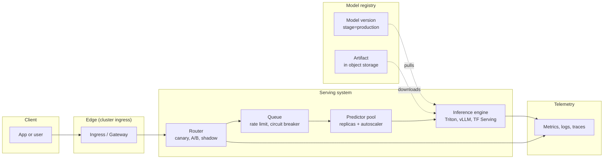

# 16.7 Model serving platforms: KServe, Seldon and BentoML

| Field | Value |
|---|---|
| Level | Advanced |
| Priority tier | 1 |
| Lab venue | GCP / GKE |
| Part | Part 16: MLOps and LLMOps tools and platforms |
| Primary sources | *Generative AI on Kubernetes* (`generative-ai-on-kubernetes`, Chapter 1); *Designing Machine Learning Systems* (`designing-machine-learning-systems`, Chapter 7); *Practical MLOps* (`practical-mlops`, Chapter 10); *Machine Learning Platform Engineering* (`machine-learning-platform-engineering`, Chapters 5, 10); KServe, Seldon Core and BentoML official documentation |
| Cross-references | Chapter 15.6 (Triton Inference Server); Chapter 15.16 (Production serving stack); Chapter 16.6 (Model registry and GitOps); Chapter 16.8 (LLMOps); Chapter 5.22 (Multitenancy and platform services) |
| Coverage file | `planning/coverage/chapters/16-07.md` |
| Claim & number ledger | `planning/ledgers/16-07.md` |

## Why this matters for AI infrastructure

Chapter 15 walked through what happens inside one inference engine — Triton's model repository, vLLM's continuous batching, TensorRT-LLM's engine build. This chapter walks through the system that sits in front of those engines on a Kubernetes cluster. The serving platform is what gives a model a URL, a canary, an autoscaler, an SLO, and a place in the cluster's IAM model. Without a serving platform, every team writes a Flask service and runs it in a pod; with a serving platform, the team declares an InferenceService and the platform does the rest.

The serving platform is the surface where MLOps meets Kubernetes. The InferenceService CRD encodes the registry's stage transition, the canary's traffic split, the autoscaler's GPU trigger, the predictor's runtime, the transformer's pre/post-processing, and the explainer's metadata. Every one of those fields is a place where the cluster primitives from Parts 1 through 5 matter: namespaces, RBAC, pod security, network policies, ingress, secrets, and observability.

```text
Why the serving platform is on the critical path (GAK Ch 1; PM Ch 10; DMLS Ch 7):
- A typical mature AI platform runs dozens to hundreds of InferenceService resources.
  The platform team owns the CRDs, the controllers, the autoscalers, and the
  ingress that fronts them.
- A serving platform that is not multi-tenant is a serving platform that becomes
  one by accident: teams share a namespace, their models share a registry, their
  traffic collides on the same ingress.
- The InferenceService is the unit that ties the registry's model version to the
  cluster's serving replicas. The reconciliation is what makes "what is running"
  answerable from a single source of truth.
```

Three operational realities make this chapter a platform-team concern rather than a data-science-only concern:

1. **The serving platform owns the SLO the customer sees.** A data scientist's model is fast on the benchmark; the platform team makes it fast at the 99th percentile with 1,000 concurrent users. The autoscaler, the queue, the cache, the rate limit — all platform decisions.
2. **The serving platform owns the GPU pool.** The autoscaler spins up GPU pods; the scheduler queues them; the cluster's quota limits them. The platform team owns the trade-off between cold-start latency (over-provision) and cost (under-provision).
3. **The serving platform owns the blast radius.** A serving crash affects every user of the model. The platform team owns the canary, the rate limit, the circuit breaker, the rollback path from Chapter 16.6.

**Before a model can serve traffic, the serving platform must be a production service with SLOs, IAM, observability, and rollback paths. A Flask pod is a pilot; an InferenceService is a platform.**

## Prerequisites and outcomes

### Prerequisites

- Chapter 15 (LLM inference and serving) for the inference engines (Triton, vLLM, TensorRT-LLM, NIM).
- Chapter 16.6 (Model registry and GitOps) for the artefact and stage contract.
- Chapter 5 (Kubernetes) for the cluster primitives (Ingress, Services, HPA, RBAC).
- Chapter 5.22 (Multitenancy and platform services) for the multi-tenant model.

### Outcomes

After completing this chapter you will be able to:

1. Specify the InferenceService contract: what fields a serving platform must expose, what fields a model team must fill in, and what the platform team owns.
2. Compare KServe, Seldon Core, and BentoML on data plane architecture, autoscaling, traffic management, and ecosystem fit.
3. Build a multi-model serving stack: a single InferenceService that fronts N models, an inference graph that combines them, and a transform pipeline that handles pre- and post-processing.
4. Implement autoscaling for bursty traffic, scale-to-zero for low-traffic models, and GPU-aware scaling for expensive models.
5. Configure traffic routing for canary, A/B testing, shadow mode, and per-request routing by header or cohort.
6. Operate the serving platform on GKE with multi-tenancy, IAM, GPU pools, observability, and rollback paths that match Chapter 16.6.

---

## 1. The InferenceService contract

### 1.1 What every serving platform must expose

*Designing Machine Learning Systems* Chapter 7 walks through the shape of a model serving system. The shape is the same regardless of which platform you choose: a serving system exposes a model through a URL, the URL is fronted by a load balancer, the load balancer routes requests to a pool of replicas, the replicas run an inference engine that loads the model from the registry.



The contract that the platform exposes to the model team has six fields. The shape is the same in KServe, Seldon, and BentoML.

| Field | What it says | Who owns it |
|---|---|---|
| **model URI** | Where the registry-staged artefact lives (`storageUri: gs://.../model.pkl`) | Model team, declared in InferenceService |
| **runtime** | Which inference engine runs the model (`sklearn`, `pytorch`, `tensorflow`, `triton`, `vllm`) | Model team + platform team |
| **scaling** | min replicas, max replicas, concurrency target, GPU request | Platform team, declared in InferenceService |
| **canary** | Traffic split between previous and new version, observation window | Platform team, declared via the canary system |
| **explainer** | Optional metadata for fairness, drift, or SHAP-based explanation | Model team + platform team |
| **transformer** | Pre/post-processing pipeline (tokenisation, normalisation, response shaping) | Model team, declared as a sidecar |

### 1.2 The InferenceService as a Kubernetes CRD

KServe's `InferenceService` is the canonical example. The CRD encodes the entire serving stack.

```yaml
# code/part16/inference_service.yaml (shape only)
apiVersion: serving.kserve.io/v1beta1
kind: InferenceService
metadata:
  name: churn-model
  namespace: team-data-science
spec:
  predictor:
    model:
      modelFormat:
        name: sklearn
      runtime: kserve-mlserver
      storageUri: s3://mlflow-artifacts/churn-model/production/model.pkl
      resources:
        requests:
          cpu: "1"
          memory: "2Gi"
        limits:
          cpu: "4"
          memory: "8Gi"
      env:
        - name: STORAGE_URI
          value: s3://mlflow-artifacts/churn-model/production/model.pkl
    minReplicas: 1
    maxReplicas: 10
    scaleTarget: 80       # CPU utilisation target; per-request concurrency on GPU
    scaleMetric: cpu
```

The platform team owns the CRD definition; the model team fills in the model URI, the runtime, and the resource requests. The platform team owns the controller that reconciles the CRD into Kubernetes Deployments, Services, HPA, PodMonitor, and Istio VirtualService resources.

### 1.3 The transformer and the explainer

*Practical MLOps* Chapter 10 walks through the transformer pattern. The transformer is a sidecar that runs before (input transformation) and after (output transformation) the predictor.

```yaml
# code/part16/inference_service_with_transformer.yaml (shape only)
apiVersion: serving.kserve.io/v1beta1
kind: InferenceService
metadata:
  name: churn-model
spec:
  transformer:
    containers:
      - name: transformer
        image: my-transformer:v1
        command: [python, transform.py]
        args: ["--mode", "preprocess"]
  predictor:
    model:
      modelFormat: {name: sklearn}
      storageUri: s3://...
  explainer:
    containers:
      - name: explainer
        image: my-explainer:v1
    minReplicas: 1
```

The transformer handles the parts of the request lifecycle that the inference engine should not: BPE tokenisation for LLMs, normalisation for tabular models, JSON reshaping, schema validation. The explainer produces per-prediction explanations for models that need them (SHAP, LIME, attention maps).

The pattern is the same in Seldon Core (the `transformer` and `explainer` containers are siblings of the predictor) and BentoML (the `bentoml.Service` defines pre- and post-processing as Python functions).

---

## 2. The three platforms: KServe, Seldon Core, BentoML

### 2.1 KServe

KServe (formerly KFServing) is the Kubernetes-native serving platform that originated in the Kubeflow project. It defines the `InferenceService` CRD; the controller reconciles the CRD into Kubernetes Deployments, Services, and Istio VirtualService resources; the data plane is pluggable (KServe ships with a sklearn runtime, a PyTorch runtime, a Triton runtime, and the vLLM runtime for LLMs).

| Strength | Detail |
|---|---|
| **Kubernetes-native** | The CRD is a first-class Kubernetes resource; everything else (RBAC, namespaces, ingress) works the way you expect. |
| **Pluggable runtimes** | The same CRD can serve sklearn, PyTorch, TensorFlow, Triton, vLLM, ONNX, and custom images. |
| **Autoscaling** | Built-in support for Knative's request-concurrency-based autoscaling; GPU-aware scaling via custom metrics. |
| **Canary** | Built-in support for traffic splitting on the `canary` field; integrates with Argo Rollouts for advanced patterns. |
| **Ecosystem** | First-class integration with Kubeflow, KServe transformers, ModelMesh for multi-model serving. |

The KServe controller is a Kubernetes Deployment; the runtimes are images in a registry (KServe ships them in `gcr.io/kserve/`); the InferenceService CRD lives in the cluster alongside Deployments and Services.

### 2.2 Seldon Core

Seldon Core is the serving platform that pre-dates KServe. It defines its own CRD (`SeldonDeployment`), uses Istio for traffic routing, and supports a richer set of inference graphs than KServe (Seldon's `graph` field supports multi-model inference pipelines).

| Strength | Detail |
|---|---|
| **Inference graphs** | First-class support for chaining models, ensembles, and routers; useful for RAG pipelines that combine a retriever and a generator. |
| **Explainers** | Built-in SHAP, anchor, and counterfactual explainers; integrated into the SeldonDeployment CRD. |
| **Payload logging** | First-class support for request/response logging to object storage; useful for audit and dataset flywheel. |
| **Maturity** | Older codebase than KServe; wider adoption in some enterprise deployments. |

The Seldon Core operator runs as a Kubernetes Deployment; the SeldonDeployment CRD lives in the cluster. Seldon's data plane uses pre-built Python components (the `seldon-core-microservice` image) that wrap the user's model.

### 2.3 BentoML

BentoML is the Python-first serving framework. The team defines a `bentoml.Service` that lists the model's pre-processing, the inference call, and the post-processing; BentoML packages the service into a Docker image; the image runs on Kubernetes (or anywhere else).

| Strength | Detail |
|---|---|
| **Python-first** | The entire serving stack is Python; no YAML CRD to learn. |
| **Multi-model** | First-class support for serving multiple models in one image; useful for foundation-model catalogues. |
| **Bento format** | The `Bento` is a packaging format that bundles the model, the dependencies, and the serving code. |
| **Yatai** | The Yatai deployment plane schedules Bentos on Kubernetes and handles autoscaling and traffic routing. |

BentoML is the right choice for teams that prefer Python over YAML, or that need to serve many small models in one image (BentoML's `multi-model` pattern). The platform team operates Yatai (BentoML's Kubernetes operator) as a multi-tenant service.

### 2.4 Comparison

| Dimension | KServe | Seldon Core | BentoML |
|---|---|---|---|
| Definition | Kubernetes CRD | Kubernetes CRD | Python `bentoml.Service` |
| Data plane | Pluggable runtime images | `seldon-core-microservice` image | Custom Docker image per Bento |
| Autoscaling | Knative request-concurrency + custom GPU metrics | Kubernetes HPA + custom metrics | Yatai with custom metrics |
| Canary | Built-in field + Argo Rollouts integration | Istio traffic splitting | Yatai canary |
| Inference graphs | Limited (multiple predictors per service) | First-class (`graph` field) | Multi-model in one Bento |
| Explainers | Alibi, AIF360 integration | First-class SHAP, anchor, counterfactual | Custom |
| Best fit | Kubeflow teams; Kubernetes-native; need pluggable runtimes | Inference graphs; rich explainer ecosystem | Python-first teams; many small models |

The three are interchangeable on the contract from Section 1.1. The choice is operational: KServe is the right default for Kubernetes-native teams; Seldon Core is the right fit for teams that need inference graphs out of the box; BentoML is the right fit for teams that prefer Python.

---

## 3. Autoscaling and traffic routing

### 3.1 The three autoscaling modes

*Generative AI on Kubernetes* Chapter 1 walks through the three autoscaling modes that a serving platform must support.

| Mode | Trigger | When to use |
|---|---|---|
| **Concurrency-based** | Knative request concurrency target | CPU-light models; latency-stable; cheap replicas |
| **CPU-based** | Standard Kubernetes HPA on CPU utilisation | CPU-bound models; GPU-light |
| **Custom-metric (GPU)** | Queue depth, KV cache utilisation, or per-pod token throughput | GPU-bound LLMs; queue depth is the natural signal |

GPU autoscaling is the hard case. The default Kubernetes HPA does not understand GPU queue depth; KServe's custom metric adapter does. The pattern from Chapter 11.17 (time-slicing) and Chapter 11.18 (KAI scheduler) is the platform team's tool for GPU-aware autoscaling.

```yaml
# code/part16/kserve_gpu_autoscaling.yaml (shape only)
apiVersion: serving.kserve.io/v1beta1
kind: InferenceService
metadata:
  name: llm-serving
spec:
  predictor:
    model:
      modelFormat: {name: vllm}
      runtime: kserve-vllm
      storageUri: s3://...
      resources:
        limits:
          nvidia.com/gpu: "1"
    minReplicas: 0      # scale to zero when idle
    maxReplicas: 8
    scaleTarget: 4       # 4 concurrent requests per replica
    scaleMetric: concurrency
    autoscalingClass: kserve.autoscaling_class
```

The `scaleTarget: 4` means each replica handles up to 4 concurrent requests before a new replica is spawned. The `scaleMetric: concurrency` uses Knative's request-concurrency metric; the autoscaler watches the metric and scales the replicas accordingly.

### 3.2 Scale-to-zero for low-traffic models

*Generative AI on Kubernetes* Chapter 1 makes the case for scale-to-zero: a model that serves 10 requests per day should not consume a GPU for 24 hours. KServe supports scale-to-zero through `minReplicas: 0`. The cold-start penalty is the trade-off: the first request after the replicas go to zero takes seconds, not milliseconds.

The pattern is to use scale-to-zero for low-traffic models (a chat assistant that serves internal users; a periodic batch predictor; a documentation assistant that serves one request per minute) and reserved capacity for high-traffic models (the customer-facing recommendation engine that serves 1,000 QPS).

### 3.3 Canary and traffic routing

*Designing Machine Learning Systems* Chapter 7 and *Generative AI on Kubernetes* Chapter 1 both walk through traffic routing as the platform's job. The model team declares a new version; the platform shifts a fraction of traffic to it; the platform watches the SLO; the platform completes the rollout or rolls back.

KServe's canary is built into the CRD; the platform operator declares the canary traffic split and the observation window.

```yaml
# code/part16/canary_inference_service.yaml (shape only)
apiVersion: serving.kserve.io/v1beta1
kind: InferenceService
metadata:
  name: churn-model
spec:
  predictor:
    canaryTrafficPercent: 10
    canary:
      model:
        modelFormat: {name: sklearn}
        storageUri: s3://mlflow-artifacts/churn-model/canary/model.pkl
```

The platform watches the canary's metrics for the configured window; on success, the canary becomes the stable; on failure, the canary is removed and the stable stays.

Seldon Core uses Istio for traffic splitting; BentoML uses Yatai. The mechanism differs; the contract is the same.

### 3.4 A/B testing and shadow mode

Beyond canary, the platform exposes two more patterns.

- **A/B testing.** Requests carry a header (or a cookie) that names the variant; the router splits by header. Useful for comparing models on a specific user cohort or a marketing experiment.
- **Shadow mode.** The new model receives 100% of traffic but its response is discarded; the live model serves the user. Useful for collecting ground truth before promotion.

KServe and Seldon both support A/B via custom routing rules. Shadow mode is implemented by routing 100% to the canary but disabling the response path; the platform's logging captures the canary's responses for offline analysis.

---

## 4. Multi-model serving and inference graphs

### 4.1 ModelMesh and multi-model endpoints

*Generative AI on Kubernetes* Chapter 1 introduces ModelMesh, the KServe-adjacent project that serves many models through one endpoint. The use case is a catalogue of hundreds or thousands of small models (one per tenant, one per product, one per user cohort) where each model is too small to deserve its own replicas.

The ModelMesh controller pools the models in a shared memory space; requests carry the model id; the controller routes to the right model without spinning up a new pod. The trade-off is that all models share the same runtime; the platform's job is to make sure the runtime supports the union of model formats the catalogue needs.

### 4.2 Inference graphs

Seldon Core's `graph` field is the most explicit inference graph in production. The graph defines a directed acyclic graph of models, routers, and combiners.

```yaml
# code/part16/seldon_graph.yaml (shape only)
apiVersion: machinelearning.seldon.io/v1
kind: SeldonDeployment
metadata:
  name: rag-pipeline
spec:
  predictors:
    - name: retriever
      graph:
        children:
          - name: query-encoder
            type: MODEL
            modelUri: s3://models/encoder
          - name: vector-store
            type: MODEL
            modelUri: s3://models/vectorstore
        modelUri: s3://models/retriever
    - name: generator
      graph:
        children:
          - name: retrieved-context
            type: OUTPUT_TRANSFORMER
        modelUri: s3://models/generator
```

The graph is a RAG pipeline: the retriever encodes the query, queries the vector store, and feeds the retrieved context to the generator. The two predictors can be served by different runtimes; the orchestrator routes between them.

### 4.3 BentoML multi-model

BentoML's multi-model pattern serves many models in one Bento. The pattern is to define the `bentoml.Service` with multiple `bentoml.models` references and a routing function.

```python
# code/part16/multi_model_service.py (shape only)
import bentoml

@bentoml.service(
    resources={"cpu": "2", "memory": "4Gi"},
)
class MultiModelService:
    model_a = bentoml.models.BentoModel("model_a:latest")
    model_b = bentoml.models.BentoModel("model_b:latest")

    def predict(self, input_data: dict, model_name: str) -> dict:
        if model_name == "model_a":
            return self.model_a.predict(input_data)
        elif model_name == "model_b":
            return self.model_b.predict(input_data)
        raise ValueError(f"unknown model: {model_name}")
```

The router is the model's first action; the request body carries the model name. The Bento is one Docker image; the platform serves it as one Kubernetes Deployment.

---

## 5. Operating the serving platform on GKE

### 5.1 The components

| Component | Where it runs | Backing store | SLO |
|---|---|---|---|
| KServe controller | Kubernetes Deployment | etcd | InferenceService reconcile p99 < 5 s |
| Knative serving | Kubernetes Deployment | etcd | Request-concurrency metric p99 < 1 s |
| Istio control plane | Kubernetes Deployment | etcd | Config push p99 < 30 s |
| Custom metric adapter | Kubernetes Deployment | Prometheus | GPU metric scrape p99 < 10 s |
| Object store (artefacts) | Direct from pods | GCS bucket | p99 pull < 30 s |
| Prometheus | Managed or self-hosted | TSDB | Scrape p99 < 5 s |

### 5.2 Multi-tenancy

*Generative AI on Kubernetes* Chapter 1 names multi-tenancy as the first operational concern. The pattern is one namespace per team; one InferenceService per model; one service account per team; one set of network policies per namespace.

```yaml
# code/part16/network_policy.yaml (shape only)
apiVersion: networking.k8s.io/v1
kind: NetworkPolicy
metadata:
  name: team-data-science-isolation
  namespace: team-data-science
spec:
  podSelector: {}
  policyTypes: [Ingress, Egress]
  ingress:
    - from:
        - namespaceSelector:
            matchLabels:
              name: ingress
  egress:
    - to:
        - namespaceSelector:
            matchLabels:
              name: kube-system
```

The network policy allows ingress from the cluster's ingress namespace only; egress to the cluster's DNS service only. The team's pods cannot reach each other across namespaces; the team's pods cannot reach the public internet. The platform team owns the policy.

### 5.3 IAM and secrets

The serving system reads the model from the registry's object store. The credentials live in a Kubernetes Secret; the Secret is mounted as an environment variable; the Secret is rotated by the platform team via External Secrets Operator.

The serving system also reads any feature-store credentials (Chapter 16.3). The credentials are scoped per-namespace; the platform team owns the IAM bindings on the feature store.

### 5.4 Observability of the serving platform

| Metric | Why it matters | Alert |
|---|---|---|
| InferenceService reconcile latency p99 | Hot path for every CRD change | > 10 s |
| Request latency p50 / p95 / p99 | Customer-facing SLO | > SLO threshold |
| Error rate (5xx, 4xx) | Customer-facing SLO | > 0.1% |
| Cold-start time | Affects scale-to-zero latency | > 10 s |
| GPU utilisation | Affects cost | < 30% for 30 min |
| Queue depth | Affects latency; drives autoscaling | > scaleTarget * replicas |
| Cold-pull artefact size | Drives cold-start latency | > 50 GB |

The cold-start time metric is the most important for scale-to-zero workloads. The first request after the replicas go to zero takes the time to (1) pull the artefact from object storage, (2) load it into HBM, (3) warm the runtime. A 50 GB artefact on a 10 Gbps pull takes ~40 seconds; a 500 GB LLM takes ~7 minutes. The platform team owns the cold-start budget.

---

## 6. How it fails

Six failure modes recur.

### 6.1 "The serving system is OOM at p99"

**Symptom:** Average latency is fine. p99 latency is 30 seconds. The on-call opens Grafana and sees the GPU's HBM at 100%. The serving system is processing requests as fast as it can and still falling behind.

**Diagnosis:** The concurrency target is too high for the GPU's HBM capacity. A model with 80 GB weights + 40 GB KV cache cannot serve 8 concurrent requests; it can serve 4. The autoscaler scaled up because the queue grew, but more replicas did not help because each replica was overloaded.

**Fix:** Lower the `scaleTarget` to a number the GPU can serve. For a 70B model on H100, the right number is 2-4 concurrent requests per replica. For a 7B model on L40S, the right number is 8-16.

### 6.2 "The canary passed offline but failed in production"

**Symptom:** The canary ran for 10 minutes at 10% traffic. The SLO held. The canary was promoted to 100%. Within 30 minutes, the production SLO is breached. The on-call rolls back.

**Diagnosis:** The canary window was too short. The failure mode is a long-tail regression that takes more than 10 minutes to surface (a cold path that most requests don't hit; a downstream service that has a queue; a state-dependent failure).

**Fix:** Adopt the production shadow stage from Chapter 16.6 Section 7.3. Extend the canary window to 24 hours at 100% shadow, then 10 minutes at 10%, then 30 minutes at 50%, then 100%. The shadow catches the long-tail failure modes the canary misses.

### 6.3 "The model artefact cannot be pulled"

**Symptom:** A new model version is promoted to production. The serving replicas crash-loop. The events show "failed to pull artefact: 403 Forbidden". The on-call opens the registry and confirms the artefact exists.

**Diagnosis:** The serving service account's IAM bindings have expired or were never set. The artefact is in the bucket; the cluster cannot read it.

**Fix:** Adopt the IAM model from Section 5.3. The serving service account has a single role: read the registry's bucket. The platform team owns the IAM binding; the binding is in Terraform; the CI checks the binding before the promotion.

### 6.4 "Scale-to-zero caused a 30-second first-request latency"

**Symptom:** A model was scaled to zero. The first request after idle took 30 seconds. The user complained. The on-call restored minReplicas: 1.

**Diagnosis:** The cold-start budget is too high for the user-facing SLO. The first request pays for artefact pull, HBM load, and runtime warm-up.

**Fix:** Either reduce the cold-start budget (a smaller artefact; a faster storage; a runtime with pre-warmed caches) or keep minReplicas: 1 (the cost is one replica per idle model; the benefit is no cold-start penalty).

### 6.5 "Inference graph deadlock"

**Symptom:** A RAG pipeline serves traffic. The retriever returns context. The generator times out. The error rate climbs. The on-call investigates.

**Diagnosis:** The retriever is slow under load. The generator's timeout is too short. The retriever's queue depth is unbounded. The generator's request sits in the generator's queue, waits for the retriever, and the retriever's queue grows.

**Fix:** Set explicit timeouts on every edge of the inference graph. Set explicit queue sizes on every component. The retriever's queue should drop requests before the generator's queue grows. The platform team's runbook names the timeout and the queue size for every model.

### 6.6 "The autoscaler scaled to zero during a traffic spike"

**Symptom:** A model was idle. The autoscaler scaled it to zero. A traffic spike arrived. The autoscaler tried to scale up; the new replicas were not ready; the requests hit 503.

**Diagnosis:** The autoscaler's scale-from-zero latency is longer than the traffic spike. The platform's SLO is "p99 latency < 200ms"; the scale-from-zero is 30 seconds.

**Fix:** Use Knative's `panic-mode` percentage. When the autoscaler detects a sudden spike, it allocates extra capacity beyond the steady-state target; the panic window is the time the autoscaler takes to provision a new replica.

---

## 7. Hands-on lab

This lab stands up KServe on GKE, deploys a multi-model InferenceService, and verifies the autoscaling and canary. The lab is **untested** in this repository.

### 7.1 Prerequisites

- A GKE Autopilot or Standard cluster (1.27+).
- KServe installed via Helm (`helm install kserve kserve/kserve`).
- Knative serving and Istio installed.
- A model artefact in GCS (the artefact from the Chapter 16.6 lab).

### 7.2 Step 1: install KServe

```bash
helm repo add kserve https://kserve.github.io/helm-charts
helm install kserve kserve/kserve \
  --namespace kserve --create-namespace \
  --set kserve.controller.deploymentMode=Deployment
# expected: the kserve-controller pod is running
```

### 7.3 Step 2: deploy an InferenceService

```bash
kubectl apply -f code/part16/inference_service.yaml
kubectl get inferenceservice churn-model -n team-data-science -w
# expected: READY=True within 60 seconds
```

### 7.4 Step 3: send a request

```bash
URL=$(kubectl get inferenceservice churn-model -n team-data-science -o jsonpath='{.status.url}')
curl -X POST $URL/v2/models/churn-model/infer \
  -H "Content-Type: application/json" \
  -d '{"inputs":[{"name":"tier_gold","shape":[2],"datatype":"FP32","data":[1.0, 0.0]}]}'
# expected: a JSON response with predictions
```

### 7.5 Step 4: deploy a canary

```bash
kubectl apply -f code/part16/canary_inference_service.yaml
# expected: traffic shifts 10% to the canary over the configured window
kubectl get inferenceservice churn-model -n team-data-science -o jsonpath='{.status.canary}' | jq .
```

### 7.6 Step 5: verify autoscaling

```bash
# Generate load
hey -z 60s -c 100 -m POST -T "application/json" -d '{"inputs":[{"name":"tier_gold","shape":[1],"datatype":"FP32","data":[1.0]}]}' $URL/v2/models/churn-model/infer

# Watch the autoscaler
kubectl get hpa -n team-data-science -w
# expected: replicas grow from 1 to 5+ as load increases
```

### 7.7 Step 6: test scale-to-zero

```bash
# Stop generating load
sleep 120

# Watch the replicas
kubectl get inferenceservice churn-model -n team-data-science -w
# expected: replicas scale to 0 after the idle window
```

### 7.8 What to record

After the lab, you should be able to answer five questions in five seconds each:

1. What InferenceServices are running in the team's namespace?
2. What is the autoscaler config (min/max replicas, scale target)?
3. What is the cold-start time for a scale-from-zero?
4. What is the canary traffic split?
5. What is the GPU utilisation and the queue depth?

If any takes more than 30 seconds, the serving platform is not yet a production service. The lab is **untested** against a live GKE cluster.

---

## Exercises

1. **Add a transformer.** Add a pre-processing transformer that normalises the input before inference. Verify that the transformer's response is forwarded to the predictor unchanged. *Solution sketch:* an `InferenceService` with a `transformer` section; the transformer image runs `python transform.py --mode preprocess` and forwards the JSON.
2. **Add a custom GPU metric.** Implement a custom metric that exposes the GPU's KV cache utilisation as a Prometheus gauge; wire the autoscaler to use the metric. *Solution sketch:* a sidecar that polls `nvidia-smi` and exposes the metric; an HPA with the custom metric.
3. **Add A/B routing by header.** Configure the InferenceService to route 50% of requests with header `X-Experiment: model-b` to a canary. Verify the routing works. *Solution sketch:* a VirtualService with a `match` block on the header; the route sends matching requests to the canary.
4. **Add an explainer.** Configure an Alibi explainer on the InferenceService. Verify the explainer returns SHAP values for a sample input. *Solution sketch:* the `explainer` section of the InferenceService; a request to `/explain` returns the SHAP values.
5. **Add a BentoML multi-model service.** Define a BentoML service that serves two models; deploy it on Kubernetes via Yatai. *Solution sketch:* the `MultiModelService` from Section 4.3; `bentoml build` produces the Bento; Yatai deploys it.
6. **Add inference-graph deadlock detection.** Configure explicit timeouts on every edge of a RAG inference graph; verify the timeouts are enforced. *Solution sketch:* Seldon's `timeout` field on each component; a load test that triggers the timeout.

---

## Checkpoint questions

<details><summary>1. What is the InferenceService contract?</summary>
A Kubernetes CRD that exposes six fields: model URI, runtime, scaling, canary, explainer, transformer. The platform team owns the CRD and the controller; the model team fills in the model-specific fields. The contract is the same in KServe, Seldon Core, and BentoML.
</details>

<details><summary>2. What is the difference between KServe, Seldon Core, and BentoML?</summary>
KServe is Kubernetes-native with a pluggable runtime model; Seldon Core has first-class inference graphs and explainers; BentoML is Python-first with multi-model support. All three implement the same InferenceService contract; the choice is operational and ecosystem-driven.
</details>

<details><summary>3. What is the transformer pattern?</summary>
A sidecar that runs before the predictor (input transformation: BPE tokenisation, normalisation, JSON reshaping) and after (output transformation: response shaping, schema validation). The pattern is the same in KServe (transformer field), Seldon (transformer container), and BentoML (Python pre/post functions).
</details>

<details><summary>4. What is the difference between canary, A/B testing, and shadow mode?</summary>
Canary shifts a fraction of traffic to the new model; A/B testing routes by header or cohort; shadow mode runs the new model at 100% traffic but discards the response. Canary is for SLO validation; A/B is for comparison; shadow is for ground-truth collection.
</details>

<details><summary>5. What is the scale-from-zero penalty?</summary>
The cold-start latency for the first request after the replicas go to zero: artefact pull from object storage, HBM load, runtime warm-up. A 50 GB model on 10 Gbps takes ~40 seconds; a 500 GB LLM takes ~7 minutes. The platform team owns the cold-start budget; the choice is between low cost (scale-to-zero) and low latency (reserved capacity).
</details>

<details><summary>6. Why is scale-to-zero not always the right answer?</summary>
Because the cold-start penalty may violate the user-facing SLO. A model that takes 30 seconds to serve the first request after idle is a model that users will leave. Reserved capacity (minReplicas: 1) avoids the cold-start; the cost is one replica per idle model.
</details>

<details><summary>7. What is Knative's panic mode?</summary>
A scaling mode that allocates extra capacity beyond the steady-state target during a traffic spike. The autoscaler detects the spike, opens the panic window, and provisions replicas faster than the steady-state autoscaler would. The trade-off is wasted capacity during the panic; the benefit is no 503s during the spike.
</details>

<details><summary>8. What is the inference-graph deadlock failure?</summary>
A RAG pipeline where the retriever is slow; the generator's queue grows; the retriever's queue grows; both components saturate. The fix is explicit timeouts on every edge of the graph and explicit queue sizes on every component. The platform team's runbook names the timeouts.
</details>

<details><summary>9. What is the right concurrency target for a GPU-bound LLM?</summary>
Depends on the model's KV cache capacity. For a 70B model on H100 (80 GB HBM3), 2-4 concurrent requests per replica. For a 7B model on L40S (48 GB GDDR6), 8-16. The platform team measures the throughput per replica and sets the target to 70-80% of peak.
</details>

<details><summary>10. Why is multi-tenancy the first operational concern?</summary>
Because a serving platform that is not multi-tenant becomes one by accident. Teams share a namespace; their models share a registry; their traffic collides on the same ingress; their IAM is shared; their SLOs are coupled. The platform team's first job is the multi-tenant primitives: namespaces, service accounts, network policies, per-team quotas.
</details>

<details><summary>11. What is the difference between a transformer and a pre-processor?</summary>
A transformer is a serving-platform primitive that runs as a sidecar; a pre-processor is a piece of code that runs inside the inference engine. The platform team's pattern is to use transformers for serving-specific concerns (schema validation, JSON reshaping) and pre-processors inside the inference engine for engine-specific concerns (BPE tokenisation, normalisation).
</details>

<details><summary>12. What is ModelMesh?</summary>
The KServe-adjacent project that serves many models through one endpoint. ModelMesh pools the models in a shared memory space; requests carry the model id; the controller routes to the right model without spinning up a new pod. The trade-off is that all models share the same runtime; the benefit is one Deployment for hundreds of small models.
</details>

<details><summary>13. What is the difference between HPA and Knative request-concurrency scaling?</summary>
HPA watches CPU or memory utilisation and scales replicas based on a target percentage. Knative request-concurrency watches the number of concurrent in-flight requests per replica and scales based on a target count. Knative is the right fit for latency-sensitive serving where CPU utilisation is a lagging indicator.
</details>

<details><summary>14. Why does the InferenceService CRD need a `canaryTrafficPercent` field?</summary>
Because the canary is part of the serving contract. The model team declares the new version and the traffic split; the platform operator reconciles the CRD into the routing config (Istio VirtualService, Knative route); the canary runs for the configured window; the platform watches the SLO. The contract makes canary a first-class operation, not a hand-crafted side configuration.
</details>

<details><summary>15. What is the difference between a transformer and an explainer?</summary>
A transformer runs on every request and reshapes the input or output; an explainer runs on request and produces per-prediction explanations (SHAP, LIME, attention maps). The transformer is on the critical path; the explainer is off the critical path but is on the audit path (every explanation is logged for regulator review).
</details>

<details><summary>16. What is the cold-pull artefact size limit?</summary>
There is no hard limit, but the cold-start latency scales linearly with the artefact size. The platform team's pattern is to cap the artefact size at the storage bandwidth times the SLO cold-start budget. A 100 Gbps pull with a 10-second budget supports a 125 GB artefact; a 1 Gbps pull with the same budget supports a 1.25 GB artefact.
</details>

<details><summary>17. What is the difference between KServe's autoscaling and Knative's autoscaling?</summary>
KServe's autoscaling is a thin layer over Knative's autoscaling that adds custom metrics (GPU utilisation, queue depth) and InferenceService-specific defaults. The underlying mechanism is Knative's request-concurrency metric; KServe adds the inference-specific knobs.
</details>

<details><summary>18. What is the difference between an InferenceService and a Deployment?</summary>
A Deployment runs a service; an InferenceService runs a model. The InferenceService encodes the model URI, the runtime, the canary, the explainer, the transformer, the autoscaler. The Deployment encodes the container image, the replicas, the resource requests. The InferenceService is the right abstraction for serving; the Deployment is the right abstraction for everything else.
</details>

<details><summary>19. Why does the platform team own the InferenceService CRD?</summary>
Because the CRD is the integration point between the cluster and the model team. The platform team owns the schema (what fields are required; what defaults apply); the controller (how the CRD becomes Deployments, Services, HPA); the validation (which fields are allowed); the multi-tenant primitives (per-team namespaces, RBAC, quotas). The model team fills in the model-specific fields; the platform team owns the rest.
</details>

<details><summary>20. What five questions should the serving lab let you answer in five seconds each?</summary>
What InferenceServices are running. What is the autoscaler config. What is the cold-start time. What is the canary traffic split. What is the GPU utilisation and queue depth. If any takes more than 30 seconds, the serving platform is not yet a production service.
</details>

---

## Sources and review notes

- *Generative AI on Kubernetes* (`generative-ai-on-kubernetes`, Chapter 1). Source for the three autoscaling modes (concurrency, CPU, custom GPU), the scale-to-zero trade-off, the multi-tenancy pattern with one namespace per team, the canary mechanism, and the InferenceService as the unit of serving. Chapter 1 is approximately 7,100 words.
- *Designing Machine Learning Systems* (`designing-machine-learning-systems`, Chapter 7). Source for the deployment patterns (recreate, rolling, canary, blue/green), the InferenceService contract, the autoscaler mechanics, the inference graph pattern, and the operational SLOs (cold-start, queue depth, GPU utilisation). Chapter 7 is approximately 10,300 words.
- *Practical MLOps* (`practical-mlops`, Chapter 10). Source for the transformer pattern, the ML interoperability concerns (ONNX, PMML, portable inference engines), and the platform abstractions for serving. Chapter 10 is approximately 7,500 words.
- *Machine Learning Platform Engineering* (`machine-learning-platform-engineering`, Chapters 5, 10). Source for the operational pattern (Postgres backend, object store for artefacts, IAM model, observability SLOs) and the multi-tenant platform view. Chapter 5 is approximately 9,000 words; Chapter 10 is approximately 9,000 words.
- KServe, Seldon Core, and BentoML official documentation. Source for the InferenceService CRD shape, the canary mechanism, the inference graph syntax, and the multi-model patterns.

### Cross-references to other handbook chapters

- Chapter 15.6 (Triton Inference Server) for the inference engine details.
- Chapter 15.16 (Production serving stack) for the broader serving architecture.
- Chapter 16.6 for the model registry that the InferenceService reads from.
- Chapter 16.8 for the LLMOps-specific serving patterns (RAG, agents).
- Chapter 5.22 (Multitenancy and platform services) for the multi-tenant primitives.

### Migrated from `nvidia-devops`

The transformer and explainer pattern draws on Volume 25 chapter 9. The wording has been rewritten in the handbook's voice.

### Explicitly labelled inferences

- The concurrency targets in Section 6.1 are starting points drawn from common production experience; specific targets depend on the model's KV cache capacity and the GPU's HBM size.
- The Knative panic-mode thresholds in Section 3.3 are inferences from the Knative documentation; specific thresholds depend on the traffic pattern and the SLO.
- The cold-start penalty numbers in Section 5.4 are inferences from typical storage and HBM bandwidths; specific numbers depend on the artefact size and the storage bandwidth.

### Not verified on live hardware

- The lab in Section 7 is **untested** against a live GKE cluster in this repository.
- The KServe, Knative, and Istio versions assumed in the lab should be pinned against the current releases before production use.
- The custom GPU metric adapter assumes a Prometheus-based observability stack; verify against the current KServe documentation.
