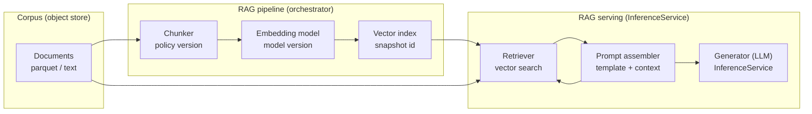
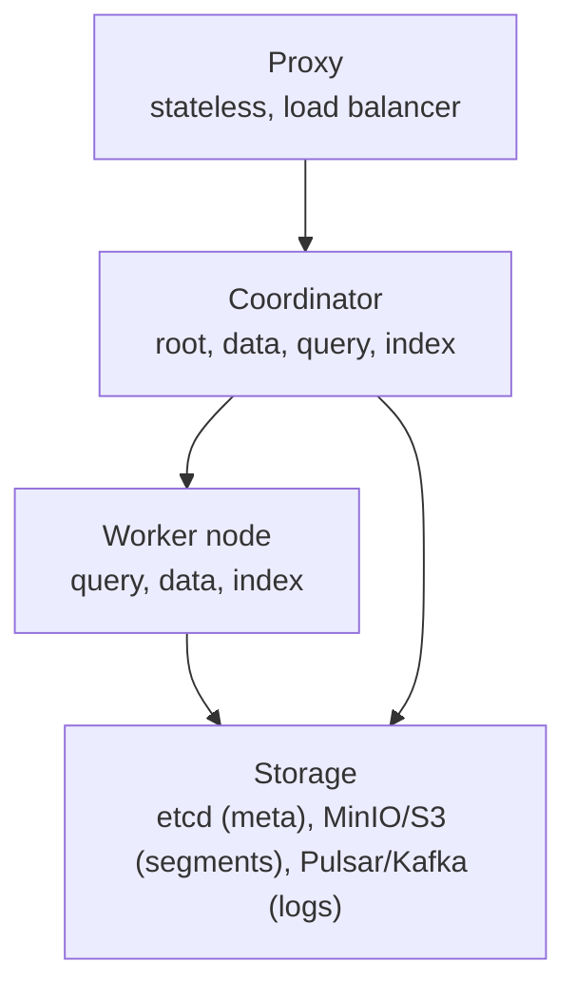
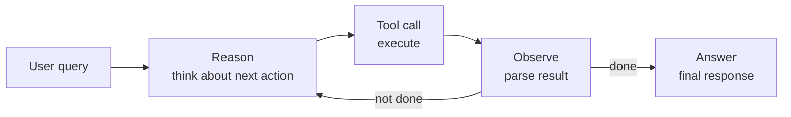
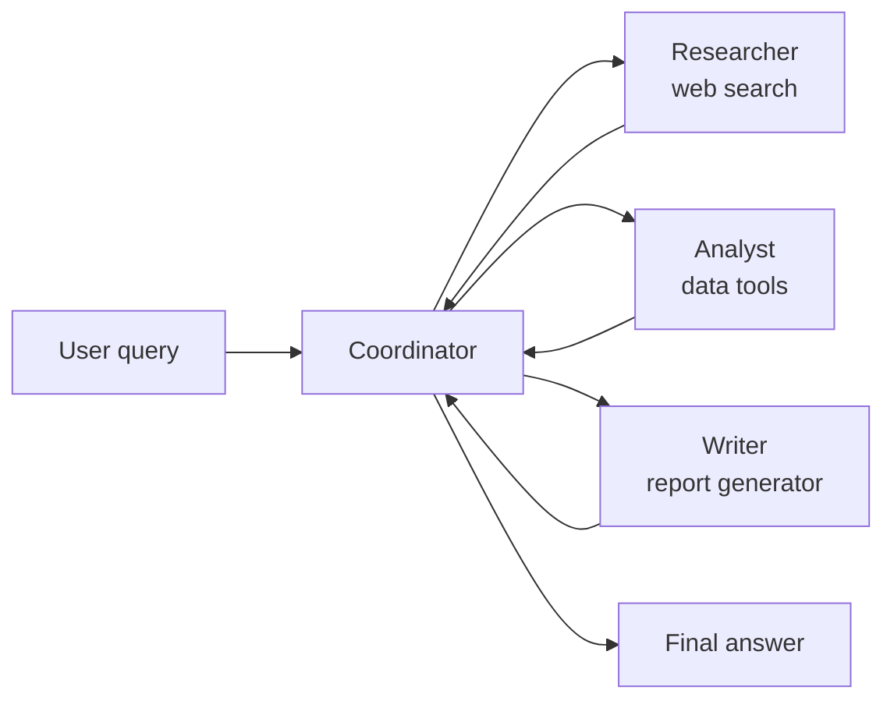

# 16.8 LLMOps: RAG, vector databases and agents

| Field | Value |
|---|---|
| Level | Advanced |
| Priority tier | 1 |
| Lab venue | GCP / GKE |
| Part | Part 16: MLOps and LLMOps tools and platforms |
| Primary sources | *LLMOps* (`llmops`, Chapters 3, 6); *AI Engineering* (`ai-engineering`, Chapters 5, 6); *Generative AI on Kubernetes* (`generative-ai-on-kubernetes`, Chapters 8, 9); *LLM Engineer's Handbook* (`llm-engineers-handbook`, Chapters 4, 9, 10, 11); *LLMs in Production* (`llms-in-production`, Chapters 2, 4) |
| Cross-references | Chapter 16.1 (LLMOps foundations); Chapter 16.3 (LLM data pipelines); Chapter 16.7 (Serving platforms); Chapter 15.3 (vLLM); Chapter 15.8 (Dynamo, llm-d) |
| Coverage file | `planning/coverage/chapters/16-08.md` |
| Claim & number ledger | `planning/ledgers/16-08.md` |

## Why this matters for AI infrastructure

Picture a team that already runs a GPU cluster for training and serving models. Now the product team wants a chatbot that answers questions from the company's private documents. That chatbot is an LLM application, and it sits on top of the foundations from Chapter 16.1, the data pipelines from Chapter 16.3, and the serving platforms from Chapter 16.7. Three patterns make up most of this work. Retrieval-Augmented Generation, or RAG, lets a model answer from a private corpus. Vector databases give the model fast lookup across millions of embeddings. Agents let the model call tools and chain its reasoning steps together.

If you run a GPU cluster for AI, you also run an LLM application. The application is what pays for the cluster, and its quality is the part the user sees. Its cost is the part the CFO sees. Your job as the platform team is to make the application fast, accurate, observable, and easy to roll back.

The box below lists example ranges for planning. These are not measurements from any one system, so measure your own workload before you set a budget.

```text
Why LLMOps is on the critical path (background reading: LLMOps; AI Engineering; Generative AI on Kubernetes; the figures below are examples, not quotations):
- A typical RAG application serves 100-10,000 QPS in production. Each request costs
  10-100 ms of GPU time for the LLM and 50-200 ms of CPU time for the retriever.
  A misconfigured chunking policy or vector index doubles the cost.
- An agent loop that loops or escalates can burn 1000x the expected GPU time per
  request. A hard iteration cap is the difference between a $5,000/month bill
  and a $5,000/day bill.
- The corpus behind a RAG application drifts continuously (new docs, edited docs,
  deleted docs). The retrieval index has a freshness SLO. A stale index is a
  silent regression that no one notices until the customer does.
```

Small settings change the bill a lot. A misconfigured chunking policy or vector index can double the cost, and a runaway agent loop can cost far more.

Three operational realities make this a platform-team concern, not only a data-science concern:

1. Treat a vector database as a database. It runs on your cluster, needs access control and backups, and has SLOs. The platform team owns the operations, even when a data scientist owns the schema.
2. Treat agents as pipelines. They run as Kubernetes pods, call outside services, and produce traces. The agent runtime needs the same retries, timeouts, and rate limits as any other platform service.
3. Count LLM cost per request. Every token has a price. Cost attribution, rate limits, and autoscaling decide whether the bill stays under control.

**Before an LLM application can serve customers, its RAG pipeline, vector index, and agent runtime must be production services with SLOs and rollback paths.**

A notebook demo is a pilot. An InferenceService with a signed index is a platform.

## Prerequisites and outcomes

What does a team need to know before it builds a RAG chatbot? An LLM application touches retrieval, storage, agents, and cost all at once. The prerequisites below give you the vocabulary for those topics, and the later sections assume them.

### Prerequisites

- Chapter 16.1 (LLMOps foundations and the four goals).
- Chapter 16.3 (LLM data pipelines, index snapshot id, freshness SLO).
- Chapter 16.7 (serving platforms and InferenceService).
- Chapter 15.3 (vLLM in depth) for the LLM serving engine.
- Chapter 14.13 (Fine-tuning) for the LLM customisation context.

### Outcomes

After completing this chapter, you will be able to:

1. Specify a RAG architecture with its corpus, chunking, embedding model, vector index, retriever, prompt assembly, and generator.
2. Choose a vector database among Milvus, Qdrant, pgvector, Pinecone, and Weaviate, by comparing recall, latency, scale, and operational fit.
3. Wire an agent loop with tool calling, a retry policy, an iteration cap, a cost cap, and trace emission.
4. Run a prompt-engineering discipline with versioned templates, eval suites, and regression tests.
5. Implement cost control with token budgets per request, per tenant, and per model.
6. Operate the LLMOps stack on GKE, with vector databases, embedding pipelines, agent runtimes, and observability that ties back to the SLO.

---

## 1. RAG architecture

### 1.1 The five components

Suppose a user asks, "What changed in our refund policy last month?" A model that has never read your policy will guess. RAG fixes this by fetching the right text first, then asking the model to answer from it. *AI Engineering* Chapter 6 walks through the pattern. A RAG system has five components: the corpus, the chunker, the embedding model, the vector index, and the retriever-generator pipeline. Each one is a production system with its own lifecycle.



Those five components produce four artifacts, and you version them together. Each artifact records a hash or the settings of the inputs that produced it, so you can trace it back.

| Artifact | Where it lives | Versioning |
|---|---|---|
| Corpus snapshot | Object store | sha256 of the directory |
| Chunked corpus | Object store | chunk size, overlap, metadata fields, hash of corpus |
| Embedding table | Object store or vector store | chunk id, vector, embedding model id, hash of model |
| Index snapshot | Vector store | snapshot id bound to (corpus hash, embedding model id, chunking policy version) |

The index snapshot id plays the same role as the dataset id from Chapter 16.1. Every artifact has an id and a hash, and each id is bound to the ids of the inputs that produced it. When an answer goes wrong, that chain shows you which input to check first.

### 1.2 The retriever

The retriever is the first part of the system a question meets at request time. *Generative AI on Kubernetes* Chapter 8 walks through it. The retriever encodes the query with the same embedding model that embedded the corpus. It then searches the vector index for the top-K nearest neighbours and returns those chunks.

The retriever sets recall, which tells you whether the right context reaches the model at all. The generator sets precision, which tells you whether the answer uses that context correctly.

Track two numbers on the retriever:

- Recall@K. For a held-out set of (query, relevant chunk) pairs, what fraction of queries return the relevant chunk in the top-K results?
- Latency p99. How long does the vector search take at peak QPS?

A retriever with low recall misses the right context, and the generator then has to guess. A retriever with high latency dominates the end-to-end latency budget. Teams often start from targets such as recall above 0.9 at K=10 and p99 latency under 50 ms. Treat those as example values, and set your own from your use case.

### 1.3 The prompt assembler and the generator

Between the retriever and the model sits the prompt assembler. *AI Engineering* Chapter 6 introduces it. It takes the user's question, the retrieved chunks, and the prompt template, and builds the exact prompt the generator will see.

```python
# code/part16/prompt_assembler.py
import json

PROMPT_TEMPLATE = """You are a documentation assistant. Answer the question
based only on the context below. If the answer is not in the context,
say "I don't know" rather than making it up.

Context:
{context}

Question: {question}

Answer:"""

def assemble(question: str, chunks: list[str]) -> str:
    context = "\n\n---\n\n".join(chunks)
    return PROMPT_TEMPLATE.format(context=context, question=question)
```

Treat the prompt template as an artifact, as Chapter 16.1 Section 5.2 describes. Keep it in Git, so every change has an author and a diff. The eval suite from Chapter 16.9 then checks that a template change does not lower accuracy.

The generator is an LLM served as an InferenceService. It is usually the most expensive part of the pipeline, so the autoscaler and cost controls live here. Log the index snapshot id and the template version with every answer, so you can trace a bad answer back to its inputs.

---

## 2. Vector databases

### 2.1 The four production choices

Your team has to pick a vector database, and the product pages all sound alike. The real differences are operational. *LLMOps* Chapter 3 and *Generative AI on Kubernetes* Chapter 8 compare the options. Four implementations are in common use. Each can meet the contract from Section 1.1, but each asks something different of the team that runs it.

| Tool | Open source | Index type | Best fit |
|---|---|---|---|
| **Milvus** | Yes | IVF, HNSW, DiskANN | Petabyte-scale; GPU acceleration; strong consistency |
| **Qdrant** | Yes | HNSW | Cloud-native; rich filtering; Rust performance |
| **pgvector** | Yes (Postgres extension) | HNSW, IVF | Teams already on Postgres; want one database for everything |
| **Pinecone** | No (managed) | Proprietary | Serverless; zero ops; pay per query |

*LLMOps* Chapter 3 names Milvus as the open-source default for production-scale deployments. *Generative AI on Kubernetes* Chapter 8 makes a different point. If your team already runs Postgres, pgvector often fits small and medium deployments well.

### 2.2 Milvus architecture

Milvus splits storage from compute, so each layer can scale on its own. The design has four layers.



The proxy receives requests and balances them. The coordinator decides which worker handles which job. The workers run the queries and the index work, and the storage layer keeps the segments. A Milvus install is several Kubernetes workloads, not one. The platform team owns the Helm chart, the storage backend, the resource requests, and the SLOs.

Milvus offers three index types, and the type changes how much memory the index needs. IVF (Inverted File) is the default. HNSW (Hierarchical Navigable Small World) is the most accurate. DiskANN is the disk-backed variant for very large indices.

### 2.3 Index snapshot and freshness

The index snapshot from Chapter 16.3 Section 5 is the contract between the retriever and the corpus. The Python function below makes the id reproducible. The same three inputs always produce the same id.

```python
# code/part16/index_snapshot.py
import hashlib, json

def index_snapshot_id(corpus_hash: str, embedding_model_id: str,
                      chunking_policy_version: str) -> str:
    """Compute the index snapshot id as a content hash of its three inputs."""
    payload = json.dumps({
        "corpus_hash": corpus_hash,
        "embedding_model_id": embedding_model_id,
        "chunking_policy_version": chunking_policy_version,
    }, sort_keys=True).encode()
    return hashlib.sha256(payload).hexdigest()
```

The serving system reads the index snapshot id on every request. The audit log records the corpus hash and the embedding model id behind that snapshot. When answer quality drops, check those three inputs first.

The freshness SLO from Chapter 16.3 Section 5.3 sets how often the index must be rebuilt. A static knowledge base, such as product documentation, needs daily or weekly rebuilds. A corpus that changes often, such as news or product listings, needs rebuilds triggered by changes to the affected partition.

### 2.4 pgvector for small-to-medium deployments

*LLMOps* Chapter 3 presents pgvector as a good fit for small and medium deployments. You add it to a Postgres server you already run. The extension gives you a `vector` type and the `<=>` cosine-distance operator, so the queries look like ordinary SQL.

```sql
-- Add the extension
CREATE EXTENSION IF NOT EXISTS vector;

-- Create a table with a vector column
CREATE TABLE chunks (
    id BIGSERIAL PRIMARY KEY,
    document_id TEXT NOT NULL,
    content TEXT NOT NULL,
    embedding vector(1536) NOT NULL,
    created_at TIMESTAMPTZ DEFAULT now()
);

-- Create an HNSW index for fast similarity search
CREATE INDEX chunks_embedding_hnsw ON chunks
USING hnsw (embedding vector_cosine_ops);
```

pgvector is still Postgres, so your existing backup, monitoring, and upgrade habits apply. The trade-off is scale, and any fixed size limit deserves caution. When the table outgrows that server, Milvus or Qdrant is the better choice. Before you choose pgvector, measure your table size and query rate on the Postgres server you plan to use.

---

## 3. Agent architectures

### 3.1 The ReAct loop

An agent that can call tools can also call them forever, so its loop needs a clear shape and firm limits. *AI Engineering* Chapter 6 walks through the ReAct (Reason + Act) loop that most agents implement. The loop has four steps: reason about the next action, call a tool, observe the result, and repeat. Picture a support agent that looks up an order, checks a shipping status, and then writes the reply.



Treat the loop as a pipeline with two brakes. The iteration cap is the maximum number of tool calls per request. The cost cap is the maximum number of tokens one request may burn. Both caps are structural, which means the agent runtime refuses to go past either one.

### 3.2 Function calling and tool schemas

*LLMOps* Chapter 6 introduces function calling. You describe each tool with a schema. The model then replies with JSON that names a tool and its arguments, and the runtime runs the tool and sends the result back to the model.

```json
{
  "name": "search_documentation",
  "description": "Search the company documentation for relevant pages",
  "parameters": {
    "type": "object",
    "properties": {
      "query": {"type": "string", "description": "Search query"},
      "max_results": {"type": "integer", "default": 10}
    },
    "required": ["query"]
  }
}
```

Treat the tool schema as an artifact with its own version. A schema change can break the agent, so the eval suite should check accuracy after every change. The runtime also enforces the schema. It rejects malformed tool calls before they reach the tool implementation.

### 3.3 Multi-agent orchestration

One agent is often not enough for a complex task, so you may run several. *Generative AI on Kubernetes* Chapter 9 walks through multi-agent orchestration. A coordinator agent hands work to specialist agents. Each specialist has its own tool set and its own system prompt.



The coordinator costs more than a single-agent loop. Every delegation is a round trip, and every round trip costs tokens. The platform team's pattern is to set an iteration cap for each agent and a cost cap for each request. Treat the coordinator's plan as a fixed, bounded graph, not an open-ended chain.

### 3.4 Agent observability

When an agent misbehaves, the first question is what it did, step by step. *Generative AI on Kubernetes* Chapter 9 names observability as the first operational concern for agents. The runtime must emit a trace for every tool call. An observability backend, such as Langfuse, LangSmith, or another OpenTelemetry-compatible tool, stores and shows those traces.

Production Kubernetes, chapter 9, explains that a distributed trace is built from spans, one for each service that handles a request. Your application has to emit those spans itself, and it has to pass the trace headers from one call to the next. An agent that calls a retriever and then a tool is a chain of spans, and the headers must survive every hop.

```text
Agent trace fields (background reading: Generative AI on Kubernetes; AI Engineering; the figures below are examples, not quotations):
- trace_id (uniquely identifies the request)
- parent_id (the coordinator's trace that delegated to this agent)
- agent_id (which specialist agent ran)
- tool_call (the JSON of the function call)
- tool_response (the JSON of the function response)
- token_count (input, output, total)
- cost_usd (the dollar cost of the request)
- duration_ms (the wall-clock duration)
- status (success, retry, error, abort)
```

The trace is your audit trail. Write every trace to an immutable log, so no one can change history after an incident. That log feeds the eval suite in Chapter 16.9, the cost attribution in Chapter 16.14, and incident response. When an agent loops, the trace shows you where.

---

## 4. Prompt engineering as a discipline

### 4.1 The prompt template is an artifact

A one-line edit to a prompt can change every answer the product gives. Prompt engineering becomes reliable only when you treat it like code. *AI Engineering* Chapter 5 presents it as a discipline. Keep the template in Git, and record its version in the registry entry from Chapter 16.1 Section 5.2. The eval suite then checks that a template change does not lower accuracy.

A safe path for a template change has four steps:

1. Write the template as a Jinja file in the prompt repository.
2. Protect the main branch, so every change goes through a pull request and a review.
3. Let CI run the eval suite against the new template. A drop in accuracy fails the pull request.
4. When the change merges, it becomes a new template version, and the registry records it.

You will notice that a template change is usually a small diff. An embedding model swap moves gigabytes of artifacts. That makes the template the cheapest versioned artifact in the LLMOps stack, and it still deserves the same rigor as the model.

### 4.2 Few-shot examples and prompt regression

*AI Engineering* Chapter 5 introduces few-shot prompting. The template includes 2-5 examples, and the model copies their output format. Those examples are part of the artifact, so changing an example changes the prompt.

The failure to watch for is prompt regression. If you see accuracy drop for only one kind of request, suspect a regression first. A small template edit can hurt one group of users while the overall score stays flat. The eval suite catches this by keeping a regression set of inputs and checking that the new template still produces the expected outputs.

### 4.3 Cost control on the prompt

A prompt's token count is a direct cost, and every extra chunk adds to it. Take an example price of $3 per million input tokens. A prompt with 2,000 tokens of retrieved context costs about $0.006 per request, and one with 20,000 tokens costs about $0.06. That gap is about $0.054 per request.

At 1,000 requests per second, the same gap adds up to about $194,400 per hour. Context size is therefore a budget decision as much as a quality decision.

Enforce a per-request input budget, so one request cannot grow without limit. The retriever returns the top-K chunks, and the assembler truncates them to fit. The eval suite then checks that accuracy holds at that truncation point. Before you raise K, measure what the extra context costs and whether accuracy improves.

---

## 5. Cost control and observability for LLM applications

### 5.1 The cost model

Every LLM request costs money, and the bill arrives at the end of the month. To control that bill, you first need to see which parts of a request cost what. *LLMOps* Chapter 6 walks through the cost model. Several parts add up to the cost of one request.

```text
Cost per LLM request = (input_tokens * input_price_per_token)
                     + (output_tokens * output_price_per_token)
                     + (embedding_tokens * embedding_price_per_token)
                     + (vector_search_cost_per_query)
                     + (agent_tool_costs)
```

Prices differ by model. A self-hosted open model shows up as GPU-hours, not as a price per token. Your cost attribution has to handle both kinds of cost.

### 5.2 Per-request budgets

A single request should never be able to spend without limit. The platform team sets a budget for each limit in the table below, and the system enforces each one.

| Budget | What it caps | What happens on exceed |
|---|---|---|
| Input token budget | The size of the prompt + context | Truncate; fail with 413 |
| Output token budget | The size of the LLM response | Cut off mid-response; flag for review |
| Total token budget | Input + output | Refuse the request; route to a cheaper model |
| Cost budget | The dollar cost of the request | Same as total token budget, but in dollars |
| Iteration cap | The number of agent steps | Abort the agent loop; return the partial answer |
| Latency budget | The wall-clock duration | Same as iteration cap, but in time |

Each layer enforces its own budgets: the prompt assembler, the agent runtime, and the InferenceService. The trace records every budget decision. The dashboard then shows how often each budget is exceeded, per model and per tenant.

### 5.3 Observability

When costs rise or answers slow down, you need to see the cause quickly. The observability backend has to record every LLM call, tool call, retrieval, and budget decision. Teams often use Langfuse or LangSmith for this. The same traces then feed the eval suite in Chapter 16.9, the cost dashboard in Chapter 16.14, and incident response.

```text
Observability metrics for LLM applications (background reading: Generative AI on Kubernetes; LLMOps; the figures below are examples, not quotations):
- Request rate (RPS) per model, per tenant
- Token throughput (TPS) per model, per tenant
- Cost per request (p50, p95, p99)
- Latency per stage (retriever, assembler, generator) p50/p95/p99
- Budget-exceedance rate (per budget type)
- Retrieval recall@K (sampled)
- Eval suite pass rate (per template version, per model version)
- Agent loop iteration distribution (mean, p99)
```

Treat observability as a platform service. The platform team owns the metrics, the alerts, and the dashboards, and data scientists read them. Production Kubernetes, chapter 9, warns that too many labels can make Prometheus servers too expensive to run. A tenant label, for example, multiplies the number of series, so count the series a label creates before you add it.

Production Kubernetes, chapter 13, makes a related point about scaling. If CPU stays flat while load grows, scale on a metric that tracks load, such as the request count, and expose it through a custom metrics adapter.

---

## 6. How it fails

Six failure modes come back again and again. Each one below gives the symptom you see first, the likely cause, and the fix.

### 6.1 "The retrieval index is stale"

Symptom: Answers cite documentation that was deleted in the source system last week. In one example, the source documents were 12 hours old, but the answers still quoted content that no longer exists.

Diagnosis: The index has no freshness signal, so nothing tells you it has fallen behind. In this case, the rebuild job runs on a weekly schedule.

Fix: Tie the index snapshot id to the corpus snapshot id, so each answer shows how old its index is. Alert when the index age passes the freshness SLO. Add a check in the retrieval pipeline that refuses to serve when the index is older than the policy window. This is the same fix as Chapter 16.3 Section 7.5.

### 6.2 "The agent loop ran away"

Symptom: Suppose an agent makes 800 LLM calls for one user request. The cost guardrail fired at call 700, but the system kept running until it hit the hard limit. The user got a half-formed answer.

Diagnosis: The runtime had a soft cap, which only warns. It kept calling the model after the cap fired.

Fix: Use hard caps on iteration count and cost. Once a cap is reached, the runtime refuses to call the model again. It returns a 429 response with a "cost exceeded" message, and it does not return a partial answer.

### 6.3 "The prompt change degraded accuracy"

Symptom: A small template change shipped, and the eval suite passed. In one example, accuracy on live customer traffic fell 8 percentage points, so the on-call engineer rolled back.

Diagnosis: The eval suite did not cover the case that live traffic hit. The suite is a sample, and live traffic is the whole population.

Fix: Expand the eval suite with samples that look like real customer traffic. Then run the new template in shadow mode, as Chapter 16.6 Section 7.3 describes, before you promote it. Shadow mode runs the new template alongside the live one. The example uses 24 hours, but choose a window that covers your daily traffic pattern.

### 6.4 "The vector database is OOM"

Symptom: At peak load, the vector database returns out-of-memory errors. The cluster as a whole has free memory, but the database sits on its own node pool, so that memory is out of reach.

Diagnosis: The database was sized for average load instead of peak. An HNSW index lives in memory, and its footprint grows with the number of vectors.

Fix: Size the database for peak load. For indices too big for memory, consider IVF, which can spill to disk, instead of HNSW, which stays in memory. The platform team owns this sizing decision.

### 6.5 "The cost exploded overnight"

Symptom: In one example, the cost dashboard shows $50,000 spent yesterday, up from $5,000 a day. The team starts an investigation.

Diagnosis: A new prompt template shipped. It carried ten times the context of the old one, so each request cost about ten times more. Customer traffic stayed the same.

Fix: Set cost budgets per request and per tenant. A template change that breaks the budget should fail CI. The audit log then shows exactly which change caused the spike.

### 6.6 "The agent hallucinated a tool call"

Symptom: The agent sent a tool call with a parameter that the schema does not allow. The runtime ran the tool anyway. The tool returned an error, the loop kept going with that error, and the user received a broken answer.

Diagnosis: The runtime never checked the call against the schema. It trusted the model.

Fix: Validate every tool call strictly against its schema. Reject any call that does not match, and tell the model why. The model can then retry with a corrected call. The rule to remember is to trust the model to suggest actions, never to execute them unchecked.

---

## 7. Hands-on lab

Suppose you need to prove that a RAG system works end to end, not only in a notebook. This lab builds the full path on GKE: a vector store, a generator, an indexed corpus, a serving endpoint, and an agent run. The lab is untested in this repository, so treat each expected output as a target to check.

### 7.1 Prerequisites

Have these three items ready before you start.

- A GKE Autopilot or Standard cluster (1.27+).
- A model artifact in GCS (the artifact from Chapter 16.6).
- Helm for installing Milvus and LangChain.

### 7.2 Step 1: install Milvus

Install the vector store first, because every later step reads from it or writes to it.

```bash
helm repo add milvus https://milvus-io.github.io/milvus-helm
helm install milvus milvus/milvus \
  --namespace rag --create-namespace \
  --set cluster.enabled=true \
  --set etcd.replicaCount=3 \
  --set minio.mode=distributed
# expected: milvus proxy, coordinators, workers, etcd, minio all running
```

Check that the proxy, coordinators, workers, etcd, and MinIO are all running before you go on.

### 7.3 Step 2: install vLLM as the generator

Next, install vLLM to serve the model that writes the final answer.

```bash
helm install vllm vllm/vllm \
  --namespace rag \
  --set model.name=meta-llama/Llama-3.1-8B-Instruct \
  --set resources.limits.nvidia.com/gpu=1
# expected: the vLLM pod is running; the InferenceService URL is printed
```

When the vLLM pod is running, note the InferenceService URL the command prints.

### 7.4 Step 3: index a small corpus

This step reads the corpus, embeds each chunk, and writes the vectors into Milvus. Write down the index snapshot id the script prints, because you need it in Section 7.8.

```bash
python code/part16/index_corpus.py \
  --corpus gs://my-corpus/snap1 \
  --embedding-model sentence-transformers/all-MiniLM-L6-v2 \
  --output-milvus milvus://rag.milvus.svc.cluster.local:19530
# expected: a populated Milvus collection; the index snapshot id is printed
```

### 7.5 Step 4: serve a RAG endpoint

Apply the RAG service definition, then wait for it to report ready.

```bash
kubectl apply -f code/part16/rag_inference_service.yaml
kubectl get inferenceservice rag-assistant -n rag -w
# expected: READY=True within 60 seconds
```

### 7.6 Step 5: query the RAG endpoint

Send one question to the endpoint. The response should include the answer, the chunks it used, and the token count.

```bash
URL=$(kubectl get inferenceservice rag-assistant -n rag -o jsonpath='{.status.url}')
curl -X POST $URL/v1/rag \
  -H "Content-Type: application/json" \
  -d '{"query": "What is the MLOps lifecycle?"}'
# expected: a JSON response with the LLM's answer, the retrieved chunks, and the token count
```

### 7.7 Step 6: run the agent loop

Run the agent with a limit of five iterations and a cost cap of $0.10. The trace should list each tool call and the total cost.

```bash
python code/part16/run_agent.py \
  --query "What is the MLOps lifecycle and what are its failure modes?" \
  --max-iterations 5 \
  --max-cost 0.10
# expected: the agent's trace with tool calls; a final answer; cost under $0.10
```

### 7.8 What to record

After the lab, you should be able to answer these five questions quickly. Five seconds each is a useful target.

1. What is the index snapshot id, and what corpus hash is it bound to?
2. What is the retriever's recall@10 on the held-out set?
3. What is the cost per RAG request, broken down by retriever and generator?
4. What is the agent's iteration cap, and what is the actual iteration distribution?
5. What is the prompt template version, and what is the eval suite pass rate for that version?

Both time limits are example targets, not standards. If any answer takes more than 30 seconds to find, treat that as a sign the stack is not yet production-ready. The lab has not been run against a live GKE cluster.

---

## Exercises

Work through these after the lab. Each exercise turns one rule from this chapter into code you can test. If you are short on time, start with exercises 1 and 2, because they guard against the most expensive failures you will meet.

1. Add a freshness check. Implement a check that refuses to serve if the index age exceeds the freshness SLO, then verify that the check fires. *Solution sketch:* a middleware that reads the index metadata and rejects requests when the index is stale.
2. Add a hard iteration cap. Implement a hard cap on the agent loop's iteration count and cost, then verify that the cap fires. *Solution sketch:* a counter in the agent runtime that goes up on every tool call, and an exception raised when it passes the cap.
3. Add a vector-database load test. Generate 1M vectors, then measure recall@10 and p99 latency. *Solution sketch:* a script that inserts the vectors, plus a benchmark that queries with held-out ground truth.
4. Add a prompt regression test. Add 50 customer-traffic-representative samples to the eval suite, then check that the suite catches a small template change. *Solution sketch:* a JSON file of inputs and expected outputs, and a CI job that runs the new template and compares the results.
5. Add a cost budget per tenant. Enforce a token budget for each tenant, then verify that it fires. *Solution sketch:* a counter per tenant, with the InferenceService rejecting requests once that tenant's budget runs out.
6. Add a vector index rebuild pipeline. Wire an Argo Workflow that rebuilds the index from the corpus on a schedule. *Solution sketch:* an Argo DAG with stages for chunking, embedding, and indexing, and a cron schedule that starts the workflow daily.

---

## Checkpoint questions

<details><summary>1. Users report that answers cite documentation deleted in the source system last week. The rebuild job runs weekly. What is the real problem and what do you change?</summary>
The index has no freshness signal, so nothing tells you it fell behind. Tie the index snapshot id to the corpus snapshot id so each answer shows how old its index is. Alert when the index age passes the freshness SLO. Add a check that refuses to serve when the index is older than the policy window.
</details>

<details><summary>2. An agent made 800 LLM calls for one request. The cost guardrail fired at call 700 but the loop ran on and the user got a half-formed answer. What was wrong?</summary>
The runtime had a soft cap, which only warns. It kept calling the model after the cap fired. Use hard caps on iteration count and cost instead. Once a cap is reached, the runtime refuses to call the model again and returns a 429 with a "cost exceeded" message.
</details>

<details><summary>3. A small template change passed the eval suite, but accuracy on live customer traffic fell 8 points and you rolled back. Why did the suite miss it, and what do you add?</summary>
The suite is a sample and live traffic is the whole population. It did not cover the case live traffic hit. Add samples that look like real customer traffic. Then run the new template in shadow mode alongside the live one before you promote it, for a window that covers your daily traffic pattern.
</details>

<details><summary>4. At peak load the vector database returns out-of-memory errors, yet the cluster has free memory. What is the likely cause and fix?</summary>
The database sits on its own node pool, so the free memory elsewhere is out of reach. It was sized for average load instead of peak. An HNSW index lives in memory and grows with the number of vectors. Size for peak load, and for indices too big for memory consider IVF, which can spill to disk.
</details>

<details><summary>5. The cost dashboard shows $50,000 spent yesterday, up from $5,000 a day, and customer traffic did not change. What do you look for first and how do you stop a repeat?</summary>
Look for a recent prompt template change. In the chapter's example a new template carried ten times the context, so each request cost about ten times more. The audit log shows which change caused the spike. To prevent a repeat, set cost budgets per request and per tenant, so a template that breaks the budget fails CI.
</details>

<details><summary>6. An agent sent a tool call with a parameter the schema does not allow. The runtime ran the tool, got an error, and the loop continued with a broken answer. What should the runtime have done?</summary>
It should have validated the call against the tool schema before running it. A call that does not match is rejected and the model is told why. The model can then retry with a corrected call. The rule is to trust the model to suggest actions and never to execute them unchecked.
</details>

<details><summary>7. Why is the index snapshot id a hash of the corpus hash, the embedding model id, and the chunking policy version?</summary>
The same three inputs always produce the same id, so the id names exactly what built the index. Each artifact carries the ids of the inputs that produced it. When an answer goes wrong, that chain shows which input to check first. Logging the id with every answer lets you trace a bad answer back to its inputs.
</details>

<details><summary>8. Why does low retriever recall lead to wrong answers even when the generator is good?</summary>
Recall tells you whether the right context reaches the model at all. If the relevant chunk is not in the top-K results, the generator never sees it. It then has to guess. The generator sets precision, which is whether the answer uses the context correctly, and it cannot fix missing context.
</details>

<details><summary>9. Why does a multi-agent coordinator cost more than a single-agent loop?</summary>
Every delegation to a specialist is a round trip, and every round trip costs tokens. So the coordinator pays for each hand-off on top of the work itself. That is why the platform team sets an iteration cap for each agent and a cost cap for each request. The coordinator's plan should be a fixed, bounded graph, not an open-ended chain.
</details>

<details><summary>10. Why can adding a tenant label to a metric make Prometheus too expensive to run?</summary>
A label multiplies the number of time series, because every label value creates its own series. *Production Kubernetes*, chapter 9, warns that too many labels can make Prometheus servers too expensive. Count the series a label creates before you add it.
</details>

<details><summary>11. Why can a small template edit hurt one group of users while the overall eval score stays flat?</summary>
An overall score averages over all requests, so a loss on one request type can be hidden by steady results elsewhere. This is prompt regression. If accuracy drops for only one kind of request, suspect it first. The fix is a regression set of inputs, and the eval suite checks that the new template still produces the expected outputs.
</details>

<details><summary>12. When would you choose pgvector over Milvus, and what do you give up?</summary>
Choose pgvector when your team already runs Postgres and the deployment is small or medium. You add one extension and keep your existing backup, monitoring, and upgrade habits. You give up scale. When the table outgrows the Postgres server, Milvus or Qdrant is the better choice, so measure your table size and query rate first.
</details>

<details><summary>13. When would you choose an HNSW index over IVF, and what do you give up?</summary>
HNSW is the most accurate and suits indices that fit in memory. You give up memory headroom, because its footprint grows with the number of vectors. IVF can spill to disk, so it suits indices too big for memory. IVF is the Milvus default.
</details>

<details><summary>14. When would you use a multi-agent setup instead of one agent, and what do you give up?</summary>
Use several agents when a task is complex and needs specialists, each with its own tool set and system prompt. You give up cost and simplicity. Every delegation is a round trip that costs tokens. You also need caps on each agent and a cost cap for each request.
</details>

<details><summary>15. You are tempted to raise K so the retriever returns more chunks. What do you weigh first?</summary>
More chunks mean more input tokens, and every extra chunk adds to the cost of each request. You enforce a per-request input budget, and the assembler truncates the chunks to fit. Before raising K, measure what the extra context costs and whether accuracy improves at that size. The eval suite checks that accuracy holds at the truncation point.
</details>

<details><summary>16. At an example price of $3 per million input tokens, a 2,000-token context costs about $0.006 per request and a 20,000-token context about $0.06. What is the gap per hour at 1,000 requests per second?</summary>
The gap per request is $0.054. At 1,000 requests per second that is $54 per second. Over 3,600 seconds it is $54 times 3,600, which is $194,400 per hour. Context size is a budget decision as much as a quality decision.
</details>

<details><summary>17. Check the per-request prices in the last question. How do you get $0.006 and $0.06?</summary>
Divide tokens by one million and multiply by $3. For 2,000 tokens that is 2,000 divided by 1,000,000, which is 0.002, and 0.002 times $3 is $0.006. For 20,000 tokens it is 0.02 times $3, which is $0.06. The context is ten times larger, so the cost is ten times larger.
</details>

<details><summary>18. Daily spend jumps from $5,000 to $50,000 after a template that carries ten times the context. How much extra do you pay per day and does the ratio match?</summary>
The extra spend is $45,000 per day, since $50,000 minus $5,000 is $45,000. The ratio is 10 to 1. That matches ten times the context, because each request cost about ten times more and traffic stayed the same.
</details>

<details><summary>19. Answer quality drops. In what order do you check the inputs behind the index?</summary>
The serving system reads the index snapshot id on every request, and the audit log records the corpus hash and the embedding model id behind it. First read the snapshot id from the answer's log entry. Second check the corpus hash and the embedding model id. Third check the chunking policy version, since the snapshot binds all three. Also check the prompt template version, which is logged with each answer.
</details>

<details><summary>20. An agent loops and the bill climbs. What do you read in the trace, and in what order?</summary>
Start with the status and the iteration count to see how many steps ran and where it stopped. Next read the tool call and tool response fields, to see which tool kept being called and what it returned. Then check the token count and cost per step. The trace is your audit trail, and when an agent loops it shows you where.
</details>

---

## Sources and review notes

- *LLMOps* (`llmops`, Chapters 3, 6). Source for the RAG architecture, the four production vector databases, the function calling pattern, the cost model for LLM requests, and the agent runtime. Chapter 3 is approximately 11,400 words; Chapter 6 is approximately 7,800 words.
- *AI Engineering* (`ai-engineering`, Chapters 5, 6). Source for prompt engineering as a discipline, the prompt assembler, the ReAct loop, function calling with tool schemas, multi-agent orchestration, and the agent observability pattern. Chapter 5 is approximately 12,500 words; Chapter 6 is approximately 17,700 words.
- *Generative AI on Kubernetes* (`generative-ai-on-kubernetes`, Chapters 8, 9). Source for the RAG pipeline shape, the vector database landscape, the agent runtime pattern, the multi-agent orchestration, and the observability stack. Chapter 8 is approximately 13,000 words; Chapter 9 is approximately 10,800 words.
- *LLM Engineer's Handbook* (`llm-engineers-handbook`, Chapters 4, 9, 10, 11). Source for the RAG feature pipeline, the inference pipeline deployment, the MLOps and LLMOps chapter, and the MLOps principles chapter. Word counts vary.
- *LLMs in Production* (`llms-in-production`, Chapters 2, 4). Source for the practical MLOps lessons, the agent observability patterns, and the production deployment considerations. Word counts vary.

### Cross-references to other handbook chapters

- Chapter 16.1 Section 5.2 for the prompt template as a versioned artifact.
- Chapter 16.3 Section 5 for the index snapshot contract.
- Chapter 16.7 for the serving platform that hosts the LLM.
- Chapter 15.3 (vLLM) for the generator's serving engine.
- Chapter 15.8 (Dynamo, llm-d) for disaggregated prefill/decode serving.

### Migrated from `nvidia-devops`

The RAG pipeline pattern and the agent loop pattern draw on Volume 25 chapters 11 and 12. The wording has been rewritten in the handbook's voice.

### Explicitly labelled inferences

- The concurrency targets for the retriever (recall > 0.9 at K=10; p99 latency < 50 ms) are starting points drawn from common production experience; specific targets depend on the use case.
- The cost-per-token numbers in Section 5.1 are vendor-specific; verify against the current LLM provider pricing before quoting.
- The HNSW vs IVF trade-off in Section 2.2 is a general guidance; specific deployments should benchmark both.

### Not verified on live hardware

- The lab in Section 7 is **untested** against a live GKE cluster in this repository.
- The Milvus, vLLM, and LangChain versions assumed in the lab should be pinned against the current releases before production use.
- The recall@K benchmarks assume a held-out ground-truth set; the specific benchmark depends on the corpus.
