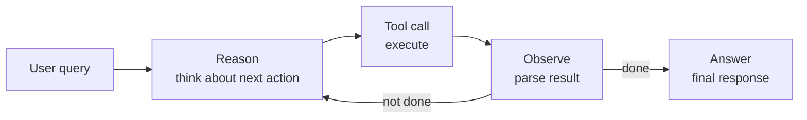
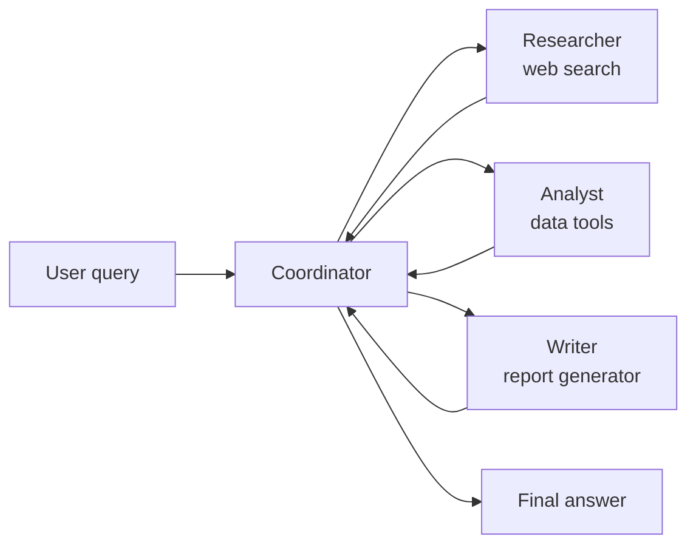

# 16.8 LLMOps: RAG, vector databases and agents

| Field | Value |
|---|---|
| Level | Advanced |
| Priority tier | 1 |
| Lab venue | GCP / GKE |
| Part | Part 16: MLOps and LLMOps tools and platforms |
| Primary sources | *LLMOps* (`llmops`, Chapters 3, 6); *AI Engineering* (`ai-engineering`, Chapters 5, 6); *Generative AI on Kubernetes* (`generative-ai-on-kubernetes`, Chapters 8, 9); *LLM Engineer's Handbook* (`llm-engineers-handbook`, Chapters 4, 9, 10, 11); *LLMs in Production* (`llms-in-production`, Chapters 2, 4) |
| Cross-references | Chapter 16.1 (LLMOps foundations); Chapter 16.3 (LLM data pipelines); Chapter 16.7 (Serving platforms); Chapter 15.3 (vLLM); Chapter 15.8 (Dynamo, llm-d) |
| Coverage file | `planning/coverage/chapters/16-08.md` |
| Claim & number ledger | `planning/ledgers/16-08.md` |

## Why this matters for AI infrastructure

The MLOps foundations from Chapter 16.1, the data pipelines from Chapter 16.3, and the serving platforms from Chapter 16.7 are the substrate. The LLMOps applications that sit on top of that substrate are the product. RAG is the pattern that lets a model answer questions about a private corpus. Vector databases are the system that gives the model fast lookup against millions of embeddings. Agents are the pattern that lets the model call tools and chain reasoning. Each of the three is a production system with its own failure modes, its own observability, and its own cost curve.

If you operate a GPU cluster for AI, you operate an LLM application. The application is what pays for the cluster. The application's quality is what the user sees. The application's cost is what the CFO sees. The platform team's job is to make the application fast, accurate, observable, and rollback-ready.

```text
Why LLMOps is on the critical path (LLO Ch 3; AIE Ch 6; GAK Ch 8):
- A typical RAG application serves 100-10,000 QPS in production. Each request costs
  10-100 ms of GPU time for the LLM and 50-200 ms of CPU time for the retriever.
  A misconfigured chunking policy or vector index doubles the cost.
- An agent loop that loops or escalates can burn 1000x the expected GPU time per
  request. A hard iteration cap is the difference between a $5,000/month bill
  and a $5,000/day bill.
- The corpus behind a RAG application drifts continuously (new docs, edited docs,
  deleted docs). The retrieval index has a freshness SLO. A stale index is a
  silent regression that no one notices until the customer does.
```

Three operational realities make this chapter a platform-team concern rather than a data-science-only concern:

1. **Vector databases are databases.** They run on the cluster; they have IAM; they have backup; they have SLOs. The platform team owns the operational story even when the data scientist owns the schema.
2. **Agents are pipelines.** They run as Kubernetes pods; they call external services; they produce traces. The agent runtime is a platform service with retries, timeouts, and rate limits.
3. **LLM cost is a per-request number.** Every token is a dollar. The platform team's cost attribution, rate limiting, and autoscaling decisions are what keep the bill under control.

**Before an LLM application can serve customers, the RAG pipeline, the vector index, and the agent runtime must be production services with SLOs and rollback paths. A notebook demo is a pilot; an InferenceService with a signed index is a platform.**

## Prerequisites and outcomes

### Prerequisites

- Chapter 16.1 (LLMOps foundations and the four goals).
- Chapter 16.3 (LLM data pipelines, index snapshot id, freshness SLO).
- Chapter 16.7 (serving platforms and InferenceService).
- Chapter 15.3 (vLLM in depth) for the LLM serving engine.
- Chapter 14.13 (Fine-tuning) for the LLM customisation context.

### Outcomes

After completing this chapter you will be able to:

1. Specify a RAG architecture: corpus, chunking, embedding model, vector index, retriever, prompt assembly, generator.
2. Choose a vector database: Milvus, Qdrant, pgvector, Pinecone, Weaviate, on the dimensions of recall, latency, scale, and operational fit.
3. Wire an agent loop: tool calling, retry policy, iteration cap, cost cap, trace emission.
4. Operate a prompt-engineering discipline: versioned prompt templates, eval suites, regression tests.
5. Implement cost control: token budgets per request, per tenant, per model.
6. Operate the LLMOps stack on GKE with vector databases, embedding pipelines, agent runtimes, and observability that ties back to the SLO.

---

## 1. RAG architecture

### 1.1 The five components

*AI Engineering* Chapter 6 walks through the RAG pattern. The architecture has five components: the corpus, the chunker, the embedding model, the vector index, and the retriever-generator pipeline. Each is a production system with its own lifecycle.

```mermaid
flowchart LR
    subgraph Corpus["Corpus (object store)"]
        C[Documents<br/>parquet / text]
    end

    subgraph Pipeline["RAG pipeline (orchestrator)"]
        CH[Chunker<br/>policy version]
        EM[Embedding model<br/>model version]
        IDX[Vector index<br/>snapshot id]
    end

    subgraph Serving["RAG serving (InferenceService)"]
        R[Retriever<br/>vector search]
        PA[Prompt assembler<br/>template + context]
        G[Generator (LLM)<br/>InferenceService]
    end

    C --> CH --> EM --> IDX
    IDX --> R
    C --> R
    PA --> R
    R --> PA --> G
```

The five components produce four artifacts that are versioned together:

| Artifact | Where it lives | Versioning |
|---|---|---|
| Corpus snapshot | Object store | sha256 of the directory |
| Chunked corpus | Object store | chunk size, overlap, metadata fields, hash of corpus |
| Embedding table | Object store or vector store | chunk id, vector, embedding model id, hash of model |
| Index snapshot | Vector store | snapshot id bound to (corpus hash, embedding model id, chunking policy version) |

The index snapshot id is the equivalent of the dataset id from Chapter 16.1. Every artifact in the RAG pipeline has an id; every artifact has a hash; every id is bound to the ids of its inputs.

### 1.2 The retriever

*Generative AI on Kubernetes* Chapter 8 walks through the retriever. The retriever takes a query, encodes it with the same embedding model used to embed the corpus, searches the vector index for the top-K nearest neighbours, and returns the chunks. The retriever is the component that determines recall; the generator is the component that determines precision.

The two metrics to track on the retriever are:

- **Recall@K.** For a held-out set of (query, relevant chunk) pairs, what fraction of queries return the relevant chunk in the top-K results?
- **Latency p99.** How long does the vector search take at peak QPS?

A retriever with low recall is a retriever that misses the right context; the generator hallucinates. A retriever with high latency is a retriever that dominates the end-to-end latency budget. The platform team's tuning goal is recall > 0.9 at K=10 and latency p99 < 50 ms.

### 1.3 The prompt assembler and the generator

*AI Engineering* Chapter 6 introduces the prompt assembler. The assembler takes the user's query, the retrieved chunks, and the prompt template, and produces the prompt that the generator sees.

```python
# code/part16/prompt_assembler.py (shape only)
import json

PROMPT_TEMPLATE = """You are a documentation assistant. Answer the question
based only on the context below. If the answer is not in the context,
say "I don't know" rather than making it up.

Context:
{context}

Question: {question}

Answer:"""

def assemble(question: str, chunks: list[str]) -> str:
    context = "\n\n---\n\n".join(chunks)
    return PROMPT_TEMPLATE.format(context=context, question=question)
```

The prompt template is the artifact from Chapter 16.1 Section 5.2. The template is versioned in Git; the eval suite from Chapter 16.9 verifies that a template change does not regress accuracy.

The generator is an LLM InferenceService. The LLM is the most expensive component in the RAG pipeline; the platform team's autoscaler and cost controls live here.

---

## 2. Vector databases

### 2.1 The four production choices

*LLMOps* Chapter 3 and *Generative AI on Kubernetes* Chapter 8 walk through the vector database landscape. Four implementations are in production today; each is interchangeable on the contract from Section 1.1, and each differs on the operational model.

| Tool | Open source | Index type | Best fit |
|---|---|---|---|
| **Milvus** | Yes | IVF, HNSW, DiskANN | Petabyte-scale; GPU acceleration; strong consistency |
| **Qdrant** | Yes | HNSW | Cloud-native; rich filtering; Rust performance |
| **pgvector** | Yes (Postgres extension) | HNSW, IVF | Teams already on Postgres; want one database for everything |
| **Pinecone** | No (managed) | Proprietary | Serverless; zero ops; pay per query |

*LLMOps* Chapter 3 introduces Milvus as the open-source default for production-scale deployments. *Generative AI on Kubernetes* Chapter 8 adds the observation that pgvector is the right choice for small-to-medium deployments where the team already runs Postgres.

### 2.2 Milvus architecture

Milvus separates storage and compute. The architecture has four layers:

```mermaid
flowchart TB
    P[Proxy<br/>stateless, load balancer]
    C[Coordinator<br/>root, data, query, index]
    W[Worker node<br/>query, data, index]
    S[Storage<br/>etcd (meta), MinIO/S3 (segments), Pulsar/Kafka (logs)]
    P --> C
    C --> W
    W --> S
    C --> S
```

The proxy is the load balancer; the coordinator assigns work; the workers do the work; the storage holds the segments. A Milvus deployment is a Kubernetes StatefulSet with multiple components; the platform team owns the Helm chart, the storage backend, the resource requests, and the SLOs.

Milvus supports three index types. IVF (Inverted File) is the default; HNSW (Hierarchical Navigable Small World) is the most accurate; DiskANN is the disk-backed variant for very large indices.

### 2.3 Index snapshot and freshness

The index snapshot from Chapter 16.3 Section 5 is the contract that ties the retriever to the corpus.

```python
# code/part16/index_snapshot.py (shape only)
import hashlib, json

def index_snapshot_id(corpus_hash: str, embedding_model_id: str,
                      chunking_policy_version: str) -> str:
    """Compute the index snapshot id as a content hash of its three inputs."""
    payload = json.dumps({
        "corpus_hash": corpus_hash,
        "embedding_model_id": embedding_model_id,
        "chunking_policy_version": chunking_policy_version,
    }, sort_keys=True).encode()
    return hashlib.sha256(payload).hexdigest()
```

The serving system reads the index snapshot id at request time; the audit log shows the corpus hash and the embedding model id that produced it; a regression in answer quality points to one of the three inputs.

The freshness SLO from Chapter 16.3 Section 5.3 governs how often the index is rebuilt. A static knowledge base (documentation) needs daily or weekly rebuilds. A frequently updated corpus (news, products) needs event-driven rebuilds on the changed partition.

### 2.4 pgvector for small-to-medium deployments

*LLMOps* Chapter 3 introduces pgvector as the right choice for small-to-medium deployments. The pattern is to add the pgvector extension to an existing Postgres; the extension adds the `vector` type and the `<=>` cosine-distance operator.

```sql
-- Add the extension
CREATE EXTENSION IF NOT EXISTS vector;

-- Create a table with a vector column
CREATE TABLE chunks (
    id BIGSERIAL PRIMARY KEY,
    document_id TEXT NOT NULL,
    content TEXT NOT NULL,
    embedding vector(1536) NOT NULL,
    created_at TIMESTAMPTZ DEFAULT now()
);

-- Create an HNSW index for fast similarity search
CREATE INDEX chunks_embedding_hnsw ON chunks
USING hnsw (embedding vector_cosine_ops);
```

pgvector is Postgres; the platform team's existing Postgres operational knowledge applies. The trade-off is scale: pgvector scales to millions of vectors per table; beyond that, Milvus or Qdrant is the better choice.

---

## 3. Agent architectures

### 3.1 The ReAct loop

*AI Engineering* Chapter 6 walks through the ReAct (Reason + Act) loop that most agents implement. The loop has four steps: reason about the next action, call a tool, observe the result, repeat.



The agent loop is a pipeline. The pipeline is bounded by an iteration cap (the maximum number of tool calls per request) and a cost cap (the maximum number of tokens burned per request). Both caps are structural; the agent runtime refuses to exceed them.

### 3.2 Function calling and tool schemas

*LLMOps* Chapter 6 introduces function calling. The LLM is given a schema describing the tools it can call; the LLM produces a JSON response that names the tool and the arguments; the runtime executes the tool and feeds the result back to the LLM.

```json
{
  "name": "search_documentation",
  "description": "Search the company documentation for relevant pages",
  "parameters": {
    "type": "object",
    "properties": {
      "query": {"type": "string", "description": "Search query"},
      "max_results": {"type": "integer", "default": 10}
    },
    "required": ["query"]
  }
}
```

The tool schema is an artifact. The schema is versioned; the eval suite verifies that a schema change does not break the agent's accuracy. The runtime enforces the schema; the runtime rejects malformed tool calls before they reach the tool implementation.

### 3.3 Multi-agent orchestration

*Generative AI on Kubernetes* Chapter 9 walks through multi-agent orchestration. The pattern is a coordinator agent that delegates to specialist agents; each specialist has its own tool set and its own system prompt.



The coordinator's loop is more expensive than a single-agent loop (every delegation is a round-trip; every round-trip is a token cost). The platform team's pattern is to enforce per-agent iteration caps and per-request cost caps; the coordinator's loop is a hard-bounded DAG, not an unbounded chain.

### 3.4 Agent observability

*Generative AI on Kubernetes* Chapter 9 names observability as the first operational concern for agents. The agent runtime must emit a trace for every tool call; the trace is consumed by an observability backend (Langfuse, LangSmith, OpenTelemetry-compatible backends).

```text
Agent trace fields (GAK Ch 9; AIE Ch 6):
- trace_id (uniquely identifies the request)
- parent_id (the coordinator's trace that delegated to this agent)
- agent_id (which specialist agent ran)
- tool_call (the JSON of the function call)
- tool_response (the JSON of the function response)
- token_count (input, output, total)
- cost_usd (the dollar cost of the request)
- duration_ms (the wall-clock duration)
- status (success, retry, error, abort)
```

The trace is the audit trail. The platform team's pattern is to write every trace to an immutable log; the audit log feeds the eval suite (Chapter 16.9), the cost attribution (Chapter 16.14), and the incident response (when an agent loops, the trace shows where).

---

## 4. Prompt engineering as a discipline

### 4.1 The prompt template is an artifact

*AI Engineering* Chapter 5 walks through prompt engineering as a discipline. The prompt template is a versioned artifact in Git; the template is part of the registry entry (Chapter 16.1 Section 5.2); the eval suite verifies that a template change does not regress accuracy.

The pattern is:

1. Write the prompt template as a Jinja file in the prompt repo.
2. The prompt repo is a Git repo with branch protection; PRs require review.
3. The CI runs the eval suite against the new template; the PR fails if accuracy regresses.
4. The merged PR becomes a new template version; the registry carries the version.

The template is the cheapest versioned artifact in the LLMOps stack. A template change is a 5-line diff; an embedding model change is a multi-GB artefact swap. The platform team's job is to make the template's lifecycle as rigorous as the model's.

### 4.2 Few-shot examples and prompt regression

*AI Engineering* Chapter 5 introduces few-shot prompting: the template includes 2-5 examples that the LLM uses as references for the desired output format. The examples are an artifact; changing the examples is changing the prompt.

The failure mode is prompt regression: a small change to the template degrades accuracy on a slice of users without changing the overall metric. The eval suite catches this by holding out a regression set of inputs and verifying that the new template produces the expected outputs.

### 4.3 Cost control on the prompt

The prompt's token count is the prompt's dollar cost. A prompt that includes 2,000 tokens of retrieved context costs $0.006 per request at GPT-4 pricing ($3 per million input tokens); a prompt that includes 20,000 tokens costs $0.06 per request. At 1,000 QPS, the difference is $5,400/hour.

The platform team's pattern is to enforce a per-request input token budget. The retriever returns the top-K chunks; the assembler truncates to fit the budget; the eval suite verifies that accuracy holds at the budget's truncation point.

---

## 5. Cost control and observability for LLM applications

### 5.1 The cost model

*LLMOps* Chapter 6 walks through the cost model. The cost per request has three components:

```text
Cost per LLM request = (input_tokens * input_price_per_token)
                     + (output_tokens * output_price_per_token)
                     + (embedding_tokens * embedding_price_per_token)
                     + (vector_search_cost_per_query)
                     + (agent_tool_costs)
```

The prices vary by model (a 7B open-source model on owned GPUs costs less than GPT-4 per token; the cost shows up as GPU-hours rather than dollars-per-token). The platform team's cost attribution has to handle both modes.

### 5.2 Per-request budgets

The platform team enforces per-request budgets:

| Budget | What it caps | What happens on exceed |
|---|---|---|
| Input token budget | The size of the prompt + context | Truncate; fail with 413 |
| Output token budget | The size of the LLM response | Cut off mid-response; flag for review |
| Total token budget | Input + output | Refuse the request; route to a cheaper model |
| Cost budget | The dollar cost of the request | Same as total token budget, but in dollars |
| Iteration cap | The number of agent steps | Abort the agent loop; return the partial answer |
| Latency budget | The wall-clock duration | Same as iteration cap, but in time |

The budgets are enforced in the prompt assembler, the agent runtime, and the InferenceService. The budgets are visible in the trace; the platform team's dashboard shows the budget-exceedance rate per model and per tenant.

### 5.3 Observability

The observability backend must capture every LLM call, every tool call, every retrieval, and every budget decision. The backend is typically Langfuse or LangSmith; the trace is consumed by the eval suite (Chapter 16.9), the cost dashboard (Chapter 16.14), and the incident response.

```text
Observability metrics for LLM applications (GAK Ch 8; LLO Ch 6):
- Request rate (RPS) per model, per tenant
- Token throughput (TPS) per model, per tenant
- Cost per request (p50, p95, p99)
- Latency per stage (retriever, assembler, generator) p50/p95/p99
- Budget-exceedance rate (per budget type)
- Retrieval recall@K (sampled)
- Eval suite pass rate (per template version, per model version)
- Agent loop iteration distribution (mean, p99)
```

The observability stack is a platform service. The platform team owns the metrics, the alerts, and the dashboards; the data scientist consumes the dashboards.

---

## 6. How it fails

Six failure modes recur.

### 6.1 "The retrieval index is stale"

**Symptom:** A RAG application returns answers based on documentation that has been edited in the source system. The source-of-truth timestamp shows the documents are 12 hours old. The answers reference content that was deleted last week.

**Diagnosis:** The retrieval index has no freshness signal. The pipeline that rebuilds the index is on a weekly schedule.

**Fix:** Tie the index snapshot id to the corpus snapshot id. Alert when the index age exceeds the freshness SLO. Add a freshness check in the retrieval pipeline that refuses to serve if the index is older than the policy window. The fix is the same as Chapter 16.3 Section 7.5.

### 6.2 "The agent loop ran away"

**Symptom:** An agent-based application generated 800 LLM calls for a single user request. The cost guardrail fired at 700; the system kept running until it hit the hard limit. The user's request returned a half-formed answer.

**Diagnosis:** The agent runtime had a soft cap, not a hard cap. The runtime kept generating after the cap fired.

**Fix:** Hard caps on iteration count and cost. The runtime refuses to call the LLM after the cap is reached; the runtime returns a 429 with a "cost exceeded" message; the response is not partial.

### 6.3 "The prompt change degraded accuracy"

**Symptom:** A small change to the prompt template shipped. The eval suite passed. The accuracy dropped 8 percentage points on the customer-facing traffic. The on-call rolled back.

**Diagnosis:** The eval suite did not cover the failure mode that the customer traffic hit. The eval suite is a sample; the customer traffic is the population.

**Fix:** Expand the eval suite. Add customer-traffic-representative samples. Add a shadow mode (Chapter 16.6 Section 7.3) that runs the new template at 100% traffic in shadow for 24 hours before promotion.

### 6.4 "The vector database is OOM"

**Symptom:** The vector database returns "out of memory" errors at peak QPS. The cluster has free memory; the vector database is on a separate node pool.

**Diagnosis:** The vector database is sized for average QPS, not peak. The HNSW index is in memory; the in-memory footprint scales with the number of vectors.

**Fix:** Right-size the vector database for peak. Use IVF (which can spill to disk) instead of HNSW (which is in-memory only) for indices that exceed memory. The platform team owns the sizing decision.

### 6.5 "The cost exploded overnight"

**Symptom:** The cost dashboard shows $50,000 spent yesterday, up from $5,000/day. The team investigates.

**Diagnosis:** A new prompt template was deployed; the template includes 10x the context it used to; the cost per request went up 10x; the customer traffic was the same.

**Fix:** Cost budgets per request and per tenant. A template change that exceeds the budget fails the CI. The platform team's audit log shows the template change that caused the spike.

### 6.6 "The agent hallucinated a tool call"

**Symptom:** The agent's tool call included a parameter that the tool schema did not allow. The runtime executed the tool with the parameter anyway. The tool returned an error; the agent loop continued with the error; the user got a broken answer.

**Diagnosis:** The runtime did not validate the tool call against the schema. The runtime trusted the LLM.

**Fix:** Strict schema validation. The runtime rejects any tool call that does not match the schema; the runtime reports the rejection to the LLM; the LLM retries with a corrected call. The platform team's pattern is "trust the LLM to suggest, never to execute".

---

## 7. Hands-on lab

This lab stands up a RAG pipeline (Milvus + vLLM + LangChain) on GKE, indexes a small corpus, and verifies the end-to-end RAG serving. The lab is **untested** in this repository.

### 7.1 Prerequisites

- A GKE Autopilot or Standard cluster (1.27+).
- A model artefact in GCS (the artefact from Chapter 16.6).
- Helm for installing Milvus and LangChain.

### 7.2 Step 1: install Milvus

```bash
helm repo add milvus https://milvus-io.github.io/milvus-helm
helm install milvus milvus/milvus \
  --namespace rag --create-namespace \
  --set cluster.enabled=true \
  --set etcd.replicaCount=3 \
  --set minio.mode=distributed
# expected: milvus proxy, coordinators, workers, etcd, minio all running
```

### 7.3 Step 2: install vLLM as the generator

```bash
helm install vllm vllm/vllm \
  --namespace rag \
  --set model.name=meta-llama/Llama-3.1-8B-Instruct \
  --set resources.limits.nvidia.com/gpu=1
# expected: the vLLM pod is running; the InferenceService URL is printed
```

### 7.4 Step 3: index a small corpus

```bash
python code/part16/index_corpus.py \
  --corpus gs://my-corpus/snap1 \
  --embedding-model sentence-transformers/all-MiniLM-L6-v2 \
  --output-milvus milvus://rag.milvus.svc.cluster.local:19530
# expected: a populated Milvus collection; the index snapshot id is printed
```

### 7.5 Step 4: serve a RAG endpoint

```bash
kubectl apply -f code/part16/rag_inference_service.yaml
kubectl get inferenceservice rag-assistant -n rag -w
# expected: READY=True within 60 seconds
```

### 7.6 Step 5: query the RAG endpoint

```bash
URL=$(kubectl get inferenceservice rag-assistant -n rag -o jsonpath='{.status.url}')
curl -X POST $URL/v1/rag \
  -H "Content-Type: application/json" \
  -d '{"query": "What is the MLOps lifecycle?"}'
# expected: a JSON response with the LLM's answer, the retrieved chunks, and the token count
```

### 7.7 Step 6: run the agent loop

```bash
python code/part16/run_agent.py \
  --query "What is the MLOps lifecycle and what are its failure modes?" \
  --max-iterations 5 \
  --max-cost 0.10
# expected: the agent's trace with tool calls; a final answer; cost under $0.10
```

### 7.8 What to record

After the lab, you should be able to answer five questions in five seconds each:

1. What is the index snapshot id, and what corpus hash is it bound to?
2. What is the retriever's recall@10 on the held-out set?
3. What is the cost per RAG request, broken down by retriever and generator?
4. What is the agent's iteration cap, and what is the actual iteration distribution?
5. What is the prompt template version, and what is the eval suite pass rate for that version?

If any takes more than 30 seconds, the LLMOps stack is not yet a production service. The lab is **untested** against a live GKE cluster.

---

## Exercises

1. **Add a freshness check.** Implement a check that refuses to serve if the index age exceeds the freshness SLO. Verify the check fires. *Solution sketch:* a middleware that reads the index metadata and rejects requests when the index is stale.
2. **Add a hard iteration cap.** Implement a hard cap on the agent loop's iteration count and cost. Verify the cap fires. *Solution sketch:* a counter in the agent runtime that increments on every tool call; an exception raised when the counter exceeds the cap.
3. **Add a vector-database load test.** Generate 1M vectors; measure the recall@10 and the latency p99. *Solution sketch:* a script that inserts the vectors; a benchmark script that queries with held-out ground truth.
4. **Add a prompt regression test.** Add 50 customer-traffic-representative samples to the eval suite. Verify the eval suite catches a small template change. *Solution sketch:* a JSON file of inputs and expected outputs; the CI runs the new template and compares.
5. **Add a cost budget per tenant.** Enforce a per-tenant token budget. Verify the budget fires. *Solution sketch:* a counter per tenant; the InferenceService rejects requests when the tenant's budget is exceeded.
6. **Add a vector index rebuild pipeline.** Wire an Argo Workflow that rebuilds the index from the corpus on a schedule. *Solution sketch:* an Argo DAG with stages for chunking, embedding, and indexing; a Cron schedule that triggers the workflow daily.

---

## Checkpoint questions

<details><summary>1. What five components does a RAG pipeline have?</summary>
The corpus (object store), the chunker (policy version), the embedding model (model version), the vector index (snapshot id), and the retriever-generator pipeline. Each is a production system with its own lifecycle; the index snapshot id is bound to the corpus hash, the embedding model id, and the chunking policy version.
</details>

<details><summary>2. What is the difference between Milvus, Qdrant, pgvector, and Pinecone?</summary>
Milvus is open source with petabyte scale and GPU acceleration; Qdrant is open source with rich filtering and Rust performance; pgvector is a Postgres extension for small-to-medium deployments; Pinecone is managed serverless for zero-ops. The choice is operational and ecosystem-driven.
</details>

<details><summary>3. What is the ReAct loop?</summary>
The pattern most agents implement: reason about the next action, call a tool, observe the result, repeat. The loop is bounded by an iteration cap and a cost cap; the runtime refuses to exceed them.
</details>

<details><summary>4. What is a tool schema?</summary>
The JSON schema that describes the tools the agent can call: the tool name, the description, the parameters (with types and required fields). The schema is an artifact; changing the schema is changing the agent's contract with the runtime. The runtime validates every tool call against the schema; the runtime rejects malformed calls.
</details>

<details><summary>5. What is the cost model for an LLM request?</summary>
Input tokens * input price + output tokens * output price + embedding tokens * embedding price + vector search cost + agent tool costs. The platform team enforces per-request budgets on input, output, total tokens, dollar cost, iteration count, and latency. Budgets are visible in the trace.
</details>

<details><summary>6. Why is the prompt template versioned in Git?</summary>
Because the template is an artifact. Changing the template is changing the model's behaviour. The template repo has branch protection; PRs require review; the CI runs the eval suite against the new template; the PR fails if accuracy regresses.
</details>

<details><summary>7. What is the freshness SLO for a vector index?</summary>
The maximum age of the index relative to the corpus. Static knowledge bases tolerate days; frequently updated corpora tolerate hours; streaming corpora tolerate seconds. The freshness SLO is the alert threshold; the rebuild frequency is the budget.
</details>

<details><summary>8. Why are hard caps better than soft caps for agent loops?</summary>
Because soft caps fire informatively; the loop continues; the cost grows unbounded. Hard caps are structural; the runtime refuses to call the LLM after the cap is reached; the runtime returns a 429 with a "cost exceeded" message. Hard caps are the difference between a $5,000/month bill and a $5,000/day bill.
</details>

<details><summary>9. What is the difference between a single-agent and a multi-agent loop?</summary>
A single-agent loop has one LLM reasoning and acting. A multi-agent loop has a coordinator that delegates to specialist agents; each specialist has its own tool set and system prompt. Multi-agent loops are more expensive (every delegation is a round-trip) but more capable. The platform team's pattern is to enforce per-agent caps.
</details>

<details><summary>10. What is the agent trace?</summary>
The per-request record emitted by the agent runtime: trace id, parent id, agent id, tool call, tool response, token count, cost, duration, status. The trace is the audit trail for the eval suite, the cost dashboard, and the incident response. The trace is written to an immutable log.
</details>

<details><summary>11. What is the difference between recall and precision in a RAG application?</summary>
Recall is the retriever's job: what fraction of queries return the relevant context in the top-K. Precision is the generator's job: what fraction of retrieved context produces a correct answer. The platform team's tuning goal is recall > 0.9 at K=10 and p99 latency < 50 ms.
</details>

<details><summary>12. Why is schema validation on tool calls necessary?</summary>
Because the LLM hallucinates tool calls. A tool call with a parameter that the schema does not allow is a broken call; the runtime must reject it; the runtime must report the rejection to the LLM; the LLM retries with a corrected call. "Trust the LLM to suggest, never to execute".
</details>

<details><summary>13. What is the right context size for a RAG prompt?</summary>
Whatever fits the per-request input token budget at the truncation point where the eval suite's accuracy stops improving. The platform team measures accuracy vs context size; the budget is the smallest context size that hits the accuracy target.
</details>

<details><summary>14. What is the difference between pgvector and a dedicated vector database?</summary>
pgvector is a Postgres extension; it adds the `vector` type and the cosine-distance operator. The trade-off is scale: pgvector scales to millions of vectors per table; beyond that, Milvus or Qdrant is the better choice. For teams already on Postgres, pgvector is the lowest-ops path.
</details>

<details><summary>15. What is the right granularity for an agent's cost budget?</summary>
Per-request. A per-day budget lets one runaway agent burn the entire budget; a per-request budget catches the runaway agent before it burns anything. The per-request budget is enforced in the agent runtime; the per-day budget is the alert threshold for the cost dashboard.
</details>

<details><summary>16. What is the difference between an agent's iteration cap and its cost cap?</summary>
The iteration cap is the maximum number of tool calls; the cost cap is the maximum dollar or token cost. An agent that calls cheap tools may stay under the cost cap but exceed the iteration cap. An agent that calls expensive tools may stay under the iteration cap but exceed the cost cap. Both caps are structural; the runtime refuses to exceed either.
</details>

<details><summary>17. What is the right shape for an agent trace?</summary>
A tree. The coordinator's trace is the root; each delegation to a specialist is a child; each tool call is a leaf. The tree shows the cost at every level; the eval suite measures accuracy at every level; the cost dashboard attributes cost to every level.
</details>

<details><summary>18. Why does the LLM application need a per-tenant budget?</summary>
Because one tenant's runaway cost is the platform's bill. Without per-tenant budgets, a single misconfigured application can burn the entire monthly GPU budget. Per-tenant budgets are enforced in the InferenceService; the cost dashboard shows the budget-exceedance rate per tenant.
</details>

<details><summary>19. What is the difference between HNSW and IVF for vector indices?</summary>
HNSW (Hierarchical Navigable Small World) is in-memory; the index footprint scales with the number of vectors. IVF (Inverted File) is disk-backed; the index can spill to disk for very large indices. HNSW is the right choice for small-to-medium indices with low latency requirements; IVF is the right choice for very large indices where memory is the bottleneck.
</details>

<details><summary>20. What five questions should the LLMOps lab let you answer in five seconds each?</summary>
What is the index snapshot id and what corpus hash is it bound to. What is the retriever's recall@10. What is the cost per request broken down by retriever and generator. What is the agent's iteration cap and actual distribution. What is the prompt template version and eval pass rate. If any takes more than 30 seconds, the LLMOps stack is not yet a production service.
</details>

---

## Sources and review notes

- *LLMOps* (`llmops`, Chapters 3, 6). Source for the RAG architecture, the four production vector databases, the function calling pattern, the cost model for LLM requests, and the agent runtime. Chapter 3 is approximately 11,400 words; Chapter 6 is approximately 7,800 words.
- *AI Engineering* (`ai-engineering`, Chapters 5, 6). Source for prompt engineering as a discipline, the prompt assembler, the ReAct loop, function calling with tool schemas, multi-agent orchestration, and the agent observability pattern. Chapter 5 is approximately 12,500 words; Chapter 6 is approximately 17,700 words.
- *Generative AI on Kubernetes* (`generative-ai-on-kubernetes`, Chapters 8, 9). Source for the RAG pipeline shape, the vector database landscape, the agent runtime pattern, the multi-agent orchestration, and the observability stack. Chapter 8 is approximately 13,000 words; Chapter 9 is approximately 10,800 words.
- *LLM Engineer's Handbook* (`llm-engineers-handbook`, Chapters 4, 9, 10, 11). Source for the RAG feature pipeline, the inference pipeline deployment, the MLOps and LLMOps chapter, and the MLOps principles chapter. Word counts vary.
- *LLMs in Production* (`llms-in-production`, Chapters 2, 4). Source for the practical MLOps lessons, the agent observability patterns, and the production deployment considerations. Word counts vary.

### Cross-references to other handbook chapters

- Chapter 16.1 Section 5.2 for the prompt template as a versioned artifact.
- Chapter 16.3 Section 5 for the index snapshot contract.
- Chapter 16.7 for the serving platform that hosts the LLM.
- Chapter 15.3 (vLLM) for the generator's serving engine.
- Chapter 15.8 (Dynamo, llm-d) for disaggregated prefill/decode serving.

### Migrated from `nvidia-devops`

The RAG pipeline pattern and the agent loop pattern draw on Volume 25 chapters 11 and 12. The wording has been rewritten in the handbook's voice.

### Explicitly labelled inferences

- The concurrency targets for the retriever (recall > 0.9 at K=10; p99 latency < 50 ms) are starting points drawn from common production experience; specific targets depend on the use case.
- The cost-per-token numbers in Section 5.1 are vendor-specific; verify against the current LLM provider pricing before quoting.
- The HNSW vs IVF trade-off in Section 2.2 is a general guidance; specific deployments should benchmark both.

### Not verified on live hardware

- The lab in Section 7 is **untested** against a live GKE cluster in this repository.
- The Milvus, vLLM, and LangChain versions assumed in the lab should be pinned against the current releases before production use.
- The recall@K benchmarks assume a held-out ground-truth set; the specific benchmark depends on the corpus.
