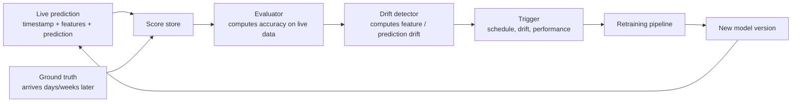

# 16.10 Monitoring, drift and continual learning

| Field | Value |
|---|---|
| Level | Intermediate |
| Priority tier | 1 |
| Lab venue | GCP / GKE |
| Part | Part 16: MLOps and LLMOps tools and platforms |
| Primary sources | *Designing Machine Learning Systems* (`designing-machine-learning-systems`, Chapters 8, 9); *Practical MLOps* (`practical-mlops`, Chapter 6); NVIDIA Zero-to-Hero Volume 25 (`chapter-12-end-to-end-case-study-banknifty-big-move-prediction-pipeline.md`) |
| Cross-references | Chapter 16.1 (MLOps foundations); Chapter 16.2 (Experiment tracking); Chapter 16.3 (Data pipelines); Chapter 16.6 (Model registry); Chapter 16.7 (Serving platforms); Chapter 16.9 (LLM evaluation) |
| Coverage file | `planning/coverage/chapters/16-10.md` |
| Claim & number ledger | `planning/ledgers/16-10.md` |

## Why this matters for AI infrastructure

Chapter 16.1 described the stale model. The model in production is months older than the training pipeline, because someone has to retrain it by hand. This chapter is the fix. Monitoring shows you the symptoms, drift detection points to the cause, and continual learning closes the loop with a retraining trigger. Your job as a platform engineer is a pipeline that catches drift in hours, not months.

Monitoring is easy to skip, because its cost stays hidden until the model breaks. Suppose, as an example, that a model scores 0.92 AUC on the day it deploys. If the data drifts, the same model might score 0.78 six months later. Nobody notices, because nobody is watching. The customer notices first, and the on-call hears about it only when the failure is too large for the dashboards to miss.

```text
Why monitoring is on the critical path (background reading: Designing Machine Learning Systems; Practical MLOps; the figures below are examples, not quotations):
- A typical mature ML platform monitors 10-50 metrics per model: latency, error
  rate, feature drift, prediction drift, label drift, business metric. Each
  metric has its own threshold; each threshold is enforced by a different alert.
- The most common silent failure is data drift: the upstream data changes; the
  model's inputs no longer match the distribution the model was trained on; the
  model's outputs drift. The drift is invisible to the operational metrics
  (latency, error rate) until it is too late.
- The retraining trigger is the mechanism that closes the loop. Without the
  trigger, drift is detected but not acted on; the team is paging themselves
  every day to remind themselves to retrain; the trigger never fires.
```

Three operational realities make this a platform concern, not only a data science concern.

1. Monitoring is a platform service. The metrics pipeline (Prometheus, Grafana, and alerting), the drift detectors (Evidently, whylogs, and Arize), and the retraining trigger from Chapter 16.4 are platform decisions. Someone has to run them, upgrade them, and answer the page when they fail.
2. Drift detection runs on every prediction. Each prediction produces a feature vector and an output, and the detector scores both against a reference distribution. Your job is to make that check cheap and reliable, because it never stops.
3. Retraining triggers consume GPU hours. Each trigger starts a training job, and every job competes for the same GPU pool. You own the trigger policy: when it fires, when it waits, and when it rolls back.

**Before you trust a model in production, make its monitoring, drift detection, and retraining trigger production services with SLOs and rollback paths.** A model without monitoring is a model that nobody is watching.

## Prerequisites and outcomes

Before you build the monitoring, the earlier parts of the stack need to be in place. Each one feeds this chapter. If you skip one, a later step will have nothing to read.

### Prerequisites

- Chapter 16.1 covers the MLOps foundations and the four failure shapes.
- Chapter 16.2 covers experiment tracking, which holds the run record that the retraining trigger fires on.
- Chapter 16.3 covers data pipelines and the feature store that drift detection reads.
- Chapter 16.6 covers the model registry, where the retraining trigger promotes a new version.
- Chapter 16.7 covers serving platforms, including the InferenceService that writes the prediction logs.

### Outcomes

By the end of this chapter, you will be able to:

1. Write a monitoring contract that names the metrics, thresholds, alerts, and dashboards.
2. Detect feature drift, prediction drift, label drift, and concept drift, each with a suitable statistical method.
3. Build an online evaluation pipeline that scores live predictions against ground truth that arrives later.
4. Compare a new model with the baseline using A/B testing, shadow mode, and canary analysis.
5. Implement a retraining trigger that fires on a schedule, on drift, or on performance.
6. Run the monitoring, drift detection, and retraining pipeline on GKE with Prometheus, Evidently, and Argo Workflows.

---

## 1. The monitoring contract

Suppose your model has been live for a while, and nobody can say whether it still works. The fix is a monitoring contract. It lists what you measure, the threshold for each measure, and who responds when a threshold breaks. *Designing Machine Learning Systems* Chapter 8 names four metric categories that a production ML system needs.

### 1.1 The four metric categories

| Category | What it measures | Why it matters |
|---|---|---|
| **Operational** | Latency, error rate, throughput, availability | The SLO the customer sees; the same metrics any web service emits |
| **Input** | Feature drift, schema drift, null rate, outlier rate | The data has changed; the model's input distribution has shifted |
| **Output** | Prediction distribution, prediction drift, output class imbalance | The model's behaviour has changed; the outputs no longer match expectations |
| **Feedback** | Label drift, business metric, customer satisfaction | The ground truth has changed; the model's accuracy has dropped |

Read the table as a checklist. Each category catches a different failure shape from Chapter 16.1. Operational metrics catch the canary failure, and input metrics catch the works-on-my-machine failure. Output metrics catch the silent promotion failure, and feedback metrics catch the stale model failure. If one category is missing, one kind of failure is invisible to you.

### 1.2 Operational metrics: the same as any service

Start with what you already know. The operational metrics are the ones any web service emits, and they tell you whether the endpoint is up and fast. The target values in the table below are examples. Choose your own, based on what your customers need.

| Metric | What it measures | Target |
|---|---|---|
| p50 latency | The median request latency | < 50 ms for tabular; < 300 ms TTFT for LLM |
| p95 latency | The 95th percentile latency | < 100 ms for tabular; < 1 s TTFT for LLM |
| p99 latency | The 99th percentile latency | < 500 ms for tabular; < 3 s TTFT for LLM |
| Error rate (5xx) | The fraction of requests that fail | < 0.1% |
| Throughput | Requests per second | Capacity-planning dependent |
| Availability | Uptime over a rolling window | 99.9% monthly |

The InferenceService emits these metrics. Prometheus stores them, and alert rules page the on-call when a value crosses its threshold.

### 1.3 Input metrics: the data has drifted

Input drift is the quiet kind. The model's code and weights have not changed, but the features arriving at it have. *Designing Machine Learning Systems* Chapter 8 introduces input drift as the case where the feature values in production no longer match the training distribution.

| Metric | What it measures | Why it matters |
|---|---|---|
| Feature mean | The mean of each feature over a window | A shift in mean is a shift in the population |
| Feature std | The standard deviation of each feature | A shift in std is a shift in the spread |
| Feature quantiles | The p10, p50, p90 of each feature | A shift in quantiles is a shift in the tails |
| Null rate | The fraction of nulls in each feature | A spike in nulls is a data pipeline bug |
| Schema drift | A column that was present is now missing (or vice versa) | A schema change is a contract violation |

A sidecar computes these metrics. It scores the live feature vectors against a reference distribution built from the training set. When the gap crosses a threshold, the alert fires.

### 1.4 Output metrics: the model's behaviour has changed

Sometimes the inputs look normal and the model still changes. One cause is a model upgrade from your LLM provider. Another is a bad training run that quietly damaged the weights.

| Metric | What it measures | Why it matters |
|---|---|---|
| Prediction distribution | The histogram of predictions | A shift in the histogram is a shift in the model's behaviour |
| Output class imbalance | The fraction of predictions in each class | An imbalance is a sign of class collapse |
| Output variance | The variance of predictions across similar inputs | Low variance is a sign of model collapse |
| Confidence distribution | The histogram of the model's confidence | Low confidence is a sign of out-of-distribution inputs |

You compute output metrics with the same statistics as input drift. The only difference is what you feed in: predictions instead of feature vectors.

### 1.5 Feedback metrics: the ground truth has changed

Sometimes the model stays accurate on its own terms, but the world it predicts has moved. The most expensive case is concept drift, where the relationship between features and target shifts.

| Metric | What it measures | Why it matters |
|---|---|---|
| Label drift | The distribution of labels in production | A shift in labels is a shift in the target |
| Live accuracy | The accuracy on the live data with a delayed ground truth | A drop in live accuracy is concept drift |
| Business metric | The conversion rate, retention rate, or other KPI the model affects | A drop in business metric is the model's failure to deliver value |
| Customer satisfaction | CSAT, NPS, retention | A drop in customer satisfaction is the ultimate metric |

Feedback metrics are the hardest to compute, because labels arrive late. A churn label can take weeks, and a fraud label can take months. Most teams therefore read input and output metrics for fast warnings, and feedback metrics for slow confirmation. Before you launch a model, decide which feedback metric you will read and how long you will wait for its labels.

---

## 2. Drift detection

Suppose your fraud model suddenly starts flagging far more transactions. The cause could be a new customer segment, a change in the labels, or a new fraud pattern. Each one needs a different response, so you first have to name the drift type. *Designing Machine Learning Systems* Chapter 8 names four types.

### 2.1 The four drift types

| Drift type | What it is | Example |
|---|---|---|
| **Feature drift** | The input distribution has changed | A new customer segment with different feature values |
| **Label drift** | The target distribution has changed | A new product category with different conversion rates |
| **Concept drift** | The relationship between features and target has changed | A new fraud pattern that the model does not know |
| **Prediction drift** | The model's output distribution has changed | The model is suddenly predicting more positives |

The types can overlap. Concept drift can follow feature drift, and prediction drift can result from either one. Check feature drift first, because it is the cheapest signal. Use prediction drift as a second check that confirms what the feature signal suggested.

### 2.2 The statistical methods

Each method trades cost against the kind of data it can handle. Some run on a CPU for every feature, while others need a GPU and a model of their own. Pick the method by the shape of the feature, not by what is newest.

| Method | What it does | Cost | When to use |
|---|---|---|---|
| **Kolmogorov-Smirnov test** | Compares two empirical distributions; outputs a p-value | Cheap (CPU) | Continuous features |
| **Population Stability Index (PSI)** | Compares two histograms; outputs a single number | Cheap (CPU) | Categorical features; binning-tolerant |
| **Chi-squared test** | Compares observed vs expected categorical frequencies | Cheap (CPU) | Categorical features |
| **Learned embedding drift** | Trains an autoencoder on the training distribution; scores the live inputs by reconstruction error | Moderate (GPU) | High-dimensional features (embeddings) |
| **Classifier-based drift** | Trains a classifier to distinguish training vs live; if the classifier succeeds, drift exists | Moderate (GPU) | Complex distributions |
| **Statistical process control (SPC)** | Tracks the running mean and detects deviations beyond control limits | Cheap (CPU) | Time-series features |

*Practical MLOps* Chapter 6 walks through the same statistical methods. The platform team's default is the Kolmogorov-Smirnov test for continuous features, PSI for categorical features, and learned embedding drift for embedding features. The last one fits the output of an LLM's embedding model. Start with the simpler tests. Move to the heavier methods only when the simple ones fail to explain what you see.

### 2.3 The reference distribution

A drift score means nothing without something to compare it against. That something is the reference distribution, usually the feature statistics of the training set. The detector measures how far the live data has moved from it.

```python
# code/part16/drift_reference.py
import json
import numpy as np

def compute_reference(features: np.ndarray, feature_names: list[str]) -> dict:
    """Compute the reference distribution from the training set."""
    reference = {}
    for i, name in enumerate(feature_names):
        reference[name] = {
            "mean": float(np.mean(features[:, i])),
            "std": float(np.std(features[:, i])),
            "quantiles": {
                "p10": float(np.quantile(features[:, i], 0.1)),
                "p50": float(np.quantile(features[:, i], 0.5)),
                "p90": float(np.quantile(features[:, i], 0.9)),
            },
            "min": float(np.min(features[:, i])),
            "max": float(np.max(features[:, i])),
        }
    return reference
```

The reference is a versioned artifact, just like the model. When the training set changes, you build a new reference. Every drift report should name the reference version it used, so an auditor can see what the live data was compared against.

### 2.4 The alert thresholds

A drift score needs a line that tells a person to act. That line is the alert threshold. The detector outputs a number, such as the KS statistic, the PSI, or the reconstruction error. The values in the table below are examples to start from. Tune them on your own production traffic.

| Method | Threshold | Action |
|---|---|---|
| KS statistic | > 0.1 | Page on-call; investigate |
| PSI | > 0.2 | Page on-call; investigate |
| PSI | > 0.5 | Page on-call; consider rolling back the model |
| Reconstruction error | > 3 std above reference mean | Page on-call; investigate |
| Reconstruction error | > 5 std above reference mean | Page on-call; consider rolling back the model |

The goal is to catch drift before the customer does, without paging on noise.

---

## 3. Online evaluation

A prediction happens the moment a request arrives. The truth about that prediction can take weeks to show up. Online evaluation joins the two as they arrive, so you can judge the model on real outcomes instead of on the test set alone.

### 3.1 The online evaluation loop

*Designing Machine Learning Systems* Chapter 9 describes this pattern. You score live predictions against a delayed ground truth, and the loop closes when the label arrives.



This pipeline is the feedback loop that closes the MLOps lifecycle. It runs all the time. It consumes ground truth as it arrives, and it starts retraining when a metric crosses its threshold.

### 3.2 The delayed ground truth problem

Imagine you run a churn model. You predict this week which customers will leave, and you learn the answer weeks later. An on-call engineer cannot wait that long to find out whether the model broke.

| Use case | Ground truth latency | Proxy signal |
|---|---|---|
| Churn prediction | 30-90 days | Cancellation page view; customer service contact |
| Fraud detection | 1-3 months | Chargeback notification |
| Recommendation | Seconds to minutes | Click, dwell time, conversion |
| Ad targeting | Hours | Click, conversion |
| LLM chat | None (no ground truth) | User thumbs-up / thumbs-down |

Use the ground truth as soon as it arrives. While you wait, a proxy signal can stand in for it. A proxy is an estimate, not a measurement, so treat it as an early warning rather than a verdict. Fast proxies give feedback in minutes to hours, and the ground truth confirms or corrects them later.

### 3.3 Shadow mode and A/B testing

A new model is ready, but you are not yet sure it is safe for every user. Four mechanisms let you compare it with the live model while you limit the risk. *Designing Machine Learning Systems* Chapter 9 introduces shadow mode and A/B testing for this job.

| Mechanism | What it does | When to use |
|---|---|---|
| **Shadow mode** | New model serves 100% of traffic in shadow; responses are discarded | Long-tail evaluation; high-risk changes |
| **Canary** | New model serves 1-5% of traffic; responses are served | SLO validation; low-risk changes |
| **A/B testing** | New model serves a fraction of traffic by header or cohort | Marketing experiments; comparison on a specific cohort |
| **Holdout** | New model serves a fraction of traffic; responses are served; metrics are compared after the fact | Retrospective evaluation; offline analysis |

Teams usually combine these mechanisms rather than pick one. For example, one team might run shadow mode for 24 hours, a canary for 30 minutes, and an A/B test for 7 days. Those durations are examples. Set yours from how fast your traffic and labels arrive. Before you promote a model, decide which of these mechanisms it must pass, and in what order.

---

## 4. Retraining triggers

Your model starts drifting on a weekend, and the weekly retraining job is still waiting on the calendar. Should a training run start now, or wait? The answer depends on the trigger you use, and most teams combine three of them. *Designing Machine Learning Systems* Chapter 9 walks through this trigger policy.

### 4.1 The three trigger types

| Trigger type | When it fires | Cost | When to use |
|---|---|---|---|
| **Schedule-based** | Every N days / weeks / months | Predictable GPU cost | Stable distributions; regulatory requirements |
| **Drift-triggered** | When the drift detector's threshold is breached | Reactive GPU cost | Unstable distributions; rapid concept drift |
| **Performance-triggered** | When the live accuracy drops below a threshold | Reactive GPU cost | Critical business metrics; SLA-anchored models |

The schedule is the baseline. It makes GPU cost predictable, and it suits stable distributions and regulatory schedules. The drift and performance triggers are the accelerants. They fire when the baseline is not enough.

### 4.2 The retraining pipeline

The retraining job should be the same pipeline you used for the first training run. The only difference is what starts it. Instead of a person opening a notebook, an event starts the job.

```python
# code/part16/retraining_trigger.py
import argparse
from datetime import datetime, timedelta

def should_retrain(
    drift_score: float,
    drift_threshold: float,
    last_retrain_at: datetime,
    schedule_interval_days: int,
    live_accuracy: float,
    accuracy_threshold: float,
) -> tuple[bool, str]:
    """Return (should_retrain, reason)."""
    if drift_score > drift_threshold:
        return True, f"drift score {drift_score} > {drift_threshold}"
    if live_accuracy < accuracy_threshold:
        return True, f"live accuracy {live_accuracy} < {accuracy_threshold}"
    if datetime.utcnow() - last_retrain_at > timedelta(days=schedule_interval_days):
        return True, f"schedule: {schedule_interval_days} days since last retrain"
    return False, "no trigger"

if __name__ == "__main__":
    ap = argparse.ArgumentParser()
    ap.add_argument("--drift-score", type=float, required=True)
    ap.add_argument("--drift-threshold", type=float, default=0.2)
    ap.add_argument("--last-retrain-at", type=str, required=True)
    ap.add_argument("--schedule-interval-days", type=int, default=7)
    ap.add_argument("--live-accuracy", type=float, default=0.85)
    ap.add_argument("--accuracy-threshold", type=float, default=0.85)
    args = ap.parse_args()

    last_retrain = datetime.fromisoformat(args.last_retrain_at)
    should, reason = should_retrain(
        args.drift_score, args.drift_threshold,
        last_retrain, args.schedule_interval_days,
        args.live_accuracy, args.accuracy_threshold,
    )
    if should:
        print(f"TRIGGER FIRED: {reason}")
        # Submit the retraining DAG to Argo Workflows
    else:
        print(f"NO TRIGGER: {reason}")
```

The function returns a decision and a reason. The reason goes into the log, so every fire can be explained later. The retraining pipeline is an Argo Workflows DAG from Chapter 16.4. It runs the prepare, validate, train, evaluate, and promote stages, and its output is a new model version in the registry.

### 4.3 The retraining cooldown

A noisy drift detector can fire every hour. The cluster then spends its time retraining, and no new model reaches production. A cooldown prevents this. It stops the trigger from firing again until a set time has passed since the last run.

| Trigger | Cooldown |
|---|---|
| Drift-triggered | 24 hours |
| Performance-triggered | 24 hours |
| Schedule-based | The schedule interval itself |

The values in this table are examples. Pick a cooldown at least as long as your evaluation suite needs to finish. The cooldown also gives the new model time to be evaluated before the next trigger can fire.

---

## 5. Operating monitoring and retraining on GKE

Suppose the drift detector pages you at night and the dashboard is blank. You need to know which component is down, where it runs, and what it stores. The table below answers those questions. It also lists a target for each component, so you can tell which piece is slow.

### 5.1 The components

| Component | Where it runs | Backing store | SLO |
|---|---|---|---|
| Prometheus | Managed or self-hosted | TSDB | Scrape latency p99 < 5 s |
| Drift detector (Evidently) | Kubernetes Deployment | Object store for reference distributions | Drift score p99 < 1 s |
| Retraining trigger | Kubernetes Deployment + Argo sensor | Postgres for trigger state | Trigger evaluation p99 < 30 s |
| Online evaluator | Kubernetes Job, GPU pool | Postgres for scored predictions | Score latency p99 < 5 min |
| Retraining DAG (Argo Workflows) | Kubernetes Job | Object store for datasets and models | Full DAG p99 < 4 hours |

The SLO column holds example targets. Set your own from what the business needs.

### 5.2 IAM and the audit log

The drift detector reads live features from the feature store, and it reads the reference distribution from object storage. It writes its results to the audit log. It needs read access to both sources and write access only to the audit log. The IAM model is the same as the one in Chapter 16.3 Section 6.2.

The retraining trigger writes to the audit log every time it fires. The entry records the trigger type, the trigger reason, and the retraining DAG's run ID. That record is your proof that a trigger fired and why, which matters when someone asks why a model changed.

### 5.3 Observability

The drift score per feature matters most. A spike on one feature usually means the upstream source changed. A slow rise across many features usually means the population is shifting. Respond to each one differently.

| Metric | Why it matters | Alert |
|---|---|---|
| Drift score (per feature) | Catches input drift | > threshold for 1 hour |
| Prediction drift (per class) | Catches output drift | > threshold for 1 hour |
| Live accuracy (when available) | Catches concept drift | < threshold for 1 day |
| Retraining DAG failure rate | Catches a broken retraining pipeline | > 0 for 1 hour |
| Trigger-to-model latency | Catches a slow retraining pipeline | > schedule interval |
| Cooldown violations | Catches a trigger that fired during cooldown | > 0 |

The durations and thresholds in this table are examples. Give each feature its own metric series, but be careful with labels. Every label value multiplies the number of series Prometheus must store, so a short, fixed set of labels keeps the server healthy. Production Kubernetes, chapter 9, makes the same warning about label use.

Watch the monitor itself, too. Production Kubernetes, chapter 9, recommends a dead man's switch: an alert that fires on a regular schedule and pages you when it stops. Apply that to the drift detector, so that silence never looks like health.

---

## 6. How it fails

Six failure modes come up again and again. Each one below gives the symptom, the likely diagnosis, and a fix.

### 6.1 "The drift detector is paged every hour"

The on-call engineer is paged every hour. The team checks the model, and the model is fine. The trigger still fires anyway, a new model trains, and the new model is no better than the old one.

Diagnosis: the threshold is too tight, so the detector is reacting to noise. If you see this pattern, check your own alert settings before you touch the model.

Fix: raise the threshold and tune it on production traffic. You want to catch drift before the customer does, not to catch every small wobble. Also remember that too many critical alerts wear out on-call engineers, and false positives can bury the real ones. Page only on persistent drift, meaning the threshold stays breached for more than 1 hour in this example, and not on a single scrape.

### 6.2 "The retraining pipeline retrains every day"

The retraining trigger fires every day. Most of the cluster's time goes to retraining, and new models wait in a busy queue. Nothing reaches production, because the queue is never free.

Diagnosis: the drift detector is too sensitive, the schedule is too tight, or the cooldown is missing.

Fix: add the cooldown from Section 4.3. Raise the drift threshold, and reduce the schedule frequency, for example from daily to weekly. Retrain when a new model is likely to beat the old one, not every time the detector fires.

### 6.3 "The model accuracy dropped but the drift detector didn't fire"

Customer accuracy drops by 10 points in this example. The dashboards look fine. The drift score has not moved, and the input distribution has not shifted in any visible way.

Diagnosis: this is concept drift. The relationship between features and target has changed, but the inputs look the same. An input-only drift detector cannot see that change.

Fix: add the performance-triggered retraining from Section 4.1, which fires when live accuracy drops. The rule of thumb is simple. Drift detection catches input changes, and performance triggers catch concept drift.

### 6.4 "The retraining DAG succeeded but the new model is worse"

The drift trigger fired, the DAG ran, and the new model passed the promotion gate. Then customer-facing accuracy fell after the release.

Diagnosis: the promotion gate missed the regression. The eval suite caught it only on live traffic, after the canary had started.

Fix: adopt the production shadow stage from Chapter 16.6 Section 7.3. The shadow runs the new model on 100% of traffic for a set period, such as 24 hours, and its metrics are compared with the live model's. The canary starts only after the shadow passes.

### 6.5 "The ground truth never arrived"

The online evaluation pipeline is waiting for ground truth. The drift threshold is breached, but the trigger cannot fire, because live accuracy is undefined.

Diagnosis: the ground truth is delayed, as with a churn label or a fraud dispute. The pipeline is waiting correctly.

Fix: use the proxy signal from Section 3.2. A proxy is an estimate, not a measurement, but it is good enough to fire the trigger. Fire the drift trigger right away, and fire the performance trigger once the proxy signal is available.

### 6.6 "The drift detector was bypassed"

The drift detector is configured, but production traffic does not pass through it. Its drift score is undefined, so the team cannot tell whether drift exists.

Diagnosis: the serving system does not emit prediction logs, so the detector has nothing to score.

Fix: make prediction log emission a condition for the InferenceService to be marked ready. The rule is short: no prediction log emission, no production traffic.

---

## 7. Hands-on lab

Use this lab to stand up Prometheus, Evidently, and the retraining trigger on GKE. Then you check drift detection and the retraining pipeline from end to end. The lab is **untested** in this repository.

### 7.1 Prerequisites

- A GKE Autopilot or Standard cluster (1.27+).
- An InferenceService from Chapter 16.7.
- A feature store from Chapter 16.3.
- Prometheus and Grafana installed via Helm.

### 7.2 Step 1: install Prometheus and Grafana

Start with the metrics stack, because every later step reads from it.

```bash
helm repo add prometheus-community https://prometheus-community.github.io/helm-charts
helm install prometheus prometheus-community/kube-prometheus-stack \
  --namespace monitoring --create-namespace
# expected: Prometheus and Grafana pods are running
```

### 7.3 Step 2: install Evidently for drift detection

Next, install the detector and point it at the reference file for the model version you are monitoring. That reference is the training distribution from Section 2.3.

```bash
helm install evidently evidentlyai/evidently \
  --namespace monitoring \
  --set evidently.reference-features-path=s3://my-bucket/reference/v3.parquet
# expected: the Evidently service is running; the drift dashboard is at /drift
```

### 7.4 Step 3: deploy the retraining trigger

Deploy the trigger with the thresholds you chose in Section 4. The values below match the examples in this chapter.

```bash
helm install retraining-trigger my-charts/retraining-trigger \
  --namespace mlops \
  --set trigger.drift-threshold=0.2 \
  --set trigger.schedule-interval-days=7 \
  --set trigger.cooldown-hours=24 \
  --set trigger.argo-workflow-template=retraining-dag
# expected: the trigger service is running; the trigger evaluates every 30 minutes
```

### 7.5 Step 4: generate drift

Inject drifted features, so you can see the detector react. This is a synthetic shift. Real production drift is usually subtler.

```bash
# Inject drifted features into the feature store
python code/part16/inject_drift.py \
  --feature-store feast \
  --feature-view user_features \
  --drift-magnitude 0.5
# expected: the live feature distribution shifts by 0.5 standard deviations
```

### 7.6 Step 5: observe the drift detector

Check the score in Grafana, or query the metric directly. The lab expects the score to pass 0.2 within 5 minutes.

```bash
# Open Grafana and navigate to the drift dashboard
kubectl port-forward -n monitoring svc/prometheus-grafana 8080:80

# Or query the drift metric directly
curl -s http://prometheus.monitoring:9090/api/v1/query?query=evidently_drift_score | jq .
# expected: drift_score > 0.2 within 5 minutes
```

### 7.7 Step 6: observe the retraining trigger

Read the trigger's log. A fired trigger prints its reason, which you can compare with the threshold you set.

```bash
kubectl logs -n mlops -l app=retraining-trigger -f
# expected: "TRIGGER FIRED: drift score 0.34 > 0.2" within 5 minutes
```

### 7.8 Step 7: observe the retraining DAG

List the workflow runs, then inspect the latest one. The five stages should run in order.

```bash
argo list -n mlops
# expected: a workflow run with the retraining DAG
argo get -n mlops @latest
# expected: stages prepare -> validate -> train -> evaluate -> promote
```

### 7.9 What to record

After the lab, you should be able to answer five questions in five seconds each:

1. What is the current drift score per feature?
2. What is the current prediction drift per class?
3. When did the last retraining trigger fire, and what was the reason?
4. What is the cooldown state of the trigger?
5. What is the live accuracy (if ground truth is available)?

The five-second limit and the 30-second limit below are this lab's own targets. Choose the limits your on-call team needs. If any answer takes more than 30 seconds, the monitoring pipeline is not yet a production service. The lab is still untested against a live GKE cluster.

---

## Exercises

Each exercise builds one piece of the loop from this chapter, and you can do them in order. The solution sketches describe one way to do each one, not the only way you can do it.

1. Add a feature-drift detector. Use Evidently to compute the KS statistic for each feature, and alert when it exceeds 0.1. *Solution sketch:* a CronJob runs Evidently on the last hour of features, writes the result to Prometheus, and raises an alert on the metric.
2. Add a performance-triggered retraining. Fire the retraining DAG when live accuracy drops below the threshold. *Solution sketch:* a metric computes live accuracy, and an alert fires the DAG on a threshold breach.
3. Add a retraining cooldown. Make your trigger refuse to fire until 24 hours have passed since the last fire. *Solution sketch:* a Postgres table records the last fire time, and the trigger checks that table before it fires.
4. Add a proxy-signal evaluator. Use a proxy, such as a cancellation page view for churn, to fire the performance trigger before the ground truth arrives. *Solution sketch:* a metric reads the proxy signal from the feature store, and an alert fires when the proxy's correlation with actual churn drops.
5. Add a production shadow stage. Run the new model on 100% of traffic in shadow for 24 hours before the canary. *Solution sketch:* a Knative route sends all traffic to the canary, the canary's responses are discarded, and its metrics are compared with the live model's.
6. Add a drift dashboard. You build a Grafana dashboard that shows drift score per feature, prediction drift per class, live accuracy, and retraining trigger history. *Solution sketch:* export the dashboard as a JSON file, import it into Grafana, and pin it to the team's home dashboard.

---

## Checkpoint questions

<details><summary>1. What four metric categories does a production ML system monitor?</summary>
The four are operational, input, output, and feedback metrics. Operational covers latency, error rate, throughput, and availability. Input covers feature drift, schema drift, and null rate, while output covers prediction drift, class imbalance, and confidence distribution, and feedback covers label drift, live accuracy, business metric, and customer satisfaction. Each category maps to one of the four failure shapes from Chapter 16.1.
</details>

<details><summary>2. What is the difference between feature drift and concept drift?</summary>
Feature drift means the inputs changed, while the link between features and target stayed the same. Concept drift means that link changed, while the inputs look the same. Drift detectors catch feature drift on the input, and performance triggers catch concept drift on the output.
</details>

<details><summary>3. What is the KS test, and when is it the right drift detector?</summary>
The Kolmogorov-Smirnov test compares two empirical distributions and gives you a p-value. It is cheap to run on a CPU and works well on continuous features. It fails on categorical features, where PSI is the better choice, and on high-dimensional embeddings, where learned embedding drift works better.
</details>

<details><summary>4. What is the Population Stability Index (PSI), and when is it the right drift detector?</summary>
PSI compares two histograms and gives you a single number. It is cheap to run on a CPU, it works on categorical features, and it tolerates the choice of bins. The example thresholds are 0.2 to page the on-call and 0.5 to consider rolling back.
</details>

<details><summary>5. What is the delayed ground truth problem?</summary>
For many ML use cases, the ground truth arrives days or months after the prediction. A churn label can take weeks, and a fraud label can take months. Use the ground truth when it arrives, and estimate the missing part with proxy signals in the meantime.
</details>

<details><summary>6. What is the difference between shadow mode, canary, and A/B testing?</summary>
Shadow mode runs the new model on 100% of traffic, and its responses are thrown away. A canary serves real responses to 1-5% of traffic. A/B testing routes users by header or cohort. Combining them catches more failure modes than any one mechanism alone.
</details>

<details><summary>7. What are the three retraining trigger types?</summary>
The three types are schedule-based, drift-triggered, and performance-triggered. Schedule-based fires every N days, weeks, or months. Drift-triggered fires when the drift detector's threshold is breached, and performance-triggered fires when live accuracy drops below a threshold. The schedule is the baseline, and the other two speed things up when the baseline is not enough.
</details>

<details><summary>8. What is the retraining cooldown?</summary>
The cooldown is the minimum time between two trigger fires. It stops thrashing when the drift detector is noisy. The chapter's example value is 24 hours, and the trigger enforces it before each fire.
</details>

<details><summary>9. Why is a proxy signal necessary when the ground truth is delayed?</summary>
You cannot wait weeks or months for ground truth before retraining. A proxy signal, such as a cancellation page view for churn or a chargeback for fraud, is an estimate that arrives in minutes or hours. It is enough to fire the trigger, and the ground truth later confirms whether the trigger was right.
</details>

<details><summary>10. What is the difference between prediction drift and output class imbalance?</summary>
Prediction drift is a change in the distribution of predictions. Output class imbalance is a skew in the same histogram, such as too many positives and too few negatives. Prediction drift catches any shift, while class imbalance catches one specific kind. You monitor both, and each has its own threshold.
</details>

<details><summary>11. What is the drift detector's reference distribution?</summary>
The reference distribution is a versioned artifact that records each feature's mean, standard deviation, quantiles, minimum, and maximum from the training set. It is computed at training time, and it changes only when the training set changes. The drift detector's output names the reference version it used.
</details>

<details><summary>12. Why does the platform team own the retraining trigger?</summary>
Retraining fires a DAG that uses GPU hours, and the platform team owns both the GPU pool and the trigger policy. The data scientist consumes the new model, while the platform team owns the trigger that produces it.
</details>

<details><summary>13. What is the alert threshold for the drift detector?</summary>
These are example starting points, not fixed rules. A KS statistic above 0.1 pages the on-call. A PSI above 0.2 pages, and above 0.5 means you should consider rolling back. Reconstruction error above 3 standard deviations pages, and above 5 means consider rolling back. Tune all of them on production traffic, so you catch drift before the customer does, without paging on noise.
</details>

<details><summary>14. What is the trigger-to-model latency?</summary>
This is the time from the trigger firing to the new model reaching production. A useful example target is a run that finishes before the next scheduled run, such as within 7 days for weekly retraining. The right target depends on the trigger type and the training cost.
</details>

<details><summary>15. What is the difference between a feature drift alert and a prediction drift alert?</summary>
A feature drift alert catches a change in the inputs, and a prediction drift alert catches a change in the outputs. They catch different failures. A model can absorb input drift quietly, so a feature alert alone can miss it.
</details>

<details><summary>16. Why does the retraining pipeline produce a new model version rather than updating the existing one?</summary>
The registry from Chapter 16.6 tracks every version as its own artifact, with its own lineage, so each one can be reversed. Overwriting a version would erase that lineage and remove your ability to roll back.
</details>

<details><summary>17. What is the live accuracy metric, and when is it available?</summary>
Live accuracy is the accuracy measured on live traffic, using ground truth that arrives late. It becomes available only when the labels arrive, weeks or months after the prediction. Use the drift score as the fast signal and live accuracy as the slow one.
</details>

<details><summary>18. What is the difference between operational drift and data drift?</summary>
Operational drift is a change in how the serving system behaves, such as latency or error rate. Data drift is a change in the data the model sees. The two are independent, so a model can run smoothly while its data shifts, or the reverse.
</details>

<details><summary>19. Why does the cooldown apply to all three trigger types?</summary>
Any trigger type can fire too often if its signal is noisy. The cooldown gives the pipeline time to evaluate the new model before the next fire. The 24 hours here is an example, so set the cooldown to the time your own evaluation suite needs.
</details>

<details><summary>20. What five questions should the monitoring lab let you answer in five seconds each?</summary>
You should be able to answer five questions. What is the drift score per feature, and what is the prediction drift per class? When did the last trigger fire, and why? What is the cooldown state, and what is the live accuracy when ground truth exists? If any answer takes more than 30 seconds, the monitoring pipeline is not yet a production service.
</details>

---

## Sources and review notes

- *Designing Machine Learning Systems* (`designing-machine-learning-systems`, Chapters 8, 9). Source for the four metric categories, the four drift types, the statistical methods for drift detection (KS, PSI, learned embeddings), the online evaluation loop, the delayed ground truth problem, the shadow / canary / A/B / holdout mechanisms, the three retraining trigger types, the retraining cooldown, and the operational pattern for monitoring as a service. Chapter 8 is approximately 14,600 words; Chapter 9 is approximately 11,300 words.
- *Practical MLOps* (`practical-mlops`, Chapter 6). Source for the monitoring and logging patterns, the operational metrics for ML systems, the drift detection methods, and the integration with the experiment tracker. Chapter 6 is approximately 8,100 words.
- NVIDIA Zero-to-Hero Volume 25 (`chapter-12-end-to-end-case-study-banknifty-big-move-prediction-pipeline.md`). Source for the end-to-end case study that ties the monitoring, drift detection, and retraining trigger to a real production pipeline. The wording has been rewritten in the handbook's voice.

### Cross-references to other handbook chapters

- Chapter 16.1 for the four failure shapes that the monitoring contract maps to.
- Chapter 16.2 for the experiment tracker that the retraining DAG writes to.
- Chapter 16.3 for the feature store that the drift detector reads.
- Chapter 16.6 for the registry that the retraining trigger writes to.
- Chapter 16.7 for the serving platform that emits the prediction logs.
- Chapter 16.9 for the eval suite that catches the regressions the monitoring misses.

### Migrated from `nvidia-devops`

The end-to-end retraining pipeline pattern draws on Volume 25 chapter 12. The wording has been rewritten in the handbook's voice.

### Explicitly labelled inferences

- The drift alert thresholds in Section 2.4 are starting points drawn from common practice; specific thresholds depend on the production traffic.
- The retraining cooldown of 24 hours in Section 4.3 is a starting point; specific cooldowns depend on the trigger type and the model's training cost.
- The proxy signals in Section 3.2 are starting points; specific proxy signals depend on the use case.

### Not verified on live hardware

- The lab in Section 7 is **untested** against a live GKE cluster in this repository.
- The Prometheus, Evidently, and Argo Workflows versions assumed in the lab should be pinned against the current releases before production use.
- The drift injection in the lab is a synthetic test; production drift is more subtle.
