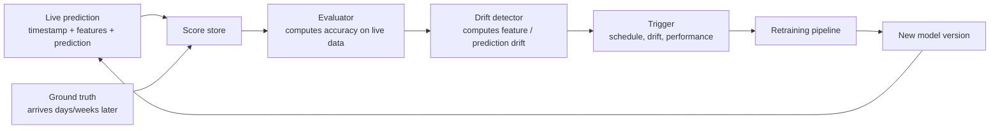

# 16.10 Monitoring, drift and continual learning

| Field | Value |
|---|---|
| Level | Intermediate |
| Priority tier | 1 |
| Lab venue | GCP / GKE |
| Part | Part 16: MLOps and LLMOps tools and platforms |
| Primary sources | *Designing Machine Learning Systems* (`designing-machine-learning-systems`, Chapters 8, 9); *Practical MLOps* (`practical-mlops`, Chapter 6); NVIDIA Zero-to-Hero Volume 25 (`chapter-12-end-to-end-case-study-banknifty-big-move-prediction-pipeline.md`) |
| Cross-references | Chapter 16.1 (MLOps foundations); Chapter 16.2 (Experiment tracking); Chapter 16.3 (Data pipelines); Chapter 16.6 (Model registry); Chapter 16.7 (Serving platforms); Chapter 16.9 (LLM evaluation) |
| Coverage file | `planning/coverage/chapters/16-10.md` |
| Claim & number ledger | `planning/ledgers/16-10.md` |

## Why this matters for AI infrastructure

Chapter 16.1 named the "stale model" failure: the live artifact is months older than the training pipeline because retraining is manual. This chapter is the cure. Monitoring detects the symptoms; drift detection identifies the cause; continual learning closes the loop with an automated retraining trigger. The platform team's job is to build the pipeline that catches drift in hours, not months.

The cost of not monitoring is invisible until it isn't. A model that scored 0.92 AUC at deploy time is scoring 0.78 AUC six months later because the data drifted; nobody noticed because nobody was watching. The model is silently degrading; the customer's trust erodes; the on-call gets paged when the model finally breaks in a way the dashboards cannot miss.

```text
Why monitoring is on the critical path (DMLS Ch 8; PM Ch 6):
- A typical mature ML platform monitors 10-50 metrics per model: latency, error
  rate, feature drift, prediction drift, label drift, business metric. Each
  metric has its own threshold; each threshold is enforced by a different alert.
- The most common silent failure is data drift: the upstream data changes; the
  model's inputs no longer match the distribution the model was trained on; the
  model's outputs drift. The drift is invisible to the operational metrics
  (latency, error rate) until it is too late.
- The retraining trigger is the mechanism that closes the loop. Without the
  trigger, drift is detected but not acted on; the team is paging themselves
  every day to remind themselves to retrain; the trigger never fires.
```

Three operational realities make this chapter a platform-team concern rather than a data-science-only concern:

1. **Monitoring is a platform service.** The metrics pipeline (Prometheus, Grafana, alerting), the drift detectors (Evidently, whylogs, Arize), and the retraining trigger (the orchestrator from Chapter 16.4) are platform-team decisions.
2. **Drift detection runs on every prediction.** Every prediction produces a feature vector and a prediction; the drift detector scores both against a reference distribution. The platform team's job is to make this cheap and reliable.
3. **Retraining triggers consume GPU hours.** Every trigger fires a training job; every training job consumes the GPU pool. The platform team owns the trigger policy (when to fire, when to wait, when to roll back).

**Before a model can be trusted in production, the monitoring, drift detection, and retraining trigger must be production services with SLOs and rollback paths. A model without monitoring is a model that nobody is watching.**

## Prerequisites and outcomes

### Prerequisites

- Chapter 16.1 (MLOps foundations, the four failure shapes).
- Chapter 16.2 (Experiment tracking for the run record that the retraining trigger fires).
- Chapter 16.3 (Data pipelines for the feature store that drift detection reads).
- Chapter 16.6 (Model registry for the version that the retraining trigger promotes).
- Chapter 16.7 (Serving platforms for the InferenceService that emits the prediction logs).

### Outcomes

After completing this chapter you will be able to:

1. Specify the monitoring contract: the metrics, the thresholds, the alerts, the dashboards.
2. Detect feature drift, prediction drift, label drift, and concept drift with the right statistical method for each.
3. Build an online evaluation pipeline that scores live predictions against a held-out ground truth.
4. Implement A/B testing, shadow mode, and canary analysis to compare a new model against the baseline.
5. Implement the retraining trigger: schedule-based, drift-triggered, or performance-triggered.
6. Operate the monitoring, drift detection, and retraining pipeline on GKE with Prometheus, Evidently, and Argo Workflows.

---

## 1. The monitoring contract

### 1.1 The four metric categories

*Designing Machine Learning Systems* Chapter 8 walks through the four metric categories that an ML system in production needs to monitor.

| Category | What it measures | Why it matters |
|---|---|---|
| **Operational** | Latency, error rate, throughput, availability | The SLO the customer sees; the same metrics any web service emits |
| **Input** | Feature drift, schema drift, null rate, outlier rate | The data has changed; the model's input distribution has shifted |
| **Output** | Prediction distribution, prediction drift, output class imbalance | The model's behaviour has changed; the outputs no longer match expectations |
| **Feedback** | Label drift, business metric, customer satisfaction | The ground truth has changed; the model's accuracy has dropped |

The four categories map to the four failure shapes from Chapter 16.1. Operational metrics catch the canary failure. Input metrics catch the works-on-my-machine failure. Output metrics catch the silent promotion failure. Feedback metrics catch the stale model failure.

### 1.2 Operational metrics: the same as any service

The operational metrics are the same as any web service. Latency, error rate, throughput, availability.

| Metric | What it measures | Target |
|---|---|---|
| p50 latency | The median request latency | < 50 ms for tabular; < 300 ms TTFT for LLM |
| p95 latency | The 95th percentile latency | < 100 ms for tabular; < 1 s TTFT for LLM |
| p99 latency | The 99th percentile latency | < 500 ms for tabular; < 3 s TTFT for LLM |
| Error rate (5xx) | The fraction of requests that fail | < 0.1% |
| Throughput | Requests per second | Capacity-planning dependent |
| Availability | Uptime over a rolling window | 99.9% monthly |

These metrics are emitted by the InferenceService; the metrics feed Prometheus; the alerts page the on-call.

### 1.3 Input metrics: the data has drifted

*Designing Machine Learning Systems* Chapter 8 introduces input drift. The feature values that the model sees in production no longer match the distribution the model was trained on.

| Metric | What it measures | Why it matters |
|---|---|---|
| Feature mean | The mean of each feature over a window | A shift in mean is a shift in the population |
| Feature std | The standard deviation of each feature | A shift in std is a shift in the spread |
| Feature quantiles | The p10, p50, p90 of each feature | A shift in quantiles is a shift in the tails |
| Null rate | The fraction of nulls in each feature | A spike in nulls is a data pipeline bug |
| Schema drift | A column that was present is now missing (or vice versa) | A schema change is a contract violation |

The metrics are computed by a sidecar that scores the live feature vectors against a reference distribution. The reference distribution is computed from the training set; the sidecar compares the live distribution to the reference; the alert fires when the divergence crosses a threshold.

### 1.4 Output metrics: the model's behaviour has changed

The output metrics catch the cases where the input has not changed but the model has. The most common cause is a model upgrade from the LLM provider; the most expensive cause is a model that has been corrupted by a bad training run.

| Metric | What it measures | Why it matters |
|---|---|---|
| Prediction distribution | The histogram of predictions | A shift in the histogram is a shift in the model's behaviour |
| Output class imbalance | The fraction of predictions in each class | An imbalance is a sign of class collapse |
| Output variance | The variance of predictions across similar inputs | Low variance is a sign of model collapse |
| Confidence distribution | The histogram of the model's confidence | Low confidence is a sign of out-of-distribution inputs |

The output metrics are computed by a sidecar that scores the live predictions against a reference distribution. The same statistical methods as input drift detection apply; the only difference is the input is the prediction, not the feature vector.

### 1.5 Feedback metrics: the ground truth has changed

The feedback metrics catch the cases where the model is accurate but the ground truth has changed. The most expensive cause is concept drift: the relationship between features and target has shifted.

| Metric | What it measures | Why it matters |
|---|---|---|
| Label drift | The distribution of labels in production | A shift in labels is a shift in the target |
| Live accuracy | The accuracy on the live data with a delayed ground truth | A drop in live accuracy is concept drift |
| Business metric | The conversion rate, retention rate, or other KPI the model affects | A drop in business metric is the model's failure to deliver value |
| Customer satisfaction | CSAT, NPS, retention | A drop in customer satisfaction is the ultimate metric |

The feedback metrics are the hardest to compute because the ground truth is delayed (a churn label arrives weeks after the prediction; a fraud label arrives months after). The platform team's pattern is to use the feedback metrics as the long-term signal and the input/output metrics as the short-term signal.

---

## 2. Drift detection

### 2.1 The four drift types

*Designing Machine Learning Systems* Chapter 8 names the four drift types.

| Drift type | What it is | Example |
|---|---|---|
| **Feature drift** | The input distribution has changed | A new customer segment with different feature values |
| **Label drift** | The target distribution has changed | A new product category with different conversion rates |
| **Concept drift** | The relationship between features and target has changed | A new fraud pattern that the model does not know |
| **Prediction drift** | The model's output distribution has changed | The model is suddenly predicting more positives |

The four drift types are not independent. Concept drift usually follows feature drift; prediction drift is the consequence of either. The platform team's pattern is to detect feature drift first (the cheapest signal) and use prediction drift as the second-line confirmation.

### 2.2 The statistical methods

*Designing Machine Learning Systems* Chapter 8 and *Practical MLOps* Chapter 6 walk through the statistical methods for drift detection. Each method has different costs and different accuracy profiles.

| Method | What it does | Cost | When to use |
|---|---|---|---|
| **Kolmogorov-Smirnov test** | Compares two empirical distributions; outputs a p-value | Cheap (CPU) | Continuous features |
| **Population Stability Index (PSI)** | Compares two histograms; outputs a single number | Cheap (CPU) | Categorical features; binning-tolerant |
| **Chi-squared test** | Compares observed vs expected categorical frequencies | Cheap (CPU) | Categorical features |
| **Learned embedding drift** | Trains an autoencoder on the training distribution; scores the live inputs by reconstruction error | Moderate (GPU) | High-dimensional features (embeddings) |
| **Classifier-based drift** | Trains a classifier to distinguish training vs live; if the classifier succeeds, drift exists | Moderate (GPU) | Complex distributions |
| **Statistical process control (SPC)** | Tracks the running mean and detects deviations beyond control limits | Cheap (CPU) | Time-series features |

The platform team's default is the Kolmogorov-Smirnov test for continuous features, the PSI for categorical features, and the learned embedding drift for embedding features (the output of an LLM's embedding model).

### 2.3 The reference distribution

The drift detector compares the live distribution to a reference distribution. The reference distribution is the training set's distribution; the reference distribution is versioned in the same way as the model artifact.

```python
# code/part16/drift_reference.py (shape only)
import json
import numpy as np

def compute_reference(features: np.ndarray, feature_names: list[str]) -> dict:
    """Compute the reference distribution from the training set."""
    reference = {}
    for i, name in enumerate(feature_names):
        reference[name] = {
            "mean": float(np.mean(features[:, i])),
            "std": float(np.std(features[:, i])),
            "quantiles": {
                "p10": float(np.quantile(features[:, i], 0.1)),
                "p50": float(np.quantile(features[:, i], 0.5)),
                "p90": float(np.quantile(features[:, i], 0.9)),
            },
            "min": float(np.min(features[:, i])),
            "max": float(np.max(features[:, i])),
        }
    return reference
```

The reference distribution is a versioned artifact; the reference distribution changes when the training set changes. The drift detector's output includes the reference distribution version, so the audit trail shows which reference the live distribution was compared against.

### 2.4 The alert thresholds

The drift detector's output is a number (the KS statistic, the PSI, the reconstruction error). The alert threshold is the number above which the platform team pages the on-call.

| Method | Threshold | Action |
|---|---|---|
| KS statistic | > 0.1 | Page on-call; investigate |
| PSI | > 0.2 | Page on-call; investigate |
| PSI | > 0.5 | Page on-call; consider rolling back the model |
| Reconstruction error | > 3 std above reference mean | Page on-call; investigate |
| Reconstruction error | > 5 std above reference mean | Page on-call; consider rolling back the model |

The thresholds are starting points; the platform team tunes them on the production traffic. The goal is to catch drift before the customer does, without paging on noise.

---

## 3. Online evaluation

### 3.1 The online evaluation loop

*Designing Machine Learning Systems* Chapter 9 walks through online evaluation. The pattern is to score live predictions against a delayed ground truth; the loop closes when the ground truth arrives.



The online evaluation pipeline is the feedback loop that closes the MLOps lifecycle. The pipeline runs continuously; the pipeline consumes ground truth as it arrives; the pipeline triggers retraining when the metrics cross the threshold.

### 3.2 The delayed ground truth problem

The ground truth is not always available. A churn label arrives weeks after the prediction; a fraud label arrives months after. The platform team's pattern is to use the available ground truth as soon as it arrives, and to estimate the missing ground truth with proxy signals.

| Use case | Ground truth latency | Proxy signal |
|---|---|---|
| Churn prediction | 30-90 days | Cancellation page view; customer service contact |
| Fraud detection | 1-3 months | Chargeback notification |
| Recommendation | Seconds to minutes | Click, dwell time, conversion |
| Ad targeting | Hours | Click, conversion |
| LLM chat | None (no ground truth) | User thumbs-up / thumbs-down |

The proxy signal is an estimate, not a measurement. The platform team's pattern is to use the proxy signal for fast feedback (minutes to hours) and the ground truth for slow feedback (days to months). The two signals converge as the ground truth arrives.

### 3.3 Shadow mode and A/B testing

*Designing Machine Learning Systems* Chapter 9 introduces shadow mode and A/B testing as the mechanisms for comparing a new model against the baseline without exposing users to the new model's risks.

| Mechanism | What it does | When to use |
|---|---|---|
| **Shadow mode** | New model serves 100% of traffic in shadow; responses are discarded | Long-tail evaluation; high-risk changes |
| **Canary** | New model serves 1-5% of traffic; responses are served | SLO validation; low-risk changes |
| **A/B testing** | New model serves a fraction of traffic by header or cohort | Marketing experiments; comparison on a specific cohort |
| **Holdout** | New model serves a fraction of traffic; responses are served; metrics are compared after the fact | Retrospective evaluation; offline analysis |

The platform team's pattern is to combine the four mechanisms. Shadow mode runs for 24 hours; canary runs for 30 minutes; A/B testing runs for 7 days; holdout runs forever. The combination catches every failure mode that any single mechanism misses.

---

## 4. Retraining triggers

### 4.1 The three trigger types

*Designing Machine Learning Systems* Chapter 9 walks through the retraining trigger policy. The platform team's pattern is to combine three trigger types.

| Trigger type | When it fires | Cost | When to use |
|---|---|---|---|
| **Schedule-based** | Every N days / weeks / months | Predictable GPU cost | Stable distributions; regulatory requirements |
| **Drift-triggered** | When the drift detector's threshold is breached | Reactive GPU cost | Unstable distributions; rapid concept drift |
| **Performance-triggered** | When the live accuracy drops below a threshold | Reactive GPU cost | Critical business metrics; SLA-anchored models |

The schedule-based trigger is the baseline; the platform team runs a weekly or monthly retraining job. The drift-triggered and performance-triggered triggers are the accelerants; they fire when the baseline is not enough.

### 4.2 The retraining pipeline

The retraining pipeline is the same DAG as the initial training pipeline, with one difference: the input is not a notebook, it is a trigger event.

```python
# code/part16/retraining_trigger.py (shape only)
import argparse
from datetime import datetime, timedelta

def should_retrain(
    drift_score: float,
    drift_threshold: float,
    last_retrain_at: datetime,
    schedule_interval_days: int,
    live_accuracy: float,
    accuracy_threshold: float,
) -> tuple[bool, str]:
    """Return (should_retrain, reason)."""
    if drift_score > drift_threshold:
        return True, f"drift score {drift_score} > {drift_threshold}"
    if live_accuracy < accuracy_threshold:
        return True, f"live accuracy {live_accuracy} < {accuracy_threshold}"
    if datetime.utcnow() - last_retrain_at > timedelta(days=schedule_interval_days):
        return True, f"schedule: {schedule_interval_days} days since last retrain"
    return False, "no trigger"

if __name__ == "__main__":
    ap = argparse.ArgumentParser()
    ap.add_argument("--drift-score", type=float, required=True)
    ap.add_argument("--drift-threshold", type=float, default=0.2)
    ap.add_argument("--last-retrain-at", type=str, required=True)
    ap.add_argument("--schedule-interval-days", type=int, default=7)
    ap.add_argument("--live-accuracy", type=float, default=0.85)
    ap.add_argument("--accuracy-threshold", type=float, default=0.85)
    args = ap.parse_args()

    last_retrain = datetime.fromisoformat(args.last_retrain_at)
    should, reason = should_retrain(
        args.drift_score, args.drift_threshold,
        last_retrain, args.schedule_interval_days,
        args.live_accuracy, args.accuracy_threshold,
    )
    if should:
        print(f"TRIGGER FIRED: {reason}")
        # Submit the retraining DAG to Argo Workflows
    else:
        print(f"NO TRIGGER: {reason}")
```

The retraining pipeline is an Argo Workflows DAG (Chapter 16.4). The DAG runs the same stages as the initial training pipeline: prepare data, validate features, train, evaluate, promote. The DAG's input is the trigger event; the DAG's output is a new model version in the registry.

### 4.3 The retraining cooldown

The retraining trigger can fire too often. If the drift detector is noisy, the trigger fires every hour; the cluster spends all its time retraining; no model reaches production. The platform team's pattern is a cooldown period: the trigger cannot fire again until N hours after the last retraining.

| Trigger | Cooldown |
|---|---|
| Drift-triggered | 24 hours |
| Performance-triggered | 24 hours |
| Schedule-based | The schedule interval itself |

The cooldown prevents thrashing. The cooldown also gives the new model time to be evaluated before the next trigger fires.

---

## 5. Operating monitoring and retraining on GKE

### 5.1 The components

| Component | Where it runs | Backing store | SLO |
|---|---|---|---|
| Prometheus | Managed or self-hosted | TSDB | Scrape latency p99 < 5 s |
| Drift detector (Evidently) | Kubernetes Deployment | Object store for reference distributions | Drift score p99 < 1 s |
| Retraining trigger | Kubernetes Deployment + Argo sensor | Postgres for trigger state | Trigger evaluation p99 < 30 s |
| Online evaluator | Kubernetes Job, GPU pool | Postgres for scored predictions | Score latency p99 < 5 min |
| Retraining DAG (Argo Workflows) | Kubernetes Job | Object store for datasets and models | Full DAG p99 < 4 hours |

### 5.2 IAM and the audit log

The drift detector reads the live features from the feature store; the drift detector reads the reference distribution from object storage. The IAM model is the same as Chapter 16.3 Section 6.2: the detector has read access to the feature store and the object store; the detector writes to the audit log.

The retraining trigger writes to the audit log every time it fires; the audit log records the trigger type, the trigger reason, and the retraining DAG's run id. The audit log is the artefact that proves the trigger fired; the audit log is what the regulator inspects.

### 5.3 Observability

| Metric | Why it matters | Alert |
|---|---|---|
| Drift score (per feature) | Catches input drift | > threshold for 1 hour |
| Prediction drift (per class) | Catches output drift | > threshold for 1 hour |
| Live accuracy (when available) | Catches concept drift | < threshold for 1 day |
| Retraining DAG failure rate | Catches a broken retraining pipeline | > 0 for 1 hour |
| Trigger-to-model latency | Catches a slow retraining pipeline | > schedule interval |
| Cooldown violations | Catches a trigger that fired during cooldown | > 0 |

The drift score per feature is the most important metric. A spike in drift score on a single feature is a sign of a data pipeline bug (the upstream source changed); a slow drift across many features is a sign of population shift. The platform team responds differently to each.

---

## 6. How it fails

Six failure modes recur.

### 6.1 "The drift detector is paged every hour"

**Symptom:** The on-call is paged every hour because the drift detector's threshold is breached. The team investigates; the model is fine; the trigger fires; a new model is trained; the new model is not better than the old.

**Diagnosis:** The threshold is too tight. The drift detector is catching noise.

**Fix:** Raise the threshold; tune on production traffic; the goal is to catch drift before the customer does, not to catch every micro-drift. The platform team's pattern is to page on persistent drift (the threshold breached for more than 1 hour), not transient drift (the threshold breached for a single scrape).

### 6.2 "The retraining pipeline retrains every day"

**Symptom:** The retraining trigger fires every day. The cluster spends 80% of its time retraining. No new model reaches production because the retraining queue is always busy.

**Diagnosis:** The drift detector is too sensitive; the schedule is too tight; the cooldown is missing.

**Fix:** Add the cooldown from Section 4.3. Raise the drift threshold. Reduce the schedule frequency (weekly instead of daily). The platform team's pattern is to retrain when the new model is likely to be better than the old, not when the drift detector fires.

### 6.3 "The model accuracy dropped but the drift detector didn't fire"

**Symptom:** The customer's accuracy metric dropped 10 points. The on-call opens the dashboards; the drift detector's score is unchanged; the operational metrics are fine; the input distribution has not shifted visibly.

**Diagnosis:** This is concept drift. The relationship between features and target has shifted; the input distribution has not. The drift detector cannot catch concept drift on the input alone.

**Fix:** Add a performance-triggered retraining (Section 4.1) that fires when the live accuracy drops. The platform team's pattern is "drift detection catches input changes; performance triggers catch concept drift".

### 6.4 "The retraining DAG succeeded but the new model is worse"

**Symptom:** The drift trigger fired; the retraining DAG ran; the new model passed the promotion gate; the new model is in production; the customer-facing accuracy dropped.

**Diagnosis:** The promotion gate did not catch the regression. The eval suite on the live traffic caught it after the canary.

**Fix:** Adopt the production shadow stage from Chapter 16.6 Section 7.3. The shadow runs the new model at 100% traffic for 24 hours; the shadow's metrics are compared to the live model's; the canary does not start until the shadow passes.

### 6.5 "The ground truth never arrived"

**Symptom:** The online evaluation pipeline is waiting for the ground truth. The drift detector's threshold is breached; the trigger cannot fire because the live accuracy is undefined.

**Diagnosis:** The ground truth is delayed (a churn label; a fraud dispute). The pipeline is correctly waiting.

**Fix:** Use the proxy signal from Section 3.2. The proxy signal is an estimate, not a measurement, but it is enough to fire the trigger. The platform team's pattern is to fire the drift trigger immediately and the performance trigger when the proxy signal is available.

### 6.6 "The drift detector was bypassed"

**Symptom:** The drift detector is configured but the production traffic is not flowing through it. The drift score is undefined; the team does not know if drift exists.

**Diagnosis:** The serving system is not emitting the prediction logs; the drift detector has no inputs to score.

**Fix:** Make the prediction log emission a precondition for the InferenceService to be marked ready. The platform team's pattern is "no prediction log emission, no production traffic".

---

## 7. Hands-on lab

This lab stands up Prometheus, Evidently, and the retraining trigger on GKE, then verifies drift detection and the retraining pipeline. The lab is **untested** in this repository.

### 7.1 Prerequisites

- A GKE Autopilot or Standard cluster (1.27+).
- An InferenceService from Chapter 16.7.
- A feature store from Chapter 16.3.
- Prometheus and Grafana installed via Helm.

### 7.2 Step 1: install Prometheus and Grafana

```bash
helm repo add prometheus-community https://prometheus-community.github.io/helm-charts
helm install prometheus prometheus-community/kube-prometheus-stack \
  --namespace monitoring --create-namespace
# expected: Prometheus and Grafana pods are running
```

### 7.3 Step 2: install Evidently for drift detection

```bash
helm install evidently evidentlyai/evidently \
  --namespace monitoring \
  --set evidently.reference-features-path=s3://my-bucket/reference/v3.parquet
# expected: the Evidently service is running; the drift dashboard is at /drift
```

### 7.4 Step 3: deploy the retraining trigger

```bash
helm install retraining-trigger my-charts/retraining-trigger \
  --namespace mlops \
  --set trigger.drift-threshold=0.2 \
  --set trigger.schedule-interval-days=7 \
  --set trigger.cooldown-hours=24 \
  --set trigger.argo-workflow-template=retraining-dag
# expected: the trigger service is running; the trigger evaluates every 30 minutes
```

### 7.5 Step 4: generate drift

```bash
# Inject drifted features into the feature store
python code/part16/inject_drift.py \
  --feature-store feast \
  --feature-view user_features \
  --drift-magnitude 0.5
# expected: the live feature distribution shifts by 0.5 standard deviations
```

### 7.6 Step 5: observe the drift detector

```bash
# Open Grafana and navigate to the drift dashboard
kubectl port-forward -n monitoring svc/prometheus-grafana 8080:80

# Or query the drift metric directly
curl -s http://prometheus.monitoring:9090/api/v1/query?query=evidently_drift_score | jq .
# expected: drift_score > 0.2 within 5 minutes
```

### 7.7 Step 6: observe the retraining trigger

```bash
kubectl logs -n mlops -l app=retraining-trigger -f
# expected: "TRIGGER FIRED: drift score 0.34 > 0.2" within 5 minutes
```

### 7.8 Step 7: observe the retraining DAG

```bash
argo list -n mlops
# expected: a workflow run with the retraining DAG
argo get -n mlops @latest
# expected: stages prepare -> validate -> train -> evaluate -> promote
```

### 7.9 What to record

After the lab, you should be able to answer five questions in five seconds each:

1. What is the current drift score per feature?
2. What is the current prediction drift per class?
3. When did the last retraining trigger fire, and what was the reason?
4. What is the cooldown state of the trigger?
5. What is the live accuracy (if ground truth is available)?

If any takes more than 30 seconds, the monitoring pipeline is not yet a production service. The lab is **untested** against a live GKE cluster.

---

## Exercises

1. **Add a feature-drift detector.** Use Evidently to compute the KS statistic per feature; alert when the statistic exceeds 0.1. *Solution sketch:* a CronJob that runs Evidently on the last hour of features; writes the result to Prometheus; an alert on the metric.
2. **Add a performance-triggered retraining.** Fire the retraining DAG when the live accuracy drops below the threshold. *Solution sketch:* a metric that computes the live accuracy; an alert that fires the DAG on threshold breach.
3. **Add a retraining cooldown.** Refuse to fire the retraining trigger until 24 hours have passed since the last fire. *Solution sketch:* a Postgres table that records the last fire time; the trigger checks the table before firing.
4. **Add a proxy-signal evaluator.** Use a proxy signal (e.g. cancellation page view for churn) to fire the performance trigger before the ground truth arrives. *Solution sketch:* a metric that reads the proxy signal from the feature store; an alert that fires when the proxy signal's correlation with the actual churn drops.
5. **Add a production shadow stage.** Run the new model at 100% traffic in shadow for 24 hours before the canary. *Solution sketch:* a Knative route that sends 100% of traffic to the canary; the canary's response is discarded; the shadow's metrics are compared to the live model's.
6. **Add a drift dashboard.** Build a Grafana dashboard that shows drift score per feature, prediction drift per class, live accuracy, and retraining trigger history. *Solution sketch:* a Grafana dashboard JSON file; import into Grafana; pin to the team's home dashboard.

---

## Checkpoint questions

<details><summary>1. What four metric categories does a production ML system monitor?</summary>
Operational (latency, error rate, throughput, availability), input (feature drift, schema drift, null rate), output (prediction drift, class imbalance, confidence distribution), and feedback (label drift, live accuracy, business metric, customer satisfaction). The four categories map to the four failure shapes from Chapter 16.1.
</details>

<details><summary>2. What is the difference between feature drift and concept drift?</summary>
Feature drift is a change in the input distribution; the relationship between features and target is unchanged. Concept drift is a change in the relationship between features and target; the input distribution is unchanged. Drift detectors catch feature drift on the input; performance triggers catch concept drift on the output.
</details>

<details><summary>3. What is the KS test, and when is it the right drift detector?</summary>
The Kolmogorov-Smirnov test compares two empirical distributions and outputs a p-value. The KS test is cheap (CPU); the KS test works on continuous features; the KS test fails on categorical features (use PSI instead) and on high-dimensional embeddings (use learned embedding drift).
</details>

<details><summary>4. What is the Population Stability Index (PSI), and when is it the right drift detector?</summary>
PSI compares two histograms and outputs a single number. PSI is cheap (CPU); PSI works on categorical features; PSI is binning-tolerant. The threshold is 0.2 (page) and 0.5 (consider rolling back).
</details>

<details><summary>5. What is the delayed ground truth problem?</summary>
The ground truth for many ML use cases arrives days or months after the prediction. A churn label arrives weeks after the prediction; a fraud label arrives months after. The platform team's pattern is to use the available ground truth when it arrives, and to estimate the missing ground truth with proxy signals.
</details>

<details><summary>6. What is the difference between shadow mode, canary, and A/B testing?</summary>
Shadow mode runs the new model at 100% traffic in shadow (responses are discarded). Canary serves 1-5% of traffic with real responses. A/B testing routes by header or cohort. The combination catches every failure mode that any single mechanism misses.
</details>

<details><summary>7. What are the three retraining trigger types?</summary>
Schedule-based (every N days / weeks / months), drift-triggered (when the drift detector's threshold is breached), and performance-triggered (when the live accuracy drops below a threshold). The schedule-based trigger is the baseline; the drift and performance triggers are the accelerants.
</details>

<details><summary>8. What is the retraining cooldown?</summary>
The minimum time between two retraining trigger fires. The cooldown prevents thrashing when the drift detector is noisy. The platform team's default is 24 hours; the cooldown is enforced by the trigger before firing.
</details>

<details><summary>9. Why is a proxy signal necessary when the ground truth is delayed?</summary>
Because the platform team cannot wait weeks or months for the ground truth to fire the retraining trigger. The proxy signal is an estimate (cancellation page view for churn; chargeback for fraud) that is available in minutes or hours. The proxy signal is enough to fire the trigger; the ground truth confirms the trigger was correct.
</details>

<details><summary>10. What is the difference between prediction drift and output class imbalance?</summary>
Prediction drift is the change in the distribution of predictions; output class imbalance is the skew in the histogram of predictions. Prediction drift catches any shift; output class imbalance catches a specific kind of shift (too many positives, too few negatives). Both are monitored; both have thresholds.
</details>

<details><summary>11. What is the drift detector's reference distribution?</summary>
A versioned artifact that captures the training set's feature distribution (mean, std, quantiles, min, max per feature). The reference distribution is computed once at training time; the reference distribution changes when the training set changes. The drift detector's output includes the reference distribution version.
</details>

<details><summary>12. Why does the platform team own the retraining trigger?</summary>
Because the retraining trigger fires a DAG that consumes GPU hours; the platform team owns the GPU pool; the platform team owns the trigger policy. The data scientist consumes the new model; the platform team owns the trigger that produces the new model.
</details>

<details><summary>13. What is the alert threshold for the drift detector?</summary>
Starting points: KS > 0.1 (page); PSI > 0.2 (page), > 0.5 (consider rolling back); reconstruction error > 3 std (page), > 5 std (consider rolling back). The thresholds are tuned on production traffic; the goal is to catch drift before the customer does, without paging on noise.
</details>

<details><summary>14. What is the trigger-to-model latency?</summary>
The time from when the retraining trigger fires to when the new model is in production. The platform team's target is < schedule interval (a weekly retraining should complete in < 7 days). The SLO depends on the trigger type and the training cost.
</details>

<details><summary>15. What is the difference between a feature drift alert and a prediction drift alert?</summary>
A feature drift alert catches a change in the input distribution. A prediction drift alert catches a change in the model's output distribution. The two alerts catch different failure modes; a feature drift alert without a prediction drift alert can miss a model that compensates for input drift silently.
</details>

<details><summary>16. Why does the retraining pipeline produce a new model version rather than updating the existing one?</summary>
Because the registry (Chapter 16.6) tracks every version; every version is a separate artifact with its own lineage; every version is reversible. Updating an existing version would erase the lineage; the team would lose the ability to roll back.
</details>

<details><summary>17. What is the live accuracy metric, and when is it available?</summary>
The accuracy on the live data with a delayed ground truth. The metric is available when the ground truth arrives (weeks or months after the prediction). The platform team's pattern is to use the live accuracy as the slow signal and the drift score as the fast signal.
</details>

<details><summary>18. What is the difference between operational drift and data drift?</summary>
Operational drift is a change in the serving system's behaviour (latency, error rate). Data drift is a change in the data the model sees. The two are independent; a model can have stable operations and shifting data, or vice versa.
</details>

<details><summary>19. Why does the cooldown apply to all three trigger types?</summary>
Because any trigger type can fire too often if the upstream signal is noisy. The cooldown ensures that the retraining pipeline has time to evaluate the new model before the next trigger fires. The cooldown's default of 24 hours is enough for most evaluation suites to run.
</details>

<details><summary>20. What five questions should the monitoring lab let you answer in five seconds each?</summary>
What is the current drift score per feature. What is the current prediction drift per class. When did the last retraining trigger fire and why. What is the cooldown state. What is the live accuracy if ground truth is available. If any takes more than 30 seconds, the monitoring pipeline is not yet a production service.
</details>

---

## Sources and review notes

- *Designing Machine Learning Systems* (`designing-machine-learning-systems`, Chapters 8, 9). Source for the four metric categories, the four drift types, the statistical methods for drift detection (KS, PSI, learned embeddings), the online evaluation loop, the delayed ground truth problem, the shadow / canary / A/B / holdout mechanisms, the three retraining trigger types, the retraining cooldown, and the operational pattern for monitoring as a service. Chapter 8 is approximately 14,600 words; Chapter 9 is approximately 11,300 words.
- *Practical MLOps* (`practical-mlops`, Chapter 6). Source for the monitoring and logging patterns, the operational metrics for ML systems, the drift detection methods, and the integration with the experiment tracker. Chapter 6 is approximately 8,100 words.
- NVIDIA Zero-to-Hero Volume 25 (`chapter-12-end-to-end-case-study-banknifty-big-move-prediction-pipeline.md`). Source for the end-to-end case study that ties the monitoring, drift detection, and retraining trigger to a real production pipeline. The wording has been rewritten in the handbook's voice.

### Cross-references to other handbook chapters

- Chapter 16.1 for the four failure shapes that the monitoring contract maps to.
- Chapter 16.2 for the experiment tracker that the retraining DAG writes to.
- Chapter 16.3 for the feature store that the drift detector reads.
- Chapter 16.6 for the registry that the retraining trigger writes to.
- Chapter 16.7 for the serving platform that emits the prediction logs.
- Chapter 16.9 for the eval suite that catches the regressions the monitoring misses.

### Migrated from `nvidia-devops`

The end-to-end retraining pipeline pattern draws on Volume 25 chapter 12. The wording has been rewritten in the handbook's voice.

### Explicitly labelled inferences

- The drift alert thresholds in Section 2.4 are starting points drawn from common practice; specific thresholds depend on the production traffic.
- The retraining cooldown of 24 hours in Section 4.3 is a starting point; specific cooldowns depend on the trigger type and the model's training cost.
- The proxy signals in Section 3.2 are starting points; specific proxy signals depend on the use case.

### Not verified on live hardware

- The lab in Section 7 is **untested** against a live GKE cluster in this repository.
- The Prometheus, Evidently, and Argo Workflows versions assumed in the lab should be pinned against the current releases before production use.
- The drift injection in the lab is a synthetic test; production drift is more subtle.
