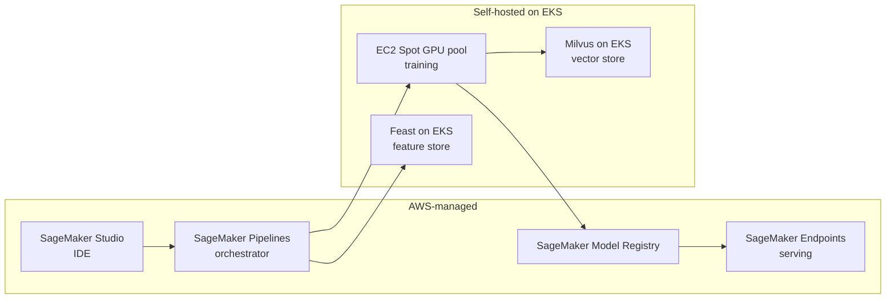
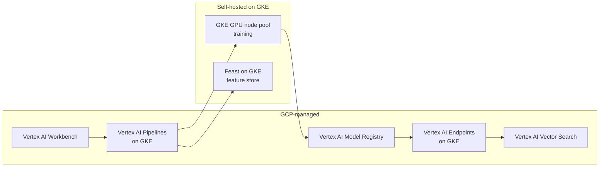
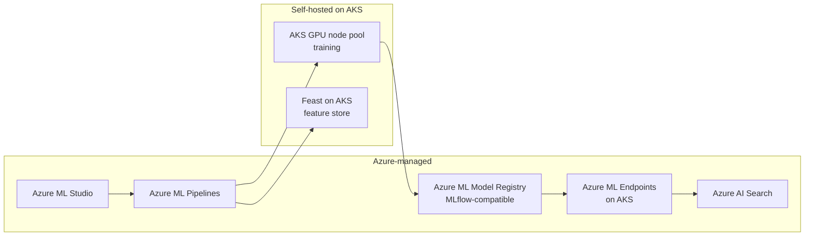
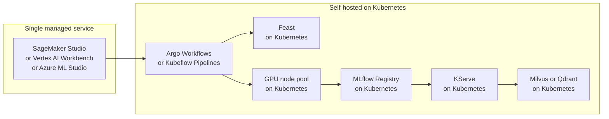

# 16.11 Cloud MLOps platforms: Vertex AI, SageMaker and Azure ML

| Field | Value |
|---|---|
| Level | Intermediate |
| Priority tier | 2 |
| Lab venue | GCP / GKE |
| Part | Part 16: MLOps and LLMOps tools and platforms |
| Primary sources | *Practical MLOps* (`practical-mlops`, Chapters 7, 8, 9); AWS SageMaker, Azure Machine Learning, and Vertex AI official documentation; *Machine Learning Platform Engineering* (`machine-learning-platform-engineering`, Chapters 5, 9) |
| Cross-references | Chapter 16.1 (MLOps foundations); Chapter 16.6 (Model registry and GitOps); Chapter 16.7 (Serving platforms); Chapter 16.14 (Multi-tenant AI factory); Chapter 5 (Kubernetes) |
| Coverage file | `planning/coverage/chapters/16-11.md` |
| Claim & number ledger | `planning/ledgers/16-11.md` |

## Why this matters for AI infrastructure

The earlier chapters assumed a self-hosted Kubernetes platform on GKE, EKS, or AKS. In that setup the platform team runs the registry, the orchestrator, the feature store, and the serving stack itself. This chapter looks at the other option, where the cloud provider runs those same pieces as managed services.

Three managed stacks cover this ground today: Vertex AI on GCP, SageMaker on AWS, and Azure Machine Learning on Azure. Each one bundles a studio (a notebook and IDE), a pipeline orchestrator, a feature store, a model registry, and an endpoint service for serving models. You get all five from one vendor, under one bill.

Choosing between self-hosted and managed is mostly an organisational decision, not a technical one. A team of three data scientists with no platform engineers gains the most from a managed stack. A team with several platform engineers often prefers to run its own. Many teams land in the middle, using managed notebooks and pipelines while keeping the GPU pool on their own nodes, because managed GPU capacity costs more.

The block below records the cited sources' rough figures for the managed stack. Treat them as starting points and check them against your own costs before you rely on them.

```text
Why the managed stack is on the critical path (background reading: Practical MLOps; Machine Learning Platform Engineering; the figures below are examples, not quotations):
- A typical mature ML platform has 10-30 engineers operating it; the managed
  stack reduces the operational burden to 2-3 engineers, but at a higher
  per-resource cost (typically 2-5x the cost of self-hosted GPU capacity).
- A cloud migration is a one-way door for the data, the models, and the
  registries. The migration must be designed to leave the team with an exit
  ramp (the data in portable formats; the models in ONNX; the pipelines in
  Kubeflow or Argo Workflows).
- The three managed stacks are not interchangeable; each cloud provider has
  chosen a different abstraction. Vertex AI is the most Kubernetes-friendly
  (custom training jobs run as Google-managed containers, not in your own GKE cluster); SageMaker is the most AWS-native (Studio,
  Pipelines, Endpoints are AWS-managed services); Azure ML is the most
  enterprise-friendly (Studio is Azure-native; MLflow is supported).
```

Three operational realities make this a platform-team problem, not only a data-science problem. First, the managed stack shows up on the platform team's bill, and it can become the largest line in the AI factory's budget. Second, moving data and models out of a managed stack is hard, so the platform team has to own an exit plan. Third, the managed stack sets an identity boundary, and the platform team owns the cross-cloud access rules that data scientists use.

**Treat a managed stack as a long-term contract, not a one-line decision.** Before your team commits, work out the abstraction, the cost, and the exit route.

## Prerequisites and outcomes

### Prerequisites

- Chapter 16.1 (MLOps foundations).
- Chapter 16.6 (Model registry and GitOps).
- Chapter 16.7 (Serving platforms).
- Chapter 5 (Kubernetes) for the cluster primitives the managed stacks sit on top of.

### Outcomes

By the end of this chapter you should be able to:

- Compare Vertex AI, SageMaker, and Azure Machine Learning on the core parts: Studio, Pipelines, Feature Store, Registry, and Endpoints.
- Decide between managed and self-hosted by weighing cost, time to the first model, and team skills.
- Build a hybrid design, with managed Studio and Pipelines and a self-hosted GPU pool and serving layer.
- Design a portability contract, with data in open formats, models in ONNX, and pipelines in Kubeflow or Argo Workflows.
- Run the managed stack on GKE, EKS, or AKS, with cost attribution, IAM, and observability that match the earlier chapters.

---

## 1. The three managed stacks

### 1.1 Vertex AI on GCP

Vertex AI is Google Cloud's managed ML platform. Each of its parts matches a layer you already know from the earlier chapters, so the table works as a translation guide. If you already run on one of these clouds, start with its table.

| Component | What it does | Mapping from earlier chapters |
|---|---|---|
| **Vertex AI Workbench** | Managed JupyterLab; per-user notebooks on a managed cluster | The notebook layer (Chapter 16.1 Section 1) |
| **Vertex AI Pipelines** | Managed Kubeflow Pipelines. The runtime is GKE | The orchestrator (Chapter 16.4) |
| **Vertex AI Feature Store** | Managed feature store; offline view is BigQuery; online view is Bigtable | The feature store (Chapter 16.3) |
| **Vertex AI Model Registry** | Managed model registry. The backing store is a Postgres-like service | The registry (Chapter 16.6) |
| **Vertex AI Endpoints** | Managed serving. The runtime is a managed GKE. The autoscaler is custom-metric-aware | The serving platform (Chapter 16.7) |
| **Vertex AI Vector Search** | Managed vector database. The index type is proprietary | The vector store (Chapter 16.8) |
| **Vertex AI Pipelines + Custom Jobs** | GPU-backed training. The runtime is GKE with NVIDIA CUDA images | The distributed compute (Chapter 16.5) |

Vertex AI is the most Kubernetes-friendly of the three. Vertex AI runs custom training jobs, pipelines and endpoints as Google-managed services; you do not operate a GKE cluster for them. If your platform team already runs GKE, you have a head start. A team on EKS or AKS can still use Vertex AI, but it pays for cross-cloud networking.

### 1.2 SageMaker on AWS

SageMaker is AWS's managed ML platform. Its parts are AWS services, and they sit at a higher level of abstraction than Vertex AI's.

| Component | What it does | Mapping from earlier chapters |
|---|---|---|
| **SageMaker Studio** | Managed IDE; per-user JupyterLab on a managed cluster | The notebook layer |
| **SageMaker Pipelines** | Managed pipeline orchestrator. The runtime is a managed compute | The orchestrator |
| **SageMaker Feature Store** | Managed feature store; offline view is S3 + Glue; online view is a managed low-latency store | The feature store |
| **SageMaker Model Registry** | Managed model registry; groups, versions, stages | The registry |
| **SageMaker Endpoints** | Managed serving. The runtime is a managed instance group; multi-model endpoints share one instance group | The serving platform |
| **OpenSearch / Aurora pgvector** | Vector search on top of OpenSearch or Postgres | The vector store |
| **SageMaker Training Jobs** | Managed training. The runtime is a managed compute cluster | The distributed compute |

SageMaker is the most AWS-native of the three, and that comes with a trade-off. Studio is opinionated, and its pipelines do not carry over cleanly to other clouds. In return, IAM, the VPC, KMS, and observability all use AWS's own services. If you already run on AWS, most of the identity and networking work is familiar.

### 1.3 Azure Machine Learning

Azure ML is Microsoft's managed ML platform. It mixes Azure services with open standards. MLflow is supported natively, and Kubeflow Pipelines can be deployed on AKS.

| Component | What it does | Mapping from earlier chapters |
|---|---|---|
| **Azure ML Studio** | Managed IDE; per-user JupyterLab | The notebook layer |
| **Azure ML Pipelines** | Managed pipeline orchestrator | The orchestrator |
| **Azure ML Feature Store** | Managed feature store | The feature store |
| **Azure ML Model Registry** | Managed model registry; MLflow-compatible | The registry |
| **Azure ML Endpoints** | Managed serving. The runtime is AKS | The serving platform |
| **Azure AI Search** | Vector search on top of Azure AI Search | The vector store |
| **Azure ML Compute** | Managed training. The runtime is AKS with NVIDIA images | The distributed compute |

Azure ML is the most MLflow-friendly of the three. Its abstraction sits closer to MLflow than to Kubernetes. If your team already uses MLflow, the move to Azure is smoother, because your experiment tracking carries over.

### 1.4 Comparison

| Dimension | Vertex AI | SageMaker | Azure ML |
|---|---|---|---|
| Studio | Workbench | Studio | Studio |
| Pipelines | Kubeflow Pipelines on GKE | SageMaker Pipelines | Azure ML Pipelines |
| Feature Store | Vertex AI Feature Store | SageMaker Feature Store | Azure ML Feature Store |
| Model Registry | Vertex AI Model Registry | SageMaker Model Registry | Azure ML Model Registry (MLflow-compatible) |
| Endpoints | Vertex AI Endpoints on GKE | SageMaker Endpoints on EC2 | Azure ML Endpoints on AKS |
| Vector Search | Vertex AI Vector Search | OpenSearch / Aurora pgvector | Azure AI Search |
| Custom Training | Custom Jobs on GKE | Training Jobs on managed compute | Compute on AKS |
| Portability | Kubernetes-native; portable | AWS-native; less portable | MLflow-compatible; moderately portable |
| IAM | GCP IAM | AWS IAM | Azure AD |
| Best fit | Teams already on GCP; Kubernetes-native | Teams already on AWS; AWS-native | Teams already on Azure; MLflow-friendly |

The three stacks differ in their abstractions, but they share one contract. The contract from Chapter 16.1 covers the four pillars, the promotion gate, and the lifecycle gates. It applies on every managed stack, and only the implementation changes from one to the next. When you compare the stacks, read the contract first and the product names second.

---

## 2. Managed vs self-hosted

### 2.1 The decision matrix

Imagine two teams choosing a platform. One has no one to run infrastructure, and the other has a platform group that already runs Kubernetes. *Practical MLOps* Chapters 7, 8, and 9 walk through the trade-offs, and the decision comes down to who will run the platform day to day.

| Dimension | Managed | Self-hosted |
|---|---|---|
| **Time to first model** | Hours (Studio is provisioned in minutes) | Days to weeks (cluster provisioning, IAM setup) |
| **Operational cost** | 2-5 platform engineers | 5-15 platform engineers |
| **Per-resource cost** | 2-5x the cost of self-hosted GPU | 1x (you pay for the GPU; nothing else) |
| **Customisation** | Limited to what the managed stack exposes | Unlimited (you own the YAML) |
| **Multi-cloud portability** | Locked to one cloud | Portable (Kubernetes runs anywhere) |
| **Compliance** | Provider's certifications (SOC2, HIPAA, FedRAMP) | Your own certifications |
| **Vendor risk** | High (single provider) | Low (Kubernetes is open source) |

The figures in this table are example values, not measurements. Replace them with your own quotes and staffing numbers before you decide. *Production Kubernetes*, chapter 2, makes the same underlying point about managed services. A managed control plane saves real engineering effort, but you give up some flexibility and take on the risk of vendor lock-in.

Most teams end up with a hybrid. The usual split looks like this:

- Managed for Studio and Pipelines. The team gets the IDE and the orchestrator without building them.
- Self-hosted for the GPU pool. The team owns those nodes, and the pool stays portable across clouds.
- Managed for the Registry and Endpoints. The model is served without the team running its own inference engine.
- Self-hosted for the Feature Store and Vector Search. The team owns the data plane, and the data stays portable.

The rule behind the split is simple. Go managed for what is portable and common, and self-host what is expensive or hard to move. Many mature teams settle on a split like this one.

### 2.2 The cost model

The cost of a managed stack has three parts: compute, storage, and inference. The table gives example price ranges, not current list prices. Prices change with region, commitment, and promotions, so check your own bill before you plan a budget.

| Cost component | Managed | Self-hosted |
|---|---|---|
| **GPU compute** | $2-5 per GPU-hour | $1 per GPU-hour (cloud GPU spot price) |
| **Storage** | $0.02-0.10 per GB-month | $0.01-0.02 per GB-month |
| **Inference (managed endpoints)** | $0.05-0.50 per hour per endpoint | $0.02-0.10 per hour per pod (K8s cost) |

Managed compute usually costs more per hour than self-hosted GPU capacity, and that gap is why the hybrid split exists. The managed stack buys convenience, and self-hosted capacity buys a lower unit price. Your job is to find the point where the convenience is worth the difference.

### 2.3 The portability contract

A team that commits to a managed stack is making a multi-year bet. The bet covers four things: data, models, pipelines, and features. For each one, keep an exit route in an open format.

- Data. The training data sits in the managed object store, such as GCS, S3, or Azure Blob. Keep it in open formats like Parquet, CSV, or JSON, and avoid archive tiers that only one vendor offers, such as S3 Glacier, GCS Coldline, or Azure Archive.
- Models. The models live in the managed registry. Save them in open formats such as ONNX, PMML, SavedModel, or PyTorch JIT, and keep the artefacts in object storage outside the managed stack. Then you can move the registry without moving the models.
- Pipelines. Write pipeline definitions as Kubeflow Pipelines YAML or Argo Workflows YAML. If you must leave, you can run the same definitions on a self-hosted Kubeflow or Argo Workflows install.
- Feature store. Keep feature definitions as Feast feature views or SQL DDL. If you leave the managed store, you can deploy Feast on Kubernetes.

The contract is a discipline you keep up over time, not a one-time decision. Write down the exit route for each of the four before you sign.

---

## 3. Hybrid architectures

### 3.1 The most common hybrid

*Practical MLOps* Chapter 7 describes the most common hybrid on AWS. The data scientist works in SageMaker Studio and SageMaker Pipelines, and SageMaker also runs the registry and endpoints. The platform team runs GPU training on EC2 Spot Instances.



The data scientist gets a managed notebook and pipeline, so nobody has to provision infrastructure by hand. The platform team keeps the GPU pool, the feature store, and the vector store. The cost of that arrangement is that the GPU pool is yours to run.

### 3.2 The GCP-native hybrid

On GCP the hybrid looks much like the AWS version. Vertex AI Workbench, Pipelines, Model Registry, and Endpoints are managed, and the platform team runs GPU training on a GKE node pool.



Vertex AI Pipelines and Endpoints are Google-managed services, so a hybrid with a GKE-based platform needs a clear boundary between the two. Vertex AI Vector Search is the managed option in place of Milvus on GKE. Choosing it is a trade between convenience and cost.

### 3.3 The Azure-native hybrid

On Azure the pattern follows the GCP version. Azure ML Studio, Pipelines, Model Registry, and Endpoints are managed, and GPU training runs on an AKS node pool that the platform team owns.



Azure ML Endpoints run on AKS, so the GPU training sits on a node pool that your own platform team manages. Azure AI Search is the managed option in place of a vector store you would run on AKS.

### 3.4 The most aggressive self-hosted

The most aggressive self-hosted design keeps only the IDE in a managed service. SageMaker Studio, Vertex AI Workbench, or Azure ML Studio handles the notebooks. Pipelines, registry, endpoints, feature store, and vector search all run on your own Kubernetes cluster.



This design gives the most portability and the heaviest operations load. Some teams move to it only after they outgrow the managed stack. Plan the staffing before you start the move.

---

## 4. Operating the managed stack

### 4.1 IAM and multi-tenancy

The managed stack has its own IAM model, separate from your cluster's. Map your tenancy model onto it, so each team's access stays inside its own boundary.

| Pattern | Managed IAM mapping |
|---|---|
| One namespace per team | One managed-stack project / account / workspace per team |
| One service account per pipeline | One managed-stack service principal per pipeline |
| One IAM role per platform engineer | One managed-stack IAM role per platform engineer |

Cross-cloud access is the hardest part of this. A data scientist on AWS who needs a GCP resource crosses two identity systems, and each crossing is a place where permissions can go wrong. A service mesh or an API gateway can hide that boundary from the user. *Production Kubernetes*, chapter 12, describes two basic tenancy models, single-tenant clusters and multitenant clusters, and a similar choice comes up here.

### 4.2 Cost attribution

The managed stack reports its cost, but the report is only useful if your resources carry labels. Tag every job and model with the owning team and the model name. The FinOps dashboard can then group the spend.

```yaml
# Vertex AI custom job labels (shape only)
labels:
  team: team-data-science
  model: churn-model
  cost-center: ml-platform
```

Those labels flow into the billing export: BigQuery for GCP, Cost and Usage Reports for AWS, and Cost Management for Azure. The result is a dashboard that shows cost per team, per model, and per month.

### 4.3 Observability

A managed stack comes with its own monitoring. Send its metrics into your existing stack, so the team reads one set of dashboards instead of three.

| Stack | Native observability | Federated to |
|---|---|---|
| Vertex AI | Cloud Monitoring | Prometheus via OpenTelemetry collector |
| SageMaker | CloudWatch | Prometheus via CloudWatch exporter |
| Azure ML | Azure Monitor | Prometheus via Azure Monitor exporter |

Once federated, the managed metrics appear next to the self-hosted ones. Your SLOs should not depend on where a model happens to run.

### 4.4 Disaster recovery

A managed stack lives in one cloud, so a cloud outage takes it down too. Ask what happens to your model serving on the day that cloud has a bad incident. Mirror the critical parts, such as the model registry and the feature store, to a second cloud or to a self-hosted copy.

Two terms set the targets. The recovery time is how long you can be down. The recovery point is how much recent data you can afford to lose. The managed service's recovery time is the provider's, not yours. Check that it meets your business's targets, and keep a fallback ready in case it does not.

---

## 5. How it fails

Five failure modes come up again and again. Each one starts with a symptom you can see, and the diagnosis tells you which part of the design to change.

### 5.1 "The managed stack is too expensive"

**Symptom:** The cost dashboard shows the managed stack costing much more than self-hosted for the same workload. The CFO asks why.

**Diagnosis:** The managed stack charges more per resource. The team is paying for convenience, and nobody has decided whether that convenience is worth it.

**Fix:** Move to the hybrid pattern from Section 3. Keep Studio and Pipelines managed, and run the GPU pool, the feature store, and the vector store yourself. The size of the saving depends on your own prices, so measure the bill before and after.

### 5.2 "We cannot migrate off the managed stack"

**Symptom:** The team wants to move from one cloud to another. The data, models, and pipelines are locked in, so the move looks like a multi-year project.

**Diagnosis:** The portability contract from Section 2.3 was never enforced. The data is in a vendor-specific format, the models sit in a vendor-specific registry, and the pipelines use a vendor-specific orchestrator.

**Fix:** Enforce the portability contract. Keep data in Parquet or CSV, models in ONNX or PMML, and pipelines in Kubeflow or Argo format. With those in place, the next migration becomes a much shorter project.

### 5.3 "The GPU quota is exhausted"

**Symptom:** The training job sits in a queue, and the managed stack reports that the GPU quota is used up.

**Diagnosis:** Managed stacks cap GPU usage with a quota. Your job waits until the quota is raised or resets. How and when that happens depends on the provider, so check the rules for your account.

**Fix:** Send overflow jobs to the self-hosted GPU pool, which is not subject to the managed quota.

### 5.4 "The managed endpoint is slow"

**Symptom:** Customer latency is high. The managed endpoint's metrics show high p99 latency, and you cannot tune the autoscaler to fix it.

**Diagnosis:** The managed autoscaler may not show you the queue depth, the load on each replica, or the cold-start time. You can only tune what you can see.

**Fix:** Move the endpoint to KServe on Kubernetes. Your platform team then controls the autoscaler and can see every metric.

### 5.5 "The managed registry is down"

**Symptom:** CI cannot promote a model, because the managed registry reports that the service is unavailable. Every release is blocked.

**Diagnosis:** The managed registry is a single point of failure, and the team has no fallback.

**Fix:** Mirror the registry to a self-hosted MLflow registry. CI writes to both, and the cluster reads from the self-hosted copy. The managed registry stays the source of truth for the audit log.

---

## 6. Hands-on lab

This lab builds a Vertex AI stack on GCP, with Workbench, Pipelines, Registry, and Endpoints. It also uses a self-hosted Feast feature store and a self-hosted GPU node pool. The lab is untested in this repository, so treat each step as a starting point.

### 6.1 Prerequisites

- A GCP project with billing enabled, `gcloud` and `kubectl` installed.
- A GKE Autopilot or Standard cluster (1.27+).
- Vertex AI API enabled.
- Feast installed (Chapter 16.3).

### 6.2 Step 1: enable Vertex AI APIs

```bash
gcloud services enable \
  aiplatform.googleapis.com \
  artifactregistry.googleapis.com \
  cloudbuild.googleapis.com
```

### 6.3 Step 2: create a Vertex AI Workbench instance

```bash
gcloud notebooks instances create my-workbench \
  --location=us-central1 \
  --machine-type=n1-standard-4
# expected: the Workbench instance is created; the URL is printed
```

### 6.4 Step 3: create a Vertex AI Pipeline

```python
# code/part16/vertex_pipeline.py
from kfp import dsl, compiler

@dsl.component(packages_to_install=["scikit-learn", "mlflow"])
def train_op(dataset_id: str, seed: int) -> str:
    import mlflow
    mlflow.set_tracking_uri("http://mlflow.mlops.svc.cluster.local:5000")
    mlflow.set_experiment("churn")
    with mlflow.start_run() as run:
        mlflow.log_param("seed", seed)
        # ... train ...
    return run.info.run_id

@dsl.pipeline(name="Churn Training Pipeline")
def training_pipeline(dataset_id: str = "churn-v3", seed: int = 42):
    train_op(dataset_id=dataset_id, seed=seed)

if __name__ == "__main__":
    compiler.Compiler().compile(training_pipeline, "pipeline.yaml")
```

```bash
# Submit the pipeline to Vertex AI
gcloud ai pipelines run --project=${PROJECT_ID} \
  --region=us-central1 \
  --template-gcs-path=gs://my-bucket/pipeline.yaml \
  --parameter-values="dataset-id=churn-v3,seed=42"
# expected: the pipeline runs on a GKE node pool; the run appears in Vertex AI Pipelines
```

### 6.5 Step 4: register the model in Vertex AI Model Registry

```bash
gcloud ai models upload --region=us-central1 \
  --display-name=churn-model \
  --artifact-uri=gs://mlflow-artifacts/churn-model/v6/model.pkl \
  --container-image-uri=us-docker.pkg.dev/vertex-ai/prediction/sklearn-cpu.1-5:latest
# expected: the model is registered; the model id is printed
```

### 6.6 Step 5: deploy the endpoint

```bash
gcloud ai endpoints create --region=us-central1 \
  --display-name=churn-model

gcloud ai endpoints deploy-model ${ENDPOINT_ID} \
  --region=us-central1 \
  --model=${MODEL_ID} \
  --machine-type=n1-standard-2 \
  --min-replica-count=1 \
  --max-replica-count=10
# expected: the endpoint is deployed; the URL is printed
```

### 6.7 Step 6: query the endpoint

```bash
ENDPOINT_URL=$(gcloud ai endpoints describe ${ENDPOINT_ID} --region=us-central1 --format='value(deployedModels[0].privateEndpoint)')
curl -X POST -H "Content-Type: application/json" \
  -d '{"instances": [{"tier_gold": 1.0}]}' \
  ${ENDPOINT_URL}/v1/predict
# expected: a JSON response with the prediction
```

### 6.8 Step 7: observe the cost

```bash
# Query BigQuery billing export
bq query --use_legacy_sql=false \
  "SELECT service.description, SUM(cost) AS total_cost
   FROM \`${PROJECT_ID}.billing.gcp_billing_export_*\`
   WHERE service.description LIKE '%aiplatform%'
   GROUP BY service.description
   ORDER BY total_cost DESC
   LIMIT 10"
# expected: a per-service cost breakdown
```

### 6.9 What to record

After the lab, you should be able to answer these five questions quickly:

1. What is the current Vertex AI Workbench instance URL?
2. What is the most recent Vertex AI Pipeline run id?
3. What is the current Vertex AI Model Registry model version?
4. What is the current Vertex AI Endpoint URL?
5. What is the cost per Vertex AI service this month?

The 30-second limit is only an example. Pick the time limit your team agrees on. If you cannot answer one of these questions quickly, the stack is not yet ready to run as a production service. The lab is untested against a live GKE cluster.

---

## Exercises

Try these after the lab. Each one changes the design, so you will see the trade-off for yourself instead of reading about it.

1. **Add a hybrid architecture.** Move GPU training to a self-hosted GKE node pool, and keep Pipelines and Endpoints managed. Then compare the cost. *Solution sketch:* submit a custom training job to GKE instead of Vertex AI Custom Jobs, and compare the cost in the BigQuery billing export.
2. **Add a portability contract.** Convert the Vertex AI Model Registry entries to ONNX, and upload them to a self-hosted MLflow registry. *Solution sketch:* a script reads the Vertex AI registry, converts each artefact to ONNX, and uploads the result to MLflow.
3. **Add a cost dashboard.** Build a Grafana dashboard that shows Vertex AI cost per service, per team, and per model. *Solution sketch:* a Grafana dashboard that queries the BigQuery billing export through the BigQuery data source.
4. **Add an IAM mapping.** Map each team's Kubernetes service account to a Vertex AI service principal. *Solution sketch:* a Terraform module creates the service principals, and the IAM bindings live in the Terraform state.
5. **Add a disaster recovery plan.** Mirror the Vertex AI Model Registry to a self-hosted MLflow registry, and mirror the Vertex AI Endpoints to KServe. *Solution sketch:* a sync job runs on a schedule you choose, for example every 15 minutes. It writes registry entries to MLflow and deploys the KServe InferenceServices.
6. **Add a multi-cloud fallback.** Stand up an Azure ML Endpoints deployment as a fallback for the Vertex AI Endpoints. *Solution sketch:* a Terraform module creates the Azure ML endpoint, and a DNS failover routes traffic to Azure ML when Vertex AI is down.

---

## Checkpoint questions

<details><summary>1. The CFO asks why the managed stack costs far more than self-hosted for the same workload. What is the cause and what do you propose?</summary>
The managed stack charges more per resource, so the team is paying for convenience and nobody has decided whether it is worth it. Move to the hybrid pattern. Keep Studio and Pipelines managed and run the GPU pool, the feature store, and the vector store yourself. The saving depends on your own prices, so measure the bill before and after.
</details>

<details><summary>2. The company wants to move from one cloud to another and the move looks like a multi-year project. What was missing?</summary>
The portability contract was never enforced. The data is in a vendor-specific format, the models sit in a vendor-specific registry, and the pipelines use a vendor-specific orchestrator. Keep data in Parquet or CSV, models in ONNX or PMML, and pipelines in Kubeflow or Argo format. With those in place the next migration is a much shorter project.
</details>

<details><summary>3. A training job sits in a queue and the managed stack says the GPU quota is used up. What do you do?</summary>
Managed stacks cap GPU usage with a quota, so the job waits until the quota is raised or resets. How and when depends on the provider, so check the rules for your account. Send overflow jobs to the self-hosted GPU pool, which is not subject to the managed quota.
</details>

<details><summary>4. A managed endpoint shows high p99 latency and you cannot tune the autoscaler. Why not, and what is the fix?</summary>
The managed autoscaler may not show you the queue depth, the load on each replica, or the cold-start time, and you can only tune what you can see. Move the endpoint to KServe on Kubernetes. Your platform team then controls the autoscaler and sees every metric.
</details>

<details><summary>5. CI cannot promote a model because the managed registry is unavailable, and every release is blocked. How do you prevent a repeat?</summary>
The managed registry is a single point of failure and the team has no fallback. Mirror it to a self-hosted MLflow registry. CI writes to both and the cluster reads from the self-hosted copy. The managed registry stays the source of truth for the audit log.
</details>

<details><summary>6. A team of three data scientists with no platform engineers wants to ship a first model quickly. Managed or self-hosted, and why?</summary>
Managed. Studio is provisioned in minutes, so the first model takes hours, where a self-hosted cluster takes days to weeks for provisioning and IAM setup. Such a team gains the most from a managed stack because nobody has to run it. The cost is a higher per-resource price and less customisation.
</details>

<details><summary>7. Why does the usual hybrid keep the GPU pool self-hosted?</summary>
Managed GPU capacity costs more per hour, so GPUs are where the managed price gap is biggest. The team also owns those nodes, and the pool stays portable across clouds. The rule is to go managed for what is portable and common and to self-host what is expensive or hard to move.
</details>

<details><summary>8. Why should model artefacts sit in object storage outside the managed stack in open formats?</summary>
Then you can move the registry without moving the models. Open formats such as ONNX, PMML, SavedModel, or PyTorch JIT can be loaded elsewhere. A model stored only in a vendor registry in a vendor format is locked in with it.
</details>

<details><summary>9. Why do you tag every managed job and model with the owning team and model name?</summary>
The managed stack reports its cost, but the report is only useful if resources carry labels. The labels flow into the billing export, which is BigQuery for GCP, Cost and Usage Reports for AWS, and Cost Management for Azure. The FinOps dashboard can then group spend per team, per model, and per month.
</details>

<details><summary>10. Why is cross-cloud access the hardest part of managed IAM?</summary>
A data scientist on AWS who needs a GCP resource crosses two identity systems. Each crossing is a place where permissions can go wrong. A service mesh or an API gateway can hide that boundary from the user.
</details>

<details><summary>11. Why do you federate managed metrics into Prometheus?</summary>
Each stack has its own monitoring, namely Cloud Monitoring, CloudWatch, and Azure Monitor. Federating them means the team reads one set of dashboards instead of three. Managed metrics then sit next to the self-hosted ones, and SLOs do not depend on where a model happens to run.
</details>

<details><summary>12. When would you choose a managed stack over self-hosted, and what do you give up?</summary>
Choose managed when you have few platform engineers and want a fast first model. The chapter's example is 2 to 5 platform engineers against 5 to 15. You give up customisation, because you are limited to what the stack exposes. You also give up portability and you take on single-provider vendor risk. A compliance plus is that you inherit the provider's certifications.
</details>

<details><summary>13. When would you use a managed vector search instead of running Milvus on GKE?</summary>
Use the managed option, such as Vertex AI Vector Search, when you want convenience and no database to operate. The trade is convenience against cost. The managed index type is proprietary, so you also give up portability. Run Milvus yourself when the data plane should stay portable.
</details>

<details><summary>14. Which managed stack fits a team already on AWS, and which fits a team already on Azure that uses MLflow?</summary>
The AWS team fits SageMaker, which is the most AWS-native, so IAM, VPC, KMS, and observability are familiar. The cost is that its pipelines do not carry over cleanly to other clouds. The Azure team fits Azure ML, which supports MLflow natively, so experiment tracking carries over.
</details>

<details><summary>15. When would you choose the most aggressive self-hosted design with only the IDE managed, and what do you give up?</summary>
Choose it when you want the most portability and have the staff for it. Pipelines, registry, endpoints, feature store, and vector search all run on your own Kubernetes cluster. You give up a light operations load. Some teams move to it only after they outgrow the managed stack, so plan the staffing before you start.
</details>

<details><summary>16. A training job uses 1,000 GPU-hours. Using the chapter's example prices, what is the gap between managed and self-hosted?</summary>
Managed at $2 to $5 per GPU-hour costs $2,000 to $5,000. Self-hosted at $1 per GPU-hour costs $1,000. The gap is $1,000 to $4,000 for the job. The prices are examples, so check your own bill.
</details>

<details><summary>17. You store 10,000 GB of data. What is the monthly storage cost for managed and self-hosted at the chapter's example prices?</summary>
Managed at $0.02 to $0.10 per GB-month costs $200 to $1,000. Self-hosted at $0.01 to $0.02 per GB-month costs $100 to $200. The ratio is therefore between 2 to 1 and 5 to 1.
</details>

<details><summary>18. One endpoint runs 24 hours a day for 720 hours in a month. What does it cost managed and self-hosted at the example hourly prices?</summary>
Managed at $0.05 to $0.50 per hour costs $36 to $360. A self-hosted pod at $0.02 to $0.10 per hour costs $14.40 to $72. These are example ranges, so check your own bill.
</details>

<details><summary>19. The FinOps dashboard cannot split the managed spend by team. In what order do you check?</summary>
First check that each job and model carries the team, model, and cost center labels. Second check that the labels reach the billing export for your cloud, which is BigQuery, Cost and Usage Reports, or Cost Management. Third check the dashboard query that groups spend by those labels.
</details>

<details><summary>20. A cloud has a bad incident and your managed serving is down. What do you check, in what order?</summary>
First check the recovery time and recovery point the business needs and compare them with the provider's recovery time, which is theirs, not yours. Second check whether the critical parts, the model registry and the feature store, are mirrored to a second cloud or a self-hosted copy. Third check that a fallback serving path is ready, such as KServe or an endpoint in another cloud.
</details>

---

## Sources and review notes

- *Practical MLOps* (`practical-mlops`, Chapters 7, 8, 9). Source for the three managed stacks (AWS SageMaker, Azure ML, GCP Vertex AI), the cost model, the hybrid pattern, the portability contract, and the operational patterns for the managed stack. Chapter 7 is approximately 10,600 words; Chapter 8 is approximately 8,000 words; Chapter 9 is approximately 4,700 words.
- AWS SageMaker, Azure Machine Learning, and Vertex AI official documentation. Source for the current component names, the pricing model, the IAM model, and the deployment patterns.
- *Machine Learning Platform Engineering* (`machine-learning-platform-engineering`, Chapters 5, 9). Source for the managed-vs-self-hosted decision matrix, the hybrid pattern, and the cost attribution model. Chapter 5 is approximately 9,000 words; Chapter 9 is approximately 9,000 words.

### Cross-references to other handbook chapters

- Chapter 16.1 for the MLOps foundations that every managed stack implements.
- Chapter 16.6 for the model registry contract that the managed registry implements.
- Chapter 16.7 for the serving platform contract that the managed endpoints implement.
- Chapter 16.14 (Platform design: multi-tenant AI factory) for the FinOps and IAM patterns.

### Migrated from `nvidia-devops`

The hybrid architecture pattern draws on Volume 25 chapter 8. The wording has been rewritten in the handbook's voice.

### Explicitly labelled inferences

- The cost-per-resource numbers in Section 2.2 are starting points; specific prices vary by region, by commitment, and by current promotional pricing.
- The hybrid pattern in Section 3.1 is the most common; specific teams may converge on different patterns based on team skills and existing commitments.
- The portability contract in Section 2.3 is a discipline; specific formats depend on the team's existing toolchain.

### Not verified on live hardware

- The lab in Section 6 is **untested** against a live GCP project in this repository.
- The Vertex AI, SageMaker, and Azure ML versions assumed in the lab should be verified against the current releases before production use.
- The cost numbers in the lab are illustrative; production costs vary by usage pattern.
