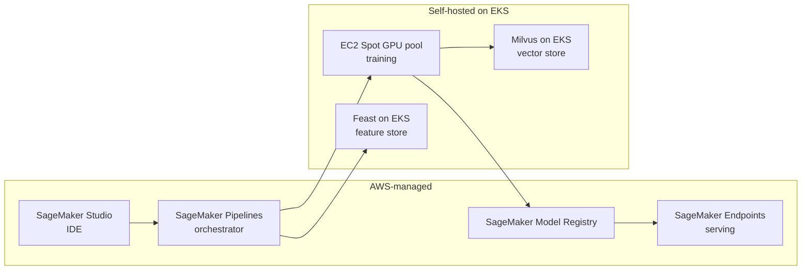
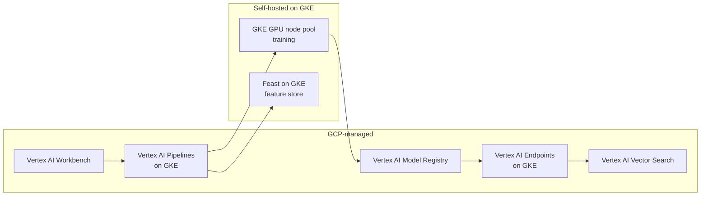
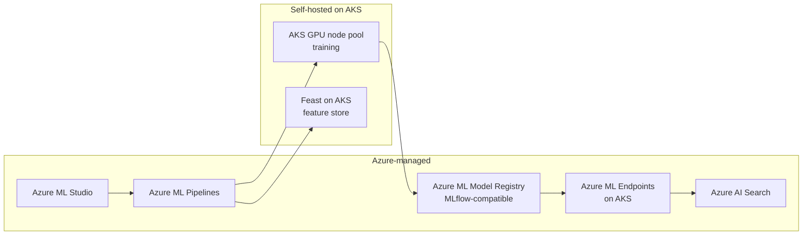
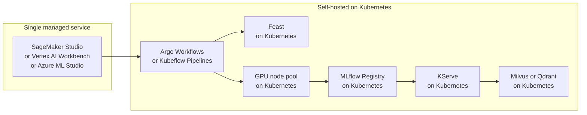

# 16.11 Cloud MLOps platforms: Vertex AI, SageMaker and Azure ML

| Field | Value |
|---|---|
| Level | Intermediate |
| Priority tier | 2 |
| Lab venue | GCP / GKE |
| Part | Part 16: MLOps and LLMOps tools and platforms |
| Primary sources | *Practical MLOps* (`practical-mlops`, Chapters 7, 8, 9); AWS SageMaker, Azure Machine Learning, and Vertex AI official documentation; *Machine Learning Platform Engineering* (`machine-learning-platform-engineering`, Chapters 5, 9) |
| Cross-references | Chapter 16.1 (MLOps foundations); Chapter 16.6 (Model registry and GitOps); Chapter 16.7 (Serving platforms); Chapter 16.14 (Multi-tenant AI factory); Chapter 5 (Kubernetes) |
| Coverage file | `planning/coverage/chapters/16-11.md` |
| Claim & number ledger | `planning/ledgers/16-11.md` |

## Why this matters for AI infrastructure

The previous chapters assumed a self-hosted Kubernetes platform (GKE, EKS, or AKS) with the platform team owning the registry, the orchestrator, the feature store, and the serving infrastructure. This chapter walks through the managed-stack alternative: the cloud provider owns the same pieces as a managed service. Vertex AI on GCP, SageMaker on AWS, and Azure Machine Learning on Azure are the three managed stacks in production today. Each one bundles a Studio (a notebook + IDE), Pipelines (an orchestrator), a Feature Store, a Model Registry, and Endpoints (a serving platform) into a single managed offering.

The decision between self-hosted and managed is not technical; it is organisational. A team of three data scientists with no platform engineers benefits from managed. A team of fifty data scientists with five platform engineers benefits from self-hosted. A team that wants to use managed for the Studio and Pipelines but self-hosted for the GPU pool (because the GPU pool is too expensive on the managed stack) benefits from hybrid.

```text
Why the managed stack is on the critical path (PM Ch 7, 8, 9; MLPE Ch 9):
- A typical mature ML platform has 10-30 engineers operating it; the managed
  stack reduces the operational burden to 2-3 engineers, but at a higher
  per-resource cost (typically 2-5x the cost of self-hosted GPU capacity).
- A cloud migration is a one-way door for the data, the models, and the
  registries. The migration must be designed to leave the team with an exit
  ramp (the data in portable formats; the models in ONNX; the pipelines in
  Kubeflow or Argo Workflows).
- The three managed stacks are not interchangeable; each cloud provider has
  chosen a different abstraction. Vertex AI is the most Kubernetes-friendly
  (custom training jobs run on GKE); SageMaker is the most AWS-native (Studio,
  Pipelines, Endpoints are AWS-managed services); Azure ML is the most
  enterprise-friendly (Studio is Azure-native; MLflow is supported).
```

Three operational realities make this chapter a platform-team concern rather than a data-science-only concern:

1. **The managed stack is the team's bill.** The platform team owns the FinOps dashboard; the cost of the managed stack is the single largest line item in the AI factory's budget.
2. **The managed stack is the team's data egress surface.** A cloud migration that does not preserve the team's exit ramp is a cloud migration that locks the team in. The platform team owns the portability contract.
3. **The managed stack is the team's IAM boundary.** The platform team owns the cross-cloud IAM; the data scientist consumes the per-team IAM.

**Before a team commits to a managed stack, the platform team must understand the abstraction, the cost, and the exit ramp. A managed stack is a long-term contract; a managed stack is not a one-line decision.**

## Prerequisites and outcomes

### Prerequisites

- Chapter 16.1 (MLOps foundations).
- Chapter 16.6 (Model registry and GitOps).
- Chapter 16.7 (Serving platforms).
- Chapter 5 (Kubernetes) for the cluster primitives the managed stacks sit on top of.

### Outcomes

After completing this chapter you will be able to:

1. Compare Vertex AI, SageMaker, and Azure Machine Learning on the five core components (Studio, Pipelines, Feature Store, Registry, Endpoints).
2. Choose between managed and self-hosted on the dimensions of operational cost, per-resource cost, time-to-first-model, and team skills.
3. Build a hybrid architecture: managed for Studio and Pipelines, self-hosted for the GPU pool and the serving platform.
4. Design a portability contract that survives a cloud migration: data in portable formats, models in ONNX, pipelines in Kubeflow or Argo Workflows.
5. Operate the managed stack on GKE / EKS / AKS with cost attribution, IAM, and observability that matches the patterns from earlier chapters.

---

## 1. The three managed stacks

### 1.1 Vertex AI on GCP

Vertex AI is Google Cloud's managed ML platform. The components map directly to the abstractions from earlier chapters.

| Component | What it does | Mapping from earlier chapters |
|---|---|---|
| **Vertex AI Workbench** | Managed JupyterLab; per-user notebooks on a managed cluster | The notebook layer (Chapter 16.1 Section 1) |
| **Vertex AI Pipelines** | Managed Kubeflow Pipelines; the runtime is GKE | The orchestrator (Chapter 16.4) |
| **Vertex AI Feature Store** | Managed feature store; offline view is BigQuery; online view is Bigtable | The feature store (Chapter 16.3) |
| **Vertex AI Model Registry** | Managed model registry; the backing store is a Postgres-like service | The registry (Chapter 16.6) |
| **Vertex AI Endpoints** | Managed serving; the runtime is a managed GKE; the autoscaler is custom-metric-aware | The serving platform (Chapter 16.7) |
| **Vertex AI Vector Search** | Managed vector database; the index type is proprietary | The vector store (Chapter 16.8) |
| **Vertex AI Pipelines + Custom Jobs** | GPU-backed training; the runtime is GKE with NVIDIA CUDA images | The distributed compute (Chapter 16.5) |

Vertex AI is the most Kubernetes-friendly of the three managed stacks. Custom training jobs run on GKE; the pipeline runtime is GKE; the endpoint runtime is GKE. The platform team that already runs GKE has a head start; the platform team that runs EKS or AKS can still use Vertex AI but pays for the cross-cloud networking.

### 1.2 SageMaker on AWS

SageMaker is AWS's managed ML platform. The components are AWS-native services; the abstractions are higher-level than Vertex AI's.

| Component | What it does | Mapping from earlier chapters |
|---|---|---|
| **SageMaker Studio** | Managed IDE; per-user JupyterLab on a managed cluster | The notebook layer |
| **SageMaker Pipelines** | Managed pipeline orchestrator; the runtime is a managed compute | The orchestrator |
| **SageMaker Feature Store** | Managed feature store; offline view is S3 + Glue; online view is a managed low-latency store | The feature store |
| **SageMaker Model Registry** | Managed model registry; groups, versions, stages | The registry |
| **SageMaker Endpoints** | Managed serving; the runtime is a managed instance group; multi-model endpoints share one instance group | The serving platform |
| **OpenSearch / Aurora pgvector** | Vector search on top of OpenSearch or Postgres | The vector store |
| **SageMaker Training Jobs** | Managed training; the runtime is a managed compute cluster | The distributed compute |

SageMaker is the most AWS-native of the three. The trade-off is that the abstractions are higher-level (Studio is opinionated; the pipelines are not portable to other clouds). The benefit is that the IAM, the VPC, the KMS, and the observability are all AWS-native; the platform team that already runs AWS has a head start.

### 1.3 Azure Machine Learning

Azure ML is Microsoft's managed ML platform. The components mix Azure-native services with open-source standards (MLflow is supported natively; Kubeflow Pipelines can be deployed on AKS).

| Component | What it does | Mapping from earlier chapters |
|---|---|---|
| **Azure ML Studio** | Managed IDE; per-user JupyterLab | The notebook layer |
| **Azure ML Pipelines** | Managed pipeline orchestrator | The orchestrator |
| **Azure ML Feature Store** | Managed feature store | The feature store |
| **Azure ML Model Registry** | Managed model registry; MLflow-compatible | The registry |
| **Azure ML Endpoints** | Managed serving; the runtime is AKS | The serving platform |
| **Azure AI Search** | Vector search on top of Azure AI Search | The vector store |
| **Azure ML Compute** | Managed training; the runtime is AKS with NVIDIA images | The distributed compute |

Azure ML is the most MLflow-friendly of the three. The trade-off is that the abstraction is closer to MLflow than to Kubernetes; the benefit is that a team already on MLflow has a smooth migration.

### 1.4 Comparison

| Dimension | Vertex AI | SageMaker | Azure ML |
|---|---|---|---|
| Studio | Workbench | Studio | Studio |
| Pipelines | Kubeflow Pipelines on GKE | SageMaker Pipelines | Azure ML Pipelines |
| Feature Store | Vertex AI Feature Store | SageMaker Feature Store | Azure ML Feature Store |
| Model Registry | Vertex AI Model Registry | SageMaker Model Registry | Azure ML Model Registry (MLflow-compatible) |
| Endpoints | Vertex AI Endpoints on GKE | SageMaker Endpoints on EC2 | Azure ML Endpoints on AKS |
| Vector Search | Vertex AI Vector Search | OpenSearch / Aurora pgvector | Azure AI Search |
| Custom Training | Custom Jobs on GKE | Training Jobs on managed compute | Compute on AKS |
| Portability | Kubernetes-native; portable | AWS-native; less portable | MLflow-compatible; moderately portable |
| IAM | GCP IAM | AWS IAM | Azure AD |
| Best fit | Teams already on GCP; Kubernetes-native | Teams already on AWS; AWS-native | Teams already on Azure; MLflow-friendly |

The three are not interchangeable on the abstraction; they are interchangeable on the contract. The contract from Chapter 16.1 (the four pillars, the promotion gate, the lifecycle gates) is the same on every managed stack; the implementation differs.

---

## 2. Managed vs self-hosted

### 2.1 The decision matrix

*Practical MLOps* Chapters 7, 8, and 9 walk through the trade-offs. The decision is not technical; it is operational.

| Dimension | Managed | Self-hosted |
|---|---|---|
| **Time to first model** | Hours (Studio is provisioned in minutes) | Days to weeks (cluster provisioning, IAM setup) |
| **Operational cost** | 2-5 platform engineers | 5-15 platform engineers |
| **Per-resource cost** | 2-5x the cost of self-hosted GPU | 1x (you pay for the GPU; nothing else) |
| **Customisation** | Limited to what the managed stack exposes | Unlimited (you own the YAML) |
| **Multi-cloud portability** | Locked to one cloud | Portable (Kubernetes runs anywhere) |
| **Compliance** | Provider's certifications (SOC2, HIPAA, FedRAMP) | Your own certifications |
| **Vendor risk** | High (single provider) | Low (Kubernetes is open source) |

The decision is usually a hybrid. The pattern is:

- **Managed for Studio and Pipelines.** The platform team gets the IDE and the orchestrator without building them; the data scientist gets the notebook without provisioning.
- **Self-hosted for the GPU pool.** The platform team owns the GPU nodes; the cost is 1x rather than 2-5x; the GPU pool is portable across clouds.
- **Managed for the Registry and Endpoints.** The platform team gets the abstraction without building it; the model is served without managing the inference engine.
- **Self-hosted for the Feature Store and Vector Search.** The platform team owns the data plane; the cost is 1x; the data is portable.

The hybrid pattern is what most mature AI factories converge on. The pattern is "managed for what is portable and commoditised; self-hosted for what is expensive and sticky".

### 2.2 The cost model

The cost of the managed stack has three components.

| Cost component | Managed | Self-hosted |
|---|---|---|
| **GPU compute** | $2-5 per GPU-hour | $1 per GPU-hour (cloud GPU spot price) |
| **Storage** | $0.02-0.10 per GB-month | $0.01-0.02 per GB-month |
| **Inference (managed endpoints)** | $0.05-0.50 per hour per endpoint | $0.02-0.10 per hour per pod (K8s cost) |

The cost model is why most mature AI factories converge on the hybrid pattern. The managed stack is convenient; the self-hosted stack is cheap. The platform team's job is to find the trade-off.

### 2.3 The portability contract

A team that commits to a managed stack is making a multi-year commitment. The commitment includes:

- **Data.** The training data is in the managed stack's object store (GCS, S3, Azure Blob). The team's exit ramp is to keep the data in portable formats (Parquet; CSV; JSON) and to avoid vendor-specific features (S3 Glacier; GCS Coldline; Azure Archive).
- **Models.** The models are in the managed stack's registry (Vertex AI Model Registry; SageMaker Model Registry; Azure ML Model Registry). The team's exit ramp is to keep the models in portable formats (ONNX; PMML; SavedModel; PyTorch JIT) and to keep the model artefacts in object storage outside the managed stack.
- **Pipelines.** The pipelines are in the managed stack's orchestrator (Vertex AI Pipelines; SageMaker Pipelines; Azure ML Pipelines). The team's exit ramp is to keep the pipeline definitions in portable formats (Kubeflow Pipelines YAML; Argo Workflows YAML) and to deploy them on self-hosted Kubeflow or Argo Workflows if needed.
- **Feature store.** The features are in the managed stack's feature store (Vertex AI Feature Store; SageMaker Feature Store; Azure ML Feature Store). The team's exit ramp is to keep the feature definitions in portable formats (Feast feature views; SQL DDL) and to deploy Feast on Kubernetes if needed.

The portability contract is the team's insurance against a cloud migration. The contract is a discipline; the contract is not a one-time decision.

---

## 3. Hybrid architectures

### 3.1 The most common hybrid

*Practical MLOps* Chapter 7 walks through the most common hybrid architecture on AWS. The pattern is SageMaker Studio + SageMaker Pipelines + SageMaker Model Registry + SageMaker Endpoints, with the GPU training on EC2 Spot Instances managed by the platform team.



The hybrid pattern has the data scientist consume the managed Studio and Pipelines; the platform team owns the GPU pool, the feature store, and the vector store; the model registry and endpoints are managed. The trade-off is convenience (the data scientist does not have to provision) and cost (the GPU pool is not managed).

### 3.2 The GCP-native hybrid

On GCP, the hybrid pattern is Vertex AI Workbench + Vertex AI Pipelines + Vertex AI Model Registry + Vertex AI Endpoints, with the GPU training on GKE managed by the platform team.



The pattern is similar to the AWS hybrid. Vertex AI's Pipelines and Endpoints are Kubernetes-native (they run on GKE); the GPU training is on a GKE node pool that the platform team owns. The Vertex AI Vector Search is the managed alternative to Milvus on GKE; the trade-off is convenience vs cost.

### 3.3 The Azure-native hybrid

On Azure, the hybrid pattern is Azure ML Studio + Azure ML Pipelines + Azure ML Model Registry + Azure ML Endpoints, with the GPU training on AKS managed by the platform team.



The pattern is similar to the GCP hybrid. Azure ML's Endpoints run on AKS; the GPU training is on an AKS node pool that the platform team owns. Azure AI Search is the managed alternative to a vector store on AKS.

### 3.4 The most aggressive self-hosted

The most aggressive self-hosted architecture is SageMaker Studio on AWS, Vertex AI Workbench on GCP, or Azure ML Studio on Azure for the IDE only; everything else (Pipelines, Registry, Endpoints, Feature Store, Vector Search) is self-hosted on EKS / GKE / AKS.



The pattern is "managed for the IDE only; self-hosted for everything else". The benefit is maximum portability; the cost is maximum operational burden. The pattern is what most mature AI factories converge on after they outgrow the managed stack.

---

## 4. Operating the managed stack

### 4.1 IAM and multi-tenancy

The managed stack has its own IAM. The platform team's pattern is to map the team's multi-tenancy model to the managed stack's IAM.

| Pattern | Managed IAM mapping |
|---|---|
| One namespace per team | One managed-stack project / account / workspace per team |
| One service account per pipeline | One managed-stack service principal per pipeline |
| One IAM role per platform engineer | One managed-stack IAM role per platform engineer |

The cross-cloud IAM (a data scientist on AWS accessing GCP resources) is the platform team's hardest problem. The pattern is to use a service mesh or an API gateway that abstracts the cross-cloud boundary.

### 4.2 Cost attribution

The managed stack emits cost data. The platform team's pattern is to tag every resource with the team's name and the model's name; the tags feed the FinOps dashboard.

```yaml
# Vertex AI custom job labels (shape only)
labels:
  team: team-data-science
  model: churn-model
  cost-center: ml-platform
```

The labels feed BigQuery billing export (GCP), Cost and Usage Reports (AWS), or Cost Management (Azure). The platform team's dashboard shows the cost per team, per model, per month.

### 4.3 Observability

The managed stack has its own observability. The platform team's pattern is to federate the managed stack's metrics into the team's existing observability stack.

| Stack | Native observability | Federated to |
|---|---|---|
| Vertex AI | Cloud Monitoring | Prometheus via OpenTelemetry collector |
| SageMaker | CloudWatch | Prometheus via CloudWatch exporter |
| Azure ML | Azure Monitor | Prometheus via Azure Monitor exporter |

The federated metrics feed the same dashboards as the self-hosted metrics. The platform team's SLOs are the same regardless of where the model runs.

### 4.4 Disaster recovery

The managed stack is in one cloud. A cloud outage takes the managed stack down. The platform team's pattern is to mirror the critical components (the model registry, the feature store) to a second cloud or to a self-hosted deployment.

The RTO (recovery time objective) and RPO (recovery point objective) for the managed stack are typically tighter than for self-hosted (the managed stack's RTO is the cloud provider's RTO; the self-hosted RTO is the platform team's RTO). The platform team's job is to verify that the managed stack's RTO meets the business's RTO, and to have a fallback for the case where it does not.

---

## 5. How it fails

Five failure modes recur.

### 5.1 "The managed stack is too expensive"

**Symptom:** The cost dashboard shows that the managed stack is 3x the cost of self-hosted for the same workload. The CFO asks why.

**Diagnosis:** The managed stack's per-resource cost is 2-5x the cost of self-hosted. The team is paying for the convenience.

**Fix:** Adopt the hybrid pattern from Section 3. Managed for Studio and Pipelines; self-hosted for the GPU pool, the feature store, and the vector store. The cost drops by 50-70%.

### 5.2 "We cannot migrate off the managed stack"

**Symptom:** The team wants to migrate from one cloud to another. The managed stack's data, models, and pipelines are locked in. The migration is a multi-year project.

**Diagnosis:** The portability contract from Section 2.3 was not enforced. The data is in a vendor-specific format; the models are in a vendor-specific registry; the pipelines are in a vendor-specific orchestrator.

**Fix:** Adopt the portability contract. Data in portable formats (Parquet; CSV); models in portable formats (ONNX; PMML); pipelines in portable formats (Kubeflow; Argo). The next migration is a multi-week project, not a multi-year project.

### 5.3 "The GPU quota is exhausted"

**Symptom:** The team's training job is queued. The managed stack reports "GPU quota exhausted". The team has used the monthly quota.

**Diagnosis:** The managed stack's GPU quota is a soft limit; the team has hit the limit. The cloud provider will not provision more GPUs until next month.

**Fix:** Use the hybrid pattern's self-hosted GPU pool for overflow. The self-hosted pool is not subject to the managed stack's quota. The team submits overflow training jobs to the self-hosted pool.

### 5.4 "The managed endpoint is slow"

**Symptom:** The customer's latency is high. The team investigates; the managed endpoint's metrics show high p99 latency. The team cannot tune the autoscaler.

**Diagnosis:** The managed endpoint's autoscaler is a black box. The team cannot see the queue depth, the per-replica utilisation, or the cold-start time.

**Fix:** Migrate the endpoint to self-hosted (KServe on Kubernetes). The platform team owns the autoscaler; the team can see every metric.

### 5.5 "The managed registry is down"

**Symptom:** The team's CI cannot promote a model. The managed registry reports "service unavailable". The team is blocked.

**Diagnosis:** The managed registry is a single point of failure. The team has no fallback.

**Fix:** Mirror the registry to a self-hosted MLflow Registry. The CI writes to both; the cluster reads from the self-hosted registry; the managed registry is the source of truth for the audit log.

---

## 6. Hands-on lab

This lab stands up a Vertex AI Workbench + Pipelines + Registry + Endpoints stack on GCP, with a self-hosted Feast feature store and a self-hosted GPU node pool. The lab is **untested** in this repository.

### 6.1 Prerequisites

- A GCP project with billing enabled, `gcloud` and `kubectl` installed.
- A GKE Autopilot or Standard cluster (1.27+).
- Vertex AI API enabled.
- Feast installed (Chapter 16.3).

### 6.2 Step 1: enable Vertex AI APIs

```bash
gcloud services enable \
  aiplatform.googleapis.com \
  artifactregistry.googleapis.com \
  cloudbuild.googleapis.com
```

### 6.3 Step 2: create a Vertex AI Workbench instance

```bash
gcloud notebooks instances create my-workbench \
  --location=us-central1 \
  --machine-type=n1-standard-4
# expected: the Workbench instance is created; the URL is printed
```

### 6.4 Step 3: create a Vertex AI Pipeline

```python
# code/part16/vertex_pipeline.py (shape only)
from kfp import dsl, compiler

@dsl.component(packages_to_install=["scikit-learn", "mlflow"])
def train_op(dataset_id: str, seed: int) -> str:
    import mlflow
    mlflow.set_tracking_uri("http://mlflow.mlops.svc.cluster.local:5000")
    mlflow.set_experiment("churn")
    with mlflow.start_run() as run:
        mlflow.log_param("seed", seed)
        # ... train ...
    return run.info.run_id

@dsl.pipeline(name="Churn Training Pipeline")
def training_pipeline(dataset_id: str = "churn-v3", seed: int = 42):
    train_op(dataset_id=dataset_id, seed=seed)

if __name__ == "__main__":
    compiler.Compiler().compile(training_pipeline, "pipeline.yaml")
```

```bash
# Submit the pipeline to Vertex AI
gcloud ai pipelines run --project=${PROJECT_ID} \
  --region=us-central1 \
  --template-gcs-path=gs://my-bucket/pipeline.yaml \
  --parameter-values="dataset-id=churn-v3,seed=42"
# expected: the pipeline runs on a GKE node pool; the run appears in Vertex AI Pipelines
```

### 6.5 Step 4: register the model in Vertex AI Model Registry

```bash
gcloud ai models upload --region=us-central1 \
  --display-name=churn-model \
  --artifact-uri=gs://mlflow-artifacts/churn-model/v6/model.pkl \
  --container-image-uri=us-docker.pkg.dev/vertex-ai/prediction/sklearn-cpu.1-5:latest
# expected: the model is registered; the model id is printed
```

### 6.6 Step 5: deploy the endpoint

```bash
gcloud ai endpoints create --region=us-central1 \
  --display-name=churn-model

gcloud ai endpoints deploy-model ${ENDPOINT_ID} \
  --region=us-central1 \
  --model=${MODEL_ID} \
  --machine-type=n1-standard-2 \
  --min-replica-count=1 \
  --max-replica-count=10
# expected: the endpoint is deployed; the URL is printed
```

### 6.7 Step 6: query the endpoint

```bash
ENDPOINT_URL=$(gcloud ai endpoints describe ${ENDPOINT_ID} --region=us-central1 --format='value(deployedModels[0].privateEndpoint)')
curl -X POST -H "Content-Type: application/json" \
  -d '{"instances": [{"tier_gold": 1.0}]}' \
  ${ENDPOINT_URL}/v1/predict
# expected: a JSON response with the prediction
```

### 6.8 Step 7: observe the cost

```bash
# Query BigQuery billing export
bq query --use_legacy_sql=false \
  "SELECT service.description, SUM(cost) AS total_cost
   FROM \`${PROJECT_ID}.billing.gcp_billing_export_*\`
   WHERE service.description LIKE '%aiplatform%'
   GROUP BY service.description
   ORDER BY total_cost DESC
   LIMIT 10"
# expected: a per-service cost breakdown
```

### 6.9 What to record

After the lab, you should be able to answer five questions in five seconds each:

1. What is the current Vertex AI Workbench instance URL?
2. What is the most recent Vertex AI Pipeline run id?
3. What is the current Vertex AI Model Registry model version?
4. What is the current Vertex AI Endpoint URL?
5. What is the cost per Vertex AI service this month?

If any takes more than 30 seconds, the managed stack is not yet a production service. The lab is **untested** against a live GKE cluster.

---

## Exercises

1. **Add a hybrid architecture.** Migrate the GPU training to a self-hosted GKE node pool; keep the Vertex AI Pipelines and Endpoints managed. Compare the cost. *Solution sketch:* a custom training job that submits to GKE instead of Vertex AI Custom Jobs; the cost comparison is in BigQuery billing export.
2. **Add a portability contract.** Convert the Vertex AI Model Registry entries to ONNX; upload them to a self-hosted MLflow Registry. *Solution sketch:* a script that reads the Vertex AI Model Registry; converts the artefacts to ONNX; uploads to MLflow.
3. **Add a cost dashboard.** Build a Grafana dashboard that shows the Vertex AI cost per service, per team, per model. *Solution sketch:* a Grafana dashboard that queries BigQuery billing export via the BigQuery datasource.
4. **Add an IAM mapping.** Map the team's per-namespace service accounts to Vertex AI service principals. *Solution sketch:* a Terraform module that creates the service principals; the IAM bindings are in the Terraform state.
5. **Add a disaster recovery plan.** Mirror the Vertex AI Model Registry to a self-hosted MLflow Registry; mirror the Vertex AI Endpoints to KServe. *Solution sketch:* a sync job that runs every 15 minutes; writes the Vertex AI registry entries to the MLflow registry; deploys the KServe InferenceServices.
6. **Add a multi-cloud fallback.** Stand up an Azure ML Endpoints deployment as a fallback for the Vertex AI Endpoints. *Solution sketch:* a Terraform module that creates the Azure ML Endpoints; a DNS failover that routes to Azure ML when Vertex AI is down.

---

## Checkpoint questions

<details><summary>1. What are the three managed ML stacks?</summary>
Vertex AI on GCP, SageMaker on AWS, Azure Machine Learning on Azure. The three bundles include Studio (IDE), Pipelines (orchestrator), Feature Store, Model Registry, and Endpoints (serving). The abstractions differ; the contract is the same.
</details>

<details><summary>2. What is the hybrid pattern?</summary>
Managed for Studio and Pipelines; self-hosted for the GPU pool, the feature store, and the vector store. The trade-off is convenience (the data scientist does not have to provision) and cost (the GPU pool is not managed). The pattern is what most mature AI factories converge on.
</details>

<details><summary>3. What is the portability contract?</summary>
The discipline that survives a cloud migration: data in portable formats (Parquet; CSV); models in portable formats (ONNX; PMML); pipelines in portable formats (Kubeflow; Argo); feature definitions in portable formats (Feast). The contract is not a one-time decision; the contract is a discipline.
</details>

<details><summary>4. What is the cost model for the managed stack?</summary>
GPU compute ($2-5 per GPU-hour vs $1 per GPU-hour self-hosted), storage ($0.02-0.10 per GB-month vs $0.01-0.02), and inference ($0.05-0.50 per hour per endpoint vs $0.02-0.10). The managed stack is 2-5x more expensive per resource; the managed stack is cheaper in operational cost (2-3 engineers vs 5-15).
</details>

<details><summary>5. What is the most Kubernetes-friendly managed stack?</summary>
Vertex AI on GCP. The Pipelines and Endpoints run on GKE; the custom training jobs run on GKE. The platform team that already runs GKE has a head start; the platform team that runs EKS or AKS can still use Vertex AI but pays for the cross-cloud networking.
</details>

<details><summary>6. What is the most AWS-native managed stack?</summary>
SageMaker. The Studio, Pipelines, and Endpoints are AWS-managed services; the IAM, VPC, and KMS are AWS-native. The trade-off is that the abstractions are higher-level (less portable); the benefit is the AWS-native integration.
</details>

<details><summary>7. What is the most MLflow-friendly managed stack?</summary>
Azure ML. The Model Registry is MLflow-compatible; the Pipelines support MLflow. The team already on MLflow has a smooth migration to Azure.
</details>

<details><summary>8. What is the most aggressive self-hosted architecture?</summary>
Managed for the IDE only (SageMaker Studio; Vertex AI Workbench; Azure ML Studio); self-hosted for everything else (Pipelines, Registry, Endpoints, Feature Store, Vector Search). The pattern is "managed for what is portable and commoditised; self-hosted for what is expensive and sticky".
</details>

<details><summary>9. What is the platform team's hardest problem in a multi-cloud setup?</summary>
Cross-cloud IAM. A data scientist on AWS accessing GCP resources; a data scientist on GCP accessing Azure resources. The pattern is to use a service mesh or an API gateway that abstracts the cross-cloud boundary.
</details>

<details><summary>10. What is the RTO for the managed stack?</summary>
The cloud provider's RTO. The platform team's job is to verify that the managed stack's RTO meets the business's RTO, and to have a fallback for the case where it does not.
</details>

<details><summary>11. Why is the managed stack's per-resource cost 2-5x self-hosted?</summary>
Because the managed stack bundles Studio, Pipelines, the Registry, and the Endpoints into a single offering; the cloud provider charges for the integration, not just for the raw resource. The GPU compute is more expensive because the cloud provider adds a managed-services margin.
</details>

<details><summary>12. What is the disaster recovery pattern for the managed stack?</summary>
Mirror the critical components (the model registry, the feature store) to a second cloud or to a self-hosted deployment. The CI writes to both; the cluster reads from the self-hosted registry; the managed registry is the source of truth for the audit log.
</details>

<details><summary>13. Why is the GPU quota exhausted a failure mode?</summary>
Because the managed stack's GPU quota is a soft limit; the team has hit the limit; the cloud provider will not provision more GPUs until next month. The fix is the hybrid pattern's self-hosted GPU pool for overflow.
</details>

<details><summary>14. Why is the managed endpoint's slow latency a failure mode?</summary>
Because the managed endpoint's autoscaler is a black box; the team cannot see the queue depth, the per-replica utilisation, or the cold-start time. The fix is to migrate the endpoint to self-hosted (KServe on Kubernetes) where the platform team owns the autoscaler.
</details>

<details><summary>15. What is the platform team's role in a managed stack deployment?</summary>
The platform team owns the FinOps dashboard; the cost of the managed stack is the single largest line item in the AI factory's budget. The platform team owns the cross-cloud IAM; the data scientist consumes the per-team IAM.
</details>

<details><summary>16. What is the difference between Vertex AI Vector Search and Milvus?</summary>
Vertex AI Vector Search is a managed proprietary vector store; the index type is proprietary; the platform team does not see the index internals. Milvus is open source; the platform team owns the index; the cost is 1x rather than 2-5x.
</details>

<details><summary>17. Why is the most aggressive self-hosted architecture the right answer for mature AI factories?</summary>
Because the managed stack's per-resource cost is 2-5x self-hosted; the operational cost of self-hosted is higher (5-15 engineers vs 2-3); the trade-off is cost vs convenience. Mature AI factories have the engineers; mature AI factories prefer the cost.
</details>

<details><summary>18. What is the role of the model registry in the portability contract?</summary>
The model registry stores the model artefacts; the artefacts are in portable formats (ONNX; PMML; SavedModel; PyTorch JIT); the artefacts are in object storage outside the managed stack. The team's exit ramp is to migrate the registry without migrating the artefacts.
</details>

<details><summary>19. What is the role of the pipeline definitions in the portability contract?</summary>
The pipelines are in portable formats (Kubeflow Pipelines YAML; Argo Workflows YAML); the pipelines are deployed on self-hosted Kubeflow or Argo Workflows if needed. The team's exit ramp is to migrate the orchestrator without migrating the pipeline definitions.
</details>

<details><summary>20. What five questions should the managed-stack lab let you answer in five seconds each?</summary>
What is the current Workbench instance URL. What is the most recent Pipeline run id. What is the current Registry model version. What is the current Endpoint URL. What is the cost per service this month. If any takes more than 30 seconds, the managed stack is not yet a production service.
</details>

---

## Sources and review notes

- *Practical MLOps* (`practical-mlops`, Chapters 7, 8, 9). Source for the three managed stacks (AWS SageMaker, Azure ML, GCP Vertex AI), the cost model, the hybrid pattern, the portability contract, and the operational patterns for the managed stack. Chapter 7 is approximately 10,600 words; Chapter 8 is approximately 8,000 words; Chapter 9 is approximately 4,700 words.
- AWS SageMaker, Azure Machine Learning, and Vertex AI official documentation. Source for the current component names, the pricing model, the IAM model, and the deployment patterns.
- *Machine Learning Platform Engineering* (`machine-learning-platform-engineering`, Chapters 5, 9). Source for the managed-vs-self-hosted decision matrix, the hybrid pattern, and the cost attribution model. Chapter 5 is approximately 9,000 words; Chapter 9 is approximately 9,000 words.

### Cross-references to other handbook chapters

- Chapter 16.1 for the MLOps foundations that every managed stack implements.
- Chapter 16.6 for the model registry contract that the managed registry implements.
- Chapter 16.7 for the serving platform contract that the managed endpoints implement.
- Chapter 16.14 (Platform design: multi-tenant AI factory) for the FinOps and IAM patterns.

### Migrated from `nvidia-devops`

The hybrid architecture pattern draws on Volume 25 chapter 8. The wording has been rewritten in the handbook's voice.

### Explicitly labelled inferences

- The cost-per-resource numbers in Section 2.2 are starting points; specific prices vary by region, by commitment, and by current promotional pricing.
- The hybrid pattern in Section 3.1 is the most common; specific teams may converge on different patterns based on team skills and existing commitments.
- The portability contract in Section 2.3 is a discipline; specific formats depend on the team's existing toolchain.

### Not verified on live hardware

- The lab in Section 6 is **untested** against a live GCP project in this repository.
- The Vertex AI, SageMaker, and Azure ML versions assumed in the lab should be verified against the current releases before production use.
- The cost numbers in the lab are illustrative; production costs vary by usage pattern.
