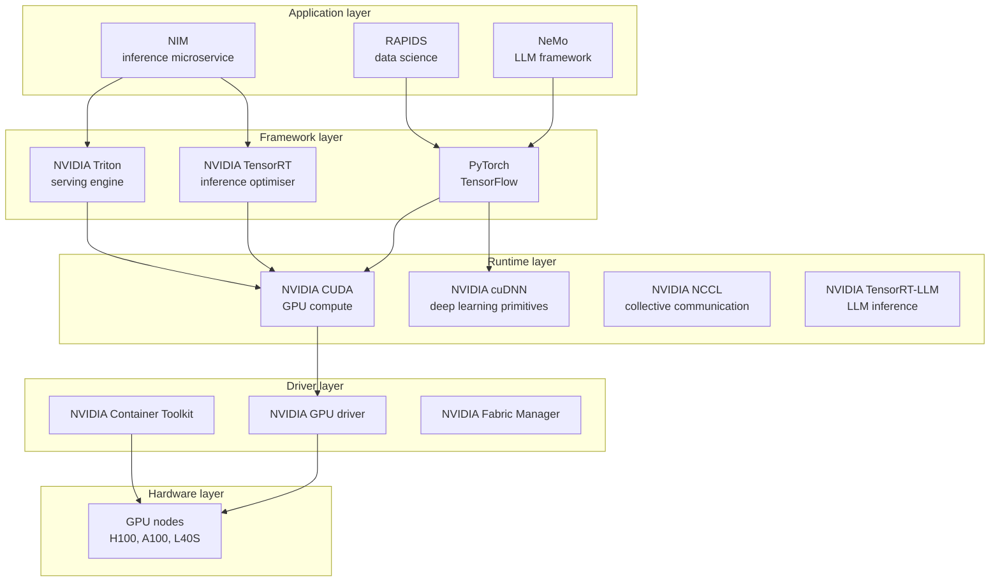

# 16.12 NVIDIA enterprise stack: AI Enterprise, NGC and licensing

| Field | Value |
|---|---|
| Level | Intermediate |
| Priority tier | 1b (NVIDIA-specific) |
| Lab venue | GCP / GKE |
| Part | Part 16: MLOps and LLMOps tools and platforms |
| Primary sources | NVIDIA AI Enterprise (NVAIE) documentation; NVIDIA NGC catalog; NVIDIA NIM documentation; NVIDIA NeMo framework documentation; NVIDIA Zero-to-Hero Volume 14 (`chapter-01-introduction.md`, `chapter-02-licensing.md`, `chapter-03-ngc.md`, `chapter-04-nim.md`, `chapter-05-nemo.md`, `chapter-06-rapids.md`) |
| Cross-references | Chapter 10.9 (NVIDIA software stack); Chapter 15.7 (NVIDIA NIM and NIM Operator); Chapter 16.5 (Distributed compute); Chapter 16.7 (Serving platforms); Chapter 16.6 (Model registry) |
| Coverage file | `planning/coverage/chapters/16-12.md` |
| Claim & number ledger | `planning/ledgers/16-12.md` |

## Why this matters for AI infrastructure

Parts 1 through 15 gave you the cluster primitives, and Chapter 16.5 added the scheduler for training jobs. Chapter 16.7 added the serving platform for inference. This chapter covers the NVIDIA layer that sits on top of all three. It has five parts: the NVIDIA AI Enterprise (NVAIE) software stack, the NGC catalog of containers and models, the NIM inference microservice, the NeMo framework for LLM customization, and the RAPIDS library for GPU-accelerated data science.

NVAIE is NVIDIA's production software stack, sold with enterprise support. You can assemble the same pieces from open source, such as PyTorch, TensorRT, Triton, NeMo, and RAPIDS, and skip the support contract. That choice looks like the managed-versus-self-hosted decision from Chapter 16.11. You either pay for the support contract, or you pay engineers to maintain the pieces.

```text
Why NVAIE is on the critical path (background reading: NVIDIA AI Enterprise docs; NVIDIA Zero-to-Hero volume 14; the figures below are examples, not quotations):
- A production GPU cluster without the NVIDIA software stack is a cluster
  that runs CUDA kernels but cannot serve an inference, cannot train an LLM,
  cannot accelerate a dataframe. The software is what makes the hardware
  useful.
- The NGC catalog is the registry of pre-built containers (TensorRT, Triton,
  NeMo, RAPIDS, NIM) and pre-trained models (Llama, Mistral, SDXL) that the
  team would otherwise have to build and curate by hand.
- NVAIE licensing is the contract that gives the team access to NVIDIA's
  enterprise support, the NGC catalog, and the right to use NVAIE-licensed
  containers in production. Without the license, the team uses the open-source
  equivalents without the support contract.
```

Three realities make this a platform-team concern, not only a data-science concern.

1. The NGC catalog is the team's container registry. The platform team owns the cache, the pull-through proxy, and the access model that lets the cluster pull from NGC.
2. NVAIE licensing is the team's budget. The platform team owns the seat count, the per-GPU license, the renewal calendar, and the audit log that proves compliance.
3. NIM and NeMo are the team's inference and training stacks. The platform team owns the Helm charts, the Kubernetes operators, the GPU pool bindings, and the service targets.

Before your team adopts NVAIE, make sure someone owns the license, the catalog, and the inference pattern.

## Prerequisites and outcomes

### Prerequisites

- Chapter 10.9 covers the driver, the CUDA toolkit, and the container toolkit.
- Chapter 15.7 covers the NIM microservice and the NIM Operator.
- Chapter 16.5 covers the GPU pool and the gang scheduler.
- Chapter 16.7 covers the InferenceService and the autoscaler.

### Outcomes

After this chapter, you will be able to:

1. Describe the NVAIE software stack, from the driver up to NIM, NeMo, and RAPIDS.
2. Set up an NGC pull-through proxy, so the cluster pulls images without holding the team's NGC credentials.
3. Deploy NIM as an InferenceService, bound to the right GPU pool.
4. Deploy NeMo for LLM fine-tuning as a Kubernetes Job with gang scheduling.
5. Run RAPIDS as a GPU-accelerated dataframe service on the data engineering cluster.
6. Run the NVAIE licensing audit: seat count, per-GPU license, renewal calendar, and compliance report.

---

## 1. The NVAIE software stack

### 1.1 The layers

Suppose a NeMo job fails and the error points at the driver. Which layer is at fault? The stack is easier to debug once you see it as layers, from the hardware up to the application. The diagram below shows five. Read it from the bottom up, because each layer depends on the one beneath it.



Most of these components are open source. The subscription adds enterprise support, and it covers the pieces that are not open source. In the chapter's account, the subscription buys four things beyond the open code.

- The driver layer gets signed updates and security patches, along with the Fabric Manager for NVLink topologies.
- The runtime layer gets CUDA, cuDNN, NCCL, and TensorRT-LLM under a support contract.
- The framework layer gets TensorRT, Triton, NeMo, and RAPIDS with pre-built containers.
- The application layer gets NIM and the NGC catalog, the container registry.

When a job fails, start by naming the layer the error comes from.

### 1.2 What the NVAIE subscription buys

Before you buy, you need to know what changes. Most of these components are open source already. The subscription changes the support, the signing, and the production rights around them.

| Layer | Open source | NVAIE subscription |
|---|---|---|
| GPU driver | Yes | Enterprise support; signed driver updates; security patches |
| CUDA | Yes | Enterprise support; version compatibility guarantees |
| Container Toolkit | Yes | Enterprise support; signed images |
| PyTorch / TensorFlow | Yes | Enterprise support; pre-built NGC containers |
| TensorRT | Yes | Enterprise support; performance guarantees |
| Triton | Yes | Enterprise support; signed images |
| NeMo | Yes | Enterprise support; pre-built containers; framework updates |
| RAPIDS | Yes | Enterprise support; pre-built containers |
| NIM | No (proprietary) | Production license; signed containers; support contract |
| NGC catalog | Free for evaluation | Production license for selected containers and models |

The subscription is priced per GPU, per year. The price depends on the GPU class and the length of the commitment. Your job is to track the per-GPU license, because finance will see it as a line item. Ask for the GPU class and commitment length behind any quote before you sign.

### 1.3 The license audit

Imagine an auditor asks which GPUs run an NVAIE-licensed container. If you cannot answer quickly, you have a compliance problem. The license is audited every year. NVIDIA's team, or a third-party auditor, asks you to prove that every GPU running a licensed container has a valid license.

The audit needs four things from you:

- A list of every GPU node in the cluster.
- The license key assigned to each node.
- The containers running on each node.
- The expiration date of each license.

Most teams keep this list in a configuration management database, or CMDB, and refresh it automatically. The CMDB reads the license state from the NVAIE License Server, the GPU inventory from the cluster API, and the container list from the runtime. Build that inventory before the audit, not during it.

---

## 2. The NGC catalog

### 2.1 What NGC is

Suppose a data scientist asks for the latest NeMo container. Where does it come from, and who decides whether your cluster may pull it? The answer is the NGC catalog. It holds three kinds of items.

- Containers: pre-built images for PyTorch, TensorFlow, Triton, NeMo, RAPIDS, TensorRT-LLM, and the NIM microservices.
- Models: pre-trained models such as Llama 3, Mistral, SDXL, CLIP, and NeMo Retriever.
- Resources: training scripts, notebooks, Helm charts, and reference architectures.

The catalog is free for evaluation. Production use of selected containers and models needs an NVAIE subscription. Your job is to decide which of those items the cluster may pull, and then to enforce that decision.

### 2.2 The NGC pull-through proxy

If every node pulls the same large image from NGC, you waste bandwidth and depend on NGC being reachable at all times. The cluster therefore does not pull directly from NGC. It pulls through a proxy that your platform team runs, and the proxy does four jobs.

- It caches each image locally, so the first pull is slow and later pulls come from the cache.
- It authenticates to NGC with the team's NGC API key.
- It enforces licensing. Only NVAIE-licensed containers go into the cache, and open-source images come from their original registry.
- It audits every pull, so the log shows who pulled what, and when.

```yaml
# code/part16/ngc_proxy.yaml
apiVersion: v1
kind: ConfigMap
metadata:
  name: ngc-proxy-config
  namespace: nvaie
data:
  config.yaml: |
    upstream: nvcr.io
    cache:
      backend: gcs
      bucket: ngc-cache-${PROJECT_ID}
    licensing:
      enforce: true
      licensed_images:
        - nvcr.io/nvidia/pytorch:24.06-py3
        - nvcr.io/nvidia/tritonserver:24.06-py3
        - nvcr.io/nim/llama3-8b-instruct:1.0.0
        - nvcr.io/nvidia/nemo:24.06
    audit:
      backend: bigquery
      dataset: nvaie_audit
```

The proxy runs as a Kubernetes Deployment behind an internal Service. The cluster's pods point at the proxy, and only the proxy talks to NGC.

Production Kubernetes, chapter 15, raises a catch for this design. Notary signatures are tied to the registry name, so a copy served from a cache can fail verification. Test your signing tool against the proxy address before you rely on it.

### 2.3 The NGC API key and IAM

Whoever holds the NGC API key can pull NVIDIA's images in your name. Keep that key in one place, and let as few services read it as possible. The key lives in a secret store such as Vault or Secret Manager, and the proxy reads it at startup.

Production Kubernetes, chapter 7, explains that the built-in Kubernetes Secret API can fall short for enterprise secrets. That is why this key belongs in an external store. The access rules are simple.

- The platform team owns the NGC API key and rotates it on a schedule. This chapter uses quarterly as its example.
- Only the pull-through proxy authenticates against NGC. No other service holds the key.
- The cluster's pods authenticate to the proxy with a Kubernetes image pull secret, and they never see the NGC key.

Production Kubernetes, chapter 7, also uses a three-month rotation as its example for encryption keys. It adds that re-encrypting old data is not enough once a key has leaked. The secret itself must be rotated too. The pattern matches the cluster boundary from Chapter 16.6, where one service holds the credential, and its use is audited. Decide now who may read the NGC key, and write that rule down before the first pull.

---

## 3. NIM: the inference microservice

### 3.1 What NIM is

Suppose a product team needs a chat model in production by the end of the week. They could download the weights, pick an inference engine, and tune it themselves. NIM is NVIDIA's packaged answer to that work. It is a Docker image that bundles a model, an inference engine such as TensorRT-LLM, vLLM, or Triton, and the runtime. NVIDIA signs the image, licenses it, and supports it.

The platform team deploys NIM as an InferenceService on Kubernetes. The NIM Operator from Chapter 15.7 does the deployment. The NIM Helm chart manages the GPU pool binding, and the image registry enforces the licensing.

```yaml
# Shape follows the k8s-nim-operator sample config/samples/nim/serving/standalone
# (checked against the NIMService CRD, group apps.nvidia.com). Image tag and model are examples.
apiVersion: apps.nvidia.com/v1alpha1
kind: NIMCache
metadata:
  name: llama-3-2-1b-instruct
  namespace: nim-service
spec:
  source:
    ngc:
      modelPuller: nvcr.io/nim/meta/llama-3.2-1b-instruct:1.12.0
      pullSecret: ngc-secret
      authSecret: ngc-api-secret
      model:
        engine: tensorrt_llm
        tensorParallelism: "1"
  storage:
    pvc:
      create: true
      size: "50Gi"
      volumeAccessMode: ReadWriteOnce
---
apiVersion: apps.nvidia.com/v1alpha1
kind: NIMService
metadata:
  name: llama-3-2-1b-instruct
  namespace: nim-service
spec:
  image:
    repository: nvcr.io/nim/meta/llama-3.2-1b-instruct
    tag: "1.12.0"
    pullPolicy: IfNotPresent
    pullSecrets:
      - ngc-secret
  authSecret: ngc-api-secret
  storage:
    nimCache:
      name: llama-3-2-1b-instruct
  replicas: 1
  resources:
    limits:
      nvidia.com/gpu: 1
  expose:
    service:
      type: ClusterIP
      port: 8000
```

The NIM Operator's API group is `apps.nvidia.com`, not `serving.nvidia.com`, and the manifest has no `resources.gpu.type` field. The model weights come from a separate NIMCache resource that the NIMService names. The Operator reads both resources and builds a Deployment with the right GPU binding, pull secret, model storage, and service.

### 3.2 The NIM model's lifecycle

As you deploy a NIM, it passes through five stages, from the first pull to retirement. Each stage has an owner and a control. If you skip one, an unsigned or unretired model can end up serving traffic.

| Stage | What it is | How the platform team manages it |
|---|---|---|
| Pull | The image and the model weights are pulled from NGC | The pull-through proxy caches the image. The model weights are pulled on first deploy. |
| Sign | The image is signed by NVIDIA | The admission controller verifies the signature (cosign) |
| Deploy | The NIM Operator deploys the NIMService | The NIM Operator's Helm chart, driven by the platform team's GitOps loop |
| Serve | The NIM receives inference requests | The InferenceService, the autoscaler, and the SLO |
| Retire | The NIM is removed from production | The platform team's GitOps loop, and the registry's archived stage |

Production Kubernetes, chapter 15, notes that signature checks are often enforced by an admission webhook, which refuses unsigned images before they run. The same chapter points out that this check sits on the deploy path. The webhook therefore has to stay highly available.

The lifecycle matches the model registry lifecycle from Chapter 16.6. The NIM image is the artifact, the NIMService is the registry entry, and the InferenceService is the deployment.

### 3.3 NIM and the model registry

When someone asks which model runs in production, the answer should not depend on memory. A NIM image is a model in the NVAIE sense and also in the MLOps sense. The platform team therefore mirrors each NIM deployment in its own model registry.

```yaml
# code/part16/nim_in_registry.yaml
apiVersion: mlops.example.com/v1
kind: ModelStage
metadata:
  name: llama3-8b-instruct
  namespace: mlops
spec:
  model_name: llama3-8b-instruct
  stage: production
  version: 1.0.0
  artifact_uri: nvcr.io/nim/llama3-8b-instruct:1.0.0
  signature_id: sha256:nvidia-signed...
  nim:
    gpu_type: h100-sxm5-80gb
    replicas: 1
```

The entry records the image URI, the GPU type, the replica count, and the signature. The deployment pipeline reads that entry and asks the NIM Operator to deploy the NIMService. Keep the registry entry and the running NIMService in sync, or your records will not match production.

---

## 4. NeMo: the LLM framework

### 4.1 What NeMo is

Suppose you want a general model to answer questions about your company's runbooks. Training a large model from scratch is expensive, so you usually fine-tune an existing one instead. NeMo is NVIDIA's framework for that kind of work. It covers three jobs.

- Pre-training: large-scale LLM training on thousands of GPUs.
- Fine-tuning: supervised fine-tuning, LoRA, QLoRA, and preference alignment with DPO or RLHF.
- Inference: NeMo Retriever, NeMo Guardrails, and NeMo Curator.

The platform team uses NeMo for LLM customization. Fine-tuning runs as a Kubernetes Job with gang scheduling, and inference runs on NIM.

### 4.2 Fine-tuning with NeMo

A fine-tuning job needs all of its GPUs at the same time. If only some of them are free, the job should wait rather than start and stall. Gang scheduling makes that rule explicit, and the Job below uses it.

```yaml
# code/part16/nemo_finetune.yaml
apiVersion: batch.volcano.sh/v1alpha1
kind: Job
metadata:
  name: nemo-finetune-llama3
spec:
  minAvailable: 8
  queue: gpu-pool
  tasks:
    - replicas: 8
      template:
        spec:
          containers:
            - name: nemo
              image: nvcr.io/nvidia/nemo:24.06
              command: [python, nemo_finetune.py]
              args: ["--model", "llama3-8b-instruct", "--dataset", "s3://my-bucket/dataset", "--lora"]
              resources:
                limits:
                  nvidia.com/gpu: 1
```

This job asks for eight tasks with one GPU each, and it waits until all eight can start. It uses LoRA to keep the training cost low. The fine-tuned model is saved to object storage and registered in the model registry. Check that the dataset path and the registry entry exist before you submit the job.

### 4.3 NeMo Guardrails

An LLM app can answer a question it should refuse, or repeat personal data from its context. Guardrails are the rules that stop those answers. NeMo Guardrails is the runtime safety layer, and you write its rules as programmable steps the model must follow.

```python
# code/part16/snippets/nemo_guardrails.py
from nemoguardrails import LLMRails, RailsConfig

config = RailsConfig.from_path("./guardrails")
rails = LLMRails(config)

response = rails.generate(
    messages=[{"role": "user", "content": user_query}]
)
```

The guardrails cover four areas.

- Topic boundaries: the model refuses topics outside the application's domain.
- Factuality: the model refuses to answer when the answer is not in the retrieval context.
- PII redaction: the model removes personal data from its responses.
- Jailbreak resistance: the model refuses prompts that try to bypass the system prompt.

Guardrails run on every request, and they sometimes block a good answer. That false-positive rate is the price of safety, so measure it on your own traffic. Test the guardrail config against real questions before you ship it.

---

## 5. RAPIDS: GPU-accelerated data science

### 5.1 What RAPIDS is

Your feature pipeline runs in pandas on the CPU, and it takes so long that the data team is blocked. RAPIDS offers GPU versions of the tools you already use. It runs on CUDA underneath, and it runs on the same GPU nodes as your training jobs.

| Library | CPU equivalent | What it accelerates |
|---|---|---|
| **cuDF** | pandas | DataFrame manipulation |
| **cuML** | scikit-learn | Machine learning algorithms |
| **cuPy** | NumPy | Array operations |
| **cuGraph** | NetworkX | Graph algorithms |
| **cuSignal** | scipy.signal | Signal processing |

The platform team runs RAPIDS as a Kubernetes Deployment on the data engineering cluster. Data scientists reach it from a Jupyter notebook or a Python script.

### 5.2 RAPIDS on the data engineering cluster

Consider a script that groups transactions by user. In pandas, it reads the data, groups it on the CPU, and writes the result. The RAPIDS version keeps the same shape, but the grouping runs on the GPU.

```python
# code/part16/rapids_dataframe.py
import cudf

df = cudf.read_parquet("s3://my-bucket/dataset.parquet")
df_grouped = df.groupby("user_id").agg({"amount": "sum"})
result = df_grouped.to_pandas()  # copy back to CPU for downstream use
```

The data is read from object storage and computed on the GPU. The result is copied back to the CPU for code that comes after. The script looks almost like a pandas script, and that is the point. The main change is where the work runs.

### 5.3 RAPIDS for feature engineering

Feature pipelines often wait on the CPU for long stretches. Chapter 16.3 uses RAPIDS for feature pipelines that would otherwise bottleneck the CPU. The pipeline runs in the data engineering namespace, on the same GPU pool as the training jobs.

Speedups depend on your data and your pipeline, so this chapter does not quote one. Time the CPU version and the GPU version on the same data before you move a pipeline. That measurement is what justifies the move.

---

## 6. Operating NVAIE on GKE

### 6.1 The components

Five components make up the NVAIE service on GKE, and each one can fail on its own. Each needs an owner and a target. The table shows where each component runs, what it stores data in, and an example target. The targets are examples, not limits from NVIDIA. Choose your own numbers based on what your users need.

| Component | Where it runs | Backing store | Example SLO (choose your own) |
|---|---|---|---|
| NGC pull-through proxy | Kubernetes Deployment | GCS bucket for cache; BigQuery for audit | Pull latency p99 < 30 s |
| NIM Operator | Kubernetes Deployment | etcd | NIMService reconcile p99 < 30 s |
| NeMo fine-tuning | Kubernetes Job | Object store for datasets and models | Training SLO per job |
| RAPIDS | Kubernetes Deployment on data cluster | Object store for dataframes | Query latency p99 < 1 s |
| NVAIE License Server | NVIDIA-managed | n/a | API latency p99 < 1 s |

### 6.2 IAM and the audit log

A pull, a deployment, and a fine-tuning run each change what runs in your cluster. Each of those actions should map to a role and leave a record. The platform team owns the access model for NVAIE.

| Role | Who | What they can do |
|---|---|---|
| `nvaie.license.reader` | Platform team | Read license state from the License Server |
| `nvaie.image.puller` | The pull-through proxy | Pull from NGC; cache; audit |
| `nvaie.cluster.reader` | Cluster | Pull from the pull-through proxy; deploy NIM |
| `nvaie.admin` | Platform team | Manage the pull-through proxy; manage the License Server integration |

Keep each role narrow. The proxy pulls from NGC, while the cluster only pulls through the proxy and deploys NIM. The audit log records every pull from the proxy, every NIM deployment, and every NeMo fine-tuning run. Those records are your proof of NVAIE compliance.

### 6.3 Observability

A license can lapse without any alarm going off until the renewal date passes. Metrics and alerts are how you see that coming. The table lists the signals to watch. The thresholds are examples, so set your own.

| Metric | Why it matters | Example alert (set your own) |
|---|---|---|
| NGC pull latency p99 | Hot path for every NIM deploy | > 60 s |
| NIM inference latency p99 | Customer-facing SLO | > SLO threshold |
| NIM GPU utilisation | Affects cost | < 30% for 30 min |
| NIM error rate | Customer-facing SLO | > 0.1% |
| License expiration | Affects compliance | < 30 days remaining |
| NeMo training duration | Affects throughput | > baseline for 3 runs |

The license expiration alert matters most. The chapter's example fires 30 days before expiry, which leaves time to renew and to record the renewal in the audit log. Set up that alert before the first renewal date arrives.

---

## 7. How it fails

Five failure modes come back again and again. Learn their symptoms, and you will recognize the next outage faster.

### 7.1 "The cluster cannot pull from NGC"

A pod stuck in `ImagePullBackOff` is a common NGC problem, and the pod never starts.

**Symptom:** The pod's image pull fails with `ImagePullBackOff`, and the error reads "unauthorized: authentication required". The pod stays stuck.

**Diagnosis:** One of three things usually went wrong. The image pull secret is missing, the pull-through proxy is misconfigured, or the NGC API key has expired.

**Fix:** Check the proxy's NGC API key, and rotate it if it has expired. Confirm the pod's image pull secret, then confirm that the pod's namespace can reach the proxy.

### 7.2 "The NVAIE license is expired"

**Symptom:** The NIM containers start, then fail with a license error. The NIM service reports that the license has expired, and the cluster runs degraded.

**Diagnosis:** The renewal was missed, and the audit did not catch it in time.

**Fix:** Renew the license now, and redeploy the NIM containers. Confirm the license state with the NVAIE License Server. Then add an expiration alert, using the 30-day example from Section 6.3 or a window you choose.

### 7.3 "The NeMo fine-tuning is OOM"

**Symptom:** The NeMo fine-tuning pod crashes with `OOMKilled`. The pod's memory request was too low for the job.

**Diagnosis:** The model is too large for the GPU's memory. A 70B model needs parallelism across several GPUs.

**Fix:** Raise the GPU count from 1 to 4 or 8. Turn on FSDP or DeepSpeed ZeRO-3, covered in Chapter 14.5. Check the memory budget before the next run.

### 7.4 "The NIM autoscaler is too aggressive"

**Symptom:** The NIM replicas scale up to 100 in response to a traffic spike. The GPU pool runs out, and other workloads cannot get GPUs.

**Diagnosis:** The autoscaler's `maxReplicas` is too high. The autoscaler also does not respect your team's GPU quota.

**Fix:** Lower `maxReplicas`. Bind the NIM to the team's Kueue LocalQueue, so the Kueue admission controller enforces the quota.

### 7.5 "The RAPIDS job uses a different CUDA version than the training job"

**Symptom:** The RAPIDS feature pipeline runs CUDA 12.2, and the training job runs CUDA 12.4. The data handoff fails because the formats do not match.

**Diagnosis:** The RAPIDS container and the training container use different CUDA versions. The chapter attributes the failure to a data format mismatch.

**Fix:** Pin all GPU containers in the namespace to one CUDA version. The platform team's pattern is "one CUDA version per namespace", declared in the namespace's ResourceQuota.

---

## 8. Hands-on lab

This lab sets up the NGC pull-through proxy, deploys a NIM microservice, runs a NeMo fine-tuning job, and checks the licensing audit. Run the steps in order, because each one depends on the last. The lab is untested in this repository, so treat every expected output as a claim to check.

### 8.1 Prerequisites

- A GKE Autopilot or Standard cluster, version 1.27 or later, with at least one H100 GPU node.
- An NVAIE subscription with an NGC API key.
- The NIM Operator installed with Helm.
- A GPU node pool with H100 or A100 GPUs.

### 8.2 Step 1: configure the NGC API key

Start by storing the key as two Kubernetes secrets in the `nvaie` namespace. They use the same names as the NIM examples in Section 3.1. The first, `ngc-api-secret`, holds the key itself for the NIM to download models. The second, `ngc-secret`, is the image pull secret for `nvcr.io`.

```bash
kubectl create namespace nvaie
kubectl create secret generic ngc-api-secret \
  --namespace nvaie \
  --from-literal=NGC_API_KEY=${NGC_API_KEY}
kubectl create secret docker-registry ngc-secret \
  --namespace nvaie \
  --docker-server=nvcr.io \
  --docker-username='$oauthtoken' \
  --docker-password=${NGC_API_KEY}
# expected: both secrets are created in the nvaie namespace
```

### 8.3 Step 2: deploy the NGC pull-through proxy

Next, install the proxy with the cache and the audit log pointed at your project.

```bash
helm install ngc-proxy my-charts/ngc-proxy \
  --namespace nvaie \
  --set ngc.upstream=nvcr.io \
  --set cache.backend=gcs \
  --set cache.bucket=${PROJECT_ID}-ngc-cache \
  --set audit.backend=bigquery \
  --set audit.dataset=nvaie_audit
# expected: the proxy pod is running; the proxy service is reachable from the cluster
```

### 8.4 Step 3: deploy the NIM microservice

Then deploy the NIM with one GPU and the pull secret it needs.

```bash
helm install nim-llama3 nvidia/nim-llm \
  --namespace nvaie \
  --set model.name=llama3-8b-instruct \
  --set image.repository=nvcr.io/nim \
  --set image.tag=1.0.0 \
  --set resources.limits.nvidia\\.com/gpu=1 \
  --set imagePullSecrets[0]=ngc-secret
# expected: the NIM pod is running; the InferenceService URL is printed
```

### 8.5 Step 4: query the NIM

Send one chat request to confirm that the model answers.

```bash
URL=$(kubectl get nimservice llama3-8b-instruct -n nvaie -o jsonpath='{.status.url}')
curl -X POST $URL/v1/chat/completions \
  -H "Content-Type: application/json" \
  -d '{"model": "llama3-8b-instruct", "messages": [{"role": "user", "content": "What is MLOps?"}]}'
# expected: a JSON response with the model's answer
```

### 8.6 Step 5: run a NeMo fine-tuning

Submit the fine-tuning Job and watch it start.

```bash
kubectl apply -f code/part16/nemo_finetune.yaml
kubectl get job -n nvaie -w
# expected: the fine-tuning runs on 8 GPUs; the model is saved to object storage
```

### 8.7 Step 6: verify the licensing audit

Finally, check that the pulls you just made appear in the audit log.

```bash
bq query --use_legacy_sql=false \
  "SELECT timestamp, image, user
   FROM \`${PROJECT_ID}.nvaie_audit.pulls\`
   ORDER BY timestamp DESC
   LIMIT 10"
# expected: a list of the most recent NGC pulls with the user and the image
```

### 8.8 What to record

After the lab, you should be able to answer five questions quickly, without digging through dashboards.

1. What is the current NIM InferenceService URL?
2. What is the most recent NGC pull, and what user pulled it?
3. What is the current NVAIE license expiration date?
4. What is the most recent NeMo fine-tuning run, and what model was fine-tuned?
5. What is the cost per NVAIE-licensed GPU per month?

If any answer takes you too long, the NVAIE stack is not yet ready to run as a production service. Set your own time limit for this check. The lab is still untested against a live GKE cluster.

---

## Exercises

1. **Add a pull-through proxy for a second registry.** Your proxy already serves NGC. Now let it pull from a private registry as well, and enforce licensing per team. *Solution sketch:* a proxy configuration with a second upstream, and a per-team allow-list.
2. **Add a NIM canary.** Deploy a second NIM with a small share of the traffic, and check its SLO before you promote it. *Solution sketch:* an Argo Rollouts canary strategy aimed at the NIMService, with an analysis template that watches the SLO metrics.
3. **Add a NeMo fine-tuning pipeline.** Build an Argo Workflow that reads from the feature store, runs the fine-tuning, and writes the model to the registry. *Solution sketch:* an Argo DAG with stages for data preparation, fine-tuning, evaluation, and registration.
4. **Add a RAPIDS feature pipeline.** Build a RAPIDS pipeline on the data engineering cluster, and measure it against your pandas baseline. *Solution sketch:* a Kubernetes Job that uses the RAPIDS container, reads from object storage, and writes to the feature store.
5. **Add a NVAIE license expiration alert.** Configure a Prometheus alert that fires before the license expires. The chapter's example window is 30 days. *Solution sketch:* a Prometheus rule that reads the NVAIE License Server's API and alerts on `expiration_date - today < 30 days`.
6. **Add a NIM autoscaler bound to the team's quota.** Make the NIM autoscaler respect the team's Kueue quota, so it never exceeds it. *Solution sketch:* a Kueue LocalQueue that bounds the NIM's GPU requests, with the autoscaler reading that quota.

---

## Checkpoint questions

<details><summary>1. An auditor asks which GPUs run an NVAIE-licensed container, and you cannot answer quickly. What should you have built?</summary>
An inventory before the audit. The audit needs a list of every GPU node, the license key for each node, the containers running on each node, and each license's expiry date. Most teams keep this in a CMDB that refreshes automatically. It reads license state from the NVAIE License Server, the GPU inventory from the cluster API, and the container list from the runtime.
</details>

<details><summary>2. NIM containers start and then fail with a license error that says the license has expired. What is the cause and what do you do?</summary>
The renewal was missed and the audit did not catch it in time. Renew the license now and redeploy the NIM containers. Confirm the license state with the NVAIE License Server. Then add an expiration alert, for example 30 days before expiry, or a window you choose.
</details>

<details><summary>3. A NeMo fine-tuning pod crashes with `OOMKilled`. What does the chapter say the cause is, and what is the fix?</summary>
The chapter says the model is too large for the GPU's memory, and that a 70B model needs parallelism across several GPUs. Raise the GPU count from 1 to 4 or 8. Turn on FSDP or DeepSpeed ZeRO-3, covered in Chapter 14.5. Check the memory budget before the next run.
</details>

<details><summary>4. A traffic spike scales NIM replicas to 100, the GPU pool runs out, and other workloads cannot get GPUs. What went wrong?</summary>
The autoscaler's `maxReplicas` is too high and the autoscaler does not respect your team's GPU quota. Lower `maxReplicas`. Bind the NIM to the team's Kueue LocalQueue, so the Kueue admission controller enforces the quota.
</details>

<details><summary>5. The RAPIDS pipeline runs CUDA 12.2 and the training job runs CUDA 12.4. The data handoff fails. What is the fix?</summary>
The two containers use different CUDA versions, and the chapter attributes the failure to a data format mismatch. Pin all GPU containers in the namespace to one CUDA version. The platform team's pattern is one CUDA version per namespace, declared in the namespace's ResourceQuota.
</details>

<details><summary>6. Someone asks which NIM model runs in production, and your records do not match what is running. What was missed?</summary>
The NIM deployment was not mirrored in the model registry, or the entry fell out of sync with the running NIMService. The platform team mirrors each deployment as a registry entry that records the image URI, GPU type, replica count, and signature. The deployment pipeline reads that entry and asks the NIM Operator to deploy. Keep the entry and the running NIMService in sync.
</details>

<details><summary>7. Why does the cluster pull NGC images through a proxy instead of directly?</summary>
Direct pulls waste bandwidth when every node fetches the same large image, and they depend on NGC being reachable. The proxy caches each image, so later pulls come from the cache. It is also the only service that holds the NGC API key, it enforces which images are licensed, and it audits every pull.
</details>

<details><summary>8. Why can image signature verification fail when the image comes from a cache?</summary>
*Production Kubernetes*, chapter 15, says Notary signatures are tied to the registry name. A copy served from a cache has a different registry name, so verification can fail. Test your signing tool against the proxy address before you rely on it.
</details>

<details><summary>9. Why does the NeMo fine-tuning Job use gang scheduling with `minAvailable: 8`?</summary>
The job needs all of its GPUs at the same time. If only some are free, the job should wait rather than start and stall. With `minAvailable: 8` and eight tasks of one GPU each, nothing starts until all eight can start.
</details>

<details><summary>10. Why does the NIM deployment use a separate NIMCache resource alongside the NIMService?</summary>
The model weights come from a separate NIMCache resource that the NIMService names. The NIMCache pulls the model from NGC into storage, which in the example is a 50Gi persistent volume claim. The Operator reads both resources and builds a Deployment with the right GPU binding, pull secret, model storage, and service.
</details>

<details><summary>11. Why must the admission webhook that verifies image signatures be highly available?</summary>
It refuses unsigned images before they run, so it sits on the deploy path. If it is down, deployments cannot pass its check. *Production Kubernetes*, chapter 15, makes this point. The webhook is therefore a production service with its own availability target.
</details>

<details><summary>12. When would you buy the NVAIE subscription instead of assembling the stack from open source, and what do you give up?</summary>
Buy the subscription when you want enterprise support, signed images, and the right to use licensed containers in production. NIM is proprietary and needs the production license. You pay per GPU per year. The alternative is to run PyTorch, TensorRT, Triton, NeMo, and RAPIDS from open source without the contract, and you pay engineers to maintain them.
</details>

<details><summary>13. When would you fine-tune with LoRA instead of training from scratch, and what do you give up?</summary>
Fine-tune an existing model when you want it to answer questions about your own material, such as company runbooks. Training a large model from scratch is expensive. LoRA keeps the training cost low. You give up the freedom of choosing the base model's design, because you start from someone else's model.
</details>

<details><summary>14. A team needs a chat model in production this week. When do you choose NIM over picking and tuning an engine yourself?</summary>
Choose NIM when speed and support matter. It bundles a model, an inference engine such as TensorRT-LLM, vLLM, or Triton, and the runtime, and NVIDIA signs, licenses, and supports the image. You give up control over the engine choice and you need a production license, since NIM is proprietary.
</details>

<details><summary>15. Your pandas feature pipeline blocks the data team. Do you move it to RAPIDS, and how do you decide?</summary>
Time the CPU version and the GPU version on the same data first. Speedups depend on your data and your pipeline, so the chapter quotes none. The script barely changes, because `cudf` looks like pandas and the main change is where the work runs. The cost is that the pipeline now needs GPU nodes and a copy back to the CPU for downstream code.
</details>

<details><summary>16. The fine-tuning Job asks for eight tasks with one GPU each, and only six GPUs are free. What happens?</summary>
Nothing starts. The Job has `minAvailable: 8`, so it waits until all eight GPUs can be given at once. Six running tasks would stall with two missing. The job starts when two more GPUs free up.
</details>

<details><summary>17. Each NIM replica requests one GPU. A spike scales it to 100 replicas on a pool of 120 GPUs, and a fine-tuning job needs 8. What is left, and what is the result?</summary>
The NIM takes 100 GPUs, which leaves 20. The 8-GPU fine-tuning job fits, but any workload that needs more than 20 more GPUs cannot start. The pool and sizes here are example numbers. The fix is a lower `maxReplicas` and a Kueue quota.
</details>

<details><summary>18. The NGC API key is rotated quarterly. How many rotations a year is that, and if the last was on 1 February, when is the next?</summary>
Quarterly means every three months, so 12 divided by 3 is 4 rotations a year. If the last was 1 February, the next is 1 May. The quarterly cadence is the chapter's example. If a key leaks, re-encrypting old data is not enough and the secret itself must be rotated.
</details>

<details><summary>19. A NeMo job fails and the error points at the driver. In what order do you look?</summary>
First name the layer the error comes from. Read the stack from the bottom up, because each layer depends on the one beneath it. Second check the driver layer, which holds the GPU driver, the Container Toolkit, and the Fabric Manager. Third check the runtime layer above it, such as CUDA, cuDNN, and NCCL.
</details>

<details><summary>20. A pod is stuck in `ImagePullBackOff` with "unauthorized: authentication required". In what order do you check?</summary>
First check the proxy's NGC API key and rotate it if it has expired. Second confirm the pod's image pull secret exists and is correct. Third confirm that the pod's namespace can reach the proxy. These are the three usual causes in the chapter.
</details>

---

## Sources and review notes

- NVIDIA AI Enterprise (NVAIE) documentation. Source for the software stack layers, the licensing model, the NGC catalog, and the support contract.
- NVIDIA NGC catalog documentation. Source for the container and model inventory, the pull-through proxy pattern, and the licensing enforcement.
- NVIDIA NIM documentation. Source for the inference microservice, the NIM Operator, the model lifecycle, and the GPU pool binding.
- NVIDIA NeMo framework documentation. Source for the LLM framework, the fine-tuning patterns, the NeMo Guardrails, and the NeMo Retriever.
- NVIDIA RAPIDS documentation. Source for the GPU-accelerated dataframe library, the cuDF / cuML / cuPy / cuGraph libraries, and the feature engineering patterns.
- NVIDIA Zero-to-Hero Volume 14 (`chapter-01-introduction.md` through `chapter-06-rapids.md`). Source for the introduction to the NVAIE stack, the licensing chapter, the NGC chapter, the NIM chapter, the NeMo chapter, and the RAPIDS chapter. The wording has been rewritten in the handbook's voice.

### Cross-references to other handbook chapters

- Chapter 10.9 (NVIDIA software stack) for the driver, CUDA, and container toolkit.
- Chapter 15.7 (NVIDIA NIM and NIM Operator) for the inference microservice in detail.
- Chapter 16.5 (Distributed compute) for the GPU pool and the gang scheduler.
- Chapter 16.7 (Serving platforms) for the InferenceService and the autoscaler.

### Migrated from `nvidia-devops`

The NVAIE stack overview, the NGC pull-through proxy pattern, and the NeMo / RAPIDS chapter structure draw on Volume 14 chapters 1-6. The wording has been rewritten in the handbook's voice.

### Explicitly labelled inferences

- The NVAIE pricing model in Section 1.2 is starting points; specific prices vary by commitment, GPU class, and region.
- The NIM and NeMo versions assumed in the lab should be pinned against the current NGC releases before production use.
- The NeMo Guardrails configuration in Section 4.3 is a sketch; production guardrails require careful design and testing.

### Not verified on live hardware

- The lab in Section 8 is **untested** against a live GKE cluster in this repository.
- The NGC API key in the lab is a placeholder; production keys are rotated quarterly.
- The NVAIE license costs in the lab are illustrative; production costs vary by commitment.
