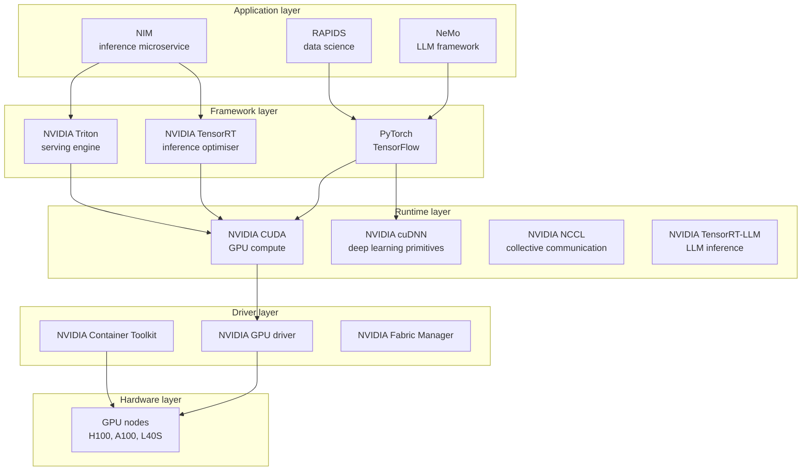

# 16.12 NVIDIA enterprise stack: AI Enterprise, NGC and licensing

| Field | Value |
|---|---|
| Level | Intermediate |
| Priority tier | 1b (NVIDIA-specific) |
| Lab venue | GCP / GKE |
| Part | Part 16: MLOps and LLMOps tools and platforms |
| Primary sources | NVIDIA AI Enterprise (NVAIE) documentation; NVIDIA NGC catalog; NVIDIA NIM documentation; NVIDIA NeMo framework documentation; NVIDIA Zero-to-Hero Volume 14 (`chapter-01-introduction.md`, `chapter-02-licensing.md`, `chapter-03-ngc.md`, `chapter-04-nim.md`, `chapter-05-nemo.md`, `chapter-06-rapids.md`) |
| Cross-references | Chapter 10.9 (NVIDIA software stack); Chapter 15.7 (NVIDIA NIM and NIM Operator); Chapter 16.5 (Distributed compute); Chapter 16.7 (Serving platforms); Chapter 16.6 (Model registry) |
| Coverage file | `planning/coverage/chapters/16-12.md` |
| Claim & number ledger | `planning/ledgers/16-12.md` |

## Why this matters for AI infrastructure

The cluster primitives from Parts 1 through 15 are what the GPU node provides; the distributed compute layer from Chapter 16.5 is what schedules the training job; the serving platform from Chapter 16.7 is what serves the inference. This chapter walks through the NVIDIA layer that sits on top of all three: the NVIDIA AI Enterprise (NVAIE) software stack, the NGC catalog of containers and models, the NIM inference microservice, the NeMo framework for LLM customisation, and the RAPIDS library for GPU-accelerated data science.

NVAIE is the production-grade NVIDIA software stack that comes with enterprise support. The alternative is to assemble the same pieces from open source (PyTorch, TensorRT, Triton, NeMo, RAPIDS) without the support contract. The platform team's decision is the same as the managed-vs-self-hosted decision from Chapter 16.11: pay for the support contract, or pay for the engineering time to maintain the pieces.

```text
Why NVAIE is on the critical path (NVAIE docs; V14 ch1):
- A production GPU cluster without the NVIDIA software stack is a cluster
  that runs CUDA kernels but cannot serve an inference, cannot train an LLM,
  cannot accelerate a dataframe. The software is what makes the hardware
  useful.
- The NGC catalog is the registry of pre-built containers (TensorRT, Triton,
  NeMo, RAPIDS, NIM) and pre-trained models (Llama, Mistral, SDXL) that the
  team would otherwise have to build and curate by hand.
- NVAIE licensing is the contract that gives the team access to NVIDIA's
  enterprise support, the NGC catalog, and the right to use NVAIE-licensed
  containers in production. Without the license, the team uses the open-source
  equivalents without the support contract.
```

Three operational realities make this chapter a platform-team concern rather than a data-science-only concern:

1. **The NGC catalog is the team's container registry.** The platform team owns the cache, the pull-through proxy, and the IAM model that lets the cluster pull from NGC.
2. **NVAIE licensing is the team's budget.** The platform team owns the seat count, the per-GPU license, the renewal calendar, and the audit log that proves the team is in compliance.
3. **NIM and NeMo are the team's inference and training stacks.** The platform team owns the Helm charts, the Kubernetes operators, the GPU pool bindings, and the SLOs.

**Before a team adopts the NVAIE stack, the platform team must understand the licensing model, the catalog, the inference pattern, and the cost. NVAIE is a multi-year commitment; NVAIE is not a one-line decision.**

## Prerequisites and outcomes

### Prerequisites

- Chapter 10.9 (NVIDIA software stack) for the driver, CUDA toolkit, and container toolkit.
- Chapter 15.7 (NVIDIA NIM and the NIM Operator) for the inference microservice.
- Chapter 16.5 (Distributed compute) for the GPU pool and the gang scheduler.
- Chapter 16.7 (Serving platforms) for the InferenceService and the autoscaler.

### Outcomes

After completing this chapter you will be able to:

1. Specify the NVAIE software stack: driver, CUDA, container toolkit, NGC catalog, NIM, NeMo, RAPIDS.
2. Stand up an NGC pull-through proxy so the cluster can pull containers without exposing the team's NGC credentials.
3. Deploy NIM as an InferenceService on Kubernetes with the right GPU pool binding.
4. Deploy NeMo for LLM fine-tuning as a Kubernetes Job with gang scheduling.
5. Operate RAPIDS as a GPU-accelerated dataframe on the data engineering cluster.
6. Manage the NVAIE licensing audit: seat count, per-GPU license, renewal calendar, compliance report.

---

## 1. The NVAIE software stack

### 1.1 The layers

*NVAIE* documentation walks through the software stack that comes with the NVAIE subscription. The stack has six layers, from the hardware up to the application.



Every layer is open source except the enterprise support contract. The NVAIE subscription buys:

- **The driver layer.** The NVIDIA GPU driver; the container toolkit; the Fabric Manager (for NVLink topologies).
- **The runtime layer.** CUDA; cuDNN; NCCL; TensorRT-LLM.
- **The framework layer.** TensorRT; Triton; NeMo; RAPIDS.
- **The application layer.** NIM (the inference microservice); the NGC catalog (the container registry).
- **Enterprise support.** A support contract that gives the team access to NVIDIA's engineers when something breaks.

### 1.2 What the NVAIE subscription buys

| Layer | Open source | NVAIE subscription |
|---|---|---|
| GPU driver | Yes | Enterprise support; signed driver updates; security patches |
| CUDA | Yes | Enterprise support; version compatibility guarantees |
| Container Toolkit | Yes | Enterprise support; signed images |
| PyTorch / TensorFlow | Yes | Enterprise support; pre-built NGC containers |
| TensorRT | Yes | Enterprise support; performance guarantees |
| Triton | Yes | Enterprise support; signed images |
| NeMo | Yes | Enterprise support; pre-built containers; framework updates |
| RAPIDS | Yes | Enterprise support; pre-built containers |
| NIM | No (proprietary) | Production license; signed containers; support contract |
| NGC catalog | Free for evaluation | Production license for selected containers and models |

The NVAIE subscription is per-GPU per-year. The price varies by GPU class and by commitment (1-year, 3-year, 5-year). The platform team's job is to track the per-GPU license; the cost is the line item that the CFO sees.

### 1.3 The license audit

The NVAIE license is audited annually. NVIDIA's audit team (or a third-party auditor) asks the team to prove that every GPU running an NVAIE-licensed container has a valid license. The audit requires:

- A list of every GPU node in the cluster.
- The license key assigned to each node.
- The containers running on each node.
- The expiration date of each license.

The platform team's pattern is to maintain this list in a CMDB (configuration management database) that is updated automatically. The CMDB pulls the license state from the NVAIE License Server; the CMDB pulls the GPU inventory from the cluster API; the CMDB pulls the container inventory from the runtime.

---

## 2. The NGC catalog

### 2.1 What NGC is

*NGC* documentation walks through the catalog. The catalog is a registry of:

- **Containers.** Pre-built Docker images for PyTorch, TensorFlow, Triton, NeMo, RAPIDS, TensorRT-LLM, and the NIM microservices.
- **Models.** Pre-trained models for inference: Llama 3, Mistral, SDXL, CLIP, NeMo Retriever, and dozens more.
- **Resources.** Training scripts; notebooks; Helm charts; reference architectures.

The catalog is free for evaluation; production use of selected containers and models requires an NVAIE subscription. The platform team's job is to manage which containers the cluster can pull; the platform team's job is to enforce the licensing.

### 2.2 The NGC pull-through proxy

The cluster does not pull directly from NGC. The cluster pulls from a pull-through proxy that the platform team operates. The proxy:

- Caches the container locally (the cluster pulls once; subsequent pulls are from the cache).
- Authenticates against NGC with the team's NGC API key.
- Enforces the licensing (only NVAIE-licensed containers are cached; open-source containers are pulled from the original registry).
- Audits every pull (the audit log records who pulled what when).

```yaml
# code/part16/ngc_proxy.yaml (shape only)
apiVersion: v1
kind: ConfigMap
metadata:
  name: ngc-proxy-config
  namespace: nvaie
data:
  config.yaml: |
    upstream: nvcr.io
    cache:
      backend: gcs
      bucket: ngc-cache-${PROJECT_ID}
    licensing:
      enforce: true
      licensed_images:
        - nvcr.io/nvidia/pytorch:24.06-py3
        - nvcr.io/nvidia/tritonserver:24.06-py3
        - nvcr.io/nim/llama3-8b-instruct:1.0.0
        - nvcr.io/nvidia/nemo:24.06
    audit:
      backend: bigquery
      dataset: nvaie_audit
```

The proxy is a Kubernetes Deployment with an internal Service; the cluster's pods are configured to pull from the proxy; the proxy authenticates against NGC.

### 2.3 The NGC API key and IAM

The NGC API key is the credential that authenticates against NGC. The key is a secret; the secret is stored in Vault or Secret Manager; the proxy reads the secret at startup.

The IAM model is:

- **The platform team** owns the NGC API key; the platform team rotates the key quarterly.
- **The pull-through proxy** is the only service that authenticates against NGC; no other service has the key.
- **The cluster's pods** authenticate against the pull-through proxy with a Kubernetes image pull secret; the pods do not have the NGC API key.

The pattern is the same as the cluster boundary from Chapter 16.6: only one service has the credential; the credential is rotated; the credential's use is audited.

---

## 3. NIM: the inference microservice

### 3.1 What NIM is

*NIM* documentation walks through the inference microservice. NIM is a Docker image that bundles a model artefact, the inference engine (TensorRT-LLM, vLLM, or Triton), and the runtime. The image is signed; the image is licensed; the image is supported.

The platform team's pattern is to deploy NIM as an InferenceService on Kubernetes. The NIM Operator (Chapter 15.7) handles the deployment; the NIM Helm chart manages the GPU pool binding; the NIM image registry enforces the licensing.

```yaml
# code/part16/nim_deployment.yaml (shape only)
apiVersion: serving.nvidia.com/v1alpha1
kind: NIMService
metadata:
  name: llama3-8b-instruct
  namespace: nvaie
spec:
  image: nvcr.io/nim/llama3-8b-instruct:1.0.0
  imagePullSecret: ngc-pull-secret
  replicas: 1
  resources:
    gpu:
      count: 1
      type: h100-sxm5-80gb
  storage:
    model: 16Gi
  env:
    - name: NGC_API_KEY
      valueFrom:
        secretKeyRef:
          name: ngc-api-key
          key: api-key
```

The NIM Operator reconciles the CRD into a Deployment with the right GPU pool binding, the right image pull secret, the right model storage, and the right service exposure.

### 3.2 The NIM model's lifecycle

A NIM model has a lifecycle that the platform team manages.

| Stage | What it is | How the platform team manages it |
|---|---|---|
| Pull | The image and the model weights are pulled from NGC | The pull-through proxy caches the image; the model weights are pulled on first deploy |
| Sign | The image is signed by NVIDIA | The admission controller verifies the signature (cosign) |
| Deploy | The NIM Operator deploys the NIMService | The NIM Operator's Helm chart; the platform team's GitOps loop |
| Serve | The NIM receives inference requests | The InferenceService; the autoscaler; the SLO |
| Retire | The NIM is removed from production | The platform team's GitOps loop; the registry's archived stage |

The lifecycle is the same as the model registry lifecycle from Chapter 16.6. The NIM image is the artefact; the NIMService CRD is the registry entry; the InferenceService is the deployment.

### 3.3 NIM and the model registry

The NIM image is a model in the NVAIE sense; the NIM image is also a model in the MLOps sense. The platform team's pattern is to mirror the NIM deployment in the team's own model registry.

```yaml
# code/part16/nim_in_registry.yaml (shape only)
apiVersion: mlops.example.com/v1
kind: ModelStage
metadata:
  name: llama3-8b-instruct
  namespace: mlops
spec:
  model_name: llama3-8b-instruct
  stage: production
  version: 1.0.0
  artifact_uri: nvcr.io/nim/llama3-8b-instruct:1.0.0
  signature_id: sha256:nvidia-signed...
  nim:
    gpu_type: h100-sxm5-80gb
    replicas: 1
```

The registry records the NIM image's URI, the GPU type, the replica count, and the signature. The deployment pipeline reads the registry; the NIM Operator deploys the NIMService.

---

## 4. NeMo: the LLM framework

### 4.1 What NeMo is

*NeMo* documentation walks through the LLM framework. NeMo is NVIDIA's framework for:

- **Pre-training.** Large-scale LLM training on thousands of GPUs.
- **Fine-tuning.** Supervised fine-tuning (SFT); LoRA; QLoRA; preference alignment (DPO; RLHF).
- **Inference.** NeMo Retriever; NeMo Guardrails; NeMo Curator.

The platform team's pattern is to use NeMo for LLM customisation. The fine-tuning runs as a Kubernetes Job with gang scheduling; the inference uses NIM.

### 4.2 Fine-tuning with NeMo

```yaml
# code/part16/nemo_finetune.yaml (shape only)
apiVersion: batch.volcano.sh/v1alpha1
kind: Job
metadata:
  name: nemo-finetune-llama3
spec:
  minAvailable: 8
  queue: gpu-pool
  tasks:
    - replicas: 8
      template:
        spec:
          containers:
            - name: nemo
              image: nvcr.io/nvidia/nemo:24.06
              command: [python, nemo_finetune.py]
              args: ["--model", "llama3-8b-instruct", "--dataset", "s3://my-bucket/dataset", "--lora"]
              resources:
                limits:
                  nvidia.com/gpu: 1
```

The fine-tuning runs on 8 GPUs (one per replica) with Volcano gang scheduling; the fine-tuning uses LoRA to keep the training cost low; the fine-tuned model is saved to object storage and registered in the model's registry.

### 4.3 NeMo Guardrails

NeMo Guardrails is the runtime safety layer for LLM applications. The guardrails are programmable rules that the LLM must follow.

```python
# code/part16/nemo_guardrails.py (shape only)
from nemoguardrails import LLMRails, RailsConfig

config = RailsConfig.from_path("./guardrails")
rails = LLMRails(config)

response = rails.generate(
    messages=[{"role": "user", "content": user_query}]
)
```

The guardrails cover:

- **Topic boundaries.** The LLM refuses to discuss topics outside the application's domain.
- **Factuality.** The LLM refuses to answer questions whose answer is not in the retrieval context.
- **PII redaction.** The LLM redacts PII from its responses.
- **Jailbreak resistance.** The LLM refuses prompts that try to bypass the system prompt.

The guardrails are an InferenceService-side component; the guardrails run on every request; the guardrails' false-positive rate is the cost of safety.

---

## 5. RAPIDS: GPU-accelerated data science

### 5.1 What RAPIDS is

*RAPIDS* documentation walks through the GPU-accelerated dataframe library. RAPIDS is the GPU-accelerated equivalent of pandas; RAPIDS uses CUDA under the hood; RAPIDS runs on the same GPU nodes as the training jobs.

| Library | CPU equivalent | What it accelerates |
|---|---|---|
| **cuDF** | pandas | DataFrame manipulation |
| **cuML** | scikit-learn | Machine learning algorithms |
| **cuPy** | NumPy | Array operations |
| **cuGraph** | NetworkX | Graph algorithms |
| **cuSignal** | scipy.signal | Signal processing |

The platform team's pattern is to deploy RAPIDS as a Kubernetes Deployment on the data engineering cluster. The data scientist consumes RAPIDS through a Jupyter notebook or a Python script.

### 5.2 RAPIDS on the data engineering cluster

```python
# code/part16/rapids_dataframe.py (shape only)
import cudf

df = cudf.read_parquet("s3://my-bucket/dataset.parquet")
df_grouped = df.groupby("user_id").agg({"amount": "sum"})
result = df_grouped.to_pandas()  # copy back to CPU for downstream use
```

RAPIDS runs on the GPU; the data is read from object storage; the result is copied back to the CPU for downstream use. The pattern is the same as a pandas pipeline; the difference is the GPU acceleration.

### 5.3 RAPIDS for feature engineering

The pattern from Chapter 16.3 is to use RAPIDS for feature engineering pipelines that would otherwise bottleneck the CPU. A feature pipeline that takes 10 minutes on pandas takes 30 seconds on RAPIDS; the GPU pool is the same pool as the training jobs; the pipeline runs in the data engineering namespace.

---

## 6. Operating NVAIE on GKE

### 6.1 The components

| Component | Where it runs | Backing store | SLO |
|---|---|---|---|
| NGC pull-through proxy | Kubernetes Deployment | GCS bucket for cache; BigQuery for audit | Pull latency p99 < 30 s |
| NIM Operator | Kubernetes Deployment | etcd | NIMService reconcile p99 < 30 s |
| NeMo fine-tuning | Kubernetes Job | Object store for datasets and models | Training SLO per job |
| RAPIDS | Kubernetes Deployment on data cluster | Object store for dataframes | Query latency p99 < 1 s |
| NVAIE License Server | NVIDIA-managed | n/a | API latency p99 < 1 s |

### 6.2 IAM and the audit log

The platform team owns the IAM model for NVAIE.

| Role | Who | What they can do |
|---|---|---|
| `nvaie.license.reader` | Platform team | Read license state from the License Server |
| `nvaie.image.puller` | The pull-through proxy | Pull from NGC; cache; audit |
| `nvaie.cluster.reader` | Cluster | Pull from the pull-through proxy; deploy NIM |
| `nvaie.admin` | Platform team | Manage the pull-through proxy; manage the License Server integration |

The audit log records every pull from the pull-through proxy; the audit log records every NIM deployment; the audit log records every NeMo fine-tuning. The audit log is the artefact that proves NVAIE compliance.

### 6.3 Observability

| Metric | Why it matters | Alert |
|---|---|---|
| NGC pull latency p99 | Hot path for every NIM deploy | > 60 s |
| NIM inference latency p99 | Customer-facing SLO | > SLO threshold |
| NIM GPU utilisation | Affects cost | < 30% for 30 min |
| NIM error rate | Customer-facing SLO | > 0.1% |
| License expiration | Affects compliance | < 30 days remaining |
| NeMo training duration | Affects throughput | > baseline for 3 runs |

The license expiration alert is the most important. The NVAIE license expires annually; the alert fires 30 days before expiration; the platform team renews the license; the renewal is in the audit log.

---

## 7. How it fails

Five failure modes recur.

### 7.1 "The cluster cannot pull from NGC"

**Symptom:** A pod's image pull fails with `ImagePullBackOff`. The error message is "unauthorized: authentication required". The pod is stuck.

**Diagnosis:** The image pull secret is missing; the pull-through proxy is misconfigured; the NGC API key is expired.

**Fix:** Verify the pull-through proxy's NGC API key; rotate the key if expired; verify the image pull secret on the pod; verify the proxy is reachable from the pod's namespace.

### 7.2 "The NVAIE license is expired"

**Symptom:** The NIM containers start but fail with a license error. The NIM microservice reports "license expired". The cluster is degraded.

**Diagnosis:** The NVAIE license expired; the renewal was missed; the audit was not run.

**Fix:** Renew the license immediately; redeploy the NIM containers; verify the license state with the NVAIE License Server; add a 60-day expiration alert to the calendar.

### 7.3 "The NeMo fine-tuning is OOM"

**Symptom:** The NeMo fine-tuning pod crashes with `OOMKilled`. The pod's memory request was too low.

**Diagnosis:** The fine-tuning model's parameter size is too large for the GPU's HBM. A 70B model fine-tuning requires multi-GPU parallelism.

**Fix:** Increase the GPU count (from 1 to 4 or 8); enable FSDP or DeepSpeed ZeRO-3 (Chapter 14.5); verify the memory budget before the next run.

### 7.4 "The NIM autoscaler is too aggressive"

**Symptom:** The NIM replicas scale up to 100 in response to a traffic spike. The GPU pool is exhausted; other workloads cannot get GPUs.

**Diagnosis:** The NIM autoscaler's `maxReplicas` is too high; the autoscaler does not respect the team's GPU quota.

**Fix:** Lower the `maxReplicas`; bind the NIM to the team's Kueue LocalQueue; the Kueue admission controller enforces the quota.

### 7.5 "The RAPIDS job uses a different CUDA version than the training job"

**Symptom:** The RAPIDS feature pipeline uses CUDA 12.2; the training job uses CUDA 12.4. The data handoff fails because the data format is incompatible.

**Diagnosis:** The RAPIDS container and the training container use different CUDA versions. The mismatch is a data format mismatch.

**Fix:** Pin all GPU containers in the namespace to the same CUDA version. The platform team's pattern is "one CUDA version per namespace; the version is declared in the namespace's ResourceQuota".

---

## 8. Hands-on lab

This lab stands up the NGC pull-through proxy, deploys a NIM microservice, runs a NeMo fine-tuning, and verifies the licensing audit. The lab is **untested** in this repository.

### 8.1 Prerequisites

- A GKE Autopilot or Standard cluster (1.27+) with at least 1 H100 GPU node.
- An NVAIE subscription with NGC API key.
- The NIM Operator installed via Helm.
- A GPU node pool with H100 or A100 GPUs.

### 8.2 Step 1: configure the NGC API key

```bash
kubectl create namespace nvaie
kubectl create secret generic ngc-api-key \
  --namespace nvaie \
  --from-literal=api-key=${NGC_API_KEY}
# expected: the secret is created; the NGC API key is stored
```

### 8.3 Step 2: deploy the NGC pull-through proxy

```bash
helm install ngc-proxy my-charts/ngc-proxy \
  --namespace nvaie \
  --set ngc.upstream=nvcr.io \
  --set cache.backend=gcs \
  --set cache.bucket=${PROJECT_ID}-ngc-cache \
  --set audit.backend=bigquery \
  --set audit.dataset=nvaie_audit
# expected: the proxy pod is running; the proxy service is reachable from the cluster
```

### 8.4 Step 3: deploy the NIM microservice

```bash
helm install nim-llama3 nvidia/nim-llm \
  --namespace nvaie \
  --set model.name=llama3-8b-instruct \
  --set image.repository=nvcr.io/nim \
  --set image.tag=1.0.0 \
  --set resources.gpu.count=1 \
  --set resources.gpu.type=h100-sxm5-80gb \
  --set imagePullSecrets[0]=ngc-pull-secret
# expected: the NIM pod is running; the InferenceService URL is printed
```

### 8.5 Step 4: query the NIM

```bash
URL=$(kubectl get nimservice llama3-8b-instruct -n nvaie -o jsonpath='{.status.url}')
curl -X POST $URL/v1/chat/completions \
  -H "Content-Type: application/json" \
  -d '{"model": "llama3-8b-instruct", "messages": [{"role": "user", "content": "What is MLOps?"}]}'
# expected: a JSON response with the model's answer
```

### 8.6 Step 5: run a NeMo fine-tuning

```bash
kubectl apply -f code/part16/nemo_finetune.yaml
kubectl get job -n nvaie -w
# expected: the fine-tuning runs on 8 GPUs; the model is saved to object storage
```

### 8.7 Step 6: verify the licensing audit

```bash
bq query --use_legacy_sql=false \
  "SELECT timestamp, image, user
   FROM \`${PROJECT_ID}.nvaie_audit.pulls\`
   ORDER BY timestamp DESC
   LIMIT 10"
# expected: a list of the most recent NGC pulls with the user and the image
```

### 8.8 What to record

After the lab, you should be able to answer five questions in five seconds each:

1. What is the current NIM InferenceService URL?
2. What is the most recent NGC pull, and what user pulled it?
3. What is the current NVAIE license expiration date?
4. What is the most recent NeMo fine-tuning run, and what model was fine-tuned?
5. What is the cost per NVAIE-licensed GPU per month?

If any takes more than 30 seconds, the NVAIE stack is not yet a production service. The lab is **untested** against a live GKE cluster.

---

## Exercises

1. **Add a pull-through proxy for a second registry.** Configure the proxy to pull from both NGC and a private registry; enforce per-team licensing. *Solution sketch:* a proxy configuration that adds a second upstream; a per-team allow-list.
2. **Add a NIM canary.** Deploy a NIM microservice with a canary traffic split; verify the canary's SLO before promotion. *Solution sketch:* an Argo Rollouts canary strategy that targets the NIMService; the analysis template watches the SLO metrics.
3. **Add a NeMo fine-tuning pipeline.** Build an Argo Workflow that runs a NeMo fine-tuning; the workflow reads from the feature store; the workflow writes the fine-tuned model to the registry. *Solution sketch:* an Argo DAG with stages for data preparation, fine-tuning, evaluation, and registration.
4. **Add a RAPIDS feature pipeline.** Build a RAPIDS-based feature pipeline that runs on the data engineering cluster; the pipeline is faster than the pandas baseline. *Solution sketch:* a Kubernetes Job that uses the RAPIDS container; the pipeline reads from object storage and writes to the feature store.
5. **Add a NVAIE license expiration alert.** Configure a Prometheus alert that fires 30 days before the NVAIE license expires. *Solution sketch:* a Prometheus rule that reads the NVAIE License Server's API; alert on `expiration_date - today < 30 days`.
6. **Add a NIM autoscaler bound to the team's quota.** Configure the NIM autoscaler to respect the team's Kueue quota; the autoscaler does not exceed the quota. *Solution sketch:* a Kueue LocalQueue that bounds the NIM's GPU requests; the NIM autoscaler reads the quota.

---

## Checkpoint questions

<details><summary>1. What six layers does the NVAIE software stack have?</summary>
Application (NeMo, NIM, RAPIDS); framework (PyTorch, TensorFlow, TensorRT, Triton); runtime (CUDA, cuDNN, NCCL, TensorRT-LLM); driver (GPU driver, container toolkit, Fabric Manager); hardware (H100, A100, L40S); and the enterprise support contract that ties them together.
</details>

<details><summary>2. What is the NGC catalog?</summary>
A registry of pre-built containers (PyTorch, TensorFlow, Triton, NeMo, RAPIDS, TensorRT-LLM, NIM), pre-trained models (Llama, Mistral, SDXL, CLIP), and resources (training scripts, notebooks, Helm charts). Free for evaluation; production use requires NVAIE subscription.
</details>

<details><summary>3. What is the NGC pull-through proxy?</summary>
A Kubernetes service that sits between the cluster and NGC. The proxy caches images locally; the proxy authenticates against NGC with the team's API key; the proxy enforces licensing; the proxy audits every pull. The cluster pulls from the proxy; the proxy pulls from NGC.
</details>

<details><summary>4. What is NIM?</summary>
A Docker image that bundles a model artefact, the inference engine (TensorRT-LLM, vLLM, or Triton), and the runtime. NIM is signed; NIM is licensed; NIM is supported by NVIDIA. The platform team deploys NIM as an InferenceService on Kubernetes.
</details>

<details><summary>5. What is NeMo?</summary>
NVIDIA's LLM framework. NeMo supports pre-training, fine-tuning (SFT, LoRA, QLoRA, preference alignment), and inference (NeMo Retriever, NeMo Guardrails, NeMo Curator). The platform team's pattern is to use NeMo for LLM customisation.
</details>

<details><summary>6. What is NeMo Guardrails?</summary>
A runtime safety layer for LLM applications. Guardrails are programmable rules the LLM must follow; the rules cover topic boundaries, factuality, PII redaction, and jailbreak resistance. Guardrails run on every request; the false-positive rate is the cost of safety.
</details>

<details><summary>7. What is RAPIDS?</summary>
A GPU-accelerated dataframe library. cuDF is the pandas equivalent; cuML is the scikit-learn equivalent; cuPy is the NumPy equivalent; cuGraph is the NetworkX equivalent. The platform team's pattern is to use RAPIDS for feature engineering pipelines that would otherwise bottleneck the CPU.
</details>

<details><summary>8. What is the NVAIE licensing model?</summary>
Per-GPU per-year. The price varies by GPU class and by commitment. The license is audited annually; the platform team must maintain a list of every GPU node, the license key, the containers running, and the expiration date.
</details>

<details><summary>9. Why is the pull-through proxy the only service with the NGC API key?</summary>
Because the proxy is the cluster boundary for NGC pulls. Only the proxy authenticates against NGC; the cluster's pods authenticate against the proxy with a Kubernetes image pull secret; the credential is rotated quarterly. The pattern is the same as the cluster boundary from Chapter 16.6.
</details>

<details><summary>10. What is the license expiration alert?</summary>
A Prometheus alert that fires 30 days before the NVAIE license expires. The platform team renews the license; the renewal is in the audit log. The alert prevents the cluster from degrading because of a missed renewal.
</details>

<details><summary>11. What is the NIMOperator's role?</summary>
The NIM Operator is a Kubernetes operator that reconciles the NIMService CRD. The CRD encodes the model image, the GPU pool, the replica count, the image pull secret, and the service exposure. The operator handles the deployment; the platform team's GitOps loop manages the CRD.
</details>

<details><summary>12. What is the difference between NeMo and NIM?</summary>
NeMo is the training framework; NIM is the inference microservice. NeMo fine-tunes a model; NIM serves the model. The two are complementary; a fine-tune in NeMo becomes a NIM in production.
</details>

<details><summary>13. What is the difference between TensorRT-LLM and Triton?</summary>
TensorRT-LLM is the LLM-specific inference optimiser; it compiles an LLM into a TensorRT engine for high-throughput inference. Triton is the multi-model serving engine; it can serve TensorRT-LLM engines alongside other model formats. The two are complementary.
</details>

<details><summary>14. Why does the NIM autoscaler respect the team's GPU quota?</summary>
Because the NIM autoscaler is bound to the team's Kueue LocalQueue. The Kueue admission controller enforces the quota; the NIM autoscaler reads the quota; the autoscaler does not exceed the quota. The pattern prevents the NIM from starving other workloads.
</details>

<details><summary>15. Why is the NGC pull-through proxy caching important?</summary>
Because the cluster's pods pull the same image many times. Without caching, every pull is a round trip to NGC; the pull latency is high; the NGC rate limit is hit. With caching, the first pull is slow; subsequent pulls are from the local cache.
</details>

<details><summary>16. What is the RAPIDS team's role in the data engineering cluster?</summary>
RAPIDS runs on the same GPU pool as the training jobs. The data engineering cluster has its own GPU pool; the RAPIDS jobs share the pool with the training jobs. The platform team's pattern is to schedule RAPIDS jobs to use idle GPU capacity.
</details>

<details><summary>17. Why is the NVAIE licensing audit annual?</summary>
Because NVIDIA audits the license state annually. The platform team must maintain a list of every GPU node, the license key, the containers running, and the expiration date. The CMDB is updated automatically.
</details>

<details><summary>18. What is the difference between the open-source NeMo and the NVAIE NeMo?</summary>
Both are open source. The NVAIE NeMo is the same code with the enterprise support contract. The NGC container is pre-built with CUDA, cuDNN, NCCL, and the supported NeMo version. The platform team's pattern is to use the NGC container in production.
</details>

<details><summary>19. What is the NeMo Retriever's role?</summary>
NeMo Retriever is NVIDIA's retrieval-augmented generation (RAG) library. It bundles the embedding model, the vector store, and the retriever. The platform team's pattern is to use NeMo Retriever for RAG applications that need NVIDIA's enterprise support.
</details>

<details><summary>20. What five questions should the NVAIE lab let you answer in five seconds each?</summary>
What is the current NIM InferenceService URL. What is the most recent NGC pull and what user pulled it. What is the current NVAIE license expiration. What is the most recent NeMo fine-tuning run. What is the cost per NVAIE-licensed GPU per month. If any takes more than 30 seconds, the NVAIE stack is not yet a production service.
</details>

---

## Sources and review notes

- NVIDIA AI Enterprise (NVAIE) documentation. Source for the software stack layers, the licensing model, the NGC catalog, and the support contract.
- NVIDIA NGC catalog documentation. Source for the container and model inventory, the pull-through proxy pattern, and the licensing enforcement.
- NVIDIA NIM documentation. Source for the inference microservice, the NIM Operator, the model lifecycle, and the GPU pool binding.
- NVIDIA NeMo framework documentation. Source for the LLM framework, the fine-tuning patterns, the NeMo Guardrails, and the NeMo Retriever.
- NVIDIA RAPIDS documentation. Source for the GPU-accelerated dataframe library, the cuDF / cuML / cuPy / cuGraph libraries, and the feature engineering patterns.
- NVIDIA Zero-to-Hero Volume 14 (`chapter-01-introduction.md` through `chapter-06-rapids.md`). Source for the introduction to the NVAIE stack, the licensing chapter, the NGC chapter, the NIM chapter, the NeMo chapter, and the RAPIDS chapter. The wording has been rewritten in the handbook's voice.

### Cross-references to other handbook chapters

- Chapter 10.9 (NVIDIA software stack) for the driver, CUDA, and container toolkit.
- Chapter 15.7 (NVIDIA NIM and NIM Operator) for the inference microservice in detail.
- Chapter 16.5 (Distributed compute) for the GPU pool and the gang scheduler.
- Chapter 16.7 (Serving platforms) for the InferenceService and the autoscaler.

### Migrated from `nvidia-devops`

The NVAIE stack overview, the NGC pull-through proxy pattern, and the NeMo / RAPIDS chapter structure draw on Volume 14 chapters 1-6. The wording has been rewritten in the handbook's voice.

### Explicitly labelled inferences

- The NVAIE pricing model in Section 1.2 is starting points; specific prices vary by commitment, GPU class, and region.
- The NIM and NeMo versions assumed in the lab should be pinned against the current NGC releases before production use.
- The NeMo Guardrails configuration in Section 4.3 is a sketch; production guardrails require careful design and testing.

### Not verified on live hardware

- The lab in Section 8 is **untested** against a live GKE cluster in this repository.
- The NGC API key in the lab is a placeholder; production keys are rotated quarterly.
- The NVAIE license costs in the lab are illustrative; production costs vary by commitment.
