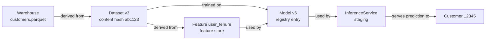
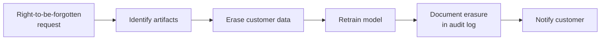

# 16.13 Governance, privacy and compliance for ML platforms

| Field | Value |
|---|---|
| Level | Advanced |
| Priority tier | 2 |
| Lab venue | GCP / GKE |
| Part | Part 16: MLOps and LLMOps tools and platforms |
| Primary sources | *LLMOps* (`llmops`, Chapter 8); *Engineering AI Systems* (`engineering-ai-systems-architecture-and-devops-essentials`, Chapters 9, 10); *Designing Machine Learning Systems* (`designing-machine-learning-systems`, Chapter 11) |
| Cross-references | Chapter 16.1 (MLOps foundations); Chapter 16.6 (Model registry and GitOps); Chapter 16.10 (Monitoring and drift); Chapter 18 (Security) |
| Coverage file | `planning/coverage/chapters/16-13.md` |
| Claim & number ledger | `planning/ledgers/16-13.md` |

## Why this matters for AI infrastructure

Imagine a loan model that declined a customer last month. A regulator asks which data shaped that decision, and your team has days, not weeks, to answer. This chapter covers that kind of question. It is about the cases where your team does not automatically have the right to train or serve a model on its data.

Privacy rules limit what you can train on. Fairness rules limit what you can serve. Model risk rules limit how you can deploy. The EU AI Act adds a class of "high-risk" AI systems with explicit obligations. Your platform team's job is to make the ML platform auditable against every rule that applies to the company.

Compliance is not an add-on that you attach after launch. It is a property the platform has from the first day. A model registry without an audit log cannot answer the regulator's questions. A feature store without a consent record cannot answer GDPR's "lawful basis" question. A serving platform without a rollback path is a platform that cannot meet the EU AI Act's "right to rectification" requirement.

Three rules explain why governance sits on the critical path for ML platforms.

```text
Why governance is on the critical path (background reading: LLMOps; Engineering AI Systems; Designing Machine Learning Systems; the figures below are examples, not quotations):
- GDPR (EU), CCPA (California), LGPD (Brazil), PIPL (China): every jurisdiction that
  has personal-data protection laws requires the team to answer the question
  "which data trained the model that decided on this customer?" in days, not
  weeks. The answer requires data lineage.
- EU AI Act (2024): high-risk AI systems (credit scoring, hiring, biometric
  identification, etc.) must meet explicit requirements for risk management,
  data governance, transparency, human oversight, accuracy, robustness, and
  cybersecurity. Non-compliance fines are up to 7% of global annual turnover.
- Model risk management (SR 11-7 in the US, equivalent regulations in the EU):
  any model that affects a regulated activity (lending, insurance, employment)
  must be inventoried, validated, monitored, and documented. The documentation
  must be auditable.
```

Each rule adds a record you must keep. The data trail, the model documentation, and the fairness checks all have to exist before a model reaches users.

*AI Factory*, chapter 11, makes the same point at the policy level. It says a regulatory framework should set guidelines for how data is acquired and stored, and should include quality assurance for that information.

Three realities make governance a platform concern, not only a data-science concern.

1. The platform produces the audit trail. Every artifact, whether data, model, prediction, or deployment, becomes a row in the audit log. Your design decides whether that log is complete.
2. The platform enforces the controls. Consent records, access policies, retention rules, and the right-to-be-forgotten workflow all run inside the platform. Data scientists use these controls, but the platform team owns them.
3. The platform is the subject of the audit. Auditors inspect the logs, IAM settings, retention rules, and access policies. The platform team is the one who answers their questions.

**Before a team deploys an ML system in a regulated domain, the platform must produce an audit trail that answers every question the regulator can ask.**

Treat compliance as a property of the platform. Check the audit trail before you check anything else.

## Prerequisites and outcomes

### Prerequisites

Read these chapters first. This one builds directly on their ideas, so a gap in an earlier chapter will show up here.

- Chapter 16.1 covers MLOps foundations and the four governance meanings.
- Chapter 16.6 covers the model registry and GitOps.
- Chapter 16.10 covers monitoring and drift.
- Chapter 18 covers the security primitives this chapter relies on.

### Outcomes

By the end of this chapter, you will be able to do six things. Use the list below as a checklist for your own platform, and mark each item you cannot yet show.

1. Map the regulatory regimes to the platform's controls. The regimes here are GDPR, HIPAA, the EU AI Act, SOC2, ISO 27001, and model-risk-management rules.
2. Build the data lineage that lets you answer "which data trained the model that decided on this customer" in days, not weeks.
3. Produce a model card for every model. The card covers architecture, training data, the fairness audit, intended use, and failure modes.
4. Implement the right-to-be-forgotten workflow that removes a customer's data from future training runs.
5. Detect and fix bias in training data and in model outputs.
6. Run the governance, privacy, and compliance stack on GKE, with audit logs, IAM, retention, and observability that match the regulatory requirements.

---

## 1. The regulatory regimes

### 1.1 The four regimes the platform must support

*LLMOps* Chapter 8 and *Engineering AI Systems* Chapters 9 and 10 describe the regulations that touch an AI platform. Each one asks for something different. Your job is to support all of them in one governance layer, not in a separate project for each.

| Regime | Jurisdiction | Key requirement | Platform control |
|---|---|---|---|
| **GDPR** | EU | Lawful basis for processing; right to be forgotten; data portability | Consent record; data deletion; data export |
| **CCPA** | California | Right to know; right to delete; right to opt out | Consent record; data deletion |
| **HIPAA** | US healthcare | PHI access controls; encryption; audit log | IAM; encryption at rest and in transit; audit log |
| **EU AI Act** | EU | Risk management; data governance; transparency; human oversight; accuracy; robustness; cybersecurity | Risk classification; data lineage; model card; human-in-the-loop; bias audit; security controls |
| **SR 11-7** | US banking | Model risk management; validation; monitoring; documentation | Model inventory; validation report; monitoring; documentation |
| **SOC2** | Global | Security controls; availability; confidentiality | IAM; encryption; monitoring; incident response |
| **ISO 27001** | Global | Information security management system | Risk assessment; security controls; continuous improvement |

The regimes overlap, so one control can serve several of them. A consent record satisfies GDPR and CCPA. An audit log satisfies HIPAA, SOC2, and SR 11-7. A model card satisfies the EU AI Act and SR 11-7. When you design a control, list every regime it serves, because that list shows how much work the control saves you.

### 1.2 The data lineage audit

Picture a customer who asks why a bank declined their application. Under GDPR Article 15, the right of access lets that customer ask for a copy of their personal data and the purposes of processing. Article 22 covers decisions made by automated means and gives the customer the right to ask for human intervention. SR 11-7 asks the bank to document every input to a model that affects a credit decision.

Both regimes need the same capability. You must answer, in seconds, "which data trained the model that produced this prediction for this customer." A good answer needs five links:

- The customer id, which identifies the entity that received the prediction.
- The prediction id, for the prediction that was served.
- The model id, for the model that produced the prediction.
- The data snapshot id, for the data the model was trained on.
- The lineage graph, which is the chain from data to prediction.

The lineage graph is the audit trail. It lives in a lineage database such as Atlas, Collibra, DataHub, or Marquez, as covered in Chapter 16.3, Section 3.7. The pipeline updates the graph at every step, so the regulator can query it whenever they ask.

### 1.3 The EU AI Act risk classification

The EU AI Act (2024) sorts AI systems into four risk classes. The class you land in decides which obligations apply to you.

| Risk class | Examples | Obligations |
|---|---|---|
| **Unacceptable** | Social scoring; real-time biometric identification in public spaces | Banned |
| **High** | Credit scoring; hiring; biometric ID; critical infrastructure | Risk management; data governance; transparency; human oversight; accuracy; robustness; cybersecurity; conformity assessment |
| **Limited** | Chatbots; emotion recognition; deep fakes | Transparency (the user knows they are interacting with AI) |
| **Minimal** | Spam filters; AI-enabled video games | No obligations |

A high-risk system must have five things:

- A risk management system that runs throughout the lifecycle.
- Data governance that ensures the training data is relevant, representative, and free of bias.
- Transparency that documents the system's capabilities and limitations.
- Human oversight that lets a person intervene on every decision.
- Accuracy, robustness, and cybersecurity that the system performs as documented.

The obligations map onto controls from earlier chapters. The risk management system is the promotion gate in Chapter 16.1, Section 4.3. Data governance is the data versioning in Chapter 16.2. Transparency is the model card in Chapter 16.6, Section 1.1. Human oversight is the canary deployment in Chapter 16.6, Section 4.2. Accuracy, robustness, and cybersecurity rely on the monitoring in Chapter 16.10 and the security controls in Chapter 18.

Before you call a system high-risk, check which of these controls you cannot yet show to an auditor.

---

## 2. The data lineage that satisfies the regulator

### 2.1 The lineage graph

*Designing Machine Learning Systems* Chapter 11 and *Engineering AI Systems* Chapter 10 describe the lineage graph in detail. Think of it as a map of how each piece of data reached each model. The graph has four node types: source system, dataset, feature, and model. It has three edge types: derived from, trained on, and used by.



Your pipeline writes to the lineage database at every stage. That database stores this graph, and it can be Atlas, Collibra, DataHub, or Marquez. A missing edge is a gap in the map, and a gap is exactly where a regulator's question gets stuck.

### 2.2 The answer to the regulator

Suppose the regulator asks which data trained the model that decided on customer 12345. With the graph in place, you answer by following four links, as the trace below shows.

```
customer 12345 -> received prediction from inference-service churn-v6 on 2024-03-15T10:30:00Z
inference-service churn-v6 -> served model churn-model-v6
churn-model-v6 -> trained on dataset churn-v3 (content hash abc123)
churn-v3 -> derived from warehouse customers.parquet (snapshot 2024-02-01T00:00:00Z)
```

The traversal takes seconds, and the auditor's report follows in minutes. Without the lineage graph, the same answer takes weeks of searching through records.

### 2.3 The lineage contract

Lineage only helps if every stage writes it at the right moment. That promise is the lineage contract. Each artifact records its own lineage as soon as it is created, as the table shows.

| Artifact | Lineage metadata | When it writes |
|---|---|---|
| Raw data | Source system; snapshot time; row count | At ingestion |
| Cleaned data | Raw data lineage; cleaning code commit; cleaning timestamp | At transformation |
| Feature | Cleaned data lineage; feature definition commit | At feature engineering |
| Model | Feature lineage; training code commit; env image hash | At training |
| Deployment | Model lineage; deployment commit; deployer | At deployment |
| Prediction | Deployment lineage; customer id; prediction timestamp | At serving |

The contract is the platform's promise to the regulator. The pipeline enforces it, because every artifact creation writes to the lineage database. The platform team audits that those writes actually happen.

*Production Kubernetes*, chapter 15, adds a useful point about the code side of this contract. Git gives you a strong audit log of changes by default, and a pull request can act as the gate for each change.

Before you let a pipeline register a model, check that every earlier stage wrote its lineage.

---

## 3. The model card

### 3.1 What the model card captures

*Engineering AI Systems* Chapter 9 describes the model card. Picture the document a regulator or a new engineer reads before touching a model. It should answer every question they have about that model.

```text
Minimum model card (background reading: Engineering AI Systems; Designing Machine Learning Systems; EU AI Act Annex IV; the figures below are examples, not quotations):
- model name and version
- intended use (what the model is for)
- out-of-scope use (what the model is NOT for)
- architecture (the model's structure)
- training data summary (which datasets, how big, how recent)
- training environment (CUDA version, framework version)
- evaluation results (overall metrics; per-segment metrics; fairness audit)
- fairness audit (per-segment accuracy; demographic parity; equalised odds)
- limitations (known failure modes; edge cases)
- ethical considerations (consent basis; data retention; right to be forgotten)
- contact information (who owns the model)
- last updated (when the card was last reviewed)
```

Your promotion gate must refuse a model whose card is missing or out of date. The gate from Chapter 16.1, Section 4.3, enforces that rule. A model card written after launch records the model, but it does not control the model.

### 3.2 The fairness audit

Fairness problems often hide inside good averages. A model can look accurate overall and still fail one group of customers. *Engineering AI Systems* Chapter 10 describes an audit that measures performance across protected groups, such as gender, race, age, and disability, and then writes a report.

| Metric | What it measures | Target |
|---|---|---|
| **Demographic parity** | The prediction rate is the same across groups | Difference < 5% |
| **Equalised odds** | The true positive rate and false positive rate are the same across groups | Difference < 5% |
| **Predictive parity** | The positive predictive value is the same across groups | Difference < 5% |
| **Calibration** | The predicted probability matches the observed frequency across groups | Difference < 5% |

The thresholds in this table are example starting points, not legal limits. Choose the values for your regime and use case, with help from your legal and risk teams.

The audit runs on every promotion. Its output becomes a row in the model card and a metric in the promotion gate. The gate refuses to advance any model that breaches a threshold.

### 3.3 The consent record

A customer who withdraws consent expects their data to stop being used. The consent record is how the platform knows that. It is the answer to GDPR Article 6 on lawful basis, and to CCPA's right to opt out.

The record captures five things:

- The customer id.
- The data fields the customer consented to.
- The purpose of the processing.
- The date and version of the consent.
- The withdrawal date, if the customer withdrew.

The consent record lives in the feature store from Chapter 16.3. The feature store's data versioning from Chapter 16.2 makes the record immutable.

Before each training run, the pipeline must read the consent record and drop every customer who withdrew. Make that read a required step, not an optional one.

---

## 4. The right-to-be-forgotten workflow

### 4.1 The GDPR Article 17 requirement

Picture a customer who asks a company to delete everything it holds about them. GDPR Article 17, the right to erasure, requires the controller to erase that data "without undue delay". The erasure reaches the warehouse, the feature store, and the training data. It also touches the model, which is a derived artefact. Model weights are not personal data per se, but the training data is.

For each request, the platform team has four jobs:

- Identify all the artifacts that contain the customer's data.
- Erase the customer's data from each artifact.
- Retrain the model on the cleaned data, or retire the model if retraining is too expensive.
- Document the erasure in the audit log.

### 4.2 The workflow

The workflow runs in the order shown below.



Teams usually build this as a Kubernetes Job with six steps. Each step below maps to one box in the diagram.

1. Read the request from a queue.
2. Identify the artifacts that hold the customer's data, such as warehouse tables, feature store rows, and training data.
3. Erase that data with DELETE statements or row-level updates.
4. Trigger a retraining DAG from Chapter 16.10 on the cleaned data.
5. Write the erasure record to the audit log.
6. Notify the customer.

Build the request path first. If the customer-facing application cannot reach the queue, the workflow never starts.

### 4.3 The retraining cost

Erasure has a compute cost, and retraining is usually the largest part of it. For example, a model that takes 12 hours to retrain and 2 hours to deploy costs 14 hours of GPU time per request. Multiply that across many requests and the bill grows quickly.

You can avoid paying that cost for every request. The Job queues the requests, retrains once a day with the day's batch, writes one audit entry, and notifies the customers together. The daily interval is an example. A longer wait can conflict with the "without undue delay" rule, so check the interval with your legal team.

This follows the scheduled retraining trigger in Chapter 16.10, Section 4.1, with one extra rule: the new model must exclude every customer in the erasure queue. Set the batch interval with legal review, not only with a cost estimate.

---

## 5. Privacy-preserving ML

### 5.1 The three patterns

Sometimes raw customer data cannot leave its home, even for training. *Engineering AI Systems* Chapter 10 describes three patterns for that case. Each pattern guards against a different threat, so start by asking who you must keep the data from.

| Pattern | What it does | Threat model | Cost |
|---|---|---|---|
| **Federated learning** | Train the model on the customer's device; aggregate the gradients on the server | The server cannot see the customer's data | Higher compute on the edge; aggregation overhead |
| **Differential privacy** | Add noise to the training process to prevent memorisation of individual examples | The model does not memorise specific examples | Reduced accuracy; calibration required |
| **Homomorphic encryption** | Train the model on encrypted data, so the server never sees the plaintext | The server cannot see the data | 10-100x compute overhead |

The overhead figure for homomorphic encryption in this table has no source in this chapter. Treat it as a rough estimate until someone checks it against a source.

Choose the pattern that matches the customer's threat model. Federated learning fits mobile devices. Differential privacy fits medical data. Homomorphic encryption fits highly sensitive financial data.

### 5.2 Federated learning on the cluster

In federated learning, the data never moves. Training runs where the data lives, and only gradients travel back to you. The loop has six steps.

1. Your platform team ships a training container to the customer.
2. The customer's cluster runs the training container on the customer's data.
3. The customer's cluster sends the gradients (not the data) to the platform team's cluster.
4. The platform team's cluster aggregates the gradients across all customers.
5. The platform team's cluster produces a new model version.
6. The new model version is shipped to the customer's cluster.

Three tools do this work. TensorFlow Federated handles the orchestration. PySyft provides privacy primitives such as secure aggregation and differential privacy. NVIDIA FLARE is a federated learning framework with NVIDIA support.

### 5.3 Differential privacy in training

Differential privacy adds noise during training, so the model cannot memorise any single example. The snippet below attaches a differentially private optimizer to a Keras training loop.

```python
# code/part16/snippets/differential_privacy.py
import tensorflow_privacy as tfp

# Attach a differentially private optimiser to the training loop
optimizer = tfp.DPKerasAdamOptimizer(
    l2_norm_clip=1.0,
    noise_multiplier=0.5,
    num_microbatches=256,
    learning_rate=1e-3,
)

model.compile(optimizer=optimizer, loss='sparse_categorical_crossentropy', metrics=['accuracy'])
```

The `l2_norm_clip` and `noise_multiplier` are settings that the training library uses to add noise. The privacy budget itself is the pair epsilon and delta, which the library computes from those settings, the batch size and the number of training steps. You publish epsilon and delta on the model card, because it records the trade-off between accuracy and privacy that a regulator will ask about.

---

## 6. Operating governance and compliance on GKE

### 6.1 The components

Each governance component runs as a normal workload on your cluster, with its own backing store and its own service target. The table lists them. The service level objective (SLO) column holds example targets. Set your own, based on what your regulator and your customers expect.

| Component | Where it runs | Backing store | SLO |
|---|---|---|---|
| Lineage database (Atlas, DataHub, Marquez) | Kubernetes Deployment | Postgres + object storage | Query latency p99 < 1 s |
| Consent record (in feature store) | Same as feature store | Same as feature store | Same as feature store |
| Right-to-be-forgotten Job | Kubernetes Job | Object storage for retraining data | Erasure latency < 24 hours |
| Fairness audit | Kubernetes Job | Object storage for reports | Audit latency < 1 hour |
| Audit log | Object storage with object-lock | GCS bucket | Write latency p99 < 1 s |

### 6.2 IAM and the audit log

Governance needs its own access rules. The people who read the audit log are often not the people who write to it. Each role below gets only the rights it needs.

| Role | Who | What they can do |
|---|---|---|
| `governance.auditor` | Compliance team; external auditors | Read the lineage database; read the audit log; read the model cards |
| `governance.consent.writer` | The customer-facing application | Write to the consent record |
| `governance.consent.reader` | The training pipeline | Read the consent record |
| `governance.erasure.writer` | The right-to-be-forgotten Job | Write to the lineage database; trigger retraining |
| `governance.admin` | The platform team | Manage the lineage database; manage the consent record |

The audit log is tamper-evident because the GCS bucket uses object-lock. It records every lineage change, consent change, erasure event, and fairness audit.

*Production Kubernetes*, chapter 9, notes that the API server writes no audit records until you give it a policy file with the `--audit-policy-file` flag. It also warns that access to those logs needs thought, because they can reveal activity on sensitive systems.

*Production Kubernetes*, chapter 10, adds that impersonation stays visible. When an admin impersonates a user, the Kubernetes audit logs still show the original user and the action taken.

### 6.3 Observability

Dashboards tell you when governance is slipping, often before a regulator notices. The table lists the metrics and their alert thresholds. Treat the thresholds as example values, and tune them to your own risk.

| Metric | Why it matters | Alert |
|---|---|---|
| Lineage query latency p99 | Hot path for the regulator's questions | > 5 s |
| Right-to-be-forgotten latency p99 | GDPR Article 17 requires "without undue delay" | > 24 hours |
| Fairness audit failure rate | Catches a model that breaches the fairness threshold | > 0 for 1 day |
| Consent record staleness | Catches a record that has not been refreshed | > 1 year |
| Audit log write latency p99 | Catches a slow audit log | > 1 s |

Watch the right-to-be-forgotten latency most closely. GDPR Article 17 asks for erasure "without undue delay". The 24-hour figure is an example SLO, not a legal deadline. When the alert fires, the on-call engineer investigates the queue and the Job.

---

## 7. How it fails

Six failure modes come up again and again. Each one below gives the symptom you will see, the diagnosis, and the fix. Start with the diagnosis, not the fix, because a fix applied to the wrong cause hides the problem.

### 7.1 "The lineage graph is incomplete"

Symptom: The regulator asks which data trained the model that decided on customer 12345. The platform's query returns a partial answer. The model and the customer are known, but the data snapshot is not.

Diagnosis: The pipeline did not write to the lineage database at every step. The contract from Section 2.3 is not being enforced.

Fix: Refuse to register a model version when the lineage database lacks a required edge. The promotion gate from Chapter 16.1, Section 4.3, reads the lineage database and fails when the lineage is incomplete.

### 7.2 "The model card is missing the fairness audit"

Symptom: The regulator asks for the fairness audit of a high-risk model. The model card has no such section, because the audit never ran.

Diagnosis: The promotion gate from Chapter 16.1, Section 4.3, did not require the audit. The model was promoted without one.

Fix: You make the fairness audit a required field in the model card. The gate then refuses any model whose card is missing that section.

### 7.3 "The right-to-be-forgotten Job was not triggered"

Symptom: A customer asked for erasure. The customer-facing application received the request, but the platform team never heard about it. The customer's data stayed in the training set.

Diagnosis: The workflow is not connected to the application. The application received the request, but the platform's queue did not.

Fix: You connect the application to the erasure queue. The platform team's pattern: the customer-facing application writes to the queue, and the platform team consumes from it.

### 7.4 "The audit log was deleted"

Symptom: The auditor asks for the audit log of a model that ran in production two years ago. The audit log bucket is empty.

Diagnosis: The bucket did not have object-lock. A deletion by a careless engineer, or by a malicious one, removed the artefacts.

Fix: Turn on object-lock for the audit log bucket. The runbook says "if the audit log is missing, page the on-call immediately, do not investigate first".

### 7.5 "The consent record is stale"

Symptom: A customer consented to processing in 2020 and never refreshed that consent. The application still processes their data four years later.

Diagnosis: The consent record has no expiration date. The platform team never asked the customer to refresh it.

Fix: Add an expiration date to every consent. A 1-year expiry is a common choice. Send a refresh request a set number of days before expiry, for example 30, and pause processing if the consent lapses.

### 7.6 "The model was retrained on data from a customer who withdrew consent"

Symptom: A customer withdrew consent, but their data was still in the latest training snapshot. The new model trained on that snapshot, so the customer's data is now inside the model.

Diagnosis: The pipeline does not read the consent record at training time. It trains on the latest data, and the latest data still includes the customer.

Fix: You read the consent record at training time, and you exclude every customer who withdrew. The platform team treats the consent record as a join key, and the join drops withdrawn customers.

---

## 8. Hands-on lab

This lab sets up the lineage database, the consent record, the model card, and the right-to-be-forgotten Job on GKE. The lab is **untested** in this repository, so treat every command as a starting point.

### 8.1 Prerequisites

- A GKE Autopilot or Standard cluster (1.27+).
- A model from Chapter 16.6's lab.
- A feature store from Chapter 16.3's lab.

### 8.2 Step 1: install DataHub for lineage

Start with the lineage store. DataHub runs as a Helm release in its own namespace.

```bash
helm install datahub datahub/datahub \
  --namespace governance --create-namespace
# expected: DataHub pods are running; the UI is at /lineage
```

### 8.3 Step 2: wire the lineage into the pipeline

Next, make the training pipeline write a lineage edge for each model it trains. The helper below emits one edge, from the dataset to the model. Run it after each training job, so the edge exists before anyone asks for it.

```python
# code/part16/snippets/lineage_writer.py
from datahub.emitter.mce_builder import (
    DatasetAspect, make_dataset_urn, make_lineage_mcp
)

def record_lineage(model_id: str, dataset_id: str, run_id: str):
    """Record that model_id was trained on dataset_id in run_id."""
    lineage = make_lineage_mcp(
        upstream_urns=[make_dataset_urn(dataset_id)],
        downstream_urn=make_dataset_urn(model_id),
    )
    emitter.emit_lineage(lineage)
```

```bash
python code/part16/snippets/lineage_writer.py \
  --model churn-model-v6 \
  --dataset churn-v3 \
  --run-id abc123
# expected: the lineage edge is written to DataHub
```

### 8.4 Step 3: produce a model card

Generate the model card from the trained model. Review the output before you promote the model.

```bash
python code/part16/produce_model_card.py \
  --model churn-model-v6 \
  --output model-cards/churn-model-v6.md
# expected: a model card with architecture, training data summary, evaluation results, fairness audit
```

### 8.5 Step 4: trigger a right-to-be-forgotten Job

Now test the erasure path. Use a test customer id, not a real one.

```bash
# Submit a right-to-be-forgotten request
python code/part16/erasure_job.py \
  --customer-id 12345 \
  --reason "GDPR Article 17 request from customer"
# expected: the Job erases the customer's data; retraining is triggered; the audit log is updated
```

### 8.6 Step 5: verify the lineage graph

Query the lineage store to confirm the data flow for the test customer.

```bash
# Query the lineage database for the customer's data flow
curl -X POST http://datahub.governance:9002/api/graphql \
  -H "Content-Type: application/json" \
  -d '{"query": "{ search(input: { type: DATASET, query: \"churn-v3\", start: 0, count: 10 }) { searchResults { entity { urn } } }"}' \
  | jq .
# expected: the churn-v3 dataset with its lineage to churn-model-v6
```

### 8.7 Step 6: verify the consent record

Check the consent record for the same customer.

```bash
# Query the feature store for the customer's consent
python code/part16/check_consent.py \
  --customer-id 12345
# expected: the customer's consent record; the data fields the customer consented to
```

### 8.8 Step 7: verify the audit log

Read the most recent erasure events from the audit log.

```bash
# Query the audit log for the most recent erasure events
bq query --use_legacy_sql=false \
  "SELECT timestamp, customer_id, reason, retraining_dag
   FROM \`${PROJECT_ID}.governance.erasure_events\`
   ORDER BY timestamp DESC
   LIMIT 10"
# expected: the most recent erasure events with the customer id, the reason, and the retraining DAG
```

### 8.9 What to record

After the lab, you should answer five questions quickly. The five-second target is a suggestion from this lab, not a standard, so set your own.

1. What is the lineage edge between churn-model-v6 and churn-v3?
2. What is the model card for churn-model-v6?
3. What is the most recent erasure event, and what customer requested it?
4. What is the consent record for customer 12345?
5. What is the cost of the right-to-be-forgotten Job per request?

If any answer takes longer than 30 seconds, treat that as a warning sign. The 30-second figure is an example threshold. The lab is still untested against a live GKE cluster.

---

## Exercises

Work through these on your own platform, in order. Each one asks you to add or change a single control.

1. Add a fairness audit to the promotion gate. Refuse to promote a model whose fairness metrics breach the threshold. *Solution sketch:* use the promotion gate from Chapter 16.1, Section 4.3, and add the fairness metric to the gate's policy.
2. Add a consent expiration alert. Configure an alert that fires 30 days before a customer's consent expires. *Solution sketch:* a CronJob scans the consent record and writes the expiring customers to a queue. An alert fires on that queue.
3. Add a privacy budget to the model card. Publish the differential privacy budget on the model card. *Solution sketch:* a script reads the training run's privacy budget and writes it to the card.
4. Add a federated learning training pipeline. Stand up TensorFlow Federated or NVIDIA FLARE on a Kubernetes cluster. *Solution sketch:* a Kubernetes Deployment runs the FLARE server, and a Job runs the FLARE clients.
5. Add an EU AI Act risk classification. Add a field to the model card that records the EU AI Act risk class. The promotion gate refuses to promote a high-risk model without the human-override and bias-audit fields. *Solution sketch:* change the model card schema, then make the promotion gate read it.
6. Add right-to-be-forgotten amortisation. Queue the erasure requests, and run a daily retraining that consumes the queue. *Solution sketch:* a Kubernetes CronJob consumes the queue, runs a retraining DAG, and updates the audit log.

---

## Checkpoint questions

<details><summary>1. What four regulatory regimes does the platform support?</summary>
The platform supports GDPR for the EU, CCPA for California, HIPAA for US healthcare, the EU AI Act for the EU, SR 11-7 for US banking, and SOC2 and ISO 27001 as global standards. Because the regimes overlap, one control often serves several of them. A consent record satisfies GDPR and CCPA, while an audit log satisfies HIPAA, SOC2, and SR 11-7, and a model card satisfies the EU AI Act and SR 11-7.
</details>

<details><summary>2. What is the EU AI Act's risk classification?</summary>
The EU AI Act sorts systems into four categories: unacceptable systems are banned, high-risk systems carry explicit duties, limited-risk systems need transparency, and minimal-risk systems have no obligations. Your platform's controls map directly onto the high-risk duties.
</details>

<details><summary>3. What is the lineage graph?</summary>
It is a graph that traces the chain from data to prediction. It has four node types, which are source system, dataset, feature, and model, and three edge types, which are derived from, trained on, and used by. The pipeline updates it at every step, and it is the audit trail that satisfies GDPR Article 15 and SR 11-7.
</details>

<details><summary>4. What does the model card capture?</summary>
It records the model name and version, intended use, out-of-scope use, architecture, training data summary, training environment, evaluation results, fairness audit, limitations, ethical considerations, contact information, and the date of the last update. You need a complete card before promotion, because the promotion gate refuses any model without one.
</details>

<details><summary>5. What is GDPR Article 17?</summary>
It is the right to erasure, often called the right to be forgotten. The data controller must erase a customer's personal data "without undue delay" when the customer asks. Your platform team's pattern is a Kubernetes Job that erases the customer's data from every artifact and retrains the model on the cleaned data.
</details>

<details><summary>6. What is the consent record?</summary>
It is a record of the customer's consent to data processing. It holds the customer id, the data fields consented to, the purpose, the date and version, and the withdrawal date. The pipeline reads the record at training time, and it excludes customers who have withdrawn consent.
</details>

<details><summary>7. What are the three privacy-preserving ML patterns?</summary>
They are federated learning, which trains on the customer's device and aggregates gradients on the server, differential privacy, which adds noise to training to prevent memorisation, and homomorphic encryption, which trains on encrypted data. Each one matches a threat model. Federated learning suits mobile devices, differential privacy suits medical data, and homomorphic encryption suits highly sensitive financial data.
</details>

<details><summary>8. Why is the consent record a join key?</summary>
The pipeline joins the training data to the consent record, and the join drops customers who have withdrawn consent. This is the same pattern as any other filter join, because the consent record is a normal column in the data warehouse.
</details>

<details><summary>9. What is the right-to-be-forgotten Job's amortisation pattern?</summary>
You queue the erasure requests, and the Job runs one retraining per day that consumes the queue. This spreads the retraining cost across many requests, writes one audit entry per retraining, and notifies all the customers at once.
</details>

<details><summary>10. What is the privacy budget?</summary>
The differential privacy budget is the trade-off between accuracy and privacy. The budget is the pair epsilon and delta, computed from the noise settings, the batch size and the number of steps. You publish it on the model card, because it is the parameter a regulator inspects.
</details>

<details><summary>11. What is the fairness audit?</summary>
It is a set of metrics that compare the model's performance across protected groups: demographic parity, equalised odds, predictive parity, and calibration. The audit runs on every promotion. Its output is a row in the model card, and the promotion gate refuses any model whose fairness metrics breach the threshold.
</details>

<details><summary>12. What is the lineage contract?</summary>
It is the promise that every artifact writes its lineage at the moment it is created. Raw data writes its source system and snapshot time. Cleaned data writes its raw lineage and cleaning commit. A feature writes its cleaned data lineage and feature definition. A model writes its feature lineage, training commit, and environment image hash. A deployment writes its model lineage and deployment commit. A prediction writes its deployment lineage, customer id, and timestamp. Your pipeline enforces the contract, and your platform team audits it.
</details>

<details><summary>13. Why is the audit log tamper-evident?</summary>
The audit log proves that every other artifact was what it claimed to be. Object-lock on the GCS bucket blocks deletion or overwrite for the retention window. A deleted audit log is the worst possible incident, so the runbook says to "page the on-call immediately".
</details>

<details><summary>14. What is the consent expiration pattern?</summary>
You add an expiration date to each consent, and one year is a common choice. Your team sends a refresh request 30 days before expiry, and processing pauses if the consent lapses. The pattern satisfies GDPR Article 7 on conditions for consent, and CCPA's right to opt out.
</details>

<details><summary>15. What is the role of the consent record in the right-to-be-forgotten workflow?</summary>
The Job reads the consent record to find customers who withdrew consent. It erases their data from every artifact, then retrains the model on the cleaned data. The consent record is the trigger, the erasure is the action, and the retraining is the consequence.
</details>

<details><summary>16. Why is federated learning more expensive on the edge?</summary>
Training runs on the customer's device, which has limited compute and battery, and gradient aggregation on the server adds overhead. In return, the server never sees the customer's data, so the customer's privacy is preserved.
</details>

<details><summary>17. What is the difference between federated learning and differential privacy?</summary>
Federated learning moves training to the customer's device, so the data never leaves it. Differential privacy adds noise during training on the server, where the data sits, to stop memorisation of single examples. The two are complementary, and a serious privacy-preserving deployment often uses both.
</details>

<details><summary>18. Why is the lineage graph updated at every step?</summary>
The regulator's question, "which data trained the model that decided on this customer," needs a complete chain. A missing edge is an unanswered question. The pipeline writes the edge at every step, and the platform enforces the contract.
</details>

<details><summary>19. What is the role of the model card in the EU AI Act?</summary>
The model card is the artefact that meets the EU AI Act's transparency requirement. It documents the model's capabilities and limitations, the training data, the fairness audit, and the human oversight mechanism. High-risk systems need it.
</details>

<details><summary>20. What five questions should the governance lab let you answer in five seconds each?</summary>
The first is the lineage edge between the model and the data. The second is the model card. The third is the most recent erasure event. The fourth is the consent record for a given customer. The fifth is the cost of the right-to-be-forgotten Job per request. If any takes longer than 30 seconds, the layer is not yet a production service, and the 30-second figure is an example threshold.
</details>

---

## Sources and review notes

- *LLMOps* (`llmops`, Chapter 8). Source for the governance, monitoring, privacy, and security patterns; the regulatory regimes; the consent record; the right-to-be-forgotten workflow. Chapter 8 is approximately 8,300 words.
- *Engineering AI Systems: Architecture and DevOps Essentials* (`engineering-ai-systems-architecture-and-devops-essentials`, Chapters 9, 10). Source for the security controls, the privacy-preserving ML patterns (federated learning, differential privacy, homomorphic encryption), the fairness audit metrics, and the model card requirements. Chapter 9 is approximately 5,100 words; Chapter 10 is approximately 3,650 words.
- *Designing Machine Learning Systems* (`designing-machine-learning-systems`, Chapter 11). Source for the human side of machine learning, the model card as a documentation tool, the fairness considerations, and the stakeholder management. Chapter 11 is approximately 8,200 words.

### Cross-references to other handbook chapters

- Chapter 16.1 for the promotion gate that the governance layer enforces.
- Chapter 16.6 for the model registry that the governance layer audits.
- Chapter 16.10 for the monitoring that detects the regressions the governance layer must catch.
- Chapter 18 (Security) for the security primitives the governance layer relies on.

### Migrated from `nvidia-devops`

No direct migration from `nvidia-devops` for this chapter. The chapter is a synthesis of the gem books' governance content applied to the AI infrastructure platform.

### Explicitly labelled inferences

- The fairness audit thresholds (5% difference) in Section 3.2 are starting points drawn from common practice; specific thresholds depend on the regulatory regime and the use case.
- The right-to-be-forgotten latency SLO (24 hours) in Section 6.3 is a starting point; specific SLOs depend on the regulator's expectations and the customer's expectations.
- The consent expiration window (1 year) in Section 7.5 is a starting point; specific windows depend on the regulator's expectations.

### Not verified on live hardware

- The lab in Section 8 is **untested** against a live GKE cluster in this repository.
- The DataHub, lineage database, and audit log versions assumed in the lab should be pinned against the current releases before production use.
- The right-to-be-forgotten Job assumes a queue and a workflow; production deployments require careful queue management and idempotency.
