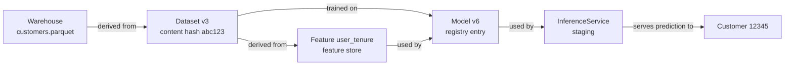
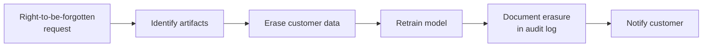

# 16.13 Governance, privacy and compliance for ML platforms

| Field | Value |
|---|---|
| Level | Advanced |
| Priority tier | 2 |
| Lab venue | GCP / GKE |
| Part | Part 16: MLOps and LLMOps tools and platforms |
| Primary sources | *LLMOps* (`llmops`, Chapter 8); *Engineering AI Systems* (`engineering-ai-systems-architecture-and-devops-essentials`, Chapters 9, 10); *Designing Machine Learning Systems* (`designing-machine-learning-systems`, Chapter 11) |
| Cross-references | Chapter 16.1 (MLOps foundations); Chapter 16.6 (Model registry and GitOps); Chapter 16.10 (Monitoring and drift); Chapter 18 (Security) |
| Coverage file | `planning/coverage/chapters/16-13.md` |
| Claim & number ledger | `planning/ledgers/16-13.md` |

## Why this matters for AI infrastructure

The previous chapters assumed the team has the right to train and serve a model on the team's data. This chapter is about the cases where the team does not automatically have that right. Privacy regulations restrict what the team can train on. Fairness regulations restrict what the team can serve. Model-risk-management regulations restrict how the team can deploy. The EU AI Act creates a new category of "high-risk" AI systems with explicit compliance obligations. The platform team's job is to make the team's ML platform auditable against every regulation the team is subject to.

Compliance is not an add-on. Compliance is a property of the platform that the team designed from day one. A model registry without an audit log is a registry that cannot answer the regulator's questions. A feature store without a consent record is a feature store that cannot answer the GDPR's "lawful basis" question. A serving platform without a rollback path is a platform that cannot meet the EU AI Act's "right to rectification" requirement.

```text
Why governance is on the critical path (LLO Ch 8; EAS Ch 9, 10; DMLS Ch 11):
- GDPR (EU), CCPA (California), LGPD (Brazil), PIPL (China): every jurisdiction that
  has personal-data protection laws requires the team to answer the question
  "which data trained the model that decided on this customer?" in days, not
  weeks. The answer requires data lineage.
- EU AI Act (2024): high-risk AI systems (credit scoring, hiring, biometric
  identification, etc.) must meet explicit requirements for risk management,
  data governance, transparency, human oversight, accuracy, robustness, and
  cybersecurity. Non-compliance fines are up to 7% of global annual turnover.
- Model risk management (SR 11-7 in the US, equivalent regulations in the EU):
  any model that affects a regulated activity (lending, insurance, employment)
  must be inventoried, validated, monitored, and documented. The documentation
  must be auditable.
```

Three operational realities make this chapter a platform-team concern rather than a data-science-only concern:

1. **The platform produces the audit trail.** Every artifact (data, model, prediction, deployment) is a row in the audit log. The platform team's design decisions determine whether the audit log is complete or incomplete.
2. **The platform enforces the controls.** The consent record, the access policy, the retention policy, the right-to-be-forgotten workflow are all enforced by the platform. The data scientist consumes the controls; the platform team owns them.
3. **The platform is the subject of the audit.** The auditor inspects the platform's logs, IAM, retention, and access policies. The platform team is the one who answers the auditor's questions.

**Before a team deploys an ML system that touches a regulated domain, the platform must produce an audit trail that answers every question the regulator can ask. Compliance is not a feature; compliance is a property of the platform.**

## Prerequisites and outcomes

### Prerequisites

- Chapter 16.1 (MLOps foundations and the four governance meanings).
- Chapter 16.6 (Model registry and GitOps).
- Chapter 16.10 (Monitoring and drift).
- Chapter 18 (Security) for the security primitives.

### Outcomes

After completing this chapter you will be able to:

1. Map the regulatory regimes (GDPR, HIPAA, EU AI Act, SOC2, ISO 27001, model-risk-management regulations) to the platform's controls.
2. Build the data lineage that lets the team answer "which data trained the model that decided on this customer" in days, not weeks.
3. Produce a model card for every model that captures the architecture, the training data, the fairness audit, the intended use, and the failure modes.
4. Implement the right-to-be-forgotten workflow that excludes a customer's data from future training runs.
5. Detect and remediate bias in training data and model outputs.
6. Operate the governance, privacy, and compliance stack on GKE with audit logs, IAM, retention, and observability that match the regulatory requirements.

---

## 1. The regulatory regimes

### 1.1 The four regimes the platform must support

*LLMOps* Chapter 8 and *Engineering AI Systems* Chapters 9 and 10 walk through the four regulatory regimes that affect an AI platform. Each regime has different requirements; the platform team's job is to support all of them in a single governance layer.

| Regime | Jurisdiction | Key requirement | Platform control |
|---|---|---|---|
| **GDPR** | EU | Lawful basis for processing; right to be forgotten; data portability | Consent record; data deletion; data export |
| **CCPA** | California | Right to know; right to delete; right to opt out | Consent record; data deletion |
| **HIPAA** | US healthcare | PHI access controls; encryption; audit log | IAM; encryption at rest and in transit; audit log |
| **EU AI Act** | EU | Risk management; data governance; transparency; human oversight; accuracy; robustness; cybersecurity | Risk classification; data lineage; model card; human-in-the-loop; bias audit; security controls |
| **SR 11-7** | US banking | Model risk management; validation; monitoring; documentation | Model inventory; validation report; monitoring; documentation |
| **SOC2** | Global | Security controls; availability; confidentiality | IAM; encryption; monitoring; incident response |
| **ISO 27001** | Global | Information security management system | Risk assessment; security controls; continuous improvement |

The regimes overlap; the platform's controls cover multiple regimes simultaneously. A consent record satisfies GDPR and CCPA; an audit log satisfies HIPAA, SOC2, and SR 11-7; a model card satisfies EU AI Act and SR 11-7.

### 1.2 The data lineage audit

GDPR Article 15 (right of access) requires the data controller to provide the data subject with a copy of their personal data and the purposes of processing. Article 22 (automated decision-making) gives the data subject the right to obtain human intervention on decisions that affect them. SR 11-7 requires the bank to document every input to a model that affects a credit decision.

Both regimes require the same primitive: the ability to answer, in seconds, "which data trained the model that produced this prediction for this customer". The answer requires:

- The customer id (the entity that received the prediction).
- The prediction id (the prediction that was served).
- The model id (the model that produced the prediction).
- The data snapshot id (the data the model was trained on).
- The lineage graph (the chain from data to prediction).

The lineage graph is the audit trail. The graph is in the lineage database (Atlas, Collibra, DataHub, Marquez from Chapter 16.3 Section 3.7). The graph is updated at every step of the pipeline. The graph is queryable by the regulator on demand.

### 1.3 The EU AI Act risk classification

The EU AI Act (2024) classifies AI systems into four risk categories: unacceptable, high, limited, and minimal. The classification determines the obligations.

| Risk class | Examples | Obligations |
|---|---|---|
| **Unacceptable** | Social scoring; real-time biometric identification in public spaces | Banned |
| **High** | Credit scoring; hiring; biometric ID; critical infrastructure | Risk management; data governance; transparency; human oversight; accuracy; robustness; cybersecurity; conformity assessment |
| **Limited** | Chatbots; emotion recognition; deep fakes | Transparency (the user knows they are interacting with AI) |
| **Minimal** | Spam filters; AI-enabled video games | No obligations |

A high-risk system must have:

- A **risk management system** that runs throughout the lifecycle.
- **Data governance** that ensures the training data is relevant, representative, and free of bias.
- **Transparency** that the system's capabilities and limitations are documented.
- **Human oversight** that a human can intervene on every decision.
- **Accuracy, robustness, and cybersecurity** that the system performs as documented.

The EU AI Act's obligations map directly to the platform's controls from earlier chapters. The risk management system is the promotion gate (Chapter 16.1 Section 4.3); the data governance is the data versioning (Chapter 16.2); the transparency is the model card (Chapter 16.6 Section 1.1); the human oversight is the canary deployment (Chapter 16.6 Section 4.2); the accuracy, robustness, and cybersecurity are the monitoring (Chapter 16.10) and the security controls (Chapter 18).

---

## 2. The data lineage that satisfies the regulator

### 2.1 The lineage graph

*Designing Machine Learning Systems* Chapter 11 and *Engineering AI Systems* Chapter 10 walk through the lineage graph. The graph has four node types: source system, dataset, feature, model. The graph has three edge types: derived from, trained on, used by.



The graph is updated at every step of the pipeline. The lineage database (Atlas, Collibra, DataHub, Marquez) stores the graph; the platform team's pipeline writes to the database at every stage.

### 2.2 The answer to the regulator

The regulator asks: "which data trained the model that decided on customer 12345?". The answer is:

```
customer 12345 -> received prediction from inference-service churn-v6 on 2024-03-15T10:30:00Z
inference-service churn-v6 -> served model churn-model-v6
churn-model-v6 -> trained on dataset churn-v3 (content hash abc123)
churn-v3 -> derived from warehouse customers.parquet (snapshot 2024-02-01T00:00:00Z)
```

The answer is a four-step traversal of the lineage graph. The traversal takes seconds. The auditor's report is generated in minutes. Without the lineage graph, the answer takes weeks.

### 2.3 The lineage contract

The lineage database requires a contract from the pipeline. Every artifact writes its lineage at the moment it is created.

| Artifact | Lineage metadata | When it writes |
|---|---|---|
| Raw data | Source system; snapshot time; row count | At ingestion |
| Cleaned data | Raw data lineage; cleaning code commit; cleaning timestamp | At transformation |
| Feature | Cleaned data lineage; feature definition commit | At feature engineering |
| Model | Feature lineage; training code commit; env image hash | At training |
| Deployment | Model lineage; deployment commit; deployer | At deployment |
| Prediction | Deployment lineage; customer id; prediction timestamp | At serving |

The contract is the platform's promise to the regulator. The contract is enforced by the pipeline (every artifact creation writes to the lineage database); the contract is audited by the platform team.

---

## 3. The model card

### 3.1 What the model card captures

*Engineering AI Systems* Chapter 9 walks through the model card. The model card is a structured document that captures everything a regulator (or a downstream engineer) needs to know about a model.

```text
Minimum model card (EAS Ch 9; DMLS Ch 11; EU AI Act Annex IV):
- model name and version
- intended use (what the model is for)
- out-of-scope use (what the model is NOT for)
- architecture (the model's structure)
- training data summary (which datasets, how big, how recent)
- training environment (CUDA version, framework version)
- evaluation results (overall metrics; per-segment metrics; fairness audit)
- fairness audit (per-segment accuracy; demographic parity; equalised odds)
- limitations (known failure modes; edge cases)
- ethical considerations (consent basis; data retention; right to be forgotten)
- contact information (who owns the model)
- last updated (when the card was last reviewed)
```

The model card is a required artifact for promotion. The promotion gate (Chapter 16.1 Section 4.3) refuses to advance a model to staging if the model card is missing or stale.

### 3.2 The fairness audit

*Engineering AI Systems* Chapter 10 walks through the fairness audit. The audit measures the model's performance across protected groups (gender, race, age, disability) and produces a report.

| Metric | What it measures | Target |
|---|---|---|
| **Demographic parity** | The prediction rate is the same across groups | Difference < 5% |
| **Equalised odds** | The true positive rate and false positive rate are the same across groups | Difference < 5% |
| **Predictive parity** | The positive predictive value is the same across groups | Difference < 5% |
| **Calibration** | The predicted probability matches the observed frequency across groups | Difference < 5% |

The fairness audit runs on every promotion. The audit's output is a row in the model card; the audit's output is a metric in the promotion gate; the promotion gate refuses to advance the model if any fairness metric breaches the threshold.

### 3.3 The consent record

The consent record is the answer to GDPR Article 6 (lawful basis) and CCPA's right to opt out. The record captures:

- The customer id.
- The data fields the customer consented to.
- The purpose of the processing.
- The date and version of the consent.
- The withdrawal date (if the customer withdrew consent).

The consent record is in the feature store (Chapter 16.3); the feature store's data versioning (Chapter 16.2) makes the record immutable. The platform team's pipeline reads the consent record before training; the pipeline excludes customers who have withdrawn consent.

---

## 4. The right-to-be-forgotten workflow

### 4.1 The GDPR Article 17 requirement

GDPR Article 17 (right to erasure) requires the data controller to erase a customer's personal data "without undue delay" when the customer requests it. The erasure applies to the warehouse, the feature store, the training data, and the model weights (the model is a derived artefact; the model weights are not personal data per se, but the training data is).

The platform team's job is to:

- Identify all the artifacts that contain the customer's data.
- Erase the customer's data from each artifact.
- Retrain the model on the cleaned data (or retire the model if retraining is too expensive).
- Document the erasure in the audit log.

### 4.2 The workflow



The platform team's pattern is to implement the workflow as a Kubernetes Job. The Job:

1. Reads the right-to-be-forgotten request from a queue.
2. Identifies the artifacts (warehouse tables; feature store rows; model training data).
3. Erases the customer data from each artifact (DELETE statements; row-level updates).
4. Triggers a retraining DAG (Chapter 16.10) on the cleaned data.
5. Writes the erasure record to the audit log.
6. Sends a notification to the customer.

### 4.3 The retraining cost

The retraining cost is the operational cost of the right-to-be-forgotten requirement. A model that takes 12 hours to retrain and 2 hours to deploy costs 14 hours of GPU time per request.

The platform team's pattern is to amortise the retraining cost across multiple erasure requests. The Job queues the requests; the Job retrains once per day with all the day's erasure requests; the Job writes the audit log; the Job notifies all customers at once.

The pattern is the same as Chapter 16.10 Section 4.1's schedule-based retraining trigger. The right-to-be-forgotten retraining is a scheduled retraining with an additional constraint: the trained model must exclude the customers in the erasure queue.

---

## 5. Privacy-preserving ML

### 5.1 The three patterns

*Engineering AI Systems* Chapter 10 walks through the three patterns for privacy-preserving ML. Each pattern addresses a different threat model.

| Pattern | What it does | Threat model | Cost |
|---|---|---|---|
| **Federated learning** | Train the model on the customer's device; aggregate the gradients on the server | The server cannot see the customer's data | Higher compute on the edge; aggregation overhead |
| **Differential privacy** | Add noise to the training process to prevent memorisation of individual examples | The model does not memorise specific examples | Reduced accuracy; calibration required |
| **Homomorphic encryption** | Train the model on encrypted data; the server never sees the plaintext | The server cannot see the data | 10-100x compute overhead |

The platform team's pattern is to choose the pattern that matches the customer's threat model. Federated learning is the right choice for mobile devices; differential privacy is the right choice for medical data; homomorphic encryption is the right choice for highly sensitive financial data.

### 5.2 Federated learning on the cluster

Federated learning runs the training on the customer's device (or the customer's cluster) and aggregates the gradients on the platform team's cluster. The pattern is:

1. The platform team ships a training container to the customer.
2. The customer's cluster runs the training container on the customer's data.
3. The customer's cluster sends the gradients (not the data) to the platform team's cluster.
4. The platform team's cluster aggregates the gradients across all customers.
5. The platform team's cluster produces a new model version.
6. The new model version is shipped to the customer's cluster.

The platform team's tools:

- **TensorFlow Federated** for the orchestration.
- **PySyft** for the privacy primitives (secure aggregation, differential privacy).
- **NVIDIA FLARE** for the federated learning framework with NVIDIA support.

### 5.3 Differential privacy in training

Differential privacy adds noise to the training process to prevent memorisation of individual examples. The pattern is:

```python
# code/part16/differential_privacy.py (shape only)
import tensorflow_privacy as tfp

# Attach a differentially private optimiser to the training loop
optimizer = tfp.DPKerasAdamOptimizer(
    l2_norm_clip=1.0,
    noise_multiplier=0.5,
    num_microbatches=256,
    learning_rate=1e-3,
)

model.compile(optimizer=optimizer, loss='sparse_categorical_crossentropy', metrics=['accuracy'])
```

The `l2_norm_clip` and `noise_multiplier` are the privacy budget. The platform team's pattern is to publish the privacy budget on the model card; the privacy budget is the trade-off between accuracy and privacy.

---

## 6. Operating governance and compliance on GKE

### 6.1 The components

| Component | Where it runs | Backing store | SLO |
|---|---|---|---|
| Lineage database (Atlas, DataHub, Marquez) | Kubernetes Deployment | Postgres + object storage | Query latency p99 < 1 s |
| Consent record (in feature store) | Same as feature store | Same as feature store | Same as feature store |
| Right-to-be-forgotten Job | Kubernetes Job | Object storage for retraining data | Erasure latency < 24 hours |
| Fairness audit | Kubernetes Job | Object storage for reports | Audit latency < 1 hour |
| Audit log | Object storage with object-lock | GCS bucket | Write latency p99 < 1 s |

### 6.2 IAM and the audit log

The governance layer has its own IAM. The pattern is:

| Role | Who | What they can do |
|---|---|---|
| `governance.auditor` | Compliance team; external auditors | Read the lineage database; read the audit log; read the model cards |
| `governance.consent.writer` | The customer-facing application | Write to the consent record |
| `governance.consent.reader` | The training pipeline | Read the consent record |
| `governance.erasure.writer` | The right-to-be-forgotten Job | Write to the lineage database; trigger retraining |
| `governance.admin` | The platform team | Manage the lineage database; manage the consent record |

The audit log is tamper-evident (object-lock on the GCS bucket). The audit log records every lineage change, every consent change, every erasure event, every fairness audit.

### 6.3 Observability

| Metric | Why it matters | Alert |
|---|---|---|
| Lineage query latency p99 | Hot path for the regulator's questions | > 5 s |
| Right-to-be-forgotten latency p99 | GDPR Article 17 requires "without undue delay" | > 24 hours |
| Fairness audit failure rate | Catches a model that breaches the fairness threshold | > 0 for 1 day |
| Consent record staleness | Catches a record that has not been refreshed | > 1 year |
| Audit log write latency p99 | Catches a slow audit log | > 1 s |

The right-to-be-forgotten latency is the most important metric. GDPR Article 17 requires erasure "without undue delay"; the platform team's SLO is 24 hours. The alert fires when the SLO is breached; the on-call investigates.

---

## 7. How it fails

Six failure modes recur.

### 7.1 "The lineage graph is incomplete"

**Symptom:** The regulator asks "which data trained the model that decided on customer 12345?". The platform team's query returns a partial answer: the model is known, the customer is known, but the data snapshot is unknown.

**Diagnosis:** The pipeline did not write to the lineage database at every step. The contract from Section 2.3 is not enforced.

**Fix:** Refuse to register a model version if the lineage database does not have all the required edges. The promotion gate (Chapter 16.1 Section 4.3) reads the lineage database; the gate fails if the lineage is incomplete.

### 7.2 "The model card is missing the fairness audit"

**Symptom:** The regulator asks for the fairness audit of a high-risk model. The model card is missing the section; the audit was never run.

**Diagnosis:** The promotion gate (Chapter 16.1 Section 4.3) did not require the fairness audit. The model was promoted without the audit.

**Fix:** Add the fairness audit as a required field in the model card. The promotion gate refuses to advance a model whose model card is missing the section.

### 7.3 "The right-to-be-forgotten Job was not triggered"

**Symptom:** A customer requested erasure. The customer-facing application received the request; the platform team was not notified; the customer's data was not erased from the training data.

**Diagnosis:** The right-to-be-forgotten workflow is not connected to the customer-facing application. The application received the request; the platform's queue did not.

**Fix:** Connect the customer-facing application to the right-to-be-forgotten queue. The platform team's pattern is "the customer-facing application writes to the queue; the platform team consumes from the queue".

### 7.4 "The audit log was deleted"

**Symptom:** The auditor asks for the audit log of a model that was in production two years ago. The audit log bucket is empty.

**Diagnosis:** The audit log bucket did not have object-lock. A deletion by a well-meaning engineer (or a malicious one) removed the artefacts.

**Fix:** Object-lock on the audit log bucket. The runbook says "if the audit log is missing, page the on-call immediately, do not investigate first".

### 7.5 "The consent record is stale"

**Symptom:** A customer consented to data processing in 2020. The customer has not refreshed consent in four years. The customer-facing application is still processing the customer's data.

**Diagnosis:** The consent record has no expiration date. The platform team never asked the customer to refresh consent.

**Fix:** Add a consent expiration date (1 year is common). The platform team sends a refresh request 30 days before expiration; the customer's data processing is paused if the consent expires.

### 7.6 "The model was retrained on data from a customer who withdrew consent"

**Symptom:** A customer withdrew consent. The customer's data was still in the latest training data snapshot. A new model was trained. The customer's data is in the model.

**Diagnosis:** The consent record is not read at training time. The pipeline trains on the latest data; the latest data includes the customer's data.

**Fix:** Read the consent record at training time. Exclude customers who have withdrawn consent. The platform team's pattern is "the consent record is a join key; the join excludes withdrawn customers".

---

## 8. Hands-on lab

This lab stands up the lineage database, the consent record, the model card, and the right-to-be-forgotten Job on GKE. The lab is **untested** in this repository.

### 8.1 Prerequisites

- A GKE Autopilot or Standard cluster (1.27+).
- A model from Chapter 16.6's lab.
- A feature store from Chapter 16.3's lab.

### 8.2 Step 1: install DataHub for lineage

```bash
helm install datahub datahub/datahub \
  --namespace governance --create-namespace
# expected: DataHub pods are running; the UI is at /lineage
```

### 8.3 Step 2: wire the lineage into the pipeline

```python
# code/part16/lineage_writer.py (shape only)
from datahub.emitter.mce_builder import (
    DatasetAspect, make_dataset_urn, make_lineage_mcp
)

def record_lineage(model_id: str, dataset_id: str, run_id: str):
    """Record that model_id was trained on dataset_id in run_id."""
    lineage = make_lineage_mcp(
        upstream_urns=[make_dataset_urn(dataset_id)],
        downstream_urn=make_dataset_urn(model_id),
    )
    emitter.emit_lineage(lineage)
```

```bash
python code/part16/lineage_writer.py \
  --model churn-model-v6 \
  --dataset churn-v3 \
  --run-id abc123
# expected: the lineage edge is written to DataHub
```

### 8.4 Step 3: produce a model card

```bash
python code/part16/produce_model_card.py \
  --model churn-model-v6 \
  --output model-cards/churn-model-v6.md
# expected: a model card with architecture, training data summary, evaluation results, fairness audit
```

### 8.5 Step 4: trigger a right-to-be-forgotten Job

```bash
# Submit a right-to-be-forgotten request
python code/part16/erasure_job.py \
  --customer-id 12345 \
  --reason "GDPR Article 17 request from customer"
# expected: the Job erases the customer's data; retraining is triggered; the audit log is updated
```

### 8.6 Step 5: verify the lineage graph

```bash
# Query the lineage database for the customer's data flow
curl -X POST http://datahub.governance:9002/api/graphql \
  -H "Content-Type: application/json" \
  -d '{"query": "{ search(input: { type: DATASET, query: \"churn-v3\", start: 0, count: 10 }) { searchResults { entity { urn } } }"}' \
  | jq .
# expected: the churn-v3 dataset with its lineage to churn-model-v6
```

### 8.7 Step 6: verify the consent record

```bash
# Query the feature store for the customer's consent
python code/part16/check_consent.py \
  --customer-id 12345
# expected: the customer's consent record; the data fields the customer consented to
```

### 8.8 Step 7: verify the audit log

```bash
# Query the audit log for the most recent erasure events
bq query --use_legacy_sql=false \
  "SELECT timestamp, customer_id, reason, retraining_dag
   FROM \`${PROJECT_ID}.governance.erasure_events\`
   ORDER BY timestamp DESC
   LIMIT 10"
# expected: the most recent erasure events with the customer id, the reason, and the retraining DAG
```

### 8.9 What to record

After the lab, you should be able to answer five questions in five seconds each:

1. What is the lineage edge between churn-model-v6 and churn-v3?
2. What is the model card for churn-model-v6?
3. What is the most recent erasure event, and what customer requested it?
4. What is the consent record for customer 12345?
5. What is the cost of the right-to-be-forgotten Job per request?

If any takes more than 30 seconds, the governance layer is not yet a production service. The lab is **untested** against a live GKE cluster.

---

## Exercises

1. **Add a fairness audit to the promotion gate.** Refuse to promote a model whose fairness metrics breach the threshold. *Solution sketch:* the promotion gate from Chapter 16.1 Section 4.3; add the fairness metric to the gate's policy.
2. **Add a consent expiration alert.** Configure an alert that fires 30 days before a customer's consent expires. *Solution sketch:* a CronJob that scans the consent record; writes the expiring customers to a queue; an alert that fires on the queue.
3. **Add a privacy budget to the model card.** Publish the differential privacy budget on the model card. *Solution sketch:* a script that reads the training run's privacy budget; writes the budget to the model card.
4. **Add a federated learning training pipeline.** Stand up TensorFlow Federated or NVIDIA FLARE on a Kubernetes cluster. *Solution sketch:* a Kubernetes Deployment that runs the FLARE server; a Job that runs the FLARE clients.
5. **Add an EU AI Act risk classification.** Add a field to the model card that captures the EU AI Act risk class; the promotion gate refuses to promote a high-risk model without the human-override and bias-audit fields. *Solution sketch:* the model card schema; the promotion gate that reads the schema.
6. **Add a right-to-be-forgotten amortisation.** Queue erasure requests; run a daily retraining that consumes the queue. *Solution sketch:* a Kubernetes CronJob that consumes the erasure queue; runs a retraining DAG; updates the audit log.

---

## Checkpoint questions

<details><summary>1. What four regulatory regimes does the platform support?</summary>
GDPR (EU), CCPA (California), HIPAA (US healthcare), EU AI Act (EU), SR 11-7 (US banking), SOC2 (global), ISO 27001 (global). The regimes overlap; the platform's controls cover multiple regimes simultaneously. A consent record satisfies GDPR and CCPA; an audit log satisfies HIPAA, SOC2, and SR 11-7; a model card satisfies EU AI Act and SR 11-7.
</details>

<details><summary>2. What is the EU AI Act's risk classification?</summary>
The EU AI Act classifies AI systems into four risk categories: unacceptable (banned), high (explicit obligations for risk management, data governance, transparency, human oversight, accuracy, robustness, cybersecurity), limited (transparency only), and minimal (no obligations). The platform's controls map directly to the high-risk obligations.
</details>

<details><summary>3. What is the lineage graph?</summary>
A graph that captures the chain from data to prediction. The graph has four node types (source system, dataset, feature, model) and three edge types (derived from, trained on, used by). The graph is updated at every step of the pipeline; the graph is the audit trail that satisfies GDPR Article 15 and SR 11-7.
</details>

<details><summary>4. What does the model card capture?</summary>
Model name and version; intended use; out-of-scope use; architecture; training data summary; training environment; evaluation results; fairness audit; limitations; ethical considerations; contact information; last updated. The model card is a required artifact for promotion; the promotion gate refuses to advance a model without a complete card.
</details>

<details><summary>5. What is GDPR Article 17?</summary>
The right to erasure ("right to be forgotten"). The data controller must erase a customer's personal data "without undue delay" when the customer requests it. The platform team's pattern is a Kubernetes Job that erases the customer's data from every artifact and retrains the model on the cleaned data.
</details>

<details><summary>6. What is the consent record?</summary>
A record that captures the customer's consent to data processing. The record contains the customer id, the data fields consented to, the purpose, the date and version, and the withdrawal date. The pipeline reads the consent record at training time; the pipeline excludes customers who have withdrawn consent.
</details>

<details><summary>7. What are the three privacy-preserving ML patterns?</summary>
Federated learning (train on the customer's device; aggregate gradients on the server), differential privacy (add noise to the training process to prevent memorisation), and homomorphic encryption (train on encrypted data). The pattern matches the threat model: federated for mobile devices; differential privacy for medical data; homomorphic encryption for highly sensitive financial data.
</details>

<details><summary>8. Why is the consent record a join key?</summary>
Because the pipeline joins the training data to the consent record; the join excludes customers who have withdrawn consent. The pattern is the same as any other filter join; the consent record is a normal column in the data warehouse.
</details>

<details><summary>9. What is the right-to-be-forgotten Job's amortisation pattern?</summary>
Queue the erasure requests; run a daily retraining that consumes the queue. The pattern amortises the retraining cost across multiple requests; the pattern updates the audit log once per retraining; the pattern notifies all customers at once.
</details>

<details><summary>10. What is the privacy budget?</summary>
The differential privacy budget is the trade-off between accuracy and privacy. The budget is the (l2_norm_clip, noise_multiplier) pair. The platform team's pattern is to publish the budget on the model card; the budget is the parameter that the regulator inspects.
</details>

<details><summary>11. What is the fairness audit?</summary>
A set of metrics that measure the model's performance across protected groups: demographic parity, equalised odds, predictive parity, and calibration. The audit runs on every promotion; the audit's output is a row in the model card; the promotion gate refuses to advance a model whose fairness metrics breach the threshold.
</details>

<details><summary>12. What is the lineage contract?</summary>
The promise that every artifact writes its lineage at the moment it is created. Raw data writes source system + snapshot time; cleaned data writes raw data lineage + cleaning code commit; feature writes cleaned data lineage + feature definition; model writes feature lineage + training code commit + env image hash; deployment writes model lineage + deployment commit; prediction writes deployment lineage + customer id + prediction timestamp. The contract is enforced by the pipeline; the contract is audited by the platform team.
</details>

<details><summary>13. Why is the audit log tamper-evident?</summary>
Because the audit log is the artefact that proves every other artefact was what it claimed to be. Object-lock on the GCS bucket prevents deletion or overwrite for the retention window. A deletion of the audit log is the worst possible incident; the runbook says "page the on-call immediately".
</details>

<details><summary>14. What is the consent expiration pattern?</summary>
Add a consent expiration date (1 year is common). The platform team sends a refresh request 30 days before expiration; the customer's data processing is paused if the consent expires. The pattern satisfies GDPR Article 7 (conditions for consent) and CCPA's right to opt out.
</details>

<details><summary>15. What is the role of the consent record in the right-to-be-forgotten workflow?</summary>
The right-to-be-forgotten Job reads the consent record to identify the customers whose consent has been withdrawn. The Job erases the customers' data from every artifact; the Job retrains the model on the cleaned data. The consent record is the trigger; the erasure is the action; the retraining is the consequence.
</details>

<details><summary>16. Why is federated learning more expensive on the edge?</summary>
Because the training runs on the customer's device; the device has limited compute and battery; the gradient aggregation on the server has overhead. The trade-off is that the server never sees the customer's data; the customer's privacy is preserved.
</details>

<details><summary>17. What is the difference between federated learning and differential privacy?</summary>
Federated learning moves the training to the customer's device; the data never leaves the device. Differential privacy adds noise to the training process on the server; the data is on the server; the noise prevents memorisation of individual examples. The two patterns are complementary; a serious privacy-preserving deployment uses both.
</details>

<details><summary>18. Why is the lineage graph updated at every step?</summary>
Because the regulator's question "which data trained the model that decided on this customer" requires the chain to be complete. A missing edge is an unanswered question. The pipeline's job is to write the edge at every step; the platform's job is to enforce the contract.
</details>

<details><summary>19. What is the role of the model card in the EU AI Act?</summary>
The model card is the artefact that satisfies the EU AI Act's transparency requirement. The card documents the model's capabilities and limitations; the card documents the training data and the fairness audit; the card documents the human oversight mechanism. The card is a required artefact for high-risk systems.
</details>

<details><summary>20. What five questions should the governance lab let you answer in five seconds each?</summary>
What is the lineage edge between the model and the data. What is the model card. What is the most recent erasure event. What is the consent record for a given customer. What is the cost of the right-to-be-forgotten Job per request. If any takes more than 30 seconds, the governance layer is not yet a production service.
</details>

---

## Sources and review notes

- *LLMOps* (`llmops`, Chapter 8). Source for the governance, monitoring, privacy, and security patterns; the regulatory regimes; the consent record; the right-to-be-forgotten workflow. Chapter 8 is approximately 8,300 words.
- *Engineering AI Systems: Architecture and DevOps Essentials* (`engineering-ai-systems-architecture-and-devops-essentials`, Chapters 9, 10). Source for the security controls, the privacy-preserving ML patterns (federated learning, differential privacy, homomorphic encryption), the fairness audit metrics, and the model card requirements. Chapter 9 is approximately 5,100 words; Chapter 10 is approximately 3,650 words.
- *Designing Machine Learning Systems* (`designing-machine-learning-systems`, Chapter 11). Source for the human side of machine learning, the model card as a documentation tool, the fairness considerations, and the stakeholder management. Chapter 11 is approximately 8,200 words.

### Cross-references to other handbook chapters

- Chapter 16.1 for the promotion gate that the governance layer enforces.
- Chapter 16.6 for the model registry that the governance layer audits.
- Chapter 16.10 for the monitoring that detects the regressions the governance layer must catch.
- Chapter 18 (Security) for the security primitives the governance layer relies on.

### Migrated from `nvidia-devops`

No direct migration from `nvidia-devops` for this chapter. The chapter is a synthesis of the gem books' governance content applied to the AI infrastructure platform.

### Explicitly labelled inferences

- The fairness audit thresholds (5% difference) in Section 3.2 are starting points drawn from common practice; specific thresholds depend on the regulatory regime and the use case.
- The right-to-be-forgotten latency SLO (24 hours) in Section 6.3 is a starting point; specific SLOs depend on the regulator's expectations and the customer's expectations.
- The consent expiration window (1 year) in Section 7.5 is a starting point; specific windows depend on the regulator's expectations.

### Not verified on live hardware

- The lab in Section 8 is **untested** against a live GKE cluster in this repository.
- The DataHub, lineage database, and audit log versions assumed in the lab should be pinned against the current releases before production use.
- The right-to-be-forgotten Job assumes a queue and a workflow; production deployments require careful queue management and idempotency.
