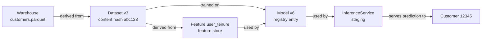
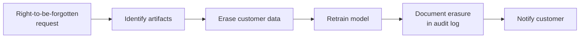

# 16.13 Governance, privacy and compliance for ML platforms

| Field | Value |
|---|---|
| Level | Advanced |
| Priority tier | 2 |
| Lab venue | GCP / GKE |
| Part | Part 16: MLOps and LLMOps tools and platforms |
| Primary sources | *LLMOps* (`llmops`, Chapter 8); *Engineering AI Systems* (`engineering-ai-systems-architecture-and-devops-essentials`, Chapters 9, 10); *Designing Machine Learning Systems* (`designing-machine-learning-systems`, Chapter 11) |
| Cross-references | Chapter 16.1 (MLOps foundations); Chapter 16.6 (Model registry and GitOps); Chapter 16.10 (Monitoring and drift); Chapter 18 (Security) |
| Coverage file | `planning/coverage/chapters/16-13.md` |
| Claim & number ledger | `planning/ledgers/16-13.md` |

## Why this matters for AI infrastructure

Imagine a loan model that declined a customer last month. A letter arrives from a regulator asking which data shaped that decision, and your team has days, not weeks, to answer. Questions like this one are the reason governance exists. This chapter is about that kind of question. It covers the cases where your team does not automatically have the right to train or serve a model on its data, and it shows how the platform can prove it followed the rules.

Each family of rules touches a different part of the work. Privacy rules limit what data you may train on. Fairness rules limit how a model may treat different groups of customers. Model risk rules limit how a model may be deployed and watched after launch. The EU AI Act, which is the European Union's law for artificial intelligence, adds a class of "high-risk" AI systems with explicit obligations. Your platform team's job is to make the ML platform auditable against every rule that applies to the company, not only the rules the data scientists remember.

Compliance is not an add-on that you attach after launch. Think of it as a building code rather than a coat of paint. A builder who plans the fire exits in the drawings pays far less than one who adds them after the walls are up. The platform has to have compliance from the first day. A model registry without an audit log cannot answer the regulator's questions. A feature store without a consent record cannot answer the question about "lawful basis" in the General Data Protection Regulation (GDPR). A serving platform without a rollback path is a platform that cannot meet the EU AI Act's "right to rectification" requirement.

Three rules explain why governance sits on the critical path for ML platforms. The critical path is the chain of steps that must finish before a model can reach a user, so a gap anywhere in that chain stops everything behind it.

```text
Why governance is on the critical path (background reading: LLMOps; Engineering AI Systems; Designing Machine Learning Systems; the figures below are examples, not quotations):
- GDPR (EU), CCPA (California), LGPD (Brazil), PIPL (China): every jurisdiction that
  has personal-data protection laws requires the team to answer the question
  "which data trained the model that decided on this customer?" in days, not
  weeks. The answer requires data lineage.
- EU AI Act (2024): high-risk AI systems (credit scoring, hiring, biometric
  identification, etc.) must meet explicit requirements for risk management,
  data governance, transparency, human oversight, accuracy, robustness, and
  cybersecurity. Non-compliance fines are up to 7% of global annual turnover.
- Model risk management (SR 11-7 in the US, equivalent regulations in the EU):
  any model that affects a regulated activity (lending, insurance, employment)
  must be inventoried, validated, monitored, and documented. The documentation
  must be auditable.
```

Each rule adds a record you must keep. Those records cannot be backfilled a week before an audit, because an auditor can tell when a log was written. The data trail, the model documentation, and the fairness checks all have to exist before a model reaches users. If one of them is missing on launch day, the model is not ready to serve, however good its accuracy looks on the dashboard.

*AI Factory*, chapter 11, makes the same point at the policy level, and it is worth reading alongside the rules above. It says a regulatory framework should set guidelines for how data is acquired and stored. It also says that framework should include quality assurance for that information. The platform is where those guidelines turn into checks that run every day.

Three realities make governance a platform concern, not only a data-science concern.

1. The platform produces the audit trail. Picture a data scientist who trains a model on a Tuesday. That training run leaves a record, and so do the dataset it read, the prediction it made, and the deployment that served it. Every artifact becomes a row in the audit log, so your design decides whether that log is complete.
2. The platform enforces the controls. Consent records, access policies, retention rules, and the right-to-be-forgotten workflow all run inside the platform. A control that lives in a document does nothing, while a control in the platform works like a lock on a door. Data scientists use these controls every day, but the platform team owns them and answers for them.
3. The platform is the subject of the audit. When an auditor visits, the questions go to the logs, the identity and access management (IAM) settings, the retention rules, and the access policies. Those are all platform artifacts, so the platform team is the one who answers on the day.

**Before a team deploys an ML system in a regulated domain, the platform must produce an audit trail that answers every question the regulator can ask.**

Treat compliance as a property of the platform, not as a late review. When you plan a launch, check the audit trail before you check anything else, because the audit trail is what proves that everything else happened.

## Prerequisites and outcomes

### Prerequisites

Picture a colleague who joins this chapter cold and gets lost by the third section. That usually means an earlier chapter was skipped. This one builds directly on the ideas below, so a gap in those chapters will show up here.

- Chapter 16.1 covers MLOps foundations and the four governance meanings.
- Chapter 16.6 covers the model registry and GitOps.
- Chapter 16.10 covers monitoring and drift.
- Chapter 18 covers the security primitives this chapter relies on.

### Outcomes

Picture your platform a month from now, after an auditor has sent a list of questions. This chapter walks through six pieces of work that let you answer that list. It maps the regulatory regimes, which are GDPR, HIPAA, the EU AI Act, SOC2, ISO 27001, and model-risk-management rules, to your controls. It builds the lineage, writes a model card for every model, runs the right-to-be-forgotten workflow, finds bias, and runs the whole stack on GKE. Use that sequence as a checklist for your own platform.

---

## 1. The regulatory regimes

### 1.1 The four regimes the platform must support

Picture three regulators sending three letters in the same week. One wants proof of consent, one wants a fairness report, and one wants the model inventory.

*LLMOps* Chapter 8 and *Engineering AI Systems* Chapters 9 and 10 describe the regulations that touch an AI platform. Each one asks for something different, and the table below lists the main ones side by side. Your job is to support all of them in one governance layer, not in a separate project for each.

| Regime | Jurisdiction | Key requirement | Platform control |
|---|---|---|---|
| **GDPR** | EU | Lawful basis for processing; right to be forgotten; data portability | Consent record; data deletion; data export |
| **CCPA** | California | Right to know; right to delete; right to opt out | Consent record; data deletion |
| **HIPAA** | US healthcare | PHI access controls; encryption; audit log | IAM; encryption at rest and in transit; audit log |
| **EU AI Act** | EU | Risk management; data governance; transparency; human oversight; accuracy; robustness; cybersecurity | Risk classification; data lineage; model card; human-in-the-loop; bias audit; security controls |
| **SR 11-7** | US banking | Model risk management; validation; monitoring; documentation | Model inventory; validation report; monitoring; documentation |
| **SOC2** | Global | Security controls; availability; confidentiality | IAM; encryption; monitoring; incident response |
| **ISO 27001** | Global | Information security management system | Risk assessment; security controls; continuous improvement |

The regimes overlap, so one control can serve several of them. Think of a control as a tool that does double duty. A consent record satisfies GDPR and CCPA. An audit log satisfies HIPAA, SOC2, and SR 11-7. A model card satisfies the EU AI Act and SR 11-7. When you design a control, list every regime it serves, because that list shows how much work the control saves you. A control that serves only one regime is a good candidate to rethink, since a second regime will probably ask for something close to it later.

### 1.2 The data lineage audit

Picture a customer who asks why a bank declined their application. The customer is not asking for a technical answer. They want to know whether a machine made the call, and what information it used. Under GDPR Article 15, the right of access lets that customer ask for a copy of their personal data and the purposes of processing. Article 22 covers decisions made by automated means and gives the customer the right to ask for human intervention. SR 11-7 asks the bank to document every input to a model that affects a credit decision, so the bank's own records have to answer the same question the customer asked.

Both regimes need the same capability, even though they were written for different purposes. You must answer, in seconds, "which data trained the model that produced this prediction for this customer." That sounds simple until you try it on a live system. Most teams find that the answer is spread across a serving log, a registry, and a folder of training notes, and nobody can say for sure which file is current. A good answer needs five links, and each one is a record the platform must keep:

- The customer id tells you who received the prediction.
- The prediction id points to the exact prediction that was served, so you are not working from memory.
- The model id names the model version that produced that prediction, because last month's version may differ.
- The data snapshot id names the frozen copy of the data the model learned from.
- The lineage graph links those records into one chain from data to prediction.

The lineage graph is the audit trail. It lives in a lineage database such as Atlas, Collibra, DataHub, or Marquez, as covered in Chapter 16.3, Section 3.7. The pipeline writes to the graph at every step, so a regulator's question can be answered on the day it arrives instead of after a search through old notes.

### 1.3 The EU AI Act risk classification

Imagine a team that builds two things on the same platform. One is a small chatbot that answers questions on the company website. The other is a credit scoring model that decides who gets a loan. Both run on the same GPUs, but the law treats them very differently. The EU AI Act (2024) sorts AI systems into four risk classes. The class you land in decides which obligations apply to you, so the first step is always to classify the system before you design its controls.

| Risk class | Examples | Obligations |
|---|---|---|
| **Unacceptable** | Social scoring; real-time biometric identification in public spaces | Banned |
| **High** | Credit scoring; hiring; biometric ID; critical infrastructure | Risk management; data governance; transparency; human oversight; accuracy; robustness; cybersecurity; conformity assessment |
| **Limited** | Chatbots; emotion recognition; deep fakes | Transparency (the user knows they are interacting with AI) |
| **Minimal** | Spam filters; AI-enabled video games | No obligations |

A high-risk system must have five things:

- A risk management system that keeps running from the first design to the last retirement. It is not a single review before launch.
- Data governance, which means the training data is relevant to the task, represents the people it will judge, and is free of bias.
- Transparency, which means written documentation of what the system can do and where it fails.
- Human oversight, so that a person can step in on any decision the system makes.
- Accuracy, robustness, and cybersecurity, so that the system keeps performing as its documentation says, even under unusual inputs and attacks.

The obligations map onto controls from earlier chapters. Think of each obligation as a question an auditor asks, and each control as the answer your platform already has. The risk management system is the promotion gate in Chapter 16.1, Section 4.3. Data governance is the data versioning in Chapter 16.2. Transparency is the model card in Chapter 16.6, Section 1.1. Human oversight is the canary deployment in Chapter 16.6, Section 4.2. Accuracy, robustness, and cybersecurity rely on the monitoring in Chapter 16.10 and the security controls in Chapter 18.

A team often learns that a system is high-risk after the design is finished, which is too late to add the controls cheaply. Before you call a system high-risk, check which of these controls you cannot yet show to an auditor. Each gap you find now is a task on the platform backlog, not a surprise during an inspection.

---

## 2. The data lineage that satisfies the regulator

### 2.1 The lineage graph

Picture a city map with no street names. Without a lineage graph, a model's history looks like that map. The graph draws every connection.

*Designing Machine Learning Systems* Chapter 11 and *Engineering AI Systems* Chapter 10 describe the lineage graph in detail. Think of it as a map of how each piece of data reached each model. The graph has four node types: source system, dataset, feature, and model. It has three edge types: derived from, trained on, and used by. A node is a thing, and an edge is a labelled arrow between two things. Each arrow answers one question, such as "where did this dataset come from" or "which model read this feature."



Read the diagram from left to right. The warehouse file feeds a dataset, the dataset trains a model, and the model is used by a staging service that answers a customer. The feature in the middle also feeds the model, so the model's lineage has two branches, not one. Each arrow has a label, and the label is what an auditor will check.

Your pipeline writes to the lineage database at every stage. That database stores this graph, and it can be Atlas, Collibra, DataHub, or Marquez. A missing edge is a gap in the map, and a gap is exactly where a regulator's question gets stuck.

### 2.2 The answer to the regulator

Suppose the regulator asks which data trained the model that decided on customer 12345. With the graph in place, you answer by following four links, as the trace below shows. Read it from the top, one arrow at a time.

```
customer 12345 -> received prediction from inference-service churn-v6 on 2024-03-15T10:30:00Z
inference-service churn-v6 -> served model churn-model-v6
churn-model-v6 -> trained on dataset churn-v3 (content hash abc123)
churn-v3 -> derived from warehouse customers.parquet (snapshot 2024-02-01T00:00:00Z)
```

The traversal takes seconds, and the auditor's report follows in minutes. The walk does not depend on anyone's memory, because each link was written when it happened. Without the lineage graph, the same answer takes weeks of searching through records, guessing which snapshot a training job used.

### 2.3 The lineage contract

Picture a data engineer who ships a cleaning step on a Friday and forgets to write its lineage. Nobody notices until the audit, and by then the cleaning code has changed twice. Lineage only helps if every stage writes it at the right moment. That promise is the lineage contract. Each artifact records its own lineage as soon as it is created, as the table shows.

| Artifact | Lineage metadata | When it writes |
|---|---|---|
| Raw data | Source system; snapshot time; row count | At ingestion |
| Cleaned data | Raw data lineage; cleaning code commit; cleaning timestamp | At transformation |
| Feature | Cleaned data lineage; feature definition commit | At feature engineering |
| Model | Feature lineage; training code commit; env image hash | At training |
| Deployment | Model lineage; deployment commit; deployer | At deployment |
| Prediction | Deployment lineage; customer id; prediction timestamp | At serving |

The contract is the platform's promise to the regulator. The pipeline enforces it, because every artifact creation writes to the lineage database. The platform team audits that those writes actually happen, and it does so by sampling real runs rather than trusting the code review alone. A sample that comes back with a missing row tells you where to look next.

*Production Kubernetes*, chapter 15, adds a useful point about the code side of this contract. Git gives you a strong audit log of changes by default, and a pull request can act as the gate for each change. A reviewer who reads the pull request before merge is adding a second record next to the lineage, and the two records together tell the story of a change.

Before you let a pipeline register a model, check that every earlier stage wrote its lineage. A registration that goes through with a gap in the chain is the same failure as a missing lock on the audit bucket, only quieter.

---

## 3. The model card

### 3.1 What the model card captures

A new engineer joins on Monday and is asked to retrain a model she has never seen. Before she touches any code, she opens the model card. *Engineering AI Systems* Chapter 9 describes the model card. Picture the document a regulator or a new engineer reads before touching a model. It should answer every question they have about that model, so that nobody has to ask the original author on a busy day.

```text
Minimum model card (background reading: Engineering AI Systems; Designing Machine Learning Systems; EU AI Act Annex IV; the figures below are examples, not quotations):
- model name and version
- intended use (what the model is for)
- out-of-scope use (what the model is NOT for)
- architecture (the model's structure)
- training data summary (which datasets, how big, how recent)
- training environment (CUDA version, framework version)
- evaluation results (overall metrics; per-segment metrics; fairness audit)
- fairness audit (per-segment accuracy; demographic parity; equalised odds)
- limitations (known failure modes; edge cases)
- ethical considerations (consent basis; data retention; right to be forgotten)
- contact information (who owns the model)
- last updated (when the card was last reviewed)
```

Picture a launch review where the model card is still sitting in a draft folder. The team is tempted to approve anyway, because the model is accurate and the deadline is close. Your promotion gate must refuse a model whose card is missing or out of date, even on a day like that. The gate from Chapter 16.1, Section 4.3, enforces that rule. A model card written after launch records the model, but it does not control the model.

### 3.2 The fairness audit

A lending team looks at one green number for the whole model and feels good about it. Then a customer from one group complains that the model keeps refusing them. Fairness problems often hide inside good averages. A model can look accurate overall and still fail one group of customers. *Engineering AI Systems* Chapter 10 describes an audit that measures performance across protected groups, such as gender, race, age, and disability, and then writes a report.

| Metric | What it measures | Target |
|---|---|---|
| **Demographic parity** | The prediction rate is the same across groups | Difference < 5% |
| **Equalised odds** | The true positive rate and false positive rate are the same across groups | Difference < 5% |
| **Predictive parity** | The positive predictive value is the same across groups | Difference < 5% |
| **Calibration** | The predicted probability matches the observed frequency across groups | Difference < 5% |

The thresholds in this table are example starting points, not legal limits. Choose the values for your regime and use case, with help from your legal and risk teams. A threshold that is too loose lets real gaps through, and one that is too tight blocks good models for no reason, so the number is a judgement you should write down and defend.

Picture a promotion meeting where the fairness row in the model card is blank. The audit runs on every promotion, so that row should never be blank by the time the meeting starts. Its output becomes a row in the model card and a metric in the promotion gate. The gate refuses to advance any model that breaches a threshold, and nobody has to argue about it in the meeting.

### 3.3 The consent record

A customer who withdraws consent expects their data to stop being used. The consent record is how the platform knows that. It is the answer to GDPR Article 6 on lawful basis, and to CCPA's right to opt out. Without it, the platform has no way to tell a customer who said yes from one who said no last year.

The record captures five things:

- Which customer? The customer id ties every row to one person.
- Which fields? The data fields the customer consented to, so the pipeline never reads a field the customer did not allow.
- Why? The purpose of the processing, because consent is given for a purpose and not for everything.
- Since when? The date and version of the consent, so you know which wording the customer accepted.
- Until when? The withdrawal date, if the customer withdrew.

The consent record lives in the feature store from Chapter 16.3. The feature store's data versioning from Chapter 16.2 makes the record immutable, so a change creates a new version rather than overwriting the old one. That history is what lets you prove what the customer agreed to on any given day.

Before each training run, the pipeline must read the consent record and drop every customer who withdrew. Make that read a required step, not an optional one, because an optional step is skipped on the night when someone is in a hurry.

---

## 4. The right-to-be-forgotten workflow

### 4.1 The GDPR Article 17 requirement

Picture a customer who asks a company to delete everything it holds about them. The request arrives by email, and the customer expects a clear answer. GDPR Article 17, the right to erasure, requires the controller to erase that data "without undue delay". The erasure reaches the warehouse, the feature store, and the training data. It also touches the model, which is a derived artefact. Model weights are not personal data per se, but the training data is, and a model trained on that data carries traces of it. That is why the erasure has to go past the database and into the model.

For each request, the platform team has four jobs. Each one has to be finished and recorded before the team can say the request is closed.

- Find every artifact that holds the customer's data, because one forgotten copy is enough to fail an audit.
- Erase the customer's data from each artifact, one by one, and keep the proof.
- Retrain the model on the cleaned data, or retire the model if retraining is too expensive.
- Document the erasure in the audit log, so that the next auditor can see what was done and when.

### 4.2 The workflow

A request arrives in the morning, and nobody on the team has touched the customer's data yet. The workflow runs in the order shown below, so each step starts only after the one before it has finished.



Teams usually build this as a Kubernetes Job with six steps. Each step below maps to one box in the diagram. A Kubernetes Job is a workload that runs a task to completion and then stops, which suits a request that has a clear end. Read the steps as a relay, where a dropped baton stops the whole race.

1. Read the request from a queue. The queue holds requests until the Job is ready for them, so a busy moment does not lose one.
2. Identify the artifacts that hold the customer's data, such as warehouse tables, feature store rows, and training data. This is the step where a forgotten copy is most likely to hide.
3. Erase that data with DELETE statements or row-level updates. A DELETE statement is a database command that removes rows, and a row-level update changes only the rows that match the customer.
4. Trigger a retraining DAG from Chapter 16.10 on the cleaned data. A DAG, or directed acyclic graph, is a pipeline of steps with a fixed order and no loops.
5. Write the erasure record to the audit log. This record is the proof that the request was handled.
6. Notify the customer. The message should say what was erased and when, in plain words.

Build the request path first. If the customer-facing application cannot reach the queue, the workflow never starts, and the customer's request sits in a place nobody reads. Test that path with a fake request before you build anything after it.

### 4.3 The retraining cost

Picture a finance lead who sees the GPU bill climb every time a customer asks for deletion. Erasure has a compute cost, and retraining is usually the largest part of it. For example, a model that takes 12 hours to retrain and 2 hours to deploy costs 14 hours of GPU time per request. Multiply that across many requests and the bill grows quickly, even though each single request looks cheap on its own.

You can avoid paying that cost for every request. The Job queues the requests, retrains once a day with the day's batch, writes one audit entry, and notifies the customers together. The daily interval is an example. A longer wait can conflict with the "without undue delay" rule, so check the interval with your legal team before you choose it.

This follows the scheduled retraining trigger in Chapter 16.10, Section 4.1, with one extra rule: the new model must exclude every customer in the erasure queue. Set the batch interval with legal review, not only with a cost estimate. Batching saves money, but the saving is worth nothing if it breaks the rule that the regulator enforces.

---

## 5. Privacy-preserving ML

### 5.1 The three patterns

A hospital wants a model trained on its patient records, but the records cannot leave the hospital's network. Even inside the hospital, the people who build the model may not be allowed to see each patient's details. Sometimes raw customer data cannot leave its home, even for training. *Engineering AI Systems* Chapter 10 describes three patterns for that case. Each pattern guards against a different threat, so start by asking who you must keep the data from.

| Pattern | What it does | Threat model | Cost |
|---|---|---|---|
| **Federated learning** | Train the model on the customer's device; aggregate the gradients on the server | The server cannot see the customer's data | Higher compute on the edge; aggregation overhead |
| **Differential privacy** | Add noise to the training process to prevent memorisation of individual examples | The model does not memorise specific examples | Reduced accuracy; calibration required |
| **Homomorphic encryption** | Train the model on encrypted data, so the server never sees the plaintext | The server cannot see the data | 10-100x compute overhead |

The overhead figure for homomorphic encryption in this table has no source in this chapter. Treat it as a rough estimate until someone checks it against a source. A cost figure that nobody has checked can send a budget in the wrong direction, so verify it before you quote it to a manager.

Choose the pattern that matches the customer's threat model. Federated learning fits mobile devices. Differential privacy fits medical data. Homomorphic encryption fits highly sensitive financial data. The pattern you pick is a judgement about who you must keep the data from, so write that judgement down next to the choice.

### 5.2 Federated learning on the cluster

Picture a phone that improves its typing suggestions from the way you type, without sending your messages to a server. That is the idea behind federated learning. In federated learning, the data never moves. Training runs where the data lives, and only gradients travel back to you. A gradient is the list of small adjustments the model wants to make after it reads a batch of examples. Sending gradients is not automatically private, so the privacy tools below exist to reduce what a gradient reveals. The loop has six steps.

1. Your platform team ships a training container to the customer. The container is the code, and it arrives without any customer data inside it.
2. The customer's cluster runs the training container on the customer's data. The data stays on the customer's side for the whole run.
3. The customer's cluster sends the gradients (not the data) to the platform team's cluster.
4. The platform team's cluster aggregates the gradients across all customers. Aggregation means combining the adjustments into one average, so no single customer's lesson stands out.
5. The platform team's cluster produces a new model version.
6. The new model version is shipped to the customer's cluster, where the next round can start.

Three tools do this work. TensorFlow Federated handles the orchestration. PySyft provides privacy primitives such as secure aggregation, which lets the server see only the combined total, and differential privacy. NVIDIA FLARE is a federated learning framework with NVIDIA support. Check each tool's privacy claims against your own threat model.

### 5.3 Differential privacy in training

A data scientist asks whether the trained model could repeat one patient's record back if someone probed it hard enough. Differential privacy is the tool for that worry. Differential privacy adds noise during training, so the model cannot memorise any single example. The snippet below attaches a differentially private optimizer to a Keras training loop.

```python
# code/part16/snippets/differential_privacy.py
import tensorflow_privacy as tfp

# Attach a differentially private optimiser to the training loop
optimizer = tfp.DPKerasAdamOptimizer(
    l2_norm_clip=1.0,
    noise_multiplier=0.5,
    num_microbatches=256,
    learning_rate=1e-3,
)

model.compile(optimizer=optimizer, loss='sparse_categorical_crossentropy', metrics=['accuracy'])
```

The `l2_norm_clip` and `noise_multiplier` are settings that the training library uses to add noise. The first one caps how much any single example can pull the model in one step. The second one sets how much noise is mixed in after that cap. You do not compute the privacy budget by hand. The privacy budget itself is the pair epsilon and delta, which the library computes from those settings, the batch size and the number of training steps. You publish epsilon and delta on the model card, because it records the trade-off between accuracy and privacy that a regulator will ask about. A smaller budget means stronger privacy and usually lower accuracy, so the card should show which side of that trade you chose.

---

## 6. Operating governance and compliance on GKE

### 6.1 The components

On a Sunday night the lineage database starts to slow down. Nobody is paged, because nothing is down, but on Monday the regulator's query times out. Governance components can fail that quietly, which is why each one needs its own target. Each governance component runs as a normal workload on your cluster, with its own backing store and its own service target. A backing store is the database or bucket where a component keeps its data. The table lists them. The service level objective (SLO) column holds example targets, and a target is a measurable promise about how fast or how available a component should be. Set your own, based on what your regulator and your customers expect.

| Component | Where it runs | Backing store | SLO |
|---|---|---|---|
| Lineage database (Atlas, DataHub, Marquez) | Kubernetes Deployment | Postgres + object storage | Query latency p99 < 1 s |
| Consent record (in feature store) | Same as feature store | Same as feature store | Same as feature store |
| Right-to-be-forgotten Job | Kubernetes Job | Object storage for retraining data | Erasure latency < 24 hours |
| Fairness audit | Kubernetes Job | Object storage for reports | Audit latency < 1 hour |
| Audit log | Object storage with object-lock | GCS bucket | Write latency p99 < 1 s |

### 6.2 IAM and the audit log

A compliance analyst asks for write access to the consent record so she can fix a typo in a customer's name. The request sounds harmless, but it breaks a rule that matters. Governance needs its own access rules. The people who read the audit log are often not the people who write to it, and the people who change consent should not be the people who check it. Each role below gets only the rights it needs, so the analyst reads the record and a separate writer makes the change, with a trail for both.

| Role | Who | What they can do |
|---|---|---|
| `governance.auditor` | Compliance team; external auditors | Read the lineage database; read the audit log; read the model cards |
| `governance.consent.writer` | The customer-facing application | Write to the consent record |
| `governance.consent.reader` | The training pipeline | Read the consent record |
| `governance.erasure.writer` | The right-to-be-forgotten Job | Write to the lineage database; trigger retraining |
| `governance.admin` | The platform team | Manage the lineage database; manage the consent record |

The audit log is tamper-evident because the GCS bucket uses object-lock. Object-lock stops anyone from deleting or overwriting the records during a fixed retention period, so a careless or hostile engineer cannot quietly edit history. The log records every lineage change, consent change, erasure event, and fairness audit, so the story of a model can be replayed in order.

*Production Kubernetes*, chapter 9, notes that the API server writes no audit records until you give it a policy file with the `--audit-policy-file` flag. The same chapter warns that access to those logs needs thought, because they can reveal activity on sensitive systems.

*Production Kubernetes*, chapter 10, adds that impersonation stays visible. When an admin impersonates a user, the Kubernetes audit logs still show the original user and the action taken.

### 6.3 Observability

On a Friday afternoon, the fairness dashboard turns red for the first time. Nobody on the team expected it, and the model is due to go live on Monday. Dashboards tell you when governance is slipping, often before a regulator notices. They turn a slow problem into a visible one while there is still time to act. The table lists the metrics and their alert thresholds. Treat the thresholds as example values, and tune them to your own risk.

| Metric | Why it matters | Alert |
|---|---|---|
| Lineage query latency p99 | Hot path for the regulator's questions | > 5 s |
| Right-to-be-forgotten latency p99 | GDPR Article 17 requires "without undue delay" | > 24 hours |
| Fairness audit failure rate | Catches a model that breaches the fairness threshold | > 0 for 1 day |
| Consent record staleness | Catches a record that has not been refreshed | > 1 year |
| Audit log write latency p99 | Catches a slow audit log | > 1 s |

Watch the right-to-be-forgotten latency most closely. It is the number a customer would feel first. GDPR Article 17 asks for erasure "without undue delay". The 24-hour figure is an example SLO, not a legal deadline, and the phrase "without undue delay" is a legal standard that your counsel has to interpret. When the alert fires, the on-call engineer investigates the queue and the Job, starting with whether the requests are arriving at all.

---

## 7. How it fails

Picture the worst time to learn one of these failure modes, which is during an audit. Six failure modes come up again and again. Each one below gives the symptom you will see, the diagnosis, and the fix. Start with the diagnosis, not the fix, because a fix applied to the wrong cause hides the problem.

### 7.1 "The lineage graph is incomplete"

Symptom: The regulator asks which data trained the model that decided on customer 12345. The platform's query returns a partial answer. The model and the customer are known, but the data snapshot is not, so the walk stops one link short of the answer.

Diagnosis: The pipeline did not write to the lineage database at every step. The contract from Section 2.3 is not being enforced, so the missing link was never written at all. Look for the stage where the chain goes quiet.

Fix: Refuse to register a model version when the lineage database lacks a required edge. The promotion gate from Chapter 16.1, Section 4.3, reads the lineage database and fails when the lineage is incomplete. A gate that fails loudly is better than a graph that looks complete and is not.

### 7.2 "The model card is missing the fairness audit"

Symptom: The regulator asks for the fairness audit of a high-risk model. The model card has no such section, because the audit never ran. The team has a model in production and no evidence about how it treats each group.

Diagnosis: The promotion gate from Chapter 16.1, Section 4.3, did not require the audit. The model was promoted without one, which means the gate checked everything except the one thing the regulator cares about.

Fix: You make the fairness audit a required field in the model card. The gate then refuses any model whose card is missing that section, and the audit becomes a condition of promotion rather than a nice extra.

### 7.3 "The right-to-be-forgotten Job was not triggered"

Symptom: A customer asked for erasure. The customer-facing application received the request, but the platform team never heard about it. The customer's data stayed in the training set, and the customer will ask about it again next month.

Diagnosis: The workflow is not connected to the application. The application received the request, but the platform's queue did not. The two systems were never joined by a message.

Fix: You connect the application to the erasure queue. The platform team's pattern: the customer-facing application writes to the queue, and the platform team consumes from it. Test the connection with a fake request before a real customer depends on it.

### 7.4 "The audit log was deleted"

Symptom: The auditor asks for the audit log of a model that ran in production two years ago. The audit log bucket is empty, and the team has no way to rebuild the history from memory.

Diagnosis: The bucket did not have object-lock. A deletion by a careless engineer, or by a malicious one, removed the artefacts, and nothing stopped the deletion.

Fix: Turn on object-lock for the audit log bucket. The runbook says "if the audit log is missing, page the on-call immediately, do not investigate first". The reason for that order is that an investigation can overwrite the evidence you need.

### 7.5 "The consent record is stale"

Symptom: A customer consented to processing in 2020 and never refreshed that consent. The application still processes their data four years later, and nobody on the team remembers asking.

Diagnosis: The consent record has no expiration date. The platform team never asked the customer to refresh it, so an old yes looks the same as a new one.

Fix: Add an expiration date to every consent. A 1-year expiry is a common choice. Send a refresh request a set number of days before expiry, for example 30, and pause processing if the consent lapses. The refresh request gives the customer a chance to change their mind before the deadline passes.

### 7.6 "The model was retrained on data from a customer who withdrew consent"

Symptom: A customer withdrew consent, but their data was still in the latest training snapshot. The new model trained on that snapshot, so the customer's data is now inside the model.

Diagnosis: The pipeline does not read the consent record at training time. It trains on the latest data, and the latest data still includes the customer. The withdrawal happened, but the pipeline never looked at it.

Fix: You read the consent record at training time, and you exclude every customer who withdrew. The platform team treats the consent record as a join key, and the join drops withdrawn customers. The join runs on every training run, so a withdrawal from yesterday is respected today.

---

## 8. Hands-on lab

Imagine a Thursday afternoon when your team must show an auditor the lineage, the consent record, a model card, and an erasure event, all in one sitting. This lab sets up those four things on GKE. The lab is **untested** in this repository, so treat every command as a starting point.

### 8.1 Prerequisites

Before you start, make sure the foundations are in place, because each step below depends on them.

- A GKE Autopilot or Standard cluster (1.27+).
- A model from Chapter 16.6's lab.
- A feature store from Chapter 16.3's lab.

### 8.2 Step 1: install DataHub for lineage

Lineage is the first thing an auditor asks for, so you install its store first. DataHub runs as a Helm release in its own namespace. Helm is the package manager for Kubernetes, and a release is one installed copy of a chart.

```bash
helm install datahub datahub/datahub \
  --namespace governance --create-namespace
# expected: DataHub pods are running; the UI is at /lineage
```

### 8.3 Step 2: wire the lineage into the pipeline

Next, make the training pipeline write a lineage edge for each model it trains. A lineage edge is one labelled arrow in the graph, and this helper writes one arrow from the dataset to the model. Run it after each training job, so the edge exists before anyone asks for it. Running it after the fact, when the question has already arrived, is too late.

```python
# code/part16/snippets/lineage_writer.py
from datahub.emitter.mce_builder import (
    DatasetAspect, make_dataset_urn, make_lineage_mcp
)

def record_lineage(model_id: str, dataset_id: str, run_id: str):
    """Record that model_id was trained on dataset_id in run_id."""
    lineage = make_lineage_mcp(
        upstream_urns=[make_dataset_urn(dataset_id)],
        downstream_urn=make_dataset_urn(model_id),
    )
    emitter.emit_lineage(lineage)
```

```bash
python code/part16/snippets/lineage_writer.py \
  --model churn-model-v6 \
  --dataset churn-v3 \
  --run-id abc123
# expected: the lineage edge is written to DataHub
```

### 8.4 Step 3: produce a model card

Generate the model card from the trained model. The card should be written from the run itself, not typed by hand afterward, so the numbers match what the model actually did. Review the output before you promote the model, and read the fairness section first, because that is where a gap is most likely to hide.

```bash
python code/part16/produce_model_card.py \
  --model churn-model-v6 \
  --output model-cards/churn-model-v6.md
# expected: a model card with architecture, training data summary, evaluation results, fairness audit
```

### 8.5 Step 4: trigger a right-to-be-forgotten Job

Now test the erasure path. Use a test customer id, not a real one, because this step really does delete data and starts a retraining run. Run it against a test copy of the data whenever your setup allows it.

```bash
# Submit a right-to-be-forgotten request
python code/part16/erasure_job.py \
  --customer-id 12345 \
  --reason "GDPR Article 17 request from customer"
# expected: the Job erases the customer's data; retraining is triggered; the audit log is updated
```

### 8.6 Step 5: verify the lineage graph

Query the lineage store to confirm the data flow for the test customer. The query searches for the dataset by name, and the answer should show a lineage path that ends at the model. If the path stops early, the lineage contract from earlier is not being met.

```bash
# Query the lineage database for the customer's data flow
curl -X POST http://datahub.governance:9002/api/graphql \
  -H "Content-Type: application/json" \
  -d '{"query": "{ search(input: { type: DATASET, query: \"churn-v3\", start: 0, count: 10 }) { searchResults { entity { urn } } }"}' \
  | jq .
# expected: the churn-v3 dataset with its lineage to churn-model-v6
```

### 8.7 Step 6: verify the consent record

Check the consent record for the same customer. Compare the fields you see with the fields the customer agreed to, because a field that appears here but not in the consent is a finding to report.

```bash
# Query the feature store for the customer's consent
python code/part16/check_consent.py \
  --customer-id 12345
# expected: the customer's consent record; the data fields the customer consented to
```

### 8.8 Step 7: verify the audit log

Read the most recent erasure events from the audit log. The entry you just created should be at the top, with the same customer id and reason you submitted. If it is missing, the erasure Job did not finish its last step, and the request is not closed.

```bash
# Query the audit log for the most recent erasure events
bq query --use_legacy_sql=false \
  "SELECT timestamp, customer_id, reason, retraining_dag
   FROM \`${PROJECT_ID}.governance.erasure_events\`
   ORDER BY timestamp DESC
   LIMIT 10"
# expected: the most recent erasure events with the customer id, the reason, and the retraining DAG
```

### 8.9 What to record

After the lab, try to answer the five questions below quickly. Picture an auditor waiting on the other end of a call. The five-second target is a suggestion from this lab, not a standard, so set your own.

1. What is the lineage edge between churn-model-v6 and churn-v3?
2. What is the model card for churn-model-v6?
3. What is the most recent erasure event, and what customer requested it?
4. What is the consent record for customer 12345?
5. What is the cost of the right-to-be-forgotten Job per request?

If any answer takes longer than 30 seconds, treat that as a warning sign. The 30-second figure is an example threshold, so set the number that your auditors would accept. A slow answer on a practice day is a clue worth chasing, because it can point to a missing edge or a query nobody tuned.

---

## Exercises

Your platform is live, and the next audit is close. Work through these on your own platform, in order. Each one asks you to add or change a single control, so you can see its effect before you move on.

1. Add a fairness audit to the promotion gate. A model is ready to ship, but its fairness metrics are over the threshold. Refuse to promote a model whose fairness metrics breach the threshold. *Solution sketch:* use the promotion gate from Chapter 16.1, Section 4.3, and add the fairness metric to the gate's policy.
2. Add a consent expiration alert. Some consents will lapse soon. Configure an alert that fires 30 days before a customer's consent expires. *Solution sketch:* a CronJob scans the consent record and writes the expiring customers to a queue. An alert fires on that queue.
3. Add a privacy budget to the model card. The card should show the trade-off the model made. Publish the differential privacy budget on the model card. *Solution sketch:* a script reads the training run's privacy budget and writes it to the card.
4. Add a federated learning training pipeline. Your team wants to train on data that cannot move. Stand up TensorFlow Federated or NVIDIA FLARE on a Kubernetes cluster. *Solution sketch:* a Kubernetes Deployment runs the FLARE server, and a Job runs the FLARE clients.
5. Add an EU AI Act risk classification. A new system may be high-risk, so the card needs a field for it. Add a field to the model card that records the EU AI Act risk class. The promotion gate refuses to promote a high-risk model without the human-override and bias-audit fields. *Solution sketch:* change the model card schema, then make the promotion gate read it.
6. Add right-to-be-forgotten amortisation. Erasure requests arrive every day, and each retraining is expensive. Amortisation here means spreading that one retraining cost over a day's worth of requests. Queue the erasure requests, and run a daily retraining that consumes the queue. *Solution sketch:* a Kubernetes CronJob consumes the queue, runs a retraining DAG, and updates the audit log.

---

## Checkpoint questions

<details><summary>1. A regulator asks which data trained the model that declined customer 12345. Your query returns the model and the customer but no data snapshot. What went wrong and what do you change?</summary>
The pipeline did not write to the lineage database at every step, so the lineage contract was not enforced. The chain from prediction to dataset has a missing edge. The fix is to make the promotion gate read the lineage database and refuse to register a model version when a required edge is absent.
</details>

<details><summary>2. An auditor asks for the fairness audit of a high-risk model, and the model card has no such section. How did the model reach production, and how do you stop it happening again?</summary>
The promotion gate did not require the audit, so the model was promoted without one. Make the fairness audit a required field in the model card. The gate then refuses any model whose card is missing that section.
</details>

<details><summary>3. A customer asked for erasure, the application accepted the request, but weeks later the customer's data is still in the training set. The platform team never saw the request. What is the likely cause?</summary>
The application is not connected to the erasure queue. The request reached the application, but nothing put it on the queue that the right-to-be-forgotten Job reads. The pattern is that the application writes to the queue and the platform team consumes from it.
</details>

<details><summary>4. An auditor asks for the audit log of a model that ran two years ago, and the bucket is empty. What do you tell the on-call engineer, and what was the missing control?</summary>
The bucket had no object-lock, so a careless or malicious deletion could remove the records. The control to turn on is object-lock for the audit log bucket. The runbook says to page the on-call immediately and not to investigate first.
</details>

<details><summary>5. A customer consented in 2020 and the application still processes their data four years later. Why did this happen and what is the fix?</summary>
The consent record has no expiration date, and nobody asked the customer to refresh it. Add an expiration date to every consent, with one year as a common choice. Send a refresh request a set number of days before expiry and pause processing if the consent lapses.
</details>

<details><summary>6. A customer withdrew consent last week, yet the newest model was trained on a snapshot that still contains their rows. What check was missing in the pipeline?</summary>
The pipeline did not read the consent record at training time. It trained on the latest data, which still included the customer. The fix is to treat the consent record as a join key, so the join drops every customer who withdrew.
</details>

<details><summary>7. Why does a missing edge in the lineage graph make the regulator's question impossible to answer in seconds?</summary>
The answer is a walk along four links, from customer to prediction, to model, to dataset, to source snapshot. If one edge is absent, the walk stops there. The remaining answer then has to be rebuilt by hand from records, which is the weeks of searching the chapter warns about.
</details>

<details><summary>8. Why does a model card written after launch fail to control the model?</summary>
A card written after launch only records what the model already is. Control comes from the promotion gate refusing a model whose card is missing or out of date. Only a card that exists before promotion can block a bad release.
</details>

<details><summary>9. Why does reading the consent record at training time, and not only at ingestion, matter for withdrawals?</summary>
A customer can withdraw after the data has already been copied into a snapshot. The snapshot then still holds their rows. Reading the consent record before each training run is the step that drops them from the new model.
</details>

<details><summary>10. Why can one platform control serve several regulations at once?</summary>
The regimes ask for overlapping records. A consent record answers both GDPR and CCPA. An audit log answers HIPAA, SOC2 and SR 11-7, and a model card answers the EU AI Act and SR 11-7. Listing every regime a control serves shows how much work that control saves.
</details>

<details><summary>11. Why does the chapter say model weights are not personal data per se, and yet an erasure request still leads to retraining?</summary>
The training data is personal data, and the model is derived from it. Erasure removes the customer from the warehouse, the feature store and the training data. The model is then retrained on the cleaned data, or retired if retraining is too expensive, so that the derived artefact no longer reflects the erased customer.
</details>

<details><summary>12. Your retraining takes a long time and erasure requests arrive daily. When would you batch requests into one daily retraining, and what do you give up?</summary>
Batching spreads the retraining cost across many requests and gives one audit entry and one customer notification. You give up speed, because a customer waits up to the batch interval. A longer wait can conflict with the "without undue delay" rule, so the interval must be set with legal review and not only with a cost estimate.
</details>

<details><summary>13. A team needs privacy for mobile-device data and another for medical data. Which patterns would you pick, and what does each cost?</summary>
Federated learning fits mobile devices. It keeps data on the device, but it costs more edge compute and adds aggregation overhead. Differential privacy fits medical data. It stops the model memorising single examples, but it reduces accuracy and needs calibration.
</details>

<details><summary>14. When would you choose homomorphic encryption over federated learning, and what is the caution about its cost?</summary>
It fits highly sensitive financial data where the server must never see plaintext. The table gives a 10 to 100 times compute overhead. The chapter notes that this figure has no source in the chapter, so treat it as a rough estimate until it is checked.
</details>

<details><summary>15. Why would you publish the differential privacy budget on the model card, and which numbers make it up?</summary>
The budget records the trade-off between accuracy and privacy, and a regulator will ask about it. It is the pair epsilon and delta. The library computes them from the noise settings, the batch size and the number of training steps.
</details>

<details><summary>16. Retraining takes 12 hours and deployment takes 2 hours. Thirty erasure requests arrive in one day. Compare GPU time if you handle each request alone with doing one daily batch.</summary>
Each request costs 12 plus 2, which is 14 hours of GPU time. Handled alone, 30 requests cost 30 times 14, which is 420 hours. One daily batch costs 14 hours, so the batch saves 406 hours.
</details>

<details><summary>17. The fairness table uses a target difference below 5 percent. A model approves 62 percent of group A and 55 percent of group B. Does it pass demographic parity, and what happens next?</summary>
The difference is 62 minus 55, which is 7 percentage points. That is above the 5 percent example target, so the audit fails. The promotion gate then refuses to advance the model. The chapter says the 5 percent figure is an example starting point and not a legal limit.
</details>

<details><summary>18. A consent is valid for one year and you send a refresh request 30 days before expiry. On which day after consent is the refresh request sent?</summary>
The refresh is sent 30 days before the end of the year. That is 365 minus 30, which is day 335 after the consent was given. If the customer does not refresh, processing pauses when the consent lapses.
</details>

<details><summary>19. The right-to-be-forgotten latency alert fires. What do you check first, second and third?</summary>
First check the erasure queue, to see whether requests are waiting and whether the application is writing to it. Second check the right-to-be-forgotten Job, to see whether it is running and consuming the queue. Third check the retraining step it triggers. The chapter says the on-call engineer investigates the queue and the Job when this alert fires.
</details>

<details><summary>20. An auditor's query returns an incomplete answer for a customer. In what order do you check the lineage chain, and why?</summary>
Start with the prediction record, because it ties the customer to a deployment. Then check the deployment and model records, which should name the training dataset. Finally check the dataset record for its source snapshot. The contract table shows each artifact recording its upstream lineage, so the first missing link points to the stage that failed to write it.
</details>

---

## Sources and review notes

- *LLMOps* (`llmops`, Chapter 8). Source for the governance, monitoring, privacy, and security patterns; the regulatory regimes; the consent record; the right-to-be-forgotten workflow. Chapter 8 is approximately 8,300 words.
- *Engineering AI Systems: Architecture and DevOps Essentials* (`engineering-ai-systems-architecture-and-devops-essentials`, Chapters 9, 10). Source for the security controls, the privacy-preserving ML patterns (federated learning, differential privacy, homomorphic encryption), the fairness audit metrics, and the model card requirements. Chapter 9 is approximately 5,100 words; Chapter 10 is approximately 3,650 words.
- *Designing Machine Learning Systems* (`designing-machine-learning-systems`, Chapter 11). Source for the human side of machine learning, the model card as a documentation tool, the fairness considerations, and the stakeholder management. Chapter 11 is approximately 8,200 words.

### Cross-references to other handbook chapters

- Chapter 16.1 for the promotion gate that the governance layer enforces.
- Chapter 16.6 for the model registry that the governance layer audits.
- Chapter 16.10 for the monitoring that detects the regressions the governance layer must catch.
- Chapter 18 (Security) for the security primitives the governance layer relies on.

### Migrated from `nvidia-devops`

No direct migration from `nvidia-devops` for this chapter. The chapter is a synthesis of the gem books' governance content applied to the AI infrastructure platform.

### Explicitly labelled inferences

- The fairness audit thresholds (5% difference) in Section 3.2 are starting points drawn from common practice; specific thresholds depend on the regulatory regime and the use case.
- The right-to-be-forgotten latency SLO (24 hours) in Section 6.3 is a starting point; specific SLOs depend on the regulator's expectations and the customer's expectations.
- The consent expiration window (1 year) in Section 7.5 is a starting point; specific windows depend on the regulator's expectations.

### Not verified on live hardware

- The lab in Section 8 is **untested** against a live GKE cluster in this repository.
- The DataHub, lineage database, and audit log versions assumed in the lab should be pinned against the current releases before production use.
- The right-to-be-forgotten Job assumes a queue and a workflow; production deployments require careful queue management and idempotency.
