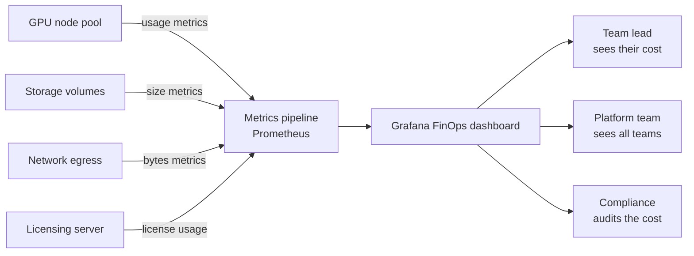
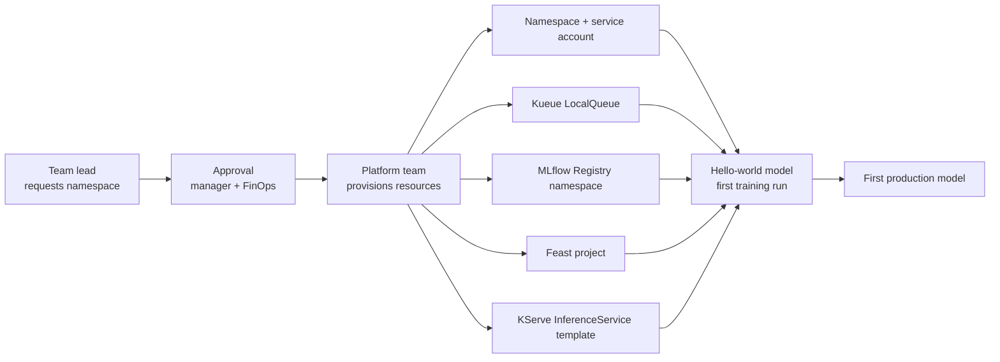

# 16.14 Platform design: multi-tenant AI factory, quotas and chargeback

| Field | Value |
|---|---|
| Level | Advanced |
| Priority tier | 1 |
| Lab venue | GCP / GKE |
| Part | Part 16: MLOps and LLMOps tools and platforms |
| Primary sources | *Production Kubernetes* (`production-kubernetes`, Chapter 12); *Machine Learning Platform Engineering* (`machine-learning-platform-engineering`, Chapters 9, 12); *AI Engineering* (`ai-engineering`, Chapter 10); *LLMOps* (`llmops`, Chapter 9); NVIDIA Zero-to-Hero Volume 21 (`chapter-01-platform-overview.md`, `chapter-02-chargeback.md`, `chapter-03-resource-pools.md`, `chapter-04-onboarding.md`) |
| Cross-references | Chapter 16.1 (MLOps foundations); Chapter 16.7 (Serving platforms); Chapter 11 (GPU Kubernetes); Chapter 5.22 (Multitenancy and platform services) |
| Coverage file | `planning/coverage/chapters/16-14.md` |
| Claim & number ledger | `planning/ledgers/16-14.md` |

## Why this matters for AI infrastructure

Picture a platform that works. Soon, data science, ML engineering, applied research, and product engineering all want the same GPU pool, registry, orchestrator, feature store, and serving platform. The platform team owns those shared parts. The teams own their own models and applications.

Multi-tenancy is not optional. A platform that is not built for many teams becomes multi-tenant anyway, by accident. Teams end up sharing a namespace, a model registry, an ingress path, and an IAM policy. Their traffic and service levels then start to affect each other.

The platform team's first job is to build the multi-tenant primitives on purpose: namespaces, service accounts, network policies, per-team quotas, per-team SLOs, and per-team billing.

```text
Why multi-tenancy is on the critical path (background reading: Production Kubernetes; Machine Learning Platform Engineering; NVIDIA Zero-to-Hero volume 21; the figures below are examples, not quotations):
- A typical mature AI factory serves 5-30 teams across data science, ML
  engineering, applied research, and product engineering. Each team has its own
  models, its own data, its own SLOs; the teams share the GPU pool, the
  registry, the orchestrator, the feature store, the serving platform.
- The GPU pool is the most expensive shared resource. The cost of a single
  H100 is $3-5 per hour; a multi-tenant AI factory runs hundreds of H100s. The
  cost is the single largest line item in the AI factory's budget.
- Without per-team quotas and chargeback, the GPU pool is consumed by the team
  that shouts loudest. The team that needs the GPU most does not get it. The
  platform's job is to allocate the GPU fairly.
```

The figures in that block are example values, not quoted prices or a measured team count. Replace them with numbers from your own cloud bill and team roster before you plan a budget.

Three operational realities make this a platform-team concern, not only a data-science concern.

1. The multi-tenant primitives are platform decisions. The platform team owns namespaces, service accounts, network policies, quotas, SLOs, and billing. The consuming teams use them.
2. The GPU pool is the most expensive shared resource. The FinOps dashboard is the feedback loop that catches runaway spending before the bill arrives.
3. Onboarding is the platform's first impression. A team that waits weeks for a namespace will build its own platform. Your goal is a first model that runs in minutes.

*Production Kubernetes*, chapter 12, draws a useful line here. A soft multitenant platform hosts teams in one organization that trust each other, yet still need isolation against mistakes. A hard multitenant platform hosts parties that do not trust each other. Your internal AI factory is almost always the soft case, and bugs still spread across teams.

**Multi-tenancy is a property of the platform, not a feature you add later.** Before the first team arrives, list every shared resource and name its owner.

## Prerequisites and outcomes

This chapter assumes you already run GPU workloads on Kubernetes. Check the prerequisites first, because the quota and admission pieces depend on them. Then use the outcomes as a checklist for the rest of the chapter.

### Prerequisites

- Chapter 16.1: MLOps foundations.
- Chapter 16.7: Serving platforms and the InferenceService.
- Chapter 11: GPU Kubernetes, for the GPU pool, the gang scheduler, and the GPU Operator.
- Chapter 5.22: Multitenancy and platform services, for the Kubernetes multi-tenant primitives.

### Outcomes

After you finish this chapter, you should be able to do six things.

1. Design a multi-tenant primitive for every shared resource.
2. Enforce per-team GPU quotas with Kueue or Volcano, at admission time.
3. Build a FinOps dashboard that shows cost per team, per model, and per month.
4. Feed the dashboard's cost data into chargeback.
5. Let a team request a namespace, a GPU quota, a model registry, and a serving endpoint in minutes.
6. Run the platform on GKE with IAM, network policies, observability, and SLOs that match the business.

---

## 1. The multi-tenant primitives

### 1.1 The shared resources

*Production Kubernetes*, chapter 12, explains the tenancy layers that a shared platform needs. This chapter applies them to the AI factory. The factory has ten shared resources. Each one is used by many teams and owned by the platform team.

One point from that book matters here. A namespace is only metadata in the control plane. Unless you add policy or scheduling rules, pods from two different namespaces can land on the same node.

| Shared resource | What it is | Who consumes it | Who owns it |
|---|---|---|---|
| **Cluster** | The Kubernetes cluster with the GPU node pool | Every team's workloads | Platform team |
| **GPU pool** | The pool of GPU nodes (H100, A100, L40S) | Every team's training and serving | Platform team |
| **Namespaces** | The Kubernetes namespaces, one per team | Every team's workloads | Platform team + team |
| **IAM** | The cluster's RBAC + the cloud's IAM | Every team's service accounts | Platform team |
| **Network policies** | The cluster's NetworkPolicy resources | Every team's pods | Platform team |
| **Model registry** | The shared model registry (MLflow Registry, Vertex AI, SageMaker) | Every team's models | Platform team + team |
| **Orchestrator** | The shared pipeline orchestrator (Argo, Kubeflow, Airflow) | Every team's pipelines | Platform team |
| **Feature store** | The shared feature store (Feast, Vertex AI, SageMaker) | Every team's features | Platform team + team |
| **Vector store** | The shared vector store (Milvus, Qdrant, Vertex AI Vector Search) | Every team's retrieval indices | Platform team + team |
| **Serving platform** | The shared serving platform (KServe, Seldon, BentoML) | Every team's inference services | Platform team + team |

The pattern is that the platform owns each resource. The team consumes it, and gets its own namespace, service account, and quota inside it. When you add a new shared resource, give it an owner in this table before any team uses it.

### 1.2 The per-team primitives

*Machine Learning Platform Engineering*, chapter 9, walks through the per-team primitives. Each team gets a slice of every shared resource. The slice is set at onboarding, enforced at admission time, and easy to audit.

A namespace is not a secret boundary inside a team. If two engineers on the same team may read Secrets in their namespace, each of them can read every Secret there. *Production Kubernetes*, chapter 12, makes this point. Before you grant a role, ask who else can read the data it protects.

| Primitive | What it is | How it is enforced |
|---|---|---|
| **Namespace** | One Kubernetes namespace per team | RBAC; NetworkPolicy |
| **Service account** | One Kubernetes service account per pipeline | IAM; Workload Identity |
| **ResourceQuota** | One ResourceQuota per namespace | Kubernetes admission controller |
| **LocalQueue** | One Kueue LocalQueue per team (binds to a ClusterQueue with a GPU quota) | Kueue admission controller |
| **InferenceService** | One or more KServe InferenceServices per team | KServe controller |
| **Model registry entry** | One or more MLflow Registry entries per team | MLflow Registry IAM |
| **Feature view** | One or more Feast feature views per team | Feast IAM |
| **Vector index** | One or more Milvus collections per team | Milvus IAM |

### 1.3 The IAM model

IAM cuts across every other primitive. If it is too loose, a good quota or namespace will not protect you. The roles below are the pattern for team members and for the platform team. Start with the fewest roles you need, and add more only when a team asks for them.

This is the writer, reader, promoter, and admin model from Chapter 16.6 Section 5.2, extended to the team level.

| Role | Who | What they can do |
|---|---|---|
| `team.admin` | The team's lead | Manage the team's namespace; create service accounts; read the team's audit logs |
| `team.developer` | The team's data scientists and ML engineers | Create pipelines; create models; create features |
| `team.viewer` | The team's product managers and stakeholders | Read the team's registry entries; read the team's metrics |
| `platform.admin` | The platform team | Manage the cluster; manage the GPU pool; manage the orchestrator |
| `platform.auditor` | The compliance team | Read every audit log; read every lineage graph |

### 1.4 Default deny-all network policy

Kubernetes assumes that every Pod can reach every other Pod. On a shared platform, that assumption lets one tenant's workload talk to another tenant's services. A default deny-all policy reverses it. Tenants are isolated the moment they join, and each connection they need must be declared.

There are two ways to build the policy. The first uses the core NetworkPolicy API, which works with any CNI plug-in. The catch is that NetworkPolicy is namespace-scoped. You need one default deny-all object per namespace. Tenants can also create their own NetworkPolicy objects, so you need an admission webhook that stops them from changing or deleting the default one.

```yaml
apiVersion: networking.k8s.io/v1
kind: NetworkPolicy
metadata:
  name: default-deny-all
  namespace: tenant-a
spec:
  podSelector: {}
  policyTypes:
  - Ingress
  - Egress
```

The empty `podSelector` matches every Pod in the namespace. Both policy types are listed, so inbound and outbound traffic are blocked.

The second way uses custom resources from the CNI plug-in. Antrea, Calico, and Cilium offer cluster-wide, or global, network policies. One object covers the whole cluster, which cuts the management work. The price is a tie to one plug-in. The Calico version of the same default looks like this.

```yaml
apiVersion: projectcalico.org/v3
kind: GlobalNetworkPolicy
metadata:
  name: default-deny
spec:
  selector: all()
  types:
  - Ingress
  - Egress
```

Simplicity usually wins here, because switching CNI plug-ins is rare. The Kubernetes Networking Special Interest Group is also looking at cluster-scoped policies in the core API, so this choice may get easier later.

Both sketches above are incomplete. A production default needs two exceptions. It must allow basic traffic such as DNS queries to the cluster's DNS server. It must also skip the kube-system namespace and other system namespaces, or the cluster can break.

Once the default is in place, tenants open the holes they need with their own policies. Adopt the default deny-all pattern before the second tenant arrives. It is the strongest network stance you can take on a shared platform.

### 1.5 Pod security policies

Network isolation does not stop a workload from misusing the node it runs on. Without a Pod security control, a workload can run as privileged, mount host volumes, or bind to the host's network. Pod Security Policies controlled these settings in older clusters, and they were removed in Kubernetes 1.25. On a current cluster, Pod Security Admission does this job.

A warning before you copy anything from this section. The PodSecurityPolicy resource described here was removed from Kubernetes in version 1.25. The book this section draws on predates that removal. On a current cluster, use Pod Security Admission or a ValidatingAdmissionPolicy instead, as Chapter 18.4 shows. Read the policy below as a description of what a restrictive default must forbid, not as a manifest to apply.

Kubernetes enforces most of these controls with an admission controller. Once the controller is enabled, a Pod is blocked unless a policy allows it. The rule that requires a nonroot user is partly enforced by the kubelet, which checks the runtime user after it pulls the image.

The restrictive policy below is a good default for a multitenant cluster.

```yaml
apiVersion: policy/v1beta1
kind: PodSecurityPolicy
metadata:
  name: default
  annotations:
    seccomp.security.alpha.kubernetes.io/allowedProfileNames: |
      'docker/default,runtime/default'
    apparmor.security.beta.kubernetes.io/allowedProfileNames: 'runtime/default'
    seccomp.security.alpha.kubernetes.io/defaultProfileName: 'runtime/default'
    apparmor.security.beta.kubernetes.io/defaultProfileName: 'runtime/default'
spec:
  privileged: false
  allowPrivilegeEscalation: false
  requiredDropCapabilities:
    - ALL
  volumes:
    - 'configMap'
    - 'emptyDir'
    - 'projected'
    - 'secret'
    - 'downwardAPI'
    - 'persistentVolumeClaim'
  hostNetwork: false
  hostIPC: false
  hostPID: false
  runAsUser:
    rule: 'MustRunAsNonRoot'
  seLinux:
    rule: 'RunAsAny'
  supplementalGroups:
    rule: 'MustRunAs'
    ranges:
      - min: 1
        max: 65535
  fsGroup:
    rule: 'MustRunAs'
    ranges:
      - min: 1
        max: 65535
  readOnlyRootFilesystem: false
```

Each setting does one job.

- `privileged: false` disallows privileged containers.
- `volumes` limits which volume types a Pod can use.
- `hostNetwork`, `hostIPC`, and `hostPID` set to `false` keep the Pod off the host's namespaces.
- `runAsUser` with `MustRunAsNonRoot` makes containers run as a nonroot user.
- `seLinux` with `RunAsAny` assumes the nodes use AppArmor rather than SELinux.
- `supplementalGroups` and `fsGroup` set the allowed group IDs. Root, group 0, is never allowed.

A policy that exists is not enough. The Pod must also be authorized to use it, and RBAC handles that check. A Pod can use a policy when its service account is allowed to. It can also use one when the actor who creates it is allowed. Pods are seldom created by people, so service accounts are the common path. The Role and RoleBinding below let the service account `my-app` use the policy `sample-psp`.

```yaml
kind: Role
apiVersion: rbac.authorization.k8s.io/v1
metadata:
  name: sample-psp
rules:
- apiGroups: ['policy']
  resources: ['podsecuritypolicies']
  resourceNames: ['sample-psp']
  verbs: ['use']
---
apiVersion: rbac.authorization.k8s.io/v1beta1
kind: RoleBinding
metadata:
  name: sample-psp
subjects:
- kind: ServiceAccount
  name: my-app
roleRef:
  apiGroup: rbac.authorization.k8s.io
  kind: Role
  name: sample-psp
```

The platform team usually creates these policies and decides who may use them. Follow least privilege, and allow only the capabilities a Pod needs for its work. Most platforms start with three policies.

- **Default.** Every tenant can use it. It blocks privileged operations, drops all Linux capabilities, and rejects root. Authorize all Pods through a ClusterRole and ClusterRoleBinding.
- **kube-system.** It covers system components in the kube-system namespace. It must be more permissive, because those Pods mount `hostPath` volumes and run as root. Bind it to all service accounts in kube-system with a RoleBinding.
- **Networking.** It covers the CNI plug-in and other networking Pods, which change the node's network stack. Bind it only to the networking service accounts.

Some workloads need more privilege than the default allows. Decide whether the risk is tolerable inside the same cluster. If it is, create a policy for that workload alone. Grant only the privileges it needs, and authorize only its service account to use the policy.

The book says the community was discussing removal of the PodSecurityPolicy API. That removal happened in Kubernetes 1.25. Pod Security Admission, or a policy engine such as Open Policy Agent or Kyverno, now provides the controls.

---

## 2. GPU quota pools

### 2.1 The quota tiers

Picture two teams. One runs exploratory notebooks on spare capacity. The other runs a production model that cannot wait in line. One tier for both would serve neither well. Tiers match each team's use case and budget to a quota.

The tier idea follows *LLMOps*, Chapter 9. The GPU ranges in the table are example values, so choose your own from your pool size and budget.

| Tier | GPU pool | Use case | Quota |
|---|---|---|---|
| **Tier 1: Hobby** | 0 (shared idle capacity) | Exploratory notebooks; small-scale experiments | 0 dedicated GPUs; first-come-first-served on idle capacity |
| **Tier 2: Standard** | Small GPU pool | Standard training and serving | 1-4 GPUs per team |
| **Tier 3: Production** | Medium GPU pool | Production training and serving | 4-16 GPUs per team |
| **Tier 4: Heavy** | Large GPU pool | Large model training; high-QPS serving | 16-64 GPUs per team |
| **Tier 5: Frontier** | Reserved GPU pool | Frontier model training; multi-tenant inference | 64-256 GPUs per team |

Each tier maps to one ClusterQueue with the matching GPU quota. A team subscribes to a tier at onboarding and can ask for an upgrade later.

A Kubernetes ResourceQuota works the same way, but only inside one namespace. *Production Kubernetes*, chapter 12, notes that the quota object is namespace-scoped. That is simple when each team has one namespace. A team with many namespaces needs extra automation, such as the Hierarchical Namespace Controller, to enforce one budget across them.

### 2.2 Kueue ClusterQueues and LocalQueues

Kueue holds a Job until the quota has room. You define one ClusterQueue per tier and one LocalQueue per team. The LocalQueue ties a team to a tier, and the ClusterQueue enforces the quota.

```yaml
# code/part16/cluster_queues.yaml
apiVersion: kueue.x-k8s.io/v1beta2
kind: ResourceFlavor
metadata:
  name: h100-sxm5-80gb
spec:
  nodeLabels:
    nvidia.com/gpu.product: NVIDIA-H100-80GB-HBM3
---
apiVersion: kueue.x-k8s.io/v1beta2
kind: ClusterQueue
metadata:
  name: cluster-queue-standard
spec:
  cohortName: default
  namespaceSelector: {}
  resourceGroups:
    - coveredResources: ["cpu", "memory", "nvidia.com/gpu"]
      flavors:
        - name: h100-sxm5-80gb
          resources:
            - name: cpu
              nominalQuota: 200
            - name: memory
              nominalQuota: 1Ti
            - name: nvidia.com/gpu
              nominalQuota: 16
---
apiVersion: kueue.x-k8s.io/v1beta2
kind: ClusterQueue
metadata:
  name: cluster-queue-production
spec:
  cohortName: default
  namespaceSelector: {}
  resourceGroups:
    - coveredResources: ["cpu", "memory", "nvidia.com/gpu"]
      flavors:
        - name: h100-sxm5-80gb
          resources:
            - name: cpu
              nominalQuota: 800
            - name: memory
              nominalQuota: 4Ti
            - name: nvidia.com/gpu
              nominalQuota: 64
```

```yaml
# code/part16/local_queues.yaml
apiVersion: kueue.x-k8s.io/v1beta2
kind: LocalQueue
metadata:
  name: team-data-science-queue
  namespace: team-data-science
spec:
  clusterQueue: cluster-queue-standard
```

A ResourceQuota refuses an over-budget request at the door, and that is the behaviour you want. In one example from *Production Kubernetes*, chapter 12, a namespace capped at 1 CPU and 512 MiB rejected a Pod that asked for 2 CPUs and 2 GiB. The error names the quota and shows both the requested and the limited amounts.

### 2.3 Quota rebalancing and fairness

Quotas drift away from real use over time. A rebalancing policy keeps them honest, and the platform team owns that policy. The three mechanisms below are the usual ones. The thresholds are examples you should set for your own factory.

- Weekly review. Look at each team's quota use every week. A team that consistently uses less than 50 percent of its quota is a downgrade candidate. A team that keeps hitting its quota is an upgrade candidate.
- Borrowing queue. A team that needs more GPUs than its quota can borrow from a shared burst ClusterQueue. The queue is first come, first served, and the team pays back the borrow in the next billing cycle.
- Preemption. A high-priority team can preempt a lower-priority Job. The preempted Job goes back into the queue, and its checkpoint is preserved, as described in Chapter 16.5 Section 3.

Put the rebalancing history on the FinOps dashboard, so every change stays visible and auditable.

### 2.4 Requests, limits, and QoS on shared nodes

Tenants share the nodes they run on. A tenant that takes too much CPU or memory hurts its neighbors on the same node. Requests and limits are the Kubernetes tools that keep tenants apart at the compute layer. Requests act mostly at the scheduler. Limits are enforced on the node, through Linux control groups (cgroups) and the Completely Fair Scheduler (CFS).

Requests and limits isolate production workloads well. Still, the isolation is weaker than what a hypervisor gives. Noisy neighbor effects are hard to remove completely in containers. Load-test the workloads you plan to place together before you trust the layout.

Requests and limits also set each Pod's Quality of Service (QoS) class. The kubelet uses that class to choose which Pods to evict when a node runs low. There are three classes.

- **Guaranteed.** Every container has CPU limits equal to CPU requests, and memory limits equal to memory requests. The kubelet seldom evicts these Pods.
- **Burstable.** Pods that are not Guaranteed, but have at least one container with a CPU or memory request. The kubelet evicts the Pods that use the most above their requests first.
- **BestEffort.** Pods with no CPU or memory limits or requests. They run on a best-effort basis, and the kubelet evicts them first.

Pod priority also affects eviction. The Kubernetes documentation on "Out of Resource" handling explains the details.

#### Memory

A memory request is a guaranteed floor. The scheduler adds the container requests into one Pod total, then finds a node with that much free memory. If no node has room, the Pod stays `Pending`. Once scheduled, its containers get the memory they requested.

A Pod can use more memory than it requested when the node has spare memory. That extra memory is memory the scheduler might later give to someone else. When a new Pod needs memory on the same node, the Pod that is over its request is terminated. This frees memory for the new Pod.

A memory limit sets the ceiling. Memory cannot be throttled, so a process that exceeds its limit is killed. The output below shows a container that was out-of-memory killed. Look for the `Reason` under `Last State`.

```
$ kubectl describe pod memory
Name:         memory
Namespace:    default
Priority:     0
... <snip> ...
Containers:
  stress:
    ... <snip> ...
    Last State:     Terminated
      Reason:       OOMKilled
      Exit Code:    1
      Started:      Fri, 23 Oct 2020 10:11:51 -0400
      Finished:     Fri, 23 Oct 2020 10:11:56 -0400
    Ready:          True
    Restart Count:  1
    Limits:
      memory:  100Mi
    Requests:
      memory:  100Mi
```

Teams often ask whether tenants may set memory limits above their requests. That choice oversubscribes the node on memory. It trades node density for stability. Oversubscribing packs more Pods per node, but it makes workloads more likely to die under contention. Most platform teams avoid it, especially on clusters that run production work.

#### CPU

CPU is a compressible resource. The kernel can slow a process down instead of killing it. One CPU unit equals one core. Fractions such as 0.5 are allowed, and the `m` suffix expresses millis. So `1000m` equals one CPU.

The scheduler places a Pod on a node with enough CPU capacity. The kubelet then converts the CPU request into cgroup CPU shares. CPU shares are relative, so a share count is not a core count. The CPU is divided in proportion to the shares. A process with 2000 shares gets twice the CPU time of a process with 1000 shares.

That proportion applies only under contention. When the CPU is idle, no process is throttled. As long as tenants declare CPU requests, the shared capacity is divided by those requests. No tenant can starve the others of CPU time.

CPU limits work differently. They set an upper bound. Kubernetes uses the bandwidth control feature of CFS, which splits time into periods. The default period is 100 ms. Each container gets a quota per period, and it is throttled once the quota runs out. A container with a 0.5 CPU limit gets 50 ms in each 100 ms period. A container with a 3 CPU limit gets 300 ms per period.

This can surprise you with multithreaded applications. A container with a 1 CPU limit gets 100 ms per period. If five threads are busy, they can use that quota in 20 ms. The container is then throttled for the remaining 80 ms of the period.

Limits reduce variability. Without them, replicas on different nodes burst into idle CPU that differs from node to node. Setting limits equal to requests gives each workload exactly the CPU it asked for. Benchmarks without limits give inconclusive results for the same reason. For latency-sensitive services, set limits equal to requests. Otherwise, skip the upper bound, because shares already give each workload its fair part under contention, and idle cycles are not wasted.

#### A Linux kernel bug that throttles CPU limits

A Linux kernel bug can throttle containers without a real reason. This hurts latency-sensitive services such as web applications. Kubernetes users have worked around it in three ways.

- Remove CPU limits from Pod specifications.
- Disable CPU limit enforcement with the kubelet flag `--cpu-cfs-quota=false`.
- Reduce the CFS period to 5-10 ms with the kubelet flag `--cpu-cfs-quota-period`.

The bug is fixed in Linux kernel 5.4. The fix was also backported to 4.14.154 and later, to 4.19.84 and later, and to 5.3.9 and later. If you need CPU limits, upgrading the kernel is the cleaner path.

---

## 3. Chargeback and FinOps

### 3.1 The cost model

The cost model below follows *LLMOps*, Chapter 9. A team's monthly bill has four parts. Each part is a quantity multiplied by a price.

- Compute cost is GPU-hours times the price per GPU-hour. The team pays for every GPU-hour its workloads consume.
- Storage cost is GB-months times the storage price. The team pays for every gigabyte its data occupies.
- Network cost is egress gigabytes times the network price. The team pays for every gigabyte its inference traffic sends out.
- Licensing cost is licensed GPU-hours times the license price. The team pays for every GPU-hour covered by an NVAIE license.

```text
Monthly cost per team (background reading: LLMOps; NVIDIA Zero-to-Hero volume 21; the figures below are examples, not quotations):
- GPU compute: GPU-hours * $2-5 per GPU-hour (NVAIE) or $1 per GPU-hour (spot)
- Storage: GB-month * $0.01-0.10 per GB-month
- Network egress: GB * $0.01-0.12 per GB
- Licensing: GPU-hours * $0.50-2 per GPU-hour
- Operations: $0.05-0.20 per GPU-hour (the platform team's allocation)
```

The prices in that block are example values, not quoted rates. Use your cloud's price sheet and your license terms instead.

The cost model is the source of the chargeback. The business uses it to allocate the factory's cost to the teams that consume it. If you change a price, change it here first, so your bills and your dashboard agree.

### 3.2 The FinOps dashboard

The FinOps dashboard shows cost per team, per model, and per month. It is the feedback loop that catches runaway spending early, before the monthly bill arrives. Platform engineers and team leads look at the same numbers, which keeps the conversation honest.



The dashboard reads four data sources.

- GPU usage: the NVIDIA GPU Operator exposes GPU utilisation per pod. The metrics feed Prometheus, and the dashboard aggregates them per team per month.
- Storage usage: the CSI driver exposes volume sizes. The dashboard aggregates them the same way.
- Network egress: the cloud's metering exports network bytes into the same pipeline.
- Licensing usage: the NVAIE License Server exports per-GPU license usage that feeds the dashboard.

### 3.3 The chargeback integration

The dashboard's per-team cost feeds the business's chargeback system. A SQL query sums the cost data by team and month, and the result goes to the ERP or billing system.

```sql
-- code/part16/chargeback_query.sql
WITH monthly AS (
    SELECT
        team,
        DATE_TRUNC('month', timestamp) AS month,
        SUM(gpu_hours * gpu_price) AS compute_cost,
        SUM(storage_gb_month * storage_price) AS storage_cost,
        SUM(network_egress_gb * network_price) AS network_cost,
        SUM(license_hours * license_price) AS license_cost
    FROM cost_metrics
    GROUP BY team, DATE_TRUNC('month', timestamp)
)
SELECT *, compute_cost + storage_cost + network_cost + license_cost AS total_cost
FROM monthly
```

Chargeback is the business's view of the AI factory. It is also the audit trail that shows the cost was allocated fairly.

---

## 4. Self-service onboarding

### 4.1 The onboarding flow

Picture a new team on its first day. If it must file a ticket and wait, it will look for another platform. The goal is a team that goes from "I want to use the platform" to "my first model is in production" in minutes, not weeks.

*Machine Learning Platform Engineering*, chapter 9, walks through this flow.



A Terraform module, a Pulumi module, or a Crossplane composition can automate the provisioning. The module takes the team's name and tier. It then creates the namespace, service account, LocalQueue, registry namespace, Feast project, and InferenceService template.

### 4.2 The onboarding module

The module call below shows what a team lead provides. The email addresses and quota values are placeholders, so replace them with your own.

```hcl
# code/part16/onboarding.tf
module "team_onboarding" {
  source = "./modules/team-onboarding"
  
  team_name        = "team-data-science"
  tier             = "standard"
  gpu_quota        = 4
  cpu_quota        = "200"
  memory_quota     = "1Ti"
  
  mlflow_namespace  = "team-data-science"
  feast_project     = "team_data_science"
  
  approver_managers = ["manager@example.com"]
  approver_finops   = ["finops@example.com"]
}
```

The module outputs the namespace, the service account, the LocalQueue, the registry namespace, the Feast project, and a hello-world InferenceService template. The team lead runs the hello-world. This chapter uses 5 minutes as an example target for that run, so choose a target your platform can meet.

### 4.3 The onboarding documentation

The onboarding documentation is the team's first impression of the platform. It must pass four tests.

- It is easy to find, with a link in the onboarding email.
- Every command can be copied and run as written.
- A hello-world finishes end to end in about 10 minutes, as an example target.
- It stays current, because CI fails when a command in it breaks.

The platform team treats the docs as a CI artifact. The docs are written in Markdown, a script runs every command, and the build fails when a command fails.

---

## 5. SLO-based platform design

### 5.1 The platform SLOs

A service level objective (SLO) is a measurable promise. Without one, nobody can say whether the platform is working. The platform SLOs are the contract between the platform team and the teams that consume it.

*AI Engineering*, chapter 10, describes the SLO-based platform design. The targets in the table are example values. Agree your own with the teams, then publish them.

| SLO | Target | Why it matters |
|---|---|---|
| **Namespace provision latency** | < 5 minutes | The first impression of the platform |
| **GPU quota request latency** | < 1 hour | The team's ability to scale |
| **InferenceService deploy latency** | < 5 minutes | The team's iteration speed |
| **Pipeline run start latency** | < 10 minutes | The team's iteration speed |
| **Cluster availability** | 99.9% monthly | The team's reliability |
| **GPU availability** | 99.5% monthly | The team's ability to train |
| **Registry availability** | 99.95% monthly | The audit trail |

The observability stack measures these SLOs. The status page publishes them, and alerting enforces them.

### 5.2 The team SLOs

The platform team owns the platform SLOs. Each team owns its own SLOs, and those come from what the team's customers need: latency, availability, and accuracy.

| Team SLO | Source | Platform support |
|---|---|---|
| **Inference latency p99** | Customer-facing | Autoscaler; GPU pool; serving platform |
| **Inference availability** | Customer-facing | Multi-replica deployment; cluster availability |
| **Training throughput** | Team's iteration | GPU quota; queue priority |
| **Model accuracy** | Customer-facing | Eval suite; retraining trigger |

Track the team SLOs on the team's dashboard, and review them as part of the team's quarterly review.

### 5.3 The error budget

An SLO becomes useful when you turn it into a budget. Suppose a team promises a p99 latency of 200 ms, an example value. p99 means 99 percent of requests finish within that target. The error budget is the share of requests allowed to miss it, and the team can spend that share.

At 99.9 percent availability, a 30-day month allows 43.2 minutes of downtime.

```text
Error budget per month (background reading: NVIDIA Zero-to-Hero volume 21; the figures below are examples, not quotations):
- SLO: p99 latency &lt;= 200 ms
- Availability: 99.9% monthly
- Error budget: 43.2 minutes of downtime per month
- Burn rate: requests exceeding the SLO / total requests
- Alert: burn rate > 2x for 1 hour -> page the on-call
- Alert: burn rate > 10x for 5 minutes -> page the on-call
```

The thresholds in that block are examples too, so tune them to your own traffic. The team spends its error budget on canary releases, shadow traffic, and chaos experiments. When the budget runs out, the team pauses new deployments until the next billing cycle.

---

## 6. Operating the multi-tenant platform on GKE

### 6.1 The components

Each platform component has its own backing store and its own service target. Know both before production, because one slow component slows every team that depends on it.

| Component | Where it runs | Backing store | SLO |
|---|---|---|---|
| Kueue controller | Kubernetes Deployment | Postgres | Admission latency p99 < 1 s |
| KAI scheduler | Kubernetes Deployment | etcd | PodGroup ready p99 < 5 s |
| GPU Operator | Kubernetes Deployment | Node-feature-discovery | Pod admission latency p99 < 1 s |
| MLflow Registry | Kubernetes Deployment | Postgres + GCS | Stage transition p99 < 500 ms |
| Argo Workflows | Kubernetes Deployment | Postgres | DAG submission p99 < 5 s |
| Feast | Kubernetes Deployment | BigQuery + Redis/Bigtable | Feature read p99 < 10 ms |
| KServe | Kubernetes Deployment | etcd | InferenceService ready p99 < 30 s |
| Kubecost (or OpenCost) | Kubernetes Deployment | Prometheus + object storage | Cost aggregation < 1 hour |

The latency targets in that table are example values. Measure your own system, then set each target from those measurements.

### 6.2 IAM and the per-team namespaces

The IAM model from Section 1.3 is enforced in the cluster. The manifest below creates a team namespace, a ResourceQuota, and a NetworkPolicy.

```yaml
# code/part16/team_namespace.yaml
apiVersion: v1
kind: Namespace
metadata:
  name: team-data-science
  labels:
    team: team-data-science
    tier: standard
    cost-center: ml-platform
---
apiVersion: v1
kind: ResourceQuota
metadata:
  name: team-data-science-quota
  namespace: team-data-science
spec:
  hard:
    cpu: "200"
    memory: 1Ti
    nvidia.com/gpu: "4"
    requests.nvidia.com/gpu: "4"
---
apiVersion: networking.k8s.io/v1
kind: NetworkPolicy
metadata:
  name: team-data-science-isolation
  namespace: team-data-science
spec:
  podSelector: {}
  policyTypes: [Ingress, Egress]
  ingress:
    - from:
        - namespaceSelector:
            matchLabels:
              name: ingress
  egress:
    - to:
        - namespaceSelector:
            matchLabels:
              name: kube-system
```

The namespace is the team's slice. The ResourceQuota is the team's budget. The NetworkPolicy is the team's isolation. If you change one of them, check the other two, because they work together.

### 6.3 Observability

Watch the platform the way the teams do. The table lists what to measure and the level that should trigger an alert. The thresholds are example values, so set them from your own baseline.

| Metric | Why it matters | Alert |
|---|---|---|
| Namespace provision latency p99 | First impression of the platform | > 5 minutes |
| GPU quota utilisation per team | Capacity planning | > 80% for 1 day |
| Cluster availability | Customer-facing SLO | < 99.9% monthly |
| Registry availability | Audit trail | < 99.95% monthly |
| InferenceService ready latency p99 | Iteration speed | > 5 minutes |
| Cost per team per month | FinOps | > budget for 1 day |

The cost-per-team alert matters most. It fires when a team's cost passes its budget. The platform team investigates, and the FinOps team then adjusts the team's quota or budget.

### 6.4 Per-tenant logging

Centralized logging is another platform service that needs multitenancy. The usual approach sends each tenant's logs to its own backend. Most log forwarders have routing features that make this straightforward.

Fluentd and Fluent Bit route by tag. The tag of each container log contains the Pod's namespace, so a `Match` rule can select one tenant's logs. The configuration below sends the logs from `alice-ns` to one Elasticsearch host, and the logs from `bob-ns` to another.

```
[OUTPUT]
    Name es
    Match kube.var.log.containers.**alice-ns**.log
    Host alice.es.internal.cloud.example.com
    Port ${FLUENT_ELASTICSEARCH_PORT}
    Logstash_Format On
    Replace_Dots On
    Retry_Limit False
[OUTPUT]
    Name es
    Match kube.var.log.containers.**bob-ns**.log
    Host bob.es.internal.cloud.example.com
    Port ${FLUENT_ELASTICSEARCH_PORT}
    Logstash_Format On
    Replace_Dots On
    Retry_Limit False
```

Route logs by namespace from the first day. Then one tenant's log data never lands in another tenant's backend.

---

## 7. How it fails

Six failure modes recur. You will likely meet most of them. Each one below gives the symptom, the likely cause, and the fix.

### 7.1 "One team hogs the GPU pool"

Other teams cannot get GPUs. The dashboard shows one team using 80 percent of the pool, and the other teams' Jobs sit in the queue. The likely cause is a quota that is too high for the hungry team and too low for everyone else. The rebalancing from Section 2.3 is not running. The fix is to lower the hungry team's quota, raise the others, add a per-team utilisation view, and alert when a team passes 80 percent of its quota. The 80 percent threshold is an example value, so you should pick the level your teams can live with.

### 7.2 "The cost dashboard shows a team's bill exploded overnight"

One team's bill is 10 times its budget, and its GPU usage spiked overnight. If you see this pattern, check the job list first. The usual causes are a runaway training job, a misconfigured autoscaler, or an LLM application that loops. Add a per-team cost alert and a hard cap on GPU spend. Kueue limits GPUs, not money: a ClusterQueue admits Jobs up to its quota. A spend cap therefore needs a small controller of your own that reads the cost data and, when the cap is reached, sets `stopPolicy: Hold` on the team's LocalQueue so no new Jobs are admitted.

### 7.3 "The team's InferenceService is slow because of a noisy neighbour"

The team's p99 latency spikes at peak hours. Other teams' workloads are saturating the network or the GPU memory bandwidth. The likely cause is that the team has no network isolation, so its pods share the network with everyone else. The fix is a NetworkPolicy for the team, a dedicated node pool for its pods, and MIG, which gives each team an isolated slice of the GPU. Time-slicing does not isolate memory or bandwidth, so it does not fix a noisy neighbour.

### 7.4 "The team's data leaked to another team"

Another team found a dataset it should not be able to read. The audit log shows the dataset sat in a shared bucket, and the other team's IAM had read access. The likely cause is a bucket policy that was too permissive. The fix is a per-team object storage prefix, per-team IAM bindings, no shared bucket for team data, and an audit log that records every read.

### 7.5 "The team's model was promoted without their approval"

A model is in production, but the audit log has no pull request, and the team never approved the promotion. The likely cause is that the promotion bypassed the GitOps loop through a manual API call. The fix is to refuse stage transitions except through the reconciler from Chapter 16.6 Section 3.2. The reconciler's IAM role should be the only path, and policy should forbid manual transitions.

### 7.6 "The team's namespace was deleted"

The namespace is gone, and with it the team's pods, services, InferenceServices, and audit log. Someone deleted it, and nothing stopped them. The fix is to grant namespace deletion only to the platform team's break-glass admin. Record every namespace event. A finalizer does not ask for approval, so use RBAC and an admission policy that denies namespace deletion, or a policy that blocks deletion while the namespace still has workloads.

Walk through these six failures before go-live. For each one, confirm the fix is already in place. If you see a symptom in production, start with the dashboard and the audit log, then work back to the cause.

---

## 8. Hands-on lab

This lab sets up Kueue, team namespaces, LocalQueues, and a FinOps dashboard on GKE. The lab is **untested** in this repository. Treat each expected output as a claim to check, not a guarantee.

### 8.1 Prerequisites

- A GKE Autopilot or Standard cluster (1.27+) with at least 4 H100 GPUs.
- Kueue installed via Helm.
- Kubecost installed via Helm.
- A team name (e.g. `team-data-science`).

### 8.2 Step 1: install Kueue

Start with the admission controller that holds queued Jobs.

```bash
helm install kueue kueue/kueue \
  --namespace kueue-system --create-namespace
# expected: the Kueue controller is running
```

### 8.3 Step 2: create the ClusterQueues

```bash
kubectl apply -f code/part16/cluster_queues.yaml
# expected: cluster-queue-standard and cluster-queue-production are created
```

### 8.4 Step 3: provision a team's namespace

Run the onboarding module. It creates the namespace, the service account, the LocalQueue, and the ResourceQuota.

```bash
# Run the onboarding module (Terraform)
cd onboarding
terraform init
terraform apply -auto-approve \
  -var="team_name=team-data-science" \
  -var="tier=standard" \
  -var="gpu_quota=4"
# expected: the namespace, the service account, the LocalQueue, the ResourceQuota are all created
```

### 8.5 Step 4: submit a training Job

```bash
kubectl apply -f code/part16/training_job.yaml -n team-data-science
kubectl get workload -n team-data-science -w
# expected: the Job is admitted by Kueue; the Job runs on the GPU pool
```

### 8.6 Step 5: query the FinOps dashboard

Open the cost dashboard, or query the allocation API directly.

```bash
# Open Grafana and navigate to the Kubecost dashboard
kubectl port-forward -n kubecost svc/kubecost-cost-analyzer 9090:9090

# Or query the cost metrics directly
curl -s http://kubecost.kubecost:9090/model/allocation?window=7d \
  | jq '.data[] | select(.properties.namespace == "team-data-science")'
# expected: the team's GPU, memory, and storage cost for the last 7 days
```

### 8.7 Step 6: trigger the quota rebalancing alert

This command is meant to inflate the team's GPU usage. The Jobs do not request any GPUs, though, so check that the team's quota actually moves before you trust the alert.

```bash
# Inflate the team's GPU usage
for i in {1..4}; do
  kubectl create job -n team-data-science stress-$i --image=nvidia/cuda:12.2.0-base -- nvidia-smi -l 3600
done

# Wait 5 minutes; observe the alert
kubectl get events -n team-data-science -w
# expected: an alert fires when the team's GPU usage exceeds 80%
```

### 8.8 Step 7: provision a second team

```bash
terraform apply -auto-approve \
  -var="team_name=team-product" \
  -var="tier=production" \
  -var="gpu_quota=16"
# expected: the second team's namespace and LocalQueue are created; the dashboard shows both teams
```

### 8.9 What to record

After the lab, you should be able to answer five questions in five seconds each.

1. What teams have provisioned namespaces, and what tier are they on?
2. What is the GPU quota utilisation per team?
3. What is the cost per team per month?
4. What is the most recent namespace provisioning event, and who provisioned it?
5. What is the cluster's current availability, and what teams are affected by the SLO?

If any answer takes more than 30 seconds, the platform is not ready for production. The 30-second limit is an example, so choose the limit that fits your operations.

---

## Exercises

Each exercise extends the lab. You can stop after any of them, and you should start with the one that matches your team's biggest risk. Each one comes with a solution sketch, not a full answer, so work out the details yourself.

1. Add a third tier. Create a Tier 6 "Reserved" tier with a dedicated GPU pool, and verify the quota is enforced. *Solution sketch:* a new ClusterQueue on the dedicated pool, and an onboarding option `tier=reserved`.
2. Add a per-team cost alert. Configure a Prometheus alert that fires when a team's monthly cost passes 80 percent of its budget. *Solution sketch:* a Prometheus rule that reads Kubecost allocation data and alerts when team cost is above 0.8 times the team budget.
3. Add a borrowing queue. Create a shared burst ClusterQueue that teams can borrow from when their quota is used up. *Solution sketch:* a new ClusterQueue, and a LocalQueue that references both the team's queue and the burst queue with a fallback policy.
4. Add a per-team budget cap. Set a hard cap on each team's monthly spend. *Solution sketch:* a Prometheus rule that reads Kubecost allocation data, and a small controller that sets `stopPolicy: Hold` on the team's LocalQueue when the cap is reached.
5. Add a self-service onboarding portal. Build a simple web app where a team lead requests a namespace, and the app calls the Terraform module. *Solution sketch:* a Flask or FastAPI app, an OAuth login, and provisioning calls made on behalf of the signed-in user.
6. Add a per-team status page. Show each team's SLO attainment on a page that is part of the platform's public status page. *Solution sketch:* a Grafana dashboard for each team, with its metrics feeding the public status page.

---

## Checkpoint questions

<details><summary>1. Other teams' Jobs sit in the queue while the dashboard shows one team using 80 percent of the GPU pool. What is the likely cause and what do you change?</summary>
The hungry team's quota is too high and the others are too low, and the rebalancing from the quota section is not running. Lower the hungry team's quota and raise the others. Add a per-team utilisation view and an alert when a team passes 80 percent of its quota. The 80 percent figure is an example value.
</details>

<details><summary>2. One team's bill is 10 times its budget after its GPU usage spiked overnight. What do you check first, and why can Kueue not cap the spend by itself?</summary>
Check the job list first, because the usual causes are a runaway training job, a misconfigured autoscaler or an LLM application that loops. Kueue limits GPUs and not money, since a ClusterQueue admits Jobs up to its quota. A spend cap needs a small controller that reads the cost data and sets `stopPolicy: Hold` on the team's LocalQueue when the cap is reached.
</details>

<details><summary>3. A team's p99 inference latency spikes at peak hours, and other teams are saturating network and GPU memory bandwidth. Which fixes does the chapter give, and which popular fix does not work?</summary>
Add a NetworkPolicy for the team, give its pods a dedicated node pool, and use MIG so the team gets an isolated slice of the GPU. Time-slicing does not isolate memory or bandwidth, so it does not fix a noisy neighbour. The root cause is that the team had no network isolation and shared the network with everyone else.
</details>

<details><summary>4. Another team found a dataset it should not read. The audit log shows the dataset sat in a shared bucket and the other team's IAM had read access. What do you change?</summary>
The bucket policy was too permissive. Use a per-team object storage prefix with per-team IAM bindings, and stop using a shared bucket for team data. Keep an audit log that records every read.
</details>

<details><summary>5. A model is in production but the audit log has no pull request and the team never approved it. How did this happen and how do you close the path?</summary>
The promotion bypassed the GitOps loop through a manual API call. Refuse stage transitions except through the reconciler from Chapter 16.6 Section 3.2. The reconciler's IAM role should be the only path, and policy should forbid manual transitions.
</details>

<details><summary>6. A team's namespace is gone along with its pods, InferenceServices and audit log. What control was missing?</summary>
Nothing stopped someone from deleting it. Grant namespace deletion only to the platform team's break-glass admin, and record every namespace event. A finalizer does not ask for approval, so use RBAC and an admission policy that denies deletion, or blocks it while the namespace still has workloads.
</details>

<details><summary>7. Why can pods from two different namespaces land on the same node, and what do you add to make tenants isolated?</summary>
A namespace is only metadata in the control plane. Without policy or scheduling rules, nothing keeps pods from different namespaces apart. You add a default deny-all network policy for traffic, and requests, limits and quotas for compute.
</details>

<details><summary>8. Why does a default deny-all NetworkPolicy need an admission webhook and two exceptions before it is production-ready?</summary>
NetworkPolicy is namespace-scoped and tenants can create their own, so a webhook must stop them changing or deleting the default one. The policy also blocks DNS queries unless you allow them. It must skip kube-system and other system namespaces too, or the cluster can break.
</details>

<details><summary>9. Why does a process that exceeds its memory limit die, while a process that exceeds its CPU limit only slows down?</summary>
Memory cannot be throttled, so a container that goes over its limit is killed and shows `OOMKilled` under `Last State`. CPU is compressible. The kernel can slow the process down through CFS bandwidth control instead of killing it.
</details>

<details><summary>10. Why does a container with a 1 CPU limit and five busy threads show latency problems even when the node is mostly idle?</summary>
The limit gives 100 ms of CPU time per 100 ms period. Five busy threads can use that quota in 20 ms. The container is then throttled for the remaining 80 ms of the period.
</details>

<details><summary>11. Why does the chapter say Pod Security Policy examples are a description and not a manifest to apply?</summary>
PodSecurityPolicy was removed in Kubernetes 1.25, and the older Kubernetes material this policy comes from predates that. On a current cluster use Pod Security Admission or a ValidatingAdmissionPolicy, or a policy engine such as Open Policy Agent or Kyverno. The policy shows what a restrictive default must forbid.
</details>

<details><summary>12. A team wants memory limits above its requests so its jobs can burst. When would you allow it, and what do you give up?</summary>
Oversubscribing memory packs more Pods per node, so you gain density. You give up stability, because workloads become more likely to die under contention. Most platform teams avoid it on clusters that run production work.
</details>

<details><summary>13. When would you choose cluster-wide Calico or Cilium policy over the core NetworkPolicy API, and what do you give up?</summary>
One object covers the whole cluster, which cuts management work compared with one NetworkPolicy per namespace. You give up portability, because the policy ties you to one CNI plug-in. The chapter says simplicity usually wins, because switching plug-ins is rare.
</details>

<details><summary>14. For a latency-sensitive service, should CPU limits equal requests or be left out, and what is the trade-off?</summary>
Limits equal to requests give each workload exactly the CPU it asked for and reduce variability. Skipping the upper bound is the alternative, because shares already give each workload its fair part under contention and idle cycles are not wasted. If a kernel bug causes false throttling, upgrade to a fixed kernel such as 5.4.
</details>

<details><summary>15. A team wants a hard budget and another wants a soft one. Which Kueue mechanisms let teams exceed their GPU quota, and what does the team owe?</summary>
A team can borrow from a shared burst ClusterQueue, which is first come, first served, and it pays back the borrow in the next billing cycle. A high-priority team can also preempt a lower-priority Job. The preempted Job goes back into the queue and its checkpoint is preserved.
</details>

<details><summary>16. A team uses 400 GPU-hours in a month. Using the low end of the example prices, $2 per GPU-hour for compute and $0.50 for licensing, what are those two costs?</summary>
Compute is 400 times $2, which is $800. Licensing is 400 times $0.50, which is $200. Together the two come to $1,000. The prices are example values, so use your own price sheet.
</details>

<details><summary>17. Your SLO is 99.9 percent availability over a 30-day month. How much downtime does the error budget allow, and what does a 0.5 CPU limit give a container per 100 ms period?</summary>
A 30-day month has 30 times 24 times 60, which is 43,200 minutes. One tenth of one percent of that is 43.2 minutes. A 0.5 CPU limit gives 0.5 times 100 ms, which is 50 ms per period.
</details>

<details><summary>18. A team has a 4-GPU quota and averages 1.5 GPUs in use. Is it a downgrade candidate under the weekly review rule?</summary>
The rule marks a team that consistently uses less than 50 percent of its quota. Half of 4 is 2 GPUs, and 1.5 is below that, at 37.5 percent. The team is a downgrade candidate. The 50 percent threshold is an example you should set for your own factory.
</details>

<details><summary>19. A team's Pod stays `Pending` after you apply its manifest. In what order do you check the causes the chapter describes?</summary>
First check whether the Job is waiting in the Kueue queue, because Kueue holds a Job until the quota has room. Second check the namespace ResourceQuota, which refuses an over-budget request and names the quota in the error. Third check whether any node has enough free memory for the summed container requests, since the scheduler leaves the Pod `Pending` if none does.
</details>

<details><summary>20. A new team says its first model took weeks to run. Which parts of the onboarding flow do you check, in order?</summary>
Check the approval step first, since the request goes to a manager and FinOps before anything is provisioned. Then check whether the module created the namespace, service account, LocalQueue, registry namespace, Feast project and InferenceService template. Last check the hello-world run, which the chapter uses as the first test and sets an example target of 5 minutes for.
</details>

---

## Sources and review notes

- *Production Kubernetes* (`production-kubernetes`, Chapter 12). Source for the multi-tenant Kubernetes primitives (namespaces, RBAC, NetworkPolicy, ResourceQuota) and the pattern of one-namespace-per-team. Chapter 12 is approximately 7,700 words.
- *Machine Learning Platform Engineering* (`machine-learning-platform-engineering`, Chapters 9, 12). Source for the per-team primitives, the onboarding flow, and the FinOps dashboard. Chapter 9 is approximately 9,000 words; Chapter 12 is approximately 9,000 words.
- *AI Engineering* (`ai-engineering`, Chapter 10). Source for the SLO-based platform design, the user feedback loop, and the team-level metrics. Chapter 10 is approximately 13,000 words.
- *LLMOps* (`llmops`, Chapter 9). Source for the cost model, the hardware and infrastructure considerations, and the scaling patterns. Chapter 9 is approximately 5,500 words.
- NVIDIA Zero-to-Hero Volume 21 (`chapter-01-platform-overview.md`, `chapter-02-chargeback.md`, `chapter-03-resource-pools.md`, `chapter-04-onboarding.md`). Source for the AI factory overview, the chargeback integration, the GPU resource pools, and the onboarding flow. The wording has been rewritten in the handbook's voice.

### Cross-references to other handbook chapters

- Chapter 16.1 for the MLOps foundations that the platform implements.
- Chapter 16.7 for the serving platform that the multi-tenant pattern wraps.
- Chapter 11 (GPU Kubernetes) for the GPU pool and the gang scheduler.
- Chapter 5.22 (Multitenancy and platform services) for the Kubernetes multi-tenant primitives.

### Migrated from `nvidia-devops`

The AI factory overview, the chargeback integration, the GPU resource pools, and the onboarding flow draw on Volume 21 chapters 1-4. The wording has been rewritten in the handbook's voice.

### Explicitly labelled inferences

- The quota tiers in Section 2.1 are starting points; specific tiers depend on the team's budget and the GPU pool size.
- The cost-per-resource numbers in Section 3.1 are starting points; specific costs vary by region, commitment, and current promotional pricing.
- The error budget in Section 5.3 is starting points; specific budgets depend on the team's SLOs and the business's tolerance.

### Not verified on live hardware

- The lab in Section 8 is **untested** against a live GKE cluster in this repository.
- The Kueue, Kubecost, and GPU Operator versions assumed in the lab should be pinned against the current releases before production use.
- The cost numbers in the lab are illustrative; production costs vary by usage pattern.
- Manifest checked against upstream CRDs on 2026-11-11 (versions: Kueue v0.20.5, API kueue.x-k8s.io/v1beta2).

corrected 2026-11-11: PodSecurityPolicy was deprecated in Kubernetes v1.21 and removed in v1.25; use Pod Security Admission (or a policy engine); source Kubernetes docs, Concepts > Security > Pod Security Policies (Removed feature).
