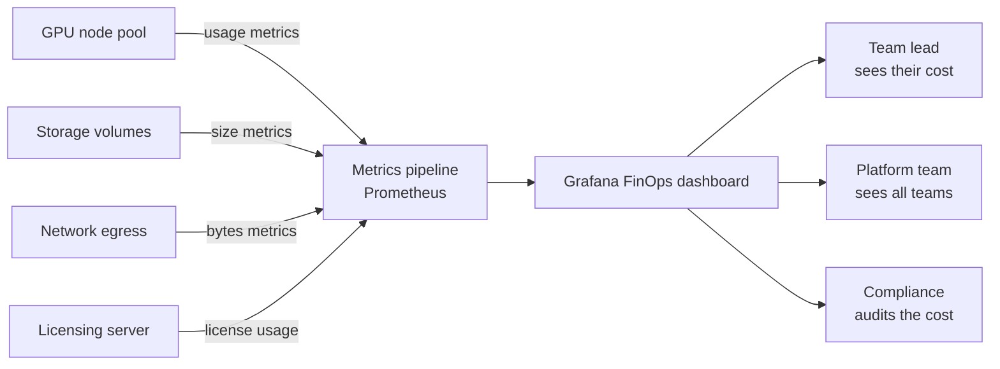
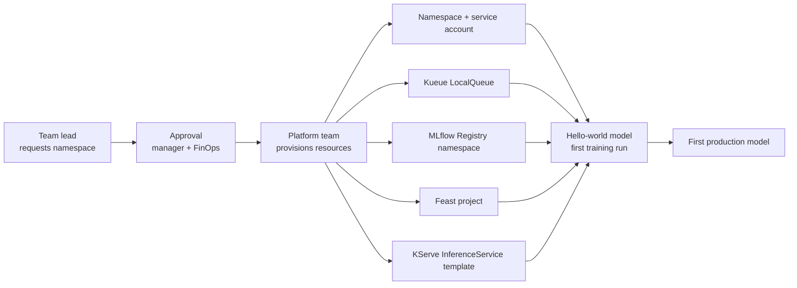

# 16.14 Platform design: multi-tenant AI factory, quotas and chargeback

| Field | Value |
|---|---|
| Level | Advanced |
| Priority tier | 1 |
| Lab venue | GCP / GKE |
| Part | Part 16: MLOps and LLMOps tools and platforms |
| Primary sources | *Production Kubernetes* (`production-kubernetes`, Chapter 12); *Machine Learning Platform Engineering* (`machine-learning-platform-engineering`, Chapters 9, 12); *AI Engineering* (`ai-engineering`, Chapter 10); *LLMOps* (`llmops`, Chapter 9); NVIDIA Zero-to-Hero Volume 21 (`chapter-01-platform-overview.md`, `chapter-02-chargeback.md`, `chapter-03-resource-pools.md`, `chapter-04-onboarding.md`) |
| Cross-references | Chapter 16.1 (MLOps foundations); Chapter 16.7 (Serving platforms); Chapter 11 (GPU Kubernetes); Chapter 5.22 (Multitenancy and platform services) |
| Coverage file | `planning/coverage/chapters/16-14.md` |
| Claim & number ledger | `planning/ledgers/16-14.md` |

## Why this matters for AI infrastructure

The previous chapters assumed a single team with a single set of resources. This chapter is about the case where the platform serves many teams. The multi-tenant AI factory is the production shape of a mature AI infrastructure: many teams (data science, ML engineering, applied research, product engineering) consume a shared platform (GPU pool, registry, orchestrator, feature store, serving platform); the platform team owns the shared platform; the teams own their models and their applications.

Multi-tenancy is not optional. A platform that is not multi-tenant becomes one by accident: teams share a namespace; their models share a registry; their traffic collides on the same ingress; their IAM is shared; their SLOs are coupled. The platform team's first job is the multi-tenant primitives: namespaces, service accounts, network policies, per-team quotas, per-team SLOs, per-team billing.

```text
Why multi-tenancy is on the critical path (PK Ch 12; MLPE Ch 9; V21 ch1):
- A typical mature AI factory serves 5-30 teams across data science, ML
  engineering, applied research, and product engineering. Each team has its own
  models, its own data, its own SLOs; the teams share the GPU pool, the
  registry, the orchestrator, the feature store, the serving platform.
- The GPU pool is the most expensive shared resource. The cost of a single
  H100 is $3-5 per hour; a multi-tenant AI factory runs hundreds of H100s. The
  cost is the single largest line item in the AI factory's budget.
- Without per-team quotas and chargeback, the GPU pool is consumed by the team
  that shouts loudest. The team that needs the GPU most does not get it. The
  platform's job is to allocate the GPU fairly.
```

Three operational realities make this chapter a platform-team concern rather than a data-science-only concern:

1. **The multi-tenant primitives are platform decisions.** Namespaces, service accounts, network policies, per-team quotas, per-team SLOs, per-team billing — the platform team owns them; the consuming teams consume them.
2. **The GPU pool is the most expensive shared resource.** The platform team owns the FinOps dashboard; the FinOps dashboard is the feedback loop that prevents runaway costs.
3. **The self-service onboarding is the platform's first impression.** A team that waits three weeks for a namespace is a team that builds their own platform. The platform team's job is to make the first model runnable in minutes.

**Before a team can serve the first model, the platform must have a multi-tenant primitive for every shared resource. Multi-tenancy is not a feature; multi-tenancy is a property of the platform.**

## Prerequisites and outcomes

### Prerequisites

- Chapter 16.1 (MLOps foundations).
- Chapter 16.7 (Serving platforms and the InferenceService).
- Chapter 11 (GPU Kubernetes) for the GPU pool, the gang scheduler, and the GPU Operator.
- Chapter 5.22 (Multitenancy and platform services) for the Kubernetes multi-tenant primitives.

### Outcomes

After completing this chapter you will be able to:

1. Design the multi-tenant primitive for every shared resource (GPU pool, registry, orchestrator, feature store, serving platform).
2. Implement per-team GPU quotas with Kueue or Volcano; the quota is enforced at admission time.
3. Build the FinOps dashboard that shows per-team, per-model, per-month cost.
4. Implement chargeback: the dashboard's cost data feeds the business's billing system.
5. Build the self-service onboarding: a team can request a namespace, a GPU quota, a model registry, and a serving endpoint in minutes.
6. Operate the multi-tenant platform on GKE with IAM, network policies, observability, and SLOs that match the business's needs.

---

## 1. The multi-tenant primitives

### 1.1 The shared resources

*Production Kubernetes* Chapter 12 walks through the shared resources that a multi-tenant platform exposes. The AI factory has eight shared resources; each is consumed by many teams; each is owned by the platform team.

| Shared resource | What it is | Who consumes it | Who owns it |
|---|---|---|---|
| **Cluster** | The Kubernetes cluster with the GPU node pool | Every team's workloads | Platform team |
| **GPU pool** | The pool of GPU nodes (H100, A100, L40S) | Every team's training and serving | Platform team |
| **Namespaces** | The Kubernetes namespaces, one per team | Every team's workloads | Platform team + team |
| **IAM** | The cluster's RBAC + the cloud's IAM | Every team's service accounts | Platform team |
| **Network policies** | The cluster's NetworkPolicy resources | Every team's pods | Platform team |
| **Model registry** | The shared model registry (MLflow Registry, Vertex AI, SageMaker) | Every team's models | Platform team + team |
| **Orchestrator** | The shared pipeline orchestrator (Argo, Kubeflow, Airflow) | Every team's pipelines | Platform team |
| **Feature store** | The shared feature store (Feast, Vertex AI, SageMaker) | Every team's features | Platform team + team |
| **Vector store** | The shared vector store (Milvus, Qdrant, Vertex AI Vector Search) | Every team's retrieval indices | Platform team + team |
| **Serving platform** | The shared serving platform (KServe, Seldon, BentoML) | Every team's inference services | Platform team + team |

The pattern is that the platform owns the resource; the team consumes the resource; the team has its own namespace, service account, and quota within the resource.

### 1.2 The per-team primitives

*Machine Learning Platform Engineering* Chapter 9 walks through the per-team primitives. Each team gets a slice of every shared resource.

| Primitive | What it is | How it is enforced |
|---|---|---|
| **Namespace** | One Kubernetes namespace per team | RBAC; NetworkPolicy |
| **Service account** | One Kubernetes service account per pipeline | IAM; Workload Identity |
| **ResourceQuota** | One ResourceQuota per namespace | Kubernetes admission controller |
| **LocalQueue** | One Kueue LocalQueue per team (binds to a ClusterQueue with a GPU quota) | Kueue admission controller |
| **InferenceService** | One or more KServe InferenceServices per team | KServe controller |
| **Model registry entry** | One or more MLflow Registry entries per team | MLflow Registry IAM |
| **Feature view** | One or more Feast feature views per team | Feast IAM |
| **Vector index** | One or more Milvus collections per team | Milvus IAM |

The pattern is that each team has a per-team slice of every primitive. The slice is configured at onboarding; the slice is enforced at admission time; the slice is auditable.

### 1.3 The IAM model

The IAM model is the cross-cutting concern. The pattern is:

| Role | Who | What they can do |
|---|---|---|
| `team.admin` | The team's lead | Manage the team's namespace; create service accounts; read the team's audit logs |
| `team.developer` | The team's data scientists and ML engineers | Create pipelines; create models; create features |
| `team.viewer` | The team's product managers and stakeholders | Read the team's registry entries; read the team's metrics |
| `platform.admin` | The platform team | Manage the cluster; manage the GPU pool; manage the orchestrator |
| `platform.auditor` | The compliance team | Read every audit log; read every lineage graph |

The IAM model is the same as Chapter 16.6 Section 5.2 (writer, reader, promoter, admin) extended to the team level.

---

## 2. GPU quota pools

### 2.1 The quota tiers

*LLMOps* Chapter 9 and NVIDIA Zero-to-Hero Volume 21 chapter 3 walk through the GPU quota tiers that a multi-tenant AI factory exposes. The tiers are based on the team's use case and the team's budget.

| Tier | GPU pool | Use case | Quota |
|---|---|---|---|
| **Tier 1: Hobby** | 0 (shared idle capacity) | Exploratory notebooks; small-scale experiments | 0 dedicated GPUs; first-come-first-served on idle capacity |
| **Tier 2: Standard** | Small GPU pool | Standard training and serving | 1-4 GPUs per team |
| **Tier 3: Production** | Medium GPU pool | Production training and serving | 4-16 GPUs per team |
| **Tier 4: Heavy** | Large GPU pool | Large model training; high-QPS serving | 16-64 GPUs per team |
| **Tier 5: Frontier** | Reserved GPU pool | Frontier model training; multi-tenant inference | 64-256 GPUs per team |

The tiers are enforced by Kueue ClusterQueues. Each tier maps to one ClusterQueue with the corresponding GPU quota. The team subscribes to a tier at onboarding; the team can request a tier upgrade.

### 2.2 Kueue ClusterQueues and LocalQueues

```yaml
# code/part16/cluster_queues.yaml (shape only)
apiVersion: kueue.x-k8s.io/v1beta1
kind: ClusterQueue
metadata:
  name: cluster-queue-standard
spec:
  cohort: default
  flavorQuotas:
    - name: h100-sxm5-80gb
      resources:
        - name: cpu
          nominalQuota: 200
        - name: memory
          nominalQuota: 1Ti
        - name: nvidia.com/gpu
          nominalQuota: 16
  resourceGroups:
    - coveredResources: ["cpu", "memory", "nvidia.com/gpu"]
      flavors: ["h100-sxm5-80gb"]
---
apiVersion: kueue.x-k8s.io/v1beta1
kind: ClusterQueue
metadata:
  name: cluster-queue-production
spec:
  cohort: default
  flavorQuotas:
    - name: h100-sxm5-80gb
      resources:
        - name: cpu
          nominalQuota: 800
        - name: memory
          nominalQuota: 4Ti
        - name: nvidia.com/gpu
          nominalQuota: 64
```

```yaml
# code/part16/local_queues.yaml (shape only)
apiVersion: kueue.x-k8s.io/v1beta1
kind: LocalQueue
metadata:
  name: team-data-science-queue
  namespace: team-data-science
spec:
  clusterQueue: cluster-queue-standard
```

The pattern is one ClusterQueue per tier; one LocalQueue per team. The LocalQueue binds the team to the tier; the ClusterQueue enforces the quota. When the team submits a Job, Kueue holds the Job until the quota allows; when the quota is exhausted, the Job is queued.

### 2.3 Quota rebalancing and fairness

The platform team owns the quota rebalancing policy. The pattern is:

- **Weekly review.** The platform team reviews the per-team quota utilisation; teams that consistently use less than 50% of their quota are flagged for a downgrade; teams that consistently hit their quota are flagged for an upgrade.
- **Borrowing queue.** A team that needs more GPU than its quota can borrow from a shared "burst" ClusterQueue; the burst queue is consumed first-come-first-served; the team pays back the borrow in the next billing cycle.
- **Preemption.** A high-priority team can preempt a lower-priority team's Job; the preempted Job is queued again; the preempted team's checkpoint is preserved (Chapter 16.5 Section 3).

The rebalancing is fair across teams; the rebalancing is auditable; the rebalancing is part of the FinOps dashboard.

---

## 3. Chargeback and FinOps

### 3.1 The cost model

*LLMOps* Chapter 9 and NVIDIA Zero-to-Hero Volume 21 chapter 2 walk through the cost model for the AI factory. The cost per team per month is the sum of:

- **Compute cost.** GPU-hours * GPU price per hour. The team pays for every GPU-hour the team's workloads consume.
- **Storage cost.** GB-month * storage price. The team pays for every GB the team's data consumes.
- **Network cost.** Egress GB * network price. The team pays for every GB the team's inference traffic egresses.
- **Licensing cost.** Per-GPU license * GPU-hours. The team pays for every NVAIE-licensed GPU-hour the team's workloads consume.

```text
Monthly cost per team (LLMOps Ch 9; V21 ch 2):
- GPU compute: GPU-hours * $2-5 per GPU-hour (NVAIE) or $1 per GPU-hour (spot)
- Storage: GB-month * $0.01-0.10 per GB-month
- Network egress: GB * $0.01-0.12 per GB
- Licensing: GPU-hours * $0.50-2 per GPU-hour
- Operations: $0.05-0.20 per GPU-hour (the platform team's allocation)
```

The cost model is the source of the chargeback. The chargeback is the business's billing system; the business uses the chargeback to allocate the AI factory's cost to the teams that consume it.

### 3.2 The FinOps dashboard

The FinOps dashboard shows per-team, per-model, per-month cost. The dashboard is the feedback loop that prevents runaway costs.



The dashboard's data sources are:

- **GPU usage.** The NVIDIA GPU Operator exposes GPU utilisation per pod; the metrics feed Prometheus; the dashboard aggregates per team per month.
- **Storage usage.** The CSI driver exposes volume sizes; the metrics feed Prometheus; the dashboard aggregates per team per month.
- **Network egress.** The cloud's metering exports network bytes; the metrics feed the dashboard; the dashboard aggregates per team per month.
- **Licensing usage.** The NVAIE License Server exports per-GPU license usage; the metrics feed the dashboard; the dashboard aggregates per team per month.

### 3.3 The chargeback integration

The dashboard's per-team cost feeds the business's chargeback system. The integration is a SQL query that aggregates the cost data by team; the query feeds the business's ERP or billing system.

```sql
-- code/part16/chargeback_query.sql (shape only)
SELECT
    team,
    DATE_TRUNC('month', timestamp) AS month,
    SUM(gpu_hours * gpu_price) AS compute_cost,
    SUM(storage_gb_month * storage_price) AS storage_cost,
    SUM(network_egress_gb * network_price) AS network_cost,
    SUM(license_hours * license_price) AS license_cost,
    SUM(compute_cost + storage_cost + network_cost + license_cost) AS total_cost
FROM cost_metrics
GROUP BY team, month
```

The chargeback is the business's view of the AI factory; the chargeback is the audit trail that proves the cost is allocated fairly.

---

## 4. Self-service onboarding

### 4.1 The onboarding flow

*Machine Learning Platform Engineering* Chapter 9 walks through the self-service onboarding flow. A new team goes from "I want to use the platform" to "my first model is in production" in minutes, not weeks.



The onboarding is automated by a Terraform module (or a Pulumi module, or a Crossplane composition). The module takes the team's name and the team's tier; the module provisions the namespace, the service account, the LocalQueue, the registry namespace, the Feast project, and the InferenceService template.

### 4.2 The onboarding module

```hcl
# code/part16/onboarding.tf (shape only)
module "team_onboarding" {
  source = "./modules/team-onboarding"
  
  team_name        = "team-data-science"
  tier             = "standard"
  gpu_quota        = 4
  cpu_quota        = "200"
  memory_quota     = "1Ti"
  
  mlflow_namespace  = "team-data-science"
  feast_project     = "team_data_science"
  
  approver_managers = ["manager@example.com"]
  approver_finops   = ["finops@example.com"]
}
```

The module's output is the team's namespace, the team's service account, the team's LocalQueue, the team's registry namespace, the team's Feast project, and a hello-world InferenceService template. The team lead runs the hello-world; the hello-world succeeds in 5 minutes; the team has a running platform.

### 4.3 The onboarding documentation

The onboarding documentation is the team's first impression of the platform. The documentation must:

- Be discoverable (a link from the team's onboarding email).
- Be copy-pasteable (every command in the docs is a command the team can run).
- Be runnable in 10 minutes (a hello-world end to end).
- Be up-to-date (the docs are tested in CI; the CI fails if the docs are stale).

The platform team's pattern is to treat the docs as a CI artifact. The docs are written in Markdown; the docs are tested by a script that runs every command; the CI fails if a command fails.

---

## 5. SLO-based platform design

### 5.1 The platform SLOs

*AI Engineering* Chapter 10 walks through the SLO-based platform design. The platform's SLOs are the contract between the platform team and the consuming teams.

| SLO | Target | Why it matters |
|---|---|---|
| **Namespace provision latency** | < 5 minutes | The first impression of the platform |
| **GPU quota request latency** | < 1 hour | The team's ability to scale |
| **InferenceService deploy latency** | < 5 minutes | The team's iteration speed |
| **Pipeline run start latency** | < 10 minutes | The team's iteration speed |
| **Cluster availability** | 99.9% monthly | The team's reliability |
| **GPU availability** | 99.5% monthly | The team's ability to train |
| **Registry availability** | 99.95% monthly | The audit trail |

The SLOs are measured by the platform's observability stack; the SLOs are published on the platform's status page; the SLOs are enforced by the platform's alerting.

### 5.2 The team SLOs

Each team has its own SLOs. The platform team owns the platform SLOs; the team owns the team SLOs. The team's SLOs are derived from the customer's SLOs (the inference latency, the inference availability, the inference accuracy).

| Team SLO | Source | Platform support |
|---|---|---|
| **Inference latency p99** | Customer-facing | Autoscaler; GPU pool; serving platform |
| **Inference availability** | Customer-facing | Multi-replica deployment; cluster availability |
| **Training throughput** | Team's iteration | GPU quota; queue priority |
| **Model accuracy** | Customer-facing | Eval suite; retraining trigger |

The team's SLOs are tracked on the team's dashboard; the team's SLOs are part of the team's quarterly review.

### 5.3 The error budget

The error budget is the team's SLO translated into a budget. If the team's inference latency SLO is 200 ms p99, the error budget is the fraction of requests that can exceed 200 ms.

```text
Error budget per month (V21 ch 1):
- SLO: p99 latency &lt;= 200 ms
- Availability: 99.9% monthly
- Error budget: 43.2 minutes of downtime per month
- Burn rate: requests exceeding the SLO / total requests
- Alert: burn rate > 2x for 1 hour -> page the on-call
- Alert: burn rate > 10x for 5 minutes -> page the on-call
```

The error budget is the team's "spend" on reliability. The team can spend the budget on canary deployments, on shadow mode, on chaos engineering. When the budget is exhausted, the team pauses new deployments until the next billing cycle.

---

## 6. Operating the multi-tenant platform on GKE

### 6.1 The components

| Component | Where it runs | Backing store | SLO |
|---|---|---|---|
| Kueue controller | Kubernetes Deployment | Postgres | Admission latency p99 < 1 s |
| KAI scheduler | Kubernetes Deployment | etcd | PodGroup ready p99 < 5 s |
| GPU Operator | Kubernetes Deployment | Node-feature-discovery | Pod admission latency p99 < 1 s |
| MLflow Registry | Kubernetes Deployment | Postgres + GCS | Stage transition p99 < 500 ms |
| Argo Workflows | Kubernetes Deployment | Postgres | DAG submission p99 < 5 s |
| Feast | Kubernetes Deployment | BigQuery + Redis/Bigtable | Feature read p99 < 10 ms |
| KServe | Kubernetes Deployment | etcd | InferenceService ready p99 < 30 s |
| Kubecost (or OpenCost) | Kubernetes Deployment | Prometheus + object storage | Cost aggregation < 1 hour |

### 6.2 IAM and the per-team namespaces

The platform team's IAM model from Section 1.3 enforces the per-team namespaces. The pattern is:

```yaml
# code/part16/team_namespace.yaml (shape only)
apiVersion: v1
kind: Namespace
metadata:
  name: team-data-science
  labels:
    team: team-data-science
    tier: standard
    cost-center: ml-platform
---
apiVersion: v1
kind: ResourceQuota
metadata:
  name: team-data-science-quota
  namespace: team-data-science
spec:
  hard:
    cpu: "200"
    memory: 1Ti
    nvidia.com/gpu: "4"
    requests.nvidia.com/gpu: "4"
---
apiVersion: networking.k8s.io/v1
kind: NetworkPolicy
metadata:
  name: team-data-science-isolation
  namespace: team-data-science
spec:
  podSelector: {}
  policyTypes: [Ingress, Egress]
  ingress:
    - from:
        - namespaceSelector:
            matchLabels:
              name: ingress
  egress:
    - to:
        - namespaceSelector:
            matchLabels:
              name: kube-system
```

The namespace is the team's slice; the ResourceQuota is the team's budget; the NetworkPolicy is the team's isolation.

### 6.3 Observability

| Metric | Why it matters | Alert |
|---|---|---|
| Namespace provision latency p99 | First impression of the platform | > 5 minutes |
| GPU quota utilisation per team | Capacity planning | > 80% for 1 day |
| Cluster availability | Customer-facing SLO | < 99.9% monthly |
| Registry availability | Audit trail | < 99.95% monthly |
| InferenceService ready latency p99 | Iteration speed | > 5 minutes |
| Cost per team per month | FinOps | > budget for 1 day |

The cost-per-team-per-month alert is the most important. The alert fires when a team's cost exceeds its budget; the platform team investigates; the FinOps team adjusts the team's quota or the team's budget.

---

## 7. How it fails

Six failure modes recur.

### 7.1 "One team hogs the GPU pool"

**Symptom:** The other teams cannot get GPUs. The dashboard shows one team using 80% of the GPU pool. The other teams' Jobs are queued.

**Diagnosis:** The GPU quota is too high for the team that is hogging; the quota is too low for the other teams. The rebalancing from Section 2.3 is not running.

**Fix:** Lower the hogging team's quota; raise the other teams' quotas; add a per-team dashboard that shows the utilisation; add an alert when a team uses more than 80% of its quota.

### 7.2 "The cost dashboard shows a team's bill exploded overnight"

**Symptom:** The FinOps dashboard shows that one team's bill is 10x its budget. The team's GPU usage spiked overnight.

**Diagnosis:** A runaway training job; a misconfigured autoscaler; an LLM application that loops.

**Fix:** Add a per-team cost alert; add a hard cap on the team's GPU spend; the Kueue ClusterQueue refuses to admit new Jobs when the team's monthly spend exceeds the cap.

### 7.3 "The team's InferenceService is slow because of a noisy neighbour"

**Symptom:** The team's InferenceService p99 latency spikes during peak hours. The cluster's other teams' workloads are saturating the network or the GPU memory bandwidth.

**Diagnosis:** The team does not have network isolation; the team's pods share the cluster's network with other teams' pods.

**Fix:** Add a NetworkPolicy that isolates the team's pods; bind the team's pods to a dedicated node pool; use the GPU Operator's time-slicing or MIG to share the GPU safely.

### 7.4 "The team's data leaked to another team"

**Symptom:** Another team found a dataset they should not have access to. The audit log shows the dataset was in a shared bucket; the other team's IAM had read access.

**Diagnosis:** The bucket's IAM was too permissive; the team's data was in a shared location.

**Fix:** Per-team object storage prefixes; per-team IAM bindings; the team's bucket is not shared; the audit log records every read.

### 7.5 "The team's model was promoted without their approval"

**Symptom:** A model is in production; the team's audit log shows no PR; the team did not approve the promotion.

**Diagnosis:** The promotion pipeline bypassed the GitOps loop; the promotion happened through a manual API call.

**Fix:** Refuse to transition the registry stage except through the reconciler (Chapter 16.6 Section 3.2); the reconciler's IAM is the only path; manual transitions are forbidden by policy and by IAM.

### 7.6 "The team's namespace was deleted"

**Symptom:** The team's namespace is gone; the team's pods, services, and InferenceServices are gone; the team's audit log is gone.

**Diagnosis:** A well-meaning engineer (or a malicious one) deleted the namespace. The deletion was not prevented.

**Fix:** The platform's IAM model does not grant namespace deletion to anyone except the platform team's break-glass admin; the audit log records every namespace event; the namespace has a finalizer that requires the platform team's approval.

---

## 8. Hands-on lab

This lab stands up Kueue, the per-team namespaces, the LocalQueues, and the FinOps dashboard on GKE. The lab is **untested** in this repository.

### 8.1 Prerequisites

- A GKE Autopilot or Standard cluster (1.27+) with at least 4 H100 GPUs.
- Kueue installed via Helm.
- Kubecost installed via Helm.
- A team name (e.g. `team-data-science`).

### 8.2 Step 1: install Kueue

```bash
helm install kueue kueue/kueue \
  --namespace kueue-system --create-namespace
# expected: the Kueue controller is running
```

### 8.3 Step 2: create the ClusterQueues

```bash
kubectl apply -f code/part16/cluster_queues.yaml
# expected: cluster-queue-standard and cluster-queue-production are created
```

### 8.4 Step 3: provision a team's namespace

```bash
# Run the onboarding module (Terraform)
cd onboarding
terraform init
terraform apply -auto-approve \
  -var="team_name=team-data-science" \
  -var="tier=standard" \
  -var="gpu_quota=4"
# expected: the namespace, the service account, the LocalQueue, the ResourceQuota are all created
```

### 8.5 Step 4: submit a training Job

```bash
kubectl apply -f code/part16/training_job.yaml -n team-data-science
kubectl get workload -n team-data-science -w
# expected: the Job is admitted by Kueue; the Job runs on the GPU pool
```

### 8.6 Step 5: query the FinOps dashboard

```bash
# Open Grafana and navigate to the Kubecost dashboard
kubectl port-forward -n kubecost svc/kubecost-cost-analyzer 9090:9090

# Or query the cost metrics directly
curl -s http://kubecost.kubecost:9090/model/allocation?window=7d \
  | jq '.data[] | select(.properties.namespace == "team-data-science")'
# expected: the team's GPU, memory, and storage cost for the last 7 days
```

### 8.7 Step 6: trigger the quota rebalancing alert

```bash
# Inflate the team's GPU usage
for i in {1..4}; do
  kubectl create job -n team-data-science stress-$i --image=nvidia/cuda:12.2.0-base -- nvidia-smi -l 3600
done

# Wait 5 minutes; observe the alert
kubectl get events -n team-data-science -w
# expected: an alert fires when the team's GPU usage exceeds 80%
```

### 8.8 Step 7: provision a second team

```bash
terraform apply -auto-approve \
  -var="team_name=team-product" \
  -var="tier=production" \
  -var="gpu_quota=16"
# expected: the second team's namespace and LocalQueue are created; the dashboard shows both teams
```

### 8.9 What to record

After the lab, you should be able to answer five questions in five seconds each:

1. What teams have provisioned namespaces, and what tier are they on?
2. What is the GPU quota utilisation per team?
3. What is the cost per team per month?
4. What is the most recent namespace provisioning event, and who provisioned it?
5. What is the cluster's current availability, and what teams are affected by the SLO?

If any takes more than 30 seconds, the multi-tenant platform is not yet a production service. The lab is **untested** against a live GKE cluster.

---

## Exercises

1. **Add a third tier.** Add a Tier 6 "Reserved" tier with a dedicated GPU pool; verify the tier's quota is enforced. *Solution sketch:* a new ClusterQueue with the dedicated GPU pool; the onboarding module adds a `tier=reserved` option.
2. **Add a per-team cost alert.** Configure a Prometheus alert that fires when a team's monthly cost exceeds 80% of its budget. *Solution sketch:* a Prometheus rule that reads Kubecost's allocation data; alert on `team_cost > team_budget * 0.8`.
3. **Add a borrowing queue.** Create a shared "burst" ClusterQueue; teams can borrow from the queue when their quota is exhausted. *Solution sketch:* a new ClusterQueue; the LocalQueue references both the team's queue and the burst queue with a fallback policy.
4. **Add a per-team budget cap.** Configure a hard cap on the team's monthly spend; the Kueue ClusterQueue refuses to admit new Jobs when the cap is reached. *Solution sketch:* a Prometheus rule that reads Kubecost's allocation data; the rule calls the Kueue API to suspend the LocalQueue when the cap is reached.
5. **Add a self-service onboarding portal.** Build a simple web app that lets a team lead request a namespace; the app calls the Terraform module. *Solution sketch:* a Flask or FastAPI app; an OAuth login; the app provisions the namespace on behalf of the user.
6. **Add a per-team status page.** Configure a status page that shows the team's SLO attainment; the page is part of the platform's public status page. *Solution sketch:* a Grafana dashboard per team; the dashboard's metrics feed the public status page.

---

## Checkpoint questions

<details><summary>1. What eight shared resources does the multi-tenant platform expose?</summary>
Cluster, GPU pool, namespaces, IAM, network policies, model registry, orchestrator, feature store, vector store, and serving platform. Each is consumed by many teams; each is owned by the platform team. The pattern is that the platform owns the resource; the team consumes the resource; the team has its own namespace, service account, and quota within the resource.
</details>

<details><summary>2. What five quota tiers does the platform expose?</summary>
Tier 1 (Hobby; 0 dedicated GPUs), Tier 2 (Standard; 1-4 GPUs), Tier 3 (Production; 4-16 GPUs), Tier 4 (Heavy; 16-64 GPUs), Tier 5 (Frontier; 64-256 GPUs). The tiers are enforced by Kueue ClusterQueues; the team subscribes to a tier at onboarding; the team can request a tier upgrade.
</details>

<details><summary>3. What is the FinOps dashboard's data sources?</summary>
GPU usage (NVIDIA GPU Operator metrics), storage usage (CSI driver metrics), network egress (cloud metering), and licensing usage (NVAIE License Server). The metrics feed Prometheus; the dashboard aggregates per team per month; the chargeback query feeds the business's billing system.
</details>

<details><summary>4. What is the self-service onboarding flow?</summary>
The team lead requests a namespace; the approval (manager + FinOps) gates the request; the platform team provisions the resources (namespace, service account, LocalQueue, registry namespace, Feast project, InferenceService template); the team runs a hello-world; the hello-world succeeds in 5 minutes; the team has a running platform.
</details>

<details><summary>5. What are the platform SLOs?</summary>
Namespace provision latency < 5 minutes; GPU quota request latency < 1 hour; InferenceService deploy latency < 5 minutes; pipeline run start latency < 10 minutes; cluster availability 99.9% monthly; GPU availability 99.5% monthly; registry availability 99.95% monthly.
</details>

<details><summary>6. What is the error budget?</summary>
The team's SLO translated into a budget. If the SLO is p99 latency &lt;= 200 ms with 99.9% availability, the error budget is 43.2 minutes of downtime per month. The team can spend the budget on canary deployments, shadow mode, chaos engineering. When the budget is exhausted, the team pauses new deployments until the next billing cycle.
</details>

<details><summary>7. What is the per-team primitive for the GPU pool?</summary>
One Kueue LocalQueue per team; the LocalQueue binds to a ClusterQueue with the corresponding GPU quota. The Kueue admission controller enforces the quota; when the team's quota is exhausted, the team's Jobs are queued.
</details>

<details><summary>8. What is the per-team primitive for the model registry?</summary>
One MLflow Registry namespace per team; the namespace is bound to the team's IAM; the team's models are isolated from other teams' models. The team's audit log is per-team.
</details>

<details><summary>9. Why is the FinOps dashboard the feedback loop for cost?</summary>
Because the dashboard shows the per-team cost in real time; the dashboard's alert fires when a team's cost exceeds its budget; the platform team can intervene before the cost explodes. Without the dashboard, the cost is invisible until the monthly bill arrives; the cost is too late to fix.
</details>

<details><summary>10. What is the role of the borrowing queue?</summary>
A shared "burst" ClusterQueue that teams can borrow from when their quota is exhausted. The borrowing queue is consumed first-come-first-served; the borrowing team pays back the borrow in the next billing cycle. The pattern prevents a team's burst workload from blocking other teams' steady workloads.
</details>
<details><summary>11. What is the per-team primitive for network isolation?</summary>
A NetworkPolicy per namespace that allows ingress from the cluster's ingress namespace only and egress to the cluster's DNS service only. The team's pods cannot reach each other across namespaces; the team's pods cannot reach the public internet.
</details>

<details><summary>12. Why is the platform team's IAM model more restrictive than the consuming teams' IAM model?</summary>
Because the platform team's actions affect every team; the platform team's actions are audited; the platform team's actions are subject to the break-glass admin pattern. The consuming teams' actions affect only their own namespace; the consuming teams' actions are auditable within their namespace.
</details>

<details><summary>13. What is the per-team ResourceQuota?</summary>
A Kubernetes ResourceQuota that bounds the team's CPU, memory, and GPU requests within the namespace. The quota is enforced at admission time; the quota is part of the team's onboarding configuration; the quota is part of the team's FinOps dashboard.
</details>

<details><summary>14. What is the platform status page?</summary>
A public dashboard that shows the platform's SLO attainment; the dashboard is per-team; the dashboard is part of the platform's operational discipline. The dashboard is the team's first place to look when something is wrong.
</details>

<details><summary>15. Why is the per-team dashboard's metrics latency important?</summary>
Because the team uses the dashboard to debug its own issues; the dashboard's metrics must be fresh; the dashboard's metrics must be at the same resolution as the team's SLOs. A dashboard with stale metrics is a dashboard that cannot debug.
</details>

<details><summary>16. What is the cost-per-team-per-month alert?</summary>
A Prometheus alert that fires when a team's monthly cost exceeds 80% of its budget. The alert fires in the first week of the month; the platform team investigates; the FinOps team adjusts the team's quota or the team's budget. The alert prevents the cost from exploding silently.
</details>

<details><summary>17. What is the role of the platform's break-glass admin?</summary>
A privileged IAM role that the platform team can assume in an emergency. The break-glass admin can delete namespaces, revoke access, and intervene on production. The break-glass admin's use is audited; the audit log records every action.
</details>

<details><summary>18. What is the per-team audit log?</summary>
An append-only log that records every action the team takes: every model registration, every pipeline run, every feature definition, every deployment. The per-team audit log is part of the platform's compliance story; the per-team audit log is what the regulator inspects.
</details>

<details><summary>19. What is the role of the team's hello-world?</summary>
The hello-world is the team's first end-to-end run on the platform. The hello-world succeeds in 5 minutes; the success gives the team confidence; the success reveals whether the platform's documentation is up to date. A hello-world that fails is a platform that needs fixing.
</details>

<details><summary>20. What five questions should the multi-tenant platform lab let you answer in five seconds each?</summary>
What teams have provisioned namespaces and what tier. What is the GPU quota utilisation per team. What is the cost per team per month. What is the most recent namespace provisioning event. What is the cluster's current availability. If any takes more than 30 seconds, the multi-tenant platform is not yet a production service.
</details>

---

## Sources and review notes

- *Production Kubernetes* (`production-kubernetes`, Chapter 12). Source for the multi-tenant Kubernetes primitives (namespaces, RBAC, NetworkPolicy, ResourceQuota) and the pattern of one-namespace-per-team. Chapter 12 is approximately 7,700 words.
- *Machine Learning Platform Engineering* (`machine-learning-platform-engineering`, Chapters 9, 12). Source for the per-team primitives, the onboarding flow, and the FinOps dashboard. Chapter 9 is approximately 9,000 words; Chapter 12 is approximately 9,000 words.
- *AI Engineering* (`ai-engineering`, Chapter 10). Source for the SLO-based platform design, the user feedback loop, and the team-level metrics. Chapter 10 is approximately 13,000 words.
- *LLMOps* (`llmops`, Chapter 9). Source for the cost model, the hardware and infrastructure considerations, and the scaling patterns. Chapter 9 is approximately 5,500 words.
- NVIDIA Zero-to-Hero Volume 21 (`chapter-01-platform-overview.md`, `chapter-02-chargeback.md`, `chapter-03-resource-pools.md`, `chapter-04-onboarding.md`). Source for the AI factory overview, the chargeback integration, the GPU resource pools, and the onboarding flow. The wording has been rewritten in the handbook's voice.

### Cross-references to other handbook chapters

- Chapter 16.1 for the MLOps foundations that the platform implements.
- Chapter 16.7 for the serving platform that the multi-tenant pattern wraps.
- Chapter 11 (GPU Kubernetes) for the GPU pool and the gang scheduler.
- Chapter 5.22 (Multitenancy and platform services) for the Kubernetes multi-tenant primitives.

### Migrated from `nvidia-devops`

The AI factory overview, the chargeback integration, the GPU resource pools, and the onboarding flow draw on Volume 21 chapters 1-4. The wording has been rewritten in the handbook's voice.

### Explicitly labelled inferences

- The quota tiers in Section 2.1 are starting points; specific tiers depend on the team's budget and the GPU pool size.
- The cost-per-resource numbers in Section 3.1 are starting points; specific costs vary by region, commitment, and current promotional pricing.
- The error budget in Section 5.3 is starting points; specific budgets depend on the team's SLOs and the business's tolerance.

### Not verified on live hardware

- The lab in Section 8 is **untested** against a live GKE cluster in this repository.
- The Kueue, Kubecost, and GPU Operator versions assumed in the lab should be pinned against the current releases before production use.
- The cost numbers in the lab are illustrative; production costs vary by usage pattern.
