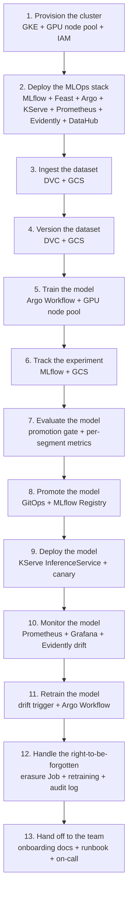
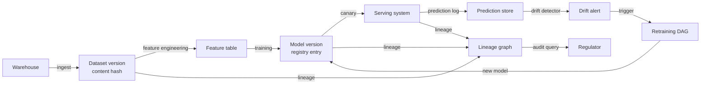

# 16.15 Lab: end-to-end MLOps on GKE

| Field | Value |
|---|---|
| Level | Advanced |
| Priority tier | 1 |
| Lab venue | GCP / GKE |
| Part | Part 16: MLOps and LLMOps tools and platforms |
| Cross-references | Every chapter in Part 16; Chapter 5 (Kubernetes); Chapter 11 (GPU Kubernetes); Chapter 14 (Distributed training); Chapter 15 (Inference) |
| Coverage file | `planning/coverage/chapters/16-15.md` |
| Claim & number ledger | `planning/ledgers/16-15.md` |

## Why this matters for AI infrastructure

Imagine you are the on-call engineer on the night a team runs its first full pipeline. The training stage starts, then stalls. The team asks whether the platform is broken or the design is wrong. You can answer that with confidence only if you have already run the whole path, from data to serving, at least once. A pipeline that has never run end to end is a set of promises, not a system.

The previous fourteen chapters explained the MLOps stack one layer at a time. This chapter runs the whole stack as one system. A team that has read every chapter can describe each component alone. A team that has run this lab can describe how the components connect, and where they tend to break. That difference shows up in the middle of the night, when the question is no longer what a tool does but why the chain stopped.

The lab tells one story. A team provisions a GKE cluster, deploys the MLOps stack, and trains a model on a public dataset. It promotes the model, serves it, watches it for drift, and retrains it when the drift grows. Last, it handles a right-to-be-forgotten request. Each part of the story hands a file, a record, or a decision to the next part. The story ends with a model in production, a dashboard, an audit log, and a team that can run the platform. These steps were not run on a live cluster, so treat each expected output as a claim to check.

```text
Why the capstone matters (background reading: NVIDIA Zero-to-Hero volume 25; Practical MLOps; Machine Learning Platform Engineering; the figures below are examples, not quotations):
- The MLOps stack is a system, not a collection of tools. The system has inputs
  (data, code, hyper-parameters), processes (training, evaluation, promotion),
  outputs (models in production), and feedback loops (drift detection, retraining).
- A team that has run the lab end to end knows where the seams are: where
  the data flows from the warehouse to the feature store, where the model flows
  from the registry to the serving system, where the audit log records every
  transition. The seams are what the platform team owns.
- The capstone is the integration test. Every chapter introduced a component;
  this chapter shows the components working together. A team that has run the
  capstone can debug any MLOps failure by walking the chain from the symptom
  back to the component.
```

Picture a team lead who asks the platform team to "just make it work" before a launch. Three things make this capstone a platform-team project rather than a data-science project, and each one is a check the platform team owns.

1. The capstone tests integration. Every component from Part 16 must be installed, configured, and connected. Your platform design decides whether the parts work together or conflict. Two tools can each pass their own tests and still fail when they share a namespace.
2. The capstone tests the SLOs. Every component must emit the metrics that the SLOs from Chapter 16.14 require. If the observability stack is weak, the SLOs cannot be measured at all, and an unmeasured promise is not a promise.
3. The capstone tests the audit trail. Every component must write the records a regulator will ask for. Your lineage design decides whether you can answer those questions, and the capstone is the only place where all of the records meet at once.

**Before you call your MLOps stack production-ready, run the capstone from start to finish. A component that has never been integrated has not been validated.**

## Prerequisites and outcomes

### Prerequisites

Picture a platform engineer who opens this lab on her first day, with the earlier chapters still unread. She will spend the afternoon looking up terms instead of running commands. The list below names what to read first.

- Read Chapters 16.1 through 16.14 in Part 16. They cover every component you will deploy here.
- Know the Kubernetes basics from Chapter 5. This lab builds directly on those cluster primitives.
- Understand the GPU pool and the gang scheduler from Chapter 11.
- Know the parallelism patterns from Chapter 14.
- Know the serving engines from Chapter 15.

### Outcomes

Picture finishing the capstone and handing the keys to the next team. This capstone covers six pieces of work, and they come in the same order you meet them in the lab. Each piece maps to a section of the lab, so you can check your progress as you go. The first piece provisions a GKE cluster with a GPU node pool and the multi-tenant primitives. The second deploys the MLOps stack, which means data versioning, feature store, experiment tracking, pipeline orchestrator, registry, serving platform, monitoring, drift detection, retraining trigger, and governance. The third trains a model on a public dataset end to end, from data preparation to deployment. The fourth operates the model in production, which means serving it, monitoring it, detecting drift, and retraining it. The fifth handles a regulatory event, including the right-to-be-forgotten workflow and the audit log query. The last hands the platform to the next team with onboarding documentation, a runbook, and an on-call rotation.

---

## 1. The capstone story arc

### 1.1 The thirteen steps

Picture a relay race in which each runner has to wait for the baton. The capstone has thirteen steps. Each step deploys one chapter's content onto the cluster, and each step depends on the one before it. If you skip a step, the steps after it have nothing to build on, and the failure often shows up far away from the skipped step.



The story arc is the production shape of an AI factory. Read the diagram as one line of work, where each step hands something to the next. The platform team owns the whole line, not just one station on it. When a step fails, the diagram tells you which step to visit first, because the arrows show what it was supposed to hand over.

### 1.2 The data flow

Picture an auditor who asks, months after launch, where one prediction came from. Two kinds of information move through this system to make that question answerable. Data moves forward, from the warehouse to a prediction. Audit information moves alongside it and collects in a lineage graph that a regulator can query.



The forward flow shows the life of one model. The lineage flow shows how the platform records that life. The two flows meet in the lineage graph, which is the artefact that links them. The loop at the bottom, where drift leads to retraining and retraining leads back to the registry, is what makes the system a loop rather than a one-way line.

---

## 2. Step 1: provision the cluster

Picture a training stage that waits for an hour and says nothing useful. Every later step depends on this one. If the cluster has no GPU pool, the training stage sits in Pending, and the failure can look like a scheduling problem. The cause is usually one missing piece at this step, not a bug in the training code.

Start with a small CPU cluster, then add an autoscaling GPU pool. An autoscaling pool grows and shrinks with demand, so you pay for GPUs only while work is waiting. Next, install the GPU Operator, Kueue for queueing, and Volcano for gang scheduling. Gang scheduling starts a group of Pods together or not at all, which matters when a distributed training job needs all of its GPUs at once. Finally, create the team's namespace with its quota and network policy.

A namespace is a label in the control plane, not a wall on the worker nodes. Without extra policy, pods from two namespaces can still land on the same node. Production Kubernetes, chapter 12, makes this point, so add scheduling constraints if two teams must never share a node. Scheduling constraints tell the scheduler where a Pod may or may not go, and they are the only firm way to keep two teams apart on the hardware.

```bash
# Create the GKE cluster
gcloud container clusters create mlops-capstone \
  --region us-central1 \
  --machine-type n1-standard-4 \
  --num-nodes 1 \
  --enable-autoscaling \
  --min-nodes 1 \
  --max-nodes 10 \
  --enable-autorepair \
  --release-channel regular

# Create the GPU node pool
gcloud container node-pools create gpu-pool \
  --cluster mlops-capstone \
  --machine-type a2-highgpu-1g \
  --num-nodes 2 \
  --enable-autoscaling \
  --min-nodes 0 \
  --max-nodes 8 \
  --accelerator type=nvidia-tesla-a100,count=1

# Install the NVIDIA GPU Operator
helm install gpu-operator nvidia/gpu-operator \
  --namespace gpu-operator --create-namespace

# Install Kueue
helm install kueue kueue/kueue \
  --namespace kueue-system --create-namespace

# Install Volcano (for gang scheduling)
helm install volcano volcano-sh/volcano \
  --namespace volcano-system --create-namespace

# Create the team's namespace
kubectl apply -f code/part16/team_namespace.yaml
```

Before you move on, confirm each piece. Run one check per piece rather than trusting the install messages alone. You should see a running GKE cluster with a GPU node pool, and the GPU Operator, Kueue, and Volcano installed. The team's namespace should exist with its ResourceQuota and NetworkPolicy. If any of those is missing, stop here, because the next step will fail for a reason that looks unrelated.

---

## 3. Step 2: deploy the MLOps stack

Picture a new platform engineer who must rebuild the whole stack after a laptop dies. If the chart versions live only in a shell history, the rebuild becomes guesswork. The MLOps stack is the sum of every component from Chapters 16.1 through 16.14. You install each component with Helm, and you keep the chart versions in your GitOps repo. That way you can rebuild the stack the same way later.

Install the components in the order shown. Argo Workflows and MLflow come first, because the training steps in the next sections write to them. The order is not arbitrary. A later install that points at an earlier one fails if the earlier one is not there yet.

```bash
# Install Argo Workflows (Chapter 16.4)
helm install argo-workflows argo/argo-workflows \
  --namespace argo --create-namespace

# Install MLflow (Chapter 16.2)
helm install mlflow community-charts/mlflow \
  --namespace mlops --create-namespace \
  --set trackingService.service.type=ClusterIP \
  --set backendStore.url=sqlite:///mlflow.db \
  --set artifactRoot=gs://${PROJECT_ID}-mlflow-artifacts

# Install Feast (Chapter 16.3)
helm install feast feast-charts/feast \
  --namespace feast --create-namespace

# Install KServe (Chapter 16.7)
helm install kserve kserve/kserve \
  --namespace kserve --create-namespace \
  --set kserve.controller.deploymentMode=Deployment

# Install Prometheus and Grafana (Chapter 16.10)
helm install prometheus prometheus-community/kube-prometheus-stack \
  --namespace monitoring --create-namespace

# Install Evidently (Chapter 16.10)
helm install evidently evidentlyai/evidently \
  --namespace monitoring \
  --set evidently.reference-features-path=gs://${PROJECT_ID}-reference/v3.parquet

# Install DataHub (Chapter 16.13)
helm install datahub datahub/datahub \
  --namespace governance --create-namespace
```

When the installs finish, each component should show as healthy on the platform dashboard. A healthy component is one whose pods are running and whose own health check passes. At that point, the SLOs from Chapter 16.14 can be measured. If a component is missing from the dashboard, fix it before you load any data, because data loaded into a half-observed stack is hard to trust later.

---

## 4. Step 3-4: ingest and version the dataset

Data versioning matters because a model is only as reproducible as its data. If you cannot say which rows trained a model, you cannot explain its behavior later. Picture a model that starts to misbehave, and a team that cannot tell whether the data changed. The capstone uses a public dataset, the UCI Adult dataset, and versions it with DVC. DVC, or Data Version Control, tracks large data files alongside your code. Adult is not a churn dataset. Its label says whether a person earns more than 50,000 dollars a year. It stands in for a churn table because it is a small, stable, public binary-classification file. A binary classification file has two possible answers for each row. The capstone keeps the name churn for the files and the model so that the other chapters line up, and you treat the income label as the target.

You download the file. DVC then adds a small pointer file to Git and pushes the data itself to a GCS bucket. GCS is Google Cloud Storage, the object store behind the bucket. The commit holds the pointer, so the dataset's content hash becomes part of your code history. A content hash is a fingerprint computed from the file's bytes, so a change to even one row produces a different fingerprint.

```bash
# Download the dataset
mkdir -p churn-capstone/data && cd churn-capstone
git init
curl -O https://archive.ics.uci.edu/ml/machine-learning-databases/adult/adult.data
mv adult.data data/churn.csv

# Initialise DVC against GCS
dvc init --storage.gs gs://${PROJECT_ID}-dvc

# Version the dataset
dvc add data/churn.csv
git add data/churn.csv.dvc data/.gitignore
git commit -m "v1 of the capstone dataset (UCI Adult, stands in for churn)"
dvc push
# expected: a content hash in GCS; a sha256 in data/churn.csv.dvc
```

The expected output is a versioned dataset in the bucket. Check that the pointer file, the commit, and the bucket object all show the same hash, because a mismatch means the push and the commit are out of step. The dataset's content hash is the reference the rest of the pipeline uses, so record it with every run. If someone later asks which data a model saw, the hash answers the question without anyone searching a folder.

---

## 5. Step 5-6: train and track the experiment

Training is where cost and risk meet. It takes a GPU pool, real data, and a seed, and it produces the model you will later defend to a regulator. A seed is the starting number for the random choices in training. Fixing it means the same run can be repeated. The Argo Workflow below makes each run repeatable, and MLflow records what that run used. Argo Workflows is a Kubernetes engine that runs a pipeline as a graph of steps.

The workflow has four stages: prepare, train, evaluate, and register. Each stage runs in its own container, so a bug in one stage cannot quietly change the packages another stage uses. Only the train stage asks for a GPU. The dataset ID and the seed flow into the stages as parameters, so the run is traceable. A parameter is a named value passed from the workflow into a stage.

```yaml
# code/part16/capstone_training_workflow.yaml
apiVersion: argoproj.io/v1alpha1
kind: Workflow
metadata:
  generateName: churn-training-
spec:
  entrypoint: pipeline
  arguments:
    parameters:
      - {name: dataset-id, value: "churn-v1"}
      - {name: seed, value: "42"}
  templates:
    - name: pipeline
      dag:
        tasks:
          - name: prepare
            template: prepare
            arguments:
              parameters: [{name: dataset-id, value: "{{workflow.parameters.dataset-id}}"}]
          - name: train
            template: train
            dependencies: [prepare]
            arguments:
              parameters:
                - {name: dataset-id, value: "{{workflow.parameters.dataset-id}}"}
                - {name: seed, value: "{{workflow.parameters.seed}}"}
          - name: evaluate
            template: evaluate
            dependencies: [train]
          - name: register
            template: register
            dependencies: [evaluate]
    - name: prepare
      container:
        image: my-prepare:v1
        command: [python, prepare.py]
        args: ["--dataset-id", "{{inputs.parameters.dataset-id}}"]
      inputs:
        parameters:
          - {name: dataset-id}
    - name: train
      container:
        image: my-train:v1
        command: [python, train.py]
        args: ["--dataset-id", "{{inputs.parameters.dataset-id}}", "--seed", "{{inputs.parameters.seed}}"]
        resources:
          requests:
            nvidia.com/gpu: "1"
          limits:
            nvidia.com/gpu: "1"
      inputs:
        parameters:
          - {name: dataset-id}
          - {name: seed}
    - name: evaluate
      container:
        image: my-evaluate:v1
        command: [python, evaluate.py]
    - name: register
      container:
        image: my-register:v1
        command: [python, register.py]
```

Submit the workflow, then check its progress with the Argo commands. The first command starts the run, the second lists it, and the third shows the stages one by one. The run also appears in MLflow, where you can compare it with other runs and see whether the seed made a difference.

```bash
argo submit -n mlops -f code/part16/capstone_training_workflow.yaml \
  --parameter-values "dataset-id=churn-v1,seed=42"
argo list -n mlops
argo get -n mlops @latest
# expected: the workflow runs on the GPU node pool; the run appears in MLflow
```

A completed workflow is more than a green badge. It means each stage ran, handed its output to the next stage, and left a record. The expected output is a completed workflow with four stages. The MLflow run record should carry the data hash, the commit hash, the seed, and the metrics. Those items are what let someone rerun the training next year and get the same story, which is the point of the whole exercise.

---

## 6. Step 7-8: evaluate and promote

Picture a data scientist who is sure her model is better, and a manager who wants proof before anything moves. A model is not ready for production just because it trained. Promotion moves it from an experiment to a candidate, and you want that decision to be mechanical rather than a matter of opinion. The promotion gate from Chapter 16.1, Section 4.3, runs as the register stage.

The function below makes two checks before it registers anything. First, it refuses a run that lacks any of four required tags. A tag is a label attached to the run, such as the data hash or the seed. Second, it refuses a run whose AUC is below the baseline's AUC. AUC, or area under the curve, is a score that measures how well a classifier ranks positive cases above negative ones, and higher is better. A blocked run returns 1, which lets the caller fail the stage.

```python
# code/part16/promotion_gate.py
import mlflow
from mlflow.tracking import MlflowClient

def promote(run_id: str, baseline_run_id: str) -> int:
    client = MlflowClient()
    run = client.get_run(run_id)
    baseline = client.get_run(baseline_run_id)
    
    # Check required tags
    for tag in ("data_hash", "code_commit", "seed", "env_image"):
        if tag not in run.data.tags:
            print(f"PROMOTION BLOCKED: missing required tag {tag}")
            return 1
    
    # Check AUC vs baseline
    auc = run.data.metrics.get("auc", 0)
    baseline_auc = baseline.data.metrics.get("auc", 0)
    if auc < baseline_auc:
        print(f"PROMOTION BLOCKED: AUC regressed ({auc:.4f} < {baseline_auc:.4f})")
        return 1
    
    # Register
    model_uri = f"runs:/{run_id}/model"
    mv = client.create_model_version("churn-model", model_uri, run_id)
    client.transition_model_version_stage("churn-model", mv.version, stage="Staging")
    print(f"PROMOTED churn-model v{mv.version} to Staging")
    return 0
```

The gate moves the model to Staging, not Production. Staging is a holding area where the model can be checked before users see it. Moving it to Production is a separate step, handled by the GitOps loop from Chapter 16.6, Section 3.2. Keeping the two steps apart means a person or a reviewer can see the candidate before it goes live.

The expected output is the model version in Staging. Look at the version number in the printed line, because it is the handle you will use later when the GitOps loop moves the model. The audit log records the promotion decision, and the GitOps loop is ready to move the model to Production. If the gate blocked the run, read the printed reason first, because it names the missing tag or the AUC gap.

---

## 7. Step 9: deploy the InferenceService

Now the model needs real traffic. Picture the first real user request arriving at the new model, with no earlier run to lean on. You serve it behind a KServe InferenceService and send a small share of requests to the new version. KServe is the serving platform for models on Kubernetes, and an InferenceService is its resource for one served model. That share is the canary, named after the canaries that miners once used to warn of bad air. If the canary meets its SLO, you raise its share. If it does not, you roll it back.

The YAML sends 10 percent of requests to this spec, and the previous revision keeps 90 percent. The comment on the canaryTrafficPercent line says the same thing, so the file and the explanation agree.

```yaml
# code/part16/capstone_inference_service.yaml
apiVersion: serving.kserve.io/v1beta1
kind: InferenceService
metadata:
  name: churn-model
  namespace: team-data-science
spec:
  predictor:
    canaryTrafficPercent: 10   # 10% to this spec; 90% stays on the previous revision
    model:
      modelFormat: {name: sklearn}
      storageUri: s3://mlflow-artifacts/churn-model/canary/model.pkl   # the new model version
    minReplicas: 1
    maxReplicas: 5
    scaleTarget: 4
```

Apply the manifest and watch for READY=True. READY=True means the service has passed its readiness checks and can take traffic. The timing in the comment is an example value, not a target, so do not treat a slower start as a failure on its own.

```bash
kubectl apply -f code/part16/capstone_inference_service.yaml
kubectl get inferenceservice churn-model -n team-data-science -w
# expected: READY=True within 60 seconds; the canary runs at 10% traffic
```

The expected output is 10 percent of traffic on the canary and 90 percent on the previous revision. Then either advance the canary to 100 percent or roll it back, based on its SLO. The decision should use the SLO numbers you collected during the canary, not a feeling about how the model seems.

---

## 8. Step 10: monitor the model

A model can get worse without throwing a single error. Picture a model whose answers slowly drift away from reality while every dashboard stays green. Monitoring is how you notice. The Prometheus, Grafana, and Evidently stack captures the metrics that the SLOs from Chapter 16.14 require. Prometheus collects numbers over time, Grafana draws them as panels, and Evidently compares live feature data with the data the model learned from.

Open Grafana with a port-forward, or use curl to read one metric straight from Prometheus. A port-forward is a temporary tunnel from your laptop into the cluster, and it closes when you stop the command.

```bash
# Open Grafana and navigate to the MLOps dashboard
kubectl port-forward -n monitoring svc/prometheus-grafana 8080:80
# Or query Prometheus directly
curl -s http://prometheus.monitoring:9090/api/v1/query?query=kserve_inference_latency_p99 | jq .
```

Alerting needs its own check. Picture an alert pipeline that broke last month, and nobody noticed until the on-call phone stayed silent during a real outage. Production Kubernetes, chapter 9, suggests an alert that always fires, so a silent pipeline shows up fast. A test alert that is expected to fire, and that does fire, proves the route from metric to pager still works.

The expected output is a dashboard with six panels:

- Inference latency p50, p95, and p99 per model.
- Error rate (5xx) per model.
- GPU utilisation per replica.
- Drift score per feature, from Evidently.
- Cost per model per month, from Kubecost.
- Retraining trigger history, from the Argo Workflow controller.

Read the panels in order, from latency and errors down to drift and cost. The first two tell you whether users are hurt right now. The drift panel tells you whether the model is still right, and the cost panel tells you whether it is still affordable. A dashboard that shows only the first two can look healthy while the model quietly goes wrong.

---

## 9. Step 11: retrain the model

Picture a Monday morning when the support queue fills with complaints about a model that worked fine on Friday. Drift means the live data no longer looks like the data the model learned from. Waiting for a customer to complain is too slow. A drift detector watches the features instead, comparing today's values with the reference values from training. When the drift score crosses a threshold, the trigger fires and the retraining DAG starts. The DAG is the same kind of pipeline graph you have already seen.

The retraining DAG runs the same stages as the first training. It registers the new model, and then the canary tests that model before it takes full traffic. Running the same stages matters, because a retrain that skips the gate would ship a model the team never checked.

```bash
# Inject drift into the feature store
python code/part16/inject_drift.py \
  --feature-store feast \
  --feature-view user_features \
  --drift-magnitude 0.5

# Wait for the drift detector to fire
sleep 600

# Observe the retraining trigger
kubectl logs -n mlops -l app=retraining-trigger -f
# expected: "TRIGGER FIRED: drift score 0.34 > 0.2"

# Observe the retraining DAG
argo list -n mlops
# expected: a new workflow run with the retraining DAG

# Observe the canary
kubectl argo rollouts get rollout churn-model -n team-data-science -w
# expected: the canary runs at 10% traffic; the SLO is monitored
```

The lab forces drift on purpose, so you can see the trigger fire without waiting for real drift. The sleep is a crude wait, and it is there only to give the detector time to run. In practice, you would watch the trigger's logs instead of counting seconds. The threshold in the example output, 0.2, is an example value. Choose your own threshold after you tune it on your production traffic. If the trigger does not fire after the wait, check the drift input before you blame the detector, because the injected drift may never have reached the feature view.

The expected output is a new model version trained on the latest data. The canary tests it, and the model either advances to Production or rolls back, based on the SLO.

---

## 10. Step 12: handle a right-to-be-forgotten request

A customer asks you to erase their data. This is a legal obligation, and the platform has to answer it everywhere the data lives. That covers the warehouse, the feature store, and any model trained on the data. Picture the customer waiting for a confirmation email that must say the work is done. The erasure Job removes the data, the retraining DAG rebuilds the model, and the audit log records the event.

Run the three commands in order, because each one checks the work of the one before it. First submit the request. Then check that the data is gone. Last, query the audit log for the record. Skipping the middle check is an easy way for a request to look closed when it is not.

```bash
# Submit the right-to-be-forgotten request
python code/part16/erasure_job.py \
  --customer-id 12345 \
  --reason "GDPR Article 17 request from customer"
# expected: the Job erases the customer's data; retraining is triggered

# Verify the customer's data is gone
python code/part16/verify_erasure.py \
  --customer-id 12345
# expected: the customer's data is not in the warehouse; the customer's data is not in the feature store

# Query the audit log
bq query --use_legacy_sql=false \
  "SELECT timestamp, customer_id, reason, retraining_dag
   FROM \`${PROJECT_ID}.governance.erasure_events\`
   ORDER BY timestamp DESC LIMIT 1"
# expected: the erasure event with the customer id, the reason, and the retraining DAG
```

The expected output is the customer's data erased from every artifact. The model is retrained on the cleaned data, and the audit log has an entry for the event. Only when all three checks agree can the request be marked as done, and the customer can then be told.

---

## 11. Step 13: hand off to the team

Picture the platform's first real on-call night, with a new engineer who has never seen the cluster. The capstone ends with a handoff. If the next team cannot start without you, the platform is not finished yet. Three deliverables make the handoff work.

- Onboarding documentation: a copy-paste guide that walks a new team through namespace provisioning, GPU quota requests, model registry setup, and InferenceService deployment.
- Runbook: a page that names the on-call rotation, the escalation policy, the common failure modes, and the recovery steps. An escalation policy says who to call next when the first person cannot fix a problem.
- On-call rotation: a PagerDuty or Opsgenie schedule. The on-call engineer has cluster access and the runbook. In this example the rotation changes every week, but your team should pick its own cadence. PagerDuty and Opsgenie are services that route alerts to the person on duty.

Good on-call rotations depend on good alerts. Production Kubernetes, chapter 9, warns that too many critical alerts burn out engineers and bury real events. Tune each alert, and write a clear description in its annotations so the on-call engineer knows what to do. An alert with no next step is a question left on the engineer's desk at night.

```bash
# Confirm the handoff artifacts are in place
ls onboarding.md
ls runbook.md
ls oncall_rotation.md
# expected: all three files exist and are up to date
```

The expected output is three handoff files. The goal is a new team that onboards without help from the platform team, so the platform team can shift from building to operating. The test of a handoff is simple. Ask someone who did not build the platform to follow the onboarding file, and watch where they stop.

---

## 12. The capstone as a CI test

Picture a small change to a Helm chart on a Thursday, merged with a quick review, that quietly breaks the promotion gate two steps later. The capstone is also the integration test for the MLOps stack. A change to a chart, a policy, or an onboarding file can break a path that only the full run exercises. Running the capstone in CI catches that before it reaches production. CI here means the automatic pipeline that runs on every pull request.

If you change any of those paths, run this workflow before you merge. The workflow below is a pattern to adapt, not a finished pipeline. It runs on a self-hosted runner with GPU access, which means a machine you run yourself rather than one the CI provider supplies. Each step calls a script in the capstone folder. The cleanup step runs even when an earlier step fails, so a broken run does not leave a cluster running and billing overnight.

```yaml
# code/part16/capstone_ci.yaml
name: capstone_e2e
on:
  pull_request:
    paths:
      - 'charts/**'
      - 'policies/**'
      - 'onboarding/**'
jobs:
  capstone:
    runs-on: [self-hosted, gpu]
    timeout-minutes: 720
    steps:
      - uses: actions/checkout@v4
      - name: Provision cluster
        run: ./capstone/01_provision.sh
      - name: Deploy stack
        run: ./capstone/02_deploy.sh
      - name: Train model
        run: ./capstone/03_train.sh
      - name: Promote model
        run: ./capstone/04_promote.sh
      - name: Deploy model
        run: ./capstone/05_deploy.sh
      - name: Monitor and retrain
        run: ./capstone/06_retrain.sh
      - name: Handle erasure
        run: ./capstone/07_erasure.sh
      - name: Cleanup
        if: always()
        run: ./capstone/99_cleanup.sh
```

The CI run fails if any step fails. It passes only when the model is in production, the SLOs are met, and the audit log is updated. A pass that skips any of those three checks is not a pass worth trusting.

---

## 13. How the capstone fails

Six failure modes recur across the capstone. Each one below gives the symptom you will see, the diagnosis behind it, and the fix. Read the symptom first, since it is the only part you see before the diagnosis.

### 13.1 "The training stage crashed because the GPU node pool is exhausted"

**Symptom:** The Argo Workflow's `train` stage stays in `Pending`. The events show `nvidia.com/gpu: 0 available`, because other teams' workloads hold the GPUs. The training code has not even started, so the logs are empty.

**Diagnosis:** Either your team has used up its GPU quota, or other teams fill the pool. In both cases the Kueue LocalQueue has no room to admit the job. Check the quota usage first, then the pool, because the fix depends on which one is full.

**Fix:** Lower the quota of the teams that are hogging GPUs. Add a borrowing queue from Chapter 16.14, Section 2.3. Add a per-team cost alert, so a runaway job gets caught early. The borrowing queue lets a team use spare GPUs when its own quota is full, while the alert watches for the job that never stops.

A ResourceQuota covers only one namespace. If a team uses several namespaces, you need extra automation to enforce its GPU cap across all of them. Production Kubernetes, chapter 12, makes this point about multitenancy.

### 13.2 "The promotion gate failed because the data hash is missing"

**Symptom:** The `register` stage failed with `PROMOTION BLOCKED: missing required tag data_hash`. The training script did not log that tag. The gate did its job, but the failure reached the team only at the end of the run.

**Diagnosis:** Someone changed the training script and dropped the MLflow logging. The contract from Chapter 16.2, Section 2.1, was not enforced where the run starts. The check sat at the end, when the cheap place to catch the problem was the beginning.

**Fix:** Make the `mlflow.start_run` block fail when the data hash is empty. The platform team's pattern is simple. The run record comes first, and a missing tag counts as an exception to fix right away. A failure at the start costs seconds, while a failure at the register stage costs a full training run.

### 13.3 "The InferenceService deployment failed because the cluster binding is wrong"

**Symptom:** The KServe InferenceService is in `Failed` state. The events say `cluster binding not found`, but the model URI looks right. The URI is the only thing the team checked, so the failure looks like a mystery.

**Diagnosis:** The `storageUri` points to a bucket your team cannot read. The IAM bindings for the team were never set up. The error text names the cluster, but the cause is access to the bucket, so read the bucket permissions before you read the cluster settings.

**Fix:** Check the IAM bindings on the bucket. Confirm that the team's service account can read it, then redeploy the InferenceService. A quick read test with the same service account tells you whether the fix worked before you wait on the redeploy.

### 13.4 "The drift detector's threshold is too tight"

**Symptom:** The drift detector fires every hour, so the on-call engineer is paged every hour. The retraining DAG runs almost all the time, and the team starts to ignore the pages.

**Diagnosis:** The threshold is too tight, so the detector treats normal noise as drift. A detector that fires on noise trains people to stop listening, which is worse than having no detector.

**Fix:** Raise the threshold after you tune it on production traffic. Add a cooldown from Chapter 16.10, Section 4.3, so one noisy stretch does not restart retraining. A cooldown is a quiet period after a trigger, during which the system will not fire again. The goal is to catch real drift before the customer does, not to react to every small shift.

### 13.5 "The right-to-be-forgotten Job did not retrain the model"

**Symptom:** The customer's data is erased, but the model is not retrained. The next prediction still reflects the old weights, and the customer's pattern is still inside the model.

**Diagnosis:** The retraining DAG is not part of the erasure Job. The Job erases the data and stops, so the model keeps serving the old weights. The erasure looked finished in the warehouse, but the model still remembers.

**Fix:** Make the retraining DAG the final stage of the erasure Job. The Job should not report success until the new model is in production. Reporting success early is the exact trap this lab is designed to catch.

### 13.6 "The audit log was deleted by a well-meaning engineer"

**Symptom:** The audit log bucket is empty, and the regulator's query returns nothing. The team has no record to show for the last year of promotions.

**Diagnosis:** Object lock was not enabled on the bucket, so a deletion removed the records. A well-meaning cleanup can cause as much damage as a hostile one, because the bucket does not know the difference.

**Fix:** Enable object lock on the audit log bucket. The platform team's pattern is that only the audit bucket gets object lock. In this example policy, the setting is reviewed every quarter. Object lock is cheap to turn on at the start and very hard to add after the records are gone.

---

## 14. What the team has built

Picture the team lead opening the platform review with one slide, and every chapter in Part 16 has a line on it. At the end of the capstone, the team has a production-grade MLOps stack that covers every chapter in Part 16. The table maps each chapter to the component that shows it working in the capstone. Read the middle column as the proof, and the last column as the honest state of that proof.

| Chapter | Component in the capstone | Operational state |
|---|---|---|
| 16.1 | The promotion gate function | Mechanical. The gate is the only path from training to registry |
| 16.2 | MLflow + DVC + GCS | Versioned. Every artifact has a content hash |
| 16.3 | Feast + BigQuery + Redis | Online and offline parity; freshness SLO is met |
| 16.4 | Argo Workflows | DAG runs every step of the pipeline |
| 16.5 | Kueue + Volcano + GPU Operator | Gang scheduling. The team can run multi-GPU jobs |
| 16.6 | MLflow Registry + Argo CD | GitOps loop. The registry is the source of truth |
| 16.7 | KServe + Knative + Istio | Canary deployment; autoscaling; traffic routing |
| 16.8 | NIM + Milvus + NeMo Guardrails | The LLM application is production-ready |
| 16.9 | Eval suite + Great Expectations | Regression set catches known failure modes |
| 16.10 | Prometheus + Grafana + Evidently | Drift detection; retraining trigger; online evaluation |
| 16.11 | Vertex AI Workbench + self-hosted GPU pool | Hybrid architecture; managed for Studio; self-hosted for GPUs |
| 16.12 | NGC pull-through proxy + NIM Operator | NVAIE-licensed. The licensing audit is current |
| 16.13 | DataHub + audit log + consent record | GDPR / EU AI Act / SR 11-7 compliant |
| 16.14 | Kueue + Kubecost + onboarding module | Multi-tenant; per-team quotas; per-team FinOps |

The platform is built. Use the table as your checklist when you review it, and check that you can point to one working component for each chapter. A chapter with no working component in the table is a gap to close before anyone calls the platform finished. Your next job is to operate it, and operating it is a different skill from building it.

---

## Exercises

1. Run the capstone as a CI test. Your team changes the MLOps stack every week, and nobody runs the full path before merging. Set up the capstone as a CI pipeline that runs on every change to the MLOps stack. *Solution sketch:* use the GitHub Actions workflow from Section 12, with a self-hosted runner that has GPU access.
2. Add a cost cap to the team's onboarding module. A team ran over budget last month. Set a hard limit on the team's monthly spend. The Kueue ClusterQueue should refuse new Jobs once the limit is reached. *Solution sketch:* the onboarding module adds the cap, and a Prometheus rule suspends the LocalQueue when spend crosses it.
3. Add a second team to the capstone. A second team wants the platform too. Provision a second namespace, have that team run a different model, and check that the multi-tenant primitives work end to end. *Solution sketch:* reuse the onboarding module with a different team name, and deploy a second KServe InferenceService.
4. Add a third team that runs an LLM application. A product team wants a retrieval chatbot on the platform. Provision a team that runs a RAG application, and confirm that NIM, Milvus, and NeMo Guardrails work together. *Solution sketch:* reuse the onboarding module, then add a NIMService, a Milvus collection, and a NeMo Guardrails configuration.
5. Add a regulatory audit. The next audit is scheduled, and the answers are scattered. Schedule a quarterly audit that queries the lineage graph, checks the consent record, and confirms the audit log is intact. *Solution sketch:* a script that runs those queries and writes the quarterly audit report.
6. Add a chaos test. You want proof that the platform recovers, not a hope. Inject failures, such as a dead GPU node, a revoked IAM binding, or a deleted feature store row, and check that the platform recovers. *Solution sketch:* use a chaos tool such as Chaos Mesh or LitmusChaos. Set the recovery window yourself. For example, you might allow five minutes. Pick the limit your team can live with.

---

## Checkpoint questions

<details><summary>1. The `train` stage of the Argo Workflow stays `Pending` and the events show `nvidia.com/gpu: 0 available`. What are the two likely causes and what do you change?</summary>
Either your team used up its GPU quota, or other teams fill the pool. In both cases the Kueue LocalQueue has no room to admit the job. Lower the quota of teams that hog GPUs, add a borrowing queue, and add a per-team cost alert so a runaway job is caught early.
</details>

<details><summary>2. The `register` stage fails with `PROMOTION BLOCKED: missing required tag data_hash`. What happened and how do you prevent it?</summary>
Someone changed the training script and dropped the MLflow logging, so the run has no `data_hash` tag. The contract was not enforced where the run starts. Make the `mlflow.start_run` block fail when the data hash is empty, so a missing tag is an exception to fix right away.
</details>

<details><summary>3. A KServe InferenceService is in `Failed` state, the events say `cluster binding not found`, and the model URI looks right. What do you check?</summary>
The `storageUri` may point to a bucket your team cannot read, because the team's IAM bindings were never set up. Check the IAM bindings on the bucket and confirm the team's service account can read it. Then redeploy the InferenceService.
</details>

<details><summary>4. The drift detector fires every hour, so the on-call engineer is paged every hour and retraining runs almost all the time. What is wrong and what do you change?</summary>
The threshold is too tight, so the detector treats normal noise as drift. Raise the threshold after tuning it on production traffic. Add a cooldown so one noisy stretch does not restart retraining.
</details>

<details><summary>5. A customer's data is erased, but the next prediction still reflects the old weights. What is missing in the erasure Job?</summary>
The retraining DAG is not part of the erasure Job. The Job erases the data and stops, so the model keeps serving the old weights. Make retraining the final stage, and do not report success until the new model is in production.
</details>

<details><summary>6. The regulator's query returns nothing because the audit log bucket is empty. What control was missing?</summary>
Object lock was not enabled on the bucket, so a deletion removed the records. Enable object lock on the audit log bucket. The chapter's example policy reviews the setting every quarter.
</details>

<details><summary>7. Why does a model that trains successfully still not go straight to Production in this lab?</summary>
The promotion gate only moves it to Staging, after checking that four tags exist and that its AUC is not below the baseline's. Moving it to Production is a separate step handled by the GitOps loop. That split keeps the decision mechanical and recorded.
</details>

<details><summary>8. Why does dropping the dataset ID and seed from the Argo parameters make a run hard to defend later?</summary>
The dataset ID and the seed flow into the stages as parameters so the run is traceable. Without them, you cannot say which data or which seed produced a model. The MLflow run record should carry the data hash, the commit hash, the seed and the metrics.
</details>

<details><summary>9. A teammate runs `dvc add` on the churn dataset and commits the pointer file. Later the bucket object shows a different hash from the one in the pointer. What does the mismatch tell you, and why does the dataset become part of your code history?</summary>
DVC adds a small pointer file to Git and pushes the data itself to a GCS bucket, so the commit holds the content hash and the hash travels with the code. A mismatch between the pointer file, the commit and the bucket object means the push and the commit are out of step. Check that all three show the same hash, and record that hash with every run.
</details>

<details><summary>10. Why does the chapter say a namespace is not a wall between teams on the worker nodes?</summary>
A namespace is a label in the control plane. Without extra policy, pods from two namespaces can still land on the same node. If two teams must never share a node, add scheduling constraints.
</details>

<details><summary>11. Why is the capstone useful as a CI test and not only as a one-time lab?</summary>
A change to a chart, a policy or an onboarding file can break a path that only the full run exercises. Running the capstone on pull requests that touch those paths catches the break before production. The cleanup step uses `if: always()` so it runs even when an earlier step fails.
</details>

<details><summary>12. Would you pick a quick drift trigger with a short cooldown or a loose trigger with a long one, and what do you give up?</summary>
A tight trigger catches drift sooner, but it risks paging the on-call engineer on noise and keeping retraining running almost all the time. A looser one with a cooldown is calmer, but real drift reaches customers for longer. The chapter says the goal is to catch real drift before the customer does, not to react to every small shift.
</details>

<details><summary>13. The canary share is set to 10 percent. When would you advance it, and when would you roll it back?</summary>
Advance the canary to 100 percent if it meets its SLO. Roll it back if it does not. The price of a small canary is that fewer requests test the new version, but a failure touches fewer customers.
</details>

<details><summary>14. Would you wait for real drift or inject it on purpose in the lab, and what is the cost of injecting it?</summary>
Injecting drift lets you see the trigger fire without waiting for real drift. The cost is that the lab uses a crude `sleep 600` and an example threshold of 0.2, neither of which should be copied into production. In practice you would watch the trigger logs and tune the threshold on production traffic.
</details>

<details><summary>15. Why would you route the retraining DAG through the canary again, instead of sending the new model to full traffic?</summary>
The retraining DAG registers the new model, and the canary tests it before it takes full traffic. A retrained model can still be worse than the one it replaces. The canary and its SLO decide whether it advances to Production or rolls back.
</details>

<details><summary>16. The canary spec sets `canaryTrafficPercent: 10`. If the service receives 1,000 requests per second, how many go to each revision?</summary>
The canary gets 10 percent, which is 1,000 times 0.10, or 100 requests per second. The previous revision keeps the other 900. This follows the manifest, where 10 percent goes to the new spec and 90 percent stays on the previous revision.
</details>

<details><summary>17. The drift log says `TRIGGER FIRED: drift score 0.34 > 0.2`. By how much does the score pass the threshold, and as a fraction of the threshold?</summary>
The score passes by 0.34 minus 0.2, which is 0.14. As a fraction of the threshold that is 0.14 divided by 0.2, or 0.7, so 70 percent over. The 0.2 threshold is an example value.
</details>

<details><summary>18. The capstone CI job has `timeout-minutes: 720`. How many hours is that, and how many GPUs can the GPU pool reach at most?</summary>
720 minutes divided by 60 is 12 hours. The GPU node pool allows at most 8 nodes, and each node has one A100 from `count=1`. That gives at most 8 GPUs.
</details>

<details><summary>19. A first pipeline run stalls in training. In what order do you check the components, and why?</summary>
First check the cluster, because a missing GPU pool leaves the training stage in `Pending`. Second check the quota and Kueue admission, since the LocalQueue may have no room. Third check the workflow stage and the MLflow run record. The chapter says a team that has run the whole chain can debug any failure by walking from the symptom back to the component.
</details>

<details><summary>20. After you inject drift, no retraining workflow appears. What do you check first, second and third?</summary>
First read the logs of the retraining trigger, which should print the fired message and the drift score. Second run `argo list` to see whether a new workflow run exists. Third look at the canary with the Argo Rollouts command, to see whether the new model reached 10 percent traffic.
</details>

---

## Sources and review notes

- NVIDIA Zero-to-Hero Volume 25 (`chapter-02-licensing.md`, `chapter-03-data-versioning-with-dvc.md`, `chapter-04-experiment-tracking-with-mlflow.md`, `chapter-05-data-ingestion-and-cleaning-pipeline-design.md`, `chapter-07-model-architecture-and-training-pipeline-design.md`, `chapter-08-scaling-to-multi-node-distributed-training.md`, `chapter-09-the-model-promotion-gate-governance-before-the-registry.md`, `chapter-10-end-to-end-case-study-banknifty-big-move-prediction-pipeline.md`). Source for the end-to-end case study that ties the MLOps stack together; the data versioning, experiment tracking, training pipeline, promotion gate, and end-to-end capstone structure. The wording has been rewritten in the handbook's voice.
- *Practical MLOps* (`practical-mlops`, Chapter 12). Source for the MLOps case studies and the integration patterns. Chapter 12 is approximately 7,400 words.
- *Machine Learning Platform Engineering* (`machine-learning-platform-engineering`, Chapters 9, 12). Source for the multi-tenant platform patterns, the onboarding flow, and the operational discipline.

### Cross-references to other handbook chapters

- Every chapter in Part 16 (Chapters 16.1 through 16.14).
- Chapter 5 (Kubernetes) for the cluster primitives.
- Chapter 11 (GPU Kubernetes) for the GPU pool.
- Chapter 14 (Distributed training) for the parallelism patterns.
- Chapter 15 (Inference) for the serving engines.

### Migrated from `nvidia-devops`

The end-to-end case study structure draws on Volume 25 chapter 10. The wording has been rewritten in the handbook's voice.

### Explicitly labelled inferences

- The thirteen-step story arc is a synthesis of the gem books' content; specific teams may add or remove steps based on their stack.
- The CI test in Section 12 assumes a self-hosted runner with GPU access; production CI runners vary by team.
- The handoff artifacts in Section 11 are starting points; specific teams may add more artifacts (status page, runbook video walkthrough, on-call training materials).

### Not verified on live hardware

- The lab in this chapter is **untested** against a live GKE cluster in this repository.
- The specific Helm chart versions assumed in the lab should be pinned against the current releases before production use.
- The cost numbers throughout the lab are illustrative; production costs vary by usage pattern, commitment, and region.
