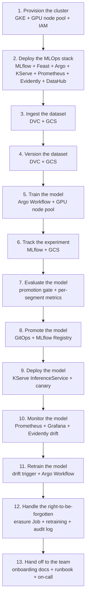
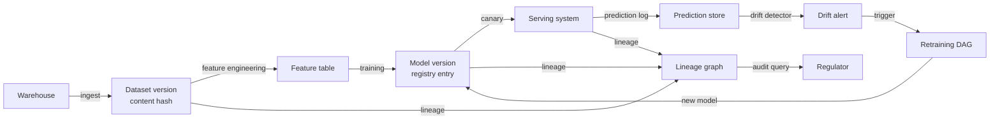

# 16.15 Lab: end-to-end MLOps on GKE

| Field | Value |
|---|---|
| Level | Advanced |
| Priority tier | 1 |
| Lab venue | GCP / GKE |
| Part | Part 16: MLOps and LLMOps tools and platforms |
| Primary sources | NVIDIA Zero-to-Hero Volume 25 (`chapter-02-licensing.md`, `chapter-03-data-versioning-with-dvc.md`, `chapter-04-experiment-tracking-with-mlflow.md`, `chapter-05-data-ingestion-and-cleaning-pipeline-design.md`, `chapter-07-model-architecture-and-training-pipeline-design.md`, `chapter-08-scaling-to-multi-node-distributed-training.md`, `chapter-09-the-model-promotion-gate-governance-before-the-registry.md`, `chapter-10-end-to-end-case-study-banknifty-big-move-prediction-pipeline.md`); *Practical MLOps* (`practical-mlops`, Chapter 12); *Machine Learning Platform Engineering* (`machine-learning-platform-engineering`, Chapters 9, 12) |
| Cross-references | Every chapter in Part 16; Chapter 5 (Kubernetes); Chapter 11 (GPU Kubernetes); Chapter 14 (Distributed training); Chapter 15 (Inference) |
| Coverage file | `planning/coverage/chapters/16-15.md` |
| Claim & number ledger | `planning/ledgers/16-15.md` |

## Why this matters for AI infrastructure

The previous fourteen chapters walked through the MLOps stack one layer at a time. This chapter walks through the whole stack as one system. A team that has read every chapter can describe every component in isolation; a team that has run this lab can describe how the components compose into a production system. The capstone is what turns the book into a platform.

The lab is a story arc. A team provisions a GKE cluster; the team deploys the MLOps stack on the cluster; the team trains a model on a public dataset; the team promotes the model to production; the team serves the model behind an InferenceService; the team watches the model for drift; the team retrains the model when the drift breaches the threshold; the team handles a right-to-be-forgotten request. The story ends with a model in production, a dashboard in Grafana, an audit log in BigQuery, and a team that knows how to operate the platform.

```text
Why the capstone matters (V25 ch 10; PM Ch 12; MLPE Ch 9):
- The MLOps stack is a system, not a collection of tools. The system has inputs
  (data, code, hyper-parameters), processes (training, evaluation, promotion),
  outputs (models in production), and feedback loops (drift detection, retraining).
- A team that has run the lab end to end knows where the seams are: where
  the data flows from the warehouse to the feature store, where the model flows
  from the registry to the serving system, where the audit log records every
  transition. The seams are what the platform team owns.
- The capstone is the integration test. Every chapter introduced a component;
  this chapter shows the components working together. A team that has run the
  capstone can debug any MLOps failure by walking the chain from the symptom
  back to the component.
```

Three operational realities make this capstone a platform-team deliverable rather than a data-science deliverable:

1. **The capstone is a multi-component integration.** Every component from Part 16 must be installed, configured, and connected. The platform team's design decisions determine whether the components compose or conflict.
2. **The capstone is a SLO test.** Every component must produce the metrics the SLOs from Chapter 16.14 demand. The platform team's observability stack determines whether the SLOs are measurable.
3. **The capstone is an audit test.** Every component must produce the audit log the regulator demands. The platform team's lineage and audit story determine whether the regulator can answer their questions.

**Before a team can call their MLOps stack production-ready, the team must run the capstone end to end. A component that has not been integrated is a component that has not been validated.**

## Prerequisites and outcomes

### Prerequisites

- Chapters 16.1 through 16.14 (every chapter in Part 16).
- Chapter 5 (Kubernetes) for the cluster primitives.
- Chapter 11 (GPU Kubernetes) for the GPU pool and the gang scheduler.
- Chapter 14 (Distributed training) for the parallelism patterns.
- Chapter 15 (Inference) for the serving engines.

### Outcomes

After completing this capstone, you will be able to:

1. Provision a GKE cluster with the GPU node pool and the multi-tenant primitives.
2. Deploy the MLOps stack: data versioning, feature store, experiment tracking, pipeline orchestrator, registry, serving platform, monitoring, drift detection, retraining trigger, governance.
3. Train a model on a public dataset end to end: prepare data, train, evaluate, promote, deploy.
4. Operate the model in production: serve, monitor, detect drift, retrain.
5. Handle a regulatory event: the right-to-be-forgotten workflow; the audit log query.
6. Hand off the platform to the next team: the onboarding documentation, the runbook, the on-call rotation.

---

## 1. The capstone story arc

### 1.1 The thirteen steps

The capstone has thirteen steps; each step is a chapter's content deployed end to end.



The story arc is the production shape of an AI factory. Every step is a chapter's content deployed end to end; the steps compose into a system; the system is what the platform team operates.

### 1.2 The data flow

The data flows through the system in one direction: warehouse, dataset, feature, model, prediction. The audit log flows in the other direction: lineage, audit, alert, action.



The forward flow is the model's life cycle; the backward flow is the platform's life cycle. The two flows meet at the lineage graph; the lineage graph is the artefact that connects them.

---

## 2. Step 1: provision the cluster

The capstone begins with a GKE cluster. The cluster has a GPU node pool, the multi-tenant primitives, and the IAM for the MLOps stack.

```bash
# Create the GKE cluster
gcloud container clusters create mlops-capstone \
  --region us-central1 \
  --machine-type n1-standard-4 \
  --num-nodes 1 \
  --enable-autoscaling \
  --min-nodes 1 \
  --max-nodes 10 \
  --enable-autorepair \
  --release-channel regular

# Create the GPU node pool
gcloud container node-pools create gpu-pool \
  --cluster mlops-capstone \
  --machine-type a2-highgpu-1g \
  --num-nodes 2 \
  --enable-autoscaling \
  --min-nodes 0 \
  --max-nodes 8 \
  --accelerator type=nvidia-tesla-a100,count=1

# Install the NVIDIA GPU Operator
helm install gpu-operator nvidia/gpu-operator \
  --namespace gpu-operator --create-namespace

# Install Kueue
helm install kueue kueue/kueue \
  --namespace kueue-system --create-namespace

# Install Volcano (for gang scheduling)
helm install volcano volcano-sh/volcano \
  --namespace volcano-system --create-namespace

# Create the team's namespace
kubectl apply -f code/part16/team_namespace.yaml
```

The expected output is a running GKE cluster with a GPU node pool, the GPU Operator installed, Kueue and Volcano installed, and the team's namespace created with the ResourceQuota and the NetworkPolicy.

---

## 3. Step 2: deploy the MLOps stack

The MLOps stack is the sum of every component from Chapters 16.1 through 16.14. The stack is deployed as a set of Helm charts; the charts are versioned in the team's GitOps repo; the deployment is reproducible.

```bash
# Install Argo Workflows (Chapter 16.4)
helm install argo-workflows argo/argo-workflows \
  --namespace argo --create-namespace

# Install MLflow (Chapter 16.2)
helm install mlflow community-charts/mlflow \
  --namespace mlops --create-namespace \
  --set trackingService.service.type=ClusterIP \
  --set backendStore.url=sqlite:///mlflow.db \
  --set artifactRoot=gs://${PROJECT_ID}-mlflow-artifacts

# Install Feast (Chapter 16.3)
helm install feast feast-charts/feast \
  --namespace feast --create-namespace

# Install KServe (Chapter 16.7)
helm install kserve kserve/kserve \
  --namespace kserve --create-namespace \
  --set kserve.controller.deploymentMode=Deployment

# Install Prometheus and Grafana (Chapter 16.10)
helm install prometheus prometheus-community/kube-prometheus-stack \
  --namespace monitoring --create-namespace

# Install Evidently (Chapter 16.10)
helm install evidently evidentlyai/evidently \
  --namespace monitoring \
  --set evidently.reference-features-path=gs://${PROJECT_ID}-reference/v3.parquet

# Install DataHub (Chapter 16.13)
helm install datahub datahub/datahub \
  --namespace governance --create-namespace
```

The expected output is a running MLOps stack; the platform team's dashboard shows every component as healthy; the SLOs from Chapter 16.14 are measurable.

---

## 4. Step 3-4: ingest and version the dataset

The capstone uses a public dataset (the UCI Adult dataset for churn prediction). The dataset is ingested from a public URL; the dataset is versioned with DVC against a GCS bucket.

```bash
# Download the dataset
mkdir churn-capstone && cd churn-capstone
git init
curl -O https://archive.ics.uci.edu/ml/machine-learning-databases/adult/adult.data
mv adult.data data/churn.csv

# Initialise DVC against GCS
dvc init --storage.gs gs://${PROJECT_ID}-dvc

# Version the dataset
dvc add data/churn.csv
git add data/churn.csv.dvc data/.gitignore
git commit -m "v1 of churn dataset (UCI Adult)"
dvc push
# expected: a content hash in GCS; a sha256 in data/churn.csv.dvc
```

The expected output is a versioned dataset in GCS; the dataset's content hash is the artefact the rest of the pipeline references.

---

## 5. Step 5-6: train and track the experiment

The training runs as an Argo Workflow on the GPU node pool. The experiment tracker (MLflow) records the run.

```yaml
# code/part16/capstone_training_workflow.yaml (shape only)
apiVersion: argoproj.io/v1alpha1
kind: Workflow
metadata:
  generateName: churn-training-
spec:
  entrypoint: pipeline
  arguments:
    parameters:
      - {name: dataset-id, value: "churn-v1"}
      - {name: seed, value: "42"}
  templates:
    - name: pipeline
      dag:
        tasks:
          - name: prepare
            template: prepare
            arguments:
              parameters: [{name: dataset-id, value: "{{workflow.parameters.dataset-id}}"}]
          - name: train
            template: train
            dependencies: [prepare]
            arguments:
              parameters:
                - {name: dataset-id, value: "{{workflow.parameters.dataset-id}}"}
                - {name: seed, value: "{{workflow.parameters.seed}}"}
          - name: evaluate
            template: evaluate
            dependencies: [train]
          - name: register
            template: register
            dependencies: [evaluate]
    - name: prepare
      container:
        image: my-prepare:v1
        command: [python, prepare.py]
        args: ["--dataset-id", "{{inputs.parameters.dataset-id}}"]
      inputs:
        parameters:
          - {name: dataset-id}
    - name: train
      container:
        image: my-train:v1
        command: [python, train.py]
        args: ["--dataset-id", "{{inputs.parameters.dataset-id}}", "--seed", "{{inputs.parameters.seed}}"]
        resources:
          requests:
            nvidia.com/gpu: "1"
          limits:
            nvidia.com/gpu: "1"
      inputs:
        parameters:
          - {name: dataset-id}
          - {name: seed}
    - name: evaluate
      container:
        image: my-evaluate:v1
        command: [python, evaluate.py]
    - name: register
      container:
        image: my-register:v1
        command: [python, register.py]
```

```bash
argo submit -n mlops -f code/part16/capstone_training_workflow.yaml \
  --parameter-values "dataset-id=churn-v1,seed=42"
argo list -n mlops
argo get -n mlops @latest
# expected: the workflow runs on the GPU node pool; the run appears in MLflow
```

The expected output is a completed workflow with the four stages; the run record in MLflow carries the data hash, the commit hash, the seed, and the metrics.

---

## 6. Step 7-8: evaluate and promote

The promotion gate from Chapter 16.1 Section 4.3 runs as the `register` stage. The gate checks the baseline; on pass, the model advances to the registry.

```python
# code/part16/promotion_gate.py (shape only)
import mlflow
from mlflow.tracking import MlflowClient

def promote(run_id: str, baseline_run_id: str) -> int:
    client = MlflowClient()
    run = client.get_run(run_id)
    baseline = client.get_run(baseline_run_id)
    
    # Check required tags
    for tag in ("data_hash", "code_commit", "seed", "env_image"):
        if tag not in run.data.tags:
            print(f"PROMOTION BLOCKED: missing required tag {tag}")
            return 1
    
    # Check AUC vs baseline
    auc = run.data.metrics.get("auc", 0)
    baseline_auc = baseline.data.metrics.get("auc", 0)
    if auc < baseline_auc:
        print(f"PROMOTION BLOCKED: AUC regressed ({auc:.4f} < {baseline_auc:.4f})")
        return 1
    
    # Register
    model_uri = f"runs:/{run_id}/model"
    mv = client.create_model_version("churn-model", model_uri, run_id)
    client.transition_model_version_stage("churn-model", mv.version, stage="Staging")
    print(f"PROMOTED churn-model v{mv.version} to Staging")
    return 0
```

The expected output is the model version promoted to the Staging stage; the audit log records the promotion decision; the GitOps loop (Chapter 16.6 Section 3.2) is ready to advance the model to Production.

---

## 7. Step 9: deploy the InferenceService

The model is served behind a KServe InferenceService with a canary rollout.

```yaml
# code/part16/capstone_inference_service.yaml (shape only)
apiVersion: serving.kserve.io/v1beta1
kind: InferenceService
metadata:
  name: churn-model
  namespace: team-data-science
spec:
  predictor:
    canaryTrafficPercent: 10
    canary:
      model:
        modelFormat: {name: sklearn}
        storageUri: s3://mlflow-artifacts/churn-model/canary/model.pkl
    model:
      modelFormat: {name: sklearn}
      storageUri: s3://mlflow-artifacts/churn-model/production/model.pkl
    minReplicas: 1
    maxReplicas: 5
    scaleTarget: 4
```

```bash
kubectl apply -f code/part16/capstone_inference_service.yaml
kubectl get inferenceservice churn-model -n team-data-science -w
# expected: READY=True within 60 seconds; the canary runs at 10% traffic
```

The expected output is the InferenceService serving 10% of traffic on the canary and 90% on the stable; the canary's SLO is monitored; the canary either advances to 100% or rolls back.

---

## 8. Step 10: monitor the model

The monitoring stack (Prometheus + Grafana + Evidently) captures every metric the SLOs from Chapter 16.14 demand.

```bash
# Open Grafana and navigate to the MLOps dashboard
kubectl port-forward -n monitoring svc/prometheus-grafana 8080:80
# Or query Prometheus directly
curl -s http://prometheus.monitoring:9090/api/v1/query?query=kserve_inference_latency_p99 | jq .
```

The expected output is the dashboard showing:

- **Inference latency p50 / p95 / p99** per model.
- **Error rate (5xx)** per model.
- **GPU utilisation** per replica.
- **Drift score per feature** (from Evidently).
- **Cost per model per month** (from Kubecost).
- **Retraining trigger history** (from the Argo Workflow controller).

---

## 9. Step 11: retrain the model

The drift trigger fires when the drift score breaches the threshold. The retraining DAG runs the same stages as the initial training; the new model is registered; the canary tests the new model.

```bash
# Inject drift into the feature store
python code/part16/inject_drift.py \
  --feature-store feast \
  --feature-view user_features \
  --drift-magnitude 0.5

# Wait for the drift detector to fire
sleep 600

# Observe the retraining trigger
kubectl logs -n mlops -l app=retraining-trigger -f
# expected: "TRIGGER FIRED: drift score 0.34 > 0.2"

# Observe the retraining DAG
argo list -n mlops
# expected: a new workflow run with the retraining DAG

# Observe the canary
kubectl argo rollouts get rollout churn-model -n team-data-science -w
# expected: the canary runs at 10% traffic; the SLO is monitored
```

The expected output is a new model version trained on the latest data; the canary tests the new model; the new model advances to Production or rolls back based on the SLO.

---

## 10. Step 12: handle a right-to-be-forgotten request

A customer requests erasure. The platform's right-to-be-forgotten Job erases the customer's data; the retraining DAG retrains the model on the cleaned data; the audit log records the erasure.

```bash
# Submit the right-to-be-forgotten request
python code/part16/erasure_job.py \
  --customer-id 12345 \
  --reason "GDPR Article 17 request from customer"
# expected: the Job erases the customer's data; retraining is triggered

# Verify the customer's data is gone
python code/part16/verify_erasure.py \
  --customer-id 12345
# expected: the customer's data is not in the warehouse; the customer's data is not in the feature store

# Query the audit log
bq query --use_legacy_sql=false \
  "SELECT timestamp, customer_id, reason, retraining_dag
   FROM \`${PROJECT_ID}.governance.erasure_events\`
   ORDER BY timestamp DESC LIMIT 1"
# expected: the erasure event with the customer id, the reason, and the retraining DAG
```

The expected output is the customer's data erased from every artifact; the model retrained on the cleaned data; the audit log updated.

---

## 11. Step 13: hand off to the team

The capstone ends with the handoff. The platform team's deliverables are:

- **Onboarding documentation.** A copy-pasteable guide that walks a new team through namespace provisioning, GPU quota request, model registry setup, and InferenceService deployment.
- **Runbook.** A page that names the on-call rotation, the escalation policy, the common failure modes, and the recovery steps.
- **On-call rotation.** A PagerDuty (or Opsgenie) schedule that rotates weekly; the on-call engineer has access to the cluster; the on-call engineer has the runbook.

```bash
# Confirm the handoff artifacts are in place
ls onboarding.md
ls runbook.md
ls oncall_rotation.md
# expected: all three files exist and are up to date
```

The expected output is the three handoff artifacts; the next team can onboard without the platform team's help; the platform team has shifted from building to operating.

---

## 12. The capstone as a CI test

The capstone is the integration test for the MLOps stack. The platform team's pattern is to run the capstone as a CI test on every change to the stack.

```yaml
# code/part16/capstone_ci.yaml (shape only)
name: capstone_e2e
on:
  pull_request:
    paths:
      - 'charts/**'
      - 'policies/**'
      - 'onboarding/**'
jobs:
  capstone:
    runs-on: [self-hosted, gpu]
    timeout-minutes: 720
    steps:
      - uses: actions/checkout@v4
      - name: Provision cluster
        run: ./capstone/01_provision.sh
      - name: Deploy stack
        run: ./capstone/02_deploy.sh
      - name: Train model
        run: ./capstone/03_train.sh
      - name: Promote model
        run: ./capstone/04_promote.sh
      - name: Deploy model
        run: ./capstone/05_deploy.sh
      - name: Monitor and retrain
        run: ./capstone/06_retrain.sh
      - name: Handle erasure
        run: ./capstone/07_erasure.sh
      - name: Cleanup
        if: always()
        run: ./capstone/99_cleanup.sh
```

The CI test runs the capstone end to end on every change to the stack. The CI fails if any step fails; the CI passes when the model is in production, the SLOs are met, and the audit log is updated.

---

## 13. How the capstone fails

Six failure modes recur across the capstone.

### 13.1 "The training stage crashed because the GPU node pool is exhausted"

**Symptom:** The Argo Workflow's `train` stage is stuck in `Pending`. The events show `nvidia.com/gpu: 0 available`. The other teams are hogging the GPU pool.

**Diagnosis:** The team's GPU quota is exhausted; the other teams' workloads are running. The Kueue LocalQueue is full.

**Fix:** Lower the GPU quota for the other teams; add a borrowing queue (Chapter 16.14 Section 2.3); add a per-team cost alert that prevents the runaway.

### 13.2 "The promotion gate failed because the data hash is missing"

**Symptom:** The `register` stage failed; the error message is `PROMOTION BLOCKED: missing required tag data_hash`. The training script did not log the tag.

**Diagnosis:** The training script was changed without updating the MLflow logging. The contract from Chapter 16.2 Section 2.1 is not enforced.

**Fix:** Make the training script's `mlflow.start_run` block fail if the data hash is empty. The platform team's pattern is "the run record is the first action; missing tags are an exception".

### 13.3 "The InferenceService deployment failed because the cluster binding is wrong"

**Symptom:** The KServe InferenceService is in `Failed` state. The events show `cluster binding not found`. The model URI is correct.

**Diagnosis:** The InferenceService's `storageUri` points to a bucket the team does not have access to. The team's IAM bindings have not been set up.

**Fix:** Verify the IAM bindings on the bucket; verify the team's service account has read access; redeploy the InferenceService.

### 13.4 "The drift detector's threshold is too tight"

**Symptom:** The drift detector fires every hour. The team is paged every hour. The retraining DAG is running constantly.

**Diagnosis:** The threshold is too tight. The drift detector is catching noise.

**Fix:** Raise the threshold; tune on the production traffic; add a cooldown (Chapter 16.10 Section 4.3); the goal is to catch drift before the customer does, not to catch every micro-drift.

### 13.5 "The right-to-be-forgotten Job did not retrain the model"

**Symptom:** The customer's data is erased; the model is not retrained; the next prediction still references the customer's data through the weights.

**Diagnosis:** The retraining DAG is not part of the erasure Job; the Job only erases the data; the model continues to serve the old weights.

**Fix:** Add the retraining DAG as a final stage of the erasure Job; the Job does not return success until the new model is in production.

### 13.6 "The audit log was deleted by a well-meaning engineer"

**Symptom:** The audit log bucket is empty. The regulator's query returns no results.

**Diagnosis:** Object-lock was not enabled on the bucket. A deletion removed the audit log.

**Fix:** Enable object-lock on the audit log bucket. The platform team's pattern is "the audit log bucket is the only bucket with object-lock enabled; the policy is reviewed quarterly".

---

## 14. What the team has built

At the end of the capstone, the team has built a production-grade MLOps stack that satisfies every chapter in Part 16.

| Chapter | Component in the capstone | Operational state |
|---|---|---|
| 16.1 | The promotion gate function | Mechanical; the gate is the only path from training to registry |
| 16.2 | MLflow + DVC + GCS | Versioned; every artifact has a content hash |
| 16.3 | Feast + BigQuery + Redis | Online and offline parity; freshness SLO is met |
| 16.4 | Argo Workflows | DAG runs every step of the pipeline |
| 16.5 | Kueue + Volcano + GPU Operator | Gang scheduling; the team can run multi-GPU jobs |
| 16.6 | MLflow Registry + Argo CD | GitOps loop; the registry is the source of truth |
| 16.7 | KServe + Knative + Istio | Canary deployment; autoscaling; traffic routing |
| 16.8 | NIM + Milvus + NeMo Guardrails | The LLM application is production-ready |
| 16.9 | Eval suite + Great Expectations | Regression set catches known failure modes |
| 16.10 | Prometheus + Grafana + Evidently | Drift detection; retraining trigger; online evaluation |
| 16.11 | Vertex AI Workbench + self-hosted GPU pool | Hybrid architecture; managed for Studio; self-hosted for GPUs |
| 16.12 | NGC pull-through proxy + NIM Operator | NVAIE-licensed; the licensing audit is current |
| 16.13 | DataHub + audit log + consent record | GDPR / EU AI Act / SR 11-7 compliant |
| 16.14 | Kueue + Kubecost + onboarding module | Multi-tenant; per-team quotas; per-team FinOps |

The team has built the platform. The team's next job is to operate it.

---

## Exercises

1. **Run the capstone as a CI test.** Configure the capstone as a CI pipeline; the pipeline runs on every change to the MLOps stack. *Solution sketch:* the GitHub Actions workflow from Section 12; a self-hosted runner with GPU access.
2. **Add a cost cap to the team's onboarding module.** Configure a hard cap on the team's monthly spend; the Kueue ClusterQueue refuses to admit new Jobs when the cap is reached. *Solution sketch:* the onboarding module adds a cost cap; the cap is enforced by a Prometheus rule that suspends the LocalQueue.
3. **Add a second team to the capstone.** Provision a second team's namespace; the second team runs a different model; verify the multi-tenant primitives work end to end. *Solution sketch:* the onboarding module with a different team name; a second KServe InferenceService.
4. **Add a third team that runs an LLM application.** Provision a third team that runs a RAG application; verify the NIM + Milvus + NeMo Guardrails integration works end to end. *Solution sketch:* the same onboarding module; a NIMService; a Milvus collection; a NeMo Guardrails configuration.
5. **Add a regulatory audit.** Schedule a quarterly regulatory audit; the audit queries the lineage graph; the audit verifies the consent record; the audit verifies the audit log is intact. *Solution sketch:* a script that runs the audit queries; the script's output is the quarterly audit report.
6. **Add a chaos engineering test.** Inject failures into the cluster (kill a GPU node; revoke an IAM binding; delete a feature store row); verify the platform recovers. *Solution sketch:* a chaos engineering framework (Chaos Mesh, LitmusChaos); the test fails if the platform does not recover within 5 minutes.

---

## Checkpoint questions

<details><summary>1. What thirteen steps does the capstone walk through?</summary>
Provision the cluster; deploy the MLOps stack; ingest the dataset; version the dataset; train the model; track the experiment; evaluate the model; promote the model; deploy the model; monitor the model; retrain the model; handle the right-to-be-forgotten request; hand off to the team. Each step is a chapter's content deployed end to end.
</details>

<details><summary>2. What is the data flow through the capstone?</summary>
The data flows in one direction: warehouse, dataset, feature, model, prediction. The audit log flows in the other direction: lineage, audit, alert, action. The two flows meet at the lineage graph; the lineage graph is the artefact that connects them.
</details>

<details><summary>3. What is the capstone as a CI test?</summary>
A CI pipeline that runs the capstone end to end on every change to the MLOps stack. The CI fails if any step fails; the CI passes when the model is in production, the SLOs are met, and the audit log is updated. The capstone is the integration test for the stack.
</details>

<details><summary>4. What is the handoff at the end of the capstone?</summary>
Three artifacts: onboarding documentation (a copy-pasteable guide that walks a new team through the platform); a runbook (a page that names the on-call rotation, the escalation policy, the common failure modes, and the recovery steps); an on-call rotation (a PagerDuty schedule that rotates weekly). The handoff shifts the platform team from building to operating.
</details>

<details><summary>5. What is the most common failure mode in the capstone?</summary>
The training stage crashes because the GPU node pool is exhausted (one team hogs the GPU pool; the other teams cannot get GPUs). The fix is to lower the GPU quota for the hogging team; add a borrowing queue; add a per-team cost alert.
</details>

<details><summary>6. What is the most important contract in the capstone?</summary>
The promotion gate function. The promotion gate is the only path from training to registry. The gate is mechanical; the gate's exit code is the only thing that advances the registry stage. Without the gate, the team can promote models without the required metadata.
</details>

<details><summary>7. What is the most important audit in the capstone?</summary>
The audit log query. The audit log records every artifact's lineage; the audit log records every promotion decision; the audit log records every right-to-be-forgotten request. The regulator's question "which data trained the model that decided on this customer" is answered by a four-step traversal of the lineage graph.
</details>

<details><summary>8. What is the most important SLO in the capstone?</summary>
The InferenceService latency p99. The latency is the customer-facing SLO; the latency is the canary's success criterion; the latency is the rollback's trigger. A team that does not measure the latency p99 does not have a production service.
</details>

<details><summary>9. What is the most important operational discipline in the capstone?</summary>
The on-call rotation. The on-call engineer has access to the cluster; the on-call engineer has the runbook; the on-call engineer is the team's first responder to a production incident. A team that does not have an on-call rotation does not have a production service.
</details>

<details><summary>10. What is the most important platform-team deliverable?</summary>
The onboarding documentation. A team that waits three weeks for a namespace is a team that builds their own platform. The onboarding documentation makes the first model runnable in minutes; the documentation is the team's first impression of the platform.
</details>

<details><summary>11. What is the difference between the MLOps stack and the platform?</summary>
The MLOps stack is the collection of tools (MLflow, Feast, Argo, KServe). The platform is the system that the tools compose into (the namespace; the IAM; the GPU quota; the audit log; the FinOps dashboard). The platform is what the team operates; the tools are what the platform exposes.
</details>

<details><summary>12. What is the most expensive component in the capstone?</summary>
The GPU pool. The cost of a single H100 is $3-5 per hour; a multi-tenant AI factory runs hundreds of H100s. The cost is the single largest line item in the AI factory's budget. The FinOps dashboard is the feedback loop that prevents the cost from exploding.
</details>

<details><summary>13. What is the most failure-prone component in the capstone?</summary>
The drift detector. The drift detector's threshold is the trade-off between catching drift before the customer does and not paging on noise. A threshold that is too tight floods the on-call; a threshold that is too loose misses the drift until the customer complains. The threshold must be tuned on the production traffic.
</details>

<details><summary>14. What is the most regulated component in the capstone?</summary>
The right-to-be-forgotten workflow. GDPR Article 17 requires erasure "without undue delay"; the SLO is 24 hours. The workflow must erase the customer's data from every artifact; the workflow must retrain the model on the cleaned data; the workflow must update the audit log. A failure to erase is a regulatory incident.
</details>

<details><summary>15. What is the most overlooked component in the capstone?</summary>
The lineage graph. The lineage graph is the artefact that connects the data flow to the audit flow; the lineage graph is what the regulator's question answers. A team that does not maintain the lineage graph cannot answer the regulator's questions.
</details>

<details><summary>16. What is the most reproducible component in the capstone?</summary>
The MLOps stack itself. The Helm charts are versioned; the onboarding module is versioned; the CI test is versioned. A team that has the MLOps stack in Git can rebuild the platform from scratch in a day. The reproducibility is the platform's insurance against loss.
</details>

<details><summary>17. What is the most portable component in the capstone?</summary>
The capstone's data flow. The dataset is in Parquet; the model is in pickle; the feature table is in BigQuery; the registry entry is in MLflow; the audit log is in BigQuery. A team that owns the data can rebuild the platform anywhere. The portability is the platform's insurance against a cloud migration.
</details>

<details><summary>18. What is the most expensive mistake in the capstone?</summary>
Deleting the audit log. The audit log is the artefact that proves every other artefact was what it claimed to be. A deletion of the audit log is the worst possible incident; the runbook says "page the on-call immediately, do not investigate first".
</details>

<details><summary>19. What is the most important documentation in the capstone?</summary>
The runbook. The runbook names the on-call rotation, the escalation policy, the common failure modes, and the recovery steps. A team that does not have a runbook does not have a production service. A runbook that is out of date is worse than no runbook at all (the team trusts the runbook; the runbook is wrong).
</details>

<details><summary>20. What is the difference between a successful capstone and a failed capstone?</summary>
A successful capstone ends with a model in production, a dashboard in Grafana, an audit log in BigQuery, and a team that knows how to operate the platform. A failed capstone ends with a model in production that nobody knows how to debug, a dashboard that nobody checks, an audit log that nobody queries, and a team that does not know where the seams are. The success of the capstone is the team's ability to operate the platform; the failure of the capstone is the team's inability to operate the platform.
</details>

---

## Sources and review notes

- NVIDIA Zero-to-Hero Volume 25 (`chapter-02-licensing.md`, `chapter-03-data-versioning-with-dvc.md`, `chapter-04-experiment-tracking-with-mlflow.md`, `chapter-05-data-ingestion-and-cleaning-pipeline-design.md`, `chapter-07-model-architecture-and-training-pipeline-design.md`, `chapter-08-scaling-to-multi-node-distributed-training.md`, `chapter-09-the-model-promotion-gate-governance-before-the-registry.md`, `chapter-10-end-to-end-case-study-banknifty-big-move-prediction-pipeline.md`). Source for the end-to-end case study that ties the MLOps stack together; the data versioning, experiment tracking, training pipeline, promotion gate, and end-to-end capstone structure. The wording has been rewritten in the handbook's voice.
- *Practical MLOps* (`practical-mlops`, Chapter 12). Source for the MLOps case studies and the integration patterns. Chapter 12 is approximately 7,400 words.
- *Machine Learning Platform Engineering* (`machine-learning-platform-engineering`, Chapters 9, 12). Source for the multi-tenant platform patterns, the onboarding flow, and the operational discipline.

### Cross-references to other handbook chapters

- Every chapter in Part 16 (Chapters 16.1 through 16.14).
- Chapter 5 (Kubernetes) for the cluster primitives.
- Chapter 11 (GPU Kubernetes) for the GPU pool.
- Chapter 14 (Distributed training) for the parallelism patterns.
- Chapter 15 (Inference) for the serving engines.

### Migrated from `nvidia-devops`

The end-to-end case study structure draws on Volume 25 chapter 10. The wording has been rewritten in the handbook's voice.

### Explicitly labelled inferences

- The thirteen-step story arc is a synthesis of the gem books' content; specific teams may add or remove steps based on their stack.
- The CI test in Section 12 assumes a self-hosted runner with GPU access; production CI runners vary by team.
- The handoff artifacts in Section 11 are starting points; specific teams may add more artifacts (status page, runbook video walkthrough, on-call training materials).

### Not verified on live hardware

- The lab in this chapter is **untested** against a live GKE cluster in this repository.
- The specific Helm chart versions assumed in the lab should be pinned against the current releases before production use.
- The cost numbers throughout the lab are illustrative; production costs vary by usage pattern, commitment, and region.
