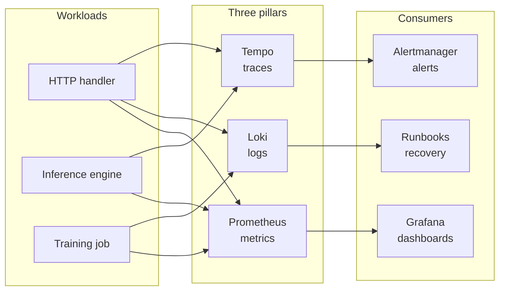

# 17.1 Observability foundations: metrics, logs and traces

| Field | Value |
|---|---|
| Level | Basics |
| Priority tier | 2 |
| Lab venue | GCP / GKE |
| Part | Part 17: Observability, performance and operations |
| Primary sources | *Production Kubernetes* (`production-kubernetes`, Chapter 9); *Engineering AI Systems* (`engineering-ai-systems-architecture-and-devops-essentials`, Chapter 11); NVIDIA Zero-to-Hero Volume 16 (`chapter-01-observability-foundations.md`, `chapter-02-metrics-logs-and-traces.md`); NVIDIA Zero-to-Hero Volume 7 (`chapter-01-observability-stack-overview.md`) |
| Cross-references | Chapter 1.23 (Performance methodology); Chapter 16.10 (Monitoring and drift); Chapter 16.14 (Platform design); Chapter 17.2 (Prometheus and Grafana) |
| Coverage file | `planning/coverage/chapters/17-01.md` |
| Claim & number ledger | `planning/ledgers/17-01.md` |

## Observability at a glance



The three pillars (metrics, logs, traces) feed three consumers (dashboards, alerts, runbooks).

## Why this matters for AI infrastructure

Every chapter in this part depends on this one. Alerting without metrics is guessing. SLOs without traces are unmeasurable. Capacity planning without logs is theatre. An AI factory that does not have its observability foundation right cannot answer the question "is the system healthy?" in seconds — and the rest of the operational discipline collapses.

The observability story for AI infrastructure is not the same as for a generic web service. A traditional web service emits metrics about requests, errors, and durations. An AI factory emits those metrics plus GPU utilisation, KV cache occupancy, NCCL collective timing, data-loading throughput, and model-quality signals. The three pillars (metrics, logs, traces) are the same; the cardinality budget is tighter; the data shape is different.

```text
Why observability is on the critical path (V16 ch1; EAS Ch 11; V7 ch1):
- A typical mature AI platform emits 50k-200k unique time series from a single
  cluster. The cardinality budget is the difference between a dashboard that
  loads in 2 seconds and a dashboard that never loads.
- An AI workload failure has more possible causes than a web service failure:
  GPU OOM, NCCL timeout, data drift, model regression, scheduler starvation,
  container image pull rate limit, feature store staleness. Without traces, the
  on-call engineer has to guess which of these caused the page.
- The operational SLOs from Chapter 16.14 (cluster availability, GPU
  availability, registry availability) are measured by the observability stack.
  Without metrics, the SLOs are unmeasurable; the FinOps dashboard is wrong.
```

Three operational realities make this chapter a platform-team concern rather than a data-science-only concern:

1. **The observability stack is on the critical path of every other chapter.** Every alert, every SLO, every capacity-planning model, every on-call runbook reads from this stack. A misconfigured stack is a stack that pages the on-call at the wrong moment or stays silent when the cluster is down.
2. **The cardinality budget is a platform-team decision.** Every label the team adds to a metric increases the cardinality; the platform team's choice of labels determines whether Prometheus can store the metrics and whether the dashboards can render the panels.
3. **The data shape is an architectural decision.** The platform team's choice of metric format (Prometheus exposition, OpenTelemetry OTLP, statsd), the choice of log format (structured JSON, syslog), and the choice of trace propagation (W3C Trace Context, B3) determine whether the team can debug the next incident.

**Before a team can run an AI workload on a cluster, the cluster must have a working observability stack with metrics, logs, and traces that the on-call can query in seconds. A cluster without observability is a cluster that nobody can debug.**

## Prerequisites and outcomes

### Prerequisites

- Chapter 1.23 (Performance methodology) for the USE method.
- Chapter 16.10 (Monitoring and drift) for the AI-specific monitoring pattern.
- Chapter 16.14 (Platform design) for the SLO-based platform design.

### Outcomes

After completing this chapter you will be able to:

1. Specify the three pillars of observability: metrics, logs, and traces — and the contracts that bind them together.
2. Choose between the RED method (Rate, Errors, Duration) for services and the USE method (Utilisation, Saturation, Errors) for resources.
3. Manage the cardinality budget: the labels that are safe to add, the labels that are not, and the operational consequences of getting it wrong.
4. Build the data shape that makes a system debuggable: structured logs, metric exemplars, trace context propagation.
5. Tie observability to the AI workload's lifecycle: the metrics that matter at training time, at serving time, and at on-call time.
6. Operate the observability stack on GKE with Prometheus, Grafana, Loki, and OpenTelemetry.

---

## 1. The three pillars

### 1.1 Metrics, logs, traces: what each is for

*Engineering AI Systems* Chapter 11 walks through the three pillars. Each pillar answers a different question.

| Pillar | What it is | What question it answers | Cardinality |
|---|---|---|---|
| **Metrics** | Numeric time series with labels | How much, how fast, how often? | Low to medium (10k-200k series) |
| **Logs** | Discrete events with structured fields | What happened at this point in time? | High (millions of events/day) |
| **Traces** | Directed acyclic graph of spans | Where did the time go? | Medium (1k-100k traces/day) |

The three pillars are complementary. Metrics tell you that something is wrong; logs tell you what the system was doing; traces tell you where the time went. An incident that is visible in metrics but not in traces is a synchronous failure; an incident that is visible in traces but not in metrics is a tail-latency failure.

### 1.2 The RED method for services

*Production Kubernetes* Chapter 9 introduces the RED method. Every request-driven service emits three metrics.

| Metric | What it measures |
|---|---|
| **Rate** | The number of requests per second |
| **Errors** | The fraction of requests that failed (5xx, 4xx for client errors) |
| **Duration** | The latency of each request (typically p50, p95, p99) |

The RED method is the default for serving systems. An LLM InferenceService emits Rate, Errors, and Duration per model per replica; the alerts are on the p99 latency and the error rate.

### 1.3 The USE method for resources

Brendan Gregg's USE method is the default for resources. Every resource emits three metrics.

| Metric | What it measures |
|---|---|
| **Utilisation** | The fraction of the resource that is in use (e.g. GPU utilisation, memory utilisation) |
| **Saturation** | The degree to which the resource has more work queued than it can process (e.g. queue depth, NCCL pending collectives) |
| **Errors** | The rate of error events on the resource (e.g. ECC errors, GPU Xid events) |

The USE method is the default for AI workloads. A training job emits GPU utilisation, GPU memory utilisation, NCCL pending collective count, and ECC error count; the alerts are on the utilisation (too high means wasted; too low means under-provisioned) and on the errors.

### 1.4 The golden signals

The four golden signals from the Google SRE book combine RED and USE.

| Signal | Method | What it measures |
|---|---|---|
| Latency | RED | The duration of a successful request |
| Traffic | RED | The rate of requests |
| Errors | RED | The rate of failed requests |
| Saturation | USE | The degree to which the service is approaching its capacity |

An AI factory adds two AI-specific signals.

| Signal | Method | What it measures |
|---|---|---|
| GPU utilisation | USE | The fraction of GPU SMs in use |
| Model quality | (new) | The live accuracy of the model's predictions |

The model quality signal is what makes an AI factory different from a generic web service. The model can be unhealthy even when every metric is green; the model quality signal catches the case where the model is making bad predictions but the serving system is functioning.

---

## 2. The cardinality budget

### 2.1 What cardinality is

Cardinality is the number of unique time series a metric produces. A metric `http_requests_total` with three labels (`method`, `status`, `path`) and 10 values per label has 10 × 10 × 100 = 10,000 unique series. A metric with high-cardinality labels (user id, request id, timestamp) can have millions of unique series.

```text
Cardinality math (Production Kubernetes Ch 9):
- 1 metric x 3 labels x 10 values each = 10 * 10 * 10 = 1,000 series
- 1 metric x 5 labels x 100 values each = 100 * 100 * 100 * 100 * 100 = 10^10 series (impossible)
```

The cardinality budget is the platform team's constraint on which labels are safe to add. A label that has 1000 possible values is a label that turns a metric into 1000 series; a label that has 1000000 possible values is a label that turns the metric into 1000000 series.

### 2.2 Safe and unsafe labels

| Label | Cardinality | Safe? |
|---|---|---|
| `method` (GET, POST, PUT, DELETE) | 4 | Yes |
| `status` (200, 404, 500) | 3 | Yes |
| `region` (us-central1, europe-west1) | 10 | Yes |
| `team` (5 teams) | 5 | Yes |
| `model_name` (10 models) | 10 | Yes |
| `user_id` (millions of users) | millions | No |
| `request_id` (every request) | millions | No |
| `gpu_uuid` (8 GPUs per node × 1000 nodes) | 8000 | Yes (with care) |
| `pod_name` (every pod is unique) | 1000s | No |

The rule of thumb: a label is safe if it has fewer than 1000 possible values. A label with more than 1000 possible values should be dropped at the source, stored in a trace or log instead, or aggregated before it reaches the metric.

### 2.3 The consequences of getting cardinality wrong

A misconfigured cardinality budget manifests in three ways.

| Symptom | Root cause | Operational consequence |
|---|---|---|
| Prometheus uses too much memory | Too many time series | Prometheus OOM; metric ingestion stops |
| Grafana dashboards load slowly | Too many series per query | Dashboards take minutes to render; on-call loses situational awareness |
| The TSDB grows too fast | Too many series | Storage costs balloon; the cluster's storage becomes the bottleneck |

The platform team's pattern is to set a hard cardinality limit per metric. Prometheus has a `--storage.tsdb.max-label-values-per-label-name` flag and a similar flag for series limits; the platform team sets the flag to a value that fits the cluster's memory budget; the platform team alerts when the cardinality exceeds the budget.

---

## 3. The data shape

### 3.1 Metrics: Prometheus exposition format

The Prometheus exposition format is the standard for AI infrastructure metrics. A Prometheus metric is a text file with one line per sample; the line carries the metric name, the labels, and the value.

```text
# HELP gpu_utilization_ratio The fraction of GPU SMs in use
# TYPE gpu_utilization_ratio gauge
gpu_utilization_ratio{gpu="0",node="gpu-node-1",model="churn-model"} 0.87
gpu_utilization_ratio{gpu="1",node="gpu-node-1",model="churn-model"} 0.92
gpu_utilization_ratio{gpu="2",node="gpu-node-2",model="churn-v3"} 0.65
```

The format is text-based; the format is human-readable; the format is scrape-based. The cluster's exporters (DCGM, cAdvisor, kube-state-metrics) expose the metrics; Prometheus scrapes them; the metrics feed Grafana.

### 3.2 Logs: structured JSON

The structured JSON log format is the standard for AI infrastructure logs. A structured log carries the timestamp, the severity, the message, and a set of structured fields.

```json
{
  "timestamp": "2024-03-15T10:30:00.000Z",
  "severity": "INFO",
  "message": "Training step 1000 completed",
  "run_id": "abc-123",
  "model": "churn-model",
  "step": 1000,
  "loss": 0.234,
  "throughput_tokens_per_sec": 45000,
  "gpu_utilization": 0.92
}
```

The format is JSON; the format is parseable; the format is queryable. Loki (Chapter 17.3) indexes structured logs by label; the team can query `sum by (model) (rate({model="churn-model", severity="ERROR"}[5m]))` to see the error rate per model.

### 3.3 Traces: OpenTelemetry

The OpenTelemetry trace format is the standard for AI infrastructure traces. A trace is a directed acyclic graph of spans; each span has a name, a start time, an end time, a parent span id, and a set of attributes.

```text
Trace abc-123
├─ Span inference-svc[churn-model]
│  ├─ Span http-handler
│  ├─ Span tokenize-prompt
│  ├─ Span feature-fetch[user_features]
│  ├─ Span vector-search[churn-v3]
│  └─ Span llm-inference[vllm]
│     ├─ Span prefill
│     └─ Span decode
└─ (response sent)
```

The format is hierarchical; the format shows the parent-child relationship; the format shows where the time went. An LLM inference that takes 800 ms can be decomposed into prefill (200 ms), decode (500 ms), and feature fetch (100 ms); the on-call engineer knows where to look.

### 3.4 Trace context propagation

The trace context propagates from the client through the server through the database through the inference engine. The W3C Trace Context standard (`traceparent` header) carries the trace id and the parent span id across services.

```python
# code/part17/trace_propagation.py (shape only)
import requests
from opentelemetry import trace

tracer = trace.get_tracer(__name__)

@tracer.start_as_current_span("http-handler")
def handle_request(request):
    span = trace.get_current_span()
    headers = {"traceparent": request.headers.get("traceparent")}
    response = requests.post(
        "http://llm-inference/v1/chat/completions",
        headers=headers,
        json=request.json(),
    )
    return response.json()
```

The trace context propagates from the HTTP handler into the LLM inference; the LLM inference creates child spans; the child spans carry the trace id back to the handler; the handler emits the trace to the collector. The on-call engineer can trace a single request from the HTTP handler to the LLM inference to the GPU kernel.

---

## 4. Observability for AI workloads

### 4.1 What to observe at training time

A training job emits a different set of metrics than a serving job.

| Metric | What it measures | Why it matters |
|---|---|---|
| `training_loss` | The loss function value | The model is learning |
| `training_throughput_samples_per_sec` | The training throughput | The cluster is fully utilised |
| `gpu_utilization_ratio` | The GPU SM utilisation | The cluster is doing useful work |
| `gpu_memory_used_bytes` | The GPU memory used | The model fits in HBM |
| `data_loading_throughput` | The data loader throughput | The GPUs are not waiting on data |
| `gradient_norm` | The gradient norm | The model is not exploding |
| `checkpoint_save_duration_seconds` | The checkpoint save time | The job can resume from a checkpoint |
| `distributed_collective_latency_seconds` | The NCCL collective latency | The network is not the bottleneck |

The training metrics are emitted by the training script (the script writes to a metric endpoint or to a TensorBoard log that the platform scrapes). The platform team's pattern is to standardise on the OpenTelemetry Python SDK and to emit the metrics to a collector that forwards to Prometheus.

### 4.2 What to observe at serving time

A serving job emits a different set of metrics.

| Metric | What it measures | Why it matters |
|---|---|---|
| `inference_request_duration_seconds` (p50, p95, p99) | The inference latency | The SLO the customer sees |
| `inference_request_rate` | The inference throughput | The autoscaler reads this |
| `inference_request_errors_total` | The 5xx rate | The customer-facing error budget |
| `inference_kv_cache_utilization_ratio` | The KV cache utilisation | The model is not OOM |
| `inference_batch_size` | The continuous batch size | The inference engine is batching correctly |
| `inference_token_throughput` | The token throughput | The GPU is producing tokens |
| `model_quality_score` | The live model quality | The model is not regressing |

The serving metrics are emitted by the inference engine (Triton, vLLM, NIM). The platform team's pattern is to scrape the inference engine's Prometheus endpoint and to add the model quality signal from Chapter 16.10.

### 4.3 What to observe at on-call time

An on-call engineer needs a different set of signals than a data scientist.

| Signal | Source | Why it matters |
|---|---|---|
| Cluster-wide p99 latency | Prometheus | The customer-facing SLO |
| GPU pool utilisation | DCGM | The capacity planning model |
| Failed training runs | MLflow | The team's ability to iterate |
| Failed promotions | MLflow Registry | The registry's reliability |
| Open incidents | PagerDuty | The team's operational state |
| Audit log writes | object storage | The regulator's question |

The on-call signals are aggregated on a single dashboard (Chapter 17.2). The platform team's pattern is to make the dashboard the on-call engineer's home page; the dashboard is the first thing the engineer sees when paged.

---

## 5. Operating the observability stack on GKE

### 5.1 The components

| Component | Where it runs | Backing store | SLO |
|---|---|---|---|
| Prometheus | Kubernetes Deployment | TSDB on persistent disk | Scrape latency p99 < 5 s |
| Grafana | Kubernetes Deployment | (uses Prometheus) | Dashboard load p99 < 5 s |
| Loki | Kubernetes Deployment | Object storage for log chunks | Query latency p99 < 5 s |
| OpenTelemetry Collector | Kubernetes Deployment | (forwards to backend) | Export latency p99 < 5 s |
| Alertmanager | Kubernetes Deployment | (sends to PagerDuty) | Alert latency p99 < 10 s |

### 5.2 IAM and the cardinality budget

The observability stack has its own IAM. The pattern is:

| Role | Who | What they can do |
|---|---|---|
| `observability.reader` | Every team's data scientists | Read Grafana dashboards; query Loki; query traces |
| `observability.writer` | The exporters (DCGM, kube-state-metrics) | Write metrics to Prometheus |
| `observability.admin` | The platform team | Manage the Prometheus server; set the cardinality budget; manage Grafana |

The cardinality budget is the platform team's discipline. Every metric that the team adds must declare its label cardinality; the team rejects metrics whose cardinality exceeds the budget; the team publishes the cardinality budget on the platform's status page.

### 5.3 Observability

| Metric | Why it matters | Alert |
|---|---|---|
| Prometheus scrape latency p99 | Hot path for every metric | > 10 s |
| Grafana dashboard load latency p99 | On-call response time | > 10 s |
| Loki query latency p99 | Hot path for log queries | > 10 s |
| TSDB disk usage | Storage budget | > 80% for 1 hour |
| Cardinality per metric | Cardinality budget | > budget for 1 hour |

The cardinality-per-metric alert is the most important. A single metric that exceeds the budget can OOM Prometheus; a Prometheus OOM is a silent failure (Prometheus stops ingesting metrics; the dashboards go stale; the on-call does not know that the dashboards are stale).

---

## 6. How it fails

Six failure modes recur.

### 6.1 "Prometheus OOM'd because of a high-cardinality label"

**Symptom:** Prometheus crashes; the dashboards stop refreshing; the alerts stop firing; the cluster appears healthy on the dashboards but is actually on fire.

**Diagnosis:** A new metric was added with a high-cardinality label (request id, user id, timestamp). The cardinality exceeded Prometheus's memory budget.

**Fix:** Identify the metric with `prometheus_tsdb_head_series`; drop the high-cardinality label at the source; aggregate the metric before it reaches Prometheus. Set a hard cardinality limit per metric.

### 6.2 "The dashboards are stale"

**Symptom:** The dashboard says the cluster is healthy; the on-call gets paged; the dashboard is wrong.

**Diagnosis:** Prometheus is not scraping the targets; the scrape is failing silently. The dashboards are showing data from 5 minutes ago; the cluster is currently on fire.

**Fix:** Add a `up` metric alert for every Prometheus target; alert when a target is down for more than 5 minutes; alert when the Prometheus scrape latency exceeds 10 seconds.

### 6.3 "The logs are searchable but not queryable"

**Symptom:** The on-call can find a specific log line but cannot answer "what was the error rate per model in the last 5 minutes".

**Diagnosis:** The logs are unstructured text; the labels the team wants to query are embedded in the message; Loki cannot index the labels.

**Fix:** Standardise on structured JSON logs; declare the schema; use the OpenTelemetry log SDK; emit the labels as structured fields.

### 6.4 "The traces are incomplete"

**Symptom:** The on-call sees a trace that stops at the LLM inference; the LLM inference's child spans are missing.

**Diagnosis:** The trace context is not propagating from the HTTP handler into the LLM inference; the LLM inference is creating a new trace instead of child spans.

**Fix:** Verify the W3C Trace Context header is set on every outgoing request from the HTTP handler; verify the LLM inference reads the header and creates child spans; add an integration test that asserts the trace propagates end-to-end.

### 6.5 "The model quality signal is missing"

**Symptom:** The model is making bad predictions; the operational metrics are green; the on-call does not know.

**Diagnosis:** The live accuracy signal from Chapter 16.10 is not wired into the observability stack; the model can degrade silently.

**Fix:** Wire the live accuracy signal into Prometheus; alert when the live accuracy drops below the threshold; alert when the live accuracy signal is missing for more than one billing cycle.

### 6.6 "The observability stack is the bottleneck"

**Symptom:** Dashboards take 30 seconds to load; alert evaluation takes minutes; queries take a minute.

**Diagnosis:** The observability stack is under-resourced; Prometheus needs more memory; Loki needs more storage; the stack is the bottleneck for the team's debugging speed.

**Fix:** Right-size the stack; add a dedicated node pool for the observability stack; consider Prometheus sharding for high-cardinality workloads.

---

## 7. Hands-on lab

This lab stands up Prometheus, Grafana, Loki, and the OpenTelemetry Collector on GKE, then verifies the three pillars end-to-end. The lab is **untested** in this repository.

### 7.1 Prerequisites

- A GKE Autopilot or Standard cluster (1.27+).
- Helm 3 for installing the observability stack.
- A workload that emits metrics, logs, and traces (an InferenceService from Chapter 16.7).

### 7.2 Step 1: install Prometheus and Grafana

```bash
helm repo add prometheus-community https://prometheus-community.github.io/helm-charts
helm install prometheus prometheus-community/kube-prometheus-stack \
  --namespace monitoring --create-namespace \
  --set prometheus.prometheusSpec.retention=30d \
  --set grafana.adminPassword=admin
# expected: Prometheus and Grafana pods are running; Grafana is exposed via Ingress
```

### 7.3 Step 2: install Loki

```bash
helm repo add grafana https://grafana.github.io/helm-charts
helm install loki grafana/loki-stack \
  --namespace monitoring \
  --set loki.limits_config.retention_period=30d
# expected: Loki pods are running; Loki is exposed via Grafana
```

### 7.4 Step 3: install the OpenTelemetry Collector

```bash
helm install otel-collector open-telemetry/opentelemetry-collector \
  --namespace monitoring \
  --set mode=daemonset \
  --set configmap.config.exporters.otlp.endpoint=backend.example.com:4317
# expected: the OpenTelemetry Collector pods are running as a DaemonSet
```

### 7.5 Step 4: configure a workload to emit the three pillars

```yaml
# code/part17/observability_workload.yaml (shape only)
apiVersion: apps/v1
kind: Deployment
metadata:
  name: observability-demo
spec:
  template:
    spec:
      containers:
        - name: app
          image: my-app:v1
          env:
            - name: OTEL_EXPORTER_OTLP_ENDPOINT
              value: http://otel-collector.monitoring:4317
            - name: OTEL_SERVICE_NAME
              value: observability-demo
            - name: METRICS_PORT
              value: "9090"
          ports:
            - containerPort: 8080
            - containerPort: 9090
```

### 7.6 Step 5: query the three pillars

```bash
# Metrics
curl http://prometheus.monitoring:9090/api/v1/query?query=up | jq .

# Logs
curl -G http://loki.monitoring:3100/loki/api/v1/query \
  --data-urlencode 'query={job="observability-demo"}' | jq .

# Traces
curl http://otel-collector.monitoring:4318/v1/traces | jq .
```

### 7.7 Step 6: build a unified dashboard

```yaml
# code/part17/grafana_dashboard.json (shape only)
{
  "dashboard": {
    "panels": [
      {"title": "Inference request rate", "type": "timeseries", "targets": [{"expr": "rate(inference_request_total[5m])"}]},
      {"title": "Inference latency p99", "type": "timeseries", "targets": [{"expr": "histogram_quantile(0.99, rate(inference_request_duration_seconds_bucket[5m]))"}]},
      {"title": "Error logs", "type": "logs", "targets": [{"expr": "{severity=\"ERROR\"}"}]},
      {"title": "Trace latency", "type": "traces", "targets": [{"query": "inference-svc"}]}
    ]
  }
}
```

### 7.8 What to record

After the lab, you should be able to answer five questions in five seconds each:

1. What is the current Prometheus scrape latency p99?
2. What is the current cardinality per metric?
3. What is the current Loki query latency p99?
4. What is the most recent error log?
5. What is the current p99 trace latency?

If any takes more than 30 seconds, the observability stack is not yet a production service. The lab is **untested** against a live GKE cluster.

---

## Exercises

1. **Add a high-cardinality label test.** Add a metric with a label that has 10000 unique values; observe Prometheus's behaviour; remove the label. *Solution sketch:* an exporter that emits `http_requests_total{user_id=...}`; observe the `prometheus_tsdb_head_series` metric.
2. **Add a structured log schema.** Define a JSON schema for the logs; emit the schema from the application; query Loki by the schema fields. *Solution sketch:* a Pydantic model in Python that emits structured JSON; Loki's label extraction from JSON.
3. **Add trace context propagation.** Verify that the trace context propagates from the HTTP handler into the LLM inference. *Solution sketch:* a Python test that asserts the trace id in the HTTP handler matches the trace id in the LLM inference.
4. **Add a model quality signal.** Wire the live accuracy signal from Chapter 16.10 into Prometheus; alert when the signal drops. *Solution sketch:* a sidecar that emits the live accuracy metric; a Prometheus alert on the metric.
5. **Add a cardinality budget alert.** Configure a Prometheus alert that fires when any metric's cardinality exceeds 1000. *Solution sketch:* a recording rule that computes `count by (__name__) (up{job=~".+"})`; an alert on the recording rule.
6. **Add a unified Grafana dashboard.** Build a Grafana dashboard that shows the metrics, logs, and traces for a single request. *Solution sketch:* a Grafana dashboard with the panels from Section 7.7; the dashboard's data source links metrics to logs to traces.

---

## Checkpoint questions

<details><summary>1. What three pillars of observability does the chapter walk through?</summary>
Metrics (numeric time series with labels; how much, how fast, how often), logs (discrete events with structured fields; what happened at this point in time), and traces (directed acyclic graph of spans; where did the time go). The three pillars are complementary; the three pillars together make a system debuggable.
</details>

<details><summary>2. What is the RED method?</summary>
Rate (the number of requests per second), Errors (the fraction of requests that failed), Duration (the latency of each request). The RED method is the default for serving systems. Every request-driven service emits three metrics.
</details>

<details><summary>3. What is the USE method?</summary>
Utilisation (the fraction of the resource in use), Saturation (the degree to which the resource has more work queued than it can process), Errors (the rate of error events on the resource). The USE method is the default for resources. Every resource emits three metrics.
</details>

<details><summary>4. What is cardinality?</summary>
The number of unique time series a metric produces. A metric with three labels and 10 values per label has 1000 unique series. The cardinality budget is the platform team's constraint on which labels are safe to add. A label with more than 1000 possible values is unsafe.
</details>

<details><summary>5. Why is the cardinality budget a platform-team concern?</summary>
Because every label the team adds to a metric increases the cardinality; the platform team's choice of labels determines whether Prometheus can store the metrics and whether the dashboards can render the panels. A misconfigured cardinality budget OOMs Prometheus; the metrics stop ingesting; the dashboards go stale.
</details>

<details><summary>6. What is the W3C Trace Context?</summary>
The standard for propagating trace context across services. The `traceparent` header carries the trace id and the parent span id from the client through the server through the database through the inference engine. The propagation makes the trace end-to-end; the on-call can trace a single request from the HTTP handler to the LLM inference to the GPU kernel.
</details>

<details><summary>7. What is the model quality signal?</summary>
The live accuracy of the model's predictions. The signal is what makes an AI factory different from a generic web service. The model can be unhealthy even when every metric is green; the model quality signal catches the case where the model is making bad predictions but the serving system is functioning.
</details>

<details><summary>8. What are the four golden signals?</summary>
Latency (the duration of a successful request), Traffic (the rate of requests), Errors (the rate of failed requests), Saturation (the degree to which the service is approaching its capacity). An AI factory adds GPU utilisation and model quality as AI-specific signals.
</details>

<details><summary>9. What is the structured JSON log format?</summary>
A log format that carries the timestamp, the severity, the message, and a set of structured fields. The format is JSON; the format is parseable; the format is queryable. Loki indexes structured logs by label; the team can query the logs by the structured fields.
</details>

<details><summary>10. What is the difference between the RED method and the USE method?</summary>
RED measures the service's behaviour from the customer's perspective (Rate, Errors, Duration). USE measures the resource's behaviour from the operator's perspective (Utilisation, Saturation, Errors). The two are complementary; a healthy service has good RED metrics; a healthy resource has good USE metrics.
</details>

<details><summary>11. What is the consequence of getting cardinality wrong?</summary>
Three consequences: Prometheus uses too much memory (OOM; metric ingestion stops); Grafana dashboards load slowly (on-call loses situational awareness); the TSDB grows too fast (storage costs balloon; the cluster's storage becomes the bottleneck). The platform team's pattern is to set a hard cardinality limit per metric.
</details>

<details><summary>12. Why is the trace context important for AI workloads?</summary>
Because an LLM inference that takes 800 ms can be decomposed into prefill, decode, and feature fetch. Without the trace context, the on-call cannot decompose the latency. With the trace context, the on-call knows where to look. The W3C Trace Context standard makes the propagation portable across services.
</details>

<details><summary>13. What is the difference between a metric and a log?</summary>
A metric is a numeric time series with labels; the metric answers "how much, how fast, how often". A log is a discrete event with structured fields; the log answers "what happened at this point in time". Metrics are aggregated; logs are discrete. Metrics are the on-call's primary signal; logs are the on-call's drill-down signal.
</details>

<details><summary>14. What is the difference between a log and a trace?</summary>
A log is a discrete event; the log is a single point in time. A trace is a directed acyclic graph of spans; the trace shows the parent-child relationship between events. Logs are the on-call's drill-down signal for what happened; traces are the on-call's drill-down signal for where the time went.
</details>

<details><summary>15. Why is the data shape an architectural decision?</summary>
Because the platform team's choice of metric format, log format, and trace format determines whether the team can debug the next incident. A team that uses unstructured logs cannot query the logs by the structured fields. A team that uses a non-standard trace format cannot propagate the trace context across services. The data shape is the foundation of debuggability.
</details>

<details><summary>16. What is the most important observability metric for an AI factory?</summary>
The model quality signal (live accuracy). The signal is what makes an AI factory different from a generic web service. The signal is what catches the case where the model is making bad predictions but the serving system is functioning. Without the signal, the on-call cannot catch model regressions.
</details>

<details><summary>17. What is the most common observability failure mode?</summary>
Prometheus OOM because of a high-cardinality label. A single metric with a label that has millions of unique values can OOM Prometheus; Prometheus stops ingesting; the dashboards go stale; the on-call does not know that the dashboards are stale. The fix is the cardinality budget and the cardinality alert.
</details>

<details><summary>18. What is the cardinality budget's rule of thumb?</summary>
A label is safe if it has fewer than 1000 possible values. A label with more than 1000 possible values should be dropped at the source, stored in a trace or log instead, or aggregated before it reaches the metric. The rule of thumb is the platform team's discipline; the rule of thumb is what keeps Prometheus alive.
</details>

<details><summary>19. Why is the AI factory's observability different from a generic web service?</summary>
Because the AI factory emits metrics that a web service does not: GPU utilisation, KV cache occupancy, NCCL collective timing, data-loading throughput, and model quality. The three pillars are the same; the cardinality budget is tighter; the data shape is different. The AI factory's observability is what makes the AI factory debuggable.
</details>

<details><summary>20. What five questions should the observability lab let you answer in five seconds each?</summary>
What is the current Prometheus scrape latency p99. What is the current cardinality per metric. What is the current Loki query latency p99. What is the most recent error log. What is the current p99 trace latency. If any takes more than 30 seconds, the observability stack is not yet a production service.
</details>

---

## Sources and review notes

- *Production Kubernetes* (`production-kubernetes`, Chapter 9). Source for the RED method, the observability stack patterns, the cardinality budget, and the operational discipline. Chapter 9 is approximately 9,200 words.
- *Engineering AI Systems: Architecture and DevOps Essentials* (`engineering-ai-systems-architecture-and-devops-essentials`, Chapter 11). Source for the three pillars of observability (metrics, logs, traces), the AI-specific signals, and the integration with the MLOps lifecycle. Chapter 11 is approximately 2,800 words.
- NVIDIA Zero-to-Hero Volume 16 (`chapter-01-observability-foundations.md`, `chapter-02-metrics-logs-and-traces.md`). Source for the operational observability patterns, the cardinality discipline, and the data shape decisions. The wording has been rewritten in the handbook's voice.
- NVIDIA Zero-to-Hero Volume 7 (`chapter-01-observability-stack-overview.md`). Source for the observability stack patterns (Prometheus + Grafana + Loki + OpenTelemetry), the deployment on Kubernetes, and the operational metrics.

### Cross-references to other handbook chapters

- Chapter 1.23 (Performance methodology) for the USE method.
- Chapter 16.10 (Monitoring and drift) for the AI-specific monitoring pattern.
- Chapter 16.14 (Platform design) for the SLO-based platform design.
- Chapter 17.2 (Prometheus and Grafana) for the metrics stack in detail.

### Migrated from `nvidia-devops`

The three pillars framework, the cardinality discipline, and the operational observability patterns draw on Volume 16 chapters 1-2 and Volume 7 chapter 1. The wording has been rewritten in the handbook's voice.

### Explicitly labelled inferences

- The cardinality budget's rule of thumb (1000 unique values per label) is a starting point drawn from common practice; specific budgets depend on the metric and the cluster's memory.
- The model quality signal as an AI-specific golden signal is an inference from the operational patterns of mature AI factories; specific signals depend on the use case.
- The structured JSON log format as the standard is an inference from the OpenTelemetry and Loki conventions; specific teams may use other structured formats.

### Not verified on live hardware

- The lab in Section 7 is **untested** against a live GKE cluster in this repository.
- The Prometheus, Grafana, Loki, and OpenTelemetry Collector versions assumed in the lab should be pinned against the current releases before production use.
- The cardinality numbers in the lab are illustrative; production cardinality depends on the workload.
