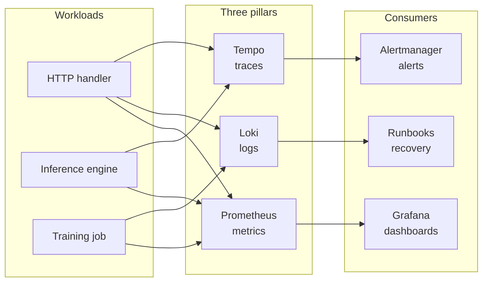

# 17.1 Observability foundations: metrics, logs and traces

| Field | Value |
|---|---|
| Level | Basics |
| Priority tier | 2 |
| Lab venue | GCP / GKE |
| Part | Part 17: Observability, performance and operations |
| Cross-references | Chapter 1.23 (Performance methodology); Chapter 16.10 (Monitoring and drift); Chapter 16.14 (Platform design); Chapter 17.2 (Prometheus and Grafana) |
| Coverage file | `planning/coverage/chapters/17-01.md` |
| Claim & number ledger | `planning/ledgers/17-01.md` |

## Observability at a glance



Read the diagram from left to right, and notice where you would look first during an incident. Every workload feeds one or more of the three pillars, and each pillar feeds a different consumer. Dashboards show trends, alerts fire when something crosses a line, and runbooks tell the on-call what to do next.

## Why this matters for AI infrastructure

Imagine an on-call engineer paged at night because a training job has slowed down. The dashboard is blank, the logs are spread across dozens of pods, and nobody knows which component changed. Without an observability foundation, the first hour of that incident goes to guessing.

Every chapter in this part depends on this one. Alerting without metrics is guessing. SLOs without traces cannot be checked against real requests. Capacity planning without logs rests on assumptions you cannot test.

An AI platform emits the same kinds of signals as a web service: requests, errors, and durations. It also emits GPU utilisation, KV cache occupancy (the memory that holds attention state for each active request), collective communication timing, data-loading throughput, and model quality. The three pillars stay the same. The label budget is tighter, and the shape of the data is different.

```text
Why observability is on the critical path (background reading: NVIDIA Zero-to-Hero volume 16; Engineering AI Systems; NVIDIA Zero-to-Hero volume 7; the figures below are examples, not quotations):
- A typical mature AI platform emits 50k-200k unique time series from a single
  cluster. The cardinality budget is the difference between a dashboard that
  loads in 2 seconds and a dashboard that never loads.
- An AI workload failure has more possible causes than a web service failure:
  GPU OOM, NCCL timeout, data drift, model regression, scheduler starvation,
  container image pull rate limit, feature store staleness. Without traces, the
  on-call engineer has to guess which of these caused the page.
- The operational SLOs from Chapter 16.14 (cluster availability, GPU
  availability, registry availability) are measured by the observability stack.
  Without metrics, the SLOs are unmeasurable; the FinOps dashboard is wrong.
```

The numbers in that block come from the chapter's source notes. They are example values, not measurements from this handbook, so check them against your own cluster before you plan around them.

Three realities make this a platform-team job, not only a data-science job.

1. **The observability stack sits under every other chapter.** Alerts, SLOs, capacity models, and runbooks all read from it. A misconfigured stack either pages at the wrong moment or stays silent while the cluster is down.
2. The platform team decides the cardinality budget. Each label you add multiplies the number of series. That choice decides whether Prometheus can store the data and whether the dashboards can draw.
3. The data shape is an architecture decision. The metric format, the log format, and the trace propagation method decide whether your team can debug the next incident.

A cluster without observability is a cluster nobody can debug. Before a team runs an AI workload, the cluster needs a stack that the on-call can query in seconds.

## Prerequisites and outcomes

### Prerequisites

Work through these three chapters first. Each one gives you a method or pattern that this chapter builds on.

- Chapter 1.23 (Performance methodology) for the USE method.
- Chapter 16.10 (Monitoring and drift) for the AI-specific monitoring pattern.
- Chapter 16.14 (Platform design) for the SLO-based platform design.

### Outcomes

After completing this chapter you will be able to:

1. Describe the three pillars of observability (metrics, logs, and traces) and the contracts that link them.
2. Pick the RED method (Rate, Errors, Duration) for services or the USE method (Utilisation, Saturation, Errors) for resources.
3. Manage the cardinality budget: which labels are safe, which are not, and what goes wrong when you get it wrong.
4. Build a data shape you can debug: structured logs, metric exemplars, and trace context propagation.
5. Match the metrics to the workload's stage: training, serving, and on-call.
6. Run the observability stack on GKE with Prometheus, Grafana, Loki, and OpenTelemetry.

---

## 1. The three pillars

### 1.1 Metrics, logs, traces: what each is for

Imagine a model endpoint that suddenly takes twice as long to answer. One kind of evidence will not explain it. Chapter 11 of *Engineering AI Systems* walks through the three pillars, and each one answers a different question.

| Pillar | What it is | What question it answers | Cardinality |
|---|---|---|---|
| **Metrics** | Numeric time series with labels | How much, how fast, how often? | Low to medium (10k-200k series) |
| **Logs** | Discrete events with structured fields | What happened at this point in time? | High (millions of events/day) |
| **Traces** | Directed acyclic graph of spans | Where did the time go? | Medium (1k-100k traces/day) |

The ranges in the Cardinality column are example values, not measurements. Your team should size its own limits from what its cluster can store and query.

The three pillars complement each other. Metrics show that something is wrong. Logs show what the system was doing at that moment. Traces show where the time went inside one request. Start with metrics to find the symptom, then open the logs and traces for the same time window.

### 1.2 The RED method for services

Think about a web API that returns errors for ten minutes. You need a few numbers on every service to see that failure quickly. The RED method gives you three: how many requests arrive, how many fail, and how long they take. *Production Kubernetes* Chapter 9 introduces the RED method, and every request-driven service should emit these three metrics.

| Metric | What it measures |
|---|---|
| **Rate** | The number of requests per second |
| **Errors** | The fraction of requests that failed (5xx, 4xx for client errors) |
| **Duration** | The latency of each request (typically p50, p95, p99) |

RED fits serving systems well. An LLM InferenceService emits Rate, Errors, and Duration for each model and each replica. Alerts usually fire on p99 latency and on the error rate.

### 1.3 The USE method for resources

A training job can look busy while most of its GPUs sit idle. The USE method asks three questions about every resource, such as a GPU, a memory pool, or a network link. Brendan Gregg's USE method gives you utilisation, saturation, and errors for each one.

| Metric | What it measures |
|---|---|
| **Utilisation** | The fraction of the resource that is in use (e.g. GPU utilisation, memory utilisation) |
| **Saturation** | The degree to which the resource has more work queued than it can process (e.g. queue depth, NCCL pending collectives) |
| **Errors** | The rate of error events on the resource (e.g. ECC errors, GPU Xid events) |

USE fits AI workloads well. A training job emits GPU utilisation, GPU memory utilisation, the NCCL pending collective count, and the ECC error count. Alerts sit on utilisation (too high means wasted; too low means under-provisioned) and on the errors.

### 1.4 The golden signals

When you can only chart four things, the golden signals are a good place to start. They combine RED and USE into one short list.

| Signal | Method | What it measures |
|---|---|---|
| Latency | RED | The duration of a successful request |
| Traffic | RED | The rate of requests |
| Errors | RED | The rate of failed requests |
| Saturation | USE | The degree to which the service is approaching its capacity |

An AI factory adds two AI-specific signals.

| Signal | Method | What it measures |
|---|---|---|
| GPU utilisation | USE | The fraction of GPU SMs in use |
| Model quality | (new) | The live accuracy of the model's predictions |

A model can be unhealthy while every operational metric stays green. The model quality signal catches a model that gives bad predictions even though the serving system works. Add it to the stack before you need it, not after the first bad release.

---

## 2. The cardinality budget

### 2.1 What cardinality is

Imagine adding a `user_id` label to a request counter. The change is one line of code. In storage, it creates one time series for every user, and that count grows with your traffic.

Cardinality is the number of unique time series a metric produces. Take `http_requests_total` with three labels: `method` with 10 values, `status` with 10 values, and `path` with 100 values. The metric then produces 10 × 10 × 100 = 10,000 series. A label built from user IDs, request IDs, or timestamps can push the count into the millions. When you see a count like that, the label is the first suspect.

```text
Cardinality math (background reading: Production Kubernetes; the figures below are examples, not quotations):
- 1 metric x 3 labels x 10 values each = 10 * 10 * 10 = 1,000 series
- 1 metric x 5 labels x 100 values each = 100 * 100 * 100 * 100 * 100 = 10^10 series (impossible)
```

The platform team owns the cardinality budget. It decides which labels are safe to add. One label with 1,000 possible values turns one metric into up to 1,000 series. A label with 1000000 possible values turns it into up to 1000000 series, and you will feel that in memory.

### 2.2 Safe and unsafe labels

Use this table when a developer proposes a new label. Ask how many values the label could take as the system grows, not how many you see today.

| Label | Cardinality | Safe? |
|---|---|---|
| `method` (GET, POST, PUT, DELETE) | 4 | Yes |
| `status` (200, 404, 500) | 3 | Yes |
| `region` (us-central1, europe-west1) | 10 | Yes |
| `team` (5 teams) | 5 | Yes |
| `model_name` (10 models) | 10 | Yes |
| `user_id` (millions of users) | millions | No |
| `request_id` (every request) | millions | No |
| `gpu_uuid` (8 GPUs per node × 1000 nodes) | 8000 | Yes (with care) |
| `pod_name` (every pod is unique) | 1000s | No |

A common rule of thumb says a label is safe if it has fewer than 1,000 possible values. The source notes describe that figure as an inference from common practice, so treat it as a starting point. A label above the line should be dropped at the source, moved into a log or trace, or aggregated before it reaches the metric.

### 2.3 The consequences of getting cardinality wrong

A bad cardinality budget shows up in three ways.

| Symptom | Root cause | Operational consequence |
|---|---|---|
| Prometheus uses too much memory | Too many time series | Prometheus OOM; metric ingestion stops |
| Grafana dashboards load slowly | Too many series per query | Dashboards take minutes to render; on-call loses situational awareness |
| The TSDB grows too fast | Too many series | Storage costs balloon, and the cluster's storage becomes the bottleneck |

The usual response is a hard limit on the series each metric may produce. Prometheus has a `--storage.tsdb.max-label-values-per-label-name` flag and a similar flag for series limits. Set the limit to fit the cluster's memory budget, and alert when you see a metric go over it.

---

## 3. The data shape

### 3.1 Metrics: Prometheus exposition format

Every exporter and every scraper has to agree on one format. The Prometheus exposition format is widely used for AI infrastructure metrics, and it is plain text. Each sample is one line that holds the metric name, its labels, and its value.

```text
# HELP gpu_utilization_ratio The fraction of GPU SMs in use
# TYPE gpu_utilization_ratio gauge
gpu_utilization_ratio{gpu="0",node="gpu-node-1",model="churn-model"} 0.87
gpu_utilization_ratio{gpu="1",node="gpu-node-1",model="churn-model"} 0.92
gpu_utilization_ratio{gpu="2",node="gpu-node-2",model="churn-v3"} 0.65
```

Because the format is plain text, you can read an endpoint with curl and see the numbers directly. Prometheus pulls from each endpoint on a schedule, so the application never has to push data anywhere. Exporters such as DCGM, cAdvisor, and kube-state-metrics expose the numbers. Prometheus scrapes them, and Grafana draws the results.

### 3.2 Logs: structured JSON

A log line that says a step finished is easy to write and hard to query. A structured log carries the same event as named fields. That lets you filter by model, by run, or by severity without parsing free text.

```json
{
  "timestamp": "2024-03-15T10:30:00.000Z",
  "severity": "INFO",
  "message": "Training step 1000 completed",
  "run_id": "abc-123",
  "model": "churn-model",
  "step": 1000,
  "loss": 0.234,
  "throughput_tokens_per_sec": 45000,
  "gpu_utilization": 0.92
}
```

Loki (Chapter 17.3) indexes these logs by label, so you can ask questions across many records at once. For example, `sum by (model) (rate({model="churn-model", severity="ERROR"}[5m]))` shows the error rate per model. Agree on one schema across services first. Otherwise every team ends up writing its own parser.

### 3.3 Traces: OpenTelemetry

A trace follows one request through every service it touches. Each step in the trace is a span, with a name, a start time, an end time, a parent span, and attributes. The OpenTelemetry trace format is widely used for this, and the tree below shows what one request looks like.

```text
Trace abc-123
├─ Span inference-svc[churn-model]
│  ├─ Span http-handler
│  ├─ Span tokenize-prompt
│  ├─ Span feature-fetch[user_features]
│  ├─ Span vector-search[churn-v3]
│  └─ Span llm-inference[vllm]
│     ├─ Span prefill
│     └─ Span decode
└─ (response sent)
```

The tree shows where the time went. In the worked example, an 800 ms request splits into 200 ms of prefill, 500 ms of decode, and 100 ms of feature fetch. Those three parts add up to the full 800 ms, so the on-call engineer knows which step to inspect first. The numbers are an illustration, not measurements.

### 3.4 Trace context propagation

A trace stays whole only when every hop passes the trace ID along. The W3C Trace Context standard does this with the `traceparent` header. The header carries the trace ID and the parent span ID from the client to the server, then on to the database and the inference engine.

```python
# code/part17/snippets/trace_propagation.py
import requests
from opentelemetry import trace
from opentelemetry.trace.propagation.tracecontext import TraceContextTextMapPropagator

tracer = trace.get_tracer(__name__)

@tracer.start_as_current_span("http-handler")
def handle_request(request):
    # Propagate the trace context to downstream services
    headers = {}
    TraceContextTextMapPropagator().inject(headers)
    response = requests.post(
        "http://llm-inference/v1/chat/completions",
        headers=headers,
        json=request.json(),
    )
    return response.json()
```

The snippet writes the header into the outgoing request, so the inference service can join the same trace. The inference service creates child spans, and the handler sends the finished trace to the collector. Your application still needs instrumentation. A service mesh does not remove that work, because the request headers must still pass from one service to the next. With the trace in place, the on-call engineer can follow one request from the HTTP handler to the LLM inference and to the GPU kernel.

---

## 4. Observability for AI workloads

### 4.1 What to observe at training time

A training run can last for days. Its health shows up in loss, throughput, and GPU use, not in request latency. The table lists the signals most teams watch during a run.

| Metric | What it measures | Why it matters |
|---|---|---|
| `training_loss` | The loss function value | The model is learning |
| `training_throughput_samples_per_sec` | The training throughput | The cluster is fully utilised |
| `gpu_utilization_ratio` | The GPU SM utilisation | The cluster is doing useful work |
| `gpu_memory_used_bytes` | The GPU memory used | The model fits in HBM |
| `data_loading_throughput` | The data loader throughput | The GPUs are not waiting on data |
| `gradient_norm` | The gradient norm | The model is not exploding |
| `checkpoint_save_duration_seconds` | The checkpoint save time | The job can resume from a checkpoint |
| `distributed_collective_latency_seconds` | The NCCL collective latency | The network is not the bottleneck |

Watch the data loader as closely as you watch the GPUs. A slow loader leaves the GPUs waiting, and you pay for hardware that does nothing. *AI Systems Performance Engineering*, Chapter 16, names the DCGM field behind the SM utilisation row: `DCGM_FI_DEV_GPU_UTIL`. Use that field when you build the panel on the exporter side.

> **dcgm-exporter 4.9.0 version note.** dcgm-exporter 4.9.0 (2026-11-06) renamed many default metrics and changed some units. For example `DCGM_FI_DEV_GPU_UTIL` (percent) became `DCGM_FI_DEV_GPU_UTIL_RATIO` (0 to 1), and `DCGM_FI_DEV_FB_USED` (MiB) became `DCGM_FI_DEV_FB_USED_BYTES`. The metric names in this chapter are the 4.8.x names. On a 4.9.0 exporter use the [full mapping in 17.4](04-dcgm-exporter-and-interpreting-gpu-metrics.md#14-what-dcgm-exporter-490-renamed), and change thresholds together with the unit.

The training script emits these metrics, either to a metrics endpoint or to a TensorBoard log that the platform scrapes. Many teams standardise on the OpenTelemetry Python SDK and send the metrics to a collector, which forwards them to Prometheus. Short jobs, such as an evaluation run, can finish before Prometheus scrapes them. For those, Prometheus offers a Pushgateway, which accepts metrics the job pushes before it exits.

### 4.2 What to observe at serving time

A serving problem reaches customers within seconds. That is why you watch latency and errors first. The table lists the signals for the serving dashboard.

| Metric | What it measures | Why it matters |
|---|---|---|
| `inference_request_duration_seconds` (p50, p95, p99) | The inference latency | The SLO the customer sees |
| `inference_request_rate` | The inference throughput | The autoscaler reads this |
| `inference_request_errors_total` | The 5xx rate | The customer-facing error budget |
| `inference_kv_cache_utilization_ratio` | The KV cache utilisation | The model is not OOM |
| `inference_batch_size` | The continuous batch size | The inference engine is batching correctly |
| `inference_token_throughput` | The token throughput | The GPU is producing tokens |
| `model_quality_score` | The live model quality | The model is not regressing |

Track p95 and p99 latency, not only the median. If you watch only the median, you will miss the slow requests. Even a 0.1 percent outlier shows up often in a large cluster, so the tail matters more than the average. *AI Systems Performance Engineering*, Chapter 16, makes this point with the same reasoning.

The serving metrics come from the inference engine, such as Triton, vLLM, or NIM. The platform team usually scrapes the engine's Prometheus endpoint. It then adds the model quality signal from Chapter 16.10.

### 4.3 What to observe at on-call time

At 3 a.m., an on-call engineer needs a few answers, not a chart of everything. The table lists the signals that matter when a page arrives.

| Signal | Source | Why it matters |
|---|---|---|
| Cluster-wide p99 latency | Prometheus | The customer-facing SLO |
| GPU pool utilisation | DCGM | The capacity planning model |
| Failed training runs | MLflow | The team's ability to iterate |
| Failed promotions | MLflow Registry | The registry's reliability |
| Open incidents | PagerDuty | The team's operational state |
| Audit log writes | object storage | The regulator's question |

These signals belong on one dashboard, covered in Chapter 17.2. Make that dashboard the first page you open after a page. Keep it short enough to read in one screen.

---

## 5. Operating the observability stack on GKE

The observability stack is a production service too. If Prometheus or Loki fails, the team loses its view of everything else. Each component therefore needs its own latency target.

### 5.1 The components

| Component | Where it runs | Backing store | SLO |
|---|---|---|---|
| Prometheus | Kubernetes Deployment | TSDB on persistent disk | Scrape latency p99 < 5 s |
| Grafana | Kubernetes Deployment | (uses Prometheus) | Dashboard load p99 < 5 s |
| Loki | Kubernetes Deployment | Object storage for log chunks | Query latency p99 < 5 s |
| OpenTelemetry Collector | Kubernetes Deployment | (forwards to backend) | Export latency p99 < 5 s |
| Alertmanager | Kubernetes Deployment | (sends to PagerDuty) | Alert latency p99 < 10 s |

The SLO values in this table are example targets. Pick your own from what the team can tolerate, and write them down before go-live.

*Production Kubernetes*, Chapter 9, makes the point that Prometheus is not designed for long-term storage of metrics. It can write to remote endpoints instead. Projects such as Thanos and Cortex offer stacks for that job. Decide how long production keeps data and how long nonproduction keeps it, then tell your tenants what to expect.

### 5.2 IAM and the cardinality budget

Not everyone should be able to change the metrics stack. Readers need read access. Exporters need write access. Admin rights stay with the platform team.

| Role | Who | What they can do |
|---|---|---|
| `observability.reader` | Every team's data scientists | Read Grafana dashboards; query Loki; query traces |
| `observability.writer` | The exporters (DCGM, kube-state-metrics) | Write metrics to Prometheus |
| `observability.admin` | The platform team | Manage the Prometheus server; set the cardinality budget; manage Grafana |

The cardinality budget is the platform team's discipline. Every new metric must declare its label cardinality. The team rejects metrics that exceed the budget and publishes the budget on the platform's status page.

### 5.3 Observability

The stack needs its own alerts. Otherwise it can fail quietly while the rest of the cluster looks fine.

| Metric | Why it matters | Alert |
|---|---|---|
| Prometheus scrape latency p99 | Hot path for every metric | > 10 s |
| Grafana dashboard load latency p99 | On-call response time | > 10 s |
| Loki query latency p99 | Hot path for log queries | > 10 s |
| TSDB disk usage | Storage budget | > 80% for 1 hour |
| Cardinality per metric | Cardinality budget | > budget for 1 hour |

The thresholds in the Alert column are example values. Tune them to your team's tolerance and your hardware. The cardinality alert matters most. One metric over budget can exhaust Prometheus memory. A Prometheus out-of-memory failure is silent, because Prometheus stops ingesting metrics, the dashboards go stale, and nobody is told that they are stale.

---

## 6. How it fails

Six failure modes recur. Each one below starts with the symptom you see first, then the likely cause, then the fix.

### 6.1 "Prometheus OOM'd because of a high-cardinality label"

**Symptom:** Prometheus crashes. The dashboards stop refreshing and the alerts stop firing. From the outside, the cluster can look healthy while it is on fire.

**Diagnosis:** Someone added a metric with a high-cardinality label, such as a request ID, a user ID, or a timestamp. The series count grew past what Prometheus can hold in memory.

**Fix:** Find the metric with `prometheus_tsdb_head_series`. Drop the label at the source, or aggregate the metric before it reaches Prometheus. Then set a hard limit on the series each metric may produce.

### 6.2 "The dashboards are stale"

**Symptom:** The dashboard shows a healthy cluster. The on-call gets paged anyway, because the dashboard is out of date.

**Diagnosis:** Prometheus cannot scrape one or more targets, and the failure is silent. The dashboard keeps drawing old data while the cluster degrades.

**Fix:** Add an `up` metric alert for every Prometheus target. Choose how long a target may stay down before it pages, and alert when scrape latency grows too high. The source's example values are 5 minutes of downtime and 10 seconds of scrape latency.

A fixed threshold is the simplest alert, and it is easy to get wrong. *AI Factory*, Chapter 11, describes threshold alerts as either too nervous, firing more often than needed, or too relaxed, firing too rarely. Start with a few alerts, and improve each one as you learn how the system behaves.

### 6.3 "The logs are searchable but not queryable"

**Symptom:** The on-call can find a specific log line but cannot answer "what was the error rate per model in the last 5 minutes".

**Diagnosis:** The logs are plain text. The fields the team wants to query sit inside the message, so Loki cannot index them as labels.

**Fix:** Move to structured JSON logs with a declared schema. Use the OpenTelemetry log SDK and emit the labels as separate fields.

### 6.4 "The traces are incomplete"

**Symptom:** The on-call sees a trace that stops at the LLM inference. The inference service's child spans are missing.

**Diagnosis:** The trace context does not reach the inference service. The service starts a new trace instead of adding child spans to the existing one.

**Fix:** Confirm that the W3C Trace Context header leaves every outgoing request from the handler. Confirm that the inference service reads the header and creates child spans. Add an integration test that checks the trace from end to end.

### 6.5 "The model quality signal is missing"

**Symptom:** The model gives bad predictions, but the operational metrics are green. Nobody knows.

**Diagnosis:** The live accuracy signal from Chapter 16.10 is not connected to the observability stack. The model can degrade without anyone seeing it.

**Fix:** Send the live accuracy signal to Prometheus. Alert when it drops below a threshold your team chooses. Also alert when the signal goes missing for a period your team sets.

### 6.6 "The observability stack is the bottleneck"

**Symptom:** Dashboards take 30 seconds to load. Alert evaluation takes minutes, and queries take a minute.

**Diagnosis:** The stack is under-resourced. Prometheus needs more memory, Loki needs more storage, and a slow stack slows down every debugging session.

**Fix:** Right-size the stack. Give it a dedicated node pool. For high-cardinality workloads, consider Prometheus sharding.

---

## 7. Hands-on lab

This lab installs Prometheus, Grafana, Loki, and the OpenTelemetry Collector on GKE. Then it checks the three pillars from end to end. The lab is **untested** in this repository, so treat the commands as a starting point.

### 7.1 Prerequisites

- A GKE Autopilot or Standard cluster. Check the minimum version that each chart requires.
- Helm 3 for installing the observability stack.
- A workload that emits metrics, logs, and traces, such as an InferenceService from Chapter 16.7.

### 7.2 Step 1: install Prometheus and Grafana

Install the kube-prometheus-stack chart. It brings Prometheus and Grafana, and the retention flag keeps metrics for 30 days.

```bash
helm repo add prometheus-community https://prometheus-community.github.io/helm-charts
helm install prometheus prometheus-community/kube-prometheus-stack \
  --namespace monitoring --create-namespace \
  --set prometheus.prometheusSpec.retention=30d \
  --set grafana.adminPassword=admin
# expected: Prometheus and Grafana pods are running; Grafana is exposed via Ingress
```

### 7.3 Step 2: install Loki

Install Loki with the loki-stack chart. The retention flag sets how long log data is kept.

```bash
helm repo add grafana https://grafana.github.io/helm-charts
helm install loki grafana/loki-stack \
  --namespace monitoring \
  --set loki.limits_config.retention_period=30d
# expected: Loki pods are running; Loki is exposed via Grafana
```

### 7.4 Step 3: install the OpenTelemetry Collector

Run the collector as a DaemonSet, so one collector sits on each node. It forwards data to the backend address you set.

```bash
helm install otel-collector open-telemetry/opentelemetry-collector \
  --namespace monitoring \
  --set mode=daemonset \
  --set configmap.config.exporters.otlp.endpoint=backend.example.com:4317
# expected: the OpenTelemetry Collector pods are running as a DaemonSet
```

### 7.5 Step 4: configure a workload to emit the three pillars

Point the workload at the collector and give it a service name. The environment variables tell the application where to send its data.

```yaml
# code/part17/observability_workload.yaml
apiVersion: apps/v1
kind: Deployment
metadata:
  name: observability-demo
spec:
  selector:
    matchLabels:
      app: observability-demo
  template:
    metadata:
      labels:
        app: observability-demo
    spec:
      containers:
        - name: app
          image: my-app:v1
          env:
            - name: OTEL_EXPORTER_OTLP_ENDPOINT
              value: http://otel-collector.monitoring:4317
            - name: OTEL_SERVICE_NAME
              value: observability-demo
            - name: METRICS_PORT
              value: "9090"
          ports:
            - containerPort: 8080
            - containerPort: 9090
```

### 7.6 Step 5: query the three pillars

Query each pillar once from the command line. Together, the three commands confirm that metrics, logs, and traces all arrive.

```bash
# Metrics
curl http://prometheus.monitoring:9090/api/v1/query?query=up | jq .

# Logs
curl -G http://loki.monitoring:3100/loki/api/v1/query \
  --data-urlencode 'query={job="observability-demo"}' | jq .

# Traces
curl http://otel-collector.monitoring:4318/v1/traces | jq .
```

### 7.7 Step 6: build a unified dashboard

The dashboard puts request rate, p99 latency, error logs, and traces on one page. That lets you move from a spike in a graph to the matching log line and trace.

```yaml
# code/part17/grafana_dashboard.json
{
  "dashboard": {
    "title": "Grafana dashboard",
    "panels": [
      {"title": "Inference request rate", "type": "timeseries", "targets": [{"expr": "rate(inference_request_total[5m])"}]},
      {"title": "Inference latency p99", "type": "timeseries", "targets": [{"expr": "histogram_quantile(0.99, rate(inference_request_duration_seconds_bucket[5m]))"}]},
      {"title": "Error logs", "type": "logs", "targets": [{"expr": "{severity=\"ERROR\"}"}]},
      {"title": "Trace latency", "type": "traces", "targets": [{"query": "inference-svc"}]}
    ]
  }
}
```

### 7.8 What to record

After the lab, answer five questions. Each answer should take seconds to find. The 5-second and 30-second figures below are example targets that your team should set for itself.

1. What is the current Prometheus scrape latency p99?
2. What is the current cardinality per metric?
3. What is the current Loki query latency p99?
4. What is the most recent error log?
5. What is the current p99 trace latency?

If an answer takes more than 30 seconds to find, the stack is not yet ready to run as a production service. The lab is still untested against a live GKE cluster.

---

## Exercises

Work through these in order. Each one checks a single idea from the chapter.

1. **Add a high-cardinality label test.** Add a metric with a label that has 10000 unique values. Watch how Prometheus behaves, then remove the label. *Solution sketch:* an exporter that emits `http_requests_total{user_id=...}`; watch the `prometheus_tsdb_head_series` metric.
2. **Add a structured log schema.** Define a JSON schema for your logs. Emit it from the application, then query Loki by the schema fields. *Solution sketch:* a Pydantic model in Python that emits structured JSON; Loki's label extraction from JSON.
3. **Add trace context propagation.** Verify that the trace context moves from the HTTP handler into the LLM inference. *Solution sketch:* a Python test that asserts the trace ID in the HTTP handler matches the trace ID in the LLM inference.
4. **Add a model quality signal.** Send the live accuracy signal from Chapter 16.10 to Prometheus. Then alert when the signal drops. *Solution sketch:* a sidecar that emits the live accuracy metric, and a Prometheus alert on that metric.
5. **Add a cardinality budget alert.** Configure an alert that fires when a metric's cardinality passes a limit you choose. The chapter's 1,000-value rule of thumb from Section 2.2 is a reasonable starting point. *Solution sketch:* a recording rule that computes `count by (__name__) (up{job=~".+"})`, with an alert on the recording rule.
6. **Add a unified Grafana dashboard.** Build a dashboard that shows the metrics, logs, and traces for a single request. *Solution sketch:* a Grafana dashboard with the panels from Section 7.7, where the data source links metrics to logs and traces.

---

## Checkpoint questions

<details><summary>1. Prometheus crashes, the dashboards stop refreshing and the alerts stop firing, yet the cluster looks healthy from outside. What is the likely cause and how do you find it?</summary>
Someone added a metric with a high-cardinality label, such as a request ID, a user ID or a timestamp. The series count grew past what Prometheus can hold in memory. Find the metric with `prometheus_tsdb_head_series`, drop the label at the source or aggregate before Prometheus, and set a hard limit on series per metric.
</details>

<details><summary>2. The dashboard shows a healthy cluster but the on-call gets paged anyway. What went wrong and what alert would have caught it?</summary>
Prometheus cannot scrape one or more targets, and the failure is silent, so the dashboard keeps drawing old data. Add an `up` metric alert for every Prometheus target, and alert when scrape latency grows too high. The source's example values are 5 minutes of downtime and 10 seconds of scrape latency.
</details>

<details><summary>3. On-call can find one log line but cannot answer "what was the error rate per model in the last 5 minutes". What is wrong with the logs?</summary>
The logs are plain text, so the fields the team wants to query sit inside the message and Loki cannot index them as labels. Move to structured JSON logs with a declared schema, and emit the labels as separate fields. Then a query such as `sum by (model) (rate(...[5m]))` works.
</details>

<details><summary>4. A trace stops at the LLM inference span and the inference service's child spans are missing. What do you conclude and what do you check?</summary>
The trace context does not reach the inference service, so it starts a new trace instead of adding child spans to the existing one. Confirm that the W3C Trace Context header leaves every outgoing request from the handler. Confirm that the inference service reads the header, and add an end-to-end integration test.
</details>

<details><summary>5. Customers complain about bad predictions while every operational metric is green. Which signal is missing?</summary>
The model quality signal is not connected to the observability stack, so the model can degrade unseen. Send the live accuracy signal to Prometheus. Alert when it drops below a threshold your team chooses, and also when the signal goes missing for a period your team sets.
</details>

<details><summary>6. Dashboards take 30 seconds to load, alert evaluation takes minutes and queries take a minute. What is the diagnosis and the fix?</summary>
The observability stack is under-resourced, so it slows every debugging session. Right-size it and give it a dedicated node pool. For high-cardinality workloads, consider Prometheus sharding.
</details>

<details><summary>7. Why does adding one label to a counter multiply storage instead of adding to it?</summary>
Cardinality is the number of unique time series a metric produces. Each label multiplies the possible combinations with the values of the other labels. So a label with a million possible values can turn one metric into up to a million series, and you feel that in memory.
</details>

<details><summary>8. Why do metrics, logs and traces need to be used together during an incident, and in what order?</summary>
Each answers a different question. Metrics show that something is wrong, logs show what the system was doing at that moment, and traces show where the time went inside one request. Start with metrics to find the symptom, then open the logs and traces for the same time window.
</details>

<details><summary>9. Why does the chapter say to watch p95 and p99 latency and not only the median?</summary>
A median hides the slow requests. Even a 0.1 percent outlier shows up often in a large cluster, so the tail matters more than the average. The chapter cites AI Systems Performance Engineering Chapter 16 for the same reasoning.
</details>

<details><summary>10. Why does a slow data loader show up as a GPU problem in the dashboards, and which metric tells you the loader is the cause?</summary>
A slow loader leaves the GPUs waiting, so GPU utilisation drops while you still pay for the hardware. The `data_loading_throughput` metric shows whether the loader is feeding the GPUs. That is why the chapter says to watch the loader as closely as the GPUs.
</details>

<details><summary>11. When would you choose RED metrics over USE metrics, and what does each give up?</summary>
RED fits request-driven services such as an InferenceService, where you track rate, errors and duration. USE fits resources such as a GPU, a memory pool or a network link, where you track utilisation, saturation and errors. RED says nothing about whether a GPU is saturated, and USE says nothing about request latency, so an AI platform needs both.
</details>

<details><summary>12. A developer wants a `gpu_uuid` label across 1000 nodes with 8 GPUs each. How do you decide whether to allow it?</summary>
Ask how many values the label could take as the system grows. The table marks `gpu_uuid` as safe only with care, and the 1,000-value rule of thumb is an inference from common practice. Compare the count with your series budget, and alert when a metric goes over it.
</details>

<details><summary>13. Short evaluation jobs finish before Prometheus scrapes them. What do you use, and what is the trade-off of Prometheus pulling by default?</summary>
Use the Pushgateway, which accepts metrics a job pushes before it exits. By default Prometheus pulls from each endpoint on a schedule, so the application never has to push data anywhere. That pull model is simple, but a job shorter than the scrape interval can vanish unseen.
</details>

<details><summary>14. Should you rely on a service mesh to give you complete traces?</summary>
No. The chapter says a service mesh does not remove the instrumentation work, because the request headers must still pass from one service to the next. Your application has to inject and read the `traceparent` header. Without that, traces break at the first hop that drops it.
</details>

<details><summary>15. `http_requests_total` has three labels: `method` with 10 values, `status` with 10 values and `path` with 100 values. How many series can it produce?</summary>
Multiply the values of the three labels. That is 10 times 10 times 100, which is 10,000 series. A label built from user IDs or request IDs could push it into the millions.
</details>

<details><summary>16. An 800 ms request has 200 ms of prefill and 500 ms of decode. How much time is left for the other step in the worked example, and where do you look first?</summary>
The rest is 800 minus 200 minus 500, which is 100 ms for feature fetch. Decode is the largest part at 500 ms, so that is where to look first. The numbers are an illustration, not measurements.
</details>

<details><summary>17. A metric already has 10,000 series. A developer adds a `model_name` label with 10 values. What is the worst-case series count, and does it fit a budget of 200,000?</summary>
The count multiplies, so 10,000 times 10 is 100,000 series. That is under 200,000, which is the top of the example range for a mature cluster. But all other metrics share that budget, so check the total before approving.
</details>

<details><summary>18. The TSDB disk usage alert is set at more than 80 percent for 1 hour. How much of a 1 TB disk is left when the alert fires, and what else do you check?</summary>
At 80 percent used, 20 percent is left, which is 200 GB of 1 TB. Then check cardinality per metric, because too many series makes the TSDB grow fast. The thresholds in the chapter are example values.
</details>

<details><summary>19. You get paged for a slow endpoint. In what order do you look at the three pillars, and why?</summary>
First metrics, to find the symptom such as p99 latency or error rate. Second logs for the same time window, to see what the system was doing. Third traces, to see where the time went inside one slow request.
</details>

<details><summary>20. Dashboards are stale and you suspect Prometheus OOM. What do you check first, second and third?</summary>
First check whether Prometheus is running and ingesting, because an out-of-memory failure is silent and the dashboards simply go stale. Second query `prometheus_tsdb_head_series` to find the metric with too many series. Third find the label responsible and drop it at the source or aggregate it.
</details>

---

## Sources and review notes

- *Production Kubernetes* (`production-kubernetes`, Chapter 9). Source for the RED method, the observability stack patterns, the cardinality budget, and the operational discipline. Chapter 9 is approximately 9,200 words.
- *Engineering AI Systems: Architecture and DevOps Essentials* (`engineering-ai-systems-architecture-and-devops-essentials`, Chapter 11). Source for the three pillars of observability (metrics, logs, traces), the AI-specific signals, and the integration with the MLOps lifecycle. Chapter 11 is approximately 2,800 words.
- NVIDIA Zero-to-Hero Volume 16 (`chapter-01-observability-foundations.md`, `chapter-02-metrics-logs-and-traces.md`). Source for the operational observability patterns, the cardinality discipline, and the data shape decisions. The wording has been rewritten in the handbook's voice.
- NVIDIA Zero-to-Hero Volume 7 (`chapter-01-observability-stack-overview.md`). Source for the observability stack patterns (Prometheus + Grafana + Loki + OpenTelemetry), the deployment on Kubernetes, and the operational metrics.

### Cross-references to other handbook chapters

- Chapter 1.23 (Performance methodology) for the USE method.
- Chapter 16.10 (Monitoring and drift) for the AI-specific monitoring pattern.
- Chapter 16.14 (Platform design) for the SLO-based platform design.
- Chapter 17.2 (Prometheus and Grafana) for the metrics stack in detail.

### Migrated from `nvidia-devops`

The three pillars framework, the cardinality discipline, and the operational observability patterns draw on Volume 16 chapters 1-2 and Volume 7 chapter 1. The wording has been rewritten in the handbook's voice.

### Explicitly labelled inferences

- The cardinality budget's rule of thumb (1000 unique values per label) is a starting point drawn from common practice; specific budgets depend on the metric and the cluster's memory.
- The model quality signal as an AI-specific golden signal is an inference from the operational patterns of mature AI factories; specific signals depend on the use case.
- The structured JSON log format as the standard is an inference from the OpenTelemetry and Loki conventions; specific teams may use other structured formats.

### Not verified on live hardware

- The lab in Section 7 is **untested** against a live GKE cluster in this repository.
- The Prometheus, Grafana, Loki, and OpenTelemetry Collector versions assumed in the lab should be pinned against the current releases before production use.
- The cardinality numbers in the lab are illustrative; production cardinality depends on the workload.
