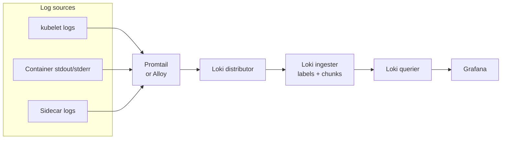
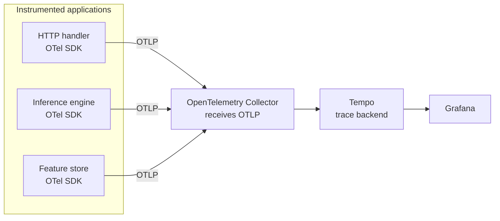
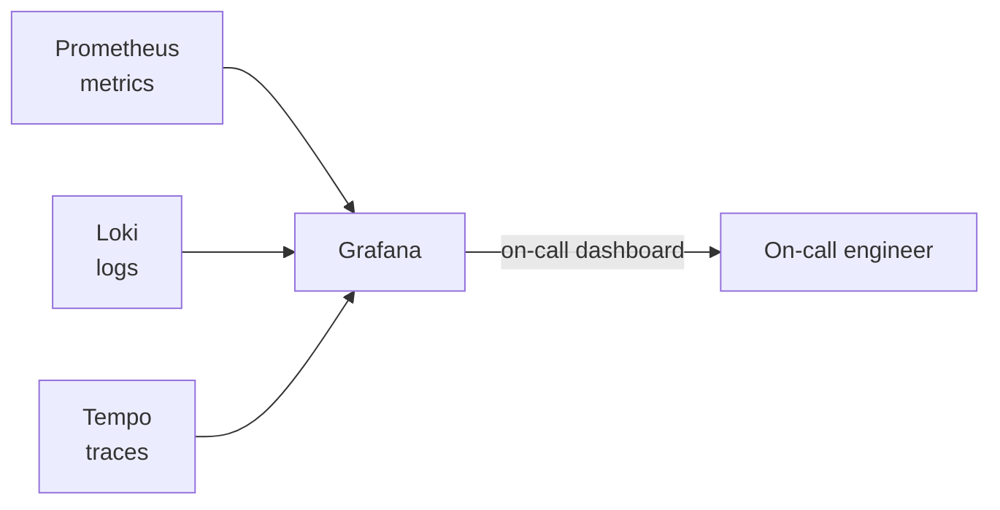

# 17.3 Logging with Loki and tracing with OpenTelemetry

| Field | Value |
|---|---|
| Level | Intermediate |
| Priority tier | 2 |
| Lab venue | GCP / GKE |
| Part | Part 17: Observability, performance and operations |
| Primary sources | Grafana Loki and OpenTelemetry official documentation; NVIDIA Zero-to-Hero Volume 16 (`chapter-06-loki-logging.md`, `chapter-07-opentelemetry-tracing.md`); *Production Kubernetes* (`production-kubernetes`, Chapter 9) |
| Cross-references | Chapter 17.1 (Observability foundations); Chapter 17.2 (Prometheus and Grafana); Chapter 15.16 (Production serving stack); Chapter 16.7 (Serving platforms) |
| Coverage file | `planning/coverage/chapters/17-03.md` |
| Claim & number ledger | `planning/ledgers/17-03.md` |

## Why this matters for AI infrastructure

Chapter 17.1 named the three pillars. Chapter 17.2 walked through the first one in detail. This chapter walks through the other two: logs and traces. Loki is the de facto standard for log aggregation on Kubernetes; OpenTelemetry is the de facto standard for distributed tracing. The combination is what makes an AI workload debuggable end-to-end.

The on-call engineer's first action during an incident is to find the symptom. The metrics tell the engineer *that* something is wrong; the logs tell the engineer *what* the system was doing at the time; the traces tell the engineer *where* the time went. A team without Loki is a team that grep-ssh into pods; a team without traces is a team that cannot decompose a 500 ms latency into the 100 ms that is the problem.

```text
Why Loki + OpenTelemetry is on the critical path (V16 ch6, 7; PK Ch 9):
- A typical AI workload emits 10-100 MB of logs per pod per hour. A 100-pod cluster
  produces 1-10 GB of logs per hour. Without Loki, the team greps into pods; the
  team cannot search; the team cannot correlate.
- An LLM inference that takes 800 ms is decomposed into prefill (200 ms), decode
  (500 ms), feature fetch (100 ms). Without traces, the on-call cannot find
  the slow component; the on-call cannot optimise.
- The W3C Trace Context propagates from the HTTP handler into the LLM
  inference into the GPU kernel. The propagation makes the trace end-to-end;
  the propagation makes the AI workload observable.
```

Three operational realities make this chapter a platform-team concern rather than a data-science-only concern:

1. **Loki's label cardinality is a platform-team decision.** Every label the team adds to a log stream increases Loki's index size; the platform team's choice of labels determines whether Loki can store the logs and whether the queries are fast.
2. **The OpenTelemetry Collector is the cluster's trace pipeline.** The collector receives spans from every workload; the collector batches and exports the spans to the backend; the collector is the on-call's trace search entry point.
3. **The tail-sampling policy is a platform-team decision.** Tracing every span is expensive; the platform team decides which spans to keep. The decision affects the on-call's ability to debug.

**Before a team can debug an AI workload, the workload's logs must be searchable by structured fields and the workload's traces must propagate from the HTTP handler to the GPU kernel. A workload without logs and traces is a workload that the on-call cannot debug.**

## Prerequisites and outcomes

### Prerequisites

- Chapter 17.1 (Observability foundations) for the three pillars and the data shape.
- Chapter 17.2 (Prometheus and Grafana) for the data source integration.

### Outcomes

After completing this chapter you will be able to:

1. Configure Loki as the cluster's log aggregation system with structured log labels.
2. Configure the OpenTelemetry Collector as the cluster's trace pipeline with W3C Trace Context propagation.
3. Write LogQL queries for AI workload failures: per-model error rates, per-run trace correlation, per-feature drift events.
4. Apply a tail-sampling policy that keeps the interesting spans and drops the rest.
5. Integrate Loki and Tempo with Grafana for unified observability.
6. Operate Loki and OpenTelemetry on GKE with SLOs, observability, and a runbook.

---

## 1. Loki

### 1.1 The Loki architecture

*Production Kubernetes* Chapter 9 walks through the Loki architecture. Loki is a log aggregation system designed for Kubernetes; Loki indexes logs by label; Loki stores log chunks in object storage; Loki queries log streams via LogQL.



The pattern is: Promtail (or Grafana Alloy) runs as a DaemonSet on every node; Promtail tails the logs; Promtail adds labels (job, namespace, pod); Promtail ships the logs to Loki; Loki indexes the labels; Loki stores the chunks in object storage; Grafana queries Loki.

### 1.2 The Loki labels

The Loki labels are the labels that Loki indexes. A label is a key-value pair that Loki uses to filter and aggregate logs.

| Label | Cardinality | Source |
|---|---|---|
| `job` | Low | From the Kubernetes service |
| `namespace` | Medium | From the Kubernetes namespace |
| `pod` | Medium | From the Kubernetes pod name |
| `container` | Low | From the Kubernetes container name |
| `severity` | Low | From the log message |
| `model` | Low | From the application exporter |
| `run_id` | High | From the training script |
| `customer_id` | Very high | From the application |

The cardinality budget applies to Loki labels too. A label with high cardinality (customer id, request id) increases the Loki index size; the platform team's pattern is to keep the Loki labels low cardinality and put the high-cardinality fields in the log message as structured fields.

### 1.3 LogQL for AI workloads

LogQL is the query language for Loki. The basic shape is `{labels} |= "text"` for log line filtering, with aggregations and transformations.

```logql
# The error rate per model over the last 5 minutes
sum by (model) (
  rate({severity="error", namespace="mlops"}[5m])
)

# The error logs for a specific training run
{run_id="abc-123", severity="error"}

# The throughput per model per minute
sum by (model) (
  rate({namespace="mlops", msg=~"inference_request_completed"}[1m])
)

# The latency warnings for a specific inference service
{inference_service="churn-model", level="warn"}

# The audit log entries from a specific user
{namespace="audit", user="alice"}
```

The pattern is: filter by labels; filter by text; aggregate by labels; compute rates and counts. The queries feed the on-call dashboard; the queries are the on-call's first action during an incident.

### 1.4 Structured logging

Structured logs are the foundation of Loki's query power. A structured log carries the timestamp, the severity, the message, and a set of structured fields.

```python
# code/part17/structured_log.py (shape only)
import logging
import json
from pythonjsonlogger import jsonlogger

logger = logging.getLogger("inference-service")

def log_request(model: str, request_id: str, duration_ms: float, status: str):
    logger.info(
        "Inference request completed",
        extra={
            "model": model,
            "request_id": request_id,
            "duration_ms": duration_ms,
            "status": status,
        },
    )
```

The structured fields are the labels that Loki can extract from the JSON. The pattern is: every log line is JSON; every JSON has a schema; the schema is documented; the platform team enforces the schema in CI.

---

## 2. OpenTelemetry

### 2.1 The OpenTelemetry architecture

OpenTelemetry (OTel) is the standard for distributed tracing. OTel defines the data model (spans, traces, metrics, logs); OTel defines the API for instrumenting applications; OTel defines the protocol (OTLP) for exporting telemetry.



The pattern is: every workload instruments with the OTel SDK; the SDK creates spans with the W3C Trace Context; the SDK exports spans to the Collector via OTLP; the Collector batches and exports to Tempo; Grafana queries Tempo.

### 2.2 The OpenTelemetry Collector

The OpenTelemetry Collector is a vendor-agnostic process that receives, processes, and exports telemetry. The Collector runs as a DaemonSet on every node (for low-latency collection) or as a Deployment (for centralised processing).

```yaml
# code/part17/otel_collector.yaml (shape only)
receivers:
  otlp:
    protocols:
      grpc:
        endpoint: 0.0.0.0:4317
      http:
        endpoint: 0.0.0.0:4318

processors:
  batch:
    timeout: 1s
    send_batch_size: 1024
  memory_limiter:
    check_interval: 1s
    limit_percentage: 80
  tail_sampling:
    decision_wait: 10s
    num_traces: 100000
    expected_new_traces_per_sec: 1000
    policies:
      - name: errors
        type: status_code
        status_code:
          status_codes: [ERROR]
      - name: slow-traces
        type: latency
        latency:
          threshold_ms: 500
      - name: sample-default
        type: probabilistic
        probabilistic:
          sampling_percentage: 10

exporters:
  otlp/tempo:
    endpoint: tempo.monitoring:4317
    tls:
      insecure: true

service:
  pipelines:
    traces:
      receivers: [otlp]
      processors: [memory_limiter, tail_sampling, batch]
      exporters: [otlp/tempo]
    metrics:
      receivers: [otlp]
      processors: [batch]
      exporters: [otlp/tempo]
```

The pattern is: receive OTLP from every workload; batch the spans; apply the tail-sampling policy; export to Tempo. The Collector's resource limits are tuned to avoid OOM; the tail-sampling policy keeps the interesting spans and drops the rest.

### 2.3 Tail sampling

Tail sampling decides which spans to keep after they have been collected. The decision is based on the span's attributes and the trace's overall health.

| Policy | What it does |
|---|---|
| `status_code` | Keep all traces that contain an ERROR span |
| `latency` | Keep all traces whose root span exceeds a threshold |
| `probabilistic` | Keep a random sample of traces |
| `composite` | Combine multiple policies |

The platform team's pattern is: keep 100% of error traces; keep 100% of slow traces (latency > 500 ms); keep 10% of healthy traces as a baseline. The policy keeps the interesting traces; the policy drops the uninteresting traces; the policy is the storage budget.

### 2.4 Trace context propagation

The W3C Trace Context is the standard for propagating trace context across services. The `traceparent` header carries the trace id and the parent span id from the client through the server through the database through the inference engine.

```python
# code/part17/trace_propagation.py (shape only)
import requests
from opentelemetry import trace
from opentelemetry.propagate.tracecontext import TraceContextTextMapPropagator

tracer = trace.get_tracer(__name__)

@tracer.start_as_current_span("http-handler")
def handle_request(request):
    # Propagate the trace context to downstream services
    headers = {}
    TraceContextTextMapPropagator().inject(headers)
    response = requests.post(
        "http://llm-inference/v1/chat/completions",
        headers=headers,
        json=request.json(),
    )
    return response.json()
```

The pattern is: the OTel SDK's propagator injects the `traceparent` header into every outgoing request; the downstream service reads the header and creates a child span. The trace is end-to-end; the on-call can follow the trace from the HTTP handler to the inference engine to the GPU kernel.

---

## 3. Integration with Grafana

### 3.1 The unified Grafana data sources

Grafana reads from the three pillars: Prometheus (metrics), Loki (logs), Tempo (traces). The on-call dashboard integrates the three.



The pattern is: every panel in the on-call dashboard links the metric to the logs to the traces. The on-call engineer clicks on a metric spike; the dashboard shows the logs at the time of the spike; the dashboard shows the traces at the time of the spike. The integration is what makes the dashboard debuggable.

### 3.2 The trace-to-logs link

The trace id is the link between traces and logs. Every log line that is part of a trace carries the trace id; the trace id is the join key between Tempo and Loki.

```python
# code/part17/trace_log_link.py (shape only)
import logging
from opentelemetry import trace

logger = logging.getLogger("inference-service")
tracer = trace.get_tracer(__name__)

@tracer.start_as_current_span("inference-request")
def handle_inference(prompt: str):
    # Add the trace id to the log line
    span = trace.get_current_span()
    trace_id = format(span.get_span_context().trace_id, "032x")
    logger.info(
        "Inference request started",
        extra={"trace_id": trace_id, "prompt_length": len(prompt)},
    )
```

The pattern is: every log line carries the trace id; Loki can be queried by trace id; the trace id is the join key. The on-call engineer finds a trace in Tempo; the on-call engineer pastes the trace id into Loki; Loki shows the logs for that trace.

### 3.3 The exemplar-to-trace link

Prometheus exemplars link a metric to the trace that produced the metric. The exemplar is a reference from a metric sample to a trace id.

```promql
# A metric query that returns exemplars
inference_request_duration_seconds_bucket{le="0.5"} with Exemplars
```

The pattern is: the application emits the trace id as an exemplar alongside the metric; Prometheus stores the exemplar with the metric sample; Grafana renders the exemplar as a link to the trace. The on-call engineer clicks on the metric spike; the dashboard shows the trace that produced the spike.

---

## 4. Operating Loki and OpenTelemetry on GKE

### 4.1 The components

| Component | Where it runs | Backing store | SLO |
|---|---|---|---|
| Loki | Kubernetes Deployment | Object storage for chunks | Query latency p99 < 5 s |
| Promtail / Alloy | DaemonSet | (tails logs to Loki) | Tail latency p99 < 1 s |
| OpenTelemetry Collector | DaemonSet + Deployment | (forwards to backend) | Export latency p99 < 5 s |
| Tempo | Kubernetes Deployment | Object storage for traces | Query latency p99 < 5 s |

### 4.2 IAM and the label cardinality

The Loki + OpenTelemetry stack has its own IAM. The pattern is:

| Role | Who | What they can do |
|---|---|---|
| `loki.reader` | Every team's data scientists | Query LogQL; view logs |
| `loki.writer` | Promtail / Alloy | Write logs to Loki |
| `otel.reader` | Every team's data scientists | Query Tempo; view traces |
| `otel.writer` | The OpenTelemetry SDK | Write spans to the Collector |

The label cardinality is the platform team's discipline. Every label the team adds to a log stream increases Loki's index size; the platform team's pattern is to keep the Loki labels low cardinality and put the high-cardinality fields in the log message as structured fields.

### 4.3 Observability

| Metric | Why it matters | Alert |
|---|---|---|
| Loki query latency p99 | Hot path for log queries | > 10 s |
| Loki ingest rate | Hot path for log ingestion | > cluster rate |
| Collector export latency p99 | Hot path for span export | > 10 s |
| Tempo query latency p99 | Hot path for trace queries | > 10 s |
| Trace context propagation rate | Catches broken propagation | < 100% for 1 hour |

The trace context propagation rate is the most important. A broken trace context means the trace is incomplete; the on-call cannot follow the trace end-to-end. The alert catches the case where a new workload is not propagating the trace context.

---

## 5. How it fails

Six failure modes recur.

### 5.1 "Loki is running out of disk"

**Symptom:** Loki's ingest fails; the logs stop flowing; the on-call cannot query the logs.

**Diagnosis:** The object storage bucket is full; the chunk lifecycle is not pruning; the retention period is too long.

**Fix:** Verify the object storage bucket size; verify the chunk lifecycle policy; reduce the retention period; add a storage usage alert.

### 5.2 "The trace context is broken"

**Symptom:** The on-call sees a trace that stops at the HTTP handler; the LLM inference's child spans are missing.

**Diagnosis:** The trace context is not propagating from the HTTP handler into the LLM inference; the LLM inference is creating a new trace instead of child spans.

**Fix:** Verify the W3C Trace Context header is set on every outgoing request from the HTTP handler; verify the LLM inference reads the header and creates child spans; add an integration test that asserts the trace propagates end-to-end.

### 5.3 "The tail-sampling policy is dropping the interesting traces"

**Symptom:** The on-call cannot find the trace for the incident; the trace was dropped by the tail-sampling policy.

**Diagnosis:** The tail-sampling policy is too aggressive; the policy is dropping traces that are interesting.

**Fix:** Adjust the tail-sampling policy; keep 100% of error traces; keep 100% of slow traces; keep a higher percentage of healthy traces.

### 5.4 "The structured logs are missing the schema"

**Symptom:** The on-call cannot query the logs by the structured fields; the structured fields are not in the log message.

**Diagnosis:** The application is emitting unstructured logs; the schema is missing; the team cannot query.

**Fix:** Standardise on the OpenTelemetry log SDK; declare the schema; enforce the schema in CI; verify the schema in production.

### 5.5 "The Collector is OOM"

**Symptom:** The Collector restarts; the spans are dropped; the traces are incomplete.

**Diagnosis:** The Collector's memory limit is too low; the batch size is too large; the trace context propagation is creating too many spans.

**Fix:** Increase the Collector's memory limit; reduce the batch size; add a memory limiter processor; verify the trace context propagation rate.

### 5.6 "The exemplar is missing"

**Symptom:** The on-call clicks on a metric spike; the dashboard does not show the trace.

**Diagnosis:** The application is not emitting exemplars; the link between the metric and the trace is missing.

**Fix:** Wire the OTel SDK to emit exemplars; verify the exemplar is emitted on every metric sample; add an integration test that asserts the exemplar is emitted.

---

## 6. Hands-on lab

This lab stands up Loki and the OpenTelemetry Collector on GKE, configures structured logging and trace context propagation, and verifies the integration with Grafana. The lab is **untested** in this repository.

### 6.1 Prerequisites

- A GKE Autopilot or Standard cluster (1.27+).
- Helm 3 for installing the observability stack.
- A workload that emits logs and traces (a Python application with the OTel SDK).

### 6.2 Step 1: install Loki

```bash
helm repo add grafana https://grafana.github.io/helm-charts
helm install loki grafana/loki-stack \
  --namespace monitoring --create-namespace \
  --set loki.limits_config.retention_period=30d
# expected: Loki pods are running; Loki is exposed via Grafana
```

### 6.3 Step 2: install the OpenTelemetry Collector

```bash
helm install otel-collector open-telemetry/opentelemetry-collector \
  --namespace monitoring \
  --set mode=daemonset \
  --set configmap.config.exporters.otlp.endpoint=tempo.monitoring:4317
# expected: the OpenTelemetry Collector pods are running as a DaemonSet
```

### 6.4 Step 3: install Tempo

```bash
helm install tempo grafana/tempo \
  --namespace monitoring \
  --set tempo.receiver.otlp.protocols.grpc.endpoint=0.0.0.0:4317
# expected: Tempo pods are running; Tempo is exposed via Grafana
```

### 6.5 Step 4: deploy a workload with structured logging

```python
# code/part17/structured_logging_demo.py
import logging
from pythonjsonlogger import jsonlogger
import sys

logger = logging.getLogger("demo")
logger.setLevel(logging.INFO)
handler = logging.StreamHandler(sys.stdout)
formatter = jsonlogger.JsonFormatter(
    "%(asctime)s %(levelname)s %(name)s %(message)s",
    rename_fields={"asctime": "timestamp", "levelname": "severity"},
)
handler.setFormatter(formatter)
logger.addHandler(handler)

logger.info("Structured log emitted", extra={"model": "churn-model", "step": 1000})
```

```bash
kubectl apply -f code/part17/logging_workload.yaml -n mlops
kubectl logs -n mlops -l app=logging-demo
# expected: structured JSON logs with model and step fields
```

### 6.6 Step 5: query the logs by structured fields

```bash
curl -G http://loki.monitoring:3100/loki/api/v1/query \
  --data-urlencode 'query={model="churn-model"}' | jq .
# expected: the log lines with the churn-model label
```

### 6.7 Step 6: instrument a workload with OTel

```python
# code/part17/otel_instrumentation_demo.py
from opentelemetry import trace
from opentelemetry.sdk.trace import TracerProvider
from opentelemetry.sdk.trace.export import BatchSpanProcessor
from opentelemetry.exporter.otlp.proto.grpc.trace_exporter import OTLPSpanExporter

provider = TracerProvider()
processor = BatchSpanProcessor(OTLPSpanExporter(endpoint="otel-collector.monitoring:4317", insecure=True))
provider.add_span_processor(processor)
trace.set_tracer_provider(provider)

tracer = trace.get_tracer(__name__)

with tracer.start_as_current_span("demo-request"):
    tracer.start_as_current_span("inner-step").end()
```

### 6.8 Step 7: query the traces

```bash
curl -s http://tempo.monitoring:3100/api/search?tags=service.name=demo | jq .
# expected: the trace IDs for the demo service
```

### 6.9 What to record

After the lab, you should be able to answer five questions in five seconds each:

1. What is the current Loki query latency p99?
2. What is the current Collector export latency p99?
3. What is the most recent error log?
4. What is the most recent trace ID?
5. What is the current trace context propagation rate?

If any takes more than 30 seconds, the logs and traces stack is not yet a production service. The lab is **untested** against a live GKE cluster.

---

## Exercises

1. **Add a structured log schema.** Define a JSON schema for the application logs; emit the schema from the application; enforce the schema in CI. *Solution sketch:* a Pydantic model in Python that emits structured JSON; a CI step that validates the log output against the schema.
2. **Add a tail-sampling policy.** Configure a tail-sampling policy that keeps 100% of error traces and 10% of healthy traces. *Solution sketch:* the tail_sampling processor in the Collector config from Section 2.2; the policy's expected_new_traces_per_sec; the policy's num_traces.
3. **Add a trace-to-logs link.** Add the trace id to every log line; verify the trace id can be used to query the logs in Loki. *Solution sketch:* the OTel SDK's span context in the log message; Loki's label extraction from JSON.
4. **Add a Loki cardinality alert.** Alert when any log stream's label cardinality exceeds 1000. *Solution sketch:* a Prometheus alert on Loki's internal metrics.
5. **Add a Tempo cardinality alert.** Alert when any trace's span count exceeds 10000. *Solution sketch:* a Prometheus alert on Tempo's internal metrics.
6. **Add a unified Grafana dashboard.** Build a Grafana dashboard that links metrics to logs to traces for a single request. *Solution sketch:* a Grafana data source for Prometheus, Loki, and Tempo; the dashboard's panels; the trace-to-logs link.

---

## Checkpoint questions

<details><summary>1. What is Loki?</summary>
A log aggregation system designed for Kubernetes. Loki indexes logs by label; Loki stores log chunks in object storage; Loki queries log streams via LogQL. The pattern is: Promtail (or Alloy) tails the logs; Promtail adds labels; Promtail ships the logs to Loki; Grafana queries Loki.
</details>

<details><summary>2. What is LogQL?</summary>
The query language for Loki. The basic shape is `{labels} |= "text"` for log line filtering, with aggregations and transformations. The platform team's LogQL queries are the queries the on-call engineer runs during an incident.
</details>

<details><summary>3. What is the OpenTelemetry Collector?</summary>
A vendor-agnostic process that receives, processes, and exports telemetry. The Collector runs as a DaemonSet on every node; the Collector batches spans; the Collector applies the tail-sampling policy; the Collector exports to the backend (Tempo, Jaeger, or a vendor).
</details>

<details><summary>4. What is the W3C Trace Context?</summary>
The standard for propagating trace context across services. The `traceparent` header carries the trace id and the parent span id from the client through the server through the database through the inference engine. The propagation makes the trace end-to-end.
</details>

<details><summary>5. What is tail sampling?</summary>
A sampling policy that decides which spans to keep after they have been collected. The decision is based on the span's attributes and the trace's overall health. The platform team's pattern is: keep 100% of error traces; keep 100% of slow traces; keep 10% of healthy traces.
</details>

<details><summary>6. What is the trace-to-logs link?</summary>
The trace id is the join key between Tempo and Loki. Every log line that is part of a trace carries the trace id; the trace id is the join key between the two systems. The on-call engineer finds a trace in Tempo; the on-call engineer pastes the trace id into Loki; Loki shows the logs for that trace.
</details>

<details><summary>7. What is the exemplar-to-trace link?</summary>
Prometheus exemplars link a metric sample to a trace id. The application emits the trace id as an exemplar alongside the metric; Prometheus stores the exemplar; Grafana renders the exemplar as a link to the trace. The on-call engineer clicks on the metric spike; the dashboard shows the trace that produced the spike.
</details>

<details><summary>8. What is the difference between Loki and Prometheus?</summary>
Loki is for logs (discrete events with structured fields); Prometheus is for metrics (numeric time series with labels). The two are complementary; the platform team's pattern is to use both. Loki indexes log lines by label; Prometheus indexes metric samples by label.
</details>

<details><summary>9. What is the difference between Loki and Elasticsearch?</summary>
Loki is designed for Kubernetes; Loki indexes logs by label; Loki stores log chunks in object storage. Elasticsearch is designed for full-text search; Elasticsearch indexes the entire log message; Elasticsearch stores logs on local disk (or shared storage). Loki is cheaper to run; Elasticsearch is more powerful for full-text search.
</details>

<details><summary>10. What is the most common Loki failure mode?</summary>
Running out of disk. Loki's object storage bucket fills up; the chunk lifecycle is not pruning; the retention period is too long. The fix is to verify the object storage bucket size; verify the chunk lifecycle policy; reduce the retention period; add a storage usage alert.
</details>

<details><summary>11. What is the most common OpenTelemetry failure mode?</summary>
The trace context is broken. The trace context is not propagating from the HTTP handler into the LLM inference; the LLM inference is creating a new trace instead of child spans. The fix is to verify the W3C Trace Context header is set on every outgoing request; verify the LLM inference reads the header; add an integration test.
</details>

<details><summary>12. What is the most common tail-sampling failure mode?</summary>
Dropping the interesting traces. The tail-sampling policy is too aggressive; the policy is dropping traces that are interesting. The fix is to keep 100% of error traces; keep 100% of slow traces; keep a higher percentage of healthy traces.
</details>

<details><summary>13. What is the structured log schema?</summary>
The schema that every log line follows. The schema is JSON; the schema is parseable; the schema is queryable. The platform team's pattern is: every log line is JSON; every JSON has a schema; the schema is documented; the schema is enforced in CI.
</details>

<details><summary>14. What is the difference between span and trace?</summary>
A trace is a directed acyclic graph of spans. A trace represents a single request's journey through the system. A span is a single operation within the trace. The trace is the end-to-end view; the span is the single-step view.
</details>

<details><summary>15. What is the difference between the OTel SDK and the OTel Collector?</summary>
The OTel SDK is the application-side library that creates spans and metrics; the SDK exports to the Collector via OTLP. The OTel Collector is the infrastructure-side process that receives, processes, and exports telemetry; the Collector batches spans; the Collector applies tail-sampling. The SDK is per-workload; the Collector is per-cluster.
</details>

<details><summary>16. What is the difference between tail sampling and head sampling?</summary>
Head sampling decides whether to keep a span when the span is created; tail sampling decides whether to keep a span after the entire trace is collected. Tail sampling is more accurate (the decision is based on the trace's overall health) but more expensive (the Collector must wait for the trace to complete). The platform team's pattern is tail sampling for accuracy.
</details>

<details><summary>17. Why is the trace context propagation rate the most important alert?</summary>
Because a broken trace context means the trace is incomplete; the on-call cannot follow the trace end-to-end. The alert catches the case where a new workload is not propagating the trace context. The alert is the platform team's defence against the most common trace failure mode.
</details>

<details><summary>18. What is the difference between Loki's labels and the log message?</summary>
Loki's labels are indexed; the labels are the join keys for LogQL queries. The log message is stored as a chunk; the message is searchable by text but not indexed. The platform team's pattern is: keep the labels low cardinality; put the high-cardinality fields in the message as structured fields.
</details>

<details><summary>19. What is the difference between the OTel Collector and Fluent Bit?</summary>
The OTel Collector is for traces (and metrics and logs); Fluent Bit is for logs. The OTel Collector supports the OTLP protocol; Fluent Bit supports syslog, journald, and tail. The platform team's pattern is: use Fluent Bit for logs; use the OTel Collector for traces.
</details>

<details><summary>20. What five questions should the logs and traces lab let you answer in five seconds each?</summary>
What is the current Loki query latency p99. What is the current Collector export latency p99. What is the most recent error log. What is the most recent trace ID. What is the current trace context propagation rate. If any takes more than 30 seconds, the logs and traces stack is not yet a production service.
</details>

---

## Sources and review notes

- Grafana Loki official documentation. Source for the Loki architecture, the label cardinality discipline, the LogQL query language, and the operational patterns.
- Grafana Tempo official documentation. Source for the Tempo architecture, the trace storage, and the integration with Grafana.
- OpenTelemetry official documentation. Source for the OTel data model, the SDK, the OTLP protocol, the Collector, and the W3C Trace Context standard.
- NVIDIA Zero-to-Hero Volume 16 (`chapter-06-loki-logging.md`, `chapter-07-opentelemetry-tracing.md`). Source for the operational patterns of Loki and OpenTelemetry on AI infrastructure. The wording has been rewritten in the handbook's voice.
- *Production Kubernetes* (`production-kubernetes`, Chapter 9). Source for the Loki integration with Kubernetes and the operational patterns.

### Cross-references to other handbook chapters

- Chapter 17.1 for the three pillars and the data shape.
- Chapter 17.2 for the Prometheus and Grafana integration.
- Chapter 15.16 for the production serving stack that emits the traces.
- Chapter 16.7 for the serving platforms that emit the logs and traces.

### Migrated from `nvidia-devops`

The Loki + OpenTelemetry operational patterns draw on Volume 16 chapters 6-7. The wording has been rewritten in the handbook's voice.

### Explicitly labelled inferences

- The tail-sampling policy in Section 2.2 is a starting point; specific policies depend on the workload and the storage budget.
- The structured log schema in Section 1.4 is a starting point; specific schemas depend on the use case.
- The Loki label cardinality budget is a starting point; specific budgets depend on the cluster's memory budget.

### Not verified on live hardware

- The lab in Section 6 is **untested** against a live GKE cluster in this repository.
- The Loki, Tempo, and OpenTelemetry Collector versions assumed in the lab should be pinned against the current releases before production use.
- The tail-sampling policies in the lab are illustrative; production policies depend on the workload.
