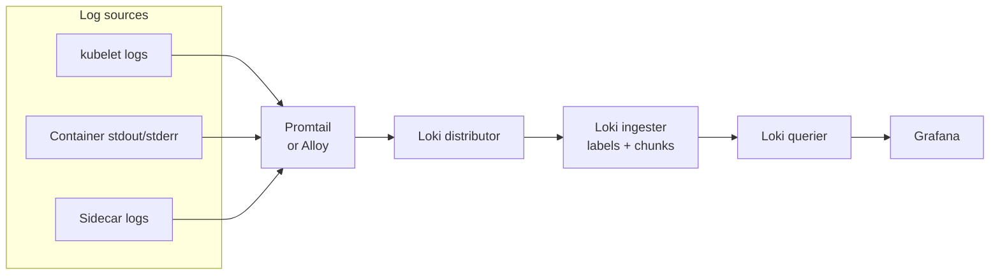
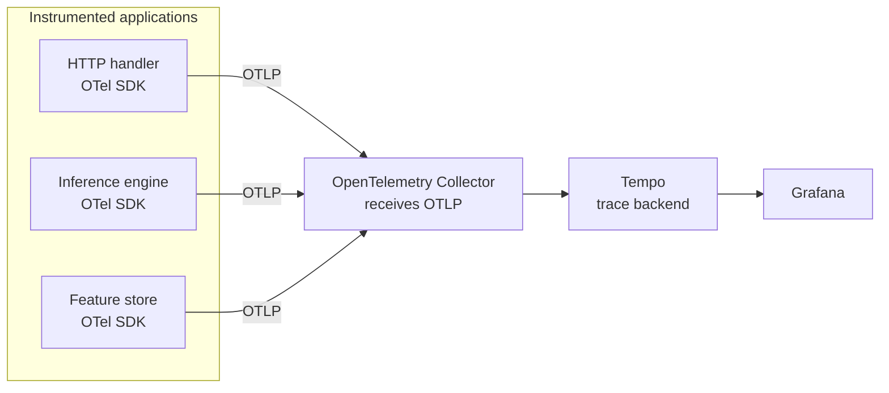
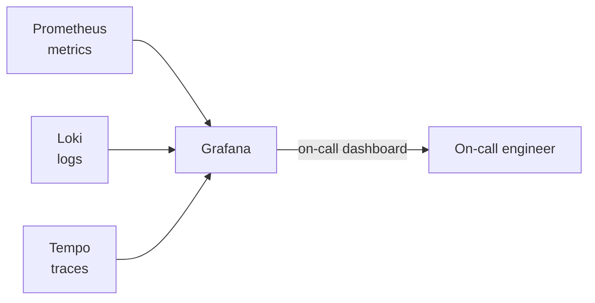

# 17.3 Logging with Loki and tracing with OpenTelemetry

| Field | Value |
|---|---|
| Level | Intermediate |
| Priority tier | 2 |
| Lab venue | GCP / GKE |
| Part | Part 17: Observability, performance and operations |
| Cross-references | Chapter 17.1 (Observability foundations); Chapter 17.2 (Prometheus and Grafana); Chapter 15.16 (Production serving stack); Chapter 16.7 (Serving platforms) |
| Coverage file | `planning/coverage/chapters/17-03.md` |
| Claim & number ledger | `planning/ledgers/17-03.md` |

## Why this matters for AI infrastructure

It is 3 a.m., and a model endpoint has started returning errors. The on-call engineer needs three answers fast: what broke, what the system was doing at that moment, and where the time went. Chapter 17.1 named the three pillars, and Chapter 17.2 covered metrics, which answer the first question. This chapter covers the other two, logs and traces, using Loki and OpenTelemetry.

Without logs, an engineer has to open a shell in each pod and read text by hand. Without traces, an engineer who sees 500 ms of latency cannot tell which step is slow, such as a 100 ms feature fetch hiding inside it.

```text
Why Loki + OpenTelemetry is on the critical path (background reading: NVIDIA Zero-to-Hero volume 16; Production Kubernetes; the figures below are examples, not quotations):
- A typical AI workload emits 10-100 MB of logs per pod per hour. A 100-pod cluster
  produces 1-10 GB of logs per hour. Without Loki, the team greps into pods; the
  team cannot search; the team cannot correlate.
- An LLM inference that takes 800 ms is decomposed into prefill (200 ms), decode
  (500 ms), feature fetch (100 ms). Without traces, the on-call cannot find
  the slow component; the on-call cannot optimise.
- The W3C Trace Context propagates from the HTTP handler into the LLM
  inference into the GPU kernel. The propagation makes the trace end-to-end;
  the propagation makes the AI workload observable.
```

The numbers in that block are example values, not measurements from a real system. Measure your own workload before you size storage or pick a sampling rate.

Trace context travels from one service to the next in HTTP headers. Each service must read the header to continue the trace.

Three decisions make this a platform concern rather than only a data-science concern.

1. Loki's label set is a platform decision. Every label adds to Loki's index, so the platform team decides which labels are allowed.
2. The OpenTelemetry Collector is the cluster's trace pipeline. It receives spans from every workload, batches them, and exports them to the backend.
3. Tail sampling is a platform decision too. Tracing every span costs too much, so the platform team decides which spans to keep.

**A workload whose logs lack structured fields is one the on-call cannot debug.** Its traces must also propagate from the HTTP handler through every service call to the inference engine, or the trail goes cold.

Check both before you call a workload production-ready.

## Prerequisites and outcomes

### Prerequisites

Read Chapter 17.1 first. It explains the three pillars and the shape of the data each one stores. Then read Chapter 17.2, which shows how Prometheus and Grafana connect to a data source. The rest of this chapter assumes both.

### Outcomes

By the end of this chapter, you will be able to do six things.

1. Set up Loki as the cluster's log store, with structured log labels.
2. Set up the OpenTelemetry Collector as the trace pipeline, with W3C Trace Context propagation.
3. Write LogQL queries for AI workload failures, such as error rates per model, trace correlation per training run, and drift events per feature.
4. Apply a tail-sampling policy that keeps the interesting spans and drops the rest.
5. Connect Loki and Tempo to Grafana in one dashboard.
6. Run Loki and OpenTelemetry on GKE with SLOs, observability, and a runbook.

If you have not read Chapter 17.2, read it before you touch Grafana in this chapter.

---

## 1. Loki

### 1.1 The Loki architecture

Suppose one pod out of a hundred fails overnight. You need its last few minutes of logs without logging into the node. Loki stores those logs, but first they must reach it.

Production Kubernetes, chapter 9, describes three ways logs leave a pod. The application can send its logs straight to the backend. A sidecar container can process them, or a node agent can collect the output of every pod on the node. Promtail or Alloy is the node agent in the diagram below.

Loki indexes logs by label, stores the log chunks in object storage, and answers queries written in LogQL.



Before you add a new log source, decide which agent will ship its lines to Loki.

### 1.2 The Loki labels

A label is a key-value pair that Loki indexes and uses to filter and aggregate logs. The labels you choose decide what Loki can find quickly. The table lists the labels a typical AI platform uses, with a rough sense of how many distinct values each one takes.

| Label | Cardinality | Source |
|---|---|---|
| `job` | Low | From the Kubernetes service |
| `namespace` | Medium | From the Kubernetes namespace |
| `pod` | Medium | From the Kubernetes pod name |
| `container` | Low | From the Kubernetes container name |
| `severity` | Low | From the log message |
| `model` | Low | From the application exporter |
| `run_id` | High | From the training script |
| `customer_id` | Very high | From the application |

Cardinality is the number of distinct values a label can take. Each distinct combination of labels forms its own log stream, so a label with a new value for every customer makes the index grow with your customer count. Production Kubernetes, chapter 9, gives the same warning about Prometheus labels: overusing them can make the server's resource use untenable.

Keep customer IDs and request IDs out of the labels. Write them into the JSON log message as fields instead, where they stay searchable without growing the index.

Before you add a label, count how many values it can take in a month.

### 1.3 LogQL for AI workloads

Suppose the error rate of one model climbs right after a deploy. You want the answer in one query, not a scroll through pods. LogQL is the language for that. A query starts with a label selector in braces, optionally adds a text filter, and then aggregates the result.

The basic shape is `{labels} |= "text"`. The braces pick the streams, and `|=` keeps only the lines that contain the text.

```logql
# The error rate per model over the last 5 minutes
sum by (model) (
  rate({severity="error", namespace="mlops"}[5m])
)

# The error logs for a specific training run
{run_id="abc-123", severity="error"}

# The throughput per model per minute
sum by (model) (
  rate({namespace="mlops", msg=~"inference_request_completed"}[1m])
)

# The latency warnings for a specific inference service
{inference_service="churn-model", level="warn"}

# The audit log entries from a specific user
{namespace="audit", user="alice"}
```

The first query counts errors per model over five minutes, which is the first thing to run when a deploy goes wrong. The second pulls every error from one training run by its run ID. The last three follow throughput, latency warnings, and audit entries.

A query returns nothing when a label is misspelled, and it raises no error. Test each query against a known failure first.

Turn the queries your on-call runs most often into dashboard panels.

### 1.4 Structured logging

A plain-text line about a failed request is hard to count. A JSON line with separate model, request ID, and duration fields can be filtered, counted, and graphed.

```python
# code/part17/structured_log.py
import logging
import json
from pythonjsonlogger import jsonlogger

logger = logging.getLogger("inference-service")

def log_request(model: str, request_id: str, duration_ms: float, status: str):
    logger.info(
        "Inference request completed",
        extra={
            "model": model,
            "request_id": request_id,
            "duration_ms": duration_ms,
            "status": status,
        },
    )
```

Loki can extract these fields from the JSON at query time. Every log line is JSON, every JSON line follows a documented schema, and CI checks that schema. A change that breaks a field name then fails the build before it reaches the cluster.

Before you accept a new service, check that its logs parse as JSON and carry the fields your queries need.

### 1.5 Getting container logs off the node

Logging in a Kubernetes-based platform covers how logs are captured, processed, and forwarded. The logs come from platform components and tenant workloads, and they travel to a storage backend. Writing logs to standard out and standard error became the prevalent best practice for service-oriented software, even before containers were common. Cloud native ecosystems add more workloads and instances, but those instances are ephemeral, and often nothing persists their logs on disk.

Applications used to write logs to a file on disk. Collecting them was simple, because there were fewer workloads and fewer instances. Containers changed that habit. Applications now write to standard out and standard error, the same way a command-line tool does. Those workloads are ephemeral, and often no disk keeps their logs, so collection and storage became harder.

Replicas make the problem worse. A workload with dozens of replicas is almost impossible to analyze without a central collection point. That point lets you search log entries across every replica at once.

There are three ways to process logs from containerized workloads:

- **Application forwarding:** the application sends its logs directly to the backend. Developers must build and maintain that code, and a backend change can force an application update. This approach is rare in production. It only makes sense for a legacy application that already integrates with a log backend and is being moved to the platform.
- **Sidecar processing:** the application writes log files to storage shared within the Pod, and a sidecar container reads and processes them. The sidecar either forwards the logs to the backend or writes them to standard out and standard error. Forwarding is a workaround for platforms with no log aggregation system. Writing to standard streams is useful only for an application that cannot write to them directly.
- **Node agent forwarding:** a log workload runs on every node. It reads the log files that the container runtime writes for each container, and it forwards them to the backend.

Node agent forwarding is the model to use, and it is by far the most common. It has several advantages. There is one integration point with the backend, instead of one per application or sidecar. Filtering, metadata, and forwarding to several backends are configured in one place. The kubelet or the container runtime handles log rotation. An application that writes log files inside its container needs its own rotation, or a sidecar that does it.

Fluentd and Fluent Bit are the usual tools for node agent forwarding. Fluentd came first. It is written mainly in Ruby and has a large plug-in ecosystem. Fluent Bit came from the need for a lighter tool for environments such as embedded Linux. It is written in C, uses far less memory, and has fewer plug-ins.

Use Fluent Bit unless a Fluentd plug-in offers a feature you need. If you do need one, run Fluent Bit as the node agent, deployed as a DaemonSet. Then run Fluentd as a cluster-wide aggregator, deployed as a Deployment or a StatefulSet. Fluent Bit sends logs to Fluentd, and Fluentd adds tags and routes the logs to the backends that developers use.

Centralizing log collection creates a single point of failure for each node, or for the whole cluster if you use a cluster-wide aggregator. A node agent that is overloaded by one noisy workload can stop collecting logs for every other workload on that node. A Fluentd aggregator that runs as a Deployment buffers logs in the ephemeral storage of its Pod. If the Pod is killed before it flushes the buffer, those logs are lost. Running the aggregator as a StatefulSet keeps the buffered logs safe when the Pod goes down.

### 1.6 Kubernetes audit logs

Audit logs record who did what in the cluster. Turn them on in production, so you can find the root cause when something goes wrong. Some compliance requirements also demand them.

The API server writes audit logs when you enable them with flags. It can record every stage of every request, including request and response bodies. Few teams want that much data, because the API server handles a very large number of calls. An audit policy selects which requests and stages to log. Without an audit policy, the API server writes no audit logs at all. Point the API server at the policy file on the control plane node with the `--audit-policy-file` flag.

The policy below limits the log volume without losing the important data.

```yaml
apiVersion: audit.k8s.io/v1
kind: Policy
rules:
- level: None
  users: ["system:kube-proxy"]
  verbs: ["watch"]
  resources:
  - group: "" # core
    resources: ["endpoints", "services", "services/status"]
- level: Metadata
  resources:
  - group: ""
    resources: ["secrets", "configmaps"]
  - group: authentication.k8s.io
    resources: ["tokenreviews"]
  omitStages:
  - "RequestReceived"
- level: Request
  verbs: ["get", "list", "watch"]
  resources:
  - group: ""
  - group: "apps"
  - group: "batch"
  omitStages:
  - "RequestReceived"
- level: RequestResponse
  resources:
  - group: ""
  - group: "apps"
  - group: "batch"
  omitStages:
  - "RequestReceived"
# Default level for all other requests.
- level: Metadata
  omitStages:
  - "RequestReceived"
```

Each level records a different amount of detail. The `None` level tells the API server to skip matching events. In this policy, a watch by the `system:kube-proxy` user on endpoints and services is never logged.

The `Metadata` level records only request metadata. That covers which user made which kind of request for which resource. It leaves out the request and response bodies. The `RequestReceived` stage is omitted, so the API server writes no entry when a request first arrives. It still writes entries when a long-running watch starts, when a response completes, and when a panic occurs.

The `Request` level adds the request body, but not the response body. For `get`, `list`, and `watch` requests, the response can be very large, so leaving it out saves space. The `RequestResponse` level logs the most. It records the request metadata, the request body, and the response body. In this policy, it applies to every other request in the listed groups, so it is the effective default for those groups.

Resources that no earlier rule matches fall through to the final rule. That rule records metadata only, and it skips the `RequestReceived` entry.

Forward audit logs to a backend the same way you forward other logs. With application forwarding, the API server sends logs straight to a webhook backend. A flag points to a config file that holds the address and credentials, in kubeconfig format. You must tune the buffering and batching settings, or events can be lost. For example, a buffer size for the number of events that is too small will overflow, and the overflow drops events.

With node agent forwarding, the API server writes log files to the control plane node's file system. Flags control the file path, the maximum retention period, the maximum number of files, and the maximum file size. Fluent Bit and Fluentd can then aggregate and forward those files. This is a good pattern if your team already uses those tools for node agent forwarding.

### 1.7 Kubernetes Events

Events are a native Kubernetes resource. Platform components use them to report what happened to an object, so they work as a kind of platform log. Unlike other logs, Events usually stay out of the logging backend. They are stored in etcd and kept for one hour by default. Operators most often read them when they want to know what actions were taken against an object.

`kubectl describe` shows the Events for one Pod. The output below is from a newly created Pod.

```
$ kubectl describe pod nginx-6db489d4b7-q8ppw
Name:         nginx-6db489d4b7-q8ppw
Namespace:    default
...
Events:
  Type    Reason     Age        From                                Message
  ----    ------     ----       ----                                -------
  Normal  Scheduled  <unknown>  default-scheduler                   Successfully assigned default/nginx-6db489d4b7-q8ppw
  Normal  Pulling    34s        kubelet, ip-10-0-0-229.us-east-2.compute.internal   Pulling image "nginx"
  Normal  Pulled     30s        kubelet, ip-10-0-0-229.us-east-2.compute.internal   Successfully pulled image "nginx"
  Normal  Created    30s        kubelet, ip-10-0-0-229.us-east-2.compute.internal   Created container nginx
  Normal  Started    30s        kubelet, ip-10-0-0-229.us-east-2.compute.internal   Started container nginx
```

To see Events for a whole namespace, run `kubectl get events -n default`. This view also includes Events for the ReplicaSet and the Deployment, not only for the Pod.

```
$ kubectl get events -n default
LAST SEEN   TYPE     REASON               OBJECT                              MESSAGE
2m5s        Normal   Scheduled            pod/nginx-6db489d4b7-q8ppw          Successfully assigned default/nginx-6db489d4b7-q8ppw
2m5s        Normal   Pulling              pod/nginx-6db489d4b7-q8ppw          Pulling image "nginx"
2m1s        Normal   Pulled               pod/nginx-6db489d4b7-q8ppw          Successfully pulled image "nginx"
2m1s        Normal   Created              pod/nginx-6db489d4b7-q8ppw          Created container nginx
2m1s        Normal   Started              pod/nginx-6db489d4b7-q8ppw          Started container nginx
2m6s        Normal   SuccessfulCreate     replicaset/nginx-6db489d4b7         Created pod: nginx-6db489d4b7-q8ppw
2m6s        Normal   ScalingReplicaSet    deployment/nginx                    Scaled up replica set nginx-6db489d4b7 to 1
```

The Kubernetes API exposes Events, so you could write automation that watches for specific Events and reacts to them. In practice, few teams do this. Another option is an Event exporter, which turns Events into metrics. The exporters section of the Prometheus material explains how those metrics are scraped.

### 1.8 Alerting on logs and log access

Application logs describe how your software behaves. They matter most when an unexpected failure needs investigation. Patterns in the logs often reveal what comes before a problem. If you want an alert based on a logged event, consider metrics first. Expose a metric that represents the behavior, then write the alerting rule against that metric. Log messages change more often than metrics do, and a small edit to the text can silently break an alert.

Think about access to the logs in your backend, too. You may not want production API server audit logs visible to everyone. Some systems hold information that only privileged users should see. Restricting access can change how you tag logs, and it may require several backends. That changes the forwarding configuration.

---

## 2. OpenTelemetry

### 2.1 The OpenTelemetry architecture

A slow request crosses several services, such as an HTTP handler, an inference engine, and a feature store. A trace is the record of that one request across all of them. OpenTelemetry (OTel) is the standard for producing that record. It defines the data model, which covers spans, traces, metrics, and logs. It also defines the API that applications use to create spans, and the OTLP protocol that carries them.

Production Kubernetes, chapter 9, uses the same model. A trace is made of spans, with one span for each service that handles the request. Tags are the searchable metadata attached to each span.

The diagram shows how the pieces connect.



Each workload uses the OTel SDK, which creates spans and attaches the W3C Trace Context. The SDK sends the spans to the Collector over OTLP. The Collector batches them and exports them to Tempo, and Grafana reads them from there.

### 2.2 The OpenTelemetry Collector

The Collector sits between your applications and the trace backend. You can run it as a DaemonSet, with one copy per node, for low-latency collection. You can also run it as a Deployment for central processing.

```yaml
# code/part17/otel_collector.yaml
receivers:
  otlp:
    protocols:
      grpc:
        endpoint: 0.0.0.0:4317
      http:
        endpoint: 0.0.0.0:4318

processors:
  batch:
    timeout: 1s
    send_batch_size: 1024
  memory_limiter:
    check_interval: 1s
    limit_percentage: 80
  tail_sampling:
    decision_wait: 10s
    num_traces: 100000
    expected_new_traces_per_sec: 1000
    policies:
      - name: errors
        type: status_code
        status_code:
          status_codes: [ERROR]
      - name: slow-traces
        type: latency
        latency:
          threshold_ms: 500
      - name: sample-default
        type: probabilistic
        probabilistic:
          sampling_percentage: 10

exporters:
  otlp/tempo:
    endpoint: tempo.monitoring:4317
    tls:
      insecure: true
  prometheus:
    endpoint: 0.0.0.0:8889

service:
  pipelines:
    traces:
      receivers: [otlp]
      processors: [memory_limiter, tail_sampling, batch]
      exporters: [otlp/tempo]
    metrics:
      receivers: [otlp]
      processors: [batch]
      exporters: [prometheus]
```

The pipeline reads from top to bottom. It receives OTLP from every workload, applies the memory limit, makes the sampling decision, batches the spans, and exports them to Tempo. The metrics pipeline sends metrics to a Prometheus exporter on port 8889, which Prometheus scrapes. Tempo stores traces only, so metrics must not go there. Set the memory limit before you tune the sampling policy, because an out-of-memory restart drops spans.

The numbers in this file are example values. Set the batch size, memory limit, and sampling rate for your own traffic.

### 2.3 Tail sampling

Tail sampling waits until a trace is complete before it decides what to keep. That lets the decision use the whole trace, so a failed or slow request can be kept every time. Head sampling would have to decide at the start, before anyone knows how the request will end.

| Policy | What it does |
|---|---|
| `status_code` | Keep all traces that contain an ERROR span |
| `latency` | Keep all traces whose root span exceeds a threshold |
| `probabilistic` | Keep a random sample of traces |
| `composite` | Combine multiple policies |

This chapter's example policy keeps 100 percent of error traces, keeps every trace slower than 500 ms, and keeps 10 percent of healthy traces as a baseline. Those thresholds are examples. Choose your own from your latency targets and your storage budget. The policy also sets the storage cost, because every kept trace takes disk space.

Before you tune the sampling rate, decide how many traces a month you can afford to store.

### 2.4 Trace context propagation

A trace breaks at the first service that forgets to pass it on. The W3C Trace Context standard prevents that with the `traceparent` header. The header carries the trace ID and the parent span ID from the client, through the server and the database, to the inference engine.

```python
# code/part17/snippets/trace_propagation.py
import requests
from opentelemetry import trace
from opentelemetry.trace.propagation.tracecontext import TraceContextTextMapPropagator

tracer = trace.get_tracer(__name__)

@tracer.start_as_current_span("http-handler")
def handle_request(request):
    # Propagate the trace context to downstream services
    headers = {}
    TraceContextTextMapPropagator().inject(headers)
    response = requests.post(
        "http://llm-inference/v1/chat/completions",
        headers=headers,
        json=request.json(),
    )
    return response.json()
```

The SDK's propagator writes the header into every outgoing request. The downstream service reads it and starts a child span, so the trace stays whole. The on-call can follow the trace from the HTTP handler to the inference engine. Trace context travels in HTTP headers between services; it does not reach inside a GPU kernel, so kernel-level detail comes from a profiler.

Production Kubernetes, chapter 9, adds that a service mesh does not remove the need for instrumentation. Request headers still have to pass from one service to the next.

Before you call a service instrumented, send one request through it and check that the trace shows a child span.

### 2.5 Traces, spans and tags

Distributed tracing follows one request as it moves across services. OpenTracing is an open source specification for distributed tracing. Its goal is to help the ecosystem agree on common standards for implementations. The specification is built around three concepts.

- **Trace:** when an end user makes a request, that request traverses several distinct services. Each one participates in satisfying it. The trace represents that whole transaction, and it is what you analyze. A trace is made of spans.
- **Span:** each distinct service that processes a request represents a span. The operations occurring inside one workload's boundaries constitute a single span that belongs to the trace.
- **Tag:** tags are metadata attached to spans. They contextualize each span within its trace, and they provide searchable indexes.

When traces are visualized, you see each one and the components that are impacting performance the most. The same view shows where errors occur and how they are affecting other components of the application.

OpenTracing merged with OpenCensus to form OpenTelemetry. *Production Kubernetes*, chapter 9, notes that OpenTelemetry support in Jaeger was still experimental when it was written. It also expects OpenTelemetry to become the de facto standard. The rest of this chapter follows that direction.

### 2.6 Tracing components on the platform

A platform that offers tracing needs several components. The patterns below apply to open source projects such as Zipkin and Jaeger. Commercial products that implement the OpenTracing standards often follow the same models.

- **Agent:** a server that applications send their spans to. On Kubernetes, it usually runs as a node agent on every machine and receives the spans of every workload on that node. It forwards batched spans to a central collector.
- **Collector:** processes the spans and stores them in the backend database. It validates, indexes, and transforms spans before it writes them to storage.
- **Storage:** Cassandra and Elasticsearch are the usual choices. Even with sampling, tracing produces very large volumes of data. The database must search that data quickly enough to make the analysis useful.
- **API:** exposes the stored traces and spans to other workloads and to visualization layers.
- **User interface:** the layer that application developers use. It queries the API and shows charts that help engineers analyze their distributed applications.

Section 2.2 describes the OpenTelemetry Collector, which fills a similar role in the stack covered here. Run the Collector close to the workloads for low latency, or centrally for heavier processing.

### 2.7 Instrumentation and service meshes

Spans become traces only when applications send them. A tracing platform cannot correlate data that applications never report. Get buy-in from application teams before you build the service. The best tracing platform is useless if the applications do not deliver the raw data it needs.

Compatibility matters more for tracing than for logs and metrics. Logs need no special handling as long as the application writes to standard out and standard error. CPU and memory can be collected without special instrumentation. Tracing is different. If an application uses a client library that the platform's tracing system does not support, tracing will not work at all. Platform and application teams must work closely together for this reason.

If you use a service mesh, include the mesh data in your traces. Mesh proxies sit on the requests going to and from your workloads. Timing spans from those proxies show how the mesh affects performance. Applications still need their own instrumentation, because the request headers must pass from one service to the next.

Before you roll out tracing, confirm that each application's tracing library works with the platform's tracing system.

---

## 3. Integration with Grafana

A metric spike tells you that something changed, but not why. Grafana can show that spike next to the logs and traces from the same minute, which narrows down the why.

### 3.1 The unified Grafana data sources

Grafana reads from three sources. Prometheus holds the metrics, Loki holds the logs, and Tempo holds the traces. One on-call dashboard can combine all three.



Each panel should link to the other two pillars. When an engineer clicks a metric spike, the dashboard opens the logs and traces from that moment.

AI Systems Performance Engineering, chapter 16, makes the same point. APM tools and OpenTelemetry can correlate logs and traces with metrics, which gives you one timeline across the whole system.

### 3.2 The trace-to-logs link

The trace ID is the join key between traces and logs. If a log line carries the trace ID, you can paste that ID into Loki and see every line from that request.

```python
# code/part17/trace_log_link.py
import logging
from opentelemetry import trace

logger = logging.getLogger("inference-service")
tracer = trace.get_tracer(__name__)

@tracer.start_as_current_span("inference-request")
def handle_inference(prompt: str):
    # Add the trace id to the log line
    span = trace.get_current_span()
    trace_id = format(span.get_span_context().trace_id, "032x")
    logger.info(
        "Inference request started",
        extra={"trace_id": trace_id, "prompt_length": len(prompt)},
    )
```

The function above stamps the trace ID onto a log line at the start of each request. That stamp is what lets you join the line to its trace later.

### 3.3 The exemplar-to-trace link

A metric value alone does not name the request behind it. An exemplar attaches a trace ID to a metric sample, so the dashboard can link a bucket of slow requests to one trace that landed in it.

```promql
# A metric query that returns exemplars
inference_request_duration_seconds_bucket{le="0.5"} with Exemplars
```

The application emits the trace ID with the metric. Prometheus stores it alongside the sample, and Grafana draws it as a link. Clicking a spike then opens a trace that produced it.

Before you rely on the spike link, click it once during a test and confirm it opens a real trace.

---

## 4. Operating Loki and OpenTelemetry on GKE

Logging and tracing are only useful while they keep running, so the stack needs its own operating rules. Each component runs in a different place and has its own latency target.

### 4.1 The components

The table lists where each component runs and the latency target this chapter uses as an example.

| Component | Where it runs | Backing store | SLO |
|---|---|---|---|
| Loki | Kubernetes Deployment | Object storage for chunks | Query latency p99 < 5 s |
| Promtail / Alloy | DaemonSet | (tails logs to Loki) | Tail latency p99 < 1 s |
| OpenTelemetry Collector | DaemonSet + Deployment | (forwards to backend) | Export latency p99 < 5 s |
| Tempo | Kubernetes Deployment | Object storage for traces | Query latency p99 < 5 s |

These latency figures are example values, not targets taken from a source. Measure the stack under real load, then pick targets your team can defend.

### 4.2 IAM and the label cardinality

Each role should get only the access it needs. The table pairs each role with what it can do. The role names are a pattern to map onto your own identity system.

| Role | Who | What they can do |
|---|---|---|
| `loki.reader` | Every team's data scientists | Query LogQL; view logs |
| `loki.writer` | Promtail / Alloy | Write logs to Loki |
| `otel.reader` | Every team's data scientists | Query Tempo; view traces |
| `otel.writer` | The OpenTelemetry SDK | Write spans to the Collector |

Label discipline is still the platform team's job. Keep Loki labels low cardinality, and move high-cardinality fields into the log message.

### 4.3 Observability

The stack needs its own dashboards and alerts, so you learn when logging or tracing itself starts to degrade. The table lists five metrics and an example alert for each one. The alert thresholds are examples too.

| Metric | Why it matters | Alert |
|---|---|---|
| Loki query latency p99 | Hot path for log queries | > 10 s |
| Loki ingest rate | Hot path for log ingestion | > cluster rate |
| Collector export latency p99 | Hot path for span export | > 10 s |
| Tempo query latency p99 | Hot path for trace queries | > 10 s |
| Trace context propagation rate | Catches broken propagation | < 100% for 1 hour |

The trace context propagation rate matters most. A broken rate leaves traces incomplete, so the on-call cannot follow a request from end to end. The alert catches a new workload that has stopped passing the trace context.

Before you launch a new workload, check that the propagation rate holds at its baseline.

---

## 5. How it fails

You will meet six failure modes again and again. Each one gives you a symptom to spot first, a likely cause, and a fix.
### 5.1 "Loki is running out of disk"

**Symptom:** Loki's ingest fails. Logs stop flowing, and the on-call cannot query them.

**Diagnosis:** The object storage bucket is full. Usually the chunk lifecycle is not pruning old data, or the retention period is longer than the bucket can hold.

**Fix:** Check the bucket size and the chunk lifecycle policy first. Then shorten the retention period, and add an alert on storage use.

### 5.2 "The trace context is broken"

**Symptom:** A trace stops at the HTTP handler. The inference engine's child spans are missing.

**Diagnosis:** The header is not reaching the inference service. The engine starts a new trace instead of a child span.

**Fix:** Confirm the handler sets the W3C Trace Context header (`traceparent`) on every outgoing request, and that the engine reads it. Then add an integration test that checks a trace crosses both services.

### 5.3 "The tail-sampling policy is dropping the interesting traces"

**Symptom:** The on-call cannot find the trace for the incident, because the sampler dropped it.

**Diagnosis:** The policy is too aggressive, so it removes traces you need.

**Fix:** Keep 100 percent of error traces and 100 percent of slow traces. Then raise the share of healthy traces you keep, so the baseline stays useful.

### 5.4 "The structured logs are missing the schema"

**Symptom:** The on-call cannot filter by field, because the fields are not in the message.

**Diagnosis:** The application writes unstructured text, so there is no schema to query against.

**Fix:** Standardise on the OpenTelemetry log SDK, declare the schema, and enforce it in CI. Then check the schema on production logs too.

### 5.5 "The Collector is OOM"

**Symptom:** The Collector restarts, spans are dropped, and traces are incomplete.

**Diagnosis:** The memory limit is too low for the batch size, or the propagation creates more spans than the Collector can hold.

**Fix:** Raise the memory limit or lower the batch size, and add a memory limiter processor. Then check the trace context propagation rate.

### 5.6 "The exemplar is missing"

**Symptom:** The on-call clicks a metric spike, and the dashboard shows no trace.

**Diagnosis:** The application does not emit exemplars, so nothing links the metric to a trace.

**Fix:** Wire the OTel SDK to emit exemplars, and test that every metric sample carries one. Add an integration test for it.

When you see one of these symptoms, start with it and check the layer that owns it.

---

## 6. Hands-on lab

This lab sets up Loki and the OpenTelemetry Collector on GKE. It then configures structured logs and trace propagation, and checks the result in Grafana. The lab has not been tested in this repository, so treat each expected output as something to verify.

### 6.1 Prerequisites

- A GKE Autopilot or Standard cluster (1.27+).
- Helm 3 for installing the observability stack.
- A workload that emits logs and traces (a Python application with the OTel SDK).

### 6.2 Step 1: install Loki

Install Loki first, so Grafana has a log store to query.

```bash
helm repo add grafana https://grafana.github.io/helm-charts
helm install loki grafana/loki-stack \
  --namespace monitoring --create-namespace \
  --set loki.limits_config.retention_period=30d
# expected: Loki pods are running; Loki is exposed via Grafana
```

### 6.3 Step 2: install the OpenTelemetry Collector

Install the Collector as a DaemonSet, so each node runs one copy. Point its exporter at Tempo.

```bash
helm install otel-collector open-telemetry/opentelemetry-collector \
  --namespace monitoring \
  --set mode=daemonset \
  --set configmap.config.exporters.otlp.endpoint=tempo.monitoring:4317
# expected: the OpenTelemetry Collector pods are running as a DaemonSet
```

### 6.4 Step 3: install Tempo

Install Tempo next, with its OTLP receiver listening on port 4317.

```bash
helm install tempo grafana/tempo \
  --namespace monitoring \
  --set tempo.receiver.otlp.protocols.grpc.endpoint=0.0.0.0:4317
# expected: Tempo pods are running; Tempo is exposed via Grafana
```

### 6.5 Step 4: deploy a workload with structured logging

Deploy a small workload that writes JSON logs. Each line carries a model name and a step number, which the next query filters on.

```python
# code/part17/structured_logging_demo.py
import logging
from pythonjsonlogger import jsonlogger
import sys

logger = logging.getLogger("demo")
logger.setLevel(logging.INFO)
handler = logging.StreamHandler(sys.stdout)
formatter = jsonlogger.JsonFormatter(
    "%(asctime)s %(levelname)s %(name)s %(message)s",
    rename_fields={"asctime": "timestamp", "levelname": "severity"},
)
handler.setFormatter(formatter)
logger.addHandler(handler)

logger.info("Structured log emitted", extra={"model": "churn-model", "step": 1000})
```

```bash
kubectl apply -f code/part17/logging_workload.yaml -n mlops
kubectl logs -n mlops -l app=logging-demo
# expected: structured JSON logs with model and step fields
```

### 6.6 Step 5: query the logs by structured fields

Ask Loki's API for the lines labelled with the model. The output should contain only the churn-model lines.

```bash
curl -G http://loki.monitoring:3100/loki/api/v1/query \
  --data-urlencode 'query={model="churn-model"}' | jq .
# expected: the log lines with the churn-model label
```

### 6.7 Step 6: instrument a workload with OTel

The demo below sends spans to the Collector through a batch processor. It creates one outer span and one inner span, so you can see the parent and child relationship in Tempo.

```python
# code/part17/snippets/otel_instrumentation_demo.py
from opentelemetry import trace
from opentelemetry.sdk.trace import TracerProvider
from opentelemetry.sdk.trace.export import BatchSpanProcessor
from opentelemetry.exporter.otlp.proto.grpc.trace_exporter import OTLPSpanExporter

provider = TracerProvider()
processor = BatchSpanProcessor(OTLPSpanExporter(endpoint="otel-collector.monitoring:4317", insecure=True))
provider.add_span_processor(processor)
trace.set_tracer_provider(provider)

tracer = trace.get_tracer(__name__)

with tracer.start_as_current_span("demo-request"):
    tracer.start_as_current_span("inner-step").end()
```

### 6.8 Step 7: query the traces

Search Tempo for traces from the demo service. The command returns trace IDs that you can open in Grafana.

```bash
curl -s http://tempo.monitoring:3100/api/search?tags=service.name=demo | jq .
# expected: the trace IDs for the demo service
```

### 6.9 What to record

After the lab, you should be able to answer five questions quickly. This chapter uses five seconds per answer as an example target. It treats an answer slower than 30 seconds as a sign the stack is not yet ready for production. Set your own bar with your team.

1. What is the current Loki query latency p99?
2. What is the current Collector export latency p99?
3. What is the most recent error log?
4. What is the most recent trace ID?
5. What is the current trace context propagation rate?

The lab has not been run against a live GKE cluster. Run it once end to end before you rely on any of these commands.

---

## Exercises

1. **Add a structured log schema.** Define a JSON schema for the application logs, emit it from the application, and check it in CI. *Solution sketch:* a Pydantic model that emits structured JSON, and a CI step that validates the log output against the schema.
2. **Add a tail-sampling policy.** Keep 100% of error traces and 10% of healthy traces. *Solution sketch:* the tail_sampling processor from Section 2.2, with its expected_new_traces_per_sec and num_traces settings.
3. **Add a trace-to-logs link.** Put the trace ID in every log line, then check that you can query Loki with it. *Solution sketch:* the OTel SDK's span context written into the log message, and Loki's label extraction from JSON.
4. **Add a Loki cardinality alert.** Alert when any log stream's label cardinality exceeds 1000. *Solution sketch:* a Prometheus alert on Loki's internal metrics.
5. **Add a Tempo cardinality alert.** Alert when any trace's span count exceeds 10000. *Solution sketch:* a Prometheus alert on Tempo's internal metrics.
6. **Add a unified Grafana dashboard.** Build a dashboard that links metrics, logs, and traces for a single request. *Solution sketch:* a Grafana data source for each of Prometheus, Loki, and Tempo, the dashboard's panels, and the trace-to-logs link.

The thresholds in these exercises are starting points. Tune them to your own cluster before you rely on them.

---

## Checkpoint questions

<details><summary>1. Loki ingest fails, logs stop flowing and the on-call cannot query them. What do you check and in what order?</summary>
The object storage bucket is probably full. Check the bucket size and the chunk lifecycle policy first, since the lifecycle may not be pruning old data. Then shorten the retention period and add an alert on storage use.
</details>

<details><summary>2. A trace stops at the HTTP handler and the inference engine's child spans are missing. What is the cause and the fix?</summary>
The header is not reaching the inference service, so the engine starts a new trace instead of a child span. Confirm the handler sets the `traceparent` header on every outgoing request and that the engine reads it. Add an integration test that checks a trace crosses both services.
</details>

<details><summary>3. After an incident the on-call cannot find the trace for the failing requests. What is wrong with the sampling policy?</summary>
The policy is too aggressive and drops traces you need. Keep 100 percent of error traces and 100 percent of slow traces. Then raise the share of healthy traces you keep so the baseline stays useful.
</details>

<details><summary>4. The on-call cannot filter logs by field because the fields are not in the message. What do you change?</summary>
The application writes unstructured text, so there is no schema to query against. Standardise on the OpenTelemetry log SDK, declare the schema and enforce it in CI. Then check the schema on production logs too.
</details>

<details><summary>5. The Collector restarts, spans are dropped and traces are incomplete. What do you do?</summary>
The memory limit may be too low for the batch size, or propagation may create more spans than the Collector can hold. Raise the memory limit or lower the batch size, and add a memory limiter processor. Then check the trace context propagation rate.
</details>

<details><summary>6. The on-call clicks a spike on a latency panel and no trace opens. Why, and what do you fix?</summary>
The application does not emit exemplars, so nothing links the metric sample to a trace. Wire the OTel SDK to emit exemplars and test that metric samples carry one. Add an integration test for it.
</details>

<details><summary>7. Why do customer IDs and request IDs belong in the JSON message and not in Loki labels?</summary>
Each distinct combination of labels forms its own log stream, so a label with a new value per customer makes the index grow with your customer count. Written as fields in the JSON message, the values stay searchable without growing the index. Count how many values a label can take in a month before you add it.
</details>

<details><summary>8. Why does a LogQL query with a misspelled label return nothing and raise no error?</summary>
The selector simply matches no streams, so the result is empty and not an error. An empty result can then look like a healthy system. That is why the chapter says to test each query against a known failure first.
</details>

<details><summary>9. Why does tail sampling keep failed and slow requests every time, when head sampling cannot?</summary>
Tail sampling waits until a trace is complete before deciding, so the decision uses the whole trace. Head sampling decides at the start, before anyone knows how the request will end. So it may drop the very request that later fails.
</details>

<details><summary>10. Why does the chapter prefer alerting on a metric rather than on a log message?</summary>
Log messages change more often than metrics do, and a small edit to the text can silently break an alert. Expose a metric that represents the behavior and write the alerting rule against it. Logs are best for investigating after the alert.
</details>

<details><summary>11. Why does a trace-to-logs link need the trace ID inside each log line?</summary>
The trace ID is the join key between traces and logs. If a line carries it, you can paste it into Loki and see every line from that request. Without the ID stamped on the line, there is nothing to join on.
</details>

<details><summary>12. Would you use application forwarding, a sidecar or a node agent to ship logs, and what do you give up with the winner?</summary>
Use a node agent, which is by far the most common. You get one integration point with the backend, and filtering, metadata and forwarding are configured in one place. You give up isolation, because a node agent overloaded by one noisy workload can stop collecting logs for every other workload on that node.
</details>

<details><summary>13. Should you run Fluentd or Fluent Bit as the node agent, and when does the aggregator change the answer?</summary>
Use Fluent Bit unless a Fluentd plug-in offers a feature you need. Fluent Bit is written in C, uses far less memory and has fewer plug-ins. If you need a Fluentd plug-in, keep Fluent Bit as the DaemonSet node agent and run Fluentd as a cluster-wide aggregator.
</details>

<details><summary>14. Should the Fluentd aggregator run as a Deployment or a StatefulSet, and what is the trade-off?</summary>
As a Deployment it buffers logs in the Pod's ephemeral storage, so if the Pod is killed before it flushes, those logs are lost. As a StatefulSet the buffered logs stay safe when the Pod goes down. A centralized aggregator is still a single point of failure for the whole cluster.
</details>

<details><summary>15. Why would you drop `system:kube-proxy` watches from the audit policy while still logging secrets at `Metadata` level?</summary>
An audit policy limits volume without losing the important data. The kube-proxy watches on endpoints and services are noisy, so the `None` level skips them. Secrets are logged at `Metadata`, which records who did what but leaves out the request and response bodies.
</details>

<details><summary>16. A 100-pod cluster has each pod emit between 10 MB and 100 MB of logs per hour. What is the range for the whole cluster?</summary>
At the low end, 100 times 10 MB is 1,000 MB, which is about 1 GB per hour. At the high end, 100 times 100 MB is 10,000 MB, which is about 10 GB per hour. The chapter treats these as example values to replace with your own measurements.
</details>

<details><summary>17. A tail-sampling policy keeps all error traces, all traces over 500 ms and 10 percent of healthy traces. Out of 10,000 healthy, fast traces, how many are kept?</summary>
Ten percent of 10,000 is 1,000 traces. The rest are dropped. Any trace with an error or a root span above 500 ms is kept whatever its share.
</details>

<details><summary>18. An 800 ms inference splits into prefill 200 ms and decode 500 ms. How long is the remaining step, and which step would you inspect first?</summary>
The rest is 800 minus 200 minus 500, which is 100 ms for feature fetch. Decode is the largest at 500 ms, so look there first. The numbers are illustrations, not measurements.
</details>

<details><summary>19. A new workload shows up with broken traces. What do you check first, second and third?</summary>
First check the trace context propagation rate, which should hold at its baseline. Second send one request through the service and look for a child span. Third check whether the application's tracing client library is supported by the platform's tracing system, since an unsupported library means tracing does not work at all.
</details>

<details><summary>20. An error rate per model jumped right after a deploy. In what order do you use the three pillars and which LogQL do you run first?</summary>
Start with metrics to see the symptom. Then run the error rate query per model, `sum by (model) (rate({severity="error", namespace="mlops"}[5m]))`, which the chapter calls the first thing to run when a deploy goes wrong. Last open a trace for a slow or failing request to see where the time went.
</details>

---

## Sources and review notes

- Grafana Loki official documentation. Source for the Loki architecture, the label cardinality discipline, the LogQL query language, and the operational patterns.
- Grafana Tempo official documentation. Source for the Tempo architecture, the trace storage, and the integration with Grafana.
- OpenTelemetry official documentation. Source for the OTel data model, the SDK, the OTLP protocol, the Collector, and the W3C Trace Context standard.
- NVIDIA Zero-to-Hero Volume 16 (`chapter-06-loki-logging.md`, `chapter-07-opentelemetry-tracing.md`). Source for the operational patterns of Loki and OpenTelemetry on AI infrastructure. The wording has been rewritten in the handbook's voice.
- *Production Kubernetes* (`production-kubernetes`, Chapter 9). Source for the Loki integration with Kubernetes and the operational patterns.

### Cross-references to other handbook chapters

- Chapter 17.1 for the three pillars and the data shape.
- Chapter 17.2 for the Prometheus and Grafana integration.
- Chapter 15.16 for the production serving stack that emits the traces.
- Chapter 16.7 for the serving platforms that emit the logs and traces.

### Migrated from `nvidia-devops`

The Loki + OpenTelemetry operational patterns draw on Volume 16 chapters 6-7. The wording has been rewritten in the handbook's voice.

### Explicitly labelled inferences

- The tail-sampling policy in Section 2.2 is a starting point; specific policies depend on the workload and the storage budget.
- The structured log schema in Section 1.4 is a starting point; specific schemas depend on the use case.
- The Loki label cardinality budget is a starting point; specific budgets depend on the cluster's memory budget.

### Not verified on live hardware

- The lab in Section 6 is **untested** against a live GKE cluster in this repository.
- The Loki, Tempo, and OpenTelemetry Collector versions assumed in the lab should be pinned against the current releases before production use.
- The tail-sampling policies in the lab are illustrative; production policies depend on the workload.
