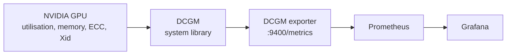

# 17.4 DCGM exporter and interpreting GPU metrics

| Field | Value |
|---|---|
| Level | Advanced |
| Priority tier | 2 |
| Lab venue | GCP / GKE |
| Part | Part 17: Observability, performance and operations |
| Cross-references | Chapter 10.21 (GPU health: DCGM, ECC, Xid); Chapter 16.10 (Monitoring and drift); Chapter 17.2 (Prometheus and Grafana); Chapter 11 (GPU Kubernetes) |
| Coverage file | `planning/coverage/chapters/17-04.md` |
| Claim & number ledger | `planning/ledgers/17-04.md` |

## Why this matters for AI infrastructure

Picture the call you dread most. It is three in the morning, a training job stopped making progress hours ago, and the logs are quiet. Nothing crashed, so no error message points at a cause. The on-call engineer has no idea which of the 800 GPUs is the problem, and every minute the job sits idle, those GPUs keep billing. Without GPU metrics, the first sign of trouble is usually a stuck job or a failed inference request, and by then the GPU hours are already burned.

The DCGM exporter changes that call. It turns "the job is stuck" into a specific finding, such as one GPU on one node that remapped a memory row an hour ago. DCGM is NVIDIA's Data Center GPU Manager, a library that reads health and performance data from each GPU. The exporter is the small service that publishes what DCGM knows to Prometheus, the metrics database most Kubernetes platforms use. Generic exporters such as cAdvisor or the node exporter do not see GPU memory errors, Xid events or throttling, so the platform team must deploy this one and own the blind spot if it is missing.

This chapter has one opinion that shapes everything after it. **Page on fault signals, not on load signals.** A GPU at 100 percent utilisation is the goal, a vLLM pod that holds most of its GPU memory is doing what it was designed to do, and an idle GPU lowers its clocks on purpose. Alerts on those three produce pages that nobody can act on. Alerts on a failed row remap, an uncorrectable memory error or a tier 3 Xid tell the engineer which node to drain. Chapter 10.21 owns the meaning of those fault signals. This chapter owns how to scrape them, alert on them and test the alerts.

## Prerequisites and outcomes

Before you start the lab, the three chapters below should feel familiar. You do not need to have run every command in them, but you should know what each one is for, because this chapter builds on that knowledge without repeating it.

### Prerequisites

- Chapter 10.21 (GPU health: DCGM, ECC, row remapping and Xid) for what the fault signals mean.
- Chapter 17.2 (Prometheus and Grafana) for the metrics stack.
- Chapter 11 (GPU Kubernetes) for the GPU device plugin and the GPU Operator.

### Outcomes

Think of this section as the map for the rest of the chapter. It walks through how to run the DCGM exporter on every GPU node and confirm that Prometheus receives its metrics. It separates fault signals from load signals, and it shows how to translate a rule between the dcgm-exporter 4.8.x and 4.9.0 names and units. Then it covers writing and unit-testing alerts on row remaps, ECC errors, Xid tiers, throttle counters, NVLink and PCIe errors, and exporter absence. Along the way it explains why high utilisation, high memory use and low clocks are not paging conditions. The last step proves an alert works by injecting a fault with `dcgmi test --inject`.

---

## 1. The DCGM exporter

### 1.1 What DCGM is

Suppose you want the temperature, memory use and error count of every GPU in a cluster. Running `nvidia-smi` by hand works on one machine, but nobody can run it all day on every node, and nobody remembers to. DCGM is NVIDIA's library for doing this continuously. It runs on every GPU node and reports each GPU's health, utilisation and performance, so the data is there before anyone thinks to look.

The DCGM exporter is the bridge from DCGM to Prometheus. It runs as a DaemonSet, which is a Kubernetes object that places one copy of a pod on every node that matches its rules. The exporter reads the DCGM fields and publishes them in the Prometheus exposition format, a plain-text layout of metric names and values, on port 9400. Prometheus scrapes that endpoint on a timer, which means it asks for the latest values at regular intervals. Grafana then draws its dashboards from what Prometheus stores.



Read the diagram from left to right. The GPU produces the raw facts, DCGM collects them, the exporter formats them as text, Prometheus stores them over time, and Grafana shows them to people. A break at any point in that chain looks the same from the dashboard, which is an empty or frozen graph. That is why the later sections spend time on the exporter itself.

### 1.2 Deploying the DCGM exporter

Imagine a new GPU node pool came up last night and nobody's dashboards show its GPUs. The fix is to install the exporter on those nodes, and the usual tool for that is Helm, the package manager for Kubernetes. Helm installs a chart, which is a bundle of templates that Kubernetes objects are generated from.

You install the exporter with Helm, on the GPU nodes.

```bash
helm repo add nvidia https://helm.ngc.nvidia.com/nvidia
helm install dcgm-exporter nvidia/dcgm-exporter \
  --namespace monitoring --create-namespace \
  --set serviceMonitor.enabled=true \
  --set tolerations[0].key=nvidia.com/gpu \
  --set tolerations[0].operator=Exists \
  --set tolerations[0].effect=NoSchedule
# expected: the DCGM exporter pods are running on every GPU node; the metrics are scraped by Prometheus
```

The chart creates a DaemonSet, so each GPU node runs one exporter pod. The toleration lets that pod land on nodes tainted for GPU use. A taint is a mark on a node that keeps ordinary pods away, and a toleration is the matching permission that lets a pod ignore the mark. The ServiceMonitor tells Prometheus to scrape the exporter. If your cluster already runs the NVIDIA GPU Operator, the Operator deploys its own exporter, so check for it before you install a second copy. Two copies scrape the same GPUs and double the series, which costs memory and makes dashboards harder to read.

### 1.3 The DCGM metric families

Open a GPU dashboard during an incident and you will see dozens of panels. Most of them answer a question you are not asking at 3 a.m. The table below sorts the metric families by the question each one answers, and it marks which ones are fault signals worth paging on and which ones are load signals that belong on a dashboard.

| Family | Examples | What it tells you | Use |
|---|---|---|---|
| Utilisation | `DCGM_FI_DEV_GPU_UTIL_RATIO`, `DCGM_FI_PROF_SM_UTIL_RATIO` | How busy the GPU is | Dashboard, capacity report |
| Memory | `DCGM_FI_DEV_FB_USED_BYTES`, `DCGM_FI_DEV_FB_CAPACITY_BYTES` | How much GPU memory is held | Dashboard, capacity report |
| Clocks, power, temperature | `DCGM_FI_DEV_SM_CLOCK_HERTZ`, `DCGM_FI_DEV_BOARD_POWER_WATTS`, `DCGM_FI_DEV_GPU_TEMP_CELSIUS` | Current operating point | Dashboard, diagnosis |
| Throttle counters | `DCGM_FI_DEV_GPU_THERMAL_THROTTLE_SECONDS_TOTAL` | Seconds spent below clocks, by cause | Alert on rate |
| ECC | `DCGM_FI_DEV_ECC_DBE_VOL_TOTAL`, `DCGM_FI_DEV_ECC_SBE_AGG_TOTAL` | Memory errors fixed or not fixed | Alert |
| Row remap and retired pages | `DCGM_FI_DEV_ROW_REMAP_FAILED`, `DCGM_FI_DEV_ROW_REMAP_UNCORRECTABLE_TOTAL` | Damaged memory the GPU has repaired or could not repair | Alert |
| Xid | `DCGM_FI_DEV_XID_ERROR` | The last driver error code | Alert by tier |
| NVLink | `DCGM_FI_DEV_NVLINK_CRC_DATA_ERROR_TOTAL` | GPU to GPU link quality | Alert on rate |
| PCIe | `DCGM_FI_DEV_PCIE_REPLAY_TOTAL` | Retries on the host link | Alert on rate |

A quick way to use this table is to ask, for each family, what action you would take if the value changed. If the answer is "wake someone up", the family belongs in the alert list. If the answer is "look at it when we review capacity", it belongs on a dashboard. Most families end up in the second group, which is the reason the alert file stays short.

Three details matter when you write queries. The profiling field `DCGM_FI_PROF_SM_UTIL_RATIO` reports a ratio from 0 to 1 and is commented out in the default counters file. The throttle counters, the ECC counters and the NVLink error counters are also commented out by default, so you must enable them in your counters file before any alert on them can fire. The retired-page names in the optional list are inferred from the old names, see section 1.4.

### 1.4 What dcgm-exporter 4.9.0 renamed

Picture this sequence. Your team upgrades the exporter chart on a Tuesday, and by Wednesday the GPU dashboard is blank in three panels and an alert that used to work has gone silent. Nothing is broken on the GPUs. The metric the alert reads has a new name, or its unit changed, and the old query matches nothing.

dcgm-exporter 4.9.0 (released 2026-11-06) renames the default and profiling-preset fields that DCGM 4.7 deprecates. The GitHub release notes say 4.9.0 "renames default metrics and labels, changes some units, and changes the configuration and Helm values formats". Twenty-three default fields get new names, and eleven of those also change unit. Clocks move from MHz to hertz, energy from millijoules to joules, utilisation from a percentage to a 0 to 1 ratio, GPU memory from MiB to bytes, and NVLink throughput from MB/s to bytes per second. The driver-version label on every metric changes from `DCGM_FI_DRIVER_VERSION` to `DCGM_FI_SYSTEM_DRIVER_VERSION`.

The unit changes are the dangerous part. An alert that says utilisation is above 95 will never fire once the metric reads between 0 and 1, because no value on that scale can be above 95. The query still runs without an error, so nothing tells you it has gone quiet. Read every renamed rule with its unit in mind.

Three more facts from the release notes matter for queries. `DCGM_FI_DEV_FB_CAPACITY_BYTES` (total framebuffer, in bytes) is now collected by default. For Kubernetes pods the exporter adds up per-process GPU utilisation and memory and emits them under the new names and the old names, and the release notes say a pod's utilisation ratio can be above 1.0. That happens because the exporter adds up the per-process figures, so treat a value over 1.0 as a sum, not as a fault. `dcp-metrics-included.csv` and `1.x-compatibility-metrics.csv` are deprecated, and `default-counters.csv` replaces them. The rest of this chapter uses the 4.9.0 names. A 4.8.x exporter still emits the old names, so rules that must run on both join the two forms with `or`, as `code/part17/gpu_alerts.yaml` does. Two renames matter most for the alerts: the Xid gauge was `DCGM_FI_DEV_XID_ERRORS` and is now `DCGM_FI_DEV_XID_ERROR`, and the PCIe replay counter was `DCGM_FI_DEV_PCIE_REPLAY_COUNTER`.

The table is built from `etc/default-counters.csv` at the 4.8.4 and 4.9.0 tags of the dcgm-exporter repository, row by row. The unit factors for clocks, energy, utilisation and memory match the conversions in the exporter's own signal catalog. The NVLink factor is not stated in any source checked for this chapter: the release notes say only "MB/s to bytes per second", so the helper refuses to scale it.

| 4.8.x name | 4.9.0 name | Unit change | New value = old value ... |
|---|---|---|---|
| `DCGM_FI_DEV_SM_CLOCK` | `DCGM_FI_DEV_SM_CLOCK_HERTZ` | MHz to Hz | x 1_000_000 |
| `DCGM_FI_DEV_MEM_CLOCK` | `DCGM_FI_DEV_MEMORY_CLOCK_HERTZ` | MHz to Hz | x 1_000_000 |
| `DCGM_FI_DEV_MEMORY_TEMP` | `DCGM_FI_DEV_MEMORY_TEMP_CELSIUS` | none | none |
| `DCGM_FI_DEV_GPU_TEMP` | `DCGM_FI_DEV_GPU_TEMP_CELSIUS` | none | none |
| `DCGM_FI_DEV_POWER_USAGE` | `DCGM_FI_DEV_BOARD_POWER_WATTS` | none | none |
| `DCGM_FI_DEV_TOTAL_ENERGY_CONSUMPTION` | `DCGM_FI_DEV_GPU_ENERGY_JOULES_TOTAL` | mJ to J | / 1_000 |
| `DCGM_FI_DEV_PCIE_REPLAY_COUNTER` | `DCGM_FI_DEV_PCIE_REPLAY_TOTAL` | none | none |
| `DCGM_FI_DEV_GPU_UTIL` | `DCGM_FI_DEV_GPU_UTIL_RATIO` | percent 0-100 to ratio 0-1 | / 100 |
| `DCGM_FI_DEV_MEM_COPY_UTIL` | `DCGM_FI_DEV_MEMORY_UTIL_RATIO` | percent 0-100 to ratio 0-1 | / 100 |
| `DCGM_FI_DEV_ENC_UTIL` | `DCGM_FI_DEV_ENC_UTIL_RATIO` | percent 0-100 to ratio 0-1 | / 100 |
| `DCGM_FI_DEV_DEC_UTIL` | `DCGM_FI_DEV_DEC_UTIL_RATIO` | percent 0-100 to ratio 0-1 | / 100 |
| `DCGM_FI_DEV_XID_ERRORS` | `DCGM_FI_DEV_XID_ERROR` | none | none |
| `DCGM_FI_DEV_FB_FREE` | `DCGM_FI_DEV_FB_FREE_BYTES` | MiB to bytes | x 1_048_576 |
| `DCGM_FI_DEV_FB_USED` | `DCGM_FI_DEV_FB_USED_BYTES` | MiB to bytes | x 1_048_576 |
| `DCGM_FI_DEV_FB_RESERVED` | `DCGM_FI_DEV_FB_RESERVED_BYTES` | MiB to bytes | x 1_048_576 |
| `DCGM_FI_DEV_NVLINK_BANDWIDTH_TOTAL` | `DCGM_FI_DEV_NVLINK_THROUGHPUT_BYTES_PER_SECOND` | MB/s to bytes/s | factor not confirmed |
| `DCGM_FI_DEV_UNCORRECTABLE_REMAPPED_ROWS` | `DCGM_FI_DEV_ROW_REMAP_UNCORRECTABLE_TOTAL` | none | none |
| `DCGM_FI_DEV_CORRECTABLE_REMAPPED_ROWS` | `DCGM_FI_DEV_ROW_REMAP_CORRECTABLE_TOTAL` | none | none |
| `DCGM_FI_DEV_ROW_REMAP_FAILURE` | `DCGM_FI_DEV_ROW_REMAP_FAILED` | none | none |
| `DCGM_FI_DRIVER_VERSION` | `DCGM_FI_SYSTEM_DRIVER_VERSION` | none | none |
| `DCGM_FI_PROF_GR_ENGINE_ACTIVE` | `DCGM_FI_PROF_GR_ENGINE_UTIL_RATIO` | none | none |
| `DCGM_FI_PROF_PIPE_TENSOR_ACTIVE` | `DCGM_FI_PROF_TENSOR_UTIL_RATIO` | none | none |
| `DCGM_FI_PROF_DRAM_ACTIVE` | `DCGM_FI_PROF_DRAM_UTIL_RATIO` | none | none |

The next rows come from commented-out optional rows in the same CSV files, matched by their help text and by the exporter's deprecated-field list. They are **inferred, not stated in the release notes**, so check them against your own counters file before relying on them.

| 4.8.x name | 4.9.0 name | Unit change |
|---|---|---|
| `DCGM_FI_DEV_RETIRED_SBE` | `DCGM_FI_DEV_PAGE_RETIRED_SBE_TOTAL` | none |
| `DCGM_FI_DEV_RETIRED_DBE` | `DCGM_FI_DEV_PAGE_RETIRED_DBE_TOTAL` | none |
| `DCGM_FI_DEV_RETIRED_PENDING` | `DCGM_FI_DEV_PAGE_RETIRED_PENDING` | none |
| `DCGM_FI_DEV_POWER_VIOLATION` | `DCGM_FI_DEV_GPU_POWER_THROTTLE_SECONDS_TOTAL` | ns to s |
| `DCGM_FI_DEV_THERMAL_VIOLATION` | `DCGM_FI_DEV_GPU_THERMAL_THROTTLE_SECONDS_TOTAL` | ns to s |
| `DCGM_FI_DEV_SYNC_BOOST_VIOLATION` | `DCGM_FI_DEV_GPU_SYNC_BOOST_THROTTLE_SECONDS_TOTAL` | ns to s |
| `DCGM_FI_DEV_BOARD_LIMIT_VIOLATION` | `DCGM_FI_DEV_GPU_LIMIT_THROTTLE_SECONDS_TOTAL` | ns to s |
| `DCGM_FI_DEV_LOW_UTIL_VIOLATION` | `DCGM_FI_DEV_GPU_LOW_UTIL_THROTTLE_SECONDS_TOTAL` | ns to s |
| `DCGM_FI_DEV_RELIABILITY_VIOLATION` | `DCGM_FI_DEV_GPU_RELIABILITY_THROTTLE_SECONDS_TOTAL` | ns to s |
| `DCGM_FI_DEV_FB_TOTAL` | `DCGM_FI_DEV_FB_CAPACITY_BYTES` | MiB to bytes |
| `DCGM_FI_PROF_SM_ACTIVE` | `DCGM_FI_PROF_SM_UTIL_RATIO` | none |
| `DCGM_FI_PROF_SM_OCCUPANCY` | `DCGM_FI_PROF_SM_OCCUPANCY_RATIO` | none |
| `DCGM_FI_PROF_PIPE_FP64_ACTIVE` | `DCGM_FI_PROF_FP64_UTIL_RATIO` | none |
| `DCGM_FI_PROF_PIPE_FP32_ACTIVE` | `DCGM_FI_PROF_FP32_UTIL_RATIO` | none |
| `DCGM_FI_PROF_PIPE_FP16_ACTIVE` | `DCGM_FI_PROF_FP16_UTIL_RATIO` | none |
| `DCGM_FI_NVML_VERSION` | `DCGM_FI_SYSTEM_NVML_VERSION` | none |
| `DCGM_FI_DEV_BRAND` | `DCGM_FI_DEV_GPU_BRAND` | none |
| `DCGM_FI_DEV_SERIAL` | `DCGM_FI_DEV_BOARD_SERIAL` | none |
| `DCGM_FI_DEV_OEM_INFOROM_VER` | `DCGM_FI_DEV_INFOROM_OEM_VERSION` | none |
| `DCGM_FI_DEV_ECC_INFOROM_VER` | `DCGM_FI_DEV_INFOROM_ECC_VERSION` | none |
| `DCGM_FI_DEV_POWER_INFOROM_VER` | `DCGM_FI_DEV_INFOROM_POWER_VERSION` | none |
| `DCGM_FI_DEV_INFOROM_IMAGE_VER` | `DCGM_FI_DEV_INFOROM_IMAGE_VERSION` | none |
| `DCGM_FI_DEV_NVLINK_BANDWIDTH_L0 (L1 to L17 alike)` | `DCGM_FI_DEV_NVLINK_THROUGHPUT_L0_BYTES_PER_SECOND` | MB/s to bytes/s |
| `DCGM_FI_DEV_FAN_SPEED` | `DCGM_FI_DEV_FAN_SPEED_RATIO` | unverified to ratio |

Handbook names that appear in neither CSV (`DCGM_FI_DEV_CLOCK_THROTTLE_REASONS`, `DCGM_FI_DEV_GPU_TEMPERATURE`, `DCGM_FI_DEV_NVLINK_TX_BANDWIDTH_L*`, `DCGM_FI_DEV_NVLINK_RX_BANDWIDTH_L*`, `DCGM_FI_DEV_NVLINK_CRC_FLIT_ERROR_COUNT_TOTAL`) are **unverified**: no mapping can be confirmed for them. If one of your own queries uses one of those names, treat the query as a guess until you have seen the metric on a real node.

The machine-readable mapping is `code/part17/dcgm_exporter_4_9_rename.json`. The tested helper `code/part17/dcgm_names.py` converts a PromQL expression either way and keeps the old meaning by scaling the series. It is a good first step when a whole file of rules needs to move, because doing the conversions by hand across dozens of rules invites mistakes.

```python
import dcgm_names as d
d.convert("DCGM_FI_DEV_GPU_UTIL > 95")
# '(DCGM_FI_DEV_GPU_UTIL_RATIO * 100) > 95'
d.convert("rate(DCGM_FI_DEV_TOTAL_ENERGY_CONSUMPTION[5m])")
# '(rate(DCGM_FI_DEV_GPU_ENERGY_JOULES_TOTAL[5m]) * 1000)'
d.convert("DCGM_FI_DEV_GPU_UTIL_RATIO > 0.95", "new_to_old")
# '(DCGM_FI_DEV_GPU_UTIL / 100) > 0.95'
```

The helper never rewrites thresholds. It changes the series, but the number on the right side of the comparison stays as you wrote it. When you rewrite a rule by hand, change the threshold with the unit: `> 95` becomes `> 0.95` for utilisation, and `< 1400` becomes `< 1400e6` for the SM clock. The upgrade checklist in the NVIDIA release notes at https://docs.nvidia.com/datacenter/dcgm/latest/release-notes/dcgm-exporter.html did not list 4.9.0 when it was fetched on 2026-11-11, so the checklist items beyond the GitHub release notes are not covered here. The release also changes the YAML configuration and Helm values formats (`config`, `configMap`, `metrics[].fields`), so read the GitHub release page before you upgrade a chart.

---

## 2. Reading the GPU metrics

### 2.1 Load signals: utilisation, memory and clocks

Picture a training job that your team pays for by the hour. The GPUs sit at 50 percent for most of the afternoon, and someone asks whether the cluster is wasting money. The question is reasonable, but the answer depends on what the GPU is waiting for. Load signals describe how hard the hardware is working. They help you plan capacity and spot waste, and they rarely tell you that something is broken.

A GPU you pay for by the hour should be busy, so high utilisation is good news. Utilisation is the fraction of time at least one kernel ran, as a ratio from 0 to 1 in 4.9.0. A kernel is a small program that runs on the GPU. Low utilisation is the interesting direction: a training GPU that sits at 50 percent is usually waiting on a data loader or a synchronisation point, which is a moment where every GPU must stop and wait for the others before it continues.

```promql
# Utilisation per GPU, and the fleet average
DCGM_FI_DEV_GPU_UTIL_RATIO
avg(DCGM_FI_DEV_GPU_UTIL_RATIO)

# Utilisation per team, through the Kubernetes labels the exporter adds
avg by (namespace) (DCGM_FI_DEV_GPU_UTIL_RATIO)
```

One warning about this metric. Utilisation only says a kernel was running. A job stuck in an NCCL wait, where NCCL is NVIDIA's library for collective communication between GPUs, can show 100 percent while it makes no progress. The kernel that waits is still a running kernel, so the counter does not move. When you need to know whether the GPU does useful work, use the profiling ratios in chapters 15.13 and 10.20.

Memory used is a load signal too. It answers the question of how much of the GPU's memory is holding data right now, and it divides by the total capacity.

```promql
DCGM_FI_DEV_FB_USED_BYTES / DCGM_FI_DEV_FB_CAPACITY_BYTES
```

An inference server such as vLLM sets aside most of GPU memory at start-up for its key-value cache, which is the scratch space that holds the attention data for each request in progress. So every healthy vLLM pod sits above 90 percent all day. An alert on that ratio fires on every healthy pod, and the on-call engineer learns to ignore it. Use the ratio on a capacity dashboard, and use the serving engine's own cache metrics, from chapter 15.3, to see real pressure.

Clocks follow the same logic. The SM clock is the speed at which the streaming multiprocessors, the GPU's main compute units, are running. An idle GPU drops its SM clock to a few hundred megahertz to save power, and a busy GPU runs near its boost clock. A rule such as "clock below 1400 MHz" therefore fires on every idle node. When you suspect throttling, read the throttle counters in section 2.5, which record the cause.

### 2.2 ECC errors

Imagine a message in the kernel log that says a GPU hit a memory error at noon. Before you drain the node, you need to know whether the error was one the GPU fixed on its own or one it could not fix. Error-correcting code (ECC) is the memory's built-in repair. It fixes single-bit errors as they happen and detects double-bit errors, which it cannot fix. ECC is on by default on data center GPUs and should stay on.

The two kinds of error need different responses, so the exporter keeps separate counters for them. The queries below read each counter over a different window, because one kind is a fresh event and the other is a slow trend.

```promql
# Uncorrectable (double-bit) errors per GPU in the last hour
sum by (gpu, node) (increase(DCGM_FI_DEV_ECC_DBE_VOL_TOTAL[1h]))

# Correctable (single-bit) errors per GPU in the last week
sum by (gpu, node) (increase(DCGM_FI_DEV_ECC_SBE_AGG_TOTAL[7d]))
```

The volatile counter resets when the driver reloads, and `increase()` handles that reset. The aggregate counter survives reboots, which is why the weekly trend uses it. A single double-bit error is a hardware fault: drain the node and start the replacement. A few single-bit errors are normal. A rate that more than triples from one week to the next is the early warning, because a GPU in that state can fail soon after. The numbers are an operating policy from chapter 10.21, so tune them to your fleet.

### 2.3 Row remapping

Newer GPUs repair a damaged memory row by remapping it to a spare row in the same bank. A bank is a block of memory cells that the GPU addresses as one unit, and each bank holds a few spare rows for this purpose. Picture a bad seat in a stadium that the ticket office quietly moves to an empty seat nearby. A correctable remap is routine. An uncorrectable remap means an uncorrectable error already happened, and the repair takes effect only after the GPU resets. A failed remap means the bank has no spare rows left, and the GPU needs replacing.

```promql
# 1 once any remap has failed: cordon, drain, RMA
DCGM_FI_DEV_ROW_REMAP_FAILED

# Rows remapped after uncorrectable errors in the last day
increase(DCGM_FI_DEV_ROW_REMAP_UNCORRECTABLE_TOTAL[24h])
```

Cordon, drain and RMA are the three steps that follow. Cordoning a node marks it so that no new pods land there. Draining moves the running pods off it. RMA, short for return merchandise authorization, is the vendor process for sending a faulty part back for replacement. The order matters. You cordon first so the scheduler stops placing work on the node, then you drain so the work that is already running moves away, and only then do you open the RMA. Doing the steps in a different order can leave a job half on a bad GPU while the replacement paperwork is still in progress.

These are default fields in the 4.9.0 counters file, and they are the strongest fault signals the exporter publishes without extra configuration.

### 2.4 Xid errors

Xid errors are NVIDIA's driver-level error codes, written to the kernel log. Each one is a number that names a specific kind of fault, such as a memory problem or a link that dropped. The exporter publishes one gauge with the value of the last Xid code. That has a trap. The gauge keeps its value until a new Xid arrives, so a rule such as "greater than zero" stays true for days after a single event, and it never clears on its own. Two fixes work together. Match the code against a tier, and require `changes()` over a window to be positive so the alert resolves once the event is old.

```promql
# A tier 3 code appeared in the last hour
(DCGM_FI_DEV_XID_ERROR == 79) and (changes(DCGM_FI_DEV_XID_ERROR[1h]) > 0)
```

The limit of this method is that `changes()` cannot see the same code twice in a row. If you need counts, enable the optional window counter `DCGM_EXP_XID_ERRORS_COUNT` in the counters file.

The tiers come from chapter 10.21, where they are an operating policy and not an NVIDIA classification. Tier 3 codes are 48, 61, 62, 64, 79 and 95: cordon and drain at once. Tier 2 codes are 13, 31, 32, 43 and 94: restart the offending pod and escalate only if the same GPU repeats the code across unrelated applications. Tier 1 codes are 45, 63 and 92, which are symptoms or precursors and are tracked as rates, not paged. Check the codes against NVIDIA's Xid catalogue for your driver version before you rely on them.

### 2.5 Temperature, power and throttle counters

Picture a training job that runs slower than it did last week, with no error in any log. Nothing failed outright. The GPU noticed it was getting too hot and lowered its clock to protect itself, which is called thermal throttling. The job still finishes, just later than planned. A GPU that runs hot lowers its clock this way, and the job slows down without an error. Temperature alone is a poor proxy, because the throttle point differs by model. A card can run at a temperature that is fine for one model and too hot for another. The throttle counters measure the effect directly: seconds spent below the application clocks, split by cause.

```promql
# Fraction of time spent below clocks because of heat, over 10 minutes
rate(DCGM_FI_DEV_GPU_THERMAL_THROTTLE_SECONDS_TOTAL[10m])
```

A value of 0.1 means the GPU lost 10 percent of its time to thermal limits. Power throttling is often intended, because many sites cap power on purpose, so the power counter gets a ticket and not a page. A ticket is a work item for the platform team to look at during working hours, and it does not wake anyone.

### 2.6 NVLink and PCIe errors

Picture a gradient exchange step that used to finish quickly and now takes longer each day. Nothing has failed, and no single GPU looks wrong. NVLink carries GPU to GPU traffic, and PCIe, short for Peripheral Component Interconnect Express, carries traffic between the GPU and the host. Both retry on errors, and a rising retry count means a degraded link, which later shows up as slow all-reduce steps. An all-reduce is the step where every GPU shares its results with the others. One slow link slows that step for the whole job. Compare the two ends of a link before you blame a GPU, as chapter 10.21 explains, because the fault is often on the other side of the connection.

```promql
sum by (gpu, node) (increase(DCGM_FI_DEV_NVLINK_CRC_DATA_ERROR_TOTAL[1h]))
sum by (gpu, node) (increase(DCGM_FI_DEV_PCIE_REPLAY_TOTAL[1h]))
```

---

## 3. GPU fault-signal alerting

Imagine a dashboard that nobody opened last weekend. A GPU went bad on Saturday, and the first person to notice was a customer. Dashboards help only when someone is looking. Alerts make the platform say when a GPU needs attention, and the rules below page only on faults.

### 3.1 The alert rules

You are writing the first real alert file for the GPU fleet, and you need it to be quiet on a healthy cluster and loud on a broken one. Each rule has an expression, an optional `for` time and a severity label. The `for` time means the condition must hold for that long before the alert fires, which filters out short spikes. Rules that depend on a renamed metric carry a 4.9.0 leg and a 4.8.x leg joined with `or`, so one file works on a mixed fleet during the rollout. Thresholds are starting values to tune on your fleet.

```yaml
# GPU fault-signal alerts. Utilisation, memory used and clock speed are NOT alerted on:
# a busy GPU is the goal, vLLM reserves most memory by design, and an idle GPU lowers its clocks.
# dcgm-exporter 4.9.0 renamed many metrics and changed some units (see code/part17/dcgm_exporter_4_9_rename.json).
# Each rule has a 4.9.0 leg and a 4.8.x leg joined with `or`, so it works on a mixed fleet during the rollout.
# Drop the second leg of each expr once every exporter runs 4.9.0 or later.
# Optional counters (ECC, NVLink CRC, throttle seconds) are commented out in the default counters file: enable them first.
# The Xid gauge holds the LAST Xid code until a new one arrives, so each Xid rule also requires changes() > 0.
groups:
  - name: gpu_fault_signals
    interval: 30s
    rules:
      - alert: GPURowRemapFailed
        expr: |
          (max by (gpu, node) (DCGM_FI_DEV_ROW_REMAP_FAILED) == 1)
          or (max by (gpu, node) (DCGM_FI_DEV_ROW_REMAP_FAILURE) == 1)
        labels:
          severity: critical
        annotations:
          summary: "GPU {{ $labels.gpu }} on {{ $labels.node }} failed a row remap: cordon, drain, RMA"

      - alert: GPURowRemapUncorrectable
        expr: |
          (max by (gpu, node) (increase(DCGM_FI_DEV_ROW_REMAP_UNCORRECTABLE_TOTAL[24h])) > 0)
          or (max by (gpu, node) (increase(DCGM_FI_DEV_UNCORRECTABLE_REMAPPED_ROWS[24h])) > 0)
        labels:
          severity: warning
        annotations:
          summary: "GPU {{ $labels.gpu }} on {{ $labels.node }} remapped a row after an uncorrectable error"

      - alert: GPUDoubleBitECCError
        expr: sum by (gpu, node) (increase(DCGM_FI_DEV_ECC_DBE_VOL_TOTAL[1h])) > 0
        labels:
          severity: critical
        annotations:
          summary: "GPU {{ $labels.gpu }} on {{ $labels.node }} had an uncorrectable ECC error"

      - alert: GPUSingleBitECCGrowth
        expr: |
          sum by (gpu, node) (increase(DCGM_FI_DEV_ECC_SBE_AGG_TOTAL[7d])) > 10
          and
          sum by (gpu, node) (increase(DCGM_FI_DEV_ECC_SBE_AGG_TOTAL[7d]))
            > 3 * sum by (gpu, node) (increase(DCGM_FI_DEV_ECC_SBE_AGG_TOTAL[7d] offset 7d))
        labels:
          severity: ticket
        annotations:
          summary: "GPU {{ $labels.gpu }} on {{ $labels.node }}: single-bit ECC errors more than tripled week over week"

      - alert: GPUXidTier3
        expr: |
          (
            (DCGM_FI_DEV_XID_ERROR == 48) or (DCGM_FI_DEV_XID_ERROR == 61) or (DCGM_FI_DEV_XID_ERROR == 62)
            or (DCGM_FI_DEV_XID_ERROR == 64) or (DCGM_FI_DEV_XID_ERROR == 79) or (DCGM_FI_DEV_XID_ERROR == 95)
            or (DCGM_FI_DEV_XID_ERRORS == 48) or (DCGM_FI_DEV_XID_ERRORS == 61) or (DCGM_FI_DEV_XID_ERRORS == 62)
            or (DCGM_FI_DEV_XID_ERRORS == 64) or (DCGM_FI_DEV_XID_ERRORS == 79) or (DCGM_FI_DEV_XID_ERRORS == 95)
          )
          and
          (
            (changes(DCGM_FI_DEV_XID_ERROR[1h]) > 0)
            or (changes(DCGM_FI_DEV_XID_ERRORS[1h]) > 0)
          )
        labels:
          severity: critical
        annotations:
          summary: "GPU {{ $labels.gpu }} on {{ $labels.node }} reported a tier 3 Xid ({{ $value }}): cordon and drain"

      - alert: GPUXidTier2
        expr: |
          (
            (DCGM_FI_DEV_XID_ERROR == 13) or (DCGM_FI_DEV_XID_ERROR == 31) or (DCGM_FI_DEV_XID_ERROR == 32)
            or (DCGM_FI_DEV_XID_ERROR == 43) or (DCGM_FI_DEV_XID_ERROR == 94)
            or (DCGM_FI_DEV_XID_ERRORS == 13) or (DCGM_FI_DEV_XID_ERRORS == 31) or (DCGM_FI_DEV_XID_ERRORS == 32)
            or (DCGM_FI_DEV_XID_ERRORS == 43) or (DCGM_FI_DEV_XID_ERRORS == 94)
          )
          and
          (
            (changes(DCGM_FI_DEV_XID_ERROR[1h]) > 0)
            or (changes(DCGM_FI_DEV_XID_ERRORS[1h]) > 0)
          )
        labels:
          severity: ticket
        annotations:
          summary: "GPU {{ $labels.gpu }} on {{ $labels.node }} reported a tier 2 Xid ({{ $value }}): restart the offending pod"

      - alert: GPUThermalThrottleViolation
        expr: |
          (rate(DCGM_FI_DEV_GPU_THERMAL_THROTTLE_SECONDS_TOTAL[10m]) > 0.1)
          or (rate(DCGM_FI_DEV_THERMAL_VIOLATION[10m]) / 1e9 > 0.1)
        for: 10m
        labels:
          severity: warning
        annotations:
          summary: "GPU {{ $labels.gpu }} on {{ $labels.node }} spent over 10 percent of the last 10 minutes below its clocks because of heat"

      - alert: GPUPowerThrottleViolation
        expr: |
          (rate(DCGM_FI_DEV_GPU_POWER_THROTTLE_SECONDS_TOTAL[10m]) > 0.5)
          or (rate(DCGM_FI_DEV_POWER_VIOLATION[10m]) / 1e9 > 0.5)
        for: 30m
        labels:
          severity: ticket
        annotations:
          summary: "GPU {{ $labels.gpu }} on {{ $labels.node }} spends most of its time power-capped"

      - alert: GPUNVLinkCRCErrors
        expr: sum by (gpu, node) (increase(DCGM_FI_DEV_NVLINK_CRC_DATA_ERROR_TOTAL[1h])) > 100
        for: 15m
        labels:
          severity: warning
        annotations:
          summary: "GPU {{ $labels.gpu }} on {{ $labels.node }} has a rising NVLink CRC error count"

      - alert: GPUPCIeReplays
        expr: |
          (sum by (gpu, node) (increase(DCGM_FI_DEV_PCIE_REPLAY_TOTAL[1h])) > 50)
          or (sum by (gpu, node) (increase(DCGM_FI_DEV_PCIE_REPLAY_COUNTER[1h])) > 50)
        for: 15m
        labels:
          severity: warning
        annotations:
          summary: "GPU {{ $labels.gpu }} on {{ $labels.node }} has a high PCIe replay rate"

  - name: gpu_exporter_presence
    interval: 30s
    rules:
      - alert: DCGMExporterAbsentFleetwide
        expr: absent(DCGM_FI_DEV_GPU_TEMP_CELSIUS) and absent(DCGM_FI_DEV_GPU_TEMP)
        for: 5m
        labels:
          severity: critical
        annotations:
          summary: "No DCGM exporter metrics at all: the GPU fleet is blind"

      - alert: DCGMExporterMissingOnGPUNode
        expr: |
          (sum by (node) (kube_node_status_capacity{resource="nvidia_com_gpu"}) > 0)
          unless on (node)
          (count by (node) (DCGM_FI_DEV_GPU_TEMP_CELSIUS) or count by (node) (DCGM_FI_DEV_GPU_TEMP))
        for: 5m
        labels:
          severity: warning
        annotations:
          summary: "Node {{ $labels.node }} advertises GPUs but exports no DCGM metrics"

      - alert: GPUCountMismatch
        expr: |
          (count by (node) (DCGM_FI_DEV_GPU_TEMP_CELSIUS) or count by (node) (DCGM_FI_DEV_GPU_TEMP))
          < on (node) sum by (node) (kube_node_status_capacity{resource="nvidia_com_gpu"})
        for: 5m
        labels:
          severity: critical
        annotations:
          summary: "Node {{ $labels.node }} reports fewer GPUs than it advertises: a GPU may have fallen off the bus"
```

The file is `code/part17/gpu_alerts.yaml`, and `code/part17/gpu_alerts_test.yml` holds its `promtool` unit tests. Promtool is the Prometheus command-line tool that checks rules and runs them against made-up input series. Three design choices are worth naming. The absence alerts at the bottom catch the failure that every other rule misses, which is silence: a dead exporter and a GPU that fell off the bus both stop producing the series the fault rules read. The Xid rules check the code and `changes()` together, for the reason in section 2.4. And the file contains no rule on utilisation, memory used or clock speed.

Severity follows who must act. Critical means a person drains a node now. Warning goes to the platform channel in working hours. Ticket opens a work item and pages nobody. Keep the critical list short, because many critical alerts burn out an on-call rotation and hide the real incident. A useful test for each new critical rule is to ask whether the on-call engineer would drain a node at three in the morning because of it. If the honest answer is "probably not", the rule should be a warning or a ticket.

### 3.2 First action for each alert

The alert fires at 3 a.m., and the person holding the pager has never seen this GPU before. They should not have to guess what to do first. Each alert needs a first action, and the runbook holds the detail behind it. The table gives the first action for each alert in the file. Read the table as a set of instructions for someone who has never seen this GPU before. The first action says what to do with the node or the pod, and the runbook says why. Keep the two together so the engineer does not have to search for either one during an incident.

| Alert | First action |
|---|---|
| GPURowRemapFailed | Cordon and drain the node, run `dcgmi diag -r 3` after recovery, and start the RMA |
| GPURowRemapUncorrectable | Schedule a GPU reset or node drain, since the repair applies after a reset |
| GPUDoubleBitECCError | Cordon and drain, flag outputs written in the fault window, start the RMA |
| GPUSingleBitECCGrowth | Open a ticket and drain at the next maintenance window |
| GPUXidTier3 | Cordon and drain, read the kernel log for the Xid sequence, run Level 3 diagnostics |
| GPUXidTier2 | Restart the pod that owns the GPU, and escalate if another application hits the same code |
| GPUThermalThrottleViolation | Check fan and inlet temperature on the node, then the rack |
| GPUPowerThrottleViolation | Compare with the site power cap before changing anything |
| GPUNVLinkCRCErrors | Compare both ends of the link, reseat or replace the side with the errors |
| GPUPCIeReplays | Check the PCIe link width and generation, then reseat the card |
| DCGMExporterMissingOnGPUNode | Compare the DaemonSet toleration with the node taint, then check the pod |
| GPUCountMismatch | Run `lspci` and `nvidia-smi` on the node, and treat a missing GPU as Xid 79 until proven otherwise |

---

## 4. Operating the DCGM exporter on GKE

### 4.1 The components

Picture an engineer who opens Grafana and sees a gap in every panel at once. The cause could be in any of four places, so it helps to know the four pieces and how each one fails. Four pieces make up this stack, and each can fail alone. The table lists them in the order the data flows, so you can start at the GPU and move right until the picture changes.

A useful habit is to check the pieces in that same order. If the DCGM library on a node is healthy but the exporter pod is gone, the fix lives in the DaemonSet, not in Prometheus. If every panel is blank at once, the problem is more likely the database or the dashboard tool, because a single broken exporter would only blank the graphs for its own node.

| Component | Where it runs | Failure you notice |
|---|---|---|
| DCGM | System library on every GPU node | Stale or missing GPU series |
| DCGM exporter | DaemonSet on every GPU node | Missing target, late scrapes |
| Prometheus | Kubernetes Deployment | Gaps in every graph |
| Grafana | Kubernetes Deployment | Dashboards fail to load |

Set your own targets for scrape latency and dashboard load time after you have watched normal numbers for a few weeks. A target copied from someone else's cluster tells you little about yours, because the number of GPUs and the number of fields you scrape change the load.

### 4.2 The cardinality budget

Picture Prometheus memory climbing after someone enables every optional field on the exporter. The growth is not a leak. Each new time series costs Prometheus memory and storage, and a series is one unique combination of a metric name and its labels. Each GPU reports many series, and every label you add multiplies the count. Count the series on your own cluster with `count({__name__=~"DCGM_.*"})` and compare the total with the budget in chapter 17.1 before you enable many optional fields. Per-pod labels are the expensive part, because pod names change on every restart, and each restart creates a new set of series.

### 4.3 Watching the exporter itself

Last Thursday the graphs for one rack froze, and nobody was paged. The exporter had been stuck in a restart loop for a while. The exporter is a service, so it needs monitoring of its own. A restart loop makes the GPU graphs stop updating without showing an error, and a frozen graph looks like a healthy GPU. That is why section 3 alerts on absence and not only on values. The table lists the three signals to watch on the exporter, with a starting alert for each.

| Signal | Why it matters | Starting alert |
|---|---|---|
| Exporter pod restarts | The exporter is unhealthy | More than 0 for 1 hour |
| Scrape duration | Slow scrapes drop samples | Above half the scrape interval |
| Exporter CPU throttling | Late metrics | Sustained throttling |

---

## 5. How it fails

Six failures come up again and again, and each one usually reaches you as a sentence from a colleague or a line on a dashboard. For each, the symptom is what you notice first, the diagnosis is the likely cause, and the fix is what to do next.

### 5.1 "The DCGM exporter is not running on a GPU node"

A GPU node joined the cluster, and the target for it never appeared in Prometheus. The `DCGMExporterMissingOnGPUNode` alert fires, and the node has no GPU metrics at all.

**Symptom:** The Prometheus target for the GPU node is missing, and the `DCGMExporterMissingOnGPUNode` alert fires.

**Diagnosis:** The DaemonSet toleration probably does not match the node's taint, so the pod never lands on the node.

**Fix:** Compare the toleration with the taint, confirm the pod runs on the node, and check that port 9400 serves metrics.

### 5.2 "The DCGM exporter is consuming too much CPU"

The exporter pod shows CPU throttling, and its metrics reach Prometheus late. The graphs look fine but lag behind the real GPUs by a noticeable amount.

**Symptom:** The exporter pod is throttled and its metrics arrive late.

**Diagnosis:** The CPU limit is probably too low for the number of fields scraped.

**Fix:** Raise the limit or lengthen the scrape interval, then confirm metrics still arrive in time.

### 5.3 "The GPU is in an ECC error storm"

The double-bit counter climbs on one card, or the weekly growth alert fires for a GPU that used to be quiet. Errors arrive again and again, not once.

**Symptom:** The double-bit counter climbs, or the single-bit weekly growth alert fires.

**Diagnosis:** A hardware fault in the high-bandwidth memory (HBM), which is the stacked memory packaged next to the GPU die.

**Fix:** Drain the node, check the outputs of jobs that ran on it, and start the replacement.

### 5.4 "The GPU is thermal-throttling"

A training job is running about as slowly as it was yesterday, yet the GPU is clearly slower than the same job on a cool node. No error appeared, so nothing paged. The only sign is the throttle rate, which keeps rising.

**Symptom:** The thermal throttle rate stays above your threshold and jobs run slower with no error.

**Diagnosis:** A cooling fault, a hot rack, or a workload that draws more power than the node can cool.

**Fix:** Check fans and inlet temperature, then move the job to a cooler node.

### 5.5 "The DCGM exporter metrics are stale"

Someone says the GPU graphs look flat, and the on-call engineer checks the target. The target is up, the scrape succeeds, and the values have not changed for hours. Everything looks healthy except the numbers, which is what makes this failure easy to miss.

**Symptom:** The target is up, but values have not changed for hours.

**Diagnosis:** The exporter may be running without reading fresh values from DCGM, so the cause sits lower in the stack.

**Fix:** Restart the exporter pod first. If values stay frozen, restart the DCGM host engine and check the kernel driver logs. The host engine is the DCGM process that talks to the GPU driver, and it sits between the exporter and the hardware.

### 5.6 "The GPU labels are missing"

A teammate asks for the GPU use of their namespace, and the query returns nothing. The GPUs are visible, but the team and pod labels that the query needs are gone.

**Symptom:** You cannot query metrics by team or pod because the labels are missing.

**Diagnosis:** The exporter may lack the access it needs to read Kubernetes pod information.

**Fix:** Verify the service account and role binding, restart the pod, and confirm the labels appear.

---

## 6. Hands-on lab

Picture a fresh GKE cluster with one GPU node pool and an empty monitoring namespace. This lab installs the exporter on GKE, loads the alert rules as a PrometheusRule, and proves one alert fires by injecting a fault. The commands were not run on hardware for this book, so check flags against your versions before you trust the output.

### 6.1 Prerequisites

Before you begin, the cluster and its tools should already be in place. The first two items are the ones most often missing from a new lab project.

- A GKE cluster with at least one GPU node, on a version your GPU node pool supports.
- Helm 3, and the Prometheus Operator from chapter 17.2 so the PrometheusRule resource exists.
- The unit tests passing first: `promtool test rules gpu_alerts_test.yml` in `code/part17`.

### 6.2 Step 1: install the DCGM exporter

Start by putting the exporter on the GPU nodes, using the same chart and settings as section 1.2. The expected result is one exporter pod on each GPU node.

```bash
helm install dcgm-exporter nvidia/dcgm-exporter \
  --namespace monitoring --create-namespace \
  --set serviceMonitor.enabled=true \
  --set tolerations[0].key=nvidia.com/gpu \
  --set tolerations[0].operator=Exists \
  --set tolerations[0].effect=NoSchedule
# expected: the DCGM exporter pods are running on every GPU node
```

### 6.3 Step 2: verify the metrics flow

Next, check that Prometheus actually holds the data. You open a local tunnel to Prometheus and ask it for one counter. If the query returns one series per GPU, the path from the exporter to the database works.

```bash
kubectl -n monitoring port-forward svc/prometheus-kube-prometheus-prometheus 9090:9090 &
curl -s 'http://localhost:9090/api/v1/query?query=DCGM_FI_DEV_PCIE_REPLAY_TOTAL' | jq .
# expected: one series per GPU (use DCGM_FI_DEV_PCIE_REPLAY_COUNTER on a 4.8.x exporter)
```

### 6.4 Step 3: load the alert rules as a PrometheusRule

Now load the alert rules into the cluster. The Prometheus Operator reads rules from a PrometheusRule resource. Wrap the groups from `gpu_alerts.yaml` in one, and label it so your Prometheus selects it. The release label in the example must match the label your Prometheus instance selects on, or the operator will ignore the rules without any error.

```bash
kubectl -n monitoring apply -f - <<'YAML'
apiVersion: monitoring.coreos.com/v1
kind: PrometheusRule
metadata:
  name: gpu-fault-signals
  labels:
    release: prometheus
spec:
  groups: []   # paste the groups from code/part17/gpu_alerts.yaml here
YAML
# expected: the rules appear under Status > Rules in the Prometheus UI
```

### 6.5 Step 4: inject a fault

Next, create the fault on purpose. DCGM can inject a field value for testing, which lets you check the whole alert path without waiting for real hardware to fail. This example writes a large PCIe replay count to GPU 0, using field 202, the example in NVIDIA's error injection documentation.

```bash
dcgmi test --inject --gpuid 0 -f 202 -v 99999
# expected: Successfully injected field info.
```

The injection goes to the host engine you run `dcgmi` against. The exporter sees it only if it reads from that same host engine, for example through `--remote-hostengine-info`. Run this on a test node, never on a node serving traffic.

### 6.6 Step 5: verify the alert fires

Last, check that the alert reached Alertmanager, which is the Prometheus component that groups alerts and routes them to people. You open a tunnel to Alertmanager and list the alert names it holds. If the alert is missing, look at the rule first and the routing second.

```bash
kubectl -n monitoring port-forward svc/alertmanager-operated 9093:9093 &
curl -s http://localhost:9093/api/v2/alerts | jq '.[].labels.alertname'
# expected: GPUPCIeReplays after the 15 minute for time
```

### 6.7 What to record

Picture the notes you will want when a colleague asks how the alert path was proven. Write down which alert fired, how long it took from injection to notification, and which routing rule delivered it. Those three facts let the next person repeat the test without you. If injection produced no alert, the likely cause is the host-engine mismatch described above, not the rule. Check that the exporter reads from the same host engine that received the injection before you edit the rule file. Editing the rule first is the most common way to lose an hour on this step.

---

## Exercises

Picture your team with the alert file loaded and a dashboard nobody has reviewed in a month. The exercises below turn that situation into small pieces of work. Each one asks you to build something you could use on your own cluster.

1. **Add a thermal dashboard.** Build a Grafana panel that shows the thermal throttle rate for each GPU next to its temperature. *Solution sketch:* plot `rate(DCGM_FI_DEV_GPU_THERMAL_THROTTLE_SECONDS_TOTAL[10m])` and `DCGM_FI_DEV_GPU_TEMP_CELSIUS`, and compare them across nodes in one rack.
2. **Track retired GPUs.** Keep a list of GPUs removed for ECC or row-remap faults, and alert when a returned GPU shows a new fault. *Solution sketch:* label the node when you cordon it, and join that label to the row-remap series.
3. **Report idle allocated GPUs.** Build a capacity report, not an alert, of GPUs that pods have claimed but that sit near zero utilisation. *Solution sketch:* join `DCGM_FI_DEV_GPU_UTIL_RATIO` with the pod labels and rank by team.
4. **Test the weekly ECC rule.** Write a promtool test for `GPUSingleBitECCGrowth` using a one-day sample interval and two weeks of values. *Solution sketch:* a counter that adds 2 per day for seven days and then 8 per day should fire, and a steady 2 per day should not.
5. **Handle a repeated Xid.** Explain what the Xid rules miss when the same code fires twice in a row, then fix it. *Solution sketch:* enable `DCGM_EXP_XID_ERRORS_COUNT` and alert on `increase()` of the windowed count.
6. **Add an NVLink alert per link.** Alert on one bad link instead of the sum over all links. *Solution sketch:* enable the per-link counters in the counters file, group by link, and compare both ends as chapter 10.21 describes.

---

## Checkpoint questions

<details><summary>1. The Prometheus target for one GPU node is missing, so that node has no GPU metrics. What is the likely cause and what do you check?</summary>
The DaemonSet toleration probably does not match the node's taint, so the exporter pod never lands on the node. Compare the toleration with the taint, confirm the pod runs on the node, and check that port 9400 serves metrics. The `DCGMExporterMissingOnGPUNode` alert exists to tell you.
</details>

<details><summary>2. The exporter pod is CPU-throttled and its metrics arrive late. What do you change?</summary>
The pod's CPU limit is probably too low for the number of fields it scrapes. Raise the limit or lengthen the scrape interval, then confirm the metrics still arrive in time.
</details>

<details><summary>3. The double-bit ECC counter on one GPU climbs. What do you do?</summary>
Treat it as a hardware fault. Drain the node, flag the outputs of jobs that ran on that GPU, and start the replacement.
</details>

<details><summary>4. A GPU's thermal throttle rate stays above your threshold. What are the likely causes and fixes?</summary>
The likely causes are a cooling fault, a hot rack, or a workload that draws more power than the node can cool. Check fans and inlet temperature, or move the job to a cooler node. The throttling slows the job without raising an error, so only the throttle counter shows it.
</details>

<details><summary>5. The Prometheus target is up, but the GPU values have not changed for hours. What do you try, in order?</summary>
The exporter may be running without reading fresh values from DCGM. Restart the exporter pod first. If the values stay frozen, restart the DCGM host engine and check the kernel driver logs.
</details>

<details><summary>6. You cannot query GPU metrics by team or pod because the labels are missing. What do you check?</summary>
The exporter may lack the access it needs to read Kubernetes pod information. Verify the service account and role binding, restart the pod and confirm the labels appear.
</details>

<details><summary>7. Why can cAdvisor and the node exporter not replace the DCGM exporter?</summary>
A generic exporter does not expose GPU memory errors, Xid events or throttling. You must deploy the DCGM exporter separately, and the platform team owns the blind spot if it is missing.
</details>

<details><summary>8. Why does this chapter not alert on GPU memory above 90 percent?</summary>
An inference server such as vLLM reserves most of GPU memory at start-up for its key-value cache, so every healthy pod sits above 90 percent. The alert would fire on all of them and tell nobody what to do. Use the ratio on a capacity dashboard and use the engine's own cache metrics for real pressure.
</details>

<details><summary>9. Why do training GPUs sitting at 50 percent utilisation point to a problem outside the GPU?</summary>
Training GPUs should be busy most of the time. At 50 percent something keeps them idle half the time, often a slow data loader or a synchronisation point. Read utilisation as a pattern over time, and remember that a stuck NCCL wait can still show high utilisation.
</details>

<details><summary>10. Why is a rule on SM clock below a fixed value a bad alert?</summary>
An idle GPU lowers its clocks to save power, so the rule fires on every idle node. The throttle counters are better because they record seconds below the application clocks and the cause, so they fire only when the GPU lost performance.
</details>

<details><summary>11. Why does an exporter in a restart loop make the GPU graphs look healthy?</summary>
A restarting exporter stops publishing, and the graphs stop updating without showing an error. A frozen graph looks like a healthy GPU. That is why the file alerts on absence and on a GPU count mismatch as well as on values.
</details>

<details><summary>12. Why do the Xid rules combine a code match with changes()?</summary>
The exporter publishes the last Xid code, and the gauge keeps that value until a new Xid arrives. A rule that checks for a value above zero stays true for days after one event. Requiring `changes()` over one hour to be positive lets the alert resolve once the event is old. The limit is that the same code twice in a row is not seen.
</details>

<details><summary>13. A single double-bit error versus a weekly tripling of single-bit errors. How do you treat each?</summary>
A double-bit error is critical: drain the node and replace the GPU. A tripling of single-bit errors is a ticket and a drain at the next maintenance window. The strict rule on double-bit errors pulls a GPU out early, which costs capacity, but the alternative is corrupted work.
</details>

<details><summary>14. Your fleet runs both 4.8.x and 4.9.0 exporters during a rollout. How do the alert rules cope, and when do you simplify them?</summary>
Each rule has a 4.9.0 leg and a 4.8.x leg joined with `or`, so it works on a mixed fleet. Drop the second leg of each expression once every exporter runs 4.9.0 or later. The helper scales series to keep the old meaning but never rewrites thresholds.
</details>

<details><summary>15. Which should you trust more, the renamed rows the release notes state or the rows marked inferred, and why?</summary>
Trust the rows built from the CSV files and the release notes. The inferred rows came from commented-out optional rows and are not stated in the release notes. Check them against your own counters file. The NVLink factor is not confirmed, so the helper refuses to scale it.
</details>

<details><summary>16. You rewrite `DCGM_FI_DEV_GPU_UTIL > 95` for exporter 4.9.0. What is the new rule, and what is a 4.8.x SM clock threshold of `< 1400` after the change?</summary>
Utilisation moves from percent to a 0 to 1 ratio, so the threshold becomes `DCGM_FI_DEV_GPU_UTIL_RATIO > 0.95`. The SM clock moves from MHz to hertz, so `< 1400` becomes `< 1400e6`. The helper never rewrites thresholds, so you change them by hand with the unit.
</details>

<details><summary>17. A 4.8.x reading of `DCGM_FI_DEV_FB_USED` is 1024 MiB. What is the 4.9.0 value in bytes, and what does a 4.8.x energy reading of 5,000 convert to?</summary>
Memory goes from MiB to bytes with a factor of 1,048,576. So 1024 times 1,048,576 is 1,073,741,824 bytes. Energy goes from millijoules to joules by dividing by 1,000, so 5,000 becomes 5 joules.
</details>

<details><summary>18. A 100-GPU cluster costs $3 to $5 per GPU hour. A stuck training job holds all 100 GPUs for 6 hours before anyone notices. What range does that waste fall in?</summary>
One hour costs 100 times $3 to 100 times $5, which is $300 to $500. Over 6 hours that is $1,800 to $3,000. The prices are example values. A fault alert that fires in minutes is what keeps the waste small.
</details>

<details><summary>19. A thermal throttle counter reports 30 seconds of throttling per minute on one GPU. What does the rate say, and does the alert fire?</summary>
Thirty seconds per 60 seconds is a rate of 0.5, so the GPU spent half its time below clocks because of heat. That is above the 0.1 threshold, so after 10 minutes the `GPUThermalThrottleViolation` alert fires.
</details>

<details><summary>20. A training job is stuck at 3 a.m. and logs are quiet. In what order do you use the DCGM signals?</summary>
First check for a tier 3 Xid, a failed row remap or a double-bit ECC error on the GPUs the job uses, then the GPU count on the node. Second check NVLink and PCIe error rates, because a degraded link stalls collectives. Third check the throttle counters. Utilisation is last, since it cannot tell a busy GPU from one stuck in a wait.
</details>

---

## Sources and review notes

- NVIDIA Zero-to-Hero Volume 16 (`chapter-03-dcgm-exporter.md`, `chapter-04-interpreting-gpu-metrics.md`) and Volume 7 (`chapter-02-dcgm-and-gpu-metrics.md`). Source for the exporter deployment and the metric families. The wording is the handbook's own.
- *Generative AI on Kubernetes*, Chapter 5, for GPU observability on Kubernetes. *Production Kubernetes*, Chapter 9, for keeping the critical alert list short.
- dcgm-exporter release 4.9.0 (GitHub, 2026-11-06) and the `etc/default-counters.csv` files at the 4.8.4 and 4.9.0 tags. Source for the renamed fields, the default versus optional fields, and the Xid, row-remap, PCIe and throttle names used in the alerts.
- NVIDIA DCGM user guide, Error Injection page (fetched 2026-11-12). Source for `dcgmi test --inject --gpuid 0 -f 202 -v 99999`; the page does not say which host engine receives the injection, so the lab states the same-host-engine condition as a requirement to check.
- Chapter 10.21 for the Xid tier policy and the week-over-week ECC rule. The tiers are an operating policy, not an NVIDIA classification.

### Cross-references to other handbook chapters

- Chapter 10.21 for the GPU health concepts (DCGM, ECC, row remapping, Xid).
- Chapter 15.3 for the vLLM memory reservation behind the memory-used point.
- Chapter 17.2 for Prometheus and Grafana, and chapter 17.6 for how these alerts fit the alerting policy.
- Chapter 11 for the GPU device plugin and the GPU Operator.

### Explicitly labelled inferences

- Thresholds in section 3.1 (10 percent thermal throttle, 100 NVLink CRC errors per hour, 50 PCIe replays per hour, triple week over week) are starting values, not vendor limits.
- The Xid `changes()` pattern is this handbook's workaround for a gauge that holds its last value.
- The retired-page and inferred rename rows in section 1.4 are matched by help text, not stated in the release notes.

### Not verified on live hardware

- The lab in section 6 was not run on a live GKE cluster. The promtool unit tests in `code/part17` were run.
- `GPUSingleBitECCGrowth` is syntax-checked but not unit-tested.
- Pin the exporter version in the lab against the current release before production use.
