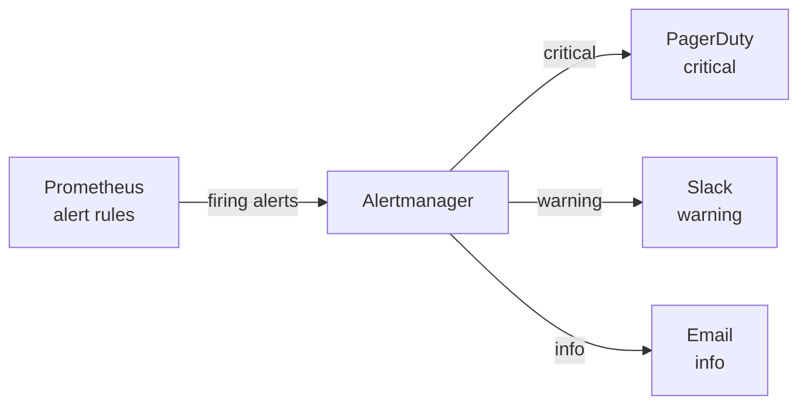

# 17.6 Alerting, SLOs and health checks for GPU clusters

| Field | Value |
|---|---|
| Level | Advanced |
| Priority tier | 2 |
| Lab venue | GCP / GKE |
| Part | Part 17: Observability, performance and operations |
| Primary sources | NVIDIA Zero-to-Hero Volume 16 (`chapter-09-alerting-slos-and-health-checks.md`); NVIDIA Zero-to-Hero Volume 10 (`chapter-09-on-call-and-runbooks.md`); *Production Kubernetes* (`production-kubernetes`, Chapters 9, 14) |
| Cross-references | Chapter 17.2 (Prometheus and Grafana); Chapter 17.4 (DCGM exporter); Chapter 17.5 (Distributed observability and profiling); Chapter 16.14 (Platform design: SLOs) |
| Coverage file | `planning/coverage/chapters/17-06.md` |
| Claim & number ledger | `planning/ledgers/17-06.md` |

## Why this matters for AI infrastructure

Every chapter in this part so far has been about collecting the signal. This chapter is about acting on the signal. Alerting is what turns metrics and traces into on-call pages. SLOs are what turn operational metrics into business contracts. Health checks are what turn Kubernetes into a system that knows whether the workload is alive.

An AI factory without alerting is an AI factory where the on-call finds out about failures from the customer. An AI factory without SLOs is an AI factory where the on-call does not know which alerts are business-critical. An AI factory without health checks is an AI factory where Kubernetes keeps restarting pods that are not actually serving traffic.

```text
Why alerting + SLOs + health checks is on the critical path (V16 ch9; PK Ch 9, 14):
- A typical mature AI platform emits 50-200 alerts per day. Without SLO-based
  routing, the on-call ignores all of them. With SLO-based routing, the on-call
  responds to the 5-10 alerts that matter.
- A typical GPU cluster has 8-16 health checks per workload. Without the
  health checks, Kubernetes cannot tell whether the workload is alive; the
  readiness probe fails; the workload is removed from the load balancer.
- The error budget is the bridge between the engineering team and the business.
  The error budget says "we can afford 43 minutes of downtime per month". The
  error budget is what the SLO alert burns against.
```

Three operational realities make this chapter a platform-team concern rather than a data-science-only concern:

1. **The alert routing is a platform-team decision.** Every alert has a severity; every severity has a routing; every routing has an on-call. The platform team owns the alert routing; the platform team owns the on-call rotation.
2. **The SLOs are the contract between engineering and the business.** The business agrees that 99.9% availability is acceptable; the engineering team agrees that 99.9% availability is achievable. The platform team owns the SLOs.
3. **The health checks are the Kubernetes primitive that keeps the workload alive.** A readiness probe that fails removes the workload from the load balancer; a liveness probe that fails restarts the workload. The platform team owns the health check templates.

**Before a team can run an AI workload on a GPU cluster, the workload must have health checks, the cluster must have SLOs, and the platform must have alert routing. A cluster without alerting is a cluster where the on-call is reactive; a cluster with alerting is a cluster where the on-call is proactive.**

## Prerequisites and outcomes

### Prerequisites

- Chapter 17.2 (Prometheus and Grafana) for the metrics stack and Alertmanager.
- Chapter 17.4 (DCGM exporter) for the GPU-specific alerts.
- Chapter 16.14 (Platform design) for the SLO-based platform design.

### Outcomes

After completing this chapter you will be able to:

1. Specify the SLOs for an AI factory: availability, latency, throughput, and model quality.
2. Configure Alertmanager routing rules: severity-based routing, on-call rotation, escalation policy.
3. Implement Kubernetes health checks for AI workloads: readiness probe, liveness probe, startup probe.
4. Define the error budget: how much downtime the SLO allows per month, how the alert burns against the budget.
5. Build the on-call runbook: what to do when each alert fires.
6. Operate the alerting and SLO stack on GKE with reliable alerting, sensible escalation, and a runbook.

---

## 1. The SLOs

### 1.1 What an SLO is

A Service Level Objective (SLO) is the target that the platform team commits to meet. An SLO has three components: a Service Level Indicator (SLI), a target, and a time window.

| Component | Example |
|---|---|
| **SLI** | The metric that measures the SLO |
| **Target** | The threshold that the SLI must meet |
| **Time window** | The period over which the SLI is measured |

The pattern is: define the SLI; define the target; define the time window; the alert fires when the SLI breaches the target for more than the time window.

### 1.2 The SLOs for an AI factory

The AI factory has SLOs at three layers: the cluster, the team, and the customer.

| Layer | SLO | SLI | Target | Window |
|---|---|---|---|---|
| **Cluster** | Cluster availability | Uptime of the cluster | 99.9% | Monthly |
| **Cluster** | GPU pool availability | Uptime of the GPU pool | 99.5% | Monthly |
| **Cluster** | Registry availability | Uptime of the model registry | 99.95% | Monthly |
| **Team** | Inference latency p99 | p99 inference latency | < 300 ms | Monthly |
| **Team** | Inference availability | Uptime of the InferenceService | 99.9% | Monthly |
| **Team** | Training throughput | Training samples per second | > 1000 samples/sec | Per run |
| **Customer** | End-to-end latency p99 | p99 latency from request to response | < 500 ms | Monthly |
| **Customer** | End-to-end availability | Uptime of the customer-facing service | 99.9% | Monthly |

The pattern is: the cluster SLOs are the platform team's contract; the team SLOs are the team's contract; the customer SLOs are the business's contract. The SLOs compose; the customer SLO depends on the team SLO depends on the cluster SLO.

### 1.3 The error budget

The error budget is the team's SLO translated into a budget. The team can spend the budget on canary deployments, on chaos engineering, on rolling upgrades. When the budget is exhausted, the team pauses new deployments until the next billing cycle.

```text
Error budget at 99.9% monthly availability:
- Total time per month: 30 days * 24 hours * 60 minutes = 43,200 minutes
- Budget: 0.1% * 43,200 = 43.2 minutes of downtime per month
- Burn rate at 1x: 43.2 minutes / 30 days = 1.44 minutes per day
- Burn rate at 2x: 2.88 minutes per day (alert)
- Burn rate at 10x: 14.4 minutes per day (page on-call)
```

The pattern is: the error budget is the cost of unreliability; the team spends the budget on improvement; when the budget is exhausted, the team pauses. The error budget is the bridge between the engineering team and the business.

---

## 2. Alertmanager

### 2.1 The Alertmanager architecture

Alertmanager is the alert router that receives alerts from Prometheus, deduplicates them, groups them, and routes them to the right receiver.



The pattern is: Prometheus evaluates the alert rules; Prometheus fires the alerts to Alertmanager; Alertmanager deduplicates, groups, and routes the alerts; Alertmanager sends the alerts to the receivers (PagerDuty, Slack, Email).

### 2.2 The alert routing

The alert routing is a YAML file that declares which alerts go to which receivers.

```yaml
# code/part17/alertmanager.yaml (shape only)
route:
  receiver: 'default-receiver'
  group_by: ['alertname', 'cluster', 'service']
  group_wait: 30s
  group_interval: 5m
  repeat_interval: 4h
  routes:
    - matchers:
        - severity="critical"
      receiver: 'pagerduty-critical'
      group_wait: 10s
      repeat_interval: 1h
    - matchers:
        - severity="warning"
      receiver: 'slack-warnings'
      repeat_interval: 12h
    - matchers:
        - severity="info"
      receiver: 'email-info'
      repeat_interval: 24h

receivers:
  - name: 'default-receiver'
    webhook_configs:
      - url: 'http://alertmanager-webhook/health'
  - name: 'pagerduty-critical'
    pagerduty_configs:
      - service_key: '<pagerduty-integration-key>'
      description: '{{ .CommonAnnotations.summary }}'
  - name: 'slack-warnings'
    slack_configs:
      - api_url: '<slack-webhook-url>'
      channel: '#ai-factory-warnings'
  - name: 'email-info'
    email_configs:
      - to: 'platform-team@example.com'
      from: 'alertmanager@example.com'
```

The pattern is: critical alerts go to PagerDuty (with 1-hour repeat); warning alerts go to Slack (with 12-hour repeat); info alerts go to Email (with 24-hour repeat). The repeat interval prevents alert storms; the group interval prevents duplicate pages.

### 2.3 The alert inhibition

The alert inhibition prevents one alert from suppressing another. The pattern is: if a cluster is down, the per-workload alerts are inhibited.

```yaml
# code/part17/inhibit_rules.yaml (shape only)
inhibit_rules:
  - source_matchers:
      - alertname="ClusterDown"
    target_matchers:
      - severity!="critical"
    equal: ['cluster']
  - source_matchers:
      - alertname="GPUNodeDown"
    target_matchers:
      - alertname="GPUXidError"
    equal: ['gpu', 'node']
```

The pattern is: when the cluster is down, the per-workload alerts are inhibited; when the GPU node is down, the GPU Xid alerts are inhibited. The inhibit rules reduce alert noise; the on-call sees the most important alert first.

---

## 3. Health checks

### 3.1 The Kubernetes health check primitives

Kubernetes has three health check primitives: the readiness probe, the liveness probe, and the startup probe.

| Probe | What it does | When it fires |
|---|---|---|
| **Readiness probe** | Is the workload ready to serve traffic? | Removes the workload from the load balancer |
| **Liveness probe** | Is the workload alive? | Restarts the workload |
| **Startup probe** | Is the workload starting up? | Disables the liveness probe until the startup is complete |

The pattern is: readiness probe checks "can the workload serve traffic"; liveness probe checks "is the workload alive"; startup probe checks "is the workload starting up". A workload that is alive but not ready is removed from the load balancer; a workload that is not alive is restarted.

### 3.2 Health checks for AI workloads

An AI workload's health check is more than "is the process alive". The health check must verify that the workload can serve traffic.

```yaml
# code/part17/health_checks.yaml (shape only)
livenessProbe:
  httpGet:
    path: /health/live
    port: 8080
  initialDelaySeconds: 30
  periodSeconds: 10
  timeoutSeconds: 3
  failureThreshold: 3

readinessProbe:
  httpGet:
    path: /health/ready
    port: 8080
  initialDelaySeconds: 10
  periodSeconds: 5
  timeoutSeconds: 3
  failureThreshold: 3

startupProbe:
  httpGet:
    path: /health/startup
    port: 8080
  periodSeconds: 5
  timeoutSeconds: 3
  failureThreshold: 30

lifecycle:
  preStop:
    exec:
      command: ["/bin/sh", "-c", "sleep 10"]
```

The pattern is: the liveness probe checks "is the process alive"; the readiness probe checks "is the model loaded and the inference engine ready"; the startup probe checks "is the model being loaded". The preStop hook gives the workload time to drain in-flight requests before Kubernetes sends SIGTERM.

### 3.3 Health checks for GPU nodes

A GPU node's health check is a separate concern. The health check verifies that the GPU driver is loaded, that DCGM is running, that the GPU is responsive.

```bash
# Health check script for a GPU node
#!/bin/bash
# Check that DCGM is running
systemctl is-active nvidia-dcgm || exit 1
# Check that the GPU is responsive
nvidia-smi -q -d UTILIZATION | grep -q "GPU" || exit 1
# Check that the DCGM exporter is running
systemctl is-active dcgm-exporter || exit 1
exit 0
```

The pattern is: the health check script verifies the DCGM daemon, the GPU driver, and the DCGM exporter. The script runs as a Kubernetes liveness probe on the GPU node; the script's exit code determines the node's health.

---

## 4. The on-call runbook

### 4.1 What the runbook contains

The runbook is the on-call engineer's guide for every alert. The runbook has six sections per alert: what the alert means, what the symptoms are, what the diagnostic steps are, what the mitigation steps are, what the escalation path is, and what the post-mortem template is.

| Section | What it contains |
|---|---|
| **What the alert means** | A one-paragraph explanation of the alert |
| **Symptoms** | The user-facing symptoms that the alert detects |
| **Diagnostic steps** | The commands to run to confirm the alert |
| **Mitigation steps** | The commands to run to fix the alert |
| **Escalation path** | Who to page if the mitigation fails |
| **Post-mortem template** | The template for the post-mortem document |

The pattern is: every alert has a runbook; the runbook is the on-call engineer's guide; the runbook is the bridge between the alert and the recovery.

### 4.2 The runbook template

```markdown
# Alert: GPUMemoryPressure

## What the alert means
The GPU's HBM utilisation has exceeded 90% for more than 5 minutes. The workload is at risk of CUDA OOM; the next training step may crash.

## Symptoms
- The GPU's HBM utilisation is above 90%
- The workload's training step is taking longer than expected
- The CUDA OOM error appears in the workload's logs

## Diagnostic steps
1. Verify the GPU's HBM utilisation: `kubectl exec -it <pod> -- nvidia-smi`
2. Check the workload's memory usage: `kubectl top pod <pod>`
3. Check the workload's logs for CUDA OOM: `kubectl logs <pod> | grep OOM`

## Mitigation steps
1. Reduce the model size
2. Enable gradient checkpointing
3. Increase the GPU's HBM by moving to a larger GPU
4. Reduce the batch size

## Escalation path
If the mitigation fails within 30 minutes, page the ML platform team.

## Post-mortem template
- What was the alert?
- What was the root cause?
- What was the impact (downtime, customer-facing)?
- What was the mitigation?
- What is the prevention (alert tuning, code change, hardware change)?
```

The pattern is: the runbook is the on-call engineer's guide; the runbook is the bridge between the alert and the recovery; the runbook is updated after every incident.

### 4.3 The runbook integration with Alertmanager

The runbook is integrated with Alertmanager via the `runbook_url` annotation.

```yaml
- alert: GPUMemoryPressure
  expr: DCGM_FI_DEV_FB_USED / DCGM_FI_DEV_FB_TOTAL > 0.9
  for: 5m
  labels:
    severity: warning
  annotations:
    summary: "GPU {{ $labels.gpu }} on {{ $labels.node }} is under memory pressure"
    runbook_url: "https://wiki.example.com/runbooks/gpu-memory-pressure"
```

The pattern is: every alert has a runbook URL; the on-call clicks the URL; the on-call sees the runbook. The runbook URL is the bridge between the alert and the recovery.

---

## 5. Operating the alerting and SLO stack on GKE

### 5.1 The components

| Component | Where it runs | Backing store | SLO |
|---|---|---|---|
| Alertmanager | Kubernetes Deployment, 2 replicas (HA) | (sends to PagerDuty) | Alert latency p99 < 10 s |
| Prometheus alert rules | (in Prometheus server) | TSDB | Alert evaluation latency p99 < 30 s |
| PagerDuty integration | Managed service | (PagerDuty) | Page latency p99 < 30 s |
| Runbook repository | Git repo | Git history | Runbook freshness p99 < 1 day |

### 5.2 IAM and the alert routing

The alerting stack has its own IAM. The pattern is:

| Role | Who | What they can do |
|---|---|---|
| `alertmanager.reader` | Every team's on-call | View alerts; view runbooks |
| `alertmanager.writer` | Prometheus | Fire alerts to Alertmanager |
| `alertmanager.admin` | The platform team | Manage the alert routing; manage the inhibit rules |

The alert routing is the platform team's discipline. Every alert has a severity; every severity has a routing; every routing has an on-call.

### 5.3 Observability

| Metric | Why it matters | Alert |
|---|---|---|
| Alertmanager latency p99 | Hot path for every alert | > 30 s |
| Alert firing rate | Alert volume | > 200 per day |
| Page delivery latency p99 | Hot path for every critical alert | > 60 s |
| Runbook freshness | Runbook accuracy | > 30 days since last update |
| SLO compliance per service | Customer-facing contract | < target for 1 hour |

The SLO compliance per service alert is the most important. A team whose SLO compliance is below the target for more than 1 hour has burned the error budget; the team must pause new deployments.

---

## 6. How it fails

Six failure modes recur.

### 6.1 "The on-call is paged for every alert"

**Symptom:** The on-call receives 200 pages per day; the on-call cannot respond to all of them; the on-call ignores the alerts.

**Diagnosis:** The alert routing is too aggressive; the alerts are not grouped; the alerts are not inhibited; the severity labels are wrong.

**Fix:** Tune the alert routing; group the alerts by cluster and service; add inhibit rules; review the severity labels; alert only on alerts that the on-call can act on.

### 6.2 "The critical alert is not paged"

**Symptom:** The cluster is down; the on-call does not know; the customer complains first.

**Diagnosis:** The critical alert is misconfigured; the alert is inhibited by another alert; the alert routing is wrong; the PagerDuty integration is broken.

**Fix:** Verify the critical alert fires when the cluster is down; verify the alert is not inhibited; verify the PagerDuty integration is healthy; add an integration test.

### 6.3 "The SLO is breached but the alert does not fire"

**Symptom:** The SLO is breached; the dashboard shows the breach; the alert does not fire.

**Diagnosis:** The alert rule has a typo in the PromQL; the alert rule is for the wrong SLI; the alert rule has the wrong time window.

**Fix:** Verify the alert rule; verify the SLI matches the SLO; verify the time window matches the SLO; add an integration test.

### 6.4 "The readiness probe fails and Kubernetes restarts the pod in a loop"

**Symptom:** The workload's readiness probe fails repeatedly; Kubernetes restarts the pod; the workload never serves traffic.

**Diagnosis:** The readiness probe is too aggressive; the readiness probe checks a dependency that is not yet ready; the readiness probe's timeout is too short.

**Fix:** Increase the readiness probe's initial delay; increase the timeout; check the dependency before the readiness probe; use a startup probe to disable the readiness probe until the dependency is ready.

### 6.5 "The error budget is exhausted but the team does not know"

**Symptom:** The error budget is exhausted; the team continues to deploy; the customer experiences an outage.

**Diagnosis:** The error budget alert is not configured; the team is not tracking the error budget; the budget is exhausted silently.

**Fix:** Add an error budget alert; track the budget on the team's dashboard; pause new deployments when the budget is exhausted; the alert fires before the budget is exhausted (e.g. at 75%).

### 6.6 "The runbook is out of date"

**Symptom:** The on-call follows the runbook; the runbook's mitigation does not work; the incident escalates.

**Diagnosis:** The runbook was not updated after the last incident; the mitigation has changed; the escalation path has changed.

**Fix:** Update the runbook after every incident; review the runbook quarterly; automate the runbook freshness check.

---

## 7. Hands-on lab

This lab stands up Alertmanager on GKE, configures the alert routing, and verifies the on-call runbook integration. The lab is **untested** in this repository.

### 7.1 Prerequisites

- A GKE Autopilot or Standard cluster (1.27+).
- Helm 3 for installing Alertmanager.
- Prometheus installed (Chapter 17.2).

### 7.2 Step 1: install Alertmanager

```bash
helm repo add prometheus-community https://prometheus-community.github.io/helm-charts
helm install alertmanager prometheus-community/alertmanager \
  --namespace monitoring --create-namespace \
  --set alertmanager.config.global.resolve_timeout=5m
# expected: Alertmanager pods are running
```

### 7.3 Step 2: configure the alert routing

```bash
kubectl -n monitoring create secret generic alertmanager-config \
  --from-file=configs/alertmanager.yaml

kubectl -n monitoring create configmap alertmanager-routes \
  --from-file=configs/inhibit_rules.yaml

# Reload Alertmanager
kubectl -n monitoring rollout restart deployment alertmanager
# expected: Alertmanager picks up the new configuration
```

### 7.4 Step 3: configure the runbook URLs

```bash
# Add the runbook URL to the alert rule
kubectl -n monitoring create configmap alert-rules \
  --from-file=configs/gpu_alerts.yaml

# Reload Prometheus
curl -X POST http://prometheus.monitoring:9090/-/reload
# expected: the alert rules are updated with runbook URLs
```

### 7.5 Step 4: simulate a critical alert

```bash
# Inject a synthetic critical alert
curl -X POST http://prometheus.monitoring:9090/api/v1/admin/tsdb \
  -H "Content-Type: application/json" \
  -d '{"name": "alert_test"}'
# expected: the alert fires; Alertmanager routes the alert
```

### 7.6 Step 5: verify the alert routing

```bash
# Query Alertmanager
kubectl -n monitoring port-forward svc/alertmanager-operated 9093:9093 &
curl -s http://localhost:9093/api/v2/alerts | jq .
# expected: the critical alert is routed to the pagerduty-critical receiver
```

### 7.7 Step 6: verify the error budget

```bash
# Query the error budget
curl -s 'http://prometheus.monitoring:9090/api/v1/query?query=cluster_availability_budget_remaining' | jq .
# expected: the remaining error budget for the current month
```

### 7.8 What to record

After the lab, you should be able to answer five questions in five seconds each:

1. What is the current Alertmanager latency p99?
2. What is the current alert firing rate?
3. What is the current error budget remaining?
4. What is the current SLO compliance per service?
5. What is the most recent critical alert, and what was the runbook URL?

If any takes more than 30 seconds, the alerting and SLO stack is not yet a production service. The lab is **untested** against a live GKE cluster.

---

## Exercises

1. **Add a new alert for a GPU Xid error.** Configure an alert that fires when a GPU Xid error is detected; add the runbook URL; verify the alert fires. *Solution sketch:* a Prometheus alert rule on the DCGM_FI_DEV_XID_ERRORS metric; the runbook URL annotation.
2. **Add an inhibit rule for cluster down.** Add an inhibit rule that suppresses per-workload alerts when the cluster is down. *Solution sketch:* an Alertmanager inhibit rule that matches ClusterDown and target per-workload alerts.
3. **Add an error budget dashboard.** Build a Grafana dashboard that shows the error budget remaining per service. *Solution sketch:* a Prometheus recording rule that computes the budget remaining; a Grafana dashboard; the panels.
4. **Add a runbook freshness check.** Configure a Prometheus alert that fires when a runbook has not been updated in 30 days. *Solution sketch:* a CI step that records the last update time; a Prometheus alert that compares the last update time to the current time.
5. **Add a readiness probe template.** Build a Kubernetes template that includes the readiness, liveness, and startup probes for an AI workload. *Solution sketch:* a Helm template or Kustomize patch; the probes; the preStop hook.
6. **Add an SLO-based alert routing.** Configure Alertmanager to route alerts based on the SLO they affect. *Solution sketch:* Alertmanager matchers that match the SLO label; the routing; the receivers.

---

## Checkpoint questions

<details><summary>1. What is an SLO?</summary>
A Service Level Objective: the target that the platform team commits to meet. An SLO has three components: a Service Level Indicator (SLI), a target, and a time window. The pattern is: define the SLI; define the target; define the time window; the alert fires when the SLI breaches the target for more than the time window.
</details>

<details><summary>2. What is the error budget?</summary>
The team's SLO translated into a budget. At 99.9% monthly availability, the budget is 43.2 minutes of downtime per month. The team can spend the budget on canary deployments, on chaos engineering, on rolling upgrades. When the budget is exhausted, the team pauses new deployments.
</details>

<details><summary>3. What three Kubernetes health check primitives exist?</summary>
Readiness probe (is the workload ready to serve traffic; removes from load balancer), liveness probe (is the workload alive; restarts the workload), startup probe (is the workload starting up; disables the liveness probe until startup is complete). The pattern is: readiness checks "can serve"; liveness checks "is alive"; startup checks "is starting".
</details>

<details><summary>4. What does Alertmanager do?</summary>
Routes alerts from Prometheus. Alertmanager deduplicates alerts (the same alert from multiple sources is one alert), groups alerts (related alerts are in one notification), and routes alerts to the right receivers (PagerDuty for critical, Slack for warning, Email for info).
</details>

<details><summary>5. What is alert inhibition?</summary>
A rule that prevents one alert from suppressing another. When the cluster is down, the per-workload alerts are inhibited; when the GPU node is down, the GPU Xid alerts are inhibited. The pattern is: the inhibit rule reduces alert noise; the on-call sees the most important alert first.
</details>

<details><summary>6. What is the runbook?</summary>
The on-call engineer's guide for every alert. The runbook has six sections per alert: what the alert means, symptoms, diagnostic steps, mitigation steps, escalation path, post-mortem template. Every alert has a runbook; the runbook is integrated with Alertmanager via the runbook_url annotation.
</details>

<details><summary>7. What is the burn rate?</summary>
The rate at which the error budget is being consumed. At 1x burn rate, the budget is consumed at the expected rate; at 2x burn rate, the budget is consumed twice as fast (alert); at 10x burn rate, the budget is consumed ten times as fast (page on-call). The platform team's pattern is: alert at 2x burn rate for 1 hour; page at 10x burn rate for 5 minutes.
</details>

<details><summary>8. What is the difference between readiness probe and liveness probe?</summary>
Readiness probe checks "is the workload ready to serve traffic" (e.g. is the model loaded). Liveness probe checks "is the workload alive" (e.g. is the process responsive). Readiness failure removes from load balancer; liveness failure restarts the workload.
</details>

<details><summary>9. What is the difference between readiness probe and startup probe?</summary>
Readiness probe runs after the startup probe completes; startup probe runs first. Startup probe disables the liveness probe until the workload is started; readiness probe is enabled after startup. The pattern is: startup probe for slow-starting workloads (model loading takes minutes); readiness probe for steady-state traffic.
</details>

<details><summary>10. What is the difference between a critical alert and a warning alert?</summary>
Critical alerts page the on-call immediately (PagerDuty with 1-hour repeat). Warning alerts notify the team (Slack with 12-hour repeat). The pattern is: critical alerts are paged when the SLO is breached; warning alerts are posted when the SLO is at risk.
</details>

<details><summary>11. What is the most common alerting failure mode?</summary>
The on-call is paged for every alert (200 pages per day). The on-call cannot respond to all of them; the on-call ignores the alerts. The fix is to tune the alert routing; group the alerts; add inhibit rules; review the severity labels; alert only on alerts that the on-call can act on.
</details>

<details><summary>12. What is the most common health check failure mode?</summary>
The readiness probe fails and Kubernetes restarts the pod in a loop. The workload never serves traffic. The fix is to increase the readiness probe's initial delay; increase the timeout; check the dependency before the readiness probe; use a startup probe.
</details>

<details><summary>13. What is the preStop hook?</summary>
A Kubernetes lifecycle hook that runs before the pod is terminated. The preStop hook gives the workload time to drain in-flight requests before Kubernetes sends SIGTERM. The pattern is: sleep 10 seconds in the preStop hook; the workload drains the requests; the pod terminates.
</details>

<details><summary>14. What is the alert severity hierarchy?</summary>
Critical (page the on-call immediately), Warning (notify the team; do not page), Info (log only; do not notify). The pattern is: critical for SLO-breaching alerts; warning for SLO-at-risk alerts; info for informational alerts.
</details>

<details><summary>15. What is the SLO composition pattern?</summary>
The cluster SLOs are the foundation; the team SLOs depend on the cluster SLOs; the customer SLOs depend on the team SLOs. The pattern is: the customer SLO is achievable only if the team SLO is achievable, which is achievable only if the cluster SLO is achievable. The SLOs compose.
</details>

<details><summary>16. Why is the alert routing a platform-team discipline?</summary>
Because every alert has a severity; every severity has a routing; every routing has an on-call. The platform team owns the alert routing; the platform team owns the on-call rotation. A team that has a broken alert routing is a team where the on-call is paged at the wrong moment or stays silent when the cluster is down.
</details>

<details><summary>17. What is the difference between a probe failure and an SLO breach?</summary>
A probe failure is a Kubernetes-level event (the pod is removed from the load balancer or restarted). An SLO breach is a customer-facing event (the cluster is not meeting the SLO). A probe failure can lead to an SLO breach if it is not handled quickly.
</details>

<details><summary>18. What is the error budget's role in deployment velocity?</summary>
The error budget is the cost of unreliability. The team spends the budget on improvement (canary deployments, chaos engineering, rolling upgrades). When the budget is exhausted, the team pauses new deployments. The error budget is the bridge between reliability and velocity; the team that has no budget has no velocity.
</details>

<details><summary>19. Why is the runbook URL annotation important?</summary>
Because the on-call clicks the URL in the PagerDuty alert; the on-call sees the runbook; the on-call follows the runbook; the on-call mitigates the alert. The runbook URL is the bridge between the alert and the recovery. A runbook URL that is missing is an alert that the on-call cannot mitigate.
</details>

<details><summary>20. What five questions should the alerting and SLO lab let you answer in five seconds each?</summary>
What is the current Alertmanager latency p99. What is the current alert firing rate. What is the current error budget remaining. What is the current SLO compliance per service. What is the most recent critical alert and what was the runbook URL. If any takes more than 30 seconds, the alerting and SLO stack is not yet a production service.
</details>

---

## Sources and review notes

- NVIDIA Zero-to-Hero Volume 16 (`chapter-09-alerting-slos-and-health-checks.md`). Source for the Alertmanager configuration, the SLO patterns, the health check templates, and the runbook integration. The wording has been rewritten in the handbook's voice.
- *Practical MLOps* (`practical-mlops`, Chapter 6, Monitoring and Logging). Source for the monitoring and logging patterns that bridge MLOps and operations, and for the framing of monitoring as a first-class MLOps discipline.
- NVIDIA Zero-to-Hero Volume 10 (`chapter-09-on-call-and-runbooks.md`). Source for the on-call runbook patterns, the escalation policy, and the post-mortem template.
- *Production Kubernetes* (`production-kubernetes`, Chapters 9, 14). Source for the Alertmanager patterns, the probe primitives, and the operational discipline.

### Cross-references to other handbook chapters

- Chapter 17.2 for the Prometheus and Alertmanager integration.
- Chapter 17.4 for the GPU-specific alerts.
- Chapter 17.5 for the profiling integration.
- Chapter 16.14 for the SLO-based platform design.

### Migrated from `nvidia-devops`

The alerting and SLO operational patterns draw on Volume 16 chapter 9 and Volume 10 chapter 9. The wording has been rewritten in the handbook's voice.

### Explicitly labelled inferences

- The SLO targets in Section 1.2 are starting points; specific targets depend on the use case and the business's tolerance.
- The burn rate thresholds in Section 1.3 are starting points; specific thresholds depend on the workload.
- The alert routing in Section 2.2 is a starting point; specific routing depends on the on-call rotation and the escalation policy.

### Not verified on live hardware

- The lab in Section 7 is **untested** against a live GKE cluster in this repository.
- The Alertmanager and Prometheus versions assumed in the lab should be pinned against the current releases before production use.
- The PagerDuty and Slack integrations in the lab require production credentials that are not provided in the lab.
